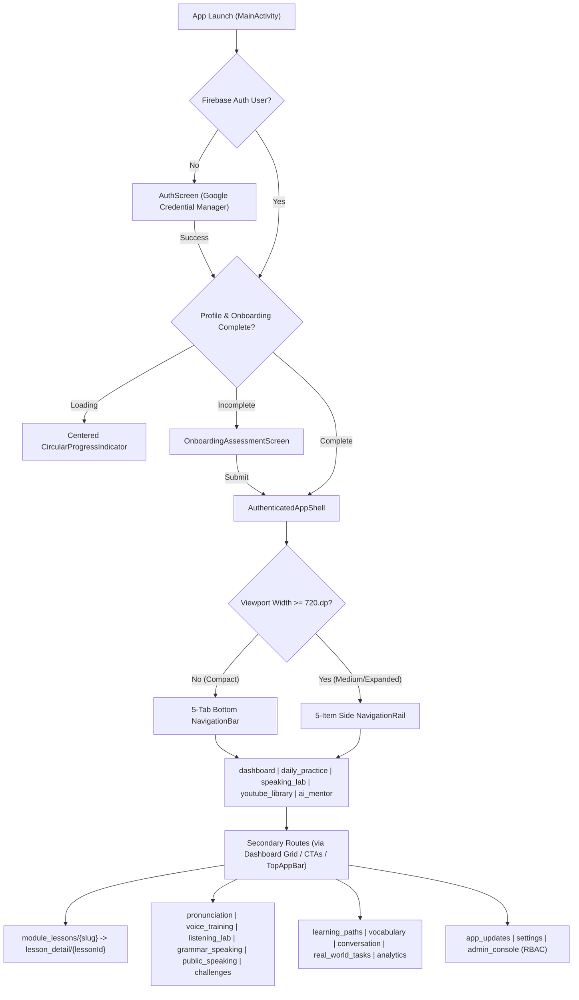

# 01 — UI and UX Design Documentation

**Revision Date:** 2026-11-18  
**Product:** SpeakCraft — AI Communication Skills Coach (`@askvinh` curriculum)  
**Current Implementation Status:** Native Android (Kotlin + Jetpack Compose + Material Design 3). Target Electron + React (Windows Desktop & Web) UI is **Not Implemented / Proposed**.  
**Audit Scope:** Read-only inspection of `/app/src/main/java/com/example/ui/...`, `/app/src/main/res/...`, and `/app/src/main/AndroidManifest.xml`.

---

## Table of Contents

1. [Executive Platform Alignment & Assumptions](#executive-platform-alignment--assumptions)
2. [Existing Application Design Overview (Items 1–2)](#existing-application-design-overview)
3. [UI Component & Screen Inventory (Items 3–4)](#ui-component--screen-inventory)
4. [Navigation Architecture & Sidebar/Rail Behavior (Items 5–6)](#navigation-architecture--sidebarrail-behavior)
5. [Screen-by-Screen UX Audit (Items 7–18)](#screen-by-screen-ux-audit)
6. [Design System, Theming, Typography, Colors & Spacing (Items 19–28)](#design-system-theming-typography-colors--spacing)
7. [Responsive, Desktop & Web Experience Audit (Items 29–32)](#responsive-desktop--web-experience-audit)
8. [UI States & Interaction Patterns (Items 33–36)](#ui-states--interaction-patterns)
9. [Identified UI/UX Defects & Inconsistencies](#identified-uiux-defects--inconsistencies)
10. [Redesigned UI/UX Recommendation & Multi-Platform Blueprint](#redesigned-uiux-recommendation--multi-platform-blueprint)
11. [Cross-References & Open Questions](#cross-references--open-questions)

---

## Executive Platform Alignment & Assumptions

### Verified Implementation vs. Prompt Context
* **Verified Fact:** The repository currently implements **SpeakCraft exclusively as a native Android application** (`minSdk = 24`, `targetSdk = 36`, `applicationId = "com.aistudio.speakcraft.qxmvkp"`) built with **Jetpack Compose**, **Material 3**, **Navigation Compose (`2.8.9`)**, and **Firebase SDKs**.
* **Platform Gap (`ISS-024`):** No Electron main/preload scripts, React components, CSS/Tailwind stylesheets, HTML entrypoints, or browser routing exist in this codebase.
* **Documentation Approach:** Every "Current State" section below documents the verified Jetpack Compose UI as implemented on disk. All Windows Desktop (Electron) and Web (React) specifications are explicitly marked **Proposed** as a parity blueprint.

---

## Existing Application Design Overview

### 1. Design Overview
SpeakCraft adopts an **"Editorial Studio"** visual language pairing high-contrast ink tones (`MidnightNavy`, `WarmIvory`) with broadcast-inspired accents (`AmberSpotlight`, `AcousticTeal`). The interface emphasizes evidence-based coaching: separating creator frameworks (`@askvinh`) from AI supplements (`LessonAttributionBadge`), separating objective speech metrics from subjective self-confidence ratings (`AnalyticsScreen`), and providing dedicated practice studios for recording, shadowing, pronunciation, vocabulary, conversation roleplay, and structured multi-day plans.

### 2. Design Architecture
* **UI Paradigm:** Declarative single-activity Jetpack Compose (`MainActivity.kt` -> `SpeakCraftRoot()`).
* **Edge-to-Edge:** `enableEdgeToEdge()` is invoked in `MainActivity.kt` before `setContent`, with `Scaffold(snackbarHost, topBar, bottomBar)` managing `innerPadding` insets.
* **State Binding:** Unidirectional data flow via Kotlin `StateFlow` exposed from four ViewModels (`MainCoachViewModel`, `SpeakingAndLabsViewModel`, `InteractiveCoachViewModel`, `UpdateAndAdminViewModel`) and collected with `collectAsStateWithLifecycle()`.
* **Theming Architecture:** Centralized Material 3 `SpeakCraftTheme` in `ui/theme/Theme.kt`, `Color.kt`, and `Type.kt` with user-selectable `SYSTEM`, `LIGHT`, and `DARK` modes persisted in Jetpack DataStore (`AppPreferencesRepository`).
* **Bundled Visual Assets:** Custom adaptive launcher icon plus generated raster artwork in `res/drawable/` (`img_onboarding_stage`, `img_mentor_avatar`, etc.) and Material Symbols Extended (`material-icons-extended`).

---

## UI Component & Screen Inventory

### 3. UI Component Inventory (`ui/components/CoachComponents.kt` & Media Helpers)

| Component | Location | Responsibility | Implementation Status |
| :--- | :--- | :--- | :--- |
| `SectionHeader` | `CoachComponents.kt:73` | Section title, optional subtitle, optional trailing `TextButton` | Implemented |
| `MetricTile` | `CoachComponents.kt:108` | KPI card (`label`, `value`, `delta`, `accentColor`, `tonalElevation = 2.dp`) | Implemented |
| `LiveWaveformVisualizer` | `CoachComponents.kt:147` | 30-bar `Canvas` animated audio meter reacting to `amplitude`, `isRecording`, `isPaused` | Implemented |
| `ScoreTrendSparkline` | `CoachComponents.kt:207` | `Canvas` line + vertical gradient fill chart for score history | Implemented |
| `SkillBreakdownBars` | `CoachComponents.kt:261` | Vertical list of skill label, `score / 100`, and `LinearProgressIndicator` | Implemented |
| `LessonAttributionBadge` | `CoachComponents.kt:291` | Pill badge distinguishing `Creator Framework (@askvinh)`, `AI Coaching Supplement`, or `Pending Transcript Verification` | Implemented |
| `UpdateBannerCard` | `CoachComponents.kt:322` | Dismissible (or pinned if `mandatory`) release availability banner | Implemented |
| `ShimmerSkeletonCard` | `CoachComponents.kt:367` | Animated alpha pulsing placeholder during async loading | Implemented |
| `EmptyStateCard` | `CoachComponents.kt:385` | Centered card with title, explanation, and optional CTA button | Implemented |
| `ErrorRecoveryCard` | `CoachComponents.kt:410` | `errorContainer` alert card with optional `"Try Again"` button | Implemented |
| `FeedbackReportCard` | `CoachComponents.kt:430` | Comprehensive AI speech diagnostic report (confidence badge, audio check, WPM/Composite tiles, withheld pronunciation notice, bars, transcript box, 5 bullet sections, next action) | Implemented |
| `FeedbackBulletSection` | `CoachComponents.kt:568` | Private helper rendering icon + tinted header + bullet list | Implemented |
| `InAppCameraVideoDialog` | `CameraVideoRecorder.kt` | Full-screen `Dialog` wrapping CameraX `PreviewView` + `VideoCapture<Recorder>` | Implemented |
| `AssessmentSlider` | `AuthAndOnboardingScreens.kt:284` | Labeled `Slider` for onboarding self-rating sliders | Implemented |
| `ModuleGrid` | `DashboardScreen.kt:376` | 2-column pseudo-grid (`items.chunked(2)`) of clickable module cards | Implemented |

### 4. Page and Screen Inventory (`ui/AppNavigation.kt` & `ui/screens/`)

| Route / Gate | Composable | File | Purpose | Status |
| :--- | :--- | :--- | :--- | :--- |
| Auth Gate | `AuthScreen` | `AuthAndOnboardingScreens.kt:53` | Google Sign-In via Credential Manager + silent auto-login | Implemented |
| Onboarding Gate | `OnboardingAssessmentScreen` | `AuthAndOnboardingScreens.kt:177` | Profile setup, level tier, daily goal, 7 baseline skill sliders | Implemented |
| `dashboard` | `DashboardScreen` | `DashboardScreen.kt` | Home overview, hero coaching card, metrics, sparkline, 15 modules + 7 utility tools | Implemented |
| `daily_practice` | `DailyPracticeScreen` | `DailyAndProgramsScreens.kt` | 9-step daily checklist, today's 3 words, reflection & confidence slider | Implemented |
| `learning_paths` | `LearningPathsScreen` | `DailyAndProgramsScreens.kt` | 30/60/90-day program enrollment & day-by-day completion chips | Implemented |
| `vocabulary` | `VocabularyScreen` | `VocabularyScreen.kt` | Spaced-repetition flashcards, TTS pronunciation, custom word modal/form, AI sentence check | Implemented |
| `speaking_lab` | `SpeakingLabScreen` | `SpeakingAndChallengesScreens.kt:76` | Mic pause/resume, CameraX video, Photo Picker (`<19MB`), 3-stage playback, AI report, past sessions | Partially implemented (`ISS-001`) |
| `challenges` | `ChallengesScreen` | `SpeakingAndChallengesScreens.kt:401` | Timed `DAILY` / `WEEKLY` speaking sprints with countdown & AI check | Implemented |
| `articulation_lab` / `pronunciation` | `PronunciationLabScreen` | `LabsAndTrainingScreens.kt:67` | Category-filtered IPA/minimal pairs/stress/linking drills, 0.75x/1.0x TTS, AI comparison | Implemented (duplicate route `ISS-018`) |
| `voice_training` | `VoiceTrainingLabScreen` | `LabsAndTrainingScreens.kt` / `LessonAndModulesScreens.kt` | 5 Vocal Foundations drills (Rate, Pauses, Melody, Volume, Character) | Implemented |
| `conversation` | `ConversationSimulatorScreen` | `ConversationAndMentorScreens.kt:69` | 13 roleplay scenarios, voice dictation + TTS partner replies, post-chat debrief | Implemented |
| `listening_lab` | `ListeningShadowingScreen` | `LabsAndTrainingScreens.kt:189` | `@askvinh` shadowing scripts with pause markers, target WPM, AI comparison | Implemented |
| `grammar_speaking` | `GrammarSpeakingScreen` | `LabsAndTrainingScreens.kt:296` | Spoken grammar & PREP/CLEAR thought organization drills | Implemented |
| `public_speaking` | `PublicSpeakingScreen` | `LabsAndTrainingScreens.kt:387` | Stage opening hooks, vocal modulation, presentation rehearsal & AI audit | Implemented |
| `real_world_tasks` | `RealWorldTasksScreen` | `LabsAndTrainingScreens.kt:476` | Real-world communication assignments with checkbox + reflection logging | Implemented |
| `module_lessons/{slug}` | `ModuleLessonsScreen` | `LessonAndModulesScreens.kt` | Filtered lessons belonging to one of the 15 curriculum modules | Implemented |
| `lesson_detail/{lessonId}` | `LessonDetailScreen` | `LessonAndModulesScreens.kt` | Interactive lesson viewer with video link, steps, practice prompt, completion & notes | Implemented |
| `youtube_library` | `YouTubeIntelligenceScreen` | `YouTubeIntelligenceScreen.kt:57` | URL ingestion bar, video audit horizontal strip, search & category/difficulty filter | Implemented |
| `analytics` | `AnalyticsScreen` | `AnalyticsAndSettingsScreens.kt:57` | Skill breakdown, sparkline, recurring mistakes, separate self-confidence card | Partially implemented (`ISS-018`) |
| `ai_mentor` | `AiMentorScreen` | `ConversationAndMentorScreens.kt:231` | Streaming personalized AI coach chat with 4 quick prompt chips | Implemented |
| `app_updates` | `AppUpdateScreen` | `AppUpdateScreen.kt:56` | Channel selector, SemVer release notes, SHA-256 download/verify, backup snapshots, audit log | Partially implemented (`ISS-017`) |
| `admin_console` | `AdminDashboardScreen` | `AdminDashboardScreen.kt:62` | RBAC-gated 4-tab admin studio (`YouTube Sync`, `Moderation`, `Releases`, `Telemetry`) | Implemented |
| `settings` | `SettingsScreen` | `AnalyticsAndSettingsScreens.kt:176` | Channel, backup, admin entry, theme mode, TTS speed, encrypted YouTube API key, sign out | Implemented |

---

## Navigation Architecture & Sidebar/Rail Behavior

### 5. Navigation Architecture
* **Root Gate (`SpeakCraftRoot`):** Observes `FirebaseAuth.authStateFlow()`. Unauthenticated users see `AuthScreen` exclusively. Authenticated users render `AuthenticatedAppShell` keyed by `user.uid` (`key(user.uid)`) so switching accounts resets ViewModel state cleanly.
* **Onboarding Gate (`AuthenticatedAppShell`):** Observes `userProfile`. While `UiState.Loading`, displays centered `CircularProgressIndicator`. If `profile == null || !profile.onboardingCompleted`, locks the user into `OnboardingAssessmentScreen` with no bottom bar or drawer.
* **Primary NavHost (`NavHost`, `startDestination = "dashboard"`):** Uses string-based route definitions in `AppNavigation.kt:410-597` (`"module_lessons/{slug}"`, `"lesson_detail/{lessonId}"`). Back stack management uses `popUpTo(findStartDestination()) { saveState = true }`, `launchSingleTop = true`, and `restoreState = true` for the 5 primary destinations.

### 6. Sidebar and Navigation Behavior
* **Responsive Switch (`AppNavigation.kt:347-409`):** `BoxWithConstraints` evaluates `val useRail = maxWidth >= 720.dp`.
  * `< 720.dp`: Renders `NavigationBar` at bottom with 5 items: **Home** (`dashboard`), **Daily** (`daily_practice`), **Record** (`speaking_lab`), **@askvinh** (`youtube_library`), **Mentor** (`ai_mentor`).
  * `>= 720.dp`: Omits `NavigationBar` and renders a persistent Material 3 `NavigationRail` on the leading edge of a `Row`.
* **TopAppBar Behavior (`AppNavigation.kt:352-380`):**
  * Shows dynamic `topBarTitle` resolved from `routeTitles` or dynamic catalog lookup for `module_lessons/{slug}` and `lesson_detail/{lessonId}`.
  * Shows Back arrow (`Icons.AutoMirrored.Filled.ArrowBack`) whenever `!isPrimaryRoute`.
  * Action icons: conditional Admin Console icon (`if (isAdmin)`), App Updates icon (with `BadgedBox` dot when `updateEvaluation.isUpdateAvailable`), and Settings icon.
* **Gap vs. Electron/Web:** There is **no collapsible desktop sidebar**, **no persistent multi-level navigation tree**, **no keyboard shortcut palette (`Ctrl+K`)**, and **no breadcrumb trail** on deep routes like `lesson_detail/{lessonId}`. Furthermore, routes like `analytics`, `vocabulary`, and `learning_paths` are only reachable via Dashboard cards (no persistent sidebar/rail shortcuts).

---

## Screen-by-Screen UX Audit

### 7. Dashboard Design (`DashboardScreen.kt`)
* **Layout:** Centered `LazyColumn` (`widthIn(max = 840.dp)`) with `16.dp` padding.
* **Blocks:**
  1. Conditional `UpdateBannerCard` (top priority when update available and not dismissed).
  2. Personalized Dark Hero Card (`MidnightNavy` container) displaying greeting, level, streak badge, and **Recommended Next Action** (`RecommendationEngine`) with primary CTA + `"Quick Record"` button.
  3. 2x2 KPI `MetricTile` grid: Practice Hours, Words Learned, Recordings, Today & Lessons.
  4. Conditional `"Latest Recording Review"` card showing WPM, prompt title, and 2-line summary.
  5. `"Pronunciation & Clarity Trend"` card with `Weekly` / `Monthly` `FilterChip`s and `ScoreTrendSparkline`.
  6. `"15 Communication Modules"` 2-column `ModuleGrid`.
  7. `"Intelligence, Analytics & System"` 2-column utility grid (`learning_paths`, `vocabulary`, `analytics`, `real_world_tasks`, `app_updates`, `settings`, plus conditional `admin_console`).
* **Critique:** The dashboard acts as a very long vertical launcher (~22 grid tiles + 5 summary cards). Two-column fixed grids (`chunked(2)`) underutilize horizontal space on wide desktop/tablet screens. Additionally, the `Weekly`/`Monthly` chips only mutate text labels without filtering session timestamps (`ISS-018`).

### 8. Authentication Screens (`AuthAndOnboardingScreens.kt:53-174`)
* **Design:** Centered `widthIn(max = 520.dp)` vertical column with `img_onboarding_stage` hero banner (`220.dp`), brand lockup (`RecordVoiceOver` icon + `displayLarge` "SpeakCraft"), value proposition card ("What's inside"), inline error message text, and a `54.dp` high `"Sign in with Google"` button (`testTag = "google_sign_in_button"`).
* **Behavior:** `LaunchedEffect(Unit)` invokes `attemptAutoSignIn(...)` silently using `GetGoogleIdOption` (`filterByAuthorizedAccounts = true`, `autoSelectEnabled = true`). Interactive click invokes `GetSignInWithGoogleOption`.
* **Critique:** No multi-provider email/password or enterprise SSO option (by design: Google Sign-In only via Credential Manager). On `attemptAutoSignIn`, there is no visual "Checking session..." indicator while silent lookup executes, which can cause a brief flash of the Sign-In screen before transitioning.

### 9. User Onboarding (`AuthAndOnboardingScreens.kt:177-294`)
* **Design:** Single scrollable form (`widthIn(max = 600.dp)`) collecting Name (`OutlinedTextField`), Level (`4 FilterChip`s in a non-wrapping `Row`), Primary Goal (`OutlinedTextField`), and 8 continuous `Slider`s (Daily Goal `5..60 min`, Fluency, Pronunciation, Active Vocabulary, Spoken Grammar, Articulation, Listening, Confidence).
* **Critique (`ISS-019` / Responsiveness):** The 4 `FilterChip`s on line 229 use a standard `Row` rather than `FlowRow` — on narrow `320dp–360dp` screens or large font scales, the 4 chips (`Beginner`, `Intermediate`, `Upper-Int`, `Advanced`) risk horizontal clipping or cramped wrapping. Additionally, 8 sliders on one long scroll without step-by-step progress or quick preset calibration creates high onboarding cognitive load.

### 10. Learning Dashboard (`LearningPathsScreen`, `ModuleLessonsScreen`, `LessonDetailScreen`)
* **Programs:** `LearningPathsScreen` supports enrolling and checking off days for structured 30/60/90-day tracks (`30-Day Communication Challenge`, `60-Day`, `90-Day`).
* **Lessons:** `ModuleLessonsScreen` lists module-specific lessons from `CurriculumCatalog` merged with Firestore `sharedLessons`. `LessonDetailScreen` displays `LessonAttributionBadge`, objective, `"Watch @askvinh"` URI link with timestamp label, explanation, numbered steps, example, practice prompt, inline recording/AI feedback, reflection notes, `"Mark Completed"`, and `"Next Lesson"` navigation.

### 11. Communication Practice Screens (`DailyPracticeScreen`, `ChallengesScreen`, `LabsAndTrainingScreens.kt`)
* **Daily Practice:** 9-step checklist (`warmups`, `vocab`, `shadowing`, `prompt`, `reflection`, etc.), today's 3-word vocabulary batch, confidence rating slider (1–10), and reflection field.
* **Challenges:** Filterable `ALL` / `DAILY` / `WEEKLY` timed speaking sprints with countdown timer (`challengeRemainingSeconds`), pause/resume, live waveform, and AI scoring.
* **Labs:** Dedicated screens for `PronunciationLabScreen` (minimal pairs, IPA, stress, linking + 0.75x/1.0x TTS), `VoiceTrainingLabScreen` (5 Vocal Foundations), `ListeningShadowingScreen` (script with pause markers + target WPM), `GrammarSpeakingScreen` (mistake vs. natural fix + PREP/CLEAR drill), `PublicSpeakingScreen`, and `RealWorldTasksScreen`.

### 12. Speaking and Recording Interfaces (`SpeakingLabScreen`, `InAppCameraVideoDialog`)
* **Capabilities:** Prompt/topic input, `LiveWaveformVisualizer`, elapsed/countdown timer, Mic Record/Stop (`MediaRecorder` `.m4a`), Pause/Resume, in-app CameraX Video Dialog (`Quality.SD` `.mp4`), Android Photo Picker (`PickVisualMedia.VideoOnly`, enforced `< 19 MB`), 3-Stage Self-Audit selector (`Stage 1: Mute Pass`, `Stage 2: Vocal (Eyes Closed)`), playback & mute toggle, `"Analyze With AI Coach"`, and past sessions list (`take(10)`).
* **Critical Defect (`ISS-001`):** Playback invokes `AudioRecorderManager.playFile(target, muted)` which uses `MediaPlayer` audio-only without attaching a `SurfaceView`/`VideoView`. Selecting `"Stage 1: Mute Pass"` for a CameraX/uploaded video plays silent audio with **no visible video playback**, defeating the visual posture/gesture audit.

### 13. AI Feedback Screens (`FeedbackReportCard`, `AiMentorScreen`)
* **`FeedbackReportCard` (`CoachComponents.kt:430`):** High-clarity evidence layout featuring confidence pill, audio quality note, holistic summary, WPM + Composite delta `MetricTile`s, explicit `"Pronunciation Score Withheld"` warning banner when `pronunciationAssessable == false`, `SkillBreakdownBars`, articulation/thought-organization notes, shaded verbatim transcript box, 5 categorized bullet sections, and `"Next Recommended Activity"` highlight.
* **`AiMentorScreen` (`ConversationAndMentorScreens.kt:231`):** Avatar header (`img_mentor_avatar`), 4 horizontally scrollable quick-prompt `FilterChip`s, single-line question input, and a single answer `Card` streaming tokens from Gemini. Lacks multi-turn conversation history persistence (`ISS-021`).

### 14. Vocabulary Interfaces (`VocabularyScreen.kt`)
* Includes spaced-repetition flashcard review (`Again` / `Got It`), `0.75x`/`1.0x` TTS playback (`TtsAndSpeechHelper`), collocations, example sentences, AI contextual sentence evaluation (`evaluateVocabularyUsage`), and custom word entry.

### 15. Conversation Simulator (`ConversationSimulatorScreen`)
* Horizontally scrollable `FilterChip` bar for 13 `@askvinh` roleplay scenarios (`Job interviews`, `Handling disagreements`, `Talking with managers`, etc.), chat bubble `LazyColumn` (user bubbles `primaryContainer` right-aligned; AI partner `surface` left-aligned), `"Partner is responding..."` typing indicator, voice dictation (`SpeechRecognizer` via mic icon), TTS auto-speak on AI replies, and `"End & Get Coach Check-In Feedback"` button producing an inline debrief `Card` and persisting a `ConversationSession`.

### 16. Progress Analytics (`AnalyticsScreen.kt`)
* Displays `Daily`/`Weekly`/`Monthly` chips, Strongest/Weakest `MetricTile`s, `ScoreTrendSparkline`, `SkillBreakdownBars` (Fluency, Pronunciation, Vocabulary, Grammar, Articulation, Listening), a visually separated `"Subjective Self-Assessment & Consistency"` card (to avoid conflating confidence with acoustic metrics), recurring mistakes list, and `"Ask AI Mentor for Custom Weekly Plan"` CTA.

### 17. User Profile and Settings (`SettingsScreen.kt`)
* Groups settings into 4 cards:
  1. **Software Updates & Backups:** `stable`/`beta` channel chips, `"Check for Updates"`, `"Backup Data"`, conditional `"Open Admin & Content Studio"`.
  2. **Appearance:** `System`/`Light`/`Dark` theme chips, Reference Voice Speed slider (`0.65x`–`1.35x`).
  3. **Integrations & Keystore Protection:** Informative note on Firebase AI Logic + Android Keystore AES-GCM encrypted optional YouTube Data API v3 key field.
  4. **Privacy & Account:** `"Delete Speaking Session History"` and `"Sign Out"` (`error` container color).
* **Critical UX Defect (`ISS-019`):** Clicking `"Delete Speaking Session History"` triggers `clearSpeakingHistory()` immediately without a confirmation dialog. Similarly, clicking the trash icon on any past recording in `SpeakingLabScreen` deletes both Firestore docs and the local `.m4a`/`.mp4` file immediately with zero undo or confirmation.

### 18. Admin Interfaces (`AdminDashboardScreen.kt`)
* **RBAC Guard (`AdminDashboardScreen.kt:68-88`):** Non-admin users see a `"Admin Access Restricted"` card explaining Firestore RBAC (`/adminUsers/{uid}`).
* **Admin Tabs (`TabRow`):**
  1. **YouTube Sync:** Channel/Playlist/Video URL field, `"Publish immediately"` checkbox, `"Sync to Shared Catalog"` button.
  2. **Moderation:** Review queue of `extractedTechniques` with `Publish`, `Approve`, `Reject` buttons, plus forms to `"Publish Shared Lesson"` and `"Publish Shared Speaking Challenge"`.
  3. **Releases:** Release publishing form (`versionName`, `versionCode`, `channel`, `downloadUrl`, `sha256Checksum`, `minSupportedVersion`, `releaseNotes`, `mandatory` checkbox) and list of existing releases with `Enable`/`Disable` toggles.
  4. **Telemetry:** Metric tiles (`Published Releases`, `Verified Installs`) and latest 25 `applicationUpdateEvents`.

---

## Design System, Theming, Typography, Colors & Spacing

### 19–20. Light Theme & Dark Theme (`ui/theme/Theme.kt`)

| Semantic Token | Light Theme Value | Dark Theme Value | Usage |
| :--- | :--- | :--- | :--- |
| `primary` | `MidnightNavy` (`#0F172A`) | `AmberGoldBright` (`#F59E0B`) | Primary CTAs, active indicators |
| `onPrimary` | `CrispPaper` (`#FFFFFF`) | `MidnightNavy` (`#0F172A`) | Text/icons on primary buttons |
| `primaryContainer` | `#E0E7FF` | `#334155` | Module icon containers, user chat bubbles |
| `secondary` | `AmberSpotlight` (`#D97706`) | `AcousticTealBright` (`#2DD4BF`) | Secondary highlights, paused waveform |
| `tertiary` | `AcousticTeal` (`#0D9488`) | `IndigoAccent` (`#4F46E5`) | Accents, badges |
| `background` | `WarmIvory` (`#FAF9F6`) | `MidnightNavy` (`#0F172A`) | Screen canvas |
| `surface` | `CrispPaper` (`#FFFFFF`) | `DeepSlate` (`#1E293B`) | Card backgrounds |
| `surfaceVariant` | `SoftStone` (`#F1F5F9`) | `SlateSurface` (`#283548`) | Transcript boxes, track backgrounds |
| `outline` | `SubtleBorderLight` (`#E2E8F0`) | `SubtleBorderDark` (`#334155`) | `1.dp` card borders |
| `error` | `CrimsonError` (`#DC2626`) | `#F87171` | Destructive buttons, alerts |

*Note: Dynamic color (`dynamicLightColorScheme`) is intentionally omitted in favor of the deterministic Editorial Studio palette across API levels.*

### 21. Typography System (`ui/theme/Type.kt`)
* **Font Families:** Three local `.ttf` font families bundled in `res/font/` (`plus_jakarta_sans.ttf`, `dm_sans.ttf`, `jetbrains_mono.ttf`).
  * `PlusJakartaSansFamily`: Used for `displayLarge` (`32sp/38sp`), `headlineLarge` (`26sp/32sp`), `headlineMedium` (`22sp/28sp`), `titleLarge` (`18sp/24sp`), `titleMedium` (`16sp/22sp`).
  * `DmSansFamily`: Used for `bodyLarge` (`16sp/24sp`), `bodyMedium` (`14sp/20sp`), `bodySmall` (`12sp/17sp`), `labelLarge` (`14sp/20sp`), `labelMedium` (`12sp/16sp`).
  * `JetBrainsMonoFamily`: Used for `labelSmall` (`11sp/14sp`, intended for metrics/WPM/timestamps).
* **Defect (`ISS-015`):** Each `FontFamily` maps `FontWeight.Normal`, `Medium`, `SemiBold`, and `Bold` to the exact same single `.ttf` file (`R.font.plus_jakarta_sans`, `R.font.dm_sans`, `R.font.jetbrains_mono`), meaning Compose cannot select distinct true bold/medium glyphs unless they are static-weight or Compose variable-font weight axes are configured via `variationSettings`.

### 22–23. Color Palette & Spacing System
* **Shapes (`Theme.kt`):** `small = 10.dp`, `medium = 16.dp`, `large = 24.dp`, `extraLarge = 32.dp`.
* **Spacing Grid:** Built around a `4.dp` / `8.dp` rhythm — standard screen padding `16.dp` (`20–24.dp` on onboarding/auth), vertical item gaps `10.dp–14.dp`, card internal padding `14.dp–18.dp`, `widthIn(max = 840.dp)` (`520.dp` on auth, `600.dp` on onboarding, `880.dp` on admin `TabRow`).

### 24–28. Component Design System, Controls, Dialogs & Icons
* **Buttons & Inputs:** Consistent `Button`, `OutlinedButton`, `FilterChip`, `OutlinedTextField`, and `IconButton`. However, **no `AlertDialog` confirmation wrappers** exist for destructive actions (`ISS-019`).
* **Cards & Tables:** Heavy reliance on outlined `Card`s (`BorderStroke(1.dp, outline)`). No tabular data-grid component exists for admin telemetry or analytics comparisons (lists of cards are used instead).
* **Dialogs & Notifications:** Uses `Scaffold`'s `SnackbarHost` for transient action feedback (`actionMessage`, `updateStatusMessage`) and `Dialog` exclusively for `InAppCameraVideoDialog`.
* **Icons & Illustrations:** Material Symbols (`Icons.Default.*` and `Icons.AutoMirrored.*`) + custom illustrations (`img_onboarding_stage`, `img_mentor_avatar`).

---

## Responsive, Desktop & Web Experience Audit

### 29. Responsive Design (Current Android)
* Switches between `NavigationBar` (`< 720.dp`) and `NavigationRail` (`>= 720.dp`).
* Centers content within `widthIn(max = 840.dp)` inside `Box(Alignment.TopCenter)` to avoid full-bleed line stretching on tablets/foldables.
* **Gaps:** Does not implement WindowSizeClass `List-Detail` or `Supporting Pane` canonical layouts on wide screens (`Expanded >= 840.dp`); `ModuleGrid` stays locked at 2 columns regardless of width; Onboarding `FilterChip` `Row` lacks `FlowRow` wrapping.

### 30–31. Desktop (Electron / Windows) & Web Application Experience (**Proposed / Not Implemented**)
* **Current State:** `0` Electron/React/Web files exist. Users cannot run SpeakCraft natively on Windows or in a desktop browser outside an Android emulator.
* **Proposed Desktop (Electron + React) Considerations:**
  * Custom frameless/titlebar-integrated shell with persistent collapsible `240px` left sidebar (expandable to all 15 modules & analytics), global keyboard shortcuts (`Ctrl+K` command palette, `Space` record/pause), system-tray quick daily drill reminder, native OS microphone/camera device selector (`navigator.mediaDevices.enumerateDevices()`), and local-first IndexedDB/SQLite draft caching.
* **Proposed Web Application Considerations:**
  * Responsive CSS Grid (`12-column` breakpoints at `640px`, `1024px`, `1440px`), browser `MediaRecorder` (`audio/webm;codecs=opus` / `video/webm`) with fallback MIME negotiation, Web Audio API `AnalyserNode` real-time waveform, deep-linkable URL routes (`/modules/:slug/lessons/:id`), and OAuth2 redirect/popup flow.

### 32. Accessibility Audit
* **Strengths:** Most `IconButton`s and custom `Image`s include `contentDescription`; primary buttons are `>= 48.dp` tall (`52–54.dp` on Auth/Onboarding).
* **Issues:**
  * `LiveWaveformVisualizer` and `ScoreTrendSparkline` (`Canvas` components in `CoachComponents.kt:175,213`) lack `Modifier.semantics { contentDescription = ... }`, making waveform state and chart trends invisible to TalkBack/screen readers.
  * `ModuleGrid` tiles (`DashboardScreen.kt:384`) use `Modifier.clickable` on `Surface` without `semantics(mergeDescendants = true)` or role annotation.
  * Text contrast risk in `DashboardScreen.kt:255` (`Color(0xFFE2E8F0)` hardcoded on `MidnightNavy`) and `FeedbackReportCard` badge tints (`alpha = 0.15f`) in dark mode not verified against WCAG AA 4.5:1 across all dynamic states.
  * Several interactive buttons lack `testTag`s (`SettingsScreen` appearance chips, `RealWorldTasksScreen` checkboxes, `AdminDashboardScreen` moderation buttons).

---

## UI States & Interaction Patterns

### 33–36. Loading, Empty, Error & Animation Patterns
* **Loading States:** Uses `CircularProgressIndicator` on profile bootstrap, inline buttons (Auth, YouTube Sync), and `ShimmerSkeletonCard` during AI analysis (`SpeakingLabScreen`, `ChallengesScreen`, `LabsAndTrainingScreens`). **Gap:** `ConversationSimulatorScreen` uses plain text `"Partner is responding..."` and an unpadded `CircularProgressIndicator` for debrief; `AiMentorScreen` lacks skeleton lines during cold stream start.
* **Empty States:** `EmptyStateCard` implemented cleanly on `SpeakingLabScreen`, `YouTubeIntelligenceScreen`, `AppUpdateScreen`, and `AdminDashboardScreen`.
* **Error States:** `ErrorRecoveryCard` supports retry callbacks, used inconsistently (`ChallengesScreen:517` and `PronunciationLabScreen:165` omit the `onRetry` lambda, leaving the user with no retry button inside the card).
* **Animations:** Uses `rememberInfiniteTransition` for `ShimmerSkeletonCard` and frame-synchronized `withFrameMillis` sine animation in `LiveWaveformVisualizer`. Lacks shared-element or crossfade screen transitions (`NavHost` uses default fade/pop).

---

## Identified UI/UX Defects & Inconsistencies

| ID | Category | Finding & File Evidence | Severity |
| :--- | :--- | :--- | :--- |
| `ISS-001` | Broken Interaction | `SpeakingLabScreen` 3-Stage Stage 1 "Mute Pass" invokes `AudioRecorderManager.playFile()`, which plays audio-only (`MediaPlayer`) with **zero video rendering surface** for `.mp4` recordings. | Critical |
| `ISS-003` | Misleading UI State | `SpeakingAndLabsViewModel.kt:213-218` emits `UiState.Success` even when Firestore `saveSpeakingSession()` fails, misleading the user into believing history was saved. | High |
| `ISS-014` | Visual Inconsistency | `AndroidManifest.xml:25` retains `@style/Theme.MyApplication`; `DashboardScreen.kt:255,270`, `CoachComponents.kt:255` hardcode `Color.White` / `Color(0xFFE2E8F0)` instead of `MaterialTheme.colorScheme` tokens. | Medium |
| `ISS-015` | Typography Defect | `ui/theme/Type.kt` maps all font weights to single `.ttf` resources per family, flattening typographic hierarchy. | Medium |
| `ISS-017` | Incomplete Flow | `AppUpdateScreen.kt:258-286` creates and lists local backup snapshots, but offers **no UI action to restore** a backup. | Medium |
| `ISS-018` | Non-functional Filter & Route Duplication | `AnalyticsScreen.kt:63` and `DashboardScreen.kt:334` `FilterChip`s (`Daily`/`Weekly`/`Monthly`) mutate header labels only without filtering `sessions`. `AppNavigation.kt:478-483` binds two routes (`articulation_lab`, `pronunciation`) to the identical screen. | Medium |
| `ISS-019` | Unprotected Destructive Actions & Overflow | `SettingsScreen.kt:315` (`Clear History`) and `SpeakingLabScreen.kt:364` (`Delete`) run destructive mutations with **no confirmation dialog**. `OnboardingAssessmentScreen.kt:229` uses non-wrapping `Row` for 4 chips. | Medium |
| `ISS-021` | Ephemeral AI State | `AiMentorScreen` stores only a single latest response in memory (`_mentorAnswer`); navigating away/restarting loses Q&A context. | Medium |
| `ISS-024` | Platform Gap | Requested Electron + React (Windows Desktop & Web) interface is absent; codebase is Android-only. | High |

---

## Redesigned UI/UX Recommendation & Multi-Platform Blueprint

### Core UX Redesign Principles
1. **Unify Recording Studio with Video Player (`SpeakingLabScreen`):** Embed Media3 `ExoPlayer` / `PlayerView` inside a toggleable preview card when `mediaType == "video/mp4"`, enabling true Stage 1 (Muted visual posture/gesture audit), Stage 2 (Audio-only eyes-closed vocal audit), and Stage 3 (Full AV + verbatim transcript sync).
2. **True Time-Windowed Analytics (`AnalyticsScreen` & `DashboardScreen`):** Filter `sessions` by timestamp (`1d`, `7d`, `30d`) when toggling period chips, and add an empty-period fallback message.
3. **Safety Confirmation Modals:** Gate `Delete Session`, `Delete Speaking History`, and `Sign Out` behind Material 3 `AlertDialog`s (and Web/Desktop confirmation modals).
4. **Canonical Adaptive Layouts (`Android Tablet / Desktop / Web`):**
   * **< 600px (Mobile):** 5-tab bottom bar + compact hero + single-column cards.
   * **600px–1023px (Tablet / Foldable):** NavigationRail + 2-column Bento dashboard + `List-Detail` on Module Lessons and Vocabulary.
   * **>= 1024px (Electron Desktop & Web — Proposed):** Persistent collapsible left navigation sidebar grouped into *Practice* (Home, Daily, Record & Review, Challenges), *Curriculum* (15 Modules, `@askvinh` Library, Vocabulary), *Coaching* (Conversation Sim, AI Mentor, Analytics), and *System* (Updates, Settings, Admin), paired with a 3-column studio grid and split-pane Recording + Live Transcript/AI Report view.

### Screen-Wise Improvement Matrix
* **`AuthScreen`:** Add `"Restoring session..."` skeleton/spinner during silent Credential Manager auto-login; (Web/Desktop: add OAuth2 PKCE Google login + session expiry notice).
* **`OnboardingAssessmentScreen`:** Convert to a 3-step wizard (1: Profile & Goal, 2: Target Level using `FlowRow`, 3: Quick Baseline Calibration) to reduce initial scroll fatigue.
* **`DashboardScreen`:** Collapse the 15-module + 7-tool grid behind category tabs or a `"Browse All Modules"` drawer/rail section, keeping Home focused on Next Action, Today's Checklist Progress, Recent Session, and Active Streak.
* **`AiMentorScreen`:** Upgrade from single-response `Card` to persisted multi-turn threaded chat stored under `users/{uid}/mentorThreads/{threadId}`.
* **`AppUpdateScreen`:** Add `"Restore Snapshot"` action alongside `"Create Manual Snapshot"` with preview diff of preferences before applying.

---

## Cross-References & Open Questions

* **Cross-References:** See `02_BACKEND_ARCHITECTURE_DOCUMENTATION.md` for data flows behind these screens; `04_ISSUES_BUGS_AND_TECHNICAL_DEBT.md` for full issue templates (`ISS-001`..`ISS-025`); `05_COMPLETE_FEATURE_DOCUMENTATION.md` for feature-by-feature specs.
* **Open Questions:**
  1. Should the Electron + React desktop and web clients achieve strict 1:1 visual parity with Android's Editorial Studio design tokens, or adopt a desktop-first multi-pane IDE layout for the Record & Review Studio?
  2. Should `articulation_lab` and `pronunciation` be merged into one route or split into distinct specialized labs (Articulation Mechanics vs. IPA Phonetics)?
