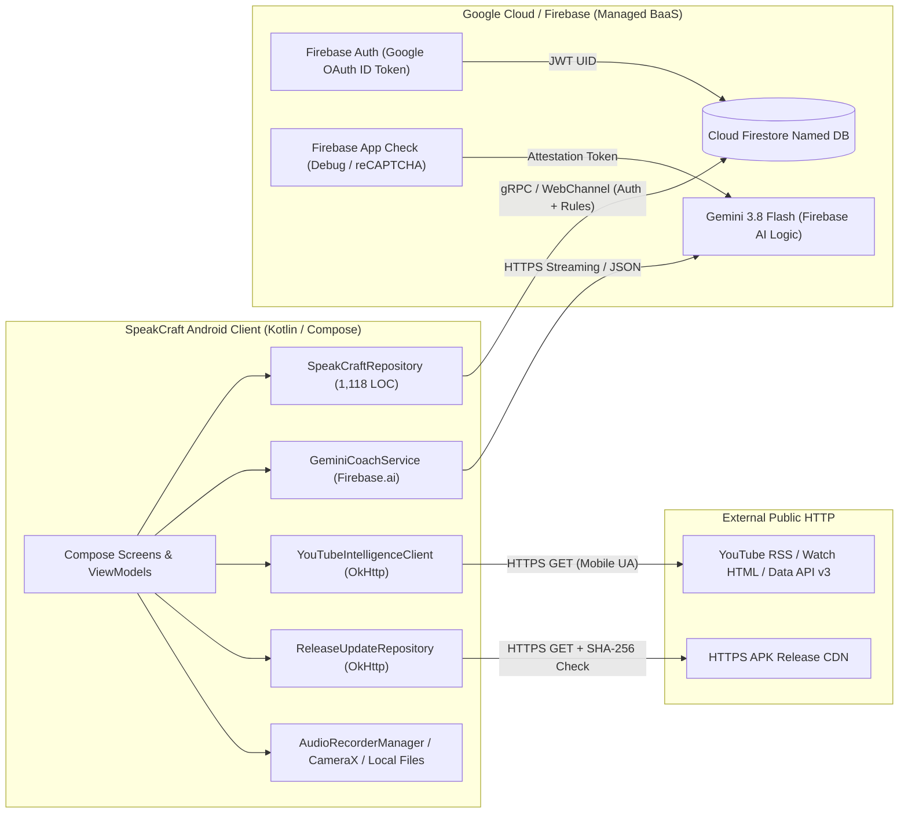
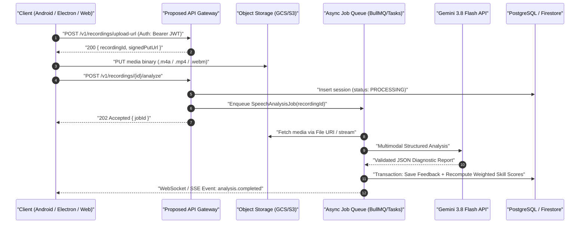

# 02 — Backend Architecture Documentation

**Revision Date:** 2026-11-18  
**Product:** SpeakCraft — AI Communication Skills Coach  
**Current Architecture:** Serverless Client-to-Firebase (`FirebaseAuth`, `Cloud Firestore Enterprise`, `Firebase App Check`, `Firebase AI Logic`) + Direct Client HTTPS (`OkHttp` for YouTube RSS/HTML/API v3 & APK release downloads).  
**Proposed Backend Architecture:** Dedicated API Gateway + Application Backend (Node.js/TypeScript or Python/Go) for Electron + React (Windows Desktop & Web) and thin mobile clients.

---

## Table of Contents

1. [Executive Reality Check: Serverless vs. Dedicated Backend](#executive-reality-check-serverless-vs-dedicated-backend)
2. [Current Backend & Data-Flow Architecture (Items 1–6)](#current-backend--data-flow-architecture)
3. [Authentication, Authorization & Session Management (Items 7–8)](#authentication-authorization--session-management)
4. [Content Ingestion, Audio/Media & AI Orchestration (Items 9–13)](#content-ingestion-audiomedia--ai-orchestration)
5. [Caching, Rate Limiting, Security, Logging & Deployment (Items 14–22)](#caching-rate-limiting-security-logging--deployment)
6. [Performance, Testing, Risks & Architectural Improvements (Items 23–30)](#performance-testing-risks--architectural-improvements)
7. [Complete Operation & API Inventory (Existing SDK Ops vs. Proposed REST/WS APIs)](#complete-operation--api-inventory)
8. [Cross-References & Open Questions](#cross-references--open-questions)

---

## Executive Reality Check: Serverless vs. Dedicated Backend

* **Verified Fact:** **There is no custom backend server in this repository.** There are zero Express/Fastify/NestJS/Django/Go HTTP route handlers, zero WebSocket servers, zero message queues, and zero server-side Cloud Functions (`functions/` directory does not exist).
* **Actual Runtime Topology:** The Android client (`SpeakCraft`) communicates directly with:
  1. **Firebase Authentication** (via Google Credential Manager ID Token exchange).
  2. **Cloud Firestore Enterprise** (named database `ai-studio-android-speakcra-e1a16d03-38bd-4af0-9917-ae6b64cadc11`, enforced by `firestore.rules`).
  3. **Firebase AI Logic** (`Firebase.ai`, `gemini-3.8-flash`) protected by **Firebase App Check**.
  4. **YouTube Public Endpoints** (`youtube.com/feeds/videos.xml`, `youtube.com/watch?v=...`, `youtube.com/results`, and optional `googleapis.com/youtube/v3/search`) via `OkHttpClient`.
  5. **HTTPS APK Hosting** (arbitrary admin-configured `https://...` URLs) via `OkHttpClient` in `ReleaseUpdateRepository`.
* **Unused Network Libraries (`ISS-012`):** `app/build.gradle.kts` declares `retrofit`, `converter-moshi`, `moshi-kotlin`, `ksp(moshi-kotlin-codegen)`, and `logging-interceptor`, none of which are imported in `src/main`.

---

## Current Backend & Data-Flow Architecture

### 1. System Overview & Architectural Pattern
The system uses a **Client-Heavy Serverless BaaS + Edge AI Pattern** paired with **Manual Constructor Dependency Injection** (`AppContainer.kt`). All business logic—score blending (`SpeakCraftRepository:735`), recommendation selection (`RecommendationEngine`), YouTube HTML/XML scraping (`YouTubeIntelligenceClient`), and Gemini prompt assembly (`GeminiCoachService`)—executes on the user's device.

### 2–3. Layer Responsibilities & Project Structure
| Layer | Package (`com.example.*`) | Key Classes | Responsibility |
| :--- | :--- | :--- | :--- |
| **DI Container** | `data` | `AppContainer` | Instantiates lazy singletons (`SpeakCraftRepository`, `GeminiCoachService`, `YouTubeIntelligenceClient`, `AudioRecorderManager`, `AppPreferencesRepository`, `ReleaseUpdateRepository`, `UpdateBackupManager`). |
| **BaaS Data Layer** | `data.firebase` | `SpeakCraftRepository`, `AuthHelper`, `AppCheckConfig`, `FirestoreErrorHandler` | Real-time Firestore `Flow` streams, batched writes, score updates, admin mutations, JSON error serialization. |
| **AI Service Layer** | `data.ai` | `GeminiCoachService`, `RecommendationEngine` | Multimodal speech evaluation, YouTube lesson extraction, vocabulary grading, chat roleplay, streaming mentor, deterministic next-action rules. |
| **External HTTP Layer** | `data.youtube`, `data.update` | `YouTubeIntelligenceClient`, `ReleaseUpdateRepository`, `ApkIntegrityVerifier`, `SemVer` | Direct `OkHttp` calls to YouTube feeds/watch pages and HTTPS APK release downloads + SHA-256/signing verification. |
| **Local Storage & Media** | `data.preferences`, `data.media`, `data.update` | `AppPreferencesRepository`, `AudioRecorderManager`, `CameraVideoRecorder`, `TtsAndSpeechHelper`, `UpdateBackupManager` | DataStore prefs, Android Keystore AES-GCM key encryption, `.m4a`/`.mp4` file I/O in `filesDir/recordings/`, JSON backup snapshots in `filesDir/backups/`. |
| **Presentation / State** | `ui.viewmodel` | `MainCoachViewModel`, `SpeakingAndLabsViewModel`, `InteractiveCoachViewModel`, `UpdateAndAdminViewModel` | Lifecycle-aware `StateFlow` orchestration (`SharingStarted.WhileSubscribed(5000)`). |

### 4–6. Client-SDK Communication, External APIs & Request/Response Lifecycle
Because no REST server exists, "backend communication" happens over two channels:
1. **Firestore Reactive Streams & Writes:** `SpeakCraftRepository` converts Firestore `Query.snapshots()` into cold Kotlin `Flow`s wrapped with `wrapStreamError`, estimating unresolved server timestamps via `DocumentSnapshot.ServerTimestampBehavior.ESTIMATE`. Mutations run inside `runMutation` / `runMutationWithReturn`, verifying `auth.currentUser?.uid` before calling `.set()`, `.update()`, or `db.batch().commit().await()`.
2. **Gemini Multimodal Call Lifecycle (`analyzeSpeechRecording`):**
   * ViewModel reads recorded `.m4a`/`.mp4` bytes into memory (`<= 19 MB`).
   * `GeminiCoachService` builds a prompt with previous session baseline + inline binary payload + `responseSchema = speechAnalysisSchema` and executes inside `withTimeout(60_000L)`.
   * JSON response is parsed locally via `org.json.JSONObject`.
   * `SpeakCraftRepository.saveSpeakingSession()` executes a Firestore `WriteBatch` creating both `speakingSessions/{sessionId}` and `speechFeedback/{feedbackId}`, then performs a read-modify-write on `users/{uid}` to blend skill scores (`(old * 3 + new * 2) / 5`).

---

## Authentication, Authorization & Session Management

### 7. Authentication & Authorization (`AuthHelper.kt`, `firestore.rules`)
* **Identity Provider:** Google Sign-In via Jetpack `CredentialManager` (`GetGoogleIdOption` for silent auto-sign-in, `GetSignInWithGoogleOption` for interactive sign-in) -> `GoogleAuthProvider.getCredential(idToken, null)` -> `Firebase.auth.signInWithCredential(...)`.
* **Session Lifecycle:** `FirebaseAuth.authStateFlow()` (`callbackFlow` over `AuthStateListener`) drives root composable switching. Sign-out clears both `CredentialManager` state (`ClearCredentialStateRequest`) and `Firebase.auth.signOut()` inside `NonCancellable`.
* **Anonymous Auth:** Explicitly disabled/prohibited. Unauthenticated reads/writes are denied globally in `firestore.rules:5-7`.
* **RBAC (`adminUsers/{uid}`):** `firestore.rules:17-21` defines `isAdmin()` by checking `exists(/databases/.../adminUsers/$(request.auth.uid))` and `active == true`. Client writes to `adminUsers` are permanently denied (`allow create, update, delete: if false` at `firestore.rules:510`), meaning admins can only be provisioned via Firebase Console / Admin SDK.

### 8. Security Architecture & App Check (`AppCheckConfig.kt`, `AppPreferencesRepository.kt`)
* **App Attestation:** Debug builds install `DebugAppCheckProviderFactory` (reading optional `FIREBASE_APPCHECK_DEBUG_TOKEN` intent extra synchronously via `.commit()`); release builds install `RecaptchaAppCheckProviderFactory` if `R.string.recaptcha_site_key` is present (`AppCheckConfig.kt:46-59`).
  * **Risk (`ISS-006`):** If `recaptcha_site_key` is missing in release builds, `configureAppCheck` logs an error and continues without an App Check provider!
* **Secret Encryption at Rest:** Optional user-supplied YouTube Data API v3 key is encrypted using Android Keystore (`AES/GCM/NoPadding`, `256`-bit key alias `speakcraft_keystore_aes_v1`) before storing Base64 IV+ciphertext in DataStore (`AppPreferencesRepository.kt`).
* **Updater Transport & Artifact Security (`ReleaseUpdateRepository`, `ApkIntegrityVerifier`):** Enforces `https://` URLs (`firestore.rules:229`), verifies downloaded APK SHA-256 hex digest against release metadata, and compares APK signing certificate SHA-256 against `signingCertSha256` (or the currently installed package certificate).

---

## Content Ingestion, Audio/Media & AI Orchestration

### 9. YouTube Content Intelligence Pipeline (`YouTubeIntelligenceClient.kt`)
1. **Input Parsing (`inspectUrl`):** Accepts channel handles (`@askvinh`), `/channel/UC...`, playlist URLs (`list=...`), or single video URLs (`watch?v=`, `youtu.be/`, `/shorts/`).
2. **Feed Discovery:**
   * If a Data API v3 key is provided, calls `googleapis.com/youtube/v3/search`.
   * Otherwise scrapes channel HTML for `channelId` / `"externalId"`, fetches public Atom RSS (`youtube.com/feeds/videos.xml?channel_id=...` or `?playlist_id=...`), or falls back to `youtube.com/results?search_query=...` HTML scraping.
3. **Caption Extraction:** Requests `youtube.com/watch?v={id}` with a mobile Safari User-Agent, regex-extracts `"captionTracks"` JSON block (`baseUrl`) and `"lengthSeconds"`, then downloads XML `timedtext` captions and parses timestamped `TranscriptSegment`s.
4. **LLM Extraction:** Passes up to `12,000` characters of transcript (or title + `2,500`-char description if captions unavailable) to `GeminiCoachService.extractYouTubeLessons()`, writing `YouTubeSource` and `ExtractedTechnique` records to Firestore.

### 10. Audio & Video Processing Pipeline (`AudioRecorderManager.kt`, `CameraVideoRecorder.kt`)
* **Audio Recording:** `MediaRecorder` (`MPEG_4`, `AAC`, `44.1 kHz`, `96 kbps`) writing `.m4a` to `context.filesDir/recordings/`. Polls `maxAmplitude` every `100ms` to drive live waveform UI and increments `elapsedSeconds` every `1,000ms` when not paused.
* **Video Recording:** CameraX `LifecycleCameraController` / `ProcessCameraProvider` + `VideoCapture.withOutput(Recorder.Builder().setQualitySelector(QualitySelector.from(Quality.SD)))` writing `.mp4` to `filesDir/recordings/`.
* **Media Attachment:** `ActivityResultContracts.PickVisualMedia` streams `Uri` via `ContentResolver.openInputStream(uri)?.readBytes()` into RAM, enforces `<= 19 MB` hard cap, copies to `filesDir/recordings/`, and inspects duration via `MediaMetadataRetriever`.
* **Critical Gap (`ISS-004`, `ISS-005`):** Media files are **never uploaded to cloud storage** (only `localMediaPath` string is saved to Firestore) and are **never transcoded/compressed** server-side.

### 11–13. Analytics, Notification/Update & AI Orchestration
* **Analytics Aggregation (`ISS-008`):** Computed client-side on read (`AnalyticsScreen`, `DashboardScreen`) and incrementally updated on write (`SpeakCraftRepository.saveSpeakingSession`). No server-side batch aggregation or materialized weekly summary jobs exist.
* **Notifications / Updates:** No FCM push notification backend exists. Release discovery happens via live Firestore stream (`observeEnabledReleases`) + client-side `SemVer` comparison (`SemVer.kt`) + `UpdateBannerCard`.
* **AI Orchestration:** Encapsulated in `GeminiCoachService` (see Document `06_AI_FEATURES_AND_AI_ARCHITECTURE.md` for full prompt/schema architecture).

---

## Caching, Rate Limiting, Security, Logging & Deployment

### 14. Caching Strategy
* **Firestore Offline Persistence:** Uses Firebase Android SDK default local disk cache for reactive offline reads and queued writes.
* **In-Memory State:** `StateFlow`s with `WhileSubscribed(5000L)` retain latest emissions across brief screen rotations/tab switches.
* **Static Curriculum:** `CurriculumCatalog` (`15` modules, vocabulary bank, drills, shadowing, grammar, challenges) is compiled directly into Kotlin objects in the APK (zero network latency).
* **No CDN / Redis Cache (`ISS-007`):** Repeated YouTube channel audits re-fetch RSS/watch HTML and re-invoke Gemini on every manual click.

### 15. Rate Limiting & Abuse Prevention
* **Current State:** **None implemented in application code.** Relies solely on Firebase App Check attestation, Firebase Auth (`isSignedIn()`), and Google Cloud project quotas.
* **Proposed State:** Per-user sliding-window token-bucket rate limits in Redis (e.g., `10` speech analyses/hour, `60` simulator turns/hour, `5` YouTube channel syncs/day) enforced at the API Gateway.

### 16–18. Input Validation, Error Handling, Logging & Monitoring
* **Validation:** Dual validation — client truncation/clamping in `SpeakCraftRepository` (e.g., `.take(2000)`, `.coerceIn(0L, 100L)`) + strict declarative schema/bounds enforcement in `firestore.rules` (key allowlists via `hasAll`/`hasOnly`, `diff().affectedKeys()`, `request.time` timestamp checks, regex on SemVer & HTTPS URLs).
* **Error Handling:** `FirestoreErrorHandler.kt` walks the exception cause chain to find `FirebaseFirestoreException`, packages `error`, `operationType`, `path`, and `authInfo` into JSON, and logs via `android.util.Log.e`.
* **Monitoring Gap (`ISS-016`):** No Crashlytics, Cloud Logging sink, OpenTelemetry, or Prometheus/Grafana telemetry exists. `applicationUpdateEvents` in Firestore is the only persisted operational audit trail.

### 19–22. Background Jobs, File Storage, Config & Deployment Architecture
* **Background Jobs:** Ephemeral `viewModelScope` coroutines only (`60s` timeout on Gemini calls; `1s` countdown loop on challenges). No `WorkManager` periodic background sync or server cron workers exist.
* **File Storage:** Local device `filesDir/recordings/`, `filesDir/updates/`, `filesDir/backups/` exposed safely via `FileProvider` (`res/xml/file_paths.xml`).
* **Config Management:** `Secrets` Gradle plugin + `.env.example` (`GEMINI_API_KEY` intentionally left commented out because Firebase AI Logic uses Firebase project config rather than client API keys) + `google-services.json` + `res/values/strings.xml` generated metadata.
* **Current Deployment:** Android APK/AAB built via Gradle (`compileSdk 36.1`, AGP) + Firebase Security Rules deployed via `firebase.json` (`firestore.rules`).

---

## Performance, Testing, Risks & Architectural Improvements

### 23–26. Bottlenecks, Concurrency, Testing & Technical Risks
1. **Read Amplification (`ISS-010`):** 10+ simultaneous user-scoped `.snapshots()` listeners without `.limit()` load full collections on app start.
2. **Memory Spikes (`ISS-005`):** `readBytes()` loads up to `19 MB` twice (input `ByteArray` + protobuf/JSON base64 encoding inside `Firebase.ai`) on mobile heap.
3. **Client-Trust Integrity (`ISS-008`):** Gamification counters (`streakDays`, `totalPracticeMinutes`, skill scores) are client-computed and directly writable under `users/{uid}` rules.
4. **Testing Coverage:** Current tests (`app/src/test/` + `firestore.test.js`) cover SemVer logic, YouTube XML/HTML parsing helpers, RecommendationEngine, Robolectric Compose smoke CUJs, and Firestore security rules—but **do not test** live Gemini JSON parsing, CameraX recording, or backend API contracts.

### 27–30. Recommended Target Backend Architecture (Proposed for Multi-Platform Expansion)
To support **Electron (Windows Desktop)**, **React Web**, and **Android** from a unified, tamper-resistant backend:
1. Introduce a **Stateless API Gateway + Backend Service** (TypeScript/Fastify or NestJS on Cloud Run / Kubernetes) verifying Firebase ID tokens (or OAuth2 JWTs).
2. Move Gemini AI prompts, YouTube scraping/Data API calls, and score/streak computation **server-side** to eliminate client tampering, centralize rate limiting/cost metering, and cache YouTube extractions across all users.
3. Add **Object Storage (GCS / S3)** with signed pre-authenticated upload URLs (`PUT`) so recordings stream directly from client to bucket without `19 MB` mobile RAM spikes and sync across Windows, Web, and Android.
4. Migrate or dual-sync relational/analytical workloads to **PostgreSQL** + **Redis** + **BullMQ / Cloud Tasks** workers (see Document `07`).

---

## Complete Operation & API Inventory

### A. Currently Implemented Client-SDK & External Operations (`Verified`)

| Op ID | Channel / Method | Target / Path | Auth / Gate | Input / Payload | Output / Side Effect | Status |
| :--- | :--- | :--- | :--- | :--- | :--- | :--- |
| `OP-001` | `CredentialManager` + `FirebaseAuth` | Google OAuth -> `signInWithCredential` | Public | Google ID Token | `FirebaseUser` session | Implemented |
| `OP-002` | `Firestore.get/set/update` | `/users/{uid}` | Owner (`isOwner`) | `UserProfile` fields | Creates/updates profile | Implemented |
| `OP-003` | `Firestore.batch` | `/users/{uid}/extractedTechniques`, `youtubeSources` | Owner | `CurriculumCatalog.askVinhKnowledgeBase` | Seeds initial `@askvinh` catalog | Implemented |
| `OP-004` | `Firestore.snapshots` | 11 user subcollections + 4 shared collections | Owner / SignedIn / Admin | `userId` | Real-time `Flow<List<T>>` streams | Implemented |
| `OP-005` | `Firestore.batch` | `/users/{uid}/speakingSessions` + `speechFeedback` + `users/{uid}` | Owner | `SpeakingSession` + scores | Saves session, feedback, blends rolling scores | Implemented (`ISS-003`, `ISS-008`) |
| `OP-006` | `Firestore.set/update` | `/users/{uid}/dailyActivities/{dateId}` + `users/{uid}` | Owner | `completedStepIds`, `reflection`, `confidenceRating`, `minutesSpent` | Updates daily log & increments streak | Implemented (Bug `ISS-002`) |
| `OP-007` | `Firestore.set/update` | `/users/{uid}/vocabulary/{wordId}` | Owner | `VocabularyEntry` SM-2 fields | Upserts card & increments `wordsLearnedCount` | Implemented |
| `OP-008` | `Firestore.set/update` | `/users/{uid}/learningProgress/{id}`, `enrollments/{id}`, `realWorldTasks/{id}` | Owner | Completion flags, notes, day lists | Persists progress | Implemented |
| `OP-009` | `Firestore.set` | `/users/{uid}/conversationSessions/{id}` | Owner | `scenario`, `turnCount`, `summaryFeedback`, `transcriptPreview` | Persists simulator debrief | Implemented |
| `OP-010` | `Firebase.ai` (`generateContent`) | `gemini-3.8-flash` (`speechAnalysisSchema`) | Auth + AppCheck | Inline audio/video (`<=19MB`) + prompt | Structured JSON `SpeakingSession` | Implemented |
| `OP-011` | `Firebase.ai` (`generateContent`) | `gemini-3.8-flash` (`youtubeExtractionSchema`) | Auth + AppCheck | Video metadata + up to 12KB transcript | 1–3 structured `ExtractedTechnique`s | Implemented |
| `OP-012` | `Firebase.ai` (`generateContent` / `startChat` / `Stream`) | `gemini-3.8-flash` | Auth + AppCheck | Vocab sentence / chat history / user profile + sessions | Eval JSON / chat reply / streamed tokens | Implemented |
| `OP-013` | `OkHttp GET` | `youtube.com/feeds/videos.xml`, `watch?v=`, `googleapis.com/youtube/v3/search` | Public / Optional Key | URL + optional API v3 key | `YouTubeAuditBundle` (`segments`, metadata) | Implemented (`ISS-007`) |
| `OP-014` | `OkHttp GET` + `FileProvider` | Admin-provided `https://...` APK URL | Signed-In (`applicationReleases`) | `ApplicationRelease` metadata | Verified APK download + `ACTION_VIEW` install | Implemented (`ISS-016`) |
| `OP-015` | `Firestore.batch` / `set` / `update` | `youtubeVideos`, `videoTranscripts`, `extractedTechniques`, `lessons`, `learningChallenges`, `applicationReleases` | `isAdmin()` (`adminUsers/{uid}`) | Curated catalog / release payload | Global catalog & release rollout | Implemented |

### B. Proposed Target Backend REST & WebSocket API Contract (`Not Implemented / Proposed`)

| API ID | Method & Endpoint | Auth | Request Params / Body | Response Schema | Error Codes | Status |
| :--- | :--- | :--- | :--- | :--- | :--- | :--- |
| `API-001` | `POST /v1/auth/session` | Public (OAuth ID Token) | `{ idToken, platform: "android"|"win"|"web" }` | `{ accessToken, refreshToken, user, isAdmin }` | `401`, `403`, `429` | Proposed |
| `API-002` | `GET /v1/users/me` / `PATCH /v1/users/me` | Bearer JWT | `{ displayName?, communicationLevel?, primaryGoal?, dailyGoalMinutes? }` | `UserProfileDTO` | `400`, `401`, `422` | Proposed |
| `API-003` | `POST /v1/recordings/upload-url` | Bearer JWT | `{ mimeType, sizeBytes, moduleType }` | `{ recordingId, uploadUrl, expiresAt }` | `400`, `413`, `429` | Proposed |
| `API-004` | `POST /v1/recordings/{id}/analyze` | Bearer JWT | `{ promptTitle, durationSeconds, extraInstructions? }` | `{ jobId, status: "PROCESSING" }` | `404`, `409`, `429`, `502` | Proposed |
| `API-005` | `GET /v1/speaking-sessions?cursor=&limit=20` | Bearer JWT | Query: `cursor`, `limit`, `moduleType?` | `{ items: SpeakingSessionDTO[], nextCursor }` | `401`, `400` | Proposed |
| `API-006` | `DELETE /v1/speaking-sessions/{id}` | Bearer JWT | Path: `id` | `204 No Content` (cascades S3 + feedback) | `403`, `404` | Proposed |
| `API-007` | `POST /v1/daily-activities/{dateKey}` | Bearer JWT | `{ completedStepIds, reflectionText?, confidenceRating, minutesSpent }` | `{ activity, updatedStreakDays }` | `400`, `422` | Proposed |
| `API-008` | `POST /v1/vocabulary/{wordId}/review` & `/evaluate` | Bearer JWT | `{ qualityGood }` / `{ userSentence }` | `{ entry }` / `{ usedCorrectly, naturalnessScore, feedback, improvedExample }` | `400`, `429` | Proposed |
| `API-009` | `POST /v1/conversations` & `POST /v1/conversations/{id}/turns` | Bearer JWT | `{ scenario, difficultyLevel }` / `{ message }` | `{ turnId, partnerReply }` | `404`, `429`, `502` | Proposed |
| `API-010` | `WS /v1/ai-mentor/stream` | Bearer JWT | `{ threadId?, question }` | Server-sent token frames `{ delta, done }` | `401`, `429`, `504` | Proposed |
| `API-011` | `POST /v1/youtube/inspect` | Bearer JWT | `{ url }` (Rate-limited; uses server API key) | `{ source, techniques[] }` | `400`, `422`, `429`, `502` | Proposed |
| `API-012` | `GET /v1/analytics/summary?window=7d\|30d\|90d` | Bearer JWT | Query: `window` | `{ skillAverages, trendSeries[], recurringMistakes[] }` | `400`, `401` | Proposed |
| `API-013` | `GET /v1/releases/latest?platform=&channel=` | Bearer JWT | Query: `platform` (`android`/`win32`/`web`), `channel` | `{ updateAvailable, mandatory, release }` | `400`, `404` | Proposed |
| `API-014` | `POST /v1/admin/releases` & `PATCH /v1/admin/techniques/{id}` | Admin RBAC | Release / moderation status payload | Updated admin resource | `401`, `403`, `422` | Proposed |

---

## Cross-References & Open Questions

* **Cross-References:** `03_USER_SCALABILITY_DOCUMENTATION.md` (scaling Firestore vs. proposed Gateway/PG), `04_ISSUES_BUGS_AND_TECHNICAL_DEBT.md` (`ISS-002`–`ISS-012`), `06_AI_FEATURES_AND_AI_ARCHITECTURE.md` (Gemini schemas & timeout limits), `07_DATABASE_DESIGN_AND_DOCUMENTATION.md` (Firestore rules & PG tables).
* **Open Questions:**
  1. Will future Electron/Web clients connect to the existing Firebase project (`ai-studio-android-speakcra-...`) or a new dedicated backend API gateway?
  2. For audio/video storage across devices, is Firebase Cloud Storage preferred (preserving zero-ops BaaS) or S3/GCS behind a custom Node/Go backend?
  3. Should `streakDays` calculation be migrated to a Cloud Function trigger (`onDocumentWritten` on `dailyActivities`) immediately so Android users cannot drift or spoof streaks?
