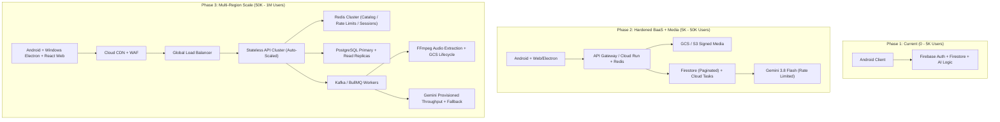

# 03 — User Scalability Documentation

**Revision Date:** 2026-11-18  
**Product:** SpeakCraft — AI Communication Skills Coach  
**Current Implementation Status:** Native Android client + Serverless Firebase (`Auth`, `Cloud Firestore`, `Firebase AI Logic`). **No load tests have been executed; all throughput/capacity figures below are engineering estimates unless marked Verified.**

---

## Table of Contents

1. [Executive Baseline & Verification Notice](#executive-baseline--verification-notice)
2. [Current Architecture Scalability Baseline (Items 1–4)](#current-architecture-scalability-baseline)
3. [Growth Capacity Matrix: 100 to 1,000,000 Users (Items 5–11)](#growth-capacity-matrix-100-to-1000000-users)
4. [Subsystem Bottleneck Analysis (Items 12–19)](#subsystem-bottleneck-analysis)
5. [Infrastructure Evolution, Cost Drivers & HA Roadmap (Items 20–25)](#infrastructure-evolution-cost-drivers--ha-roadmap)
6. [Cross-References & Open Questions](#cross-references--open-questions)

---

## Executive Baseline & Verification Notice

* **Verified Implementation Facts:**
  * Zero custom backend servers exist; horizontal scaling of auth and document storage is currently delegated to Google Cloud's managed **Firebase Auth**, **Cloud Firestore**, and **Firebase AI Logic (`gemini-3.8-flash`)** infrastructure.
  * Client queries in `SpeakCraftRepository.kt` open **10 unbounded user-scoped real-time `.snapshots()` listeners** plus **4 shared collection listeners** upon entering `AuthenticatedAppShell`.
  * Audio/video files remain device-local (`filesDir/recordings/`) and are transferred inline (up to `19 MB` byte arrays) per Gemini speech analysis request (`GeminiCoachService.kt:150`).
  * YouTube discovery & caption extraction (`YouTubeIntelligenceClient.kt`) executes directly from each user's mobile IP via `OkHttp`.
* **Load-Test Verification Gap:** Zero automated load tests (k6, Locust, JMeter, or Firebase Stress tests) exist in the repository. Capacity figures in Section 3 are **analytical estimates** based on observed client listener counts, payload sizes, Firestore documented quotas, and Gemini API throughput characteristics.

---

## Current Architecture Scalability Baseline

### 1. Current Concurrency & Request Profile per Active Session
When a single authenticated user opens SpeakCraft (`AuthenticatedAppShell`), the client immediately initiates:
* **14 Firestore real-time listeners** (`users/{uid}`, `speakingSessions`, `speechFeedback`, `vocabulary`, `dailyActivities`, `learningProgress`, `enrollments`, `realWorldTasks`, `youtubeSources`, `extractedTechniques`, `extractedTechniques [PUBLISHED]`, `lessons [PUBLISHED]`, `learningChallenges`, `applicationReleases [enabled=true]`, plus `adminUsers/{uid}` and `applicationUpdateEvents`). That is **15–16 active listeners per user**!
* **1 conditional batch seed write** (`seedAskVinhKnowledgeBaseIfEmpty()` checks `limit(1)` on `extractedTechniques` and writes up to ~20+ documents on first launch).
* **0 server-managed WebSockets or background queues.**

### 2. Primary Scaling Breakpoints Already Visible in Code
1. **Unbounded Subcollection Reads (`ISS-010`):** As a single power user accumulates 200 speaking sessions (`~8–15 KB` JSON each including `15,000`-char transcripts) + 500 vocabulary entries + 365 daily activities, opening the app triggers `1,000+` Firestore document reads per cold start or reconnect.
2. **Client-Side YouTube Scraping at Scale (`ISS-007`):** Because every user's device scrapes `youtube.com/watch?v=...` and `youtube.com/feeds/videos.xml` independently without a shared backend cache, `10,000+` users inspecting `@askvinh` creates redundant scraping bursts and triggers YouTube anti-bot/consent CAPTCHAs.
3. **Inline 19 MB Multimodal Gemini Payloads (`ISS-005`):** Sending uncompressed `.mp4` / `.m4a` bytes inline over cellular/mobile client connections fails frequently on slow networks (`60_000 ms` timeout in `GeminiCoachService.kt:24`) and scales Gemini multimodal input-token/bandwidth cost linearly with zero client pre-compression or caching.
4. **Shared `extractedTechniques` & `lessons` Contention:** Reading global `PUBLISHED` collections per user works cleanly up to `~100k` DAU via Firestore's distributed cache, unless admins update documents frequently (fan-out listener cost multiplies by concurrent active users!).
5. **No Global Rate Limiting (`ISS-006`):** Lack of per-user API quota enforcement allows a single abusive client (or bug loop) to trigger unlimited Gemini `generateContent` calls up to project-wide Vertex/AI Logic RPM ceilings.

---

## Growth Capacity Matrix: 100 to 1,000,000 Users

*All numeric traffic, storage, and cost-tier columns below are **Estimated** projections assuming typical ed-tech ratios (`25%` DAU/MAU, `10%` of DAU concurrent peak, avg `1.5` AI speech analyses + `8` simulator turns per DAU/day).*

| Tier / Scenario (5–11) | Registered Users | Est. DAU (~25%) | Est. Peak Concurrent | Est. Firestore Reads / Day (Current Unbounded) | Est. AI Requests / Day | Current Stack Feasibility (`Verified` vs `Estimated`) | Required Architecture Changes |
| :--- | :--- | :--- | :--- | :--- | :--- | :--- | :--- |
| **Tier 1: Pilot** | `100` | `25` | `5–10` | `~5,000` | `~250` | **Feasible (Est.)** — Fits well inside Firebase Spark/Blaze free/low tiers | Fix `ISS-001`..`003`, add error tracking |
| **Tier 2: Early Beta** | `1,000` | `250` | `30–50` | `~75,000` | `~2,500` | **Feasible (Est.)** — Occasional YouTube scrape rate-limits if users tap sync | Centralize YouTube ingestion + server cache |
| **Tier 3: Growth** | `10,000` | `2,500` | `250–400` | `~1.5M` | `~25,000` | **Degrades (Est.)** — Unbounded `.snapshots()` inflates Firestore read billing; Gemini RPM quotas need quota increase | Add `.limit(20)` pagination (`ISS-010`), move Gemini + rate limits behind API Gateway |
| **Tier 4: Scale-Up** | `50,000` | `12,500` | `1,250–2,000` | `~12M` (without pagination) | `~125,000` | **Bottlenecked (Est.)** — Inline `19 MB` mobile uploads cause high `60s` timeouts; local-only recordings block multi-device desktop/web | Introduce GCS/S3 signed uploads + async BullMQ/Cloud Tasks workers + PostgreSQL analytics |
| **Tier 5: Mid-Market** | `100,000` | `25,000` | `2,500–4,000` | `~35M` (unbounded) -> `~4M` (paginated) | `~250,000` | **Fails without refactor (Est.)** — Global listener fan-out on `lessons`/`releases` & client-trust score tampering become critical | CDN-cached immutable catalog JSON, Redis hot cache, server-verified scores, WebSocket notifications |
| **Tier 6: High Scale** | `500,000` | `125,000` | `12,500–20,000` | `>200M` (unbounded) | `~1.25M` | **Not viable on current client-only architecture (Est.)** — Exceeds single-region Gemini default RPM without provisioned throughput | Multi-region Cloud Run API, Read-Replica PostgreSQL, Provisioned Gemini Throughput, transcoding cluster |
| **Tier 7: Million-User** | `1,000,000` | `250,000` | `25,000–40,000` | `>450M` (unbounded) | `~2.5M` | **Not viable on current architecture (Est.)** — Requires partitioned sharding, tiered AI model routing, edge CDN | Sharded PostgreSQL (Citus/Cloud SQL), Kafka/PubSub async media pipeline, Edge CDN, FinOps AI tiering |

---

## Subsystem Bottleneck Analysis

### 12. Database & Query Scaling (Firestore Today vs. PostgreSQL Target)
* **Firestore Today:** Subcollection path isolation (`/users/{uid}/...`) scales writes cleanly per user (`1 write/sec` per document limit is rarely hit except rapid toggling of `dailyActivities` -> `users/{uid}` streak update). The bottleneck is **list queries without limits** (`SpeakCraftRepository.kt:92-222`).
* **Missing Composite Indexes / Query Limits:** `observeEnabledReleases()` (`whereEqualTo("enabled", true)`), `observePublishedSharedTechniques()` (`whereEqualTo("moderationStatus", "PUBLISHED")`), and `observeUserUpdateEvents()` (`whereEqualTo("userId", uid)`) work today without `.orderBy()` (avoiding composite index errors), but adding `.orderBy("createdAt", DESCENDING).limit(...)` will require explicit composite indexes in `firestore.indexes.json` (currently absent from repo!).

### 13. Audio/Video Recording & Storage Scaling
* **Local-Only Today:** `filesDir/recordings/` consumes user device flash (`~0.7 MB/min` AAC audio; `~8–15 MB/min` SD MP4 video). Zero cloud storage cost today, but **zero cross-platform sync** (`ISS-004`).
* **At 100k–1M Users (Cloud Storage Projection):** Assuming `3` retained 60s clips/user/month compressed to `~1.5 MB` Opus/MP4 = `4.5 MB/user/month` -> `450 GB/month` at 100k active users, `4.5 TB/month` at 1M active users. Requires **lifecycle retention policies** (e.g., delete raw video after 30 days on free tier, retain compressed audio + transcripts indefinitely).

### 14. AI Processing & Token Cost Scaling
* **Dominant Cost Driver:** Multimodal audio/video tokens + long context prompts (`askMentorStream` injects up to 5 sessions + 3 feedback summaries; `extractYouTubeLessons` injects up to `12,000` transcript chars).
* **Concurrency & Timeout Risk:** Synchronous `60s` client waits (`AI_TIMEOUT_MS = 60_000L`) tie up UI state and fail on mobile network handoffs. At `>10k` DAU, an asynchronous job architecture (`202 Accepted` + push/WebSocket completion) plus client-side audio extraction (stripping video frames unless Stage 1 visual audit is requested) cuts token consumption dramatically.

### 15. YouTube Ingestion Scaling
* **Current Flaw:** N users inspecting `@askvinh` trigger N x (RSS + N_videos x HTML watch fetches + N_videos x Gemini extractions).
* **Target Fix:** Single shared backend ingestion worker on a 6-hour cron schedule writes canonical `@askvinh` metadata & extracted techniques once to shared catalog + Redis cache, reducing external YouTube fetches and Gemini extraction calls by `>99.9%`.

### 16–19. Caching, Background Workers, Real-Time Streams & Multi-Platform Load
* **Real-Time Listener Reduction:** Replace 14 always-on Firestore snapshot listeners with REST/HTTP fetch-on-demand + `ETag` caching for static/slow-changing resources (`lessons`, `learningChallenges`, `applicationReleases`, `extractedTechniques`), retaining real-time streams only for active AI jobs or notifications.
* **Electron & Web Client Burst Behavior:** Desktop/Web browser tabs often stay open for hours, amplifying idle WebSocket/Firestore listener counts if not timed out on tab visibility (`document.visibilityState === 'hidden'`).

---

## Infrastructure Evolution, Cost Drivers & HA Roadmap

### 20–25. Cost Drivers, Multi-Region, Monitoring & Growth Roadmap
* **Top 4 Cost Drivers:**
  1. Gemini multimodal input tokens (video frames & raw audio).
  2. Firestore document reads from unbounded `.snapshots()` listeners (`ISS-010`).
  3. Cloud Storage + egress bandwidth (once cross-device recording sync is implemented).
  4. YouTube Data API v3 daily quota (`10,000` units/day default; `search.list` costs `100` units/call!).
* **Phased Scaling Roadmap:**
  * **Milestone S1 (Immediate, before 5k users):** Add `.limit(25)` + cursor pagination on user subcollections; stop seeding on every launch; remove unused KSP/Retrofit bloat; add Crashlytics + AI latency logging.
  * **Milestone S2 (5k–50k users):** Deploy Cloud Run API Gateway + Redis; migrate YouTube ingestion & streak/score aggregation server-side; move recordings to GCS/S3 signed uploads; add token-bucket rate limiting.
  * **Milestone S3 (50k–1M users):** Introduce PostgreSQL (primary + read replicas) for analytics & curriculum queries; split audio-only vs. video multimodal pipelines; enforce storage lifecycle TTLs; configure multi-region CDN for static curriculum & Electron/Android release artifacts.

---

## Cross-References & Open Questions

* **Cross-References:** `02_BACKEND_ARCHITECTURE_DOCUMENTATION.md` (API Gateway design), `04_ISSUES_BUGS_AND_TECHNICAL_DEBT.md` (`ISS-004`–`ISS-010`), `06_AI_FEATURES_AND_AI_ARCHITECTURE.md` (token & payload limits), `07_DATABASE_DESIGN_AND_DOCUMENTATION.md` (Firestore indexing & PG partitioning).
* **Open Questions:**
  1. What retention window (e.g., 30 days vs. 1 year) will product policy set for raw `.mp4` video recordings once cloud storage is enabled?
  2. What monthly per-user AI budget ceiling (or free vs. pro tier quota) should govern speech analyses and conversation turns?
  3. Will Electron desktop users run local Whisper/ONNX preprocessing to trim silence before uploading audio?
