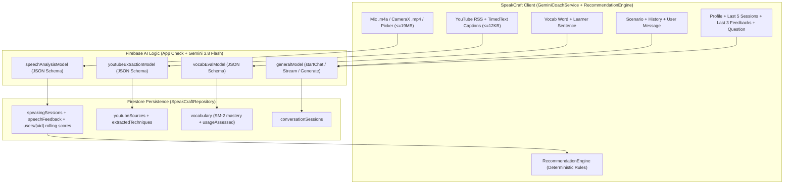

# 06 — AI Features and AI Architecture

**Revision Date:** 2026-11-18  
**Product:** SpeakCraft — AI Communication Skills Coach  
**Current AI Runtime:** Firebase AI Logic SDK (`com.google.firebase:firebase-ai` via Firebase BOM `34.17.0`), model `gemini-3.8-flash`, protected by Firebase App Check (`DebugAppCheckProviderFactory` / `RecaptchaAppCheckProviderFactory`).  
**Non-AI On-Device Speech Tools:** Android `TextToSpeech` (`Locale.US`) and Android `SpeechRecognizer` (`TtsAndSpeechHelper.kt`).

---

## Table of Contents

1. [AI System Overview & Runtime Reality (Topics 1–6)](#ai-system-overview--runtime-reality)
2. [Orchestration, Prompting, Grounding & Guardrails (Topics 7–18)](#orchestration-prompting-grounding--guardrails)
3. [Performance, Cost, Security, Caching & Evaluation (Topics 19–35)](#performance-cost-security-caching--evaluation)
4. [Capability-by-Capability Specification (Capabilities A–L, All 13 Subsections)](#capability-by-capability-specification)
5. [Cross-References & Open Questions](#cross-references--open-questions)

---

## AI System Overview & Runtime Reality

### 1–6. Architecture Overview, Model Selection & Platform Integration
* **Verified Fact:** SpeakCraft uses **zero raw `GEMINI_API_KEY` REST calls** (`GEMINI_API_KEY` in `.env.example` remains commented out). All generative AI calls run through `Firebase.ai.generativeModel("gemini-3.8-flash")` inside `/app/src/main/java/com/example/data/ai/GeminiCoachService.kt`.
* **Four Lazy Model Instances (`GeminiCoachService.kt:42-137`):**
  1. `generalModel`: Unstructured text generation, multi-turn `startChat`, and `generateContentStream` (used for Conversation Simulator turns, Conversation Check-In debrief, and AI Mentor streaming).
  2. `speechAnalysisModel`: Configured with `responseMimeType = "application/json"` and `responseSchema = speechAnalysisSchema` (21 structured fields).
  3. `youtubeExtractionModel`: Configured with `responseMimeType = "application/json"` and `responseSchema = youtubeExtractionSchema` (nested `techniques[]` array).
  4. `vocabEvalModel`: Configured with `responseMimeType = "application/json"` and `responseSchema = vocabEvalSchema` (4 fields).
* **Deterministic Non-LLM AI/Rules Component:** `RecommendationEngine.kt` (`recommendNextAction`) uses pure deterministic business rules over profile scores, sessions, daily progress, and lessons (zero LLM latency or token cost).
* **Voice I/O:** Android native `TextToSpeech` (configurable speed `0.65x..1.35x`) and Android `SpeechRecognizer` (`EXTRA_LANGUAGE_MODEL = LANGUAGE_MODEL_FREE_FORM`) provide offline/OS-level voice playback and dictation—no paid ElevenLabs/Whisper external APIs are currently used.

---

## Orchestration, Prompting, Grounding & Guardrails

### 7–12. Prompt Engineering, Grounding & Anti-Hallucination Controls
1. **Honesty Gate for Short/Noisy Audio (`GeminiCoachService.kt:162-163, 180-182`):** Explicitly instructs Gemini: *"If audio is silent, mostly noise, unintelligible, or too short (< 4 seconds), set `pronunciationAssessable = false`, `pronunciationScore = 0`, `confidenceLevel = 'Low'`"*. Code double-enforces `safePronScore = if (assessable) rawPron else 0L` so unassessable clips cannot pollute a learner's pronunciation average (`SpeakCraftRepository.kt:739-743`).
2. **Evidence Citation:** `speechAnalysisSchema` requires `recordingExamples` ("Exact verbatim phrases quoted from the recording"), surfaced directly inside `FeedbackReportCard` alongside `audioQualityNote` and `confidenceLevel`.
3. **Creator Attribution Separation (`youtubeExtractionSchema`):** Enforces separate `creatorAdvice` ("never fabricated") vs. `aiExplanation` ("supplementary coaching explanation clearly separated from creator words"). When captions are missing (`transcriptText == null`), prompt instructs Gemini to rely strictly on title + description and never invent timestamps or quotes (`GeminiCoachService.kt:237,247`).
4. **Non-Interruptive Roleplay (`sendConversationTurn`):** System instruction injected via synthetic initial history turn (`content("user") { text(systemInstruction) }`, `content("model") { text("Understood...") }`) keeps dialogue natural for `2–4` sentences without mid-chat grammar scolding, reserving corrections for `generateConversationCheckIn`.

### 13–18. Context Management, Guardrails, Streaming & Timeout Policy
* **Timeout Enforcement:** `AI_TIMEOUT_MS = 60_000L` wraps every unary `generateContent`/`sendMessage` call (`withTimeout(AI_TIMEOUT_MS)`) and the streaming `askMentorStream` collector (`InteractiveCoachViewModel.kt:127`).
* **Context Truncation Bounds:**
  * YouTube transcript truncated to `12,000` chars; description to `2,500` chars (`GeminiCoachService.kt:235,243`).
  * Mentor context injects max `5` recent sessions (`mistakes.take(2)`, `fillerWordsDetected.take(2)`) and `3` `SpeechFeedback` records (`GeminiCoachService.kt:383-389`).
* **Security & Guardrail Gaps (`ISS-006`):**
  * No input sanitization or XML delimiter fencing around untrusted YouTube metadata or user text (prompt injection risk).
  * No toxicity/safety filter overrides or PII redaction prior to sending transcripts/audio to LLM.
  * `sendConversationTurn` passes full unbounded `historyPairs` on long chats without sliding-window summarization.

---

## Performance, Cost, Security, Caching & Evaluation

### 19–35. Latency, Cost, Caching, Privacy & Operational Architecture
* **Payload Cap & Memory Risk (`ISS-005`):** Inline `ByteArray` payloads limited to `<= 19 MB` (`GeminiCoachService.kt:150`). Sending video clips consumes substantially higher multimodal token cost than audio-only `.m4a` (`~96 kbps`).
* **Zero Response Caching:** Repeated YouTube URL extractions or identical vocabulary sentence checks hit Gemini fresh every time.
* **No Token / Cost Telemetry:** `response.usageMetadata` (`promptTokenCount`, `candidatesTokenCount`) is neither logged nor persisted.
* **No Automated AI Evaluation Harness (`ISS-025`):** Zero golden-dataset regression tests verify JSON schema adherence, WPM accuracy, or `@askvinh` framework fidelity across model revisions (`gemini-3.8-flash` upgrades).
* **Proposed Production AI Gateway Upgrades:**
  1. Move `GeminiCoachService` behind the Backend API Gateway (using Google GenAI Server SDK / Vertex AI) with Redis per-user rate limits and token accounting.
  2. Replace `19 MB` inline `ByteArray` with **GCS/S3 signed uploads + Gemini File API URI** for speeches up to 30+ minutes.
  3. Share a single cached YouTube AI extraction catalog across all users (`Redis` + `PostgreSQL`).
  4. Add prompt-injection boundary wrappers, `usageMetadata` FinOps logging, and golden audio/transcript CI regression benchmarks.

---

## Capability-by-Capability Specification

Each capability below covers all 13 required architectural dimensions.

### Capability A — YouTube Content Extraction & Analysis (`Implemented`)
1. **Name & Purpose:** Automated ingestion and structured technique extraction from YouTube channels/playlists/videos (`@askvinh` or custom URLs).
2. **Trigger & User Flow:** User or Admin pastes URL -> taps Inspect/Sync -> app resolves videos, fetches captions, calls Gemini -> displays attributed techniques & source audit cards.
3. **Inputs & Context:** `videoId`, `videoTitle`, `videoUrl`, `description` (`<=2500` chars), `transcriptText` (`<=12000` chars, nullable).
4. **Prompting & Pipeline:** Single-shot structured prompt with strict non-fabrication rule separating `creatorAdvice` from `aiExplanation`.
5. **Models & Providers:** `gemini-3.8-flash` (`youtubeExtractionModel` via `Firebase.ai`).
6. **Output Schema & Parsing:** `youtubeExtractionSchema` -> `mainTopic`, `category` (enum of 20 categories), `difficulty` (3 tiers), `techniques[1..3]` (`title`, `creatorAdvice`, `aiExplanation`, `originalContext`, `instructions`, `practicalExercise`, `expectedOutcome`, `suggestedDurationMinutes`, `commonMistake`, `correction`, `timestampLabel`) parsed via `org.json.JSONObject`.
7. **Database Interaction:** User mode saves to `/users/{uid}/youtubeSources/{vid}` & `extractedTechniques/{vid}_t{i}`; Admin mode saves to top-level `youtubeVideos`, `videoTranscripts`, `extractedTechniques` (`PENDING_REVIEW` or `PUBLISHED`).
8. **Fallback & Error Handling:** Missing captions -> falls back to description/title with `NO_CAPTIONS` status; `INACCESSIBLE` skips Gemini call and logs status; `60s` timeout returns `Result.failure`.
9. **Guardrails & Attribution:** Explicit boolean `isCreatorDerived` + `"Pending Transcript Verification"` badge (`LessonAttributionBadge`).
10. **Latency & Cost:** ~2–6s per video; ~1k–4k input tokens/video; linear cost per user due to missing shared cache (`ISS-007`).
11. **Risks & Limitations:** HTML caption scraping fragility; prompt injection in public video descriptions (`ISS-006`).
12. **Implementation Status:** **Implemented** (`YouTubeIntelligenceClient.kt`, `GeminiCoachService.kt:227-290`).
13. **Future Upgrades:** Server-side scheduled YouTube Data API v3 worker + shared vector/keyword deduplication.

### Capability B — Speech Recording Transcription & Multimodal Analysis (`Implemented`)
1. **Name & Purpose:** Transcribe and score recorded audio/video speaking drills across 5 dimensions + WPM + verbatim evidence.
2. **Trigger & User Flow:** User records Mic/CameraX or attaches Picker clip -> taps `"Analyze With AI Coach"` (or `"Compare AI"`, `"Score Shadow"`, `"Check Grammar"`, `"Get Presentation AI"`, `"Submit AI Check"`).
3. **Inputs & Context:** `mediaBytes` (`<= 19 MB`), `mimeType` (`audio/mp4` / `video/mp4`), `moduleType` (7 types), `promptTitle`, `durationSeconds`, optional `previousSession` scores, `extraInstructions`.
4. **Prompting & Pipeline:** Multimodal `content { inlineData(mediaBytes, mimeType); text(prompt) }` using `@askvinh` 3Vs, 5 Vocal Foundations, PREP, and CLEAR rubrics.
5. **Models & Providers:** `gemini-3.8-flash` (`speechAnalysisModel`).
6. **Output Schema & Parsing:** `speechAnalysisSchema` (21 keys including `transcript`, `pronunciationAssessable`, `confidenceLevel`, `recordingExamples`, `fillerWordsDetected`, `repeatedExpressions`, 5 `0..100` scores, `wordsPerMinute`).
7. **Database Interaction:** `SpeakCraftRepository.saveSpeakingSession` writes `speakingSessions` + `speechFeedback` in a `WriteBatch` and updates rolling weighted scores (`3:2` blend) on `users/{uid}`.
8. **Fallback & Error Handling:** Rejects empty or `>19 MB` files pre-call; `60s` timeout -> `UiState.Error`; silent/short audio forces `pronunciationAssessable = false`, `pronunciationScore = 0`.
9. **Guardrails:** Verbatim quote requirement prevents generic praise; short-audio gate prevents inflated pronunciation averages.
10. **Latency & Cost:** ~4–15s depending on clip size; high multimodal token usage for video `.mp4`.
11. **Risks & Limitations:** Client RAM `readBytes()` spike (`ISS-005`); `19 MB` cap (~2-3 min video); silent Firestore failure masked (`ISS-003`).
12. **Implementation Status:** **Implemented** (`GeminiCoachService.kt:139-225`).
13. **Future Upgrades:** Signed GCS/S3 upload + Gemini File API URI; strip video frames when visual audit isn't needed; async job queue (`API-004`).

### Capability C — Personalized Feedback Generation (`Implemented`)
* **Purpose & Flow:** Transforms `speechAnalysisSchema` output into `SpeechFeedback` + UI `FeedbackReportCard` comparing Composite score delta (`+diff vs prior`) against `previousSession`.
* **Schema & DB:** Stored both inline on `SpeakingSession` (denormalized) and normalized in `users/{uid}/speechFeedback/{feedbackId}`.
* **Status:** **Implemented** (`CoachComponents.kt:430-565`, `SpeakCraftRepository.kt:708-727`).

### Capability D — Vocabulary Generation, Contextual Usage Grading & Spaced Repetition (`Partially Implemented`)
* **Purpose & Flow:** Learners review bundled/custom words (`CurriculumCatalog.vocabularyBank` + custom additions) and submit a custom conversational sentence to `"Evaluate Usage"` (`MainCoachViewModel.evaluateVocabUsage`).
* **Model & Schema:** `vocabEvalModel` (`vocabEvalSchema`: `usedCorrectly`, `naturalnessScore`, `feedback`, `improvedExample`).
* **DB & SM-2:** Correct usage increments `masteryLevel`, `repetitions`, sets `usageAssessed = true`, and schedules `nextReviewEpochDay = today + 4`.
* **Status:** **Implemented** for AI sentence evaluation & SM-2 scheduling; **Not implemented** for dynamic AI generation of new personalized vocabulary decks from user speech transcripts (`Proposed`).

### Capability E — Conversation Simulator (`Implemented`)
* **Purpose & Flow:** Multi-turn roleplay across 13 scenarios adapted to `userLevel`, with voice dictation (`SpeechRecognizer`) and spoken AI partner replies (`TextToSpeech`), plus end-of-chat debrief (`generateConversationCheckIn`).
* **Model & Pipeline:** `generalModel.startChat(history)` for turns (strictly non-interruptive); `generalModel.generateContent` for structured 4-part `@askvinh` post-chat debrief.
* **DB:** Saved to `users/{uid}/conversationSessions` only upon tapping `"End & Get Coach Check-In Feedback"`.
* **Status:** **Implemented** (`GeminiCoachService.kt:319-375`); full turn-by-turn streaming audio conversation (`Gemini Live`) is **Not implemented / Proposed**.

### Capability F — AI Pronunciation & Shadowing Comparison (`Implemented`)
* **Purpose & Flow:** `PronunciationLabScreen`, `VoiceTrainingLabScreen`, and `ListeningShadowingScreen` route user recordings into `speechAnalysisModel` with `extraInstructions` specifying the exact target phrase, IPA sound, or target WPM (`pacingTargetWpm`).
* **Guardrails:** Uses Android `TextToSpeech` (`0.75x`/`1.0x`) for reference playback; AI compares audio directly against reference text.
* **Status:** **Implemented** (`LabsAndTrainingScreens.kt:145-152, 252-261`); phoneme-level forced alignment / pitch contour DSP visualization is **Not implemented / Proposed**.

### Capability G — Personalized AI Mentor (`Partially Implemented`)
* **Purpose & Flow:** Streaming coach (`askMentorStream`) answering open questions or 4 quick prompts using learner profile scores, 5 recent speaking sessions, and 3 feedback summaries.
* **Model & Streaming:** `generalModel.generateContentStream(contextPrompt)` collected with `60_000 ms` `withTimeout`.
* **Gaps (`ISS-021`):** Single-turn in-memory response only (`_mentorAnswer`); no persisted multi-turn mentor chat history in Firestore.
* **Status:** **Partially implemented** (`GeminiCoachService.kt:377-408`, `ConversationAndMentorScreens.kt:231-339`).

### Capability H — Adaptive Recommendation Engine (`Implemented — Deterministic`)
* **Purpose & Flow:** Evaluates daily checklist completion, total recordings, weakest skill score, and pending lessons to compute `RecommendedNextAction` on Dashboard Hero Card.
* **Engine:** Deterministic Kotlin rule engine (`RecommendationEngine.kt`), zero LLM latency/cost.
* **Status:** **Implemented**; LLM/collaborative-filtering personalization is **Proposed** for >50k users.

### Capabilities I through L — Future / Proposed AI Capabilities (`Not Implemented / Proposed`)
* **Capability I — Automated Real-Time Progress Summarization & Weekly Narrative Digest:** **Not implemented** (Analytics currently renders client-computed bar/sparkline averages + static recurring mistake strings; proposed weekly Gemini digest job).
* **Capability J — Automated Content Quality Deduplication & Embedding Search:** **Not implemented** (YouTube library uses substring `String.contains(..., ignoreCase = true)` matching; proposed `text-embedding-004` / `pgvector` semantic search & technique deduplication across videos).
* **Capability K — Live Multimodal Video Posture/Gesture Vision Coaching (`3Vs` Visual Pass):** **Partially implemented** (`CameraVideoRecorder` captures `.mp4` and `GeminiCoachService` sends the `.mp4` inline to `gemini-3.8-flash`, which can process video + audio, *but* `speechAnalysisSchema` has no dedicated posture/eye-contact/gesture JSON fields and `SpeakingLabScreen` lacks a video playback viewport per `ISS-001`).
* **Capability L — Real-Time Low-Latency Voice Streaming (`Gemini Live API`):** **Not implemented / Proposed** (Simulator currently uses turn-based `SpeechRecognizer` -> text -> `startChat` -> `TextToSpeech`, adding 2–5s turn latency).

---

## Cross-References & Open Questions

* **Cross-References:** `02_BACKEND_ARCHITECTURE_DOCUMENTATION.md` (API Gateway & job queue for async AI), `04_ISSUES_BUGS_AND_TECHNICAL_DEBT.md` (`ISS-005`, `ISS-006`, `ISS-007`, `ISS-021`), `05_COMPLETE_FEATURE_DOCUMENTATION.md` (user-facing flows).
* **Open Questions:**
  1. Should `speechAnalysisSchema` be extended with explicit `visualBodyLanguageNotes` and `eyeContactGestureScore` fields when analyzing CameraX `.mp4` clips (Capability K)?
  2. When migrating to a Backend Gateway, should AI requests standardize on Google Cloud Vertex AI (`gemini-2.5-flash` / `gemini-3.8-flash`) with GCS file URIs to eliminate the `19 MB` inline cap?
