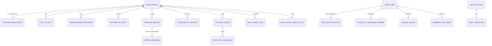
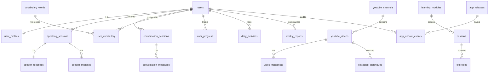

# 07 — Database Design and Documentation

**Revision Date:** 2026-11-18  
**Product:** SpeakCraft — AI Communication Skills Coach  
**Current Persistence Layer (Verified):** Cloud Firestore Enterprise (named database `ai-studio-android-speakcra-e1a16d03-38bd-4af0-9917-ae6b64cadc11`) governed by `/firestore.rules` and `/firebase-blueprint.json`, plus Jetpack DataStore Preferences (with Android Keystore AES-GCM) and local file storage (`filesDir/recordings/`, `filesDir/backups/`, `filesDir/updates/`). Room SQLite is **not used** (commented out in `app/build.gradle.kts`).  
**Target Relational Schema (Proposed):** PostgreSQL 16+ schema covering 28 normalized tables for multi-platform REST API deployment.

---

## Table of Contents

1. [Database Architecture Audit (Topics 1–4)](#database-architecture-audit)
2. [Existing Cloud Firestore Schema & Security Rules Audit (22 Collections)](#existing-cloud-firestore-schema--security-rules-audit)
3. [Local Device Persistence & File Storage (DataStore, Keystore, JSON Backups)](#local-device-persistence--file-storage)
4. [Entity-Relationship Diagrams (Firestore vs. Proposed PostgreSQL)](#entity-relationship-diagrams)
5. [Proposed Target PostgreSQL Schema (28 Normalized Tables)](#proposed-target-postgresql-schema)
6. [Indexing, Query Optimization, Integrity & Security (Topics 10–15)](#indexing-query-optimization-integrity--security)
7. [Retention, Archiving, Backup & Migration Strategy (Topics 16–20)](#retention-archiving-backup--migration-strategy)
8. [Cross-References & Open Questions](#cross-references--open-questions)

---

## Database Architecture Audit

### 1–4. Overview, Naming Conventions & Core Design Reality
* **Verified Fact:** **Zero SQL / PostgreSQL / Room tables exist in runtime code.** Although `app/build.gradle.kts` still compiles `ksp(libs.androidx.room.compiler)` (`ISS-012`), Room runtime/DAO/Entity classes do not exist.
* **Primary Cloud Store:** Cloud Firestore NoSQL document database using **camelCase** field names and **user-scoped subcollections** (`/users/{userId}/...`) paired with **top-level shared/admin collections**.
* **Integrity Enforcement:** Declarative schema validation is enforced at the database edge inside `/firestore.rules` (587 lines, verified by `/firestore.test.js`), using `hasAll()`, `hasOnly()`, `diff().affectedKeys().hasOnly()`, `request.time` server timestamp bounds, and regex assertions.

---

## Existing Cloud Firestore Schema & Security Rules Audit

### A. User-Scoped Collections (`/users/{userId}/...`) — 11 Paths

| Firestore Path | Entity (`firebase-blueprint.json`) | Required Fields | Access Control (`firestore.rules`) | Audit Notes / Issues |
| :--- | :--- | :--- | :--- | :--- |
| `/users/{userId}` | `UserProfile` | `userId`, `displayName`, `communicationLevel`, `onboardingCompleted`, `createdAt`, `updatedAt` | `get`: Owner or Admin; `list`: Admin; `create/update/delete`: Owner | Client directly writes scores/streaks (`ISS-008`, `ISS-002`) |
| `/users/{userId}/enrollments/{programId}` | `ProgramEnrollment` | `userId`, `programId`, `programTitle`, `currentDay` (1..180), `completedDays` (<=180), `active`, timestamps | Owner R/W/D (`isValidId`) | Only `completedDays[0] is int` validated (`ISS-009`) |
| `/users/{userId}/dailyActivities/{dateId}` | `DailyActivity` | `userId`, `dateKey` (8..20), `completedStepIds` (<=20), `minutesSpent` (0..600), timestamps | Owner R/W/D | `streakDays` increment bug (`ISS-002`) |
| `/users/{userId}/learningProgress/{progressId}` | `UserLearningProgress` | `userId`, `lessonId`, `moduleSlug`, `completed`, timestamps | Owner R/W/D | Unbounded `.snapshots()` (`ISS-010`) |
| `/users/{userId}/vocabulary/{wordId}` | `VocabularyEntry` | `userId`, `word`, `meaning`, `level`, `masteryLevel` (0..5), `repetitions`, `nextReviewEpochDay`, `usageAssessed`, timestamps | Owner R/W/D | Update restricted to review/note fields (`ISS-022`) |
| `/users/{userId}/speakingSessions/{sessionId}` | `SpeakingSession` | `userId`, `moduleType` (7 enums), `promptTitle`, `durationSeconds`, `overallAssessment`, `confidenceLevel`, 5 scores (`0..100`), timestamps | Owner `get/list/create/delete`; **`update: false`** (immutable) | `localMediaPath` is device-local (`ISS-004`); `isBoundedStringList` checks index 0..2 only (`ISS-009`) |
| `/users/{userId}/speechFeedback/{feedbackId}` | `SpeechFeedback` | `userId`, `sessionId`, `pronunciationAssessable`, timestamps | Owner `get/list/create/delete`; **`update: false`** (immutable) | Linked 1:1 with `SpeakingSession.feedbackId` |
| `/users/{userId}/conversationSessions/{sessionId}` | `ConversationSession` | `userId`, `scenario`, `difficultyLevel`, `turnCount` (0..500), timestamps | Owner R/W/D | Created only when debrief tapped (`ISS-021`) |
| `/users/{userId}/youtubeSources/{sourceId}` | `YouTubeSource` | `userId`, `videoId`, `title`, `videoUrl`, `category`, `difficulty`, `extractionStatus`, `transcriptAvailable`, timestamps | Owner R/W/D | Seeded per user on first launch (`ISS-011`) |
| `/users/{userId}/extractedTechniques/{techniqueId}` | `ExtractedTechnique` | `userId`, `title`, `category`, `difficulty`, `creatorAdvice`, `practicalExercise`, `sourceVideoTitle`, `sourceVideoUrl`, timestamps | Owner `get/list/create/delete`; **`update: false`** | Duplicates `CurriculumCatalog` per user (`ISS-011`) |
| `/users/{userId}/realWorldTasks/{taskId}` | `RealWorldTaskRecord` | `userId`, `taskTitle`, `completed`, timestamps | Owner R/W/D | Unbounded `.snapshots()` (`ISS-010`) |

### B. Top-Level Shared, Admin & Release Collections — 11 Paths

| Firestore Path | Entity | Access Control (`firestore.rules`) | Repository Usage Status |
| :--- | :--- | :--- | :--- |
| `/adminUsers/{userId}` | `AdminUser` | `get`: Owner or Admin; `list`: Admin; **All client writes `false`** (Server/Console only) | **Active** (`observeIsAdmin`) |
| `/youtubeChannels/{channelId}` | `YouTubeChannel` | `read`: Any signed-in user; `write`: `isAdmin()` | **Schema defined only** (not written by `SpeakCraftRepository` yet) |
| `/youtubeVideos/{videoId}` | `YouTubeVideo` | `read`: Signed-in; `write`: `isAdmin()` | **Active** (`adminSyncVideoAndTechniques`) |
| `/videoTranscripts/{videoId}` | `VideoTranscript` | `read`: Signed-in; `write`: `isAdmin()` | **Active** (`adminSyncVideoAndTechniques`) |
| `/extractedTechniques/{techniqueId}` | `ExtractedTechnique` | `read`: Signed-in if `moderationStatus == 'PUBLISHED'` OR `isAdmin()`; `write`: `isAdmin()` | **Active** (`observePublishedSharedTechniques` / `observePendingModerationTechniques`) |
| `/learningModules/{moduleId}` | `LearningModule` | `read`: Signed-in; `write`: `isAdmin()` | **Schema defined only** (UI reads `CurriculumCatalog.contentModules` in Kotlin) |
| `/lessons/{lessonId}` | `Lesson` | `read`: Signed-in if `status == 'PUBLISHED'` OR `isAdmin()`; `write`: `isAdmin()` | **Active** (`observePublishedSharedLessons` / `adminSaveSharedLesson`) |
| `/communicationExercises/{exerciseId}` | `CommunicationExercise` | `read`: Signed-in; `write`: `isAdmin()` | **Schema defined only** (not queried by UI yet) |
| `/learningChallenges/{challengeId}` | `LearningChallenge` | `read`: Signed-in; `write`: `isAdmin()` | **Active** (`observeSharedChallenges` / `adminSaveSharedChallenge`) |
| `/applicationReleases/{releaseId}` | `ApplicationRelease` | `read`: Signed-in if `enabled == true` OR `isAdmin()`; `write`: `isAdmin()` (enforces SemVer, HTTPS URL, 64-hex SHA-256) | **Active** (`observeEnabledReleases` / `adminPublishRelease`) |
| `/applicationUpdateEvents/{eventId}` | `ApplicationUpdateEvent` | `read`: Owner (`userId == auth.uid`) or `isAdmin()`; `create`: Signed-in owner; `update/delete: false` | **Active** (`logUpdateEvent`, `observeUserUpdateEvents`, `observeAllUpdateEventsForAdmin`) |

---

## Local Device Persistence & File Storage

1. **Jetpack DataStore (`AppPreferencesRepository.kt`):** File `speakcraft_prefs.preferences_pb`. Stores `theme_mode` (`SYSTEM`/`LIGHT`/`DARK`), `tts_rate` (`0.65f..1.35f`), `youtube_api_key_enc` (AES-256-GCM encrypted using Android Keystore alias `speakcraft_keystore_aes_v1`), `update_channel` (`stable`/`beta`), `last_update_check_ms`, `dismissed_release_version`.
2. **Local Recordings (`filesDir/recordings/`):** AAC `.m4a` (`AudioRecorderManager`) and SD `.mp4` (`CameraVideoRecorder` & Photo Picker copies). Exposed internally via `FileProvider`. **Not backed up in cloud (`ISS-004`).**
3. **Pre-Update Backup Snapshots (`filesDir/backups/`, `UpdateBackupManager.kt`):** JSON files (`speakcraft_backup_<timestamp>.json`) capturing app version, preferences metadata (excluding raw secrets), and local recording index, plus an interrupted-update recovery marker file.

---

## Entity-Relationship Diagrams

### A. Current Cloud Firestore Hierarchy

### B. Proposed Target PostgreSQL Relational Model (Core Subsystems)

---

## Proposed Target PostgreSQL Schema (28 Normalized Tables)

*Status: **Proposed / Not Implemented**. Designed for multi-platform Backend API (`02_BACKEND_ARCHITECTURE_DOCUMENTATION.md`) using `UUID` primary keys (`gen_random_uuid()`), `TIMESTAMPTZ` UTC timestamps, strict `CHECK` constraints, and foreign keys.*

### Core Identity & Preferences
1. **`users`**: `id UUID PK`, `firebase_uid VARCHAR(128) UNIQUE NOT NULL`, `email VARCHAR(255) UNIQUE NOT NULL`, `role VARCHAR(20) CHECK (role IN ('LEARNER','MODERATOR','ADMIN'))`, `is_active BOOLEAN DEFAULT TRUE`, `created_at TIMESTAMPTZ`, `updated_at TIMESTAMPTZ`.
2. **`user_profiles`**: `user_id UUID PK FK->users(id) ON DELETE CASCADE`, `display_name VARCHAR(100) NOT NULL`, `communication_level VARCHAR(24)`, `primary_goal VARCHAR(200)`, `onboarding_completed BOOLEAN DEFAULT FALSE`, `daily_goal_minutes SMALLINT CHECK (daily_goal_minutes BETWEEN 5 AND 240)`, `streak_days INT DEFAULT 0`, `last_practice_date DATE`, `total_practice_minutes INT DEFAULT 0`, `fluency_score SMALLINT`, `pronunciation_score SMALLINT`, `vocabulary_score SMALLINT`, `grammar_score SMALLINT`, `articulation_score SMALLINT`, `listening_score SMALLINT`, `confidence_self_rating SMALLINT`, `updated_at TIMESTAMPTZ`.
3. **`user_settings`**: `user_id UUID PK FK->users(id) ON DELETE CASCADE`, `theme_mode VARCHAR(12) DEFAULT 'SYSTEM'`, `tts_rate NUMERIC(3,2) DEFAULT 1.00`, `update_channel VARCHAR(16) DEFAULT 'stable'`, `reminder_enabled BOOLEAN DEFAULT FALSE`, `reminder_time_utc TIME`, `timezone VARCHAR(64) DEFAULT 'UTC'`, `updated_at TIMESTAMPTZ`.

### YouTube Content Intelligence
4. **`youtube_channels`**: `id UUID PK`, `youtube_channel_id VARCHAR(64) UNIQUE NOT NULL`, `handle VARCHAR(100) NOT NULL`, `title VARCHAR(250)`, `channel_url VARCHAR(500) NOT NULL`, `status VARCHAR(20) CHECK (status IN ('ACTIVE','PAUSED','ERROR'))`, `last_synced_at TIMESTAMPTZ`, `created_at TIMESTAMPTZ`.
5. **`youtube_playlists`**: `id UUID PK`, `channel_id UUID FK->youtube_channels(id)`, `youtube_playlist_id VARCHAR(64) UNIQUE NOT NULL`, `title VARCHAR(250) NOT NULL`, `video_count INT DEFAULT 0`, `created_at TIMESTAMPTZ`.
6. **`youtube_videos`**: `id UUID PK`, `channel_id UUID FK->youtube_channels(id)`, `playlist_id UUID NULL FK->youtube_playlists(id)`, `youtube_video_id VARCHAR(32) UNIQUE NOT NULL`, `title VARCHAR(300) NOT NULL`, `description TEXT`, `published_at TIMESTAMPTZ`, `duration_seconds INT CHECK (duration_seconds >= 0)`, `video_url VARCHAR(500) NOT NULL`, `thumbnail_url VARCHAR(500)`, `transcript_available BOOLEAN DEFAULT FALSE`, `processing_status VARCHAR(24)`, `created_at TIMESTAMPTZ`.
7. **`video_transcripts`**: `id UUID PK`, `video_id UUID UNIQUE FK->youtube_videos(id) ON DELETE CASCADE`, `language_code VARCHAR(16) DEFAULT 'en'`, `full_text TEXT`, `segments_json JSONB NOT NULL`, `attribution_notice VARCHAR(300)`, `created_at TIMESTAMPTZ`.
8. **`extracted_techniques`**: `id UUID PK`, `video_id UUID FK->youtube_videos(id)`, `requested_by_user_id UUID NULL FK->users(id)`, `title VARCHAR(250) NOT NULL`, `category VARCHAR(100) NOT NULL`, `difficulty VARCHAR(20) NOT NULL`, `creator_advice TEXT NOT NULL`, `ai_explanation TEXT`, `original_context TEXT`, `instructions TEXT`, `practical_exercise TEXT NOT NULL`, `expected_outcome TEXT`, `suggested_duration_minutes SMALLINT`, `common_mistake TEXT`, `correction TEXT`, `timestamp_label VARCHAR(40)`, `is_creator_derived BOOLEAN DEFAULT TRUE`, `moderation_status VARCHAR(20) CHECK (moderation_status IN ('PENDING_REVIEW','APPROVED','PUBLISHED','REJECTED'))`, `embedding VECTOR(768)` *(optional pgvector)*, `created_at TIMESTAMPTZ`.

### Curriculum & Practice Programs
9. **`learning_modules`**: `id UUID PK`, `slug VARCHAR(100) UNIQUE NOT NULL`, `title VARCHAR(150) NOT NULL`, `description TEXT`, `category VARCHAR(100) NOT NULL`, `order_index SMALLINT NOT NULL`, `is_published BOOLEAN DEFAULT TRUE`.
10. **`lessons`**: `id UUID PK`, `module_id UUID FK->learning_modules(id)`, `technique_id UUID NULL FK->extracted_techniques(id)`, `title VARCHAR(250) NOT NULL`, `objective TEXT NOT NULL`, `source_video_url VARCHAR(500)`, `timestamp_label VARCHAR(40)`, `explanation TEXT`, `instructions_json JSONB`, `example_text TEXT`, `practice_prompt TEXT NOT NULL`, `next_lesson_id UUID NULL FK->lessons(id)`, `is_creator_derived BOOLEAN DEFAULT TRUE`, `status VARCHAR(16) DEFAULT 'PUBLISHED'`, `created_at TIMESTAMPTZ`.
11. **`exercises`**: `id UUID PK`, `module_id UUID FK->learning_modules(id)`, `lesson_id UUID NULL FK->lessons(id)`, `title VARCHAR(250) NOT NULL`, `instructions TEXT NOT NULL`, `difficulty VARCHAR(20)`, `duration_seconds INT`, `is_ai_supplement BOOLEAN DEFAULT FALSE`.
12. **`learning_programs`**: `id UUID PK`, `slug VARCHAR(80) UNIQUE NOT NULL`, `title VARCHAR(200) NOT NULL`, `duration_days SMALLINT CHECK (duration_days IN (30,60,90,180))`, `description TEXT`, `syllabus_json JSONB NOT NULL`.
13. **`user_program_enrollments`**: `id UUID PK`, `user_id UUID FK->users(id) ON DELETE CASCADE`, `program_id UUID FK->learning_programs(id)`, `current_day SMALLINT DEFAULT 1`, `completed_days INT[] DEFAULT '{}'`, `active BOOLEAN DEFAULT TRUE`, `UNIQUE(user_id, program_id)`, `updated_at TIMESTAMPTZ`.
14. **`user_progress`**: `id UUID PK`, `user_id UUID FK->users(id) ON DELETE CASCADE`, `lesson_id UUID FK->lessons(id)`, `completed BOOLEAN DEFAULT FALSE`, `attempts_count INT DEFAULT 0`, `last_score SMALLINT`, `notes TEXT`, `UNIQUE(user_id, lesson_id)`, `updated_at TIMESTAMPTZ`.

### Speaking, Media & Feedback
15. **`speaking_sessions`**: `id UUID PK`, `user_id UUID FK->users(id) ON DELETE CASCADE`, `module_type VARCHAR(32) NOT NULL`, `prompt_title VARCHAR(300) NOT NULL`, `duration_seconds INT NOT NULL`, `storage_object_key VARCHAR(500)`, `media_mime_type VARCHAR(64)`, `media_size_bytes BIGINT`, `transcript TEXT`, `confidence_level VARCHAR(16)`, `pronunciation_assessable BOOLEAN DEFAULT TRUE`, `fluency_score SMALLINT`, `pronunciation_score SMALLINT`, `vocabulary_score SMALLINT`, `grammar_score SMALLINT`, `articulation_score SMALLINT`, `words_per_minute SMALLINT`, `deleted_at TIMESTAMPTZ NULL`, `created_at TIMESTAMPTZ NOT NULL`. *(Candidate for monthly range partitioning on `created_at` at >1M users).*
16. **`speech_feedback`**: `id UUID PK`, `session_id UUID UNIQUE FK->speaking_sessions(id) ON DELETE CASCADE`, `overall_assessment TEXT NOT NULL`, `audio_quality_note VARCHAR(500)`, `articulation_clarity TEXT`, `thought_organization TEXT`, `next_recommended_activity VARCHAR(400)`, `strengths_json JSONB`, `better_alternatives_json JSONB`, `recommended_exercises_json JSONB`, `created_at TIMESTAMPTZ`.
17. **`speech_mistakes`**: `id UUID PK`, `session_id UUID FK->speaking_sessions(id) ON DELETE CASCADE`, `user_id UUID FK->users(id)`, `mistake_type VARCHAR(24) CHECK (mistake_type IN ('GRAMMAR','FILLER','REPEATED','PRONUNCIATION'))`, `quoted_phrase TEXT NOT NULL`, `correction_hint TEXT`, `occurrence_count SMALLINT DEFAULT 1`, `created_at TIMESTAMPTZ`.

### Vocabulary & Spaced Repetition
18. **`vocabulary_words`**: `id UUID PK`, `word VARCHAR(80) UNIQUE NOT NULL`, `phonetic VARCHAR(120)`, `meaning VARCHAR(600) NOT NULL`, `level VARCHAR(20) NOT NULL`, `synonyms_json JSONB`, `antonyms_json JSONB`, `example_sentence VARCHAR(600)`, `collocations_json JSONB`, `is_system_seed BOOLEAN DEFAULT TRUE`.
19. **`user_vocabulary`**: `id UUID PK`, `user_id UUID FK->users(id) ON DELETE CASCADE`, `word_id UUID NULL FK->vocabulary_words(id)`, `custom_word VARCHAR(80)`, `custom_meaning VARCHAR(600)`, `personal_note TEXT`, `mastery_level SMALLINT DEFAULT 0`, `repetitions INT DEFAULT 0`, `ease_factor NUMERIC(4,2) DEFAULT 2.50`, `next_review_date DATE NOT NULL`, `usage_assessed BOOLEAN DEFAULT FALSE`, `updated_at TIMESTAMPTZ`.

### Conversation Simulator & AI Mentor
20. **`conversation_sessions`**: `id UUID PK`, `user_id UUID FK->users(id) ON DELETE CASCADE`, `scenario VARCHAR(120) NOT NULL`, `difficulty_level VARCHAR(40) NOT NULL`, `turn_count INT DEFAULT 0`, `summary_feedback TEXT`, `ended_at TIMESTAMPTZ`, `created_at TIMESTAMPTZ`.
21. **`conversation_messages`**: `id UUID PK`, `conversation_id UUID FK->conversation_sessions(id) ON DELETE CASCADE`, `role VARCHAR(16) CHECK (role IN ('USER','ASSISTANT'))`, `content TEXT NOT NULL`, `audio_object_key VARCHAR(500)`, `turn_index INT NOT NULL`, `created_at TIMESTAMPTZ`.

### Daily Practice, Challenges, Tasks & Analytics
22. **`daily_challenges`**: `id UUID PK`, `title VARCHAR(200) NOT NULL`, `challenge_type VARCHAR(16) CHECK (challenge_type IN ('DAILY','WEEKLY'))`, `duration_seconds INT NOT NULL`, `prompt TEXT NOT NULL`, `framework_hint VARCHAR(400)`, `source_reference VARCHAR(300)`, `active BOOLEAN DEFAULT TRUE`, `created_at TIMESTAMPTZ`.
23. **`user_challenge_attempts`**: `id UUID PK`, `user_id UUID FK->users(id) ON DELETE CASCADE`, `challenge_id UUID FK->daily_challenges(id)`, `speaking_session_id UUID NULL FK->speaking_sessions(id)`, `completed_at TIMESTAMPTZ NOT NULL`.
24. **`daily_activities`**: `id UUID PK`, `user_id UUID FK->users(id) ON DELETE CASCADE`, `activity_date DATE NOT NULL`, `completed_step_ids TEXT[] NOT NULL`, `reflection_text TEXT`, `confidence_rating SMALLINT CHECK (confidence_rating BETWEEN 1 AND 10)`, `minutes_spent SMALLINT NOT NULL`, `UNIQUE(user_id, activity_date)`, `updated_at TIMESTAMPTZ`.
25. **`real_world_tasks`**: `id UUID PK`, `user_id UUID FK->users(id) ON DELETE CASCADE`, `task_title VARCHAR(300) NOT NULL`, `source_video_url VARCHAR(500)`, `completed BOOLEAN DEFAULT FALSE`, `reflection TEXT`, `linked_session_id UUID NULL FK->speaking_sessions(id)`, `updated_at TIMESTAMPTZ`.
26. **`weekly_reports`**: `id UUID PK`, `user_id UUID FK->users(id) ON DELETE CASCADE`, `week_start_date DATE NOT NULL`, `sessions_count INT`, `avg_fluency NUMERIC(5,2)`, `avg_pronunciation NUMERIC(5,2)`, `avg_articulation NUMERIC(5,2)`, `top_mistakes_json JSONB`, `ai_narrative_summary TEXT`, `UNIQUE(user_id, week_start_date)`, `generated_at TIMESTAMPTZ`.

### Release Management & Notifications
27. **`app_releases`**: `id UUID PK`, `platform VARCHAR(16) CHECK (platform IN ('android','win32','web'))`, `version_name VARCHAR(32) NOT NULL`, `version_code INT NOT NULL`, `channel VARCHAR(16) CHECK (channel IN ('stable','beta'))`, `release_notes TEXT NOT NULL`, `features_json JSONB`, `bug_fixes_json JSONB`, `security_json JSONB`, `download_url VARCHAR(600) NOT NULL`, `sha256_checksum CHAR(64) NOT NULL`, `signing_cert_sha256 VARCHAR(128)`, `min_supported_version VARCHAR(32) NOT NULL`, `mandatory BOOLEAN DEFAULT FALSE`, `enabled BOOLEAN DEFAULT TRUE`, `published_at TIMESTAMPTZ`, `UNIQUE(platform, version_name, version_code)`.
28. **`app_update_events`** *(plus `user_notifications` extension)*: `id UUID PK`, `user_id UUID FK->users(id) ON DELETE CASCADE`, `release_id UUID NULL FK->app_releases(id)`, `from_version VARCHAR(32) NOT NULL`, `to_version VARCHAR(32) NOT NULL`, `channel VARCHAR(16)`, `status VARCHAR(24) NOT NULL`, `detail VARCHAR(500)`, `created_at TIMESTAMPTZ`. *(Note: A 29th auxiliary table `user_notifications` should accompany `FEAT-034` when push reminders launch).*

---

## Indexing, Query Optimization, Integrity & Security

### 10–15. Indexing, Transactions, Constraints & Access Controls
* **Current Firestore Indexing Gap (`ISS-027`):** `firestore.indexes.json` is absent. Current queries avoid composite indexes only because they omit `.orderBy()` on filtered fields (`whereEqualTo("enabled", true)`). Adding `.orderBy("createdAt", DESC)` + `.limit(25)` requires explicit composite indexes in `firestore.indexes.json`.
* **Proposed PostgreSQL Indexes:**
  * `CREATE INDEX idx_speaking_sessions_user_created ON speaking_sessions (user_id, created_at DESC) WHERE deleted_at IS NULL;`
  * `CREATE INDEX idx_user_vocab_due ON user_vocabulary (user_id, next_review_date);`
  * `CREATE INDEX idx_extracted_tech_pub_cat ON extracted_techniques (moderation_status, category, difficulty);`
  * `CREATE INDEX idx_speech_mistakes_user_type ON speech_mistakes (user_id, mistake_type, created_at DESC);`
  * `GIN` index on `extracted_techniques` `to_tsvector('english', title || ' ' || creator_advice)` for fast curriculum search.
* **Transactions & Concurrency:**
  * Current Firestore uses `WriteBatch` for `speakingSessions` + `speechFeedback` and `saveYouTubeAnalysis`, but uses non-transactional `get() + update()` on `users/{uid}` score blending (`SpeakCraftRepository.kt:732-756`) — susceptible to lost updates under concurrent writes. Target backend should wrap session creation + rolling score update in a single ACID PostgreSQL transaction or `runTransaction` in Firestore.

---

## Retention, Archiving, Backup & Migration Strategy

### 16–20. Partitioning, Lifecycle Retention, GDPR Deletion & Migration Plan
* **Soft Delete vs. Hard Delete:** Current Android `deleteSpeakingSession` and `clearSpeakingHistory` perform **hard deletes** in Firestore and device storage (`ISS-019`). Proposed PostgreSQL uses `deleted_at` soft-delete with a 30-day grace purge + immediate hard-delete endpoint for GDPR/Play Account Deletion compliance.
* **Partitioning & Retention (at >100k–1M users):** Range-partition `speaking_sessions`, `conversation_messages`, and `app_update_events` monthly by `created_at`; purge raw video binaries in GCS/S3 after 90 days (unless user exports/pins) while retaining lightweight `.m4a` audio + transcripts.
* **Firestore -> PostgreSQL Zero-Downtime Migration Strategy:**
  1. Deploy PostgreSQL + Backend API Gateway (`API-001`..`API-014`).
  2. Enable **Dual-Write Adapter** inside Backend API (writes to PostgreSQL first, mirrors summary documents to Firestore during mobile transition).
  3. Run idempotent backfill ETL job reading Firestore export (`gs://`) -> PostgreSQL (`ON CONFLICT DO NOTHING`) keyed by `firebase_uid` and original document IDs.
  4. Verify row counts & score checksums (`Verify Parity`), then switch Android/Electron/Web reads exclusively to PostgreSQL APIs.

---

## Cross-References & Open Questions

* **Cross-References:** `02_BACKEND_ARCHITECTURE_DOCUMENTATION.md` (API contracts & SDK operations), `03_USER_SCALABILITY_DOCUMENTATION.md` (read amplification & storage growth), `04_ISSUES_BUGS_AND_TECHNICAL_DEBT.md` (`ISS-002`, `ISS-004`, `ISS-008`–`ISS-011`, `ISS-027`).
* **Open Questions:**
  1. Should raw audio/video transcripts (`15,000` chars/session) be compressed or archived to cold storage after 12 months?
  2. Does compliance require an in-app `"Delete My Account & All Cloud Data"` self-service flow (note: currently `SettingsScreen` only clears speaking history, not the `/users/{uid}` account document or Firebase Auth user)?
