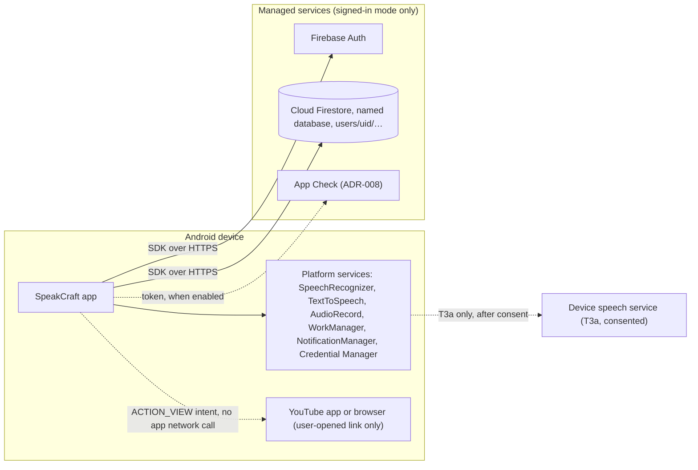

# API and Integration Specification — SpeakCraft

| Field | Value |
|---|---|
| Document ID | ARC-04 |
| Version | 0.1 — Draft for review |
| Date | 2026-11-21 |
| Status | Draft — Proposed, awaiting approval (gate G3) |
| Owner (role) | Solution Architect |
| Approval | Pending — Product Owner |
| Related | ARC-01 Solution Architecture, ARC-02 Technical Design, ARC-03 Database Design, SEC-01 Security Design, ARC-05 Local Intelligence Architecture, ADR-001…ADR-015, ENG-01, SRS, NFR, RD-02, RD-03, working papers `platform_security_audit.md` (§2, §3), `FND_ID_MAP.md` |

> **Authority (GOV-02 §4).** ARC-04 is authoritative for: the inventory of external integrations and their disposition (§2), the platform API contracts the target design relies on (§3), the Firestore **operations, query shapes and error handling** (§4 — the document schema itself is ARC-03 §8), the **internal module interfaces** (§5; WBS T-02.2.2, T-03.2.1), the typed error model (§6) and version compatibility (§7). Component IDs (`CMP-nn`) come from ARC-02 §2; security controls (`SEC-REQ-nn`, `THR-nn`) from SEC-01.
>
> **Evidence rule (GOV-02 DC-3/DC-4).** **EXISTING** = in the code today, with `path:line` (re-checked against the source for this document); **PROPOSED** = target design, not built; **VERIFIED** = seen in source/config; **INFERRED** = reasoned from evidence or from documented platform behaviour that could not be re-checked offline; **RECOMMENDATION**; **DECISION** = approved by the Product Owner. Nothing was built, run or deployed. Values marked † are *Proposed — requires approval*. `pkg/` = `app/src/main/java/com/example/`.
>
> **Product Owner direction (2026-11-21).** The curriculum is built from the techniques taught on the @askvinh YouTube channel (PRD-FR-056). **D-08 — DECISION: "original wording, link out"** (PRD-FR-057, SRS-FR-PRAC-009, SRS-BR-028): content is curated **by hand** into the bundled content pack in our own words; the only YouTube touchpoint is an outbound `ACTION_VIEW` link to the specific source video (§3.9). Watch-page scraping, caption (timedtext) download, RSS ingestion and the Data API key stay **retired** (§2) because scraping and caption download breach YouTube's Terms of Service whatever the content basis. Mistakes found and coach tips after every attempt (SRS-FR-EVAL-015/016, SRS-FR-WORD-014) are on-device, deterministic logic over content-pack tips (ARC-05 §8.4); `ContentRepository` therefore exposes techniques and tips (§5.5). Sections adjusted for this direction: §1, §2 rows 6 and 19–20, §3.9, §4.2, §5.5, §7, §8, §9.

---

## 1. Principle: there is no backend

| # | Principle |
|---|---|
| P-1 | **SpeakCraft has no server of its own and none is proposed.** There are no REST/GraphQL APIs, no Cloud Functions and no admin endpoints (SEC-01 §1.2; RD-02 §2.3). Any server-side component would need an ADR (GOV-02 DC-6) |
| P-2 | The device talks only to **managed services** through their SDKs, and only when the user is signed in: Firebase Authentication (Google provider via Credential Manager) and Cloud Firestore (existing named database), protected by Firebase Auth identity and security rules (SEC-01 §5). In no-account mode the app makes **no** network request (SEC-REQ-02) |
| P-3 | "API" in this document therefore means (a) **Android platform APIs**, (b) **Firebase SDK contracts** and the Firestore document operations the app performs, and (c) **internal Kotlin module interfaces** between packages. This document does **not** invent backend endpoints |
| P-4 | Every interface in §5 is **PROPOSED**. Every integration described as present today is **EXISTING** with `path:line` evidence |
| P-5 | A new external integration (SDK, endpoint, embedded web content, permission) requires an ADR, the SEC-01 §9.7 privacy review and Product Owner approval before implementation (ADR README; NFR-MAINT-007) |
| P-6 | Speech audio never leaves the device through SpeakCraft. The only exception is T3a, where the **device's speech service** (not SpeakCraft) receives audio after explicit consent (ADR-009; SEC-REQ-20/21) |



---

## 2. Existing integrations inventory and disposition

Evidence was re-checked in the source for this document (VERIFIED unless labelled). Status: **Keep** (retained, usually refactored), **Retire** (removed from the product), **Replace** (capability kept, implementation replaced).

| # | Integration | What it does today (EXISTING) | Evidence (`path:line`) | Network | Status | Target | Decision |
|---|---|---|---|---|---|---|---|
| 1 | **Firebase Auth via Credential Manager (Google)** | Silent sign-in with `GetGoogleIdOption` (authorised accounts, auto-select) and interactive `GetSignInWithGoogleOption`; ID token → `GoogleAuthProvider.getCredential` → `signInWithCredential`; sign-out clears credential state then `signOut()`; the whole app is gated behind sign-in; raw exception text shown on failure | `pkg/data/firebase/AuthHelper.kt:41-82` (silent; option at `:58-62`), `:84-124` (interactive; option at `:98`), `:71`, `:109` (`signInWithCredential`), `:126-143` (sign-out; `clearCredentialState` `:134`, `signOut()` `:138`), `:121` (raw `localizedMessage`), `:33-39` (`authStateFlow`); deps `app/build.gradle.kts:137,140-142`; gating `SpeakCraftRepository.kt:53-56` | Identity Toolkit, Secure Token, Play services (INFERRED, SEC-01 §8.3) | **Keep** (refactor) | CMP-53 `FirebaseAccountRepository` + `GoogleCredentialClient`; sign-in optional (D-05); error mapping SEC-01 §4.6; re-auth before deletion; process-scoped auth state | ADR-001; SEC-01 §4 |
| 2 | **Cloud Firestore (named database)** | Primary store for all signed-in data; ~20 user subcollections plus shared/admin collections; writes awaited on UI paths (51 `await()` calls in the repository); 16 snapshot listeners at sign-in; SDK default cache (no settings) | DB id `res/values/firebase_applet_config.xml:3`; `firebase.json:4` (platform audit §3.1); instance `pkg/data/AppContainer.kt:25-27`, `SpeakCraftRepository.kt:47-51`, `ActivityFirestoreRepository.kt:32`; no `FirebaseFirestoreSettings` anywhere (grep); dep `app/build.gradle.kts:136`; collections platform audit §3.2 | `firestore.googleapis.com` | **Keep** (re-purposed) | Optional backup/sync target only (ADR-014): CMP-52 is the only caller, via `SyncWorker`; target schema ARC-03 §8; legacy collections read/delete-only then retired (SEC-01 §5.6) | ADR-002, ADR-014 |
| 3 | **Firebase App Check** | Debug provider when `BuildConfig.DEBUG`, with a debug secret read from a **launch-intent extra**; reCAPTCHA provider otherwise; errors swallowed; debug artifact ships in release | `pkg/data/firebase/AppCheckConfig.kt:18` (entry), `:24-43` (debug branch; extra read `:25`, secret commit `:33-35`, provider `:41-43`), `:45-60` (reCAPTCHA), `:61-63` (swallow); called from `pkg/MainActivity.kt:15`; deps `app/build.gradle.kts:138-139`; site key `firebase_applet_config.xml:4` | `firebaseappcheck.googleapis.com` (INFERRED) | **Keep product, replace provider** | CMP-51: intent injection removed; debug provider in the `debug` source set (`debugImplementation`); Play Integrity once Play-linked; **not enforced** while sideloaded channels exist (SD-06) | ADR-008; SEC-01 §4.7 |
| 4 | **Firebase AI Logic (Gemini)** | Cloud generative calls incl. audio/video upload and Live microphone streaming; reachable only if a compile-time constant changes | `pkg/data/ai/cloud/FirebaseAiLogicService.kt:17-28` (imports), `:78` (`Firebase.ai`), `:104` (`generativeModel`), `:487` (`liveModel`); wiring `AppContainer.kt:43-45,70-79`; gate `pkg/data/ai/local/LocalExecutionPolicy.kt:13`; dep `app/build.gradle.kts:135` | Vertex/Gemini endpoints (INFERRED) | **Retire** | Removed SDK, service, coordinator branches, settings keys; TC-SEC-010 build check | ADR-003 (D-04) |
| 5 | **GitHub Releases API self-updater** | Fetches releases from `api.github.com` (repo slug user-editable), downloads APK, verifies SHA/certs, installs through FileProvider; also reads Firestore `applicationReleases` | `pkg/data/update/GitHubReleaseClient.kt:12` (OkHttp), `:23` (API URL); `pkg/data/update/ReleaseUpdateRepository.kt:53` (OkHttp), `:318` (`FileProvider.getUriForFile`), `:324` (APK MIME), `:327` (`resolveActivity`); wiring `AppContainer.kt:93-103`; `BuildConfig.GITHUB_RELEASE_REPO` `app/build.gradle.kts:41-45`; Firestore reads `SpeakCraftRepository.kt:386,397,402`; FileProvider path `res/xml/file_paths.xml:3`; no `REQUEST_INSTALL_PACKAGES` (`AndroidManifest.xml:5-8`) | `api.github.com`, GitHub asset hosts | **Retire** | Updater, screens, collections and FileProvider paths removed; distribution per ADR-004 (release-signed GitHub downloads without in-app installer, then Play) | ADR-004 (D-03) |
| 6 | **YouTube: watch-page scraping, timedtext captions, RSS feeds, Data API v3** | Scrapes watch pages with a spoofed browser user-agent, extracts `captionTracks` base URLs and downloads captions, reads channel/playlist RSS, optionally calls the Data API with a user-entered key in the URL; captions published as "techniques" | `pkg/data/youtube/YouTubeIntelligenceClient.kt:61` (OkHttp), `:95`, `:123` (RSS), `:199` (watch page), `:392`, `:401` (`captionTracks` / `baseUrl`), `:310` (Data API with `key=`), `:508` (spoofed User-Agent); wiring `AppContainer.kt:81-83`; Settings copy `pkg/ui/screens/AnalyticsAndSettingsScreens.kt:942` | `www.youtube.com`, `i.ytimg.com`, `www.googleapis.com/youtube/v3` | **Retire** — unchanged by D-08 | Content is curated **by hand** into the content pack (ARC-03 §6). The Data API key field, the client and the screen are removed. The only YouTube touchpoint is row 19 | ADR-011; SRS-BR-028 |
| 7 | **Android `SpeechRecognizer`** | One-utterance live transcription, default off; on-device recogniser on API 31+ if available, **else silent fallback to the default (often network) recogniser**; `EXTRA_PREFER_OFFLINE`; no `<queries>` | `pkg/data/ai/local/audio/LiveTranscriptionManager.kt:77-82` (availability incl. `isOnDeviceRecognitionAvailable`), `:99-103` (on-device vs default), `:160-166` (intent; `EXTRA_PREFER_OFFLINE` `:165`); `pkg/data/media/TtsAndSpeechHelper.kt:126` (`createSpeechRecognizer`), `:222`; `pkg/data/ai/IntelligenceCapabilityManager.kt:91,99`; `AndroidManifest.xml:1-49` (no `<queries>`) | Default recogniser may use the network (INFERRED; FND-SEC-07) | **Keep platform API, replace implementation** | CMP-25/28 `RecognitionSession` with tiers T1/T2/T3a/T3b; non-on-device recogniser only with valid consent (SEC-REQ-20); `<queries>` added | ADR-009 |
| 8 | **Android `TextToSpeech`** | Reference audio; locale hard-coded to `Locale.US` | `pkg/data/media/TtsAndSpeechHelper.kt:57` (constructor), `:59` (`setLanguage(Locale.US)`) | None by the app | **Keep** (refactor) | CMP-38 `TtsPlayer`, locale from the recognition-locale preference; 1.0× / 0.75× | ADR-001 |
| 9 | **`MediaRecorder` (AAC/M4A)** | Records 44.1 kHz AAC to shared `filesDir/recordings/`, later decoded into boxed arrays for analysis | `pkg/data/media/AudioRecorderManager.kt:57` (folder), `:62` (file name), `:66-76` (`MediaRecorder`, `MIC`, MPEG-4/AAC, 96 kbps, 44.1 kHz) | None | **Replace** | CMP-26 `AudioRecord` 16 kHz mono PCM16 + WAV in `noBackupFilesDir/recordings/<profileId>/`; AAC transcode after evaluation via `MediaCodec` (CMP-40; mandatory per ADR-015) | ADR-009, ADR-015 |
| 10 | **CameraX** | In-app video recording for body-language analysis | `pkg/data/media/CameraVideoRecorder.kt:7-17` (imports); deps `app/build.gradle.kts:123-127`; `CAMERA` permission `AndroidManifest.xml:8` | None | **Retire** (R1–R2) | Removed with the permission; R3 self-review only by new decision | ADR-010 |
| 11 | **MediaPipe Tasks (vision, audio)** | Face/pose/hand landmarkers without bundled models; tasks-audio included with zero imports | `pkg/data/ai/local/video/BodyLanguageAnalysisEngine.kt:5-8`, `FaceLandmarkAnalysisEngine.kt:6-9`, `GestureAnalysisEngine.kt:5-8`; deps `app/build.gradle.kts:145`, `:148`; model URLs `pkg/data/ai/local/OnDeviceModelManager.kt:112,126,140` | `storage.googleapis.com` URLs listed but no downloader | **Retire** | Removed (APK size, 16 KB page-size risk) | ADR-010 |
| 12 | **TensorFlow Lite (Whisper/Moonshine)** | Fabricated on-device ASR path; model URLs with blank hashes | `pkg/data/ai/local/audio/LocalSpeechRecognitionEngine.kt:13` (import), `:143` (`Interpreter`); dep `app/build.gradle.kts:151`; URLs `OnDeviceModelManager.kt:84,98` | `huggingface.co` URLs listed but no downloader | **Retire** | Removed; a correct implementation is research spike SPK-03 (R3) only | ADR-009 (Option B deferred) |
| 13 | **Release-publishing script** | CI writes `applicationReleases/rel_<ver>_<code>` with firebase-admin into the named database, bypassing rules | `scripts/publish_firestore_release.mjs:16-26` (database id from XML), `:168-175` (`initializeApp`, `getFirestore(app, databaseId)`); invoked `.github/workflows/release_on_push.yml:499-501`; tests `scripts/publish_firestore_release.test.mjs` | Firestore via Admin SDK, service-account key | **Retire** | Script and secret removed; revoke the service-account key (SEC-01 §8.1) | ADR-004 |
| 14 | **FileProvider** | Shares `files/updates/`, `files/backups/`, `files/recordings/` and the whole cache dir; only `updates/` is used | `AndroidManifest.xml:38-46`; `res/xml/file_paths.xml:3-6`; only caller `ReleaseUpdateRepository.kt:318` | None | **Replace** | Current paths removed; re-introduced only per §3.8 (diagnostics, and export only if Option B is decided) | SEC-01 §6.1; FND-SEC-12 |
| 15 | **OkHttp** | Three separate clients (GitHub, APK download, YouTube) | `GitHubReleaseClient.kt:12`, `ReleaseUpdateRepository.kt:53`, `YouTubeIntelligenceClient.kt:61` | As rows 5–6 | **Retire** (after rows 5, 6, 12) | Removed from the catalog | ADR-006 |
| 16 | **Jetpack DataStore** | Two preference stores | `pkg/data/preferences/AppPreferencesRepository.kt:22`; `TutorialState.kt:11` (platform audit §1.2) | None | **Keep** | `settings` and `device_state` stores (CMP-43) | ADR-001 |
| 17 | **Play Store / browser fallback links** | Updater falls back to the release page or Play Store URL when no installer resolves | `ReleaseUpdateRepository.kt:332-338` (platform audit §7) | Opens external apps | **Retire** with the updater | — | ADR-004 |
| 18 | **Firebase Installations** (implicit) | Pulled in by Firebase SDKs for installation ids / App Check | INFERRED (SEC-01 §8.3) | `firebaseinstallations.googleapis.com` | **Keep** (implicit; signed-in mode only) | Verified by traffic capture TC-SEC-002/048 | SEC-01 §8.3 |
| 19 | **Outbound link to a specific source video** | — (new) | — | None by the app; the user's YouTube app or browser loads the video | **PROPOSED** | `ExternalLinkLauncher` (CMP-16): `ACTION_VIEW` intent only, URL from the content pack, host allow-list, no API key, no scraping, no embedded download (§3.9) | D-08 DECISION; SRS-FR-PRAC-009 |
| 20 | **Embedded official YouTube IFrame player** | — | — | Would load YouTube web content inside the app | **Not proposed** | Option only if separately approved: it is a new integration (WebView + IFrame Player API terms, cookies, tracking) needing an ADR, the SEC-01 §9.7 privacy review and data-safety updates | — |

Not present today (VERIFIED absent, RD-02 §2.3, §2.5): Firebase Storage, Cloud Functions, FCM, Remote Config, Analytics, Crashlytics, WorkManager, system notifications.

---

## 3. Platform API contracts used by the target design

API levels are minimums for the call. "SPK-01" marks behaviour that must be verified on the reference devices before the R1 build (ARC-05 §4.4; NFR §1). Platform facts are **INFERRED** from the Android API reference (not re-checked online in Stage A) unless stated.

### 3.1 Summary by API level

| API level | Capability used | Tier / feature impact |
|---|---|---|
| 24–25 | `AudioRecord.Builder`, legacy `requestAudioFocus(listener, stream, hint)`, `SpeechRecognizer.createSpeechRecognizer`, `TextToSpeech`, `MediaCodec`/`MediaMuxer`, WorkManager, Credential Manager via Play services | T3a/T3b only; `java.time` unavailable without desugaring (ARC-02 TQ-14) |
| 26+ | `AudioFocusRequest`, notification channels, `Settings.ACTION_APP_NOTIFICATION_SETTINGS` | — |
| 29+ | `AudioRecordingConfiguration.isClientSilenced()` / recording callbacks | Silenced-mic detection (SPK-01) |
| 30+ | Package visibility: `<queries>` required for `RecognitionService` (and `TTS_SERVICE`, ARC-02 TQ-17); `AudioRecord.Builder.setPrivacySensitive` | Recognition fails without `<queries>` (FND-AI-04, INFERRED) |
| 31+ | `SpeechRecognizer.isOnDeviceRecognitionAvailable`, `createOnDeviceSpeechRecognizer`; error codes 10–13 | **T2** |
| 33+ | `RecognizerIntent.EXTRA_AUDIO_SOURCE` (+ encoding/channel/rate), `EXTRA_SEGMENTED_SESSION`, `onSegmentResults`, `onEndOfSegmentedSession`, `checkRecognitionSupport`, `triggerModelDownload(Intent)`, `EXTRA_ENABLE_FORMATTING`; `POST_NOTIFICATIONS` runtime permission | **T1**, language packs, notification permission |
| 34+ | `triggerModelDownload(Intent, Executor, ModelDownloadListener)`; word-level timing/confidence (`EXTRA_REQUEST_WORD_TIMING`, `RECOGNITION_PARTS`) | Pack progress; optional word timing (SPK-01) |

### 3.2 `android.speech.SpeechRecognizer` (CMP-23, CMP-25, CMP-28)

| API | Min | Contract in the target design | Failure handling | Verify |
|---|---|---|---|---|
| `SpeechRecognizer.isRecognitionAvailable(ctx)` | 8 | Any recogniser present; input to T3a/T3b decision | `false` ⇒ T3b | Stage B |
| `SpeechRecognizer.isOnDeviceRecognitionAvailable(ctx)` | 31 | On-device recogniser present (EXISTING use `LiveTranscriptionManager.kt:82`) | `false` ⇒ not T1/T2 | SPK-01 |
| `SpeechRecognizer.createOnDeviceSpeechRecognizer(ctx)` | 31 | **Only** constructor for T1/T2 (CMP-25); never network by design (SEC-01 §7.2) | Exception ⇒ demote for the attempt | SPK-01 |
| `SpeechRecognizer.createSpeechRecognizer(ctx)` | 8 | T3a only, and only when `ConsentStore.isValid(currentDisclosureVersion, recogniserPackage)` (SEC-REQ-20; TC-SEC-015) | No consent ⇒ refuse, T3b | Stage B |
| `checkRecognitionSupport(intent, executor, RecognitionSupportCallback)` | 33 | `RecognitionSupport` installed / pending / supported on-device languages for the selected locale → `PackState` (ARC-05 §4.3) | `onError(ERROR_CANNOT_CHECK_SUPPORT)` ⇒ `PackState.UNKNOWN` (never shown as "ready") | SPK-01 |
| `triggerModelDownload(intent)`; listener overload (34) | 33 / 34 | "Install offline speech" (SRS-FR-SPCH-004); status re-polled on resume (33) or via `ModelDownloadListener` (34) | Failure ⇒ `PackInstallError`; Retry | SPK-01 |
| `RecognizerIntent.EXTRA_AUDIO_SOURCE` + `EXTRA_AUDIO_SOURCE_ENCODING` (`ENCODING_PCM_16BIT`), `_CHANNEL_COUNT` (1), `_SAMPLING_RATE` (16 000) | 33 | T1: read side of `ParcelFileDescriptor.createPipe()`; app writes PCM; closing the write side ends input | Recogniser rejects or stalls ⇒ `PIPE_DEGRADED`, attempt audio-only, device demoted to T2 (RSK-09) | **SPK-01** |
| `RecognizerIntent.EXTRA_SEGMENTED_SESSION` | 33 | Value names the segmentation mode (with an audio source: `EXTRA_AUDIO_SOURCE`); results arrive in `onSegmentResults`, session ends with `onEndOfSegmentedSession` | Not honoured ⇒ treat as T2-style restart loop | **SPK-01** |
| `EXTRA_LANGUAGE_MODEL = LANGUAGE_MODEL_FREE_FORM`, `EXTRA_LANGUAGE = locale tag`, `EXTRA_PARTIAL_RESULTS = true`, `EXTRA_MAX_RESULTS = 1` | 3–8 | All tiers | — | — |
| `EXTRA_PREFER_OFFLINE` | 23 | Advisory only; **never** treated as a privacy control (SEC-01 §7.2) | — | — |
| `EXTRA_ENABLE_FORMATTING` | 33 | Requested where supported; rules never depend on punctuation (ARC-05 §8.3) | Ignored if unsupported | SPK-01 |
| `EXTRA_REQUEST_WORD_TIMING`, `EXTRA_REQUEST_WORD_CONFIDENCE`; result `RECOGNITION_PARTS` | 34 | Optional word timestamps/confidence for pause and pace evidence | Absent ⇒ `RecognisedWord.startMs/endMs/confidence = null` | SPK-01 |
| Result `SpeechRecognizer.CONFIDENCE_SCORES` | 14 | Used only when present (SRS-BR-005) | Absent ⇒ `null` | — |
| `RecognitionListener` callbacks | 8 / 33 | `onReadyForSpeech`, `onRmsChanged` (T2/T3a acoustic source), `onPartialResults`, `onResults`, `onSegmentResults` (33), `onEndOfSegmentedSession` (33), `onError` | See error table | — |
| Threading | — | Create, start, stop, cancel and destroy on the **main thread**; one instance per attempt; `destroy()` in `finally` (ARC-05 §4.2) | — | — |
| Manifest | 30+ | `<queries><intent><action android:name="android.speech.RecognitionService"/></intent></queries>` (SRS-FR-PLAT-002) | Missing ⇒ recogniser may be invisible (FND-AI-04) | TC-SEC-011 |

**Error classification (SRS-FR-SPCH-010; ARC-05 §4.2) → `RecognitionError` (§6):**

| Platform code (value) | `RecognitionError` | Behaviour |
|---|---|---|
| `ERROR_NO_MATCH` (7), `ERROR_SPEECH_TIMEOUT` (6) | `NoMatch`, `SpeechTimeout` | No text for the segment; restart while recording; never a capability failure |
| `ERROR_NETWORK_TIMEOUT` (1), `ERROR_NETWORK` (2), `ERROR_SERVER` (4), `ERROR_SERVER_DISCONNECTED` (11) | `Network` | T3a: attempt continues without transcript |
| `ERROR_RECOGNIZER_BUSY` (8), `ERROR_TOO_MANY_REQUESTS` (10) | `Busy` | One retry, then audio-only for the attempt |
| `ERROR_AUDIO` (3) | `Audio` | Audio-only for the attempt; logged |
| `ERROR_CLIENT` (5) | `Client` | Ignored when raised during our own stop/cancel; otherwise as `Audio` |
| `ERROR_INSUFFICIENT_PERMISSIONS` (9) | `Permission` | Interrupt (SRS-FR-SESS-010) |
| `ERROR_LANGUAGE_NOT_SUPPORTED` (12), `ERROR_LANGUAGE_UNAVAILABLE` (13) | `LanguageUnavailable` | Capability re-probe; offer pack install |
| `ERROR_CANNOT_CHECK_SUPPORT` (14), `ERROR_CANNOT_LISTEN_TO_DOWNLOAD_EVENTS` (15) | `CannotCheckSupport` | `PackState.UNKNOWN` |

Codes and values are INFERRED from the API reference and must be confirmed against the compile SDK in Stage B.

### 3.3 `AudioRecord`, audio focus and the recogniser pipe (CMP-26)

| Item | Contract | Verify |
|---|---|---|
| Construction | `AudioRecord.Builder()` (API 23) with `MediaRecorder.AudioSource.VOICE_RECOGNITION` (fallback `MIC`), `AudioFormat` 16 000 Hz, `CHANNEL_IN_MONO`, `ENCODING_PCM_16BIT`; buffer = max(2 × `getMinBufferSize`, 100 ms); require `state == STATE_INITIALIZED`, else `CaptureError.MicUnavailable` | SPK-01 (AGC/noise suppression differ per device; affects the silence floor) |
| Reading | `startRecording()`; verify `recordingState == RECORDSTATE_RECORDING`; blocking `read(ShortArray, 0, 320, READ_BLOCKING)` (20 ms frames) on the audio thread; `stop()` + `release()` in `finally` | — |
| Privacy-sensitive capture | `setPrivacySensitive(true)` (API 30) to prevent concurrent capture by other apps — RECOMMENDATION | SPK-01 |
| Audio focus | API 26+: `AudioFocusRequest.Builder(AUDIOFOCUS_GAIN_TRANSIENT_EXCLUSIVE)` with speech attributes; API 24–25: legacy `requestAudioFocus(listener, STREAM_MUSIC, AUDIOFOCUS_GAIN_TRANSIENT_EXCLUSIVE)` (no `androidx.media` in the stack). Any loss ⇒ interrupt (SRS-FR-SESS-010) | SPK-01 (calls: focus loss expected without `READ_PHONE_STATE`, which is not in the permission allow-list) |
| Silenced microphone | API 29+: `AudioManager.registerAudioRecordingCallback` / `AudioRecordingConfiguration.isClientSilenced()`; API 24–28: sustained digital silence heuristic | SPK-01 |
| Storage | `StatFs(noBackupFilesDir).availableBytes` ≥ maxSeconds × 32 kB + 5 MB † before start; `IOException` (ENOSPC) during write ⇒ `CaptureError.StorageFull` (SRS-ERR-004) | — |
| WAV | 44-byte RIFF header, sizes patched at finish; temp `recordings/<profileId>/<attemptId>.wav.part`, renamed at finish (ADR-015) | — |
| Recogniser pipe (T1) | `ParcelFileDescriptor.createPipe()` (API 9): read side → `EXTRA_AUDIO_SOURCE`; write side `ParcelFileDescriptor.AutoCloseOutputStream` written by a dedicated thread from a bounded queue; little-endian PCM16; close at Stop | **SPK-01** |
| Concurrency (T2/T3a) | The app does **not** open `AudioRecord` while the recogniser owns the microphone; acoustic metrics come from `onRmsChanged` | SPK-01 (Android 10+ concurrent-capture policy varies) |
| Permission | `RECORD_AUDIO` checked before every start (NFR-PRIV-001); revocation in system settings kills the process | — |

### 3.4 `TextToSpeech` (CMP-38)

| Item | Contract | Verify |
|---|---|---|
| Init | `TextToSpeech(appContext, OnInitListener)`; `setLanguage(locale)` result `LANG_MISSING_DATA` / `LANG_NOT_SUPPORTED` ⇒ `TtsError.Unavailable` (SRS-ERR-010) | Stage B |
| Speak | `setSpeechRate(1.0f / 0.75f)`; `speak(text, QUEUE_FLUSH, params, utteranceId)` (API 21); `UtteranceProgressListener` drives play state; `setAudioAttributes(USAGE_MEDIA, CONTENT_TYPE_SPEECH)` | — |
| Interaction with recording | `stop()` before any recording lease is acquired (ARC-02 §7.2) | — |
| Release | `shutdown()` in `ViewModel.onCleared()` | — |
| Manifest | `<queries><intent><action android:name="android.intent.action.TTS_SERVICE"/></intent></queries>` on API 30+ (INFERRED; not in the current SEC-REQ-31 allow-list, §9 II-06) | **SPK-01** |

### 3.5 WorkManager (CMP-57, CMP-59, CMP-60, CMP-62) — dependency per ADR-005 (Pending)

| Item | Contract |
|---|---|
| Initialisation | On-demand: `Application` implements `Configuration.Provider` with the app `WorkerFactory`; the default `WorkManagerInitializer` is removed from `androidx.startup.InitializationProvider` with `tools:node="remove"` in the manifest |
| Workers | `CoroutineWorker`; cooperative cancellation |
| Unique work | `enqueueUniqueWork(name, KEEP / REPLACE, request)`; periodic via `enqueueUniquePeriodicWork(name, KEEP, request)`; names and policies in ARC-02 §7.4 |
| Constraints | Sync: `NetworkType.CONNECTED`; reminders and cleanup: none |
| Back-off | `BackoffPolicy.EXPONENTIAL`, 30 s initial † (WorkManager enforces a minimum of 10 s and a maximum of 5 h — INFERRED) |
| Periodic minimum | 15 minutes (INFERRED); reminders use one-time work with `setInitialDelay` re-enqueued each run |
| Tags | `profile:<id>` on every request so sign-out and deletion can `cancelAllWorkByTag` (SEC-01 §6.4) |
| Reboot | Persisted work is re-scheduled by WorkManager itself; time-zone changes handled per ARC-02 TQ-16 |
| Merged manifest | WorkManager contributes non-exported components and permissions such as `RECEIVE_BOOT_COMPLETED`, `WAKE_LOCK`, `ACCESS_NETWORK_STATE`, `FOREGROUND_SERVICE` (INFERRED) — to be listed in the SEC-REQ-31 reviewed allow-list (§9 II-07) |
| Testing | `work-testing` (`TestListenableWorkerBuilder`, `WorkManagerTestInitHelper`) |

### 3.6 Notifications and `POST_NOTIFICATIONS` (CMP-59, CMP-72)

| Item | Contract |
|---|---|
| Channel | `NotificationChannelCompat.Builder("practice_reminders", IMPORTANCE_DEFAULT)` with the localised name "Practice reminders", created at start-up (no-op below API 26). No other channel in R1 (SRS-FR-REM-004) |
| Permission | API 33+: `POST_NOTIFICATIONS` requested with `ActivityResultContracts.RequestPermission` **only** when the user turns reminders on (SRS-FR-ONB-005; ADR-005). Denied ⇒ Settings shows the state and a link to `Settings.ACTION_APP_NOTIFICATION_SETTINGS` + `EXTRA_APP_PACKAGE`; no repeated prompts (SRS-FR-REM-005) |
| State checks | `NotificationManagerCompat.areNotificationsEnabled()` and the channel's importance ≠ `IMPORTANCE_NONE` before posting; on 33+ also `checkSelfPermission(POST_NOTIFICATIONS)` |
| Content | `NotificationCompat.Builder` with generic text only (no transcript or feedback, SEC-01 §6.7); `setAutoCancel(true)` |
| Tap | `PendingIntent.getActivity(…, explicit Intent(MainActivity), FLAG_IMMUTABLE or FLAG_UPDATE_CURRENT)`; no extras (SEC-REQ-29); Today is the start destination |

### 3.7 Credential Manager and Firebase Auth (CMP-53)

| Step | API | Contract |
|---|---|---|
| Client | `CredentialManager.create(context)` | `getCredential` needs an **Activity** context, passed per call through `CredentialHost` and never stored (ARC-02 §7.3) |
| Explicit sign-in / re-auth | `GetSignInWithGoogleOption.Builder(serverClientId).setNonce(nonce)` | Shown only from SCR-ACC-01, Settings → Account or deletion re-auth; never on cold start (SEC-01 §4.2). Nonce support end to end: verify (SEC-01 §4.2) |
| Silent restore | `GetGoogleIdOption.Builder().setFilterByAuthorizedAccounts(true).setAutoSelectEnabled(true).setServerClientId(id)` | Only when the install has a linked uid without a Firebase session (EXISTING pattern `AuthHelper.kt:58-62` reused) |
| Credential | `GoogleIdTokenCredential.createFrom(credential.data)` after checking `TYPE_GOOGLE_ID_TOKEN_CREDENTIAL` | `GoogleIdTokenParsingException` ⇒ `AuthError.InvalidCredential` |
| Exchange | `GoogleAuthProvider.getCredential(idToken, null)` → `FirebaseAuth.signInWithCredential` | EXISTING (`AuthHelper.kt:71,109`) |
| Re-authenticate / delete | `FirebaseUser.reauthenticate(credential)`; assert same uid; `FirebaseUser.delete()` | SEC-01 §4.5; SEC-REQ-05 |
| Sign-out | `credentialManager.clearCredentialState(ClearCredentialStateRequest())`, then `FirebaseAuth.signOut()`, then `FirebaseFirestore.terminate()` + `clearPersistence()` | SEC-01 §4.4 |
| State | `AuthStateListener` wrapped once in a process-scoped `StateFlow` (fixes `AppNavigation.kt:244`) | SEC-01 §4.3 |
| Web client id | Resolved at runtime with `resources.getIdentifier("default_web_client_id", "string", packageName)`; missing ⇒ sign-in hidden (EXISTING code uses `R.string.default_web_client_id`, `AuthHelper.kt:53,93`) | ENG-01 §3.2 |
| Errors | Mapped per SEC-01 §4.6 to `AuthError` (§6) | SEC-REQ-06 |
| Play services | Below API 34 Credential Manager relies on `credentials-play-services-auth` (EXISTING dependency, INFERRED behaviour) | Stage B |

### 3.8 Exports: Storage Access Framework vs FileProvider + share sheet (CMP-61) — decision needed

Source documents disagree (§9 II-01): SRS §8, SRS-FR-SET-004 and ARC-01 §12 specify a share sheet through a FileProvider limited to `exports/`; SEC-01 §6.1, §9.1 and SEC-REQ-22/29 specify SAF and no FileProvider except for diagnostics. Both contracts are specified so the decision can be taken without redesign.

| | **Option A — SAF (RECOMMENDATION; security-authoritative)** | **Option B — FileProvider + share sheet** |
|---|---|---|
| API | `registerForActivityResult(ActivityResultContracts.CreateDocument("application/json"))` (ZIP: `"application/zip"`) → `Uri` → `contentResolver.openOutputStream(uri, "w")`, streamed write on `io` | Write `cacheDir/exports/speakcraft-export-<dateKey>.json`; `FileProvider.getUriForFile(ctx, "<applicationId>.fileprovider", file)`; `Intent(ACTION_SEND)` with `type`, `EXTRA_STREAM`, `ClipData`, `FLAG_GRANT_READ_URI_PERMISSION`; `Intent.createChooser` |
| Manifest | No provider for export | `<provider androidx.core.content.FileProvider exported="false" grantUriPermissions="true">` with `file_paths.xml` containing only `<cache-path name="exports" path="exports/"/>` (and `diagnostics/`) |
| Data at rest | No temporary copy | Temporary copy of C1 data (transcripts) in `cacheDir` — deleted after the share returns or at next start (cleanup sweep) |
| User experience | User picks a folder/Drive location | User picks a target app (email, Drive, chat) |
| Offline / no account | Yes | Yes |
| Diagnostics | Share via Option B path `diagnostics/` only (SEC-01 §6.1) | Same provider, second path |

Export content and schema: ARC-03 §10 and SEC-01 §9.1; recordings ZIP only if D-22 approves (flag `FEATURE_EXPORT_AUDIO_ZIP`, ARC-02 §9). Signed-in users: a pull runs first when online and the file states "Includes data synced up to <time>" (SEC-01 §9.1).

### 3.9 Outbound link to the specific source video (CMP-16 `ExternalLinkLauncher`) — PROPOSED

| Item | Contract |
|---|---|
| Purpose | "Watch the original lesson" on technique detail (SCR-PRAC-04), activities and coach tips where provenance exists (SRS-FR-PRAC-008/009, SRS-FR-EVAL-016) — D-08 DECISION "original wording, link out" |
| Mechanism | `startActivity(Intent(Intent.ACTION_VIEW, uri).addCategory(Intent.CATEGORY_BROWSABLE))` inside `try/catch (ActivityNotFoundException)` ⇒ message "No app can open this link". No `resolveActivity` call (it would need `<queries>`); no `setPackage` (the user's YouTube app or browser handles it); no extras |
| URL source | Only `Provenance.sourceVideo.url` from the bundled content pack — never user input, never a Firestore value |
| Allow-list (validated at build time and again at runtime) | Scheme `https`; host `www.youtube.com`, `youtube.com`, `m.youtube.com` with path `/watch` and an 11-character `v` parameter or path `/shorts/<id>` (as ARC-03 V-12), or host `youtu.be` with an 11-character path id; optional `t`/`start` seconds. Channel roots (`/@handle`, `/channel/…`, `/c/…`), playlists and search URLs are rejected (SRS-BR-028; FND-DOM-09; ARC-03 §6 validation) |
| What is **not** done | No YouTube Data API, no API key, no watch-page or caption requests, no embedded download, no WebView, no IFrame player, no thumbnails fetched by the app. SpeakCraft itself makes **no** network request for this feature |
| Embedded player | Not proposed. An embedded official IFrame player would be a new integration requiring an ADR, the SEC-01 §9.7 privacy review and data-safety updates (§2 row 20) |
| Privacy | Opening the link leaves SpeakCraft and YouTube's own privacy policy applies; this is stated next to the link and added to `PrivacyFacts` and the privacy policy (SEC-01 §9.5). The tap is a user-initiated navigation to another app, so it is outside SEC-REQ-02's app-initiated traffic; the TC-SEC-002 script should exclude it or record it as expected |
| Branding | Link text is generic ("Watch the original lesson"); no creator name, likeness or channel branding (SRS-BR-028) |

### 3.10 Media playback and transcoding (CMP-39, CMP-40)

| Item | Contract | Verify |
|---|---|---|
| Playback | `MediaPlayer` with `setDataSource(FileDescriptor)` on the app-private file, `prepareAsync`, `release()` in `onCleared`; local only (SEC-01 §7.1) | — |
| Transcode | `MediaCodec.createEncoderByType(MediaFormat.MIMETYPE_AUDIO_AAC)`, `MediaFormat.createAudioFormat("audio/mp4a-latm", 16000, 1)` at ~24–32 kbps †, `MediaMuxer(path, MUXER_OUTPUT_MPEG_4)`; WAV deleted after a verified M4A | **SPK-01** (encoder availability on API 24–28; ARC-02 TQ-12) |

### 3.11 Target manifest summary (PROPOSED)

| Element | Target |
|---|---|
| Permissions | `INTERNET`, `RECORD_AUDIO`, `POST_NOTIFICATIONS` (33+), plus library-merged permissions as reviewed (SEC-REQ-31). Removed: `CAMERA`; `ACCESS_NETWORK_STATE` only if merged by a library |
| `<queries>` | `android.speech.RecognitionService`; `android.intent.action.TTS_SERVICE` after SPK-01 confirms the need |
| `<application>` | `android:name=".app.SpeakCraftApplication"`, `networkSecurityConfig` (SEC-01 §8.2), backup attributes per D-23 / SEC-01 §6.3 |
| Components | Only `MainActivity` exported (SEC-REQ-29); FileProvider per §3.8; WorkManager initializer removal (§3.5) |
| Features | `android.hardware.microphone` `required="false"` (EXISTING `AndroidManifest.xml:13-15`) |

### 3.12 SPK-01 verification list (feeds ARC-05 §4.4)

| # | Item | Section |
|---|---|---|
| V-1 | `EXTRA_AUDIO_SOURCE` piping accepted, continuous, with acceptable finalisation latency | §3.2, §3.3 |
| V-2 | `EXTRA_SEGMENTED_SESSION` semantics with an audio source; end-of-session behaviour when the pipe closes | §3.2 |
| V-3 | T2 restart gap ≤ 150 ms and boundary word loss | §3.2 |
| V-4 | `checkRecognitionSupport` and `triggerModelDownload` (incl. API 34 listener) per OEM | §3.2 |
| V-5 | Word timing / confidence availability (API 34) | §3.2 |
| V-6 | `AudioRecord` levels with `VOICE_RECOGNITION` (AGC/NS) vs the evidence-gate silence floor | §3.3 |
| V-7 | Focus loss on incoming calls without phone-state permission; silenced-mic detection | §3.3 |
| V-8 | Concurrency: recogniser-owned mic vs any app capture | §3.3 |
| V-9 | TTS binding with and without the `TTS_SERVICE` query on API 30+ | §3.4 |
| V-10 | AAC encoder availability on API 24–28 devices | §3.10 |

---

## 4. Firestore document contracts

### 4.1 Scope and ownership

| Item | Rule |
|---|---|
| Schema | Collections, document ids, fields, types and the authoritative "what syncs" list are defined in **ARC-03 §8** (NFR-PRIV-003). This section does not redefine them; field names below are illustrative references to ARC-03 §8 |
| Rules | Security rules and their emulator tests are owned by SEC-01 §5.3–5.5 and must be regenerated from ARC-03 §8 before release L1 (§9 II-02) |
| Database | Existing named database (EXISTING `firebase_applet_config.xml:3`), obtained with `FirebaseFirestore.getInstance(databaseId)` (EXISTING pattern `AppContainer.kt:26`) by `FirebaseProvider` (CMP-51) only after sign-in; dev project per ENG-01 ED-01 |
| Single caller | Only `FirestoreRemoteDataSource` (CMP-52) issues Firestore calls, and only from `SyncWorker`, the sign-in flow, the deletion executor and the legacy migrator. Repositories write Room rows and outbox entries; ViewModels never touch Firestore (ADR-002) |
| Paths | Built only from `FirebaseAuth.currentUser.uid` (SEC-01 §5.1 #1); no collection-group queries; no queries outside `users/{uid}` except the L1-window cleanup noted in §9 II-08 |
| Listeners | **No snapshot listeners in R1.** Pull-on-demand replaces the 16 unbounded listeners started today (FND-DATA-05; `AppNavigation.kt:405-426`) |
| Never written | Transcripts (R1), audio, file or device paths, email, speech-derived free text, consent records (SEC-01 §3.3; SEC-REQ-10) — enforced by mapper allow-lists from `PrivacyFacts` and mapper unit tests |

### 4.2 Operations per component

| Component (CMP) | Operation | Path (ARC-03 §8) | Kind | Trigger | Awaited by |
|---|---|---|---|---|---|
| `ProfileRepository` (45) + `PreferencesRepository` (49) | Upsert profile incl. `prefs` map (conditional, §4.4) | `users/{uid}` | Mutable, last-writer-wins by edit time (ARC-03 §8.10) | Outbox `PROFILE` | `SyncWorker` |
| `AttemptRepository` (46) | Create attempt (metrics-only; strength + top 3 `ISSUE_*` codes in `feedbackCodes`) | `users/{uid}/attempts/{attemptId}` | Immutable fact, create-only | Outbox `ATTEMPT` | `SyncWorker` |
| `AttemptRepository` (46) effects | Create events `SESSION_COMPLETED`, `WORD_STAGE_PASSED`, `WORD_REVIEWED` | `users/{uid}/events/{eventId}` | Immutable fact | Outbox `EVENT` | `SyncWorker` |
| `PlanRepository` (47) | Upsert plan (step merge, DONE never lost) | `users/{uid}/plans/{dateKey}` | Mutable | Outbox `PLAN` | `SyncWorker` |
| `WordRepository` (48) / attempt effects | Upsert word state (most advanced stage, later schedule) | `users/{uid}/words/{wordId}` | Mutable | Outbox `WORD` | `SyncWorker` |
| `LocalDataEraser` (55) | Paginated deletes + marker `historyClearedAt` / `wordsResetAt` | subcollections + `users/{uid}/meta/sync` | Purge | Outbox `PURGE_HISTORY` / `PURGE_WORDS` (cursor in the row) | `SyncWorker` |
| `SyncEngine` (56) | Read and upsert sync metadata (`schemaVersion`, `maxDataSchemaVersion`, markers, `legacyMigration`) | `users/{uid}/meta/sync` | Mutable | Every run | `SyncWorker` |
| `SyncEngine` (56) | Pull changed documents (§4.3) | all of the above | Read | Sign-in, app start, each worker run, export | `SyncWorker` / `pullNow()` |
| `AccountRepository` (53) | Read profile and meta from the server after sign-in to choose the adoption path | `users/{uid}`, `meta/sync` | Read (`Source.SERVER`) | Sign-in | Sign-in flow (user waits, online) |
| `AccountDeletionExecutor` (54) | Marker write, paginated deletes of every subcollection, server-side emptiness check, delete meta and profile | `users/{uid}/**` (+ legacy L1 paths) | Delete | Account deletion (SEC-01 §9.3) | Deletion flow on `appScope` |
| `LegacyMigrator` (58) | Read legacy profile (no `schemaVersion`) and legacy `vocabulary`; one-time profile replacement (SEC-01 §5.3 (a)); delete migrated legacy subcollections | `users/{uid}`, `users/{uid}/vocabulary` | Read / one-time update / delete | First signed-in start of R1 (D-19; SRS-FR-DATA-007) | `appScope` with retry (SRS-FR-DATA-008) |
| `ContentRepository` (44), `SpeechCapabilityService` (23), `TtsPlayer` (38) | — | — | No cloud access (content is bundled; techniques and tips included) | — | — |

### 4.3 Query shapes (pull)

All pulls are bounded, paginated and keyed by a **server** timestamp watermark held per scope in ENT-14 `sync_state` (ARC-03 §3.15).

| Collection | Query | Page | Watermark field | Notes |
|---|---|---|---|---|
| `users/{uid}` | `document(uid).get(Source.SERVER)` | 1 | `updatedAt` | A document without `schemaVersion` is a legacy profile ⇒ `LegacyMigrator` |
| `meta/sync` | `document("sync").get(Source.SERVER)` | 1 | — | Markers and `maxDataSchemaVersion` read before any write (§4.4) |
| `attempts` | `whereGreaterThanOrEqualTo("syncedAt", wm − overlap).orderBy("syncedAt").orderBy(FieldPath.documentId()).limit(200)`, then `startAfter(lastSyncedAt, lastId)` | 200 † | `syncedAt` | Facts have no `updatedAt` (SEC-01 §5.3); ADR-014 §5 says `updatedAt` (§9 II-03) |
| `events` | same as `attempts` | 200 † | `syncedAt` | — |
| `plans` | `whereGreaterThanOrEqualTo("updatedAt", wm − overlap).orderBy("updatedAt").orderBy(FieldPath.documentId()).limit(200)` | 200 † | `updatedAt` | Plans older than the 90-day retention are pruned locally after merge |
| `words` | same as `plans` | 200 † | `updatedAt` | — |
| Deletion pages | `collection(c).limit(400).get(Source.SERVER)` → batch delete → repeat until empty | 400 | — | SEC-01 §9.3 |
| Deletion verify | `collection(c).limit(1).get(Source.SERVER)` is empty | 1 | — | Phase `VERIFIED` |
| Legacy vocabulary | `collection("vocabulary").orderBy(FieldPath.documentId()).limit(200)` paged | 200 | — | L1 window only |

Rules for pulls:

1. **Overlap.** Each pull re-reads `overlap = 60 s †` before the watermark; duplicates are harmless because every merge is idempotent (NFR-REL-005).
2. **Watermark advance.** After a page's Room transaction commits, the scope watermark becomes the largest server timestamp in that page (ARC-02 §5.10). A first pull after sign-in starts from `null` (full, paginated).
3. **Indexes.** Range filter plus `orderBy` on the same field and on the document id is expected to be served by automatic single-field indexes (INFERRED); confirm with the emulator, and if a composite index is required add `firestore.indexes.json` deployed with the rules (§9 IQ-03).
4. **Unknown fields** are ignored; documents with `schemaVersion` above the client's supported version are **skipped** (not partially imported) and uploads pause (SEC-01 §5.4; ENG-01 §8.4).
5. **Deletions** are not visible to watermark pulls. Cross-device removal uses the `meta/sync` markers (`historyClearedAt`, `wordsResetAt`, `deletionRequestedAt`) applied before paging (SEC-01 §9.2–9.3).

### 4.4 Write semantics (upload)

| Kind | Mechanism | Idempotency / conflict rule |
|---|---|---|
| **Immutable facts** (attempts, events) | `WriteBatch` of `set(ref, dto)` (no merge), ≤ 20 † documents per batch (ARC-03 §8) (Firestore allows 500); `syncedAt = FieldValue.serverTimestamp()` | A retried create of an existing document is evaluated as an *update* and denied by the rules, failing the whole batch (SEC-01 §5.3 idempotency note). On `PERMISSION_DENIED` the engine retries the batch document by document; for each denial it calls `get(Source.SERVER)` and marks the outbox row acknowledged if a document with the same `attemptId`/`eventId` exists, otherwise `DEAD` (schema rejection — an app defect, logged by code) |
| **Mutable documents** (profile incl. prefs, plans, words) | `runTransaction { tx -> remote = tx.get(ref); merged = MergePolicy.merge(local, remote); tx.set(ref, merged.withServerUpdatedAt()) }` (online only; the SDK retries contention — INFERRED default 5 attempts) | Merge rules per ADR-014 and ARC-03 §8.10: profile/prefs by client `editedAt` then `deviceId` tie-break; plans keep every `DONE` step and never reorder completed steps (SRS-BR-013); words take the most advanced stage and the later review schedule. This avoids a stale offline edit winning merely because it uploads last (§9 II-03) |
| **`meta/sync`** | Transaction read-modify-write of the whole document (the rules use exact key lists) | Markers only move forward (max of timestamps) |
| **Purges** (Clear history, Reset vocabulary) | Paginated `limit(400)` query + batch delete per collection, progress in the outbox row `cursor`; then marker = `serverTimestamp()` | Restartable from the cursor; other devices purge on their next pull (SEC-01 §9.2) |
| **Account deletion** | SEC-01 §9.3 phases via CMP-54; `Source.SERVER` verification before deleting the profile and the Auth user | Each phase idempotent and persisted in ENT-18 |
| **Server timestamps read-back** | Not read back after each write; ENT-01/05/07 `server_updated_at` is refreshed by the next pull (§9 IQ-06) | — |
| **Timeouts** | Each batch or transaction `await()`ed inside `withTimeout(30 s †)` in the worker only — never on a UI path (SRS-FR-DATA-001; fixes FND-DATA-03) | Timeout ⇒ transient |

### 4.5 Error handling, retry and back-off

| Firestore / SDK signal | Class (§6 `SyncError`) | Action |
|---|---|---|
| `UNAVAILABLE`, `DEADLINE_EXCEEDED`, `RESOURCE_EXHAUSTED`, `ABORTED`, `INTERNAL`, `UNKNOWN`, `CANCELLED` (not caused by us), `FirebaseNetworkException`, our `withTimeout` | `Transient` | Outbox row `FAILED`, `attempt_count + 1`, `next_attempt_at = now + min(30 s × 2^n, 6 h) ± 20 % jitter †`; worker returns `Result.retry()` |
| No connectivity before start | `Offline` | Status `WAITING_FOR_NETWORK`; WorkManager network constraint resumes the work |
| `PERMISSION_DENIED` on a fact create | Idempotency check (§4.4) | Acknowledge if present on the server, else `SchemaRejected` ⇒ `DEAD` |
| `PERMISSION_DENIED` on a mutable or meta write | Check auth state and `meta/sync.deletionRequestedAt` | Marker present ⇒ `DeletionPending` (pause); otherwise `SchemaRejected` ⇒ `DEAD` |
| `UNAUTHENTICATED`, `FirebaseAuthInvalidUserException` on token refresh | `Unauthenticated` | Stop sync; SEC-01 §4.3 "You've been signed out"; local data kept as a local profile |
| App Check token failure (when enforced) | `AppCheckFailed` | Banner "Backup is temporarily unavailable" with back-off (SEC-01 §4.6) |
| `INVALID_ARGUMENT`, `FAILED_PRECONDITION` (e.g. missing index), `OUT_OF_RANGE` | `SchemaRejected` | `DEAD`, diagnostic code with collection name only |
| `NOT_FOUND` on get/delete | — | Treated as absent / already deleted (success) |
| Document `schemaVersion` above supported, or `maxDataSchemaVersion` newer | `NewerSchema` | Pause uploads (`PAUSED_SCHEMA`), ask the user to update (ENG-01 §8.4) |
| Restore detected (SEC-REQ-40) | `RestorePaused` | Pause until sign-in |

Dead-letter after **5 †** (ARC-03 §8) attempts (ARC-01 §10 "dead-letter after N failures"); Settings → Account shows "Error — Retry" with the count (SRS-FR-DATA-005; SRS-ERR-006). Logging uses codes only, e.g. `SYNC_UPLOAD_FAILED{collection=attempts, code=PERMISSION_DENIED, attempt=3}` (SEC-01 §10.1).

### 4.6 Firestore client settings (RECOMMENDATION; decision recorded in ARC-03 §8)

| Setting | Recommendation | Reason |
|---|---|---|
| Local cache | Memory-only cache (`FirebaseFirestoreSettings` with memory cache settings) | Room is the source of truth; avoids a second unencrypted on-disk copy of C2/C3 data (SEC-01 §3.2 #16) and makes write completion depend on the server only |
| Lifecycle | Initialised lazily by CMP-51 after sign-in; `terminate()` then `clearPersistence()` on sign-out and deletion (SEC-01 §4.4) | SEC-REQ-02 network silence in no-account mode |
| App Check | Provider installed before the first Firestore call (CMP-51; ADR-008) | — |
| SDK logging | Disabled in release | SEC-REQ-34 |

---

## 5. Internal module interfaces (PROPOSED; WBS T-02.2.2, T-03.2.1)

### 5.0 Conventions

| Rule | Detail |
|---|---|
| Location | Repository and service interfaces live in `app.speakcraft.data.repository` (data) or the owning `speech.*` package (speech services); engines live in `domain.*` (ARC-02 §2.1) |
| Types | Domain models (`Profile`, `Attempt`, `Technique`, `Metric`, …) are defined in ARC-02 §3.1 and are not repeated here. No Firebase or Room types appear in any signature. Android types appear only where unavoidable (`ParcelFileDescriptor`, `Uri`, `File`, the `CredentialHost` wrapper) |
| Main-safety | Every `suspend` function is main-safe (switches dispatcher internally); `Flow`s are cold, distinct and emit on the collector's context after `flowOn(io)` |
| Errors | Expected failures return `Outcome<T, E : AppError>` (§6); exceptions do not cross an interface boundary except `CancellationException` |
| Profile scope | Repositories take no uid/profile parameter for reads; they scope to the active profile internally (SEC-01 §5.4; SEC-REQ-18) |
| Idempotency | Writes keyed by client UUIDs are idempotent (SRS-BR-020) |
| Fakes | Each interface has a `Fake…` in `core/testing` (ARC-02 §11.6) |

```kotlin
// core/common/result — CMP-11
sealed interface Outcome<out T, out E : AppError> {
    data class Ok<out T>(val value: T) : Outcome<T, Nothing>
    data class Err<out E : AppError>(val error: E) : Outcome<Nothing, E>
}
typealias DataResult<T> = Outcome<T, DataError>
typealias AuthResult<T> = Outcome<T, AuthError>
```

**Interface count:** 16 required interfaces (§5.1–§5.16) + 9 supporting interfaces (`RecognitionSessionFactory`, `CaptureHandle`, `CredentialHost`, and §5.17–§5.22) = **25**.

### 5.1 `ProfileRepository` (CMP-45; ENT-01)

```kotlin
interface ProfileRepository {
    /** The single active profile (SEC-01 §6.4); null only before ensureLocalProfile() first runs. */
    val activeProfile: Flow<Profile?>
    /** Drives the start destination before the first frame (ARC-01 §5). */
    val onboardingState: Flow<OnboardingState?>
    /** Idempotent. First launch: LOCAL profile with a UUID, no network (SRS-FR-ACC-001). */
    suspend fun ensureLocalProfile(): Profile
    suspend fun updateOnboarding(step: OnboardingStep, choices: OnboardingChoices): DataResult<Unit>   // survives process death (SRS-FR-ONB-010)
    suspend fun completeOnboarding(baselineAttemptId: AttemptId?): DataResult<Unit>                 // SRS-FR-ONB-009/011
    /** Display name, level, track, daily minutes, reminder time; writes an outbox row; never resets history (SRS-BR-025). */
    suspend fun updateProfile(edit: ProfileEdit): DataResult<Unit>
    /** Input to the adoption decision after sign-in (SEC-01 §4.2). */
    suspend fun localDataSummary(): LocalDataSummary
    /** One Room transaction: re-key profile rows to [uid], SIGNED_IN, outbox rows for all syncable records (SRS-FR-ACC-003). */
    suspend fun adoptForAccount(uid: String, mode: AdoptionMode): DataResult<AdoptionReport>
    /** Sets SIGNED_OUT (keep) or prepares a fresh LOCAL profile (remove); store wiping is LocalDataEraser's job. */
    suspend fun markSignedOut(keepLocal: Boolean): DataResult<Unit>
}
data class ProfileEdit(
    val displayName: String? = null, val clearDisplayName: Boolean = false,
    val level: Level? = null, val track: Track? = null, val dailyMinutes: Int? = null, val reminderTime: TimeOfDay? = null,
)
data class LocalDataSummary(val profileId: ProfileId, val attempts: Int, val words: Int, val previouslyLinkedUid: String?)
enum class AdoptionMode { ADOPT_LOCAL, MERGE, FRESH_FOR_ACCOUNT }   // FRESH_FOR_ACCOUNT = "Keep separate on this device"
data class AdoptionReport(val rowsRekeyed: Int, val outboxRowsCreated: Int)
```

### 5.2 `AttemptRepository` (CMP-46; ENT-03, ENT-04, ENT-11, ENT-13)

```kotlin
interface AttemptRepository {
    /**
     * Transcript and quoted spans to sensitive.db, then one learning.db transaction: attempt, attempt_issue, attempt_metric,
     * recording_file, effects (plan step, word progress, reviews, events) and outbox rows (ARC-02 §7.5). Idempotent by attempt id.
     */
    suspend fun saveEvaluated(
        record: NewAttempt, result: EvaluationResult.Valid, transcript: Transcript?,
        recording: RecordingDraft?, effects: AttemptEffects,
    ): DataResult<AttemptId>
    /** INCONCLUSIVE row only: no metrics, issues, recording or transcript (SRS-BR-008, SRS-BR-022). */
    suspend fun saveInconclusive(record: NewAttempt, result: EvaluationResult.Inconclusive): DataResult<AttemptId>

    fun observeAttempt(id: AttemptId): Flow<AttemptDetail?>
    fun observeHistory(filter: HistoryFilter, limit: Int): Flow<List<AttemptSummary>>          // newest first (SRS-FR-PROG-003)
    fun observeStreakDays(): Flow<Set<DateKey>>                                                // valid speaking attempts (SRS-BR-010)
    fun observeMetricSeries(family: MetricFamily, key: MetricKey, limit: Int): Flow<List<MetricPoint>>
    fun observePracticeSummaries(range: DateRange): Flow<List<AttemptSummary>>                 // practice time (SRS-BR-018)
    suspend fun recentSummaries(since: DateKey): List<AttemptSummary>                         // PlanInput (SRS-FR-TODAY-002)
    suspend fun lastValid(kind: AttemptKind): AttemptSummary?                                 // comparison (SRS-FR-SESS-008)
    suspend fun hasValidAttemptOn(date: DateKey): Boolean                                     // reminders (SRS-BR-019)

    suspend fun rateAccuracy(id: AttemptId, rating: AccuracyRating): DataResult<Unit>         // ENT-13, local only (SRS-FR-EVAL-009)
    suspend fun saveSelfCheck(id: AttemptId, answers: Map<String, Boolean>): DataResult<Unit>  // self-reported (ARC-05 §8.4); storage pending ARC-03 (§9 IQ-09)
    suspend fun deleteRecording(id: AttemptId): DataResult<Unit>
    suspend fun deleteTranscript(id: AttemptId): DataResult<Unit>                             // D-24
}
data class NewAttempt(
    val id: AttemptId, val kind: AttemptKind, val origin: AttemptOrigin, val tier: Tier,
    val locale: RecognitionLocale?, val contentVersion: Int,
    val startedAt: EpochMillis, val dateKey: DateKey, val durationMs: Long, val recogniserConfidence: Float?,
)
data class RecordingDraft(val tempFile: java.io.File, val format: AudioFormatKind)
sealed interface AttemptEffects {
    data object None : AttemptEffects
    data class PlanStep(val planDate: DateKey, val stepIndex: Int) : AttemptEffects
    data class WordStageOutcome(val wordId: WordId, val stage: WordStage, val sentenceIndex: Int?, val passed: Boolean, val plan: PlanStep?) : AttemptEffects
    data class Reviewed(val wordId: WordId, val mode: ReviewMode, val grade: ReviewGrade?) : AttemptEffects   // grade null = intermediate try
}
data class AttemptDetail(
    val attempt: Attempt, val transcript: Transcript?, val issues: List<DetectedIssue>,
    val rating: AccuracyRating?, val recording: RecordingRef?,
)   // coach tips are re-derived with TipSelector from stored inputs (ARC-03 §3.4; §9 II-04)
data class HistoryFilter(val validOnly: Boolean = false, val templates: Set<Template>? = null, val range: DateRange? = null)
data class AccuracyRating(val accurate: Boolean, val reason: AccuracyReason?)
enum class AccuracyReason { TRANSCRIPT_WRONG, METRIC_WRONG, TIP_NOT_USEFUL }
```

### 5.3 `PlanRepository` (CMP-47; ENT-05, ENT-06)

```kotlin
interface PlanRepository {
    fun observePlan(date: DateKey): Flow<SessionPlan?>
    /** Returns the stored plan, or stores [generate]'s result exactly once per dateKey (SRS-BR-013). */
    suspend fun getOrCreate(date: DateKey, generate: suspend () -> SessionPlan): DataResult<SessionPlan>
    /** Rejects any change to DONE or SKIPPED steps (SRS-FR-TODAY-006/007). */
    suspend fun replaceIncompleteSteps(updated: SessionPlan): DataResult<Unit>
    suspend fun recordSwap(updated: SessionPlan): DataResult<Unit>                       // SRS-FR-TODAY-009
    suspend fun skipStep(date: DateKey, stepIndex: Int): DataResult<Unit>
    suspend fun completeReviewStep(date: DateKey, stepIndex: Int): DataResult<Unit>      // SRS-BR-009
    fun observePlans(range: DateRange): Flow<List<SessionPlan>>                          // sessions completed (SRS-FR-PROG-001)
    suspend fun pruneBefore(date: DateKey): Int                                          // 90 days † (CleanupWorker)
}
```

### 5.4 `WordRepository` (CMP-48; ENT-07, ENT-08)

```kotlin
interface WordRepository {
    fun observeWords(filter: WordFilter): Flow<List<WordListItem>>                        // SRS-FR-WORD-010
    fun observeWord(id: WordId): Flow<WordDetail?>
    fun observeCounts(today: DateKey): Flow<WordStatusCounts>                             // SRS-FR-PROG-007
    suspend fun dueWords(today: DateKey, max: Int): List<WordId>                          // via ReviewScheduler.due
    suspend fun dueCount(today: DateKey): Int
    suspend fun progress(ids: Collection<WordId>): List<WordProgress>
    suspend fun startWord(id: WordId): DataResult<Unit>                                   // NEW → LEARNING
    suspend fun markLearnRead(id: WordId): DataResult<Unit>                               // stage 1 "I've read this" (SRS-FR-WORD-002)
}
data class WordFilter(val statuses: Set<WordStatus>? = null, val dueOnly: Boolean = false, val query: String? = null, val level: Level? = null, val track: Track? = null)
data class WordListItem(val entry: WordEntry, val progress: WordProgress?)
data class WordDetail(val entry: WordEntry, val progress: WordProgress?, val reviews: List<Review>)
```

Stage 2–4 and review outcomes are written through `AttemptRepository.saveEvaluated(effects = …)` so that attempt, word state, review and event commit in one transaction.

### 5.5 `ContentRepository` (CMP-44; content pack ARC-03 §6) — techniques and tips added for the 2026-11-21 direction

```kotlin
interface ContentRepository {
    val contentVersion: Int
    /** Loads the bundled pack once per process (io), validates its version, builds the in-memory index (default). */
    suspend fun index(): ContentIndex
    val ready: Flow<Boolean>

    suspend fun tracks(): List<TrackSummary>                                             // SRS-FR-PRAC-001
    suspend fun activity(id: ActivityId): Activity?
    suspend fun activities(filter: ActivityFilter): List<Activity>
    suspend fun word(id: WordId): WordEntry?
    suspend fun words(filter: WordContentFilter): List<WordEntry>

    // ---- Techniques (PROPOSED; SRS-FR-PRAC-008/009; D-08 DECISION "original wording, link out") ----
    suspend fun techniques(track: Track? = null): List<Technique>
    suspend fun technique(id: TechniqueId): Technique?
    suspend fun activitiesForTechnique(id: TechniqueId): List<Activity>                   // "Practise it" targets
    /**
     * Tips whose triggers could match (issue codes, metric bands, template, technique ids), plus each technique's general
     * tips. Ranking and choice belong to TipSelector (CMP-75) and follow ARC-05 §8.4 exactly.
     */
    suspend fun tipsFor(query: TipQuery): List<TechniqueTip>
    suspend fun selfCheckItems(techniqueIds: Collection<TechniqueId>): List<SelfCheckItem> // ARC-05 §8.4
}
data class TrackSummary(val track: Track, val activityCount: Int, val techniqueCount: Int)
data class ActivityFilter(val track: Track? = null, val template: Template? = null, val level: Level? = null, val techniqueId: TechniqueId? = null, val ids: Set<ActivityId>? = null)
data class WordContentFilter(val level: Level? = null, val track: Track? = null, val ids: Set<WordId>? = null)
data class TipQuery(
    val techniqueIds: Collection<TechniqueId>,
    val issueCodes: Set<IssueCode> = emptySet(),
    val metricBands: Map<MetricKey, Band> = emptyMap(),
    val template: Template? = null,
)
```

Release builds contain only content items whose `licenceStatus` is not `PENDING_REVIEW` and whose provenance points to a specific video (SRS-BR-028; build-time validation, SRS-ERR-008). The repository never fetches remote content (ARC-01 §2).

### 5.6 `PreferencesRepository` (CMP-49; ENT-02 + `settings` DataStore)

```kotlin
interface PreferencesRepository {
    /** ENT-02 (Room) plus profile.reminder_time — synced with the profile document (canon R-1; ARC-03 §3.2–3.3). */
    val learning: Flow<LearningPreferences>
    /** `settings` DataStore — device and UI only, never synced (theme, reduce motion, reminders on/off, locale, tips seen). */
    val device: Flow<DevicePreferences>
    suspend fun updateLearning(transform: (LearningPreferences) -> LearningPreferences): DataResult<Unit>   // writes outbox (PROFILE)
    suspend fun updateDevice(transform: (DevicePreferences) -> DevicePreferences): DataResult<Unit>
    suspend fun markTipSeen(tipKey: String): DataResult<Unit>                                             // DES-06 §2.4
}
```

Changing `recordingRetention` triggers `RecordingStore.recomputeExpiry` (retroactive when shorter, SEC-01 §7.1).

### 5.7 `AccountRepository` (CMP-53, CMP-54; SEC-01 §4, §9.3)

```kotlin
/** Supplies an Activity context for one Credential Manager call; never stored by the data layer. */
interface CredentialHost { val activityContext: android.content.Context }

interface AccountRepository {
    /** Process-scoped (SEC-01 §4.3); never re-created per composition. */
    val authState: StateFlow<AuthStatus>
    val deletion: Flow<DeletionProgress?>                         // ENT-18 (sensitive.db)

    suspend fun signIn(host: CredentialHost): AuthResult<SignInOutcome>                         // SEC-01 §4.2
    suspend fun resolveAdoption(choice: AdoptionChoice): AuthResult<AuthStatus.SignedIn>         // Merge / Keep separate
    /** Silent restore only for an install with a linked uid whose Firebase session is missing. */
    suspend fun restoreSessionIfLinked(host: CredentialHost): AuthResult<Unit>
    suspend fun pendingUploadCount(): Int                                                     // D-21 default + warning
    /** SEC-01 §4.4: cancel sync, clear credential state, sign out, terminate + clearPersistence, then the chosen branch. */
    suspend fun signOut(choice: SignOutChoice): DataResult<Unit>
    /** Typed confirmation is checked by the UI; this re-authenticates the same uid before any deletion (SEC-REQ-05). */
    suspend fun startAccountDeletion(host: CredentialHost): Outcome<Unit, DeletionError>
    /** Called by StartupCoordinator / SCR-SYS-01; [host] needed only if re-authentication is required. */
    suspend fun resumeAccountDeletion(host: CredentialHost?): Outcome<DeletionPhase, DeletionError>
}
sealed interface AuthStatus {
    data object SignedOut : AuthStatus
    data class SignedIn(val uid: String, val maskedEmail: String) : AuthStatus   // email read from Auth at runtime, never stored (ARC-03 I-13)
}
sealed interface SignInOutcome {
    data class Completed(val status: AuthStatus.SignedIn, val merged: Boolean) : SignInOutcome
    data class NeedsAdoptionChoice(val maskedEmail: String) : SignInOutcome    // SEC-01 §4.2, THR-02
}
enum class AdoptionChoice { MERGE, KEEP_SEPARATE }
enum class SignOutChoice { REMOVE_FROM_DEVICE, KEEP_ON_DEVICE }               // default per D-21
enum class DeletionPhase { CONFIRMED, REAUTHENTICATED, MARKER_WRITTEN, SYNC_STOPPED, CLOUD_SUBCOLLECTIONS, VERIFIED, CLOUD_PROFILE, AUTH_DELETED, LOCAL_WIPED, DONE }
data class DeletionProgress(val phase: DeletionPhase, val currentCollection: String?, val docsDeleted: Int, val needsReauth: Boolean, val waitingForNetwork: Boolean)
```

### 5.8 `SyncRepository` (CMP-56; ENT-10, ENT-14)

```kotlin
interface SyncRepository {
    val status: Flow<SyncStatus>                                  // SRS-FR-DATA-005
    val pendingCount: Flow<Int>
    val deadLetterCount: Flow<Int>
    /** Non-blocking: enqueues unique work (ARC-02 §7.4). No-op when signed out. Never awaited by UI paths. */
    fun requestSync(reason: SyncReason)
    suspend fun retryDeadLetters(): DataResult<Int>               // DEAD → PENDING
    /** Used before export so the file is current (SEC-01 §9.1); bounded by a timeout. */
    suspend fun pullNow(): Outcome<PullOutcome, SyncError>
    suspend fun cancelAll()                                       // sign-out, deletion
}
enum class SyncStatus { DISABLED, UP_TO_DATE, SYNCING, WAITING_FOR_NETWORK, ERROR, PAUSED_RESTORE, PAUSED_SCHEMA, PAUSED_DELETION } // ARC-03 §3.15
enum class SyncReason { APP_START, SIGN_IN, LOCAL_WRITE, USER_RETRY, PERIODIC, EXPORT }
```

Outbox rows are written by repositories inside their own transactions through `OutboxWriter` (internal to `data.sync`), not through this interface (ADR-014 §1; ARC-03 §3.11).

### 5.9 `SyncEngine` (CMP-56; called only by `SyncWorker` and `pullNow`)

```kotlin
interface SyncEngine {
    suspend fun upload(session: SyncSession): Outcome<UploadOutcome, SyncError>   // §4.4
    suspend fun pull(session: SyncSession): Outcome<PullOutcome, SyncError>       // §4.3
}
/** Token re-checked inside every Room transaction; a sign-out mid-run aborts the next write (ARC-02 §4.2). */
data class SyncSession(val uid: String, val profileId: ProfileId, val deviceId: String, val epoch: Long)
data class UploadOutcome(val acknowledged: Int, val alreadyPresent: Int, val failed: Int, val dead: Int, val pausedAs: SyncStatus?)
data class PullOutcome(val pages: Int, val merged: Int, val purgedByMarker: Int, val skippedNewerSchema: Int)
```

### 5.10 `SpeechCapabilityService` (CMP-23; ARC-05 §1, §3)

```kotlin
interface SpeechCapabilityService {
    /** Shown to the user only when verified and consistent (ARC-05 §1; PP-1). */
    val capability: StateFlow<SpeechCapability>
    suspend fun refresh(trigger: CapabilityTrigger): SpeechCapability                    // SRS-FR-SPCH-003
    suspend fun supportedLocales(): List<RecognitionLocale>                               // SRS-FR-SPCH-008
    /** API 33+: triggerModelDownload; progress via listener on 34+, polling on 33 (§3.2). */
    fun installOfflinePack(locale: RecognitionLocale): Flow<PackInstallState>             // SRS-FR-SPCH-004
    /** Persists through ConsentStore; tier re-evaluated before the next attempt (SRS-FR-SPCH-006). */
    suspend fun setOnlineConsent(granted: Boolean)
    fun tierForNextAttempt(): Tier
    /** T1 piping failed at runtime: demote this device to T2 and remember it (ARC-05 §3). */
    fun reportT1PipingFailure(reason: RecognitionError)
}
data class SpeechCapability(
    val tier: Tier, val apiLevel: Int, val onDeviceRecogniser: Boolean?, val pack: PackState,
    val consent: ConsentState, val locale: RecognitionLocale, val recogniserLabel: String?, val verified: Boolean,
)
enum class PackState { INSTALLED, DOWNLOADING, DOWNLOADABLE, NOT_SUPPORTED, UNKNOWN }
enum class ConsentState { NOT_ASKED, GRANTED, DECLINED, STALE }      // STALE: disclosure version or recogniser package changed
enum class CapabilityTrigger { APP_START, ONBOARDING, LOCALE_CHANGED, CONSENT_CHANGED, PACK_INSTALLED, SETTINGS_OPENED }
sealed interface PackInstallState {
    data object Started : PackInstallState
    data class Progress(val percent: Int?) : PackInstallState
    data object Installed : PackInstallState
    data class Failed(val error: PackInstallError) : PackInstallState
}
```

### 5.11 `CaptureController` and `CaptureHandle` (CMP-26; T1 and T3b)

```kotlin
interface CaptureController {
    /** Opens the microphone. Fails fast on missing permission, low storage or an unavailable mic (§3.3). */
    suspend fun open(config: CaptureConfig): Outcome<CaptureHandle, CaptureError>
}
data class CaptureConfig(
    val attemptId: AttemptId, val profileId: ProfileId,
    val maxDurationMs: Long, val warnBeforeEndMs: Long = 10_000,   // SRS-FR-SESS-003
    val pipeToRecogniser: Boolean,                                 // true for T1
)
interface CaptureHandle {
    val events: Flow<CaptureEvent>
    /** Read side for RecognizerIntent.EXTRA_AUDIO_SOURCE when pipeToRecogniser = true; null otherwise. */
    val recogniserPipe: android.os.ParcelFileDescriptor?
    /** Finalises the WAV header, closes the pipe, returns the acoustic summary (constant-memory extractor). */
    suspend fun finish(): Outcome<CaptureOutcome, CaptureError>
    /** Stops capture, abandons focus and deletes partial audio. Idempotent. */
    suspend fun abort(cause: CaptureError)
}
sealed interface CaptureEvent {
    data class Level(val rms: Float) : CaptureEvent
    data class Elapsed(val ms: Long) : CaptureEvent
    data object NearLimit : CaptureEvent
    data object LimitReached : CaptureEvent
    data class Interrupted(val cause: CaptureError) : CaptureEvent   // focus loss, background, silenced, storage full
}
data class CaptureOutcome(val acoustic: AcousticSummary, val wavFile: java.io.File, val durationMs: Long)
```

### 5.12 `RecognitionSession` and `RecognitionSessionFactory` (CMP-25, CMP-28)

```kotlin
interface RecognitionSessionFactory {
    /** T1/T2 ⇒ createOnDeviceSpeechRecognizer; T3A ⇒ createSpeechRecognizer only with a valid consent (SEC-REQ-20); T3B ⇒ Err. */
    fun create(tier: Tier): Outcome<RecognitionSession, RecognitionError>
}
interface RecognitionSession {
    val events: Flow<RecognitionEvent>
    /** Main thread. One session per attempt (ARC-05 §4.2). */
    suspend fun start(request: RecognitionRequest): Outcome<Unit, RecognitionError>
    /** Stops listening; waits ≤ [finalisationTimeoutMs] for final results of the active segment only (no duplicate text). */
    suspend fun stop(finalisationTimeoutMs: Long): TranscriptOutcome
    /** Discards results and destroys the recogniser. Idempotent; called from finally. */
    fun cancel()
}
data class RecognitionRequest(
    val attemptId: AttemptId, val tier: Tier, val locale: RecognitionLocale,
    val audioSource: android.os.ParcelFileDescriptor?,      // T1 pipe read side; null for T2/T3a
    val segmented: Boolean,                                 // EXTRA_SEGMENTED_SESSION (T1) or restart loop (T2/T3a)
    val partialResults: Boolean = true, val requestFormatting: Boolean = true, val requestWordTiming: Boolean = true,
)
sealed interface RecognitionEvent {
    data object Ready : RecognitionEvent
    data class Partial(val text: String) : RecognitionEvent
    data class SegmentFinal(val segmentId: Int, val words: List<RecognisedWord>) : RecognitionEvent
    data class Rms(val db: Float) : RecognitionEvent                     // T2/T3a acoustic source
    data class SegmentError(val segmentId: Int, val error: RecognitionError) : RecognitionEvent
}
sealed interface TranscriptOutcome {
    data class Complete(val transcript: Transcript, val issues: Set<RecognitionIssue>) : TranscriptOutcome
    data class Empty(val reason: RecognitionError?, val issues: Set<RecognitionIssue>) : TranscriptOutcome
}
```

### 5.13–5.16 Engine interfaces — verbatim mirror of ARC-02 §3.2

`PlanEngine` (§5.15), `ProgressCalculator` (§5.16), `ReviewScheduler` (§5.14) and `EvaluationPipeline` (§5.13) are pure domain contracts (CMP-19…22). They are reproduced unchanged from ARC-02 §3.2; **if the two documents diverge, ARC-02 §3.2 governs engines**. `EvaluationPipeline`'s feedback output (`DetectedIssue`, `CoachTip`) follows ARC-05 §8.4 and the models in ARC-02 §3.1.

```kotlin
// ===== CMP-19 =====
package app.speakcraft.domain.plan

interface PlanEngine {
    val generatorVersion: String
    /** Pure and deterministic: equal input ⇒ equal plan (SRS-FR-TODAY-003). Seed = stable hash of (profileId, dateKey, contentVersion). */
    fun generate(input: PlanInput): SessionPlan
    /** Replaces PENDING steps only; DONE/SKIPPED steps keep index and content (SRS-BR-013, SRS-FR-TODAY-007). */
    fun regenerateIncomplete(current: SessionPlan, input: PlanInput): SessionPlan
    /** Next-best candidate of the same template family; at most 3 swaps per day † (SRS-FR-TODAY-009). */
    fun swap(current: SessionPlan, stepIndex: Int, input: PlanInput): SwapResult
    /** Marks a step DONE when its completion rule is met (SRS-BR-009). Inconclusive attempts never complete a step (SRS-BR-008). */
    fun applyCompletion(current: SessionPlan, completion: StepCompletion): SessionPlan
}
data class PlanInput(
    val profileId: ProfileId, val dateKey: DateKey,
    val track: Track, val level: Level, val dailyMinutes: Int,
    val tier: Tier,                                 // T3B ⇒ prefer delivery-oriented activities (SRS-FR-SPCH-007)
    val weakestFamily: MetricFamily?, val weakestMetric: MetricKey?,
    val dueReviews: List<WordId>, val newWordGoal: Int, val wordsInProgress: List<WordProgress>,
    val recentAttempts: List<AttemptSummary>,       // last 14 local days (SRS-FR-TODAY-002); 7-day repeat rule (SRS-FR-TODAY-005)
    val lastValidAttemptDate: DateKey?,             // recovery if ≥ 2 local days ago (SRS-FR-TODAY-008)
    val content: ContentIndex,
)
sealed interface SwapResult {
    data class Swapped(val plan: SessionPlan) : SwapResult
    data object LimitReached : SwapResult
    data object NoAlternative : SwapResult
}
data class StepCompletion(val stepIndex: Int, val attemptId: AttemptId?, val reviewSetFinished: Boolean)

// ===== CMP-20 =====
package app.speakcraft.domain.progress

interface ProgressCalculator {
    /** streakDays = dateKeys with ≥ 1 valid speaking attempt from any source (SRS-BR-010, -011, -012). */
    fun streak(streakDays: Set<DateKey>, today: DateKey): StreakSummary
    fun week(streakDays: Set<DateKey>, today: DateKey, firstDayOfWeekIso: Int): List<CalendarDay>
    /** Sum of recording durations of valid attempts (SRS-BR-018). */
    fun practiceTimeMs(validAttempts: List<AttemptSummary>, range: DateRange): Long
    fun sessionsCompleted(plans: List<SessionPlan>, range: DateRange): Int
    /** < 3 points ⇒ Insufficient; |change| < noise band ⇒ withinNoise = true, shown "no clear change" (SRS-BR-024). */
    fun trend(family: MetricFamily, key: MetricKey, points: List<MetricPoint>, noiseBand: Double): Trend
    fun wordCounts(words: List<WordProgress>, today: DateKey): WordStatusCounts
    /** 3, 7, 14, 30, 60, 100 days, reported once (SRS-FR-PROG-006). */
    fun newMilestone(before: StreakSummary, after: StreakSummary): Milestone?
}
data class StreakSummary(val current: Int, val longest: Int, val practisedToday: Boolean)
data class CalendarDay(val dateKey: DateKey, val practised: Boolean, val isToday: Boolean)
data class DateRange(val start: DateKey, val endInclusive: DateKey)
data class MetricPoint(val attemptId: AttemptId, val dateKey: DateKey, val value: Double)
sealed interface Trend {
    data object Insufficient : Trend
    data class Change(val first: Double, val latest: Double, val delta: Double, val withinNoise: Boolean) : Trend
}
data class WordStatusCounts(val new: Int, val learning: Int, val learned: Int, val reviewing: Int, val mastered: Int, val dueToday: Int)
enum class Milestone(val days: Int) { D3(3), D7(7), D14(14), D30(30), D60(60), D100(100) }

// ===== CMP-21 =====
package app.speakcraft.domain.review

interface ReviewScheduler {
    /** First review 1 day after Learned (SRS-BR-016, SRS-FR-WORD-008). */
    fun firstSchedule(learnedOn: DateKey): ReviewSchedule
    /** Intervals 1, 3, 7, then round(interval × EF); EF starts 2.5, min 1.3, SM-2 update; grade < 3 ⇒ interval 1, lapses + 1. */
    fun next(current: ReviewSchedule, grade: ReviewGrade, today: DateKey): ReviewSchedule
    /** Mastered when interval ≥ 21 d †; a failed review returns Mastered to Reviewing (SRS-BR-017). */
    fun statusAfterReview(current: WordStatus, next: ReviewSchedule, grade: ReviewGrade): WordStatus
    /** Due on or before today, most overdue first, at most [max] (≤ 10 † per set, SRS-BR-027). */
    fun due(words: List<WordProgress>, today: DateKey, max: Int): List<WordId>
}

// ===== CMP-22 =====
package app.speakcraft.domain.evaluation

interface EvaluationPipeline {
    val evaluationVersion: String
    /** Evidence problems return Inconclusive; never throws for them and never fabricates values (NFR-QUAL-001). */
    suspend fun evaluate(request: EvaluationRequest): EvaluationResult
}
data class EvaluationRequest(
    val attemptId: AttemptId, val kind: AttemptKind, val evidence: SpeechEvidence,
    val reference: ReferenceSpec?,
    val techniqueIds: List<TechniqueId>,            // the activity's (or word task's) techniques, for tip selection (SRS-FR-EVAL-016)
    val content: ContentIndex,                      // pinned pack version; supplies tips and inflection lists
    val previousValid: AttemptSummary?,             // comparison and "improved vs previous" strength (SRS-FR-SESS-008)
)
data class ReferenceSpec(
    val referenceText: String?,                     // READ/REPEAT text, or the stage-3 sentence
    val targetWord: WordEntry?,                     // stages 2–4 and review recall
    val targetRange: TargetRange?, val framework: StructureFramework?,
)
data class EvidenceRequirement(val minDurationMs: Long, val minVoicedMs: Long, val minVoicedRatio: Double, val minWords: Int?, val transcriptRequired: Boolean)
/** READ/REPEAT/word stages: ≥ 1 word; ANSWER/STRUCT/STORY: ≥ 8 words; T3B: transcript not required (ARC-05 §5). */
fun evidenceRequirementFor(kind: AttemptKind, tier: Tier, config: EvaluationConfig): EvidenceRequirement
data class EvaluationConfig(                        // versioned with evaluationVersion (SRS-BR-007)
    val evaluationVersion: String,                  // semver of rules + metric definitions (ARC-05 §10)
    val readRepeatPassPct: Int,                     // 75 †
    val stage2Pass: Int, val stage3Pass: Int, val stage4Pass: Int,   // 75 / 75 / 70 †
    val minDurationMs: Long, val minVoicedMs: Long, val minVoicedRatio: Double,   // 1 500 / 500 / 0.25 †
    val minWordsShort: Int, val minWordsFree: Int,  // 1 / 8 †
    val timeoutMs: Long,                            // 2 × NFR-PERF-005 budget (SRS-FR-EVAL-013)
)
```

### 5.17 `ReminderScheduler` (CMP-59; ADR-005, Pending)

```kotlin
interface ReminderScheduler {
    /** One-time unique work "reminder-<profileId>" with REPLACE; next local occurrence of [time] (SRS-FR-REM-001). */
    suspend fun schedule(time: TimeOfDay): DataResult<Unit>
    /** Time-zone, clock or preference change and app start (SRS-FR-REM-006). */
    suspend fun reschedule(reason: RescheduleReason)
    suspend fun ensureScheduled()
    suspend fun cancel()
    /** Pure: next trigger with quiet hours 22:00–07:00 † unless [time] lies inside them (SRS-BR-019). */
    fun nextTriggerAt(now: EpochMillis, time: TimeOfDay, zoneId: String): EpochMillis
}
enum class RescheduleReason { APP_START, TIME_ZONE_CHANGED, CLOCK_CHANGED, PREFERENCE_CHANGED, AFTER_RUN }
```

### 5.18 `ExportService` (CMP-61; SRS-FR-SET-004, SEC-REQ-22)

```kotlin
interface ExportService {
    /** Schema-v1 JSON (ARC-03 §10; SEC-01 §9.1), offline and without an account. Transcripts included with a notice. */
    suspend fun exportJson(target: ExportTarget): Outcome<ExportReport, ExportError>
    /** Optional ZIP of retained recordings; only if D-22 approves (FEATURE_EXPORT_AUDIO_ZIP). */
    suspend fun exportRecordingsZip(target: ExportTarget): Outcome<ExportReport, ExportError>
}
sealed interface ExportTarget {
    data class SafDocument(val uri: android.net.Uri) : ExportTarget      // Option A (§3.8, RECOMMENDATION)
    data object ShareSheet : ExportTarget                                 // Option B (§3.8); returns a content Uri to share
}
data class ExportReport(val bytes: Long, val attempts: Int, val includesDataSyncedUpTo: EpochMillis?, val shareUri: android.net.Uri?)
```

### 5.19 `RecordingStore` (CMP-50; ADR-015, SEC-REQ-16/19)

```kotlin
interface RecordingStore {
    fun tempFileFor(profileId: ProfileId, attemptId: AttemptId): java.io.File            // noBackupFilesDir/recordings/<profileId>/
    fun hasSpaceFor(durationMs: Long): Boolean
    suspend fun finalise(temp: java.io.File, attemptId: AttemptId, retention: RecordingRetention, now: EpochMillis): Outcome<RecordingRef, DataError>
    suspend fun transcodeToAac(ref: RecordingRef): Outcome<RecordingRef, DataError>       // CMP-40, FEATURE_AAC_TRANSCODE
    suspend fun delete(attemptId: AttemptId)                                               // discarded, inconclusive, user delete
    suspend fun deleteAll(profileId: ProfileId)                                            // wipe matrix (SEC-01 §6.4)
    suspend fun sweepExpired(now: EpochMillis): Int                                        // within 24 h of expiry
    suspend fun sweepOrphans(): Int                                                        // files without a recording_file/attempt row (SEC-01 §7.1)
    suspend fun recomputeExpiry(retention: RecordingRetention, now: EpochMillis)           // retroactive when shorter
}
data class RecordingRef(val attemptId: AttemptId, val relativePath: String, val format: AudioFormatKind, val bytes: Long, val expiresAt: EpochMillis?)
enum class AudioFormatKind { WAV_PCM16_16K_MONO, AAC_M4A }
```

Paths are stored **relative** to the per-profile root so that re-keying and restore never depend on absolute device paths (FND-DATA-04).

### 5.20 `ConsentStore` (CMP-24; SEC-01 §7.3)

```kotlin
interface ConsentStore {
    val record: Flow<ConsentRecord?>                                                       // device_state, local only
    suspend fun grant(disclosureVersion: Int, recogniserPackage: String?, at: EpochMillis)
    suspend fun decline(disclosureVersion: Int, at: EpochMillis)
    suspend fun withdraw(at: EpochMillis)                                                  // immediate (SRS-BR-023)
    /** True only for a grant matching the current disclosure version and default recogniser package (SEC-REQ-20). */
    suspend fun isValid(currentDisclosureVersion: Int, recogniserPackage: String?): Boolean
}
data class ConsentRecord(val granted: Boolean, val disclosureVersion: Int, val recogniserPackage: String?, val at: EpochMillis)
```

### 5.21 `TtsPlayer` (CMP-38)

```kotlin
interface TtsPlayer {
    val state: StateFlow<TtsState>
    suspend fun prepare(locale: RecognitionLocale): Outcome<Unit, TtsError>
    fun speak(text: String, rate: SpeechRate): Outcome<Unit, TtsError>                     // SRS-FR-SESS-012
    fun stop()
    fun release()                                                                          // ViewModel.onCleared
}
enum class SpeechRate(val factor: Float) { NORMAL(1.0f), SLOW(0.75f) }
sealed interface TtsState {
    data object Initialising : TtsState
    data object Ready : TtsState
    data class Speaking(val utteranceId: String) : TtsState
    data class Unavailable(val error: TtsError) : TtsState                                 // SRS-ERR-010
}
```

### 5.22 `LocalDataEraser` (CMP-55; SEC-01 §6.4, §9.2)

```kotlin
interface LocalDataEraser {
    /** Executes one column of the SEC-01 §6.4 wipe matrix for the profile. Idempotent and safe to resume. */
    suspend fun wipe(scope: WipeScope, profileId: ProfileId): Outcome<WipeReport, DataError>
    /** Applies a marker pulled from meta/sync (historyClearedAt, wordsResetAt) — other-device purge (SEC-01 §9.2). */
    suspend fun applyMarker(marker: CloudMarker, profileId: ProfileId): Outcome<Int, DataError>
}
enum class WipeScope {
    SIGN_OUT_REMOVE, SIGN_OUT_KEEP,                                   // SRS-FR-ACC-006
    CLEAR_RECORDINGS, CLEAR_ATTEMPTS_AND_TRANSCRIPTS, RESET_VOCABULARY, CLEAR_EVERYTHING,   // SRS-FR-SET-005
    DELETE_ACCOUNT,                                                   // all stores except the ENT-18 row (ARC-03 §7.6)
    DELETE_LOCAL_DATA,                                                // SRS-FR-ACC-009
}
sealed interface CloudMarker {
    data class HistoryCleared(val at: EpochMillis) : CloudMarker
    data class WordsReset(val at: EpochMillis) : CloudMarker
}
data class WipeReport(val rowsDeleted: Int, val filesDeleted: Int, val outboxPurgeQueued: Boolean)
```

### 5.23 Interface-to-requirement summary

| Interface | Implemented by | Main requirements |
|---|---|---|
| `ProfileRepository` | CMP-45 | SRS-FR-ACC-001/003, SRS-FR-ONB-010, SRS-FR-SET-001 |
| `AttemptRepository` | CMP-46 | SRS-FR-DATA-001/002, SRS-FR-EVAL-009/011/015, SRS-FR-PROG-003…005 |
| `PlanRepository` | CMP-47 | SRS-BR-009, SRS-BR-013, SRS-FR-TODAY-006/007/009 |
| `WordRepository` | CMP-48 | SRS-FR-WORD-001…010 |
| `ContentRepository` | CMP-44 | SRS-FR-PRAC-001…008/009, SRS-FR-EVAL-016, SRS-FR-WORD-011, SRS-BR-026/028 |
| `PreferencesRepository` | CMP-49 | SRS-FR-SET-002/003/007, SRS-BR-022 |
| `AccountRepository` | CMP-53, CMP-54 | SRS-FR-ACC-002…008, SEC-REQ-03…06, SEC-REQ-24 |
| `SyncRepository`, `SyncEngine` | CMP-56, CMP-57 | SRS-FR-DATA-003…006, SRS-BR-020/021, SRS-ERR-006 |
| `SpeechCapabilityService` | CMP-23 | SRS-FR-SPCH-001…008 |
| `CaptureController` | CMP-26 | SRS-FR-SESS-003/004/010, SRS-FR-SPCH-002 |
| `RecognitionSession(Factory)` | CMP-25, CMP-28 | SRS-FR-SPCH-009/010, SEC-REQ-20 |
| `EvaluationPipeline` | CMP-37 | SRS-FR-EVAL-001…008, -013…016, SRS-FR-WORD-003…006, -014 |
| `ReviewScheduler` | CMP-21 | SRS-BR-016/017, SRS-FR-WORD-008/009 |
| `PlanEngine` | CMP-19 | SRS-FR-TODAY-002…009, SRS-BR-013/014 |
| `ProgressCalculator` | CMP-20 | SRS-BR-010…012/018/024, SRS-FR-PROG-001/002/006 |
| `ReminderScheduler` | CMP-59 | SRS-FR-REM-001…006, SRS-BR-019 |
| `ExportService` | CMP-61 | SRS-FR-SET-004, SEC-REQ-22 |
| `RecordingStore` | CMP-50 | SRS-FR-DATA-009, SRS-BR-022, SEC-REQ-16/19 |
| `ConsentStore` | CMP-24 | SRS-FR-SPCH-005/006, SEC-REQ-20/21 |
| `TtsPlayer` | CMP-38 | SRS-FR-SESS-012, SRS-ERR-010 |
| `LocalDataEraser` | CMP-55 | SRS-FR-ACC-006/009, SRS-FR-SET-005, SEC-REQ-04/23 |

---

## 6. Typed error model (PROPOSED; CMP-11)

Errors are values. Each carries a stable `logCode` for `AppLogger` (SEC-01 §10.1) and never a user-facing message; ARC-02 §8 maps each to UI behaviour. Raw exception text never reaches the UI (SEC-REQ-06; SRS §15).

```kotlin
sealed interface AppError { val logCode: String }

sealed interface DataError : AppError {
    data class WriteFailed(val cause: String) : DataError { override val logCode = "DB_WRITE_FAILED:$cause" }   // cause = exception simple name
    data object StorageFull : DataError { override val logCode = "DB_STORAGE_FULL" }
    data object NotFound : DataError { override val logCode = "DB_NOT_FOUND" }
    data class ConstraintViolation(val table: String) : DataError { override val logCode = "DB_CONSTRAINT:$table" }
    data object ProfileChanged : DataError { override val logCode = "DB_PROFILE_CHANGED" }    // sync session token mismatch
}
sealed interface ContentError : AppError {
    data class MissingItem(val kind: String) : ContentError { override val logCode = "CONTENT_MISSING:$kind" }   // retired content in history (SRS-BR-026)
}
sealed interface CaptureError : AppError {
    data class PermissionDenied(val permanently: Boolean) : CaptureError { override val logCode = "CAPTURE_PERMISSION" }
    data object MicUnavailable : CaptureError { override val logCode = "CAPTURE_MIC_UNAVAILABLE" }
    data object AudioFocusLost : CaptureError { override val logCode = "CAPTURE_FOCUS_LOST" }
    data object Backgrounded : CaptureError { override val logCode = "CAPTURE_BACKGROUND" }
    data object Silenced : CaptureError { override val logCode = "CAPTURE_SILENCED" }
    data object StorageFull : CaptureError { override val logCode = "CAPTURE_STORAGE_FULL" }
    data class Device(val code: Int) : CaptureError { override val logCode = "CAPTURE_DEVICE:$code" }
}
sealed interface RecognitionError : AppError {
    data object NoMatch : RecognitionError { override val logCode = "REC_NO_MATCH" }
    data object SpeechTimeout : RecognitionError { override val logCode = "REC_SPEECH_TIMEOUT" }
    data object Network : RecognitionError { override val logCode = "REC_NETWORK" }
    data object Busy : RecognitionError { override val logCode = "REC_BUSY" }
    data object Audio : RecognitionError { override val logCode = "REC_AUDIO" }
    data object Client : RecognitionError { override val logCode = "REC_CLIENT" }
    data object Permission : RecognitionError { override val logCode = "REC_PERMISSION" }
    data object LanguageUnavailable : RecognitionError { override val logCode = "REC_LANGUAGE" }
    data object CannotCheckSupport : RecognitionError { override val logCode = "REC_CANNOT_CHECK" }
    data object Unavailable : RecognitionError { override val logCode = "REC_UNAVAILABLE" }
    data object ConsentRequired : RecognitionError { override val logCode = "REC_CONSENT_REQUIRED" }   // SEC-REQ-20 guard
    data object PipeDegraded : RecognitionError { override val logCode = "REC_PIPE_DEGRADED" }
}
sealed interface EvaluationError : AppError {
    data object Timeout : EvaluationError { override val logCode = "EVAL_TIMEOUT" }
    data class Internal(val cause: String) : EvaluationError { override val logCode = "EVAL_INTERNAL:$cause" }
}
sealed interface AuthError : AppError {                                  // one per SEC-01 §4.6 row
    data object Cancelled : AuthError { override val logCode = "AUTH_CANCELLED" }
    data object NoCredential : AuthError { override val logCode = "AUTH_NO_CREDENTIAL" }
    data object Interrupted : AuthError { override val logCode = "AUTH_INTERRUPTED" }
    data object Config : AuthError { override val logCode = "AUTH_CONFIG" }
    data object Offline : AuthError { override val logCode = "AUTH_OFFLINE" }
    data object InvalidCredential : AuthError { override val logCode = "AUTH_INVALID_CREDENTIAL" }
    data object UserInvalid : AuthError { override val logCode = "AUTH_USER_INVALID" }
    data object ReauthRequired : AuthError { override val logCode = "AUTH_REAUTH_REQUIRED" }
    data object RateLimited : AuthError { override val logCode = "AUTH_RATE_LIMITED" }
    data object DifferentAccount : AuthError { override val logCode = "AUTH_UID_MISMATCH" }
    data class Unknown(val cause: String) : AuthError { override val logCode = "AUTH_UNKNOWN:$cause" }
}
sealed interface SyncError : AppError {
    data object NotSignedIn : SyncError { override val logCode = "SYNC_NOT_SIGNED_IN" }
    data object Offline : SyncError { override val logCode = "SYNC_OFFLINE" }
    data class Transient(val code: String) : SyncError { override val logCode = "SYNC_TRANSIENT:$code" }
    data object AppCheckFailed : SyncError { override val logCode = "APPCHECK_FAILED" }
    data class SchemaRejected(val collection: String) : SyncError { override val logCode = "SYNC_DEAD:$collection" }
    data class NewerSchema(val remoteVersion: Int) : SyncError { override val logCode = "SYNC_PAUSED_SCHEMA" }
    data object DeletionPending : SyncError { override val logCode = "SYNC_PAUSED_DELETION" }
    data object RestorePaused : SyncError { override val logCode = "SYNC_PAUSED_RESTORE" }
    data object Unauthenticated : SyncError { override val logCode = "SYNC_UNAUTHENTICATED" }
}
sealed interface DeletionError : AppError {
    data object Offline : DeletionError { override val logCode = "DEL_OFFLINE" }
    data object ReauthRequired : DeletionError { override val logCode = "DEL_REAUTH_REQUIRED" }
    data object DifferentAccount : DeletionError { override val logCode = "DEL_UID_MISMATCH" }
    data class Cloud(val error: SyncError) : DeletionError { override val logCode = "DEL_CLOUD:${error.logCode}" }
    data class Local(val error: DataError) : DeletionError { override val logCode = "DEL_LOCAL:${error.logCode}" }
}
sealed interface TtsError : AppError {
    data object Unavailable : TtsError { override val logCode = "TTS_UNAVAILABLE" }
    data object LanguageMissing : TtsError { override val logCode = "TTS_LANGUAGE_MISSING" }
}
sealed interface PackInstallError : AppError {
    data object NotSupported : PackInstallError { override val logCode = "PACK_NOT_SUPPORTED" }
    data object DownloadFailed : PackInstallError { override val logCode = "PACK_INSTALL_FAILED" }
}
sealed interface ExportError : AppError {
    data object Cancelled : ExportError { override val logCode = "EXPORT_CANCELLED" }
    data object StorageFull : ExportError { override val logCode = "EXPORT_STORAGE_FULL" }
    data class WriteFailed(val cause: String) : ExportError { override val logCode = "EXPORT_FAILED:$cause" }
}
```

**Mapping of platform signals to the model (boundary adapters):**

| Source | Signal | `AppError` |
|---|---|---|
| Room / SQLite | `SQLiteFullException` | `DataError.StorageFull` |
| | `SQLiteConstraintException` on a fact insert with `IGNORE` | not an error (idempotent duplicate, SRS-BR-020) |
| | other `SQLiteException` | `DataError.WriteFailed` |
| Files | `IOException` with ENOSPC | `CaptureError.StorageFull` / `ExportError.StorageFull` |
| `AudioRecord` | `STATE_UNINITIALIZED`, `ERROR_INVALID_OPERATION`, `ERROR_DEAD_OBJECT` | `CaptureError.MicUnavailable` / `CaptureError.Device(code)` |
| Permissions | `SecurityException` or permission not granted | `CaptureError.PermissionDenied` |
| `SpeechRecognizer` | error codes 1–15 | §3.2 table |
| Credential Manager / Firebase Auth | exceptions in SEC-01 §4.6 | `AuthError.*` |
| Firestore | `FirebaseFirestoreException.Code` | §4.5 table |
| Pipeline | `TimeoutCancellationException` from `withTimeout` | `EvaluationError.Timeout` |
| `TextToSpeech` | init failure, `LANG_MISSING_DATA` / `LANG_NOT_SUPPORTED` | `TtsError` |
| SAF | `ActivityResult` with null `Uri` | `ExportError.Cancelled` |

---

## 7. Versioning and compatibility

| Identifier | Applies to | Format | Owner | Rule |
|---|---|---|---|---|
| `schemaVersion` | Every Firestore document (ARC-03 §8) | Integer, 1 in R1 | ARC-03 §8; ENG-01 §8.4 | Additive changes within a version; new required fields or new meaning ⇒ bump; rules accept old and new until the oldest supported app writes the new one; deploy rules before the app |
| `maxDataSchemaVersion` | `users/{uid}/meta/sync` | Integer | ARC-03 §8 | A client seeing a higher value than it supports stops uploading and asks the user to update (`SyncError.NewerSchema`) so last-writer-wins cannot overwrite newer data (SEC-01 §5.4) |
| Room database versions | `learning.db`, `sensitive.db` (independent) | Integer, exported schema JSON | ARC-03 §9 | Migrations are never destructive; downgrade unsupported; migration tests in CI |
| `evaluationVersion` | Every attempt (cloud field `evaluationVersion`) | Semver of rule set + metric definitions + issue catalogue (ARC-05 §8.4, §10) | ARC-05 | Changes are listed in a changelog with golden fixtures; history is **not** re-evaluated. `ruleSetVersion` (SEC-01 rules) is the same concept and should be renamed (§9 II-02) |
| `contentVersion` | Every attempt; the bundled pack | Integer pack version (ARC-03 §6) | ARC-03 §6; content workstream | Attempts keep `contentId` + `contentVersion` (SRS-BR-026); retired content stays readable in history; tips and inflection lists come from the pack version (§9 II-04) |
| Content-pack `schemaVersion` | Pack JSON | Integer | ARC-03 §6 | Build-time validation (SRS-ERR-008) incl. SRS-BR-028 provenance rules |
| `generatorVersion` | Plans | String | PlanEngine (CMP-19) | Recorded per plan; a new generator never rewrites completed steps (SRS-BR-013) |
| Export `formatVersion` | Export file | Integer, 1 | ARC-03 §10; SEC-01 §9.1 | Breaking change ⇒ bump; no importer in R1 |
| Consent `disclosureVersion` | T3a consent record | Integer | SEC-01 §7.3 #10 | Material disclosure change or new default recogniser package ⇒ re-consent |
| App `versionCode` / `versionName` | APK/AAB | ENG-01 | ENG-01 | Shown in About and diagnostics |

**Compatibility matrix (RECOMMENDATION):**

| Situation | Behaviour |
|---|---|
| Older app reads a document with unknown fields | Ignores them; never deletes them on write (merge writes the whole allow-listed document, so unknown fields written by a newer app **would** be dropped ⇒ the newer schema must bump `maxDataSchemaVersion`, which pauses older uploaders) |
| Older app sees `schemaVersion` above its maximum | Skips the document on pull; pauses uploads; prompts to update |
| Legacy profile without `schemaVersion` | One-time migration to v1 by `LegacyMigrator` (SEC-01 §5.3 (a); D-19) |
| Attempts with different `evaluationVersion` in one trend | RECOMMENDATION: trends compare only attempts with the same `evaluationVersion` major; a change starts a new segment with a note (§9 IQ-07) |
| History item whose `contentId` is absent from the current pack | Shown with the stored title and "no longer available" (SRS-BR-026); no tips re-derived |
| Export read by a future importer | `formatVersion` drives parsing |

---

## 8. Security considerations per integration (references SEC-01)

| Integration | Main threats (SEC-01 §11) | Controls (SEC-01 §12) | Notes |
|---|---|---|---|
| Firebase Auth via Credential Manager | THR-02 shared device, THR-08, THR-19 | SEC-REQ-03 (Google only), SEC-REQ-05 (same-uid re-auth), SEC-REQ-06 (mapped errors), SEC-REQ-04 (sign-out choices) | No sign-in prompt on cold start; explicit adoption choice when both sides hold data (SEC-01 §4.2); nonce where supported |
| Cloud Firestore | THR-05, THR-06, THR-07, THR-12 | SEC-REQ-07…13 (owner-only, allow-lists, create-only facts, no forbidden content, rules CI); SEC-REQ-10 mapper tests | Only CMP-52 writes; no aggregates trusted in the cloud (ADR-014 §2); bounded queries; no listeners |
| App Check | THR-03, THR-06, THR-16, THR-19 | SEC-REQ-14 (no intent debug secrets, debug artifact absent from release), SEC-REQ-15 (Play Integrity when Play-linked) | Not enforced while sideloaded channels exist (SD-06); rules remain the real control |
| `SpeechRecognizer` | THR-12, THR-13 | SEC-REQ-20 (non-on-device recogniser only with valid consent), SEC-REQ-21 (disclosure content) | `EXTRA_PREFER_OFFLINE` is never a privacy control; only CMP-25 creates recognisers (ARC-02 §11.4) |
| `AudioRecord`, recordings, transcripts | THR-01, THR-09 | SEC-REQ-16 (location), SEC-REQ-17 (backup rules), SEC-REQ-19 (retention, orphans) | Relative paths only; transcripts in `sensitive.db`; never logged (SEC-01 §7.4) |
| `TextToSpeech` | — | — | Speaks content-pack text only; no user data passed to the engine except reference sentences |
| WorkManager | THR-02 | SEC-REQ-31 (reviewed merged permissions), SEC-01 §6.4 (tagged work cancelled on sign-out/deletion) | WorkManager database excluded from backup |
| Notifications | THR-22 | SEC-01 §6.7 (generic text, `FLAG_IMMUTABLE`, explicit intent) | No other notification category in R1 |
| Export (SAF / FileProvider) | THR-21 | SEC-REQ-22 (contents, exclusions), SEC-REQ-29 (FileProvider limits) | Transcript notice at export time; decision §3.8 |
| Outbound source-video link | THR-03 (link injection) | URL only from the bundled, build-validated pack; host allow-list; no extras; generic link text (SRS-BR-028) | No app network call; privacy notice next to the link; embedded player would need ADR + SEC-01 §9.7 review |
| Logging and diagnostics | THR-14 | SEC-REQ-34/35 | Error `logCode`s only (§6) |
| Network configuration | THR-20 | SEC-REQ-30 (cleartext disabled, system CAs in release) | No certificate pinning (SEC-01 §8.2) |
| Retired integrations (rows 4–6, 10–13, 15, 17) | THR-04, THR-10, THR-11, THR-12, THR-18 | SEC-REQ-26…28, 32, 33; legacy phases L0–L2 (SEC-01 §5.6) | Revoke the release-publishing service account and the debug keystore secret (SEC-01 §8.1); remove `api.github.com`, YouTube and model-host endpoints (SEC-01 §8.3) |

---

## 9. Open questions and issues

### 9.1 Open questions (IQ)

| ID | Question | Resolution path |
|---|---|---|
| IQ-01 | Device behaviour of the SPK-01 items V-1…V-10 (§3.12) | SPK-01 report; update §3 and ARC-05 §4 |
| IQ-02 | How to obtain the default recogniser's display name for the consent text (SEC-01 §7.3 #2) using public APIs only | Stage B investigation; fall back to "your device's speech service" if not determinable |
| IQ-03 | Do pull queries (`range + orderBy(field, documentId)`) need composite indexes in the named database? | Firestore emulator; add `firestore.indexes.json` if needed |
| IQ-04 | Firestore memory-only cache vs default persistent cache | Decision recorded in ARC-03 §8 (§4.6 recommendation) |
| IQ-05 | Does any Firebase component (auto-init provider, Installations) make network calls in no-account mode? | TC-SEC-002 traffic capture; if yes, disable auto-init and initialise in CMP-51 |
| IQ-06 | Read back server `updatedAt` after each conditional write, or wait for the next pull? | Default: next pull (fewer reads); revisit if merge conflicts appear in TST-01 two-device tests |
| IQ-07 | Trend continuity across `evaluationVersion` changes | ARC-05 owner; §7 recommendation |
| IQ-08 | Is `TTS_SERVICE` `<queries>` required on the reference devices? | SPK-01 V-9 |
| IQ-09 | Storage and export of self-check answers (ARC-05 §8.4) | ARC-03 entity + SEC-01 §3.2 inventory line |

### 9.2 Issues found in source documents (II)

| ID | Issue | Documents | Recommendation |
|---|---|---|---|
| II-01 | Export delivery conflict (FileProvider + share sheet vs SAF) and audio-in-export conflict (D-22 consolidated optional ZIP vs SEC-01 SD-04 (a) and §7.1 "no share or export of audio" in R1–R2) | SRS §8, SRS-FR-SET-004, ARC-01 §12 vs SEC-01 §6.1, §7.1, §9.1, SEC-REQ-22/29; D-22 | Product Owner decision; §3.8 Option A recommended; ZIP behind `FEATURE_EXPORT_AUDIO_ZIP` |
| II-02 | SEC-01 §5.3 illustrative rules drift from ARC-03 §8: `ruleSetVersion`/`localDate` vs `evaluationVersion`/`dateKey`; word status enum and stage range; `dailyWordGoal` 0–20 vs 0–5; `templateId` lacks word-task templates; `feedbackCodes` uses `FB_*` while ARC-03/ARC-05 use the strength code plus `ISSUE_*` codes; plan step kinds | SEC-01 vs ARC-03, ARC-05 §8.4, SRS | Regenerate the rules and the TC-SEC-020…038 suite from ARC-03 §8 before L1 (also ARC-02 DI-06…10, DI-25) |
| II-03 | ADR-014 §5 and SRS-FR-DATA-004 pull by `updatedAt`, but facts carry only server `syncedAt`; ADR-014 "last-writer-wins" does not say whether "last" means last edited or last uploaded | ADR-014, SRS | Pull facts by `syncedAt` (§4.3); conditional transaction writes with edit-time LWW (§4.4; ARC-03 §8.10); clarify ADR-014 |
| II-04 | ARC-03 §3.4 re-derives coach tips "from `content_version`", but only the **current** content pack ships with the app, so after a pack update older attempts would re-derive tips from newer content (or none, if a technique was retired) | ARC-03 §3.4 vs §7 | Either store shown tip ids (ARC-03 OQ-16) or label re-derived tips on old attempts as current advice; decide before R1 content updates |
| II-05 | ADR-011's decision was revised on 2026-11-21 to cover ingestion and branding only (RD-16 NG-08 and WBS T-04.1.1 likewise), but its title still says "Remove … the creator-derived content pipeline"; SEC-01 §8.3/§9.5 do not yet mention the outbound source-video link | ADR-011 title; SEC-01 §9.5 | Retitle ADR-011; add the outbound link to `PrivacyFacts` and the privacy-policy content list (SEC-01 §9.5) |
| II-06 | The manifest `<queries>` allow-list (SRS-FR-PLAT-002, SEC-REQ-31, TC-SEC-011) lists only `RecognitionService`; TTS on API 30+ likely needs `TTS_SERVICE` | SRS, SEC-01 | Add after SPK-01 V-9 (ARC-02 DI-16) |
| II-07 | SEC-REQ-31 / TC-SEC-011 must enumerate the permissions and non-exported components merged by WorkManager (and any time-zone receiver) | SEC-01 | Record the reviewed merged-manifest list per release (ARC-02 DI-17) |
| II-08 | SEC-01 §5.4 forbids queries outside `users/{uid}`, but SEC-01 §9.3 and §5.6 require deleting the owner's top-level `applicationUpdateEvents` during the L1 window (a `where("userId", "==", uid)` query on a top-level collection) | SEC-01 | Allow this single, time-boxed exception explicitly in SEC-01 §5.4 (L1 window only) |
| II-09 | Whether `firebase-appcheck-recaptcha` / `RecaptchaAppCheckProviderFactory` exist as an Android artifact in the BoM is UNKNOWN (platform audit §6.3); until Play-linked, release builds may run with no working provider | ADR-008, SEC-01 §4.7 | Acceptable while App Check is not enforced; verify the artifact in Stage B or remove it with the provider change |
| II-10 | Plans are capped at 4 steps (`step_index` 0–3, SEC-01 rules, ARC-03) while 15-minute sessions "scale per FS-03 table" | SRS-FR-TODAY-004, SEC-01, ARC-03, FS-03 (not yet written) | FS-03 must respect the cap or ARC-03 §8 and the rules must change together (ARC-02 DI-09) |

### 9.3 Change log

| Version | Date | Change | Author (role) |
|---|---|---|---|
| 0.1 | 2026-11-21 | Initial draft: no-backend principle, integration inventory with evidence (20 rows), platform API contracts by API level with SPK-01 list, Firestore operations/queries/write semantics/error handling, 25 internal interfaces (16 required + 9 supporting), typed error model, versioning, security per integration; applies the 2026-11-21 Product Owner direction (D-08 DECISION "original wording, link out", techniques and tips in `ContentRepository`, outbound `ACTION_VIEW` link only) | Solution Architect |

