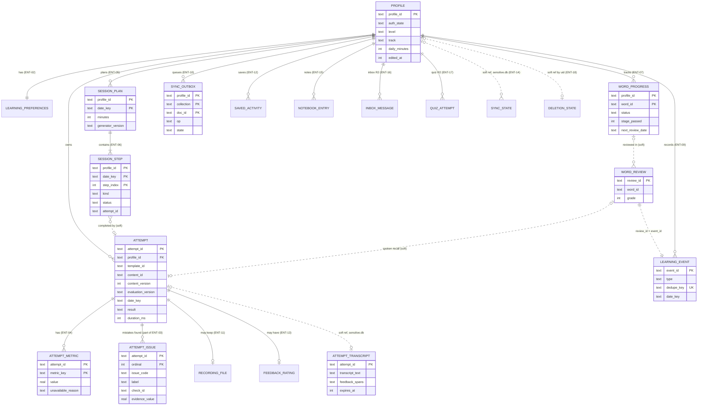

# Database Design — SpeakCraft

| Field | Value |
|---|---|
| Document ID | ARC-03 |
| Version | 0.2 — Draft for review |
| Date | 2026-11-21 |
| Status | Draft — Proposed, awaiting approval (gate G3) |
| Owner (role) | Database Architect |
| Approval | Pending — Product Owner |
| Related | ADR-002, ADR-014, ADR-015, SRS §9, SEC-01, FS-11 |

> **Authority.** Per GOV-02 §4 this document is the authoritative home of the **persistent data model** and of the `ENT-nn` entity IDs. §8 is the authoritative list of **what is synced to the cloud** (NFR-PRIV-003, ADR-014, ARC-01 §9, GAP-25/26). §10 is the authoritative export file schema (SRS-FR-SET-004; SEC-01 §9.1). Other documents reference these sections; they do not restate them.
>
> **Evidence rule (GOV-02 DC-3).** **EXISTING** = describes the current app. **VERIFIED** = seen at `path:line` during this review. **INFERRED** = reasoned from evidence or platform behaviour, not observed. **PROPOSED** = target design. **RECOMMENDATION** = a proposal that needs a decision. Values marked **†** are *Proposed — requires approval* (DC-5). Nothing in this document was built, run, migrated or deployed, and no Firebase project was contacted (DC-4).
>
> **Dependencies.** The target design assumes ADR-002 (Room, D-11), ADR-005 (WorkManager, D-12), ADR-014 (sync model), ADR-015 (recordings, D-10) and SEC-01 v0.2 are approved as proposed. Pending decisions that change this design are listed in §12.1 (D-05, D-08, D-10, D-16, D-19, D-21…D-24, D-31).
>
> **Product Owner decisions (2026-11-21).** The curriculum is built from the frameworks, techniques, tasks, exercises, activities and tips taught on the @askvinh YouTube channel. **D-08 is a DECISION** (approved by the Product Owner on 2026-11-21): option B, *original wording, link out*. All channel-derived content uses `licenceStatus = ORIGINAL_REEXPRESSION`, points to a specific source video, and shows no creator name, likeness, attribution text or branding (SRS-BR-028). The enumeration is `ORIGINAL` (written from scratch) · `ORIGINAL_REEXPRESSION` (channel-derived) · `LICENSED` (reserved; none in R1) · `PENDING_REVIEW` (never ships). Distinctive creator-coined framework names appear only in the internal provenance field `techniqueNameAsTaught`; displayed names are plain original names (generic names such as STAR and PREP are allowed). New requirements SRS-FR-PRAC-008/009 (technique content type, provenance, outbound video link), SRS-FR-EVAL-015/016 and SRS-FR-WORD-014 (mistakes found with evidence, and coach tips chosen deterministically from technique tips by trigger) are applied in §1.4, §3.4 (`attempt_issue`), §6 (techniques, tips with triggers, provenance, validation), §8.3.2, §11 (issue codes, `licenceStatus`) and §12. The schema details that implement the decision are **RECOMMENDATION**. ADR-011 still applies to ingestion: content is gathered by hand, with no YouTube scraping, caption download or API ingestion.
>
> **Path convention.** `pkg/` = `app/src/main/java/com/example/`. Other paths are relative to the repository root.

---

## 1. Existing database audit

### 1.1 Scope and method

This is a static review of the working tree at commit `82f1bad`, plus the evidence files `docs/redevelopment/working_papers/platform_security_audit.md` (§3, §5), `data_learning_audit.md` (§7, §8) and `FND_ID_MAP.md`. The four most recent commits change only documentation (INFERRED from the commit messages), so the code evidence that SEC-01 recorded at `68a9cb1` still applies. Line references marked VERIFIED were re-checked for this document.

### 1.2 Current storage overview (EXISTING)

| Store | Evidence | Notes |
|---|---|---|
| Cloud Firestore, **named** database | `pkg/data/AppContainer.kt:26` (`FirebaseFirestore.getInstance(R.string.firestore_database_id)`) — VERIFIED; id in `app/src/main/res/values/firebase_applet_config.xml:3` (platform audit §3.1) | Source of truth for most learning data today. Writes are awaited on UI paths, so offline writes hang (FND-DATA-03) |
| Firestore SDK settings | A search for `PersistentCacheSettings` or `firestoreSettings` returns 0 hits — VERIFIED | The SDK default applies: an unencrypted on-disk cache in app-private storage (INFERRED, SDK behaviour) |
| Preferences DataStore `speakcraft_prefs` | `pkg/data/preferences/AppPreferencesRepository.kt:22` — VERIFIED | 23 keys (§1.7) |
| Preferences DataStore `speakcraft_tutorial_state` | `pkg/data/preferences/TutorialState.kt:11` — VERIFIED | 2 per-user key patterns (§1.7) |
| Hand-rolled JSON files and media files in `filesDir` | §1.6 | Written on the main thread (FND-DATA-08), never synced, lost on reinstall (FND-DATA-02) |
| Room / SQLite | None. Room 2.7.0 and KSP are in the version catalog but unused (RD-02 §3; ADR-002) | — |
| Content | Kotlin source (`pkg/data/activity/*`, `pkg/data/model/CurriculumCatalog.kt`) plus admin-written shared Firestore collections | §1.4, §1.5 |

### 1.3 Firestore collections: code vs blueprint vs rules (EXISTING → disposition)

Status values: **KEEP** = the path stays and its schema is replaced by §8. **IMPORT → RETIRE** = read once by the D-19 legacy import (§9.4), then retired. **RETIRE** = read and delete only during the L1 migration window, removed at L2 (SEC-01 §5.6; §9.6 here). **RETIRE (content re-verify)** = the collection is retired, but the content it held is a candidate for editorial re-verification into the bundled pack (§1.4; RECOMMENDATION, D-08).

Code lines are `pkg/data/firebase/SpeakCraftRepository.kt` unless another file is named. Blueprint lines are `firebase-blueprint.json`. Rules lines are the `match` statements in `firestore.rules`. All three columns are VERIFIED.

| # | Path | Code | Blueprint | Rules | Status | Notes |
|---|---|---|---|---|---|---|
| 1 | `users/{uid}` | `:85` (listener), `:482`, `:668`, `:862` (writes) | `:525` | `:332` | **KEEP** (schema replaced) | Legacy fields include client-writable counters and default scores (`pkg/data/model/FirestoreModels.kt:25-37`; FND-SEC-10). Name, level, goal and daily minutes are the D-19 import source. The v1 document replaces the legacy fields at the same path (§9.4, I-06) |
| 2 | `users/{uid}/vocabulary/{wordId}` | `:127`, `:744` | `:533` | `:432` | **IMPORT → RETIRE** | D-19 vocabulary source. Ids are `vocab_<word>` (`pkg/data/model/CurriculumCatalog.kt:546`) or `custom_<word>` (`pkg/ui/viewmodel/MainCoachViewModel.kt:388`); scheduling uses UTC epoch days (`MainCoachViewModel.kt:80-81`) |
| 3 | `…/enrollments` | `:166`, `:601`, `:622` | `:526` | `:366` | RETIRE | Programme enrolment, replaced by the daily plan |
| 4 | `…/dailyActivities` | `:140`, `:644` | `:527` | `:388` | RETIRE | Self-ticked routine; minutes fabricated (FND-DOM-06, -08) |
| 5 | `…/learningProgress` | `:153`, `:701` | `:528` | `:410` | RETIRE | Lesson progress for creator-derived lessons |
| 6 | `…/speakingSessions` | `:99`, `:790`, `:903`, `:1025` | `:534` | `:453` | RETIRE | Holds transcripts (FND-SEC-05) and absolute `localMediaPath` (`:803`; FND-DATA-04). Writes are denied at HEAD (FND-DATA-06). Not imported (D-19) |
| 7 | `…/speechFeedback` | `:113`, `:791` | `:535` | `:476` | RETIRE | Transcript copy; same failing batch as #6 |
| 8 | `…/conversationSessions` | `:205`, `:920` | `:536` | `:496` | RETIRE | AI Mentor / simulator removed (SRS-FR-PLAT-001) |
| 9 | `…/youtubeSources` | `:179`, `:568`, `:940` | `:537` | `:517` | RETIRE (content re-verify) | Per-user analysed-video metadata. Video ids may inform manual provenance checks only (§1.4) |
| 10 | `…/extractedTechniques` (per user) | `:192`, `:532-539` (seed), `:964` | `:538` | `:543` | RETIRE (content re-verify) | Per-user copies of the seeded technique list plus caption-derived items. Content belongs in the bundled pack, so the copies are retired; the source list is re-verified from the catalogue (§1.4) |
| 11 | `…/realWorldTasks` | `:219`, `:1000` | `:539` | `:564` | RETIRE | Seeds reviewed as activity candidates (§1.5) |
| 12 | `…/activityProgress` | `pkg/data/firebase/ActivityFirestoreRepository.kt:68`, `:137` | `:529` | `:585` | RETIRE | Counts "completed" on any score ≥ 60 (FND-DOM-05) |
| 13 | `…/activityAttempts` | `ActivityFirestoreRepository.kt:83`, `:181` | `:530` | `:622` | RETIRE | Length-formula scores (FND-DOM-04); absolute `recordedMediaPath` (FND-DATA-04) |
| 14 | `…/savedActivities` | `ActivityFirestoreRepository.kt:100`, `:225` | `:531` | `:648` | RETIRE | Not imported (activity ids change; D-19 minimal). ENT-12 starts empty |
| 15 | `…/dailyPracticePlans` | `ActivityFirestoreRepository.kt:117`, `:255` | `:532` | `:671` | RETIRE | Loses completed items (FND-DOM-10) |
| 16 | `…/notifications` | deletion list only, `:1298` | absent | `:704` | RETIRE | Dead path, no `hasOnly` (FND-DATA-07, FND-SEC-10) |
| 17 | `…/learningEvents` | `:1298` | absent | `:715` | RETIRE | Dead path |
| 18 | `…/vocabularyProgress` | `:1299` | absent | `:726` | RETIRE | Dead path |
| 19 | `…/quizAttempts` | `:1299` | absent | `:737` | RETIRE | Dead path |
| 20 | `…/learningSnapshots` | `:1299` | absent | `:748` | RETIRE | Dead path; validates only `userId` |
| 21 | `adminUsers/{uid}` | `:256`, `:332`, `:1276` | `:540` | `:758` | RETIRE | No admin role in R1–R2 (NG-10; SEC-REQ-11) |
| 22 | `adminAnnouncements` | `:278`, `:1232` | absent | `:768` | RETIRE | Missing from blueprint |
| 23 | `adminAuditLogs` | `:305`, `:1255` | absent | `:777` | RETIRE | Missing from blueprint |
| 24 | `adminSettings` | none | absent | `:786` | RETIRE | Rules only |
| 25 | `youtubeChannels` | none (model `FirestoreModels.kt:190`) | `:541` | `:792` | RETIRE | Unused |
| 26 | `youtubeVideos` | `:1071` | `:542` | `:797` | RETIRE (content re-verify) | Video ids/titles may inform manual provenance checks |
| 27 | `videoTranscripts` | `:1091` | `:543` | `:802` | RETIRE | Verbatim captions. **Never migrated** (V-13, §6.12) |
| 28 | `extractedTechniques` (shared) | `:345`, `:430`, `:1106`, `:1140` | `:544` | `:807` | RETIRE (content re-verify) | Admin-published caption sentences. Candidates for editorial re-verification; verbatim text is not migrated |
| 29 | `learningModules` | none | `:545` | `:821` | RETIRE | Unused |
| 30 | `lessons` | `:359`, `:1151` | `:546` | `:826` | RETIRE (content re-verify) | Generated from the catalogue techniques; re-verified from the catalogue source (§1.4) |
| 31 | `communicationExercises` | none | `:547` | `:831` | RETIRE | Unused |
| 32 | `learningChallenges` | `:373`, `:1174` | `:548` | `:836` | RETIRE (content re-verify) | Catalogue challenges (§1.4) |
| 33 | `applicationReleases` | `:386`, `:397`, `:402`, `:416`, `:1191` | `:549` | `:841` | RETIRE | Updater removed (ADR-004). L1 ordering note in SEC-01 §5.6 |
| 34 | `applicationUpdateEvents` | `:444`, `:458`, `:1045` | `:550` | `:855` | RETIRE | Users cannot delete today (`update, delete: if false`). Owner delete during L1 (SEC-01 §5.3) |

**Totals:** 34 paths (20 per-user, 14 top-level). 1 KEEP, 1 IMPORT → RETIRE, 32 RETIRE (6 of them carry content to re-verify). The blueprint omits 8 paths that the rules define (#16–#20, #22–#24), which is the drift recorded as FND-DATA-07.

### 1.4 Creator-derived content stores (D-08 DECISION 2026-11-21; dispositions are RECOMMENDATION)

These stores hold content that the Product Owner wants in the curriculum. They are recorded as **content to re-verify and migrate into the new content pack**, not as data to retire. The migration is **editorial** (content workstream EP-09, T-09.2; the item-by-item check is CNT-01 `docs/product/TECHNIQUE_CATALOGUE_AUDIT.md`, in preparation), not a runtime data migration: no app code reads these stores into the pack. Each item is matched by a human reviewer to a **specific official video** with timestamps and re-expressed in SpeakCraft's own wording and examples (D-08 option B; SRS-BR-028). Until that is done the item carries `licenceStatus = PENDING_REVIEW` and cannot ship in a release build (V-10, §6.12).

| Store | Evidence (VERIFIED) | What it holds | Verification problem | Disposition |
|---|---|---|---|---|
| `askVinhKnowledgeBase` | `pkg/data/model/CurriculumCatalog.kt:187` (list runs to `:519`) | 15 technique seeds: 12 labelled `VERIFIED`, 3 `PENDING_TRANSCRIPT` (data_learning_audit §2.2) | Every `VERIFIED` item's `sourceVideoUrl` is the **channel root**, so the video titles and timestamps (`"01:15"` etc.) cannot be verified (data_learning_audit §2.3) | **Re-verify → pack** as `technique` items (§6.8) with full provenance |
| `lessons` (derived) | `CurriculumCatalog.kt:521` | 12 lessons generated from the `VERIFIED` techniques | Inherits the problem above | Fold into techniques and activities |
| `structuredPrograms` incl. the 30-day programme | `CurriculumCatalog.kt:1000`; subtitle "Adapted from @askvinh's 30-Day Mastery Plan" at `:1005` | 7 programmes, 14 week plans, day-level drills for the 30-day programme | No source video for the adaptation | **Re-verify → pack** as activities and tips linked to techniques. Programme sequencing is not a pack entity in R1 (the plan engine builds daily sessions; OQ-13) |
| `speakingChallenges` | `CurriculumCatalog.kt:887` | 10 challenges with `sourceReference "@askvinh — …"` | Reference is a label, not a video | **Re-verify → pack** as activities |
| `shadowingSegments` | `CurriculumCatalog.kt:927` | 3 shadowing scripts attributed to videos | Risk of verbatim creator speech | Pack only as newly written original scripts (option A, licensing, was not chosen). No verbatim transcript text (V-13; SRS-BR-028) |
| `users/{uid}/extractedTechniques` | `SpeakCraftRepository.kt:532-539` (`seedAskVinhKnowledgeBaseIfEmpty`), `:964` | Per-user copies of the seeds plus caption-derived items | As above | **Per-user copies retired** (content belongs in the bundled pack). Re-verification starts from the catalogue source, not from user copies |
| `users/{uid}/youtubeSources` | `:568`, `:940` | Per-user analysed-video metadata | Collected by scraping (ADR-011) | Retired. Video ids may be used by a reviewer as candidate references, checked manually |
| Shared `extractedTechniques`, `youtubeVideos`, `videoTranscripts` | `:1106`, `:1071`, `:1091` | Admin-published caption sentences, video metadata, verbatim captions | Verbatim captions; synthetic timestamps (FND-AI-11) | Retired. Items are re-verification candidates only; caption text is never migrated |
| Activity catalogue framework names | Module subtitles in `pkg/data/activity/ActivityCatalogue.kt` (High-Low-Buffalo, FORD, VAKS, CCC, Power-Zone; data_learning_audit §2.3) | 150 activities with constant `sourceAttribution = "SpeakCraft Core Curriculum"` | Attribution may be wrong in either direction | Provenance re-verified per activity in T-09.2; creator-derived activities link to techniques |
| Creator mentions in code | `FeatureTutorialRegistry.kt` (22), `DeterministicFeedbackTemplates.kt:57,210,229`, `RecommendationEngine.kt:59,73` (data_learning_audit §2.3) | UI and feedback strings | — | Removed with the replaced components. No creator name, likeness or branding appears in the new app, content, notifications or store listing (SRS-BR-028); the only link to the creator is the outbound "Watch the original lesson" link to a specific video (SRS-FR-PRAC-009) |

### 1.5 Other content held in code (EXISTING)

| Content | Evidence | Disposition (PROPOSED) |
|---|---|---|
| 150 activities, 10 modules, 25 exercise templates | `pkg/data/activity/ActivityCatalogue*.kt` (data_learning_audit §2.1) | Review, de-duplicate, re-map to 5 tracks × 5 templates, add provenance (T-09.2) → §6.7 |
| 20-word vocabulary bank | `CurriculumCatalog.kt:544` | Seed for the ≥ 300-word bank (§6.10). Also the match key for legacy vocabulary import (§9.4) |
| 8-step daily routine | `CurriculumCatalog.kt:989` | Retire (replaced by the plan engine) |
| Pronunciation drills, shadowing, grammar lessons, public-speaking modules, real-world task seeds, conversation scenarios | `CurriculumCatalog.kt:887-987` (data_learning_audit §2.2) | Review as TPL-READ/REPEAT/ANSWER candidates; creator-derived items follow §1.4 |
| 10 learning paths | `pkg/data/activity/LearningPathsEngine.kt` (data_learning_audit §3.3) | Retire (no path concept in R1) |
| `contentVersion` | Always 1 (data_learning_audit §2.1) | Replaced by the pack version (§6.11) |

### 1.6 Local JSON and file stores (EXISTING → disposition)

All paths are under `filesDir` unless stated. All are currently eligible for Auto Backup, because the backup rules are untouched templates (FND-SEC-06).

| Store | Writer evidence (VERIFIED) | Content | Disposition |
|---|---|---|---|
| `learning_state/learning_snapshot_<uid>.json` | `pkg/data/learning/LearningProgressManager.kt:50`, `:892` | `PersistedLearningSnapshot` schema v2 (`pkg/data/learning/LearningModels.kt:374-400`): dashboard plan, local streak, word progress, SRS, notebook, quiz history, notifications, event log, unbounded `processedEventKeys` (`:393`) | **Retire.** Not imported: outside D-19 scope, and its vocabulary parts are never written (FND-DOM-02). Deleted at first R1 launch (§9.5) |
| `notification_store/alerts_<uid>.json` | `pkg/data/notifications/NotificationManagerRepository.kt:36`, `:442` | In-app alerts (cap 150) | **Retire.** ENT-16 inbox (R2) starts empty |
| `mentor_history_<uid>.json` | `pkg/ui/viewmodel/InteractiveCoachViewModel.kt:159` | AI Mentor chat (free text) | **Retire**, delete |
| `recordings/speakcraft_rec_<ts>.m4a`, `recordings/speakcraft_vid_<ts>.mp4` | `pkg/data/media/AudioRecorderManager.kt:57`, `:62`; `pkg/data/media/CameraVideoRecorder.kt:201-202` | Voice and video recordings, not partitioned per user, no TTL (FND-AI-14, FND-SEC-09) | **Retire**, delete after the first-launch migration. Speaking history is not migrated (D-19), so these files have no attempt to belong to. State this in the release notes |
| `backups/` | `pkg/data/update/UpdateBackupManager.kt:30` (copies recordings, `:39`) | Updater backups | **Retire**, delete (ADR-004) |
| `updates/*.apk` | `pkg/data/update/ReleaseUpdateRepository.kt:206` | Downloaded APKs | **Retire**, delete (ADR-004) |
| `ai_models/` | `pkg/data/ai/local/OnDeviceModelManager.kt:153` | Fake model catalogue directory | **Retire**, delete (ADR-009) |
| Firestore SDK disk cache | No settings (§1.2) | Mirror of legacy cloud data | **Retire.** Replaced by a memory-only cache (§8.7); `clearPersistence()` once at first R1 launch |
| AndroidKeyStore alias `speakcraft_yt_api_key_aes` | `AppPreferencesRepository.kt:53` | AES key for the YouTube API key | **Retire.** Delete the key entry together with `youtube_api_key` (§9.5) |

### 1.7 DataStore keys (EXISTING → KEEP / MIGRATE / RETIRE)

`speakcraft_prefs` keys are declared at `AppPreferencesRepository.kt:107-129` (VERIFIED); defaults at `:26-50`. Target keys are defined in §7.5.

| Key (line) | Type, default | Decision | Target / reason |
|---|---|---|---|
| `theme_mode` (:107) | string, SYSTEM | **MIGRATE** | `settings.theme_mode` (same values) |
| `tts_rate` (:108) | float 1.0, clamped 0.6–1.4 (`:177`) | RETIRE | Reference audio plays at fixed 1.0× / 0.75× (SRS-FR-SESS-012); last choice kept as `settings.reference_speed` |
| `youtube_api_key` (:109) | string, AES-GCM `enc:` | RETIRE | ADR-011; also delete the Keystore key |
| `update_channel` (:110), `last_update_check_ms` (:111), `dismissed_release_version` (:112), `last_verified_version_code` (:113), `github_release_repo` (:117) | updater state | RETIRE | ADR-004 |
| `completed_tutorial_keys` (:114), `first_use_tutorials_enabled` (:115) | legacy tutorial state | RETIRE | Dead in production (data_learning_audit §1.5); replaced by contextual tips (DES-06 §2.4) |
| `initial_launch_completed` (:116) | bool | RETIRE | Brand moment is ≤ 1 s and not gated on first launch (NFR-PERF-002) |
| `font_scale_preference` (:118) | float 1.0, 0.85–1.3 | RETIRE | Text size follows the system font scale (SRS-FR-SET-007) |
| `reduced_motion` (:119) | bool, false | **MIGRATE** | `settings.reduce_motion`: `true` → `ON`, `false` → `FOLLOW_SYSTEM` (the new default) |
| `cloud_ai_enabled` (:120), `cloud_ai_model_tier` (:121) | cloud AI | RETIRE | ADR-003 |
| `voice_auto_speak_enabled` (:122) | bool | RETIRE | Mentor removed |
| `ai_local_enabled` (:123), `ai_live_transcription_enabled` (:124), `ai_local_speech_recognition_enabled` (:125), `ai_local_audio_analysis_enabled` (:126), `ai_local_video_analysis_enabled` (:127) | bools | RETIRE | Ineffective toggles (FND-AI-06); tier is automatic (ARC-05 §3) |
| `ai_recognition_language` (:128) | string, en-US | **MIGRATE** | `settings.recognition_locale` if the value is en-US, en-GB, en-IN or en-AU (SRS-FR-SPCH-008); otherwise dropped |
| `ai_recognition_engine` (:129) | AUTO / ANDROID_OFFLINE / LOCAL_WHISPER | RETIRE | ADR-009 |
| `completed_tutorials_<uid>` (`TutorialState.kt:28`), `first_use_tutorials_enabled_<uid>` (`:31`) | per-user tutorial state | RETIRE | Tutorial system replaced (DES-06 §2.4) |

**Totals:** 25 key patterns. 3 MIGRATE, 22 RETIRE, 0 KEEP unchanged. Both legacy DataStore files are deleted after the migration (§9.5). Settings held in the JSON snapshot (`LearningModels.kt:377-392`, e.g. `preferredReminderTime = "09:00"` at `:191`, never read) are not migrated.

### 1.8 Problems in the current data layer (FND-DATA and related findings)

| Finding | Problem (EXISTING) | Evidence | Resolved by (PROPOSED) |
|---|---|---|---|
| FND-DATA-01 | Three persistence mechanisms, no single source of truth | §1.2; data_learning_audit §8 | Room `learning.db` is the source of truth (DP-01, §3) |
| FND-DATA-02 | Local JSON state never synced; lost on reinstall | §1.6 | Every learning entity is in Room, backed up include-only (D-23) and synced when signed in (§8) |
| FND-DATA-03 | Awaited Firestore writes hang offline; non-transactional read-modify-write | platform audit §3.1 | Writes go to Room in one transaction; `SyncWorker` uploads from the outbox (§7.8, §8.8) |
| FND-DATA-04 | Absolute device paths in Firestore | `SpeakCraftRepository.kt:803`; `ActivityFirestoreRepository.kt:201` | Paths never leave the device; `recording_file.file_name` is relative (ENT-11); §8.4 |
| FND-DATA-05 | 16+ unbounded snapshot listeners at sign-in | platform audit §3.3 | No snapshot listeners. Bounded watermark pulls with `limit()` (§8.9, GAP-26) |
| FND-DATA-06 | Speaking-session saves denied by rules (HEAD regression) | platform audit §4.4 | One schema owner (this document), mapper tests and rules tests (SEC-REQ-12) |
| FND-DATA-07 | Rules, blueprint and code drift (dead collections) | §1.3 | One target schema (§8); legacy paths retired (§9.6); blueprint replaced at L3 |
| FND-DATA-08 | JSON written synchronously on the main thread | data_learning_audit §5 | Room and DataStore on IO dispatchers; StrictMode gate (NFR-PERF-012) |
| FND-SEC-05 | Transcripts uploaded to Firestore | `FirestoreModels.kt:119,157` | Transcripts only in `sensitive.db` (ENT-03 sensitive part); not synced (§8.4) |
| FND-SEC-09 | No local cleanup on sign-out; recordings unpartitioned | platform audit §5 | Per-profile partitioning and wipe matrix (§7.1, §7.6) |
| FND-SEC-10 | Client-writable counters and scores | `FirestoreModels.kt:25-37`; `firestore.rules:72-92` | No aggregate fields anywhere in the schema (DP-03) |
| FND-DOM-07 / -08 | Four streaks; fabricated minutes; "words learned" counts words seen | data_learning_audit §5 | Streak, practice time and word counts derived by queries over facts (§5.1 Q-03…Q-06) |
| FND-DOM-11 | SM-2 not wired; UTC epoch-day boundary | `MainCoachViewModel.kt:80-81` | `next_review_date` is a local `dateKey` (ENT-07; DP-07) |
| FND-DOM-15 | `isPartialEvaluation` bean-mapping bug | `FirestoreModels.kt:143` | No Firestore bean mapping of `is…` booleans; explicit mappers (§8.5) |
| FND-AI-14 | Failed recordings never cleaned | `AudioRecorderManager.kt:62` | Immediate deletion of discarded audio plus orphan sweep (§7.3 J-02, J-03) |
| (model) | Default scores, default name and free-text goal baked into the model | `FirestoreModels.kt:20,22,31-37`; default creator URL `:141` | No defaults for measured values (DP-10); enumerated level and track (§11) |
| (model) | Inconsistent level vocabularies (3, 4 and 5 tiers) | `LearningModels.kt:9-28`; `firebase-blueprint.json:10` | One 5-level enum L1…L5 (D-17; §11.5) |

### 1.9 What is reused

Data is **not** reused beyond the D-19 import (profile and vocabulary). Design ideas are reused: idempotent event keys and local `dateKey` strings (`LearningModels.kt:81-93`), the owner-only allow-list style of the current rules (`firestore.rules:332-364`), and the AES-GCM Keystore pattern (`AppPreferencesRepository.kt:52-104`) as the fallback if file encryption is ever required (SEC-01 §6.6).

---

## 2. Design principles

| ID | Principle | Consequence in this design |
|---|---|---|
| DP-01 | **Local source of truth** (ADR-002) | Room `learning.db` is authoritative. Screens read Room `Flow`s. Firestore is a replica for signed-in users and is never read on a UI path |
| DP-02 | **Immutable facts** (ADR-014 §2) | Attempts (ENT-03/04), word reviews (ENT-08) and learning events (ENT-09) are append-only. Update triggers block changes (§5.3). A correction is a new fact |
| DP-03 | **Derived aggregates** | No streak, total, count or score column exists in any table or cloud document. Streaks, practice time, words learned and trends are queries over facts (§5.1); in-memory caches are allowed, persisted counters are not |
| DP-04 | **No audio, paths or transcripts in the cloud by default** | Audio and file names stay on the device (ENT-11). Transcripts and speech-derived free text live in `sensitive.db`, which is excluded from backup and never synced in R1 (SEC-01 §3.3; D-16 for R2). §8 lists every synced field |
| DP-05 | **Schema versioning everywhere** | Room versions with exported schemas (§9.1). Every cloud document carries `schemaVersion`. The content pack has `packVersion` (the `contentVersion` of SRS-FR-EVAL-011 and SRS-BR-026) and `schemaVersion` (§6.11). Attempts carry `evaluationVersion` and `contentVersion`; plans carry `generatorVersion` |
| DP-06 | **Idempotency keys** | Every fact has a client-generated UUID v4 that is the same locally and in the cloud (SRS-BR-020). Natural duplicates are blocked by `dedupe_key` unique indexes. Outbox rows coalesce per document |
| DP-07 | **UTC instants plus local dateKey** | Instants are epoch milliseconds UTC (`*_at`). Every fact also stores the local `date_key` (`YYYY-MM-DD`) captured at event time, which is never recomputed (SRS-BR-011). Due dates are `dateKey`s |
| DP-08 | **Profile partitioning** | Every learning row carries `profile_id`; every DAO query is scoped to it (SEC-REQ-18). Child rows are tied to their parent's `profile_id` by composite foreign keys (§4.2) |
| DP-09 | **One transaction per user action** | An attempt save writes the attempt, metrics, step status, events, word state and outbox rows in one Room transaction. Files and `sensitive.db` follow a crash-safe order with sweeps (§7.8) |
| DP-10 | **Null means unknown** | A metric without evidence is `NULL` with a reason (SRS-BR-002, NFR-QUAL-001). No column has a default score, confidence or baseline |
| DP-11 | **Explicit retention** | Every entity states a retention rule (§3) enforced by a named job (§7.3) |
| DP-12 | **Content separate from user data** | The content pack is read-only, versioned and bundled (§6). User data references content by id plus version (SRS-BR-026), so retired content stays readable in history |

---

## 3. Local entities (Room)

### 3.0 Physical stores and conventions

**Stores (PROPOSED; file names confirm SEC-01 §3.2 and §6.3).**

| Store | File | Engine | Holds | Backup and device transfer (D-23) |
|---|---|---|---|---|
| `learning.db` | `databases/learning.db` (+ `-wal`, `-shm`) | Room, class `LearningDatabase` | ENT-01, 02, 03 (attempt part), 04–13, 15, 16, 17 | **Included** (include-only rule) |
| `sensitive.db` | `databases/sensitive.db` (+ side files) | Room, class `SensitiveDatabase` | ENT-03 transcript part, ENT-14, ENT-18 | **Excluded** |
| `settings` | `files/datastore/settings.preferences_pb` | Preferences DataStore | Device and UI preferences (§7.5) | **Included** |
| `device_state` | `files/datastore/device_state.preferences_pb` | Preferences DataStore | Install identity, consent record, tier cache, crash-recovery markers (§7.5) | **Excluded** |
| Recordings | `noBackupFilesDir/recordings/<profileId>/` | Files (ADR-015) | Audio; metadata in ENT-11 | **Excluded** (by location and by rule) |
| Content pack | APK `assets/content/` | Read-only JSON, loaded into memory (§6.1) | Tracks, templates, activities, techniques, tips, words | n/a |

`sensitive.db` is the Room database for data that must **not** leave the device through backup: transcripts (C1) and device-scoped technical state (sync watermarks and the deletion state machine, C4). Keeping ENT-14 and ENT-18 out of the backup set preserves SEC-01's intent for `device_state` (§6.5: a restored watermark or deletion state would be wrong on a new device). See I-02.

**Column conventions.**

| Concept | Storage | Rule |
|---|---|---|
| Fact identifiers | `TEXT` UUID v4, lower case | Generated on the device; identical in the cloud |
| `profile_id` | `TEXT` | Local UUID v4, or the Firebase uid after adoption (§7.2) |
| Instants (`*_at`) | `INTEGER` epoch ms, UTC | From the injectable `Clock` (ARC-01 §2) |
| Local dates (`date_key`, `*_date`) | `TEXT` `YYYY-MM-DD` | From `DateKeyProvider` in the device time zone at the moment of the event |
| Booleans | `INTEGER` 0/1 | — |
| Enumerations | `TEXT` | Values in §11; mapped to Kotlin enums by `TypeConverter`s |
| JSON columns | `TEXT` | Small, bounded arrays or maps with a documented shape; never free text derived from speech in `learning.db` |
| Content references | `content_id TEXT` + `content_version INTEGER` | Pack ids (§6) |

**Constraint enforcement.** Room annotations support primary keys, composite keys, foreign keys (with `onDelete`/`onUpdate`), indexes (including unique) and column defaults; they do **not** support `CHECK` constraints (INFERRED, Room API). The "Constraint" column below is therefore enforced in three layers: (1) Kotlin types and `TypeConverter`s; (2) DAO and repository validation, covered by unit tests; (3) a small set of SQLite triggers for invariants that must hold even against a faulty DAO (immutability and a few consistency rules, §5.3), created in `RoomDatabase.Callback.onCreate` and in migrations and verified by the migration harness (§9.2).

**Foreign-key policy.** *Strong* references (Room `@ForeignKey`, `PRAGMA foreign_keys = ON`) are used inside `learning.db` where the parent always exists first. *Soft* references (an id column validated by the repository) are used across databases and wherever pulled cloud data can arrive out of order (for example a review event that references an attempt not yet pulled). Every soft reference is listed in §4.2.

### 3.1 Entity summary

| ENT | Name | Table(s) | DB | Schema / release | Mutability | Synced | Backup | Retention |
|---|---|---|---|---|---|---|---|---|
| ENT-01 | Profile | `profile` | learning | v1 / R1 | Mutable | Yes — `users/{uid}` | Included | Until deleted |
| ENT-02 | LearningPreferences | `learning_preferences` | learning | v1 / R1 | Mutable | Yes — inside `users/{uid}.prefs` (3 of 4 fields) | Included | Until deleted |
| ENT-03 | Attempt | `attempt` + `attempt_issue` (learning) + `attempt_transcript` (sensitive) | both | v1 / R1 | Immutable | `attempt`: yes, metrics-only document; top issue codes inside it. `attempt_issue` evidence: no. Transcript: **no** (R2 opt-in, D-16) | `attempt`, `attempt_issue` included; transcript excluded | Until deleted; transcript optional expiry (D-24) |
| ENT-04 | AttemptMetric | `attempt_metric` | learning | v1 / R1 | Immutable | Yes — inside the attempt document | Included | With its attempt |
| ENT-05 | SessionPlan | `session_plan` | learning | v1 / R1 | Mutable | Yes — `plans/{dateKey}` | Included | 90 days † |
| ENT-06 | SessionStep | `session_step` | learning | v1 / R1 | Mutable until done | Yes — inside the plan document | Included | With its plan |
| ENT-07 | WordProgress | `word_progress` | learning | v1 / R1 | Mutable | Yes — `words/{wordId}` | Included | Until reset or deleted |
| ENT-08 | WordReview | `word_review` | learning | v1 / R1 | Immutable | Via `WORD_REVIEWED` events | Included | Until reset or deleted |
| ENT-09 | LearningEvent | `learning_event` | learning | v1 / R1 | Immutable | Yes — `events/{eventId}` (3 types) | Included | Until deleted |
| ENT-10 | SyncOutbox | `sync_outbox` | learning | v1 / R1 | Transient | n/a (drives uploads) | Included | Until acknowledged |
| ENT-11 | RecordingFile | `recording_file` | learning | v1 / R1 | Mutable (transcode) | **Never** | Row included; audio excluded | Per retention (D-10) |
| ENT-12 | SavedActivity | `saved_activity` | learning | v1 / R1 | Mutable | No (R1) | Included | Until unsaved or deleted |
| ENT-13 | FeedbackRating | `feedback_rating` | learning | v1 / R1 | Mutable (latest answer) | No (SEC-01 §3.2 #5) | Included | With its attempt (accuracy rating and self-reported self-check answers) |
| ENT-14 | SyncState | `sync_state` | sensitive | v1 / R1 | Mutable | No | Excluded | Until sign-out, removal or deletion |
| ENT-15 | NotebookEntry | `notebook_entry` | learning | v1 table (legacy import target), UI R2 | Mutable | No (OQ-05) | Included | Until deleted |
| ENT-16 | InboxMessage | `inbox_message` | learning | v2 / R2 | Mutable | No | Included | 180 days † |
| ENT-17 | QuizAttempt | `quiz_attempt` | learning | v2 / R2 | Immutable | No (OQ-05) | Included | Until deleted |
| ENT-18 | DeletionState | `deletion_state` | sensitive | v1 / R1 | Mutable | No | Excluded | Until deletion reaches `DONE` |

Column tables below use: **Null** = nullable; **Sync** = the cloud field it maps to (§8), or *no*.

### 3.2 ENT-01 Profile

| Item | Value |
|---|---|
| Table / DB | `profile` · `learning.db` |
| Purpose | The learner identity on this device: local profile before sign-in (SRS-FR-ACC-001), linked account after sign-in, plus profile choices and onboarding state |
| Primary key | `profile_id` |
| Foreign keys | — (root) |
| Indexes | PK; `idx_profile_active (is_active)` |
| Owner | Itself |
| Retention | Until account deletion, "Delete everything on this device" or sign-out → Remove (§7.6) |
| Sync | Yes → `users/{uid}` (fields marked below). Mutable, last-writer-wins per document (§8.10) |
| Backup | Included (`learning.db`) |

| Column | Type | Null | Default | Constraint / rule | Sync |
|---|---|---|---|---|---|
| `profile_id` | TEXT | no | — | PK. UUID v4 at creation; replaced by the Firebase uid on adoption (§7.2) | path `users/{uid}` |
| `auth_state` | TEXT | no | `'LOCAL'` | `LOCAL` · `SIGNED_IN` · `SIGNED_OUT` (§11.13; FS-01 §10) | no |
| `linked_uid` | TEXT | yes | NULL | Equals `profile_id` when `SIGNED_IN`, else NULL (SEC-01 §3.2 #11). Email is **not** stored (I-13) | no |
| `previously_linked_uid` | TEXT | yes | NULL | The uid this partition belonged to before a "Keep" sign-out; drives the merge prompt (SEC-01 §4.2) | no |
| `is_active` | INTEGER | no | 1 | 0/1. Exactly one active profile (repository-enforced, TC in §5.3) | no |
| `display_name` | TEXT | yes | NULL | Trimmed, 1–40 characters (SEC-01 §5.2) | `displayName` |
| `level` | TEXT | no | `'L3'` | `L1`…`L5` (D-17; default Intermediate, SRS-FR-ONB-003) | `level` |
| `track` | TEXT | no | `'TRK-EVERYDAY'` † | `TRK-*` (§11.4). Default pending FS-02 Q1 | `goal` (prefix stripped, §8.5) |
| `daily_minutes` | INTEGER | no | 10 | 5, 10 or 15 (SRS-FR-ONB-004) | `dailyMinutes` |
| `reminder_time` | TEXT | yes | NULL | `HH:mm`, 24-hour, local. The on/off switch is device-level (`settings.reminder_enabled`, §7.5; I-14) | `reminderTime` |
| `time_zone` | TEXT | yes | NULL | IANA id ≤ 64 characters; refreshed on time-zone change | `timeZone` |
| `onboarding_step` | TEXT | no | `'VALUE'` | Onboarding step (§11.15). Resume point (SRS-FR-ONB-010) | no |
| `onboarding_completed_at` | INTEGER | yes | NULL | epoch ms | no |
| `baseline_attempt_id` | TEXT | yes | NULL | Soft ref → `attempt` (FS-02 §10). Rule pending FS-02 Q2 | no |
| `member_since` | INTEGER | no | — | Local creation time; cloud `createdAt` on adoption from the cloud; legacy `createdAt` on import (§9.4; OQ-07) | no |
| `legacy_imported_at` | INTEGER | yes | NULL | Set by the D-19 import | no |
| `edited_at` | INTEGER | no | — | Client time of the last local edit to any synced field of ENT-01 **or** ENT-02 (one document clock) | `editedAt` † (I-04) |
| `edited_by_device` | TEXT | no | — | `deviceId` of the last editor | `deviceId` |
| `server_updated_at` | INTEGER | yes | NULL | Cloud `updatedAt` of the version last pulled or acknowledged | read only (`updatedAt`) |

### 3.3 ENT-02 LearningPreferences

| Item | Value |
|---|---|
| Table / DB | `learning_preferences` · `learning.db` |
| Purpose | Profile-scoped learning preferences that follow the learner across devices (R-1). Device and UI preferences stay in the `settings` DataStore; `PreferencesRepository` fronts both (ARC-04 §5) |
| Primary key | `profile_id` (1:1 with ENT-01) |
| Foreign keys | `profile_id` → `profile.profile_id` ON DELETE CASCADE, ON UPDATE CASCADE |
| Indexes | PK |
| Owner | `profile_id` |
| Retention | With the profile |
| Sync | Yes → `users/{uid}.prefs` map (3 fields). Any edit here also sets `profile.edited_at` |
| Backup | Included |

| Column | Type | Null | Default | Constraint / rule | Sync |
|---|---|---|---|---|---|
| `profile_id` | TEXT | no | — | PK, FK | — |
| `daily_word_goal` | INTEGER | no | 2 † | 0–5 (SRS-BR-027) | `prefs.dailyWordGoal` |
| `review_reminders` | INTEGER | no | 1 | 0/1. Mention due reviews in the reminder (SRS-FR-REM-003) | `prefs.reviewReminders` |
| `recording_retention` | TEXT | no | `'D30'` † | `AFTER_FEEDBACK` · `D7` · `D30` · `KEEP` (D-10; SRS-BR-022) | `prefs.recordingRetention` |
| `delete_transcripts_with_recordings` | INTEGER | no | 0 | 0/1. D-24 option "Delete transcripts when recordings expire" | no (OQ-14) |
| `updated_at` | INTEGER | no | — | epoch ms, local | no |

### 3.4 ENT-03 Attempt

ENT-03 spans **three physical tables** that share `attempt_id`: the metrics-only record `attempt` and its detected-mistake rows `attempt_issue` in `learning.db`, and the sensitive companion `attempt_transcript` in `sensitive.db` (R-1; SEC-01 §3.2 #2). `attempt_issue` is modelled as a child table of ENT-03 (no new ENT ID), because an issue has no life of its own outside its attempt; whether traceability needs a separate ID was raised as I-34 and accepted as a child table in the consistency review (CL-71). Other documents cite it as "ENT-03 (`attempt_issue`)".

| Item | Value |
|---|---|
| Tables / DBs | `attempt`, `attempt_issue` · `learning.db`; `attempt_transcript` · `sensitive.db` |
| Purpose | One recording of the user responding to an activity, a word stage or a review item, plus its evaluation (SRS §1.2). Inconclusive attempts are stored (history shows them, SRS-FR-PROG-003) but carry no metrics, recording or transcript. Interrupted or abandoned attempts are **not** stored (SRS-FR-SESS-010/011) |
| Primary key | `attempt.attempt_id`; `attempt_issue (attempt_id, ordinal)`; `attempt_transcript.attempt_id` |
| Foreign keys | `attempt.profile_id` → `profile` CASCADE/CASCADE. `attempt_issue (attempt_id, profile_id)` → `attempt (attempt_id, profile_id)` CASCADE/CASCADE. `attempt_transcript.attempt_id` is a **soft** reference (cross-database) |
| Unique | `uq_attempt_id_profile (attempt_id, profile_id)` — parent key for children's composite FKs (§4.2) |
| Indexes | `idx_attempt_profile_started (profile_id, started_at)`; `idx_attempt_profile_date (profile_id, date_key, result, duration_ms)`; `idx_attempt_profile_template (profile_id, template_id, started_at)`; `idx_attempt_profile_content (profile_id, content_id, started_at)`; `idx_attempt_plan (profile_id, plan_date_key, step_index)`. Issue: PK; `idx_issue_profile_code (profile_id, issue_code, attempt_id)`. Transcript: PK; `idx_transcript_expires (expires_at)`; `idx_transcript_profile (profile_id)` |
| Owner | `profile_id` |
| Retention | `attempt` and `attempt_issue`: until Clear history (attempts) or deletion. `attempt_transcript`: kept with the attempt (D-24 default); expires with the recording-retention period if `delete_transcripts_with_recordings = 1`; deleted with "Clear history" or per-attempt transcript delete |
| Sync | `attempt`: yes → `users/{uid}/attempts/{attemptId}`, create-only, fields marked below; the strength code and the top 3 issue codes travel in `feedbackCodes` (§8.3.2). `attempt_issue` evidence values and the full issue list: **no** (I-35). `attempt_transcript`: **no** in R1; R2 opt-in path `users/{uid}/transcripts/{attemptId}` (D-16; SEC-01 §7.5) is out of scope for schema v1 |
| Backup | `attempt`, `attempt_issue` included; `attempt_transcript` **excluded** |
| Immutability | Triggers `trg_attempt_immutable` and `trg_attempt_issue_immutable` block updates of every column except `profile_id` (re-key, §7.2) (§5.3) |
| Coach tips | The tips shown on the result (SRS-FR-EVAL-016) are **stored with the attempt** (consistency review, CL-76): `shown_tip_ids` and a text snapshot of each tip (`shown_tips_snapshot`), written in the same transaction as the attempt (§7.8). Attempt detail and result history render the snapshot, so they show what was shown even after a content update removes or rewords a tip. **Local only, not synced** (§8.4). The snapshot holds content text only; quoted user words stay in `attempt_transcript.feedback_spans` (`sensitive.db`). Resolves OQ-16 |

**`attempt` (learning.db)**

| Column | Type | Null | Default | Constraint / rule | Sync |
|---|---|---|---|---|---|
| `attempt_id` | TEXT | no | — | PK, UUID v4 | `attemptId` (= document id) |
| `profile_id` | TEXT | no | — | FK | path |
| `source` | TEXT | no | — | Entry point: `TODAY` · `PRACTICE` · `WORDS` · `ONBOARDING` · `CHECKIN` (R2) (§11.7) | no |
| `task_kind` | TEXT | no | — | `ACTIVITY` · `WORD_STAGE` · `WORD_REVIEW` (§11.7) | no |
| `template_id` | TEXT | no | — | `TPL-*` including word-task templates (§11.3) | `templateId` |
| `content_id` | TEXT | no | — | Activity id, or word id for word tasks; slug ≤ 64 | `contentId` |
| `content_version` | INTEGER | no | — | Pack version at attempt time (SRS-BR-026) | `contentVersion` |
| `evaluation_version` | TEXT | no | — | Semver of rules + metric definitions (SRS-FR-EVAL-011; ARC-05 §10) | `evaluationVersion` (I-03) |
| `target_word_id` | TEXT | yes | NULL | Word tasks and activities with a target word | `targetWordId` |
| `plan_date_key` | TEXT | yes | NULL | Set when started from a plan step | `planDate` |
| `step_index` | INTEGER | yes | NULL | 0–3 †, with `plan_date_key` | `stepIndex` |
| `tier` | TEXT | no | — | `T1` · `T2` · `T3A` · `T3B` (§11.1) | no |
| `recognition_locale` | TEXT | yes | NULL | en-US, en-GB, en-IN, en-AU; NULL in T3B | no |
| `started_at` | INTEGER | no | — | Recording start, epoch ms | `startedAt` |
| `date_key` | TEXT | no | — | Local date at `started_at`; drives streak days (SRS-BR-010/011) | `dateKey` (I-03) |
| `duration_ms` | INTEGER | no | — | 0–600 000; M-DUR | `durationMs` |
| `result` | TEXT | no | — | `EVALUATED` · `PASS` · `FAIL` · `INCONCLUSIVE` (§11.2). Valid ⇔ result ≠ `INCONCLUSIVE` | `result` |
| `inconclusive_reason` | TEXT | yes | NULL | Required iff `INCONCLUSIVE` (§11.6) | no |
| `pass_threshold` | REAL | yes | NULL | Threshold applied (versioned, SRS-BR-007); only when result is PASS/FAIL | no |
| `pass_score` | REAL | yes | NULL | 0–100 stage score or M-MATCH value used for the pass decision (ARC-05 §9) | no |
| `feedback_strength_code` | TEXT | yes | NULL | Strength code (§11.11). NULL if inconclusive or no strength qualifies | first element of `feedbackCodes` |
| `focus_issue_ordinal` | INTEGER | yes | NULL | Ordinal of the `attempt_issue` row chosen as the focus (SRS-FR-EVAL-005); NULL when no issue was found | (its code is in `feedbackCodes`) |
| `issue_count` | INTEGER | no | 0 | Number of `attempt_issue` rows (lets history and the result say "N mistakes found" without a join) | no |
| `feedback_params` | TEXT | yes | NULL | JSON map of **numeric or enumerated** template parameters for the strength and focus text (e.g. `{"n":6,"targetWpm":140,"filler":"LEX_UM"}`). Quoted user words go to `attempt_transcript.feedback_spans` | no |
| `recogniser_confidence` | REAL | yes | NULL | 0–1, only when supplied by the recogniser (SRS-BR-005) | no |
| `quality_flags` | TEXT | yes | NULL | JSON array: `CLIPPING`, `UNEVEN_LEVEL` (ARC-05 §5, M-LEVEL) | no |
| `has_transcript` | INTEGER | no | 0 | 0/1: a transcript was captured (lets the UI say "transcript deleted" vs "no transcript") | no |
| `shown_tip_ids` | TEXT | yes | NULL | JSON array of the tip ids shown on the result, in display order (≤ 3; one for word results, SRS-FR-WORD-014), at `content_version`; NULL for Inconclusive attempts (CL-76) | no |
| `shown_tips_snapshot` | TEXT | yes | NULL | JSON array `[{tipId, title, body}]`: the text of each tip as shown, so history renders it after content updates (CL-76). Content text only — no user speech | no |
| `device_id` | TEXT | no | — | Creating device (`device_state.device_id`) | `deviceId` |
| `created_at` | INTEGER | no | — | Row insert time | no (`syncedAt` is server-set) |

**`attempt_issue` (learning.db) — detected mistakes (SRS-FR-EVAL-015, SRS-FR-WORD-014)**

One row per issue found by a deterministic check on a **valid** attempt. Inconclusive attempts have no rows (they show their Inconclusive reason instead, SRS-BR-008). Evidence that quotes the user's own words (a misrecognised form, a grammar span) is stored in `sensitive.db` (`attempt_transcript.feedback_spans`, keyed by `ordinal`), never here.

| Column | Type | Null | Default | Constraint / rule | Sync |
|---|---|---|---|---|---|
| `attempt_id` | TEXT | no | — | PK part, FK part | — |
| `ordinal` | INTEGER | no | — | PK part. 0-based display order = ARC-05 §8.2 priority, then evidence size | top 3 codes in `feedbackCodes` order |
| `profile_id` | TEXT | no | — | FK part | — |
| `issue_code` | TEXT | no | — | `ISSUE_*` (§11.22; catalogue owned by ARC-05 §8.4) | code only, in `feedbackCodes` (≤ 3) |
| `label` | TEXT | no | — | `MEASURED` · `ESTIMATED`, fixed per issue code (§11.22; SRS-BR-003). `ISSUE_TOO_QUIET` is stored as `MEASURED` and displayed as a recording-quality note (ARC-05 §8.4) | no |
| `check_id` | TEXT | no | — | Identifier of the check or rule that fired: metric-band check (e.g. `CHK-WPM-BAND`) or high-precision language rule id (e.g. `GR-3PS-AGREE`, ARC-05 §8.1) | no |
| `check_version` | TEXT | no | — | Version of that check or rule; the attempt's `evaluation_version` covers the set | no |
| `metric_key` | TEXT | yes | NULL | Related `M-*` key when the issue comes from a metric band | no |
| `evidence_value` | REAL | yes | NULL | The measured value that breached the band (e.g. 182 wpm) | no (the metric itself syncs) |
| `evidence_count` | INTEGER | yes | NULL | Count evidence (e.g. 6 fillers, 4 long pauses) | no |
| `evidence_tokens` | TEXT | yes | NULL | JSON int array of indices into the **reference text** tokens (content pack at `content_version`) for READ/REPEAT/stage 3 words not recognised as intended (SRS-FR-EVAL-008) — content words, not user speech | no |
| `evidence_detail` | TEXT | yes | NULL | JSON with **non-speech** evidence only: missing structure element (`{"element":"RESULT"}`), lexicon entry ids with counts for fillers and hedges (`{"lexicon":[["LEX_UM",4],["LEX_LIKE",2]]}`), longest pause (`{"longestPauseMs":2300}`). Words the user actually said (repeated content words, a heard form, a grammar span, pause position in the transcript) go to `sensitive.db` | no |
| `has_span` | INTEGER | no | 0 | 0/1: a quoted span exists in `sensitive.db` for this ordinal | no |
| `band_target_min` / `band_target_max` | REAL | yes | NULL | Target range shown with the evidence — the band actually applied, after any `REBAND` override (§6.8) | no |

**`attempt_transcript` (sensitive.db)**

| Column | Type | Null | Default | Constraint / rule | Sync |
|---|---|---|---|---|---|
| `attempt_id` | TEXT | no | — | PK; soft ref → `learning.db attempt` | no |
| `profile_id` | TEXT | no | — | Kept equal to the attempt's profile (re-keyed by §7.2) | no |
| `transcript_text` | TEXT | no | — | ≤ 20 000 characters †. Stored only for valid attempts | no |
| `segments` | TEXT | yes | NULL | JSON array `[{startMs,endMs,text,confidence?}]` from `TranscriptAssembler` (ARC-05 §4.2) | no |
| `locale` | TEXT | no | — | Recognition locale | no |
| `feedback_spans` | TEXT | yes | NULL | JSON array `[{ordinal, span, heard?, suggestion?}]`: quoted user words keyed by `attempt_issue.ordinal` (focus quote, grammar span, "recognised as '{heard}'"; SRS-FR-EVAL-005/006/015, SRS-FR-WORD-014) | no |
| `expires_at` | INTEGER | yes | NULL | Set only when `delete_transcripts_with_recordings = 1` (§7.3 J-04) | no |
| `created_at` | INTEGER | no | — | — | no |

### 3.5 ENT-04 AttemptMetric

| Item | Value |
|---|---|
| Table / DB | `attempt_metric` · `learning.db` |
| Purpose | One row per metric defined for the attempt's template (ARC-05 §6). A metric whose inputs are unavailable is stored with `value = NULL` and a reason (SRS-FR-EVAL-002). Inconclusive attempts have no rows |
| Primary key | (`attempt_id`, `metric_key`) |
| Foreign keys | (`attempt_id`, `profile_id`) → `attempt (attempt_id, profile_id)` ON DELETE CASCADE, ON UPDATE CASCADE |
| Indexes | PK; `idx_metric_profile_key (profile_id, metric_key, attempt_id)` |
| Owner | `profile_id` |
| Retention | With the attempt |
| Sync | Yes, inside the attempt document: measured keys → `metrics` map, estimated keys → `estimates` map (mapping §8.5). M-LEN and M-LEVEL are not synced |
| Backup | Included |
| Immutability | `trg_attempt_metric_immutable` (as ENT-03) |

| Column | Type | Null | Default | Constraint / rule | Sync |
|---|---|---|---|---|---|
| `attempt_id` | TEXT | no | — | PK part, FK | — |
| `profile_id` | TEXT | no | — | FK part | — |
| `metric_key` | TEXT | no | — | `M-*` (§11.10) | key mapping §8.5 |
| `label` | TEXT | no | — | `MEASURED` · `ESTIMATED`, fixed per key (SRS-BR-003); stored so exports are self-describing | no |
| `value` | REAL | yes | NULL | In the unit below; NULL ⇔ `unavailable_reason` set | value |
| `unit` | TEXT | no | — | §11.10 (e.g. `s`, `wpm`, `pct`, `count`, `per_min`, `ratio`) | no |
| `unavailable_reason` | TEXT | yes | NULL | §11.12 | no |
| `band` | TEXT | yes | NULL | Plain-language band key (ARC-05 §6) | no |
| `target_min` / `target_max` | REAL | yes | NULL | Target range shown on the result (SRS-FR-EVAL-004) | no |
| `detail` | TEXT | yes | NULL | JSON. M-GRAM / M-HEDGE: `{"count":n}`. M-STRUCT: `{"elements":[…],"cueIds":[…]}` (lexicon entry ids, not user text). Stage 3: per-sentence M-MATCH | count / elements only (§8.5) |

### 3.6 ENT-05 SessionPlan

| Item | Value |
|---|---|
| Table / DB | `session_plan` · `learning.db` |
| Purpose | Today's plan for one local date: generated once per `dateKey` (SRS-BR-013), deterministic from its inputs (SRS-FR-TODAY-003) |
| Primary key | (`profile_id`, `date_key`) |
| Foreign keys | `profile_id` → `profile` CASCADE/CASCADE |
| Indexes | PK (serves Today, history-by-date and pruning) |
| Owner | `profile_id` |
| Retention | 90 days † rolling, local and cloud (J-05; confirms SEC-01 §3.2 #6) |
| Sync | Yes → `users/{uid}/plans/{dateKey}`, mutable, LWW plus step-preservation merge (§8.10) |
| Backup | Included |

| Column | Type | Null | Default | Constraint / rule | Sync |
|---|---|---|---|---|---|
| `profile_id` | TEXT | no | — | PK part, FK | path |
| `date_key` | TEXT | no | — | PK part | `dateKey` (= document id) |
| `generator_version` | TEXT | no | — | Plan-engine semver, ≤ 16 characters | `generatorVersion` |
| `content_version` | INTEGER | no | — | Pack version used | no |
| `minutes` | INTEGER | no | — | Planned minutes 5/10/15; recovery caps at 10 (SRS-BR-014) | `minutes` |
| `chosen_minutes` | INTEGER | no | — | Profile choice at generation | no |
| `is_recovery` | INTEGER | no | 0 | 0/1 (SRS-FR-TODAY-008) | no |
| `swaps_used` | INTEGER | no | 0 | 0–3 † (SRS-FR-TODAY-009) | no |
| `inputs_hash` | TEXT | no | — | SHA-256 of the canonical inputs (determinism check) | no |
| `generated_at` | INTEGER | no | — | — | no |
| `completed_at` | INTEGER | yes | NULL | When every step reached `DONE`/`SKIPPED` with ≥ 1 `DONE` | `completedAt` |
| `edited_at` | INTEGER | no | — | Client time of last change to plan or steps | `editedAt` † (I-04) |
| `edited_by_device` | TEXT | no | — | — | `deviceId` |
| `server_updated_at` | INTEGER | yes | NULL | — | read only |

### 3.7 ENT-06 SessionStep

| Item | Value |
|---|---|
| Table / DB | `session_step` · `learning.db` |
| Purpose | One unit of a plan: a warm-up, speaking task, word stage or review set (SRS §1.2). Completed steps are never removed or reordered (SRS-BR-013) |
| Primary key | (`profile_id`, `date_key`, `step_index`) |
| Foreign keys | (`profile_id`, `date_key`) → `session_plan` ON DELETE CASCADE, ON UPDATE CASCADE |
| Indexes | PK |
| Owner | `profile_id` |
| Retention | With its plan |
| Sync | Yes, as an element of `plans/{dateKey}.steps` (4 fields) |
| Backup | Included |

| Column | Type | Null | Default | Constraint / rule | Sync |
|---|---|---|---|---|---|
| `profile_id`, `date_key` | TEXT | no | — | PK parts, FK | — |
| `step_index` | INTEGER | no | — | 0–3 † (max 4 steps, OQ-01) | array position |
| `kind` | TEXT | no | — | `WARMUP` · `SPEAK` · `WORD_LEARN` · `WORD_REVIEW` (§11.8) | `kind` |
| `content_id` | TEXT | no | — | Activity id; word id for `WORD_LEARN`; reserved slug `review-set` for `WORD_REVIEW` | `contentId` |
| `template_id` | TEXT | yes | NULL | For speaking steps | no |
| `word_stage` | INTEGER | yes | NULL | 1–4 for `WORD_LEARN` | no |
| `review_word_ids` | TEXT | yes | NULL | JSON array ≤ 10 word ids (SRS-BR-027) | no |
| `status` | TEXT | no | `'PENDING'` | `PENDING` · `DONE` · `SKIPPED` (§11.8). `DONE` requires a valid attempt or a finished review set (SRS-BR-009) | `status` |
| `attempt_id` | TEXT | yes | NULL | Soft ref → completing attempt | `attemptId` |
| `est_minutes` | INTEGER | no | — | Estimated minutes | no |
| `reason_code` | TEXT | yes | NULL | Why the engine chose it (§11.8) | no |
| `completed_at` | INTEGER | yes | NULL | — | no |

### 3.8 ENT-07 WordProgress

| Item | Value |
|---|---|
| Table / DB | `word_progress` · `learning.db` |
| Purpose | The learner's state for one bank word: stage, status and spaced-repetition schedule (SRS-FR-WORD-001; SRS-BR-015…017). No row = `NEW` and untouched; a row is created when a word is first assigned or started |
| Primary key | (`profile_id`, `word_id`) |
| Foreign keys | `profile_id` → `profile` CASCADE/CASCADE |
| Indexes | PK; `idx_word_due (profile_id, next_review_date)`; `idx_word_status (profile_id, status)` |
| Owner | `profile_id` |
| Retention | Until Reset vocabulary or deletion |
| Sync | Yes → `users/{uid}/words/{wordId}`, merge rule SRS-BR-021 (§8.10) |
| Backup | Included |
| Consistency | `trg_word_status_stage` rejects rows that break: `NEW` ⇒ stage 0; `LEARNING` ⇒ stage 1–3; `LEARNED`/`REVIEWING`/`MASTERED` ⇒ stage 4 (§5.3) |

| Column | Type | Null | Default | Constraint / rule | Sync |
|---|---|---|---|---|---|
| `profile_id` | TEXT | no | — | PK part, FK | path |
| `word_id` | TEXT | no | — | Pack word id, slug ≤ 64 | `wordId` (= document id) |
| `status` | TEXT | no | `'NEW'` | `NEW` · `LEARNING` · `LEARNED` · `REVIEWING` · `MASTERED` (SRS-BR-017; §11.9) | `status` (I-05) |
| `stage_passed` | INTEGER | no | 0 | 0–4, highest stage passed in order (SRS-BR-015) | `stage` |
| `stage_fail_count` | INTEGER | no | 0 | Failures on the current stage; easier variant after 3 (SRS-FR-WORD-007) | no |
| `ease` | REAL | no | 2.5 | 1.3–3.0 (SRS-BR-016) | `ease` |
| `interval_days` | INTEGER | no | 0 | 0–3650 | `intervalDays` |
| `repetitions` | INTEGER | no | 0 | Successful reviews in a row | `reviews` |
| `lapses` | INTEGER | no | 0 | Failed reviews | `lapses` |
| `next_review_date` | TEXT | yes | NULL | Local `dateKey`; set when Learned | `nextReviewDate` |
| `last_reviewed_date` | TEXT | yes | NULL | — | no |
| `introduced_date` | TEXT | yes | NULL | First assignment | no |
| `learned_date` | TEXT | yes | NULL | Stage 4 passed | no |
| `origin` | TEXT | no | `'BANK'` | `BANK` · `LEGACY_IMPORT` (§9.4) | no |
| `edited_at` | INTEGER | no | — | — | `editedAt` † (I-04) |
| `edited_by_device` | TEXT | no | — | — | `deviceId` |
| `server_updated_at` | INTEGER | yes | NULL | — | read only |

### 3.9 ENT-08 WordReview

| Item | Value |
|---|---|
| Table / DB | `word_review` · `learning.db` |
| Purpose | The outcome of reviewing one word in a review set: grade and resulting schedule (SRS-FR-WORD-009; SRS-BR-016) |
| Primary key | `review_id` — equals the `event_id` of its `WORD_REVIEWED` event (1:1) |
| Foreign keys | `profile_id` → `profile` CASCADE/CASCADE. `word_id`, `attempt_id` and `review_id` → event are soft references (§4.2) |
| Indexes | `idx_review_word (profile_id, word_id, reviewed_at)`; `idx_review_date (profile_id, date_key)` |
| Owner | `profile_id` |
| Retention | Until Reset vocabulary or deletion |
| Sync | Indirect: the `WORD_REVIEWED` event carries `wordId`, `grade`, `attemptId`. Rows created from pulled events have NULL schedule columns |
| Backup | Included |
| Immutability | `trg_word_review_immutable` |

| Column | Type | Null | Default | Constraint / rule | Sync |
|---|---|---|---|---|---|
| `review_id` | TEXT | no | — | PK, UUID v4 = event id | event id |
| `profile_id` | TEXT | no | — | FK | — |
| `word_id` | TEXT | no | — | — | `payload.wordId` |
| `mode` | TEXT | no | — | `RECALL` · `SENTENCE` (§11.9) | no |
| `grade` | INTEGER | no | — | 1, 3 or 4 (SRS-BR-016) | `payload.grade` |
| `attempt_id` | TEXT | yes | NULL | Spoken attempt, if any | `payload.attemptId` |
| `reviewed_at` | INTEGER | no | — | — | event `occurredAt` |
| `date_key` | TEXT | no | — | — | event `dateKey` |
| `interval_before`, `interval_after` | INTEGER | yes | NULL | NULL when created from a pulled event | no |
| `ease_before`, `ease_after` | REAL | yes | NULL | idem | no |
| `next_review_date_after` | TEXT | yes | NULL | idem | no |

### 3.10 ENT-09 LearningEvent

| Item | Value |
|---|---|
| Table / DB | `learning_event` · `learning.db` |
| Purpose | Immutable learning facts with a UUID idempotency key (SRS-FR-DATA-002): session completion, word-stage pass, word review; plus local-only milestone markers |
| Primary key | `event_id` |
| Foreign keys | `profile_id` → `profile` CASCADE/CASCADE |
| Unique | `uq_event_dedupe (profile_id, type, dedupe_key)` |
| Indexes | `idx_event_date (profile_id, date_key)`; `idx_event_type (profile_id, type, occurred_at)` |
| Owner | `profile_id` |
| Retention | Until deleted: Clear history removes `SESSION_COMPLETED`; Reset vocabulary removes word events; deletion removes all |
| Sync | Yes → `users/{uid}/events/{eventId}`, create-only, for `SESSION_COMPLETED`, `WORD_STAGE_PASSED`, `WORD_REVIEWED`. `MILESTONE_REACHED` is local only (§11.14) |
| Backup | Included |
| Immutability | `trg_event_immutable` |

| Column | Type | Null | Default | Constraint / rule | Sync |
|---|---|---|---|---|---|
| `event_id` | TEXT | no | — | PK, UUID v4 | `eventId` (= document id) |
| `profile_id` | TEXT | no | — | FK | path |
| `type` | TEXT | no | — | §11.14 | `type` |
| `dedupe_key` | TEXT | no | — | `SESSION_COMPLETED`: plan dateKey. `WORD_STAGE_PASSED`: `<wordId>:<stage>`. `WORD_REVIEWED`: the event id. `MILESTONE_REACHED`: day count | no |
| `occurred_at` | INTEGER | no | — | — | `occurredAt` |
| `date_key` | TEXT | no | — | — | `dateKey` (I-03) |
| `payload` | TEXT | no | — | JSON per type (§8.3.5) | `payload` |
| `device_id` | TEXT | no | — | — | `deviceId` |
| `created_at` | INTEGER | no | — | — | no |

### 3.11 ENT-10 SyncOutbox

| Item | Value |
|---|---|
| Table / DB | `sync_outbox` · `learning.db` |
| Purpose | Durable queue of cloud operations. A row is written **in the same transaction** as every syncable change, whether or not the profile is signed in; `SyncWorker` drains it only while signed in and online (§8.8; resolves FS-01 §19 #2; see I-16). Payloads are **not** stored: the worker builds each document from current Room state at upload time |
| Primary key | (`profile_id`, `collection`, `doc_id`) — one pending operation per document (coalescing) |
| Foreign keys | `profile_id` → `profile` CASCADE/CASCADE |
| Indexes | PK; `idx_outbox_due (state, next_attempt_at)`; `idx_outbox_profile_state (profile_id, state)` |
| Owner | `profile_id` |
| Retention | Row deleted on acknowledgement. Dead-letter rows stay until the user retries or the data is deleted |
| Sync | n/a |
| Backup | Included. Restored rows are safe because creates are idempotent (SEC-01 §6.5) |

| Column | Type | Null | Default | Constraint / rule |
|---|---|---|---|---|
| `profile_id` | TEXT | no | — | PK part, FK |
| `collection` | TEXT | no | — | `PROFILE` · `ATTEMPT` · `PLAN` · `WORD` · `EVENT` · `META` (§11.16) |
| `doc_id` | TEXT | no | — | Document id (`profile` for PROFILE, `sync` for META, `history`/`words` for purges) |
| `op` | TEXT | no | — | `CREATE` · `UPSERT` · `DELETE` · `PURGE_HISTORY` · `PURGE_WORDS` (§11.16) |
| `generation` | INTEGER | no | 1 | Incremented on every coalesced change; an acknowledgement removes the row only if the generation is unchanged |
| `state` | TEXT | no | `'PENDING'` | `PENDING` · `IN_FLIGHT` · `FAILED` · `DEAD` (§11.16) |
| `attempt_count` | INTEGER | no | 0 | — |
| `next_attempt_at` | INTEGER | no | 0 | Back-off schedule |
| `last_error_code` | TEXT | yes | NULL | Mapped code, never exception text (SEC-REQ-06) |
| `marker_at` | INTEGER | yes | NULL | Purge marker time (purge ops) |
| `cursor` | TEXT | yes | NULL | Purge progress (collection reached) |
| `enqueued_at` | INTEGER | no | — | — |
| `updated_at` | INTEGER | no | — | — |

### 3.12 ENT-11 RecordingFile

| Item | Value |
|---|---|
| Table / DB | `recording_file` · `learning.db` |
| Purpose | Metadata for a retained recording (ADR-015). The audio file itself is in `noBackupFilesDir/recordings/<profileId>/` |
| Primary key | `attempt_id` (0..1 per attempt) |
| Foreign keys | (`attempt_id`, `profile_id`) → `attempt` ON DELETE CASCADE, ON UPDATE CASCADE (file deleted by the repository or the orphan sweep) |
| Indexes | PK; `idx_recording_expires (expires_at)`; `idx_recording_profile (profile_id)` |
| Owner | `profile_id` |
| Retention | Per `learning_preferences.recording_retention` (D-10 default 30 days †); rows are deleted with their file |
| Sync | **Never** (ADR-015 §5) |
| Backup | Row included; audio excluded. After a restore, rows without files are removed by J-02 |

| Column | Type | Null | Default | Constraint / rule |
|---|---|---|---|---|
| `attempt_id` | TEXT | no | — | PK, FK part |
| `profile_id` | TEXT | no | — | FK part |
| `file_name` | TEXT | no | — | **Relative** name `<attemptId>.wav` or `<attemptId>.m4a`; never an absolute path |
| `format` | TEXT | no | — | `WAV` · `M4A` (§11.18) |
| `size_bytes` | INTEGER | no | — | — |
| `duration_ms` | INTEGER | no | — | — |
| `sample_rate_hz` | INTEGER | no | 16000 | — |
| `transcode_state` | TEXT | no | `'NONE'` | `NONE` · `PENDING` · `DONE` · `FAILED` |
| `created_at` | INTEGER | no | — | — |
| `expires_at` | INTEGER | yes | NULL | NULL = keep until deleted. Recomputed per SEC-01 §7.1 when the option changes |

### 3.13 ENT-12 SavedActivity

| Item | Value |
|---|---|
| Table / DB | `saved_activity` · `learning.db` |
| Purpose | Activities the user saved (SRS-FR-PRAC-006) |
| Primary key | (`profile_id`, `activity_id`) |
| Foreign keys | `profile_id` → `profile` CASCADE/CASCADE |
| Indexes | PK; `idx_saved_time (profile_id, saved_at)` |
| Owner | `profile_id` |
| Retention | Until unsaved, Clear history → everything, or deletion |
| Sync | No in R1 (no Firestore path in the target skeleton; OQ-04) |
| Backup | Included |

| Column | Type | Null | Default | Constraint / rule |
|---|---|---|---|---|
| `profile_id` | TEXT | no | — | PK part, FK |
| `activity_id` | TEXT | no | — | Pack activity id |
| `saved_at` | INTEGER | no | — | — |
| `content_version` | INTEGER | no | — | Pack version at save time |

### 3.14 ENT-13 FeedbackRating

| Item | Value |
|---|---|
| Table / DB | `feedback_rating` · `learning.db` |
| Purpose | The user's own answers about an attempt, given on the result screen: the "Was this accurate?" rating (SRS-FR-EVAL-009) and the **self-check** answers for technique aspects that audio cannot show (ARC-05 §8.4, e.g. eye contact or gestures, NG-07). Both are user-reported and change after the attempt is evaluated, so they live in this separate mutable table, which keeps ENT-03 immutable (R-1). A row exists once the user answers either question |
| Primary key | `attempt_id` |
| Foreign keys | (`attempt_id`, `profile_id`) → `attempt` CASCADE/CASCADE |
| Indexes | PK; `idx_rating_profile (profile_id)` |
| Owner | `profile_id` |
| Retention | With the attempt |
| Sync | **No** (SEC-01 §3.2 #5; ADR-013 A). Self-check answers are not in the SEC-01 allow-list either (I-37) |
| Backup | Included |
| Labelling | Self-check answers carry the fixed label **`SELF_REPORTED`** (§11.10). They are never stored in ENT-04, never shown as Measured or Estimated, never used by trends, streaks or pass/fail, and are exported under a separate `selfCheck` key (§10) |

| Column | Type | Null | Default | Constraint / rule |
|---|---|---|---|---|
| `attempt_id` | TEXT | no | — | PK, FK part |
| `profile_id` | TEXT | no | — | FK part |
| `accurate` | INTEGER | yes | NULL | 0/1; NULL if the user only answered the self-check |
| `reason_code` | TEXT | yes | NULL | `TRANSCRIPT_WRONG` · `METRIC_WRONG` · `TIP_NOT_USEFUL` (§11.17); only when `accurate = 0` |
| `self_check_answers` | TEXT | yes | NULL | JSON array `[{"itemId":"…","answer":"PARTLY"}]` with `answer` ∈ `YES`, `PARTLY`, `NO` (§11.23), ≤ 6 items; item ids come from the technique's `selfCheckItems` (§6.8) at the attempt's `content_version`. Label `SELF_REPORTED` |
| `evaluation_version` | TEXT | no | — | Copied from the attempt (for local quality review) |
| `rated_at` | INTEGER | yes | NULL | Time of the latest accuracy answer |
| `self_checked_at` | INTEGER | yes | NULL | Time of the latest self-check answer |

### 3.15 ENT-14 SyncState

| Item | Value |
|---|---|
| Table / DB | `sync_state` · `sensitive.db` |
| Purpose | Per-profile sync watermarks and status (SRS-FR-DATA-004/005), applied cloud markers, legacy-migration state. Lives in the non-backed-up database so a restore never carries a stale watermark (SEC-01 §6.5; I-02) |
| Primary key | (`profile_id`, `scope`) |
| Foreign keys | — (cross-database soft ref to `profile`) |
| Indexes | PK |
| Owner | `profile_id` |
| Retention | Deleted on sign-out (both branches), removal, account deletion and "Delete everything" |
| Sync | No |
| Backup | Excluded |

| Column | Type | Null | Default | Constraint / rule |
|---|---|---|---|---|
| `profile_id` | TEXT | no | — | PK part |
| `scope` | TEXT | no | — | `ACCOUNT` · `PROFILE` · `ATTEMPTS` · `PLANS` · `WORDS` · `EVENTS` · `META` (§11.19) |
| `watermark_ms` | INTEGER | yes | NULL | Highest server `syncedAt`/`updatedAt` merged (per collection scope) |
| `last_pull_at`, `last_push_at` | INTEGER | yes | NULL | — |
| `status` | TEXT | yes | NULL | `ACCOUNT` row: `UP_TO_DATE` · `SYNCING` · `WAITING_FOR_NETWORK` · `ERROR` · `PAUSED_RESTORE` · `PAUSED_SCHEMA` · `PAUSED_DELETION` (§11.19) |
| `last_error_code` | TEXT | yes | NULL | Mapped code |
| `consecutive_failures` | INTEGER | no | 0 | — |
| `applied_history_cleared_at` | INTEGER | yes | NULL | Last `meta/sync.historyClearedAt` applied (`ACCOUNT` row) |
| `applied_words_reset_at` | INTEGER | yes | NULL | Last `wordsResetAt` applied |
| `legacy_migration` | TEXT | yes | NULL | `NOT_STARTED` · `IN_PROGRESS` · `DONE` · `SKIPPED` · `FAILED` (`ACCOUNT` row; §9.4) |
| `legacy_attempts` | INTEGER | no | 0 | Retry counter (SRS-FR-DATA-008) |
| `remote_schema_seen` | INTEGER | yes | NULL | Highest cloud `schemaVersion` observed |

### 3.16 ENT-15 NotebookEntry (table in v1; UI in R2)

| Item | Value |
|---|---|
| Table / DB | `notebook_entry` · `learning.db` |
| Purpose | Personal word notebook (SRS-FR-WORD-012, R2). The table ships in schema v1 because the D-19 import needs a home for legacy **custom** words and personal notes that do not match the bank (§9.4; I-19). The UI is hidden until R2 |
| Primary key | `entry_id` |
| Foreign keys | `profile_id` → `profile` CASCADE/CASCADE |
| Unique | `uq_notebook_word (profile_id, word_key)` |
| Indexes | `idx_notebook_created (profile_id, created_at)` |
| Owner | `profile_id` |
| Retention | Until deleted by the user, Reset vocabulary (OQ-15) or deletion |
| Sync | No (OQ-05) |
| Backup | Included. A word saved from a transcript stores only the word, never the surrounding transcript text |

| Column | Type | Null | Default | Constraint / rule |
|---|---|---|---|---|
| `entry_id` | TEXT | no | — | PK, UUID v4 |
| `profile_id` | TEXT | no | — | FK |
| `word_id` | TEXT | yes | NULL | Pack word id when the word is in the bank |
| `word_text` | TEXT | no | — | 1–60 characters |
| `word_key` | TEXT | no | — | Lower-case, trimmed `word_text` (uniqueness) |
| `meaning` | TEXT | yes | NULL | ≤ 600 characters |
| `note` | TEXT | yes | NULL | ≤ 1000 characters, user-typed |
| `tags` | TEXT | yes | NULL | JSON array ≤ 10 strings ≤ 30 characters |
| `favourite` | INTEGER | no | 0 | 0/1 |
| `source` | TEXT | no | — | `BANK` · `TRANSCRIPT` · `FEEDBACK` · `MANUAL` · `LEGACY_IMPORT` (§11.9) |
| `source_attempt_id` | TEXT | yes | NULL | Soft ref |
| `created_at`, `edited_at` | INTEGER | no | — | — |

### 3.17 ENT-16 InboxMessage (R2)

| Item | Value |
|---|---|
| Table / DB | `inbox_message` · `learning.db` (added in schema v2) |
| Purpose | Learning messages (milestones, weekly summary) shown in the R2 inbox (SRS-FR-REM-007). Text is rendered from string resources plus parameters, so no message text is stored |
| Primary key | `message_id` |
| Foreign keys | `profile_id` → `profile` CASCADE/CASCADE |
| Unique | `uq_inbox_dedupe (profile_id, dedupe_key)` — with soft-delete, a dismissed message is never regenerated (fixes FND-DOM-14) |
| Indexes | `idx_inbox_list (profile_id, deleted_at, created_at)` |
| Owner | `profile_id` |
| Retention | 180 days † (J-08), or deletion |
| Sync | No |
| Backup | Included |

| Column | Type | Null | Default | Constraint / rule |
|---|---|---|---|---|
| `message_id` | TEXT | no | — | PK, UUID v4 |
| `profile_id` | TEXT | no | — | FK |
| `type` | TEXT | no | — | `MILESTONE` · `WEEKLY_SUMMARY` (no update messages, SRS-FR-REM-007) |
| `dedupe_key` | TEXT | no | — | e.g. `milestone:30`, `week:2026-W47` |
| `params` | TEXT | yes | NULL | JSON numeric parameters |
| `created_at` | INTEGER | no | — | — |
| `read_at` | INTEGER | yes | NULL | — |
| `deleted_at` | INTEGER | yes | NULL | Soft delete (hidden) |

### 3.18 ENT-17 QuizAttempt (R2)

| Item | Value |
|---|---|
| Table / DB | `quiz_attempt` · `learning.db` (added in schema v2) |
| Purpose | One completed quiz from the seeded deterministic generator (SRS-FR-WORD-013) |
| Primary key | `quiz_id` |
| Foreign keys | `profile_id` → `profile` CASCADE/CASCADE |
| Indexes | `idx_quiz_started (profile_id, started_at)` |
| Owner | `profile_id` |
| Retention | Until Reset vocabulary or deletion |
| Sync | No (OQ-05) |
| Backup | Included |
| Immutability | `trg_quiz_immutable` |

| Column | Type | Null | Default | Constraint / rule |
|---|---|---|---|---|
| `quiz_id` | TEXT | no | — | PK, UUID v4 |
| `profile_id` | TEXT | no | — | FK |
| `seed` | INTEGER | no | — | Generator seed (reproducible) |
| `content_version` | INTEGER | no | — | — |
| `question_count` | INTEGER | no | — | 1–50 |
| `correct_count` | INTEGER | no | — | 0…`question_count` |
| `answers` | TEXT | no | — | JSON array `[{type, wordId, correct}]` — no free text |
| `started_at`, `completed_at` | INTEGER | no | — | — |
| `date_key` | TEXT | no | — | — |

### 3.19 ENT-18 DeletionState

| Item | Value |
|---|---|
| Table / DB | `deletion_state` · `sensitive.db` |
| Purpose | Persisted state machine for resumable account deletion (SRS-FR-ACC-008; SEC-01 §9.3). Not backed up, so a restore cannot start a deletion on another device (I-02) |
| Primary key | `uid` (at most one row) |
| Foreign keys | — |
| Indexes | PK |
| Owner | The account being deleted (`uid`) |
| Retention | Row deleted at phase `DONE`. The `LOCAL_WIPED` phase wipes everything except this row (§7.6) |
| Sync | No (the cloud marker is `meta/sync.deletionRequestedAt`) |
| Backup | Excluded |

| Column | Type | Null | Default | Constraint / rule |
|---|---|---|---|---|
| `uid` | TEXT | no | — | PK |
| `phase` | TEXT | no | `'CONFIRMED'` | SEC-01 §9.3 phases (§11.21) |
| `current_collection` | TEXT | yes | NULL | Collection being emptied in `CLOUD_SUBCOLLECTIONS` |
| `docs_deleted` | INTEGER | no | 0 | Progress counter (display only) |
| `started_at`, `updated_at` | INTEGER | no | — | — |
| `attempt_count` | INTEGER | no | 0 | Resume attempts |
| `last_error_code` | TEXT | yes | NULL | Mapped code |

---

## 4. Relationships and ER diagram

### 4.1 ER diagram

Solid lines are Room foreign keys inside `learning.db`. Dotted lines are soft references (cross-database or tolerant of out-of-order cloud pulls).



Content-pack items (activities, techniques, tips, words) are not Room entities. User data references them by id plus `content_version` (§6; SRS-BR-026): `attempt.content_id`, `attempt.target_word_id`, `session_step.content_id`, `word_progress.word_id`, `saved_activity.activity_id`, `notebook_entry.word_id`. Coach tips are joined at display time from `attempt_issue.issue_code` + `attempt.template_id` + the activity's `techniqueIds` to pack tips (§6.9).

### 4.2 Relationship catalogue

| Parent | Child | Cardinality | Kind | On delete | On update | Notes |
|---|---|---|---|---|---|---|
| `profile` | `learning_preferences` | 1 : 1 | FK `profile_id` | CASCADE | CASCADE | Created with the profile |
| `profile` | `attempt`, `session_plan`, `word_progress`, `word_review`, `learning_event`, `sync_outbox`, `saved_activity`, `notebook_entry`, `inbox_message`, `quiz_attempt` | 1 : N | FK `profile_id` | CASCADE | CASCADE | Re-key path (§7.2) |
| `attempt` | `attempt_metric`, `attempt_issue`, `recording_file`, `feedback_rating` | 1 : N / 1 : N / 0..1 / 0..1 | Composite FK (`attempt_id`, `profile_id`) → `uq_attempt_id_profile` | CASCADE | CASCADE | The composite key ties the child's `profile_id` to the parent's, so a child can never belong to another profile (DP-08) and re-keying follows one cascade path |
| `session_plan` | `session_step` | 1 : 1..4 | Composite FK (`profile_id`, `date_key`) | CASCADE | CASCADE | Steps do not reference `profile` directly, which avoids a double cascade on re-key |
| `attempt` | `attempt_transcript` | 1 : 0..1 | **Soft** (cross-database) | Repository deletes both; orphan sweep (J-02) | Re-key procedure | — |
| `attempt` | `session_step.attempt_id`, `word_review.attempt_id`, `profile.baseline_attempt_id`, `notebook_entry.source_attempt_id` | 1 : 0..N | **Soft** | Clear history sets step `attempt_id` to NULL in the same transaction; other refs tolerate absence | — | Pulled data can arrive out of order |
| `word_progress` | `word_review` | 1 : N | **Soft** (`profile_id`, `word_id`) | Reset vocabulary deletes both in one transaction | via `profile_id` cascade | — |
| `learning_event` (`WORD_REVIEWED`) | `word_review` | 1 : 1 | **Soft** (`review_id = event_id`) | Deleted together | — | — |
| `profile` | `sync_state`, `deletion_state` | 1 : N / 0..1 | **Soft** (cross-database) | Explicit wipe (§7.6) | Re-key procedure | — |

---

## 5. Indexes and constraints rationale

### 5.1 Query catalogue (PROPOSED)

Volumes assume two years of daily use (§7.4): ≈ 3 650 attempts, ≈ 25 000 metric rows, ≈ 4 000 events, ≤ 1 000 word rows, 90 plans. NFR-PERF-008 requires ≤ 50 ms per Today/Progress query on RD-LOW with that data; every query below is benchmarked with a seeded database in T-03.1.1.

| Q | Need (requirement) | Query shape | Index used | Rows touched |
|---|---|---|---|---|
| Q-01 | Today plan (SRS-FR-TODAY-001) | `session_plan` + `session_step` by (`profile_id`, `date_key = today`) | PKs | 1 + ≤ 4 |
| Q-02 | Plan-generation inputs (SRS-FR-TODAY-002/005) | (a) attempts with `date_key ≥ today−14`; (b) due words `next_review_date ≤ today` ordered, `LIMIT 10`; (c) content ids practised in the last 7 days; (d) weakest metric family = Q-07 aggregates | (a)(c) `idx_attempt_profile_date`; (b) `idx_word_due` | ≈ 70 / ≤ 10 |
| Q-03 | Current and longest streak (SRS-BR-010/011) | `SELECT DISTINCT date_key FROM attempt WHERE profile_id=? AND result<>'INCONCLUSIVE' ORDER BY date_key DESC`; streaks computed by the pure `ProgressCalculator` | `idx_attempt_profile_date` (covering, index-only) | ≤ 730 keys |
| Q-04 | Weekly calendar, practice time, sessions (SRS-FR-PROG-001; SRS-BR-018) | `GROUP BY date_key` with `SUM(duration_ms)` over valid attempts in a 7-day range; `SESSION_COMPLETED` events by date | `idx_attempt_profile_date` (covering); `idx_event_date` | ≤ 70 |
| Q-05 | Reminder suppression (SRS-FR-REM-002), recovery mode (SRS-BR-014) | `EXISTS` valid attempt with `date_key = today`; `MAX(date_key)` of valid attempts | `idx_attempt_profile_date` | 1 |
| Q-06 | Word counts by status, due today (SRS-FR-PROG-007) | `GROUP BY status`; `COUNT(*) WHERE next_review_date ≤ today` | `idx_word_status`; `idx_word_due` | ≤ 1 000 |
| Q-07 | Trend per template family and metric (SRS-FR-PROG-002; SRS-BR-024) | Join `attempt` (family templates, valid, newest first, `LIMIT n`) to `attempt_metric` (`metric_key = ?`, value not NULL) | `idx_attempt_profile_template` + metric PK; the planner may instead drive from `idx_metric_profile_key` | ≤ 3 650 scanned worst case |
| Q-08 | History paging (SRS-FR-PROG-003) | Keyset: `WHERE profile_id=? AND (started_at < :s OR (started_at = :s AND attempt_id < :id)) ORDER BY started_at DESC, attempt_id DESC LIMIT 30` (no row-value syntax; §5.4) | `idx_attempt_profile_started` | 30 |
| Q-09 | Attempt detail (SRS-FR-PROG-004) | PK lookups: attempt, metrics, issues, rating, recording; transcript from `sensitive.db` | PKs | ≈ 20 |
| Q-10 | "Try again" comparison (SRS-FR-SESS-008) | Previous valid attempt for the same `content_id` before `started_at`, `LIMIT 1` | `idx_attempt_profile_content` | 1 |
| Q-11 | "Practised" badges in the library (SRS-FR-PRAC-002) | `DISTINCT content_id` for `task_kind = 'ACTIVITY'` | `idx_attempt_profile_content` | ≤ 3 650 → ≈ 200 ids, cached in memory |
| Q-12 | Step completion and plan merge (SRS-BR-009; §8.10) | Attempts by (`plan_date_key`, `step_index`) | `idx_attempt_plan` | ≤ 10 |
| Q-13 | Recurring mistakes (future Progress insight; plan focus) | `attempt_issue` by `issue_code` | `idx_issue_profile_code` | bounded |
| Q-14 | Recording and transcript expiry (J-01, J-04) | `expires_at ≤ now` (device-wide maintenance query) | `idx_recording_expires`; `idx_transcript_expires` | few |
| Q-15 | Outbox drain and "N items not backed up" (§8.8; D-21) | `state IN ('PENDING','FAILED') AND next_attempt_at ≤ now LIMIT 100`; `COUNT(*)` by profile and state | `idx_outbox_due`; `idx_outbox_profile_state` | ≤ 100 |
| Q-16 | Plan pruning (J-05) | `DELETE FROM session_plan WHERE profile_id=? AND date_key < :cutoff` | PK prefix | ≤ 1 per day |
| Q-17 | Saved filter (SRS-FR-PRAC-006) | Saved activities newest first | `idx_saved_time` | ≤ 200 |
| Q-18 | Word list filters and search (SRS-FR-WORD-010) | In memory: pack words joined with a `word_progress` map | — | ≤ 1 000 |

Maintenance jobs (Q-14, Q-15) are the only queries that span profiles. They never return rows to the UI, so SEC-REQ-18 ("DAO queries never return another profile's rows") still holds; every UI-facing DAO method takes the active `profile_id`.

### 5.2 Index design notes

- Every composite index starts with `profile_id`, which satisfies DP-08 and Room's rule that foreign-key child columns are indexed.
- `idx_attempt_profile_date` includes `result` and `duration_ms` so the streak, calendar and practice-time queries are index-only scans.
- No index on JSON columns, and no query reads inside JSON with SQL functions (§5.4). JSON columns are decoded in Kotlin.
- Write amplification is negligible: an attempt insert updates 6 indexes, at ≈ 5 attempts a day.
- Index storage is included in the §7.4 estimate (≈ 35 % of table size, INFERRED).

### 5.3 Constraints and triggers

| Constraint | Where | Enforcement | Why |
|---|---|---|---|
| Primary keys, composite keys, unique keys | All tables (§3) | Room | Identity, idempotency (DP-06) |
| Foreign keys with CASCADE | §4.2 | Room `@ForeignKey`; Room enables `PRAGMA foreign_keys` when entities declare FKs (INFERRED, Room behaviour) | Partitioning, re-key, wipe |
| Enumerations, ranges, lengths, date formats, JSON shapes | Column tables in §3 | Kotlin enums and value classes, `TypeConverter`s, repository `require` checks, kotlinx-serialization schemas; unit tests per rule | Room cannot declare `CHECK` constraints |
| Immutability of facts | `attempt`, `attempt_issue`, `attempt_metric`, `word_review`, `learning_event`, `quiz_attempt` | Triggers `trg_<table>_immutable`: `BEFORE UPDATE OF <every column except profile_id> ON <table> BEGIN SELECT RAISE(ABORT, 'immutable'); END` | DP-02. `profile_id` stays updatable for re-key cascades |
| Inconclusive ⇔ reason | `attempt` | Trigger `trg_attempt_inconclusive_reason` (BEFORE INSERT) | SRS-FR-SESS-007 |
| NULL metric ⇔ reason | `attempt_metric` | Trigger `trg_metric_null_reason` (BEFORE INSERT) | SRS-BR-002, DP-10 |
| Word status ⇔ stage | `word_progress` | Trigger `trg_word_status_stage` (BEFORE INSERT and UPDATE) | SRS-BR-015/017 |
| One active profile | `profile` | Trigger `trg_profile_one_active` (BEFORE INSERT / UPDATE OF `is_active`) plus `ProfileDao.activate()` transaction | SEC-01 §6.4 |
| No profile mixing in children | `attempt_metric`, `attempt_issue`, `recording_file`, `feedback_rating`, `session_step` | Composite FKs (§4.2) | DP-08, SEC-REQ-18 |

**Trigger lifecycle.** Room validates tables, columns, foreign keys and indexes against its generated schema; it does not validate triggers (INFERRED, Room behaviour). Triggers are therefore created with `CREATE TRIGGER IF NOT EXISTS` in `RoomDatabase.Callback.onCreate`, re-asserted in `onOpen`, and recreated in any migration that rebuilds a table. The migration harness (§9.2) asserts their presence in `sqlite_master`.

### 5.4 SQLite feature floor

minSdk is 24 (subject to D-14). Android 7.0 ships SQLite 3.9 (INFERRED, platform release notes), so queries must not rely on row values (3.15), window functions (3.25), the `UPSERT` clause (3.24), generated columns (3.31) or the JSON1 functions. Room's `@Upsert` is implemented as insert-then-update and is safe. Partial indexes are supported by SQLite but cannot be declared through Room, so none are used. A bundled SQLite driver (Room 2.7 `androidx.sqlite:sqlite-bundled`) would lift this floor but is a new dependency and is **not** proposed (ADR-006 scope).

---

## 6. Content pack schema

All content is bundled, versioned JSON in the APK (SRS-FR-PRAC-005; ARC-01 §8). The technique entity, tip triggers and provenance and licence fields implement D-08 (**DECISION**, 2026-11-21), SRS-BR-028, SRS-FR-PRAC-008/009 and SRS-FR-EVAL-016; their exact schema is **RECOMMENDATION**.

### 6.1 Packaging and loading

| Aspect | Design (PROPOSED) |
|---|---|
| Location | `app/src/main/assets/content/` (authored JSON, reviewed in pull requests) |
| Loader | `ContentRepository` parses the pack once per process on the IO dispatcher with kotlinx-serialization (already in the stack) into immutable in-memory indexes: by id, by track/template/level, by technique, and a lemma/inflection index for word matching |
| Storage | **In memory, not Room** (R-1 permits either). No backup, no migration and no wipe concerns. Switch to a prepackaged read-only `content.db` (Room `createFromAsset`, excluded from backup) only if the pack exceeds 3 MB or parsing exceeds 300 ms on RD-LOW † (OQ-08) |
| Size | ≈ 0.9 MB JSON for R1 (≈ 300 words × 1.2 KB, ≈ 120 activities × 1.5 KB, ≈ 20 techniques × 2 KB, ≈ 150 tips × 0.4 KB; INFERRED) |
| Remote content | None in R1–R2. One pack per app build |
| Evaluation assets | Lexicons (fillers, hedges, structure cues) and grammar rules live in `assets/evaluation/`, versioned by `evaluationVersion` (ARC-05 §10). They are not part of the content pack; tips reference their issue codes and metric bands |

### 6.2 File layout

```
assets/content/
  manifest.json
  tracks.json
  templates.json            display text only; behaviour lives in code (ARC-05)
  techniques.json
  tips.json
  activities/
    trk-everyday.json  trk-work.json  trk-interview.json  trk-present.json  trk-clear.json
    shared-warmups.json
    onboarding.json         contains onb-intro (SRS-FR-ONB-009)
  words/
    words-l1.json … words-l5.json
build-support (not shipped):
  content/content-ids.lock          every id ever released + hash of immutable fields
  content/branding-blocklist.txt    names and handles that must not appear (SRS-BR-028)
```

### 6.3 Common conventions

| Rule | Detail |
|---|---|
| Ids | Slug `^[a-z0-9][a-z0-9-]{1,63}$`, globally unique across item types, **permanent** (never reused or renamed; V-02). `review-set` is reserved |
| Status | `ACTIVE` · `RETIRED`. Retired items stay in the pack so history can show them (SRS-BR-026) but are never selected |
| Lifecycle fields | `introducedIn` (packVersion), `retiredIn` (packVersion, optional) |
| Text | English, plain text, trimmed, no HTML, explicit length limits. Content text is data, not a string resource; UI chrome stays in resources (NFR-MAINT-008) |
| Levels | `levelMin`, `levelMax` ∈ `L1…L5` (D-17) |
| Tracks | `TRK-*` (§11.4) |
| Immutable fields | `referenceText`, `inflections`, `expectedElements` and `useSentences` cannot change for an existing id, because stored evidence (token indices, elements) refers to them. A change needs a new id and retirement of the old one (V-07) |

### 6.4 Provenance and licence block (techniques, activities, tips, words)

```json
"provenance": {
  "sourceVideoId": "AbCdEfGhIjK",
  "sourceUrl": "https://www.youtube.com/watch?v=AbCdEfGhIjK&t=75s",
  "timestampStart": 75,
  "timestampEnd": 142,
  "techniqueNameAsTaught": "(internal reference only)",
  "verifiedBy": "content-reviewer-02",
  "verifiedOn": "2026-12-03",
  "notes": "Re-expressed in own words; examples rewritten for workplace track"
},
"licenceStatus": "ORIGINAL_REEXPRESSION",
"attributionText": null
```

`licenceStatus` (SRS-BR-028; §11.20) is the discriminator for which provenance fields are required.

| Field | Type | Required when | Rule |
|---|---|---|---|
| `licenceStatus` | enum | Always | `ORIGINAL` (written from scratch by SpeakCraft) · `ORIGINAL_REEXPRESSION` (derived from a specific channel video and re-expressed in SpeakCraft's own wording and examples; D-08) · `LICENSED` (reserved; **none in R1**) · `PENDING_REVIEW` (never ships in a release build, V-10) |
| `provenance.sourceVideoId` | string, 11 characters | `ORIGINAL_REEXPRESSION` | YouTube video id |
| `provenance.sourceUrl` | string | `ORIGINAL_REEXPRESSION` | A **specific video** URL containing `sourceVideoId` (V-12). Never the channel root, a handle, a channel id or a playlist |
| `provenance.timestampStart` / `timestampEnd` | integer seconds | Start: `ORIGINAL_REEXPRESSION`; end optional | `0 ≤ start < end` |
| `provenance.techniqueNameAsTaught` | string ≤ 80 | `ORIGINAL_REEXPRESSION` techniques; optional for activities and tips | **Internal metadata, never displayed** (SRS-BR-028). Distinctive framework names coined by the creator appear only here; the displayed `name` is a plain original name. Widely used generic names (STAR, PREP) may be displayed (DES-05 §12.3) |
| `provenance.verifiedBy` | string ≤ 40 | Always except `PENDING_REVIEW` | Pseudonymous reviewer id (no personal email) |
| `provenance.verifiedOn` | date `YYYY-MM-DD` | Always except `PENDING_REVIEW` | Date of the last verification |
| `provenance.sourceRef` | object `{name, licenceId, url}` | `LICENSED` (future) | Licence reference |
| `provenance.notes` | string ≤ 400 | Optional | Reviewer notes; never displayed |
| `attributionText` | string or null | — | **Null for every item in R1.** Not used for channel-derived content (no creator attribution or branding, SRS-BR-028; V-11). Reserved for possible future `LICENSED` content, where it would be shown only if the licence requires it |

Provenance is internal metadata: none of it is displayed except through the outbound link below (SRS-BR-028).

**Outbound link.** A "Watch the original lesson" link is shown for `ORIGINAL_REEXPRESSION` items. It opens `sourceUrl` with an `ACTION_VIEW` intent (YouTube app or browser), with a neutral label and no creator name; no API key, scraping, embedding or download (SRS-FR-PRAC-009). The app itself makes no network request for it (see I-36 for SEC-01 wording).

### 6.5 Tracks (`tracks.json`)

| Field | Type | Rule |
|---|---|---|
| `id` | enum | `TRK-EVERYDAY` · `TRK-WORK` · `TRK-INTERVIEW` · `TRK-PRESENT` · `TRK-CLEAR` (exactly 5) |
| `cloudGoal` | enum | `EVERYDAY` · `WORK` · `INTERVIEW` · `PRESENT` · `CLEAR` (§8.5) |
| `title`, `description` | string ≤ 40 / ≤ 160 | Onboarding and library text (SRS-FR-ONB-002) |
| `order` | int | Display order |

### 6.6 Templates (`templates.json`)

Template behaviour (preparation time, maximum length, evidence thresholds, headline metrics, pass rules) is code owned by ARC-05 and FS-04 and versioned with `evaluationVersion`. The pack carries only display text, so there is one source of truth for behaviour.

| Field | Type | Rule |
|---|---|---|
| `id` | enum | §11.3; the validator checks the set equals the code enum |
| `name` | string ≤ 30 | e.g. "Answer a question" |
| `explanation` | string ≤ 240 | Template explanation on activity detail (SRS-FR-PRAC-003) |
| `release` | `R1` · `R2` | TPL-ROLE is R2 |

### 6.7 Activities (`activities/*.json`)

| Field | Type | Req | Rule |
|---|---|---|---|
| `id`, `status`, `introducedIn`, `retiredIn` | §6.3 | yes / yes / yes / no | — |
| `trackIds` | array of `TRK-*` | yes | ≥ 1 |
| `templateId` | enum | yes | §11.3 (activity templates only) |
| `levelMin`, `levelMax` | `L1…L5` | yes | min ≤ max |
| `title` | string ≤ 60 | yes | Original wording; no branding (V-14) |
| `goal` | string ≤ 140 | yes | SRS-FR-PRAC-003 |
| `prompt` | string ≤ 600 | yes | — |
| `referenceText` | string ≤ 400 | READ/REPEAT | Immutable per id; tokenised by the versioned ARC-05 normaliser |
| `targetRange` | `{unit, min, max}` with `unit` ∈ `WORDS`, `SECONDS` | ANSWER/STRUCT/STORY | M-LEN target (ARC-05 §6) |
| `framework` | `STAR` · `PREP` | STRUCT | — |
| `expectedElements` | array of element enum | STRUCT | Immutable per id |
| `prepSeconds`, `maxSeconds` | int | no | Per-activity overrides of template defaults (FS-02 §19 #7; `onb-intro` uses 60) |
| `targetWordIds` | array of word ids | no | — |
| `techniqueIds` | array of technique ids | yes unless `general` | ≥ 1 (V-09); the plan engine may select by technique (SRS-FR-PRAC-008) |
| `general` | bool | no (default false) | `true` = not tied to a technique; general tips apply |
| `estMinutes` | int 1–10 | yes | — |
| `tags` | array ≤ 8 strings | no | — |
| `roleplay` | `{turns:[{speaker, line, expectedElements}]}` | TPL-ROLE (R2) | SRS-FR-PRAC-007 |
| `issueOverrides` | array of `{issueCode, action, band?}` | no | RECOMMENDATION (CL-60): stops feedback contradicting the activity's intent. Rules in §6.8 |
| `provenance`, `licenceStatus`, `attributionText` | §6.4 | yes | — |

### 6.8 Techniques (`techniques.json`) — new content type (SRS-FR-PRAC-008)

A technique is a named, teachable method (technique → explanation → exercises/activities → tips). It is practised only through existing templates and evaluated only with labelled ARC-05 metrics.

| Field | Type | Req | Rule |
|---|---|---|---|
| `id`, `status`, `introducedIn`, `retiredIn` | §6.3 | yes / yes / yes / no | — |
| `name` | string ≤ 60 | yes | **Plain original** name in SpeakCraft's words (D-08; SRS-BR-028). A distinctive name coined by the creator is kept only in `provenance.techniqueNameAsTaught`; generic names such as STAR or PREP are allowed |
| `summary` | string ≤ 140 | yes | One-line idea |
| `whyItWorks` | string ≤ 400 | yes | SRS-FR-PRAC-008 |
| `steps` | array of 2–7 strings ≤ 200 | yes | Ordered |
| `tipIds` | array of tip ids | yes | ≥ 1, including ≥ 1 general tip (V-15) |
| `relatedActivityIds` | array of activity ids | yes | ≥ 1; each activity lists this technique back (V-03) |
| `targetMetrics` | array of `M-*` keys | yes (may be empty) | Only ARC-05 §6 keys (V-17). Empty when no honest metric exists; the technique then makes no measured claim |
| `selfCheckItems` | array ≤ 6 of `{id, text ≤ 120}` | no | Checklist for aspects audio cannot show (ARC-05 §8.4). Answers are stored as `SELF_REPORTED` in ENT-13. Item ids follow §6.3 and are permanent |
| `issueOverrides` | array of `{issueCode, action, band?}` | no | RECOMMENDATION (CL-60), rules below |
| `trackIds` | array of `TRK-*` | yes | ≥ 1 |
| `levelMin`, `levelMax` | `L1…L5` | yes | — |
| `provenance`, `licenceStatus`, `attributionText` | §6.4 | yes | Channel-derived → `ORIGINAL_REEXPRESSION` with full provenance; `attributionText = null` |

**Issue overrides (RECOMMENDATION; consistency item CL-60).** Feedback must not contradict the technique being practised — for example, a deliberate-pause technique would otherwise raise `ISSUE_PAUSES_LONG`. Techniques and activities may therefore carry `issueOverrides`:

```json
"issueOverrides": [
  { "issueCode": "ISSUE_PAUSES_LONG", "action": "SUPPRESS" },
  { "issueCode": "ISSUE_PACE_SLOW",   "action": "REBAND", "band": { "min": 80, "max": 140 } }
]
```

| Rule | Detail |
|---|---|
| `issueCode` | Must exist in the ARC-05 §8.4 catalogue (§11.22; V-22) |
| `action` | `SUPPRESS` — the issue is not raised for attempts on this activity or technique. `REBAND` — the issue's source metric (§11.22) is checked against `band` instead of the default band |
| `band` | Required for `REBAND`, forbidden for `SUPPRESS`: `{min, max}` in the source metric's unit (§11.10), `min < max` |
| Precedence | Activity overrides beat technique overrides. Across several techniques of one activity, `SUPPRESS` beats `REBAND`, and the widest `REBAND` band wins. Deterministic for a given `content_version` |
| Where applied | By issue detection, before the issue list is stored and displayed (ARC-05 §8.4); tip selection then sees only the surviving issues. `attempt_issue` therefore holds the issues **after** overrides, and `band_target_min/max` record the band actually applied |
| What it never changes | Metric values, labels and ENT-04 rows: the metric is still measured and shown; only the "mistake" interpretation changes. Overrides cannot create issues or add metrics |
| Versioning | Part of the content pack, versioned by `packVersion` (`content_version` on the attempt), so stored issues stay explainable |

### 6.9 Tips (`tips.json`) with structured triggers (SRS-FR-EVAL-016, SRS-FR-WORD-014)

| Field | Type | Req | Rule |
|---|---|---|---|
| `id`, `status`, `introducedIn`, `retiredIn` | §6.3 | yes / yes / yes / no | — |
| `techniqueId` | technique id or null | yes (nullable) | Null only for global general tips used by `general` activities and word tasks |
| `text` | string ≤ 240 | yes | Original wording; plain text; may contain `{n}`/`{target}` placeholders filled from `feedback_params` |
| `triggers` | array of trigger objects | yes (may be empty) | Empty = the **general tip** for its technique (or global general tip). A tip matches if **any** trigger matches |
| `priority` | int 1–100 | yes | Lower is selected first |
| `provenance`, `licenceStatus`, `attributionText` | §6.4 | yes | — |

**Trigger object.** Optional keys, at least one present; all present keys must match (logical AND):

```json
{ "issueCode": "ISSUE_PACE_FAST" }
{ "metricKey": "M-FILL", "band": "HIGH" }
{ "templateId": "TPL-STRUCT", "issueCode": "ISSUE_STRUCT_ELEMENT_MISSING" }
{ "techniqueId": "pause-power" }
```

| Key | Matches when |
|---|---|
| `issueCode` | The attempt has an `attempt_issue` row with that code (§11.22) |
| `metricKey` + `band` | The attempt's metric is in that band (ARC-05 §6 band keys) |
| `templateId` | The attempt's `template_id` equals it |
| `techniqueId` | The attempt's activity lists that technique |

**Deterministic selection.** ARC-05 §8.4 owns the algorithm; this schema supports exactly its four trigger kinds and its ranking. Inputs: the ordered `attempt_issue` rows, metric bands, `template_id`, the activity's `techniqueIds`, `content_version` and `attempt_id`.

1. Candidates are tips with at least one matching trigger.
2. Rank by trigger specificity **issue code > metric band > technique > template** (the most specific matching trigger of a tip counts), then by `priority` (ascending), then by a stable hash of `tipId + attemptId` (ARC-05 §8.4).
3. The **focus tip** is the top tip for the highest-priority issue; up to two more tips cover the next issues or, failing that, the activity's technique.
4. With no issue, one general tip for the activity's technique (empty `triggers`); for `general` activities, the global general tip for the template.

Every input is stored (issue rows, metric rows, template, `content_version`, `attempt_id`) or is in the pack at that version, so the tips shown are reproducible without being stored (NFR-QUAL-006; §3.4).

### 6.10 Words (`words/*.json`)

| Field | Type | Req | Rule |
|---|---|---|---|
| `id`, `status`, `introducedIn`, `retiredIn` | §6.3 | yes / yes / yes / no | e.g. `articulate-adj` |
| `lemma` | string ≤ 40 | yes | — |
| `pos` | enum | yes | `NOUN` · `VERB` · `ADJ` · `ADV` · `PHRASE` · `OTHER` |
| `ipa` | string ≤ 60 | no | Shown if present (SRS-FR-WORD-002) |
| `level` | `L1…L5` | yes | — |
| `trackIds` | array of `TRK-*` | yes | ≥ 1 |
| `meaning` | string ≤ 160 | yes | Simple meaning |
| `examples` | array ≥ 2 strings ≤ 160 | yes | Each contains the lemma or a listed inflection (V-06) |
| `collocations` | array ≤ 8 | no | — |
| `inflections` | array ≥ 1 | yes | Explicit accepted forms including the lemma (ARC-05 §9). Immutable per id |
| `useSentences` | array ≥ 2 strings ≤ 120 | yes | Stage 3 "Use it" (SRS-FR-WORD-004). Immutable per id |
| `easierSentences` | array ≥ 1 strings ≤ 80 | yes | Easier variant after 3 failures (SRS-FR-WORD-007) |
| `recallPrompt` | string ≤ 120 | yes | "Say the word that means …" (SRS-FR-WORD-009) |
| `provenance`, `licenceStatus`, `attributionText` | §6.4 | yes | `ORIGINAL` in R1 (written from scratch; SRS-FR-WORD-011 licensing provenance). Third-party dictionary data would need `LICENSED`, which is reserved and not used in R1 |

### 6.11 Versioning (`manifest.json`)

| Field | Type | Rule |
|---|---|---|
| `packId` | string | `speakcraft-core` |
| `packVersion` | int | Monotonic; +1 for any content change. Stored as `content_version` on attempts, plans and saved activities |
| `schemaVersion` | int | Pack JSON schema version. The R1 parser supports exactly 1; a new schema needs a parser change in the same release |
| `minAppVersionCode` | int | Guard for future side-loaded packs (none in R1–R2) |
| `createdAt` | ISO-8601 UTC | — |
| `counts` | map | Items per type and status (V-19) |
| `files` | array `{path, sha256}` | Integrity check at build time |

Old pack versions are not shipped. History stays readable because retired items remain in the pack, and fields that stored evidence depends on are immutable per id (§6.3).

### 6.12 Build-time validation

A JVM Gradle task `validateContentPack` runs in `preBuild` and in CI, and fails the build on any violation (SRS-FR-PRAC-005, SRS-ERR-008, NFR-MAINT-009). Release variants apply the release-only rules.

| Rule | Check | Source |
|---|---|---|
| V-01 | Schema conformance: required fields, types, enums, lengths; unknown keys rejected | SRS-FR-PRAC-005 |
| V-02 | Ids unique across all item types; every id in `content-ids.lock` still present (retired, never deleted) | SRS-BR-026 |
| V-03 | Referential integrity: tracks, templates, techniques ↔ activities (both directions), tips → techniques, target words, technique `tipIds` | — |
| V-04 | Template-specific fields present (reference text, framework and elements, target range, roleplay only with the R2 flag) | ARC-05 §6–7 |
| V-05 | Level ranges valid | D-17 |
| V-06 | Words: ≥ 2 examples and ≥ 2 use sentences containing the lemma or a listed inflection; inflections include the lemma; no duplicate lemma + pos | SRS-FR-WORD-002/004/011 |
| V-07 | Immutable fields unchanged for existing ids (hash in `content-ids.lock`) | §6.3 |
| V-08 | Minimum counts (§6.13) — release builds | PRD-FR-053, PRD-FR-065 |
| V-09 | Every activity has ≥ 1 technique or `general: true` | PO direction 2026-11-21 |
| V-10 | **No item with `licenceStatus = PENDING_REVIEW` in a release build.** Debug and review builds may include them with a visible "Pending review" badge | SRS-BR-028 |
| V-11 | `ORIGINAL_REEXPRESSION` items have `sourceVideoId`, `sourceUrl`, `timestampStart`, `verifiedBy` and `verifiedOn`; every item has `attributionText = null`; no item is `LICENSED` in R1 | D-08 DECISION; SRS-BR-028 |
| V-12 | `sourceUrl` is a specific video: matches `https://www.youtube.com/watch?v=<id>`, `https://youtu.be/<id>` or `https://www.youtube.com/shorts/<id>` (optional `t=` parameter) with `<id> = sourceVideoId`; URLs containing `/@`, `/channel/`, `/c/`, `/user/` or a playlist-only form are rejected | SRS-BR-028 |
| V-13 | **No verbatim transcript fields.** The schema has no key for captions, transcripts, quotes or verbatim text (keys such as `transcript`, `caption`, `quote`, `verbatim` fail V-01). Verbatim copying is further controlled editorially (CNT-01) because captions are never downloaded to compare against | SRS-BR-028; ADR-011 |
| V-14 | No creator name, handle, branding or distinctive creator-coined framework name in any displayed text field (blocklist `branding-blocklist.txt`; generic names such as STAR and PREP are not blocked). `provenance.*` is exempt because it is never displayed | SRS-BR-028; DES-05 §12.3 |
| V-15 | Every issue code in §11.22 has ≥ 1 active tip with a matching `issueCode` trigger; every technique has ≥ 1 general tip; every template has a global general tip | SRS-FR-EVAL-016; PO direction |
| V-16 | Tip triggers reference valid issue codes, metric keys, band keys, template ids and technique ids | — |
| V-17 | Technique `targetMetrics` are ARC-05 §6 keys only; `selfCheckItems` never reference metric keys or bands (self-reported answers are not metrics) | D-02; NFR-QUAL-001; ARC-05 §8.4 |
| V-18 | Text hygiene: no placeholder text (TODO, TBD, lorem), no HTML, trimmed | NFR-MAINT-009 |
| V-19 | Manifest counts and file checksums match; `packVersion` greater than the last released version | §6.11 |
| V-20 | `onb-intro` exists, TPL-ANSWER, `maxSeconds = 60` | SRS-FR-ONB-009 |
| V-21 | Slug format; reserved slugs unused | §6.3 |
| V-22 | `issueOverrides`: every `issueCode` exists in the ARC-05 §8.4 catalogue (§11.22); `REBAND` has a valid `band` (`min < max`, within the source metric's plausible range) and `SUPPRESS` has none; no duplicate `issueCode` within one record | CL-60; ARC-05 §8.4 |

### 6.13 Minimum counts (release R1)

| Item | Minimum | Source |
|---|---|---|
| Tracks | Exactly 5 | SRS-FR-ONB-002 |
| Activities | ≥ 15 per track (≥ 75 total) | PRD-FR-053; WBS T-09.3 |
| Activity mix per track | ≥ 3 warm-ups (READ/REPEAT) and ≥ 8 main tasks (ANSWER/STRUCT/STORY), with ≥ 2 main tasks in each level band L1–L2, L3, L4–L5 †; plus a shared warm-up pool ≥ 30 † | SRS-FR-TODAY-004/005 (7-day non-repeat needs alternatives) |
| Onboarding | `onb-intro` | SRS-FR-ONB-009 |
| Words | ≥ 300; ≥ 40 per level †; ≥ 50 tagged per track † | SRS-FR-WORD-011; PRD-FR-065 |
| Techniques | Every technique that passes re-verification (the 15 existing seeds are the starting set, §1.4) † | SRS-FR-PRAC-008; CNT-01 |
| Tips | ≥ 1 per issue code; ≥ 1 general per technique; ≥ 1 global general per template | V-15 |
| Templates | 5 activity templates + 4 word-task templates (R1); TPL-ROLE (R2) | §11.3 |

### 6.14 Moving existing content into the pack

Content migration is editorial and happens in EP-09: (1) inventory the sources in §1.4 and §1.5 (CNT-01); (2) for creator-derived items, a reviewer finds the specific official video and timestamps by hand (no scraping or caption download, ADR-011); (3) rewrite in original wording and examples; (4) fill provenance and set `ORIGINAL_REEXPRESSION`; (5) a second reviewer checks wording and branding; (6) only then set `status = ACTIVE`. Items that cannot be matched to a specific video stay `PENDING_REVIEW` and are excluded from release builds (V-10).

---

## 7. Local persistence

### 7.1 Profile partitioning

| Rule | Detail (PROPOSED) |
|---|---|
| Rows | Every `learning.db` and `sensitive.db` row carries `profile_id` (§3). UI-facing DAO methods require the active `profile_id` as a parameter; there is no unscoped UI query (SEC-REQ-18; TC-SEC-019) |
| Active profile | Exactly one `profile.is_active = 1` (§5.3). `ProfileRepository` exposes it as a `Flow`; repositories read it, never accept a uid from callers (SEC-01 §5.4) |
| Files | `noBackupFilesDir/recordings/<profileId>/`; in-progress captures in `…/<profileId>/pending/` |
| Preferences | Profile-scoped preferences are rows in ENT-02 (`learning.db`). The `settings` DataStore holds only device-level keys (§7.5), so SEC-01 §6.4's "settings (profile keys)" row maps to ENT-02 |
| Background work | `sync-<profileId>` unique work is tagged with the profile id; `reminder` and `cleanup` are device-level (ADR-005) |
| Inactive partitions | Kept but not visible; R1 has no profile switcher (OQ-12) |

### 7.2 Profile lifecycle and re-keying

**Creation (SRS-FR-ACC-001).** On first launch: insert `profile` (UUID v4, `auth_state = LOCAL`) and `learning_preferences` with defaults in one transaction; create `device_state.device_id` if absent.

**First sign-in (SRS-FR-ACC-003/004; SEC-01 §4.2).**

| Case | Condition | Action |
|---|---|---|
| A | Local partition has learning data; `users/{uid}` does not exist | Re-key local → uid; the outbox backlog uploads everything (no extra enqueue step, because outbox rows are always written, §3.11) |
| B | Local partition has no learning facts (only onboarding choices); cloud has data | Re-key, then full pull (watermarks empty). Cloud profile fields replace local ones (the user is restoring) |
| C | Both hold learning data, **or** the partition was previously linked to a different uid | Prompt "Add this device's practice history to ▢▢▢@gmail.com?" — *Merge*: re-key, pull, merge per §8.10. *Keep separate*: create a new partition with `profile_id = uid`, activate it, deactivate the local one |
| D | Re-sign-in to the uid in `previously_linked_uid` | As C if the cloud has data, otherwise as A |

**Re-key procedure (crash-safe; resolves FS-01 §10 "renamed or re-pointed on re-key").** SRS-FR-ACC-003 asks for "one transaction"; two databases and a directory cannot share one SQLite transaction, so the procedure is idempotent and resumable instead (I-31):

1. Write `device_state.rekey_pending = {from, to, startedAt}`.
2. `learning.db` transaction: `UPDATE profile SET profile_id = :to, auth_state = 'SIGNED_IN', linked_uid = :to WHERE profile_id = :from`. `ON UPDATE CASCADE` re-keys every child row (§4.2), including outbox rows. Add `UPSERT PROFILE` and `UPSERT META` outbox rows.
3. `sensitive.db` transaction: re-key `attempt_transcript`; delete `sync_state` rows for `:from` and `:to`; insert a fresh `ACCOUNT` row.
4. Rename `recordings/<from>` to `recordings/<to>` (same filesystem, atomic). If the target exists (merge into an existing partition), move files one by one. `recording_file.file_name` is relative, so no row changes.
5. Delete `rekey_pending`; enqueue `SyncWorker`.

At every app start, a present `rekey_pending` re-runs steps 2–5; step 2 is a no-op when no row has `:from`. After two years of daily use the cascade touches ≈ 40 000 rows, estimated at 1–3 s on RD-LOW (INFERRED; measured in T-03.3.1), so it runs behind a progress indicator.

**Sign-out (SRS-FR-ACC-006; SEC-01 §4.4; D-21).** *Remove*: wipe the partition (§7.6). *Keep*: run the same procedure in reverse (uid → new local UUID), set `auth_state = SIGNED_OUT`, `previously_linked_uid = uid`, `linked_uid = NULL`; outbox rows are kept so a later re-sign-in to the same account uploads the backlog after case D (FS-01 §19 #2). The D-21 dialog's "N items haven't been backed up" count is Q-15.

### 7.3 Retention and cleanup jobs

| Job | Trigger | Rule | Source |
|---|---|---|---|
| J-01 Recording retention | Daily `CleanupWorker` (periodic 24 h, flex 6 h †) **and** an app-start sweep | Delete files and `recording_file` rows with `expires_at ≤ now` — within 24 h of expiry | ADR-015; SEC-REQ-19; SRS-BR-022 |
| J-02 Orphan sweep and repair | App start, before any capture | Delete files with no row (and `pending/` files older than 1 h with no row); delete rows whose file is missing; move a `pending/<attemptId>.wav` into place if its row exists (crash between commit and rename, §7.8); delete transcripts with no attempt older than 1 h | SEC-01 §7.1; FND-AI-14 |
| J-03 Immediate discard | Inline | Audio of inconclusive, interrupted or abandoned attempts is deleted at once and no transcript is stored. "Delete after feedback" deletes on leaving the result | SRS-BR-022 |
| J-04 Transcript expiry | With J-01 | Only when `delete_transcripts_with_recordings = 1`: `expires_at = started_at + retention period` (AFTER_FEEDBACK → on leaving the result; KEEP → never) | D-24 |
| J-05 Plan pruning | Daily | Delete plans (steps cascade) with `date_key < today − 90` †; when signed in, enqueue `DELETE` for the cloud copies | SRS §9; SEC-01 §3.2 #6 |
| J-06 Transcode | After the result is shown (one-off work) | WAV → M4A (AAC ≈ 32 kbps mono †) with `MediaCodec`; update the row and delete the WAV; on failure keep the WAV and set `transcode_state = FAILED` | ADR-015 §2; NFR-COMP-004 |
| J-07 Retention change | When `recording_retention` changes (locally or by pull) | Shorter: recompute `expires_at` for existing files (retroactive). Longer: new files only (prospective). Same for transcripts when the D-24 option is on | SEC-01 §7.1 |
| J-08 Inbox pruning (R2) | Daily | Delete messages (including soft-deleted ones) older than 180 days † | — |
| J-09 Legacy cleanup | Once, after the first R1 launch's import step | §9.5 | D-19 |
| J-10 Dead letters | None automatic | `DEAD` outbox rows stay until the user taps Retry or the data is deleted; shown in Settings → Account | ARC-01 §10 |
| J-11 WAL checkpoint | App moves to background | `PRAGMA wal_checkpoint(PASSIVE)` on `learning.db` so Auto Backup captures recent writes (OQ-09) | SEC-01 §6.3 note |

### 7.4 Storage estimates (two years of daily use)

Assumptions †: ≈ 5 attempts a day (≈ 15 % inconclusive) → ≈ 3 650 attempts; ≈ 240 s recorded per day; average transcript ≈ 70 words; ≈ 4 events and ≈ 2.5 reviews a day; ≈ 600 words touched; 90 plans retained. Sizes include index overhead (INFERRED; to be measured with the NFR-PERF-008 seeded database).

| Store | Item | Per item | Count | Size |
|---|---|---|---|---|
| `learning.db` | `attempt` | ≈ 0.6 KB | 3 650 | ≈ 2.2 MB |
| | `attempt_metric` (≈ 6 rows per valid attempt) | ≈ 0.15 KB | ≈ 18 600 | ≈ 2.8 MB |
| | `attempt_issue` (≈ 2 per valid attempt) | ≈ 0.15 KB | ≈ 6 200 | ≈ 0.9 MB |
| | `learning_event` | ≈ 0.3 KB | ≈ 2 900 | ≈ 0.9 MB |
| | `word_review` | ≈ 0.2 KB | ≈ 1 800 | ≈ 0.4 MB |
| | `word_progress` | ≈ 0.25 KB | ≈ 600 | ≈ 0.15 MB |
| | Plans and steps (90 days) | ≈ 0.9 KB | 90 | ≈ 0.1 MB |
| | Ratings, saved, recording rows, notebook | — | — | ≈ 0.5 MB |
| | `sync_outbox` for a never-signed-in user (facts accumulate; ≈ 0 when signed in) | ≈ 0.12 KB | ≈ 10 000 | ≈ 1.2 MB |
| | **Total** | | | **≈ 8–10 MB** |
| `sensitive.db` | `attempt_transcript` (text, segments, spans) | ≈ 1.3 KB | ≈ 3 100 | ≈ 4 MB |
| Recordings | M4A ≈ 4 KB/s | ≈ 1 MB/day | 30 days (D-10) | ≈ 30 MB |
| | WAV during capture/transcode (32 KB/s) | ≤ 3.9 MB per 120 s attempt | transient | ≤ 8 MB peak |
| | "Keep until I delete", two years | ≈ 1 MB/day | 730 days | ≈ 700 MB (Settings shows storage used; warning at 500 MB †, OQ-09) |
| DataStores | `settings` + `device_state` | — | — | < 10 KB |
| Content pack | APK asset | — | — | ≈ 0.9 MB uncompressed |

NFR-COMP-004 (≤ 60 MB after 30 days with default retention) is met only with transcoding: ≈ 30 MB of M4A plus ≈ 1 MB of databases at 30 days, against ≈ 230 MB if WAV were kept (INFERRED).

### 7.5 DataStore keys (target)

**`settings`** — device and UI preferences; backed up (D-23); never synced.

| Key | Type | Default | Notes |
|---|---|---|---|
| `theme_mode` | string | `SYSTEM` | `SYSTEM` · `LIGHT` · `DARK` (SRS-FR-SET-007). Migrated (§1.7) |
| `reduce_motion` | string | `FOLLOW_SYSTEM` | `FOLLOW_SYSTEM` · `ON` · `OFF` (SRS-FR-SET-007; NFR-A11Y-005). Migrated |
| `recognition_locale` | string | from device locale if English, else `en-US` | en-US · en-GB · en-IN · en-AU (SRS-FR-SPCH-008). Migrated |
| `reference_speed` | float | 1.0 | 1.0 or 0.75 (SRS-FR-SESS-012; A11Y-25) |
| `reminder_enabled` | bool | false | Device-level on/off (POST_NOTIFICATIONS is per device); the time is `profile.reminder_time` (I-14) |
| `tips_shown` | string set | ∅ | Contextual first-use tips already shown (DES-06 §2.4) |
| `settings_schema` | int | 1 | DataStore migration version |

**`device_state`** — install-scoped; **not** backed up; never synced (SEC-01 §3.2 #13).

| Key | Type | Notes |
|---|---|---|
| `device_id` | string (UUID v4) | Written into synced documents for LWW tie-breaks; regenerated after a restore (§7.7) |
| `t3a_consent_granted`, `t3a_consent_version`, `t3a_consent_at`, `t3a_consent_recogniser` | bool, int, long, string | T3a consent record (SEC-01 §7.3 #10) |
| `t3a_last_declined_at` | long | Re-prompt at most once per 30 days † (SEC-01 §7.3 #8) |
| `speech_tier`, `speech_tier_checked_at`, `t1_piping_failed` | string, long, bool | Tier cache and remembered T1 → T2 demotion (ARC-05 §3) |
| `notification_prompt_shown` | bool | FS-02 §10 |
| `rekey_pending` | string (JSON) | §7.2 crash recovery |
| `legacy_cleanup_done` | bool | §9.5 |
| `last_cleanup_at` | long | J-01 bookkeeping |
| `restore_detected_at` | long | §7.7 |
| `device_state_schema` | int | — |

The sync watermark and the deletion state machine that SEC-01 §3.2 #13 lists here are Room entities ENT-14 and ENT-18 in `sensitive.db`, which has the same not-backed-up property (I-02).

### 7.6 Wipe behaviour

SEC-01 §6.4 is authoritative for **what** each action wipes; this table states **how** in this schema.

| Action | `learning.db` | `sensitive.db` | Recordings | `settings` | `device_state` | Cloud and outbox |
|---|---|---|---|---|---|---|
| Sign-out → Remove | `DELETE FROM profile WHERE profile_id = :uid` (all partition rows cascade, outbox included) | Delete the profile's transcripts and `sync_state` rows | Delete `recordings/<uid>/` | No profile keys (ENT-02 went with the profile) | Keep `device_id`; clear `rekey_pending` | Cloud untouched; `terminate()` + `clearPersistence()`; cancel `sync-<uid>` |
| Sign-out → Keep | Re-key to a new local UUID (§7.2); outbox kept | Re-key transcripts; delete `sync_state` | Rename folder | Kept | Kept | Cloud untouched; cancel sync |
| Clear history → recordings only | Delete `recording_file` rows | — | Delete the folder's files | — | — | Nothing (never synced) |
| Clear history → attempts and transcripts | Delete attempts (metrics, issues, recording rows, ratings cascade), plans (steps cascade) and `SESSION_COMPLETED` events; delete their outbox rows; insert `PURGE_HISTORY` | Delete the profile's transcripts | Delete files | — | — | Marker + purge (§8.11) |
| Clear history → word progress / Reset vocabulary | Delete `word_progress`, `word_review`, word events, quiz attempts (R2); notebook per OQ-15; insert `PURGE_WORDS` | — | — | — | — | Marker + purge |
| Clear history → everything | All of the above plus `saved_activity` and inbox; profile and ENT-02 kept | All the profile's transcripts | Delete files | — | — | Both purges |
| Delete account (SEC-01 §9.3 `LOCAL_WIPED`) | Delete the account's partition; another inactive local partition, if any, becomes active (OQ-12), otherwise first run creates a new local profile | Delete everything except `deletion_state`; at `DONE` delete that row too | Delete `recordings/<uid>/` | Clear | Clear everything after `DONE` (a new `device_id` follows) | Cloud already deleted in earlier phases; `terminate()` + `clearPersistence()`; `WorkManager.cancelAllWork()` |
| Delete everything on this device (no account, SRS-FR-ACC-009) | `clearAllTables()` | `clearAllTables()` | Delete `recordings/` | Clear | Clear | n/a |

Every wipe runs in one Room transaction per database, then deletes files; J-02 completes any file deletion interrupted by a crash.

### 7.7 Restore from backup (SEC-01 §6.5; SEC-REQ-40)

A restore brings back `learning.db` and `settings` only. Detection: `learning.db` exists but `device_state.device_id` is absent. Then: (1) generate a new `device_id` and set `restore_detected_at`; (2) `sync_state` is already empty (`sensitive.db` is not restored), so watermarks start from zero; (3) Firebase Auth state is not restored, so a `SIGNED_IN` partition gets `ACCOUNT` status `PAUSED_RESTORE` and shows "Sign in to resume backup"; (4) outbox rows are kept — re-uploads of facts resolve as already synced (§8.8); (5) J-02 removes `recording_file` rows without files; attempts with `has_transcript = 1` and no transcript row show "Recording and transcript not available on this device". Signing in with the same uid resumes; a different uid triggers case C (§7.2).

### 7.8 Write paths and transaction boundaries

**Saving an evaluated attempt (order matters for crash safety).**

1. During capture, the WAV is written to `recordings/<profileId>/pending/<attemptId>.wav`.
2. After evaluation, if the attempt is valid and has a transcript, insert `attempt_transcript` into `sensitive.db`.
3. One `learning.db` transaction: `attempt`, `attempt_metric`, `attempt_issue`, `recording_file` (if retained), step status (and `session_plan.completed_at` plus a `SESSION_COMPLETED` event when the last step completes), word-stage or review effects (`word_progress`, `word_review`, `WORD_STAGE_PASSED` / `WORD_REVIEWED` events), and one outbox row per affected document.
4. Move the WAV to `recordings/<profileId>/<attemptId>.wav` if retained, otherwise delete it; enqueue J-06.

A crash after step 2 leaves an orphan transcript (removed by J-02); a crash after step 3 leaves the file in `pending/` with a row (repaired by J-02). The UI shows the result only after step 3 commits (SRS-ERR-005: never show success for a failed write; NFR-REL-004).

| User action | `learning.db` transaction | Outbox rows |
|---|---|---|
| Valid attempt | As above | `ATTEMPT CREATE`; `EVENT CREATE` per event; `PLAN UPSERT`; `WORD UPSERT` when word state changed |
| Inconclusive attempt | `attempt` only (no metrics, issues, recording or transcript) | `ATTEMPT CREATE` |
| Word stage 1 "I've read this" | `word_progress` + `WORD_STAGE_PASSED` (no attempt) | `WORD UPSERT`; `EVENT CREATE` |
| Plan generated (once per `dateKey`) | `session_plan` + `session_step` | `PLAN UPSERT` |
| Swap or mid-day change | Only `PENDING` steps change (SRS-BR-013); `swaps_used + 1` | `PLAN UPSERT` |
| Profile or ENT-02 edit | Row update; `profile.edited_at = now` | `PROFILE UPSERT` |
| Save / unsave activity; rating; self-check | `saved_activity` / `feedback_rating` | none (local only) |
| Clear history / Reset vocabulary | §7.6 | `PURGE_*` |

Before generating today's plan, a signed-in device that is online pulls `plans` first; if a plan for today already exists in the cloud it is adopted instead of generating a second one (SRS-BR-013).

---

## 8. Firestore target schema and sync

This section is the authoritative list of what leaves the device (NFR-PRIV-003). Nothing is synced unless it appears in §8.3. It replaces the legacy schema (§1.3) and refines the illustrative SEC-01 §5.3 rules; differences are listed in §8.5 and §12.3.

### 8.1 Database and paths

The existing named database is retained (SEC-01 A-3). Only the signed-in owner's subtree exists:

```
users/{uid}                          ENT-01 + ENT-02            mutable, LWW per document
users/{uid}/attempts/{attemptId}     ENT-03 + ENT-04            immutable fact (create-only)
users/{uid}/plans/{dateKey}          ENT-05 + ENT-06            mutable, LWW + step preservation
users/{uid}/words/{wordId}           ENT-07                     mutable, SRS-BR-021 merge
users/{uid}/events/{eventId}         ENT-09 (+ ENT-08)          immutable fact (create-only)
users/{uid}/meta/sync                markers, migration state   mutable, field-wise
(R2, D-16, not in R1 rules)  users/{uid}/transcripts/{attemptId}
```

### 8.2 Document conventions

| Rule | Detail |
|---|---|
| Schema version | Every document has `schemaVersion = 1`. A client that reads a higher version does not overwrite it and pauses upload (SEC-01 §5.4) |
| Ids | Facts use the client UUID as document id and repeat it in a field; plans use `dateKey`; words use the pack word id |
| Server time | `createdAt`, `updatedAt`, `syncedAt` are `FieldValue.serverTimestamp()` |
| Client time | `startedAt`, `occurredAt`, `completedAt`, `editedAt` are device time, bounded by the rules to [now − 400 d, now + 5 min] (SEC-01 §5.1). A device clock more than 5 minutes fast gets uploads rejected; the worker reports "Check your device's date and time" (OQ-17) |
| Absent, not null | Optional fields are omitted when empty; no `null` values are written |
| Types | Integers are written as Long and real numbers as Double, matching `is int` / `is float` rule checks |
| Mapping | Explicit mappers (no bean mapping, avoiding FND-DOM-15) with unit tests that assert every outgoing key is in §8.3 (SEC-REQ-10) |

### 8.3 Field lists (authoritative)

#### 8.3.1 `users/{uid}`

| Field | Type | Req | Source | Rule |
|---|---|---|---|---|
| `schemaVersion` | int | yes | constant | = 1 |
| `level` | string | yes | ENT-01 `level` | `L1`…`L5` |
| `goal` | string | yes | ENT-01 `track` | `EVERYDAY` · `WORK` · `INTERVIEW` · `PRESENT` · `CLEAR` |
| `dailyMinutes` | int | yes | ENT-01 `daily_minutes` | 5, 10, 15 |
| `displayName` | string | no | ENT-01 `display_name` | ≤ 40 |
| `reminderTime` | string | no | ENT-01 `reminder_time` | `HH:mm` |
| `timeZone` | string | no | ENT-01 `time_zone` | ≤ 64 |
| `prefs.dailyWordGoal` | int | no | ENT-02 `daily_word_goal` | 0–5 (I-26) |
| `prefs.reviewReminders` | bool | no | ENT-02 `review_reminders` | — |
| `prefs.recordingRetention` | string | no | ENT-02 `recording_retention` | `AFTER_FEEDBACK` · `D7` · `D30` · `KEEP` |
| `createdAt` | timestamp | yes | server | Set on create; immutable |
| `updatedAt` | timestamp | yes | server | = request time |
| `editedAt` | timestamp | yes † | ENT-01 `edited_at` | Client time; **proposed addition to SEC-01** (I-04) |
| `deviceId` | string | yes | ENT-01 `edited_by_device` | UUID |

#### 8.3.2 `users/{uid}/attempts/{attemptId}`

| Field | Type | Req | Source | Rule |
|---|---|---|---|---|
| `schemaVersion` | int | yes | constant | = 1 |
| `attemptId` | string | yes | `attempt_id` | UUID = document id |
| `templateId` | string | yes | `template_id` | §11.3 (word-task templates added, I-12) |
| `contentId` | string | yes | `content_id` | Slug ≤ 64 |
| `contentVersion` | int | yes | `content_version` | 1–100 000 |
| `evaluationVersion` | string | yes | `evaluation_version` | Semver (I-03) |
| `result` | string | yes | `result` | `EVALUATED` · `PASS` · `FAIL` · `INCONCLUSIVE` |
| `startedAt` | timestamp | yes | `started_at` | Client bound |
| `dateKey` | string | yes | `date_key` | `YYYY-MM-DD` (I-03) |
| `durationMs` | int | yes | `duration_ms` (M-DUR) | 0–600 000 |
| `metrics` | map | yes (may be empty) | ENT-04 measured rows with a value | Keys in §8.5 |
| `estimates` | map | no | ENT-04 estimated rows with a value | Keys in §8.5 |
| `feedbackCodes` | list ≤ 4 strings | no | Strength code (if any), then the top ≤ 3 `attempt_issue` codes by ordinal | `STR_*` (§11.11) and `ISSUE_*` (§11.22) — counts and evidence are **not** included (I-35) |
| `planDate` | string | no | `plan_date_key` | `dateKey` |
| `stepIndex` | int | no | `step_index` | 0–3 |
| `targetWordId` | string | no | `target_word_id` | Slug ≤ 64 |
| `syncedAt` | timestamp | yes | server | = request time |
| `deviceId` | string | yes | `device_id` | UUID |

Inconclusive attempts are uploaded with `metrics: {}` and no `estimates` or `feedbackCodes`, so other devices can show them in history; they never count toward streaks or practice time (SRS-BR-008).

#### 8.3.3 `users/{uid}/plans/{dateKey}`

| Field | Type | Req | Source | Rule |
|---|---|---|---|---|
| `schemaVersion` | int | yes | constant | = 1 |
| `dateKey` | string | yes | `date_key` | = document id |
| `generatorVersion` | string | yes | `generator_version` | ≤ 16 |
| `minutes` | int | yes | `minutes` | 5, 10, 15 |
| `steps` | list of 1–4 maps | yes | ENT-06 ordered by `step_index` | Each map: `kind` (§11.8), `contentId` (slug; `review-set` for review steps), `status` (`PENDING` · `DONE` · `SKIPPED`), optional `attemptId` (UUID) |
| `completedAt` | timestamp | no | `completed_at` | Client bound |
| `updatedAt` | timestamp | yes | server | = request time |
| `editedAt` | timestamp | yes † | `edited_at` | Proposed addition (I-04) |
| `deviceId` | string | yes | `edited_by_device` | UUID |

#### 8.3.4 `users/{uid}/words/{wordId}`

| Field | Type | Req | Source | Rule |
|---|---|---|---|---|
| `schemaVersion` | int | yes | constant | = 1 |
| `wordId` | string | yes | `word_id` | = document id |
| `stage` | int | yes | `stage_passed` | 0–4 (I-26) |
| `status` | string | yes | `status` | `NEW` · `LEARNING` · `LEARNED` · `REVIEWING` · `MASTERED` (I-05) |
| `nextReviewDate` | string | no | `next_review_date` | `dateKey` |
| `intervalDays` | int | no | `interval_days` | 0–3650 |
| `ease` | number | no | `ease` | 1.3–3.0 |
| `reviews` | int | no | `repetitions` | ≥ 0 |
| `lapses` | int | no | `lapses` | ≥ 0 |
| `updatedAt` | timestamp | yes | server | = request time |
| `editedAt` | timestamp | yes † | `edited_at` | Proposed addition (I-04) |
| `deviceId` | string | yes | `edited_by_device` | UUID |

#### 8.3.5 `users/{uid}/events/{eventId}`

| Field | Type | Req | Source | Rule |
|---|---|---|---|---|
| `schemaVersion` | int | yes | constant | = 1 |
| `eventId` | string | yes | `event_id` | UUID = document id |
| `type` | string | yes | `type` | `SESSION_COMPLETED` · `WORD_STAGE_PASSED` · `WORD_REVIEWED` |
| `occurredAt` | timestamp | yes | `occurred_at` | Client bound |
| `dateKey` | string | yes | `date_key` | `YYYY-MM-DD` (I-03) |
| `payload` | map | yes | `payload` | Per type, below |
| `syncedAt` | timestamp | yes | server | = request time |
| `deviceId` | string | yes | `device_id` | UUID |

| Type | Payload keys (required · optional) | Rule |
|---|---|---|
| `SESSION_COMPLETED` | `planDate`, `stepsCompleted` · `attemptIds` | `stepsCompleted` 1–4; `attemptIds` ≤ 4 UUIDs |
| `WORD_STAGE_PASSED` | `wordId`, `stage` · `attemptId` | `stage` 1–4 (I-26); no `attemptId` for stage 1 |
| `WORD_REVIEWED` | `wordId`, `grade` · `attemptId` | `grade` ∈ {1, 3, 4} (I-26) |

#### 8.3.6 `users/{uid}/meta/sync`

| Field | Type | Req | Rule |
|---|---|---|---|
| `schemaVersion` | int | yes | = 1 |
| `updatedAt` | timestamp | yes | Server |
| `deviceId` | string | yes | UUID |
| `maxDataSchemaVersion` | int | no | Highest data schema written by any client (1–100) |
| `legacyMigration` | string | no | `NOT_STARTED` · `DONE` · `SKIPPED` (§9.4) |
| `historyClearedAt` | timestamp | no | Clear-history marker (§8.11) |
| `wordsResetAt` | timestamp | no | Reset-vocabulary marker |
| `deletionRequestedAt` | timestamp | no | Account-deletion marker (SEC-01 §9.3) |

### 8.4 Never synced (normative)

Everything not listed in §8.3, in particular: audio in any form; `recording_file` rows and file names or paths; transcripts, transcript segments and every quoted span (`attempt_transcript`); `attempt_issue` evidence (values, counts, token indices, lexicon ids) and any issue beyond the top three codes; `feedback_params`; `shown_tip_ids` and `shown_tips_snapshot`; recogniser confidence; quality flags; `source`, `task_kind`, `tier`, `recognition_locale`, `inconclusive_reason`, `pass_score`, `pass_threshold`, `has_transcript`; metric bands, targets and `detail`; M-LEN and M-LEVEL; ENT-13 accuracy ratings and self-reported self-check answers; ENT-12 saved activities; ENT-15/16/17; ENT-10, ENT-14, ENT-18; onboarding state, `baseline_attempt_id`, `member_since`, auth and link fields; plan `chosen_minutes`, `is_recovery`, `swaps_used`, `inputs_hash`, `content_version`; step `template_id`, `word_stage`, `review_word_ids`, `reason_code`, `est_minutes`, `completed_at`; word `stage_fail_count`, dates and `origin`; `word_review` schedule columns; ENT-02 `delete_transcripts_with_recordings`; every DataStore key; email address; consent records (SEC-01 §3.3).

### 8.5 Mappings

**Track ↔ goal.** `TRK-EVERYDAY` ↔ `EVERYDAY`, `TRK-WORK` ↔ `WORK`, `TRK-INTERVIEW` ↔ `INTERVIEW`, `TRK-PRESENT` ↔ `PRESENT`, `TRK-CLEAR` ↔ `CLEAR`.

**Metrics.** M-DUR is `attempt.duration_ms` (no ENT-04 row).

| Metric | Local value (unit) | Cloud field | Cloud type | Conversion |
|---|---|---|---|---|
| M-SPK | seconds | `metrics.speakingMs` | int | × 1000, rounded |
| M-RATIO | ratio 0–1 | `metrics.speechRatio` | double | — |
| M-WPM | wpm | `metrics.wpm` | double | — |
| M-PAUSE | count | `metrics.longPauses` | int | — |
| M-WORDS | count | `metrics.wordCount` | int | — |
| M-TARGET | 1/0 | `metrics.targetWordUsed` | bool | 1 → true |
| M-MATCH | percent | `metrics.referenceMatchPct` | double | — |
| M-FILL | per minute | `estimates.fillersPerMin` | double | — |
| M-LEX | MATTR 0–1 | `estimates.lexicalVariety` | double | — |
| M-GRAM | hits per 100 words | `estimates.grammarFlagCount` | int | from `detail.count` |
| M-HEDGE | hedges per 100 words | `estimates.hedgeCount` | int | from `detail.count` |
| M-STRUCT | elements detected (count) | `estimates.structureElements` | list of element enum | from `detail.elements` |
| M-LEN, M-LEVEL | — | not synced | — | M-LEN is derivable from M-WORDS/M-SPK and the activity target; M-LEVEL is a quality signal |

When an attempt is pulled, ENT-04 rows are rebuilt from these maps (rates recomputed from counts and `wordCount`); bands and targets are recomputed from the local catalogue when it knows the document's `evaluationVersion`, otherwise left NULL.

**SEC-01 §5.3 placeholders → final names and ranges.** SEC-01 states that its field names are placeholders until ARC-03 fixes the schema. All other SEC-01 names are adopted unchanged.

| SEC-01 §5.3 placeholder | ARC-03 | Reason |
|---|---|---|
| `attempts.ruleSetVersion` | `evaluationVersion` | SRS-FR-EVAL-011; ARC-05 §10 |
| `attempts.localDate`, `events.localDate` | `dateKey` | SRS §1.2 term; plans already use `dateKey` |
| (absent) | `editedAt` on profile, plans, words | LWW by edit time (ADR-014 §3; §8.10) |
| `words.status` ∈ NEW/LEARNING/REVIEW/SUSPENDED | NEW/LEARNING/LEARNED/REVIEWING/MASTERED | SRS-BR-017 |
| `words.stage` 0–5; `WORD_STAGE_PASSED.stage` 1–5 | 0–4; 1–4 | SRS-BR-015 (four stages) |
| `WORD_REVIEWED.grade` 0–5 | 1, 3, 4 | SRS-BR-016 |
| `prefs.dailyWordGoal` 0–20 | 0–5 | SRS-BR-027 |
| `templateId` enum | + `TPL-WORD-SAY`, `TPL-WORD-USE`, `TPL-WORD-OWN`, `TPL-WORD-RECALL` | Word-task attempts count for streaks (SRS-BR-010) |
| `feedbackCodes` enum `FB_*` | `STR_*` + `ISSUE_*` (ARC-05 §8.4) | §11.11, §11.22 |
| Export `app.ruleSetVersion` (SEC-01 §9.1) | `app.evaluationVersion` | §10 |

### 8.6 Document size estimates

Computed with Firestore's storage-size rules (document name, field names + 1 byte, strings + 1, numbers and timestamps 8, plus 32 bytes per document; INFERRED).

| Document | Typical size | Notes |
|---|---|---|
| `users/{uid}` | ≈ 0.35 KB | — |
| attempt | ≈ 0.75 KB | ≈ 0.25 KB when inconclusive |
| plan | ≈ 0.5 KB | 4 steps |
| word | ≈ 0.3 KB | — |
| event | ≈ 0.35 KB | — |
| `meta/sync` | ≈ 0.25 KB | — |

All are far below the 1 MiB document limit. Two years of one user's data ≈ 3 650 × 0.75 + 2 900 × 0.35 + 600 × 0.3 + 90 × 0.5 KB ≈ 4 MB, plus single-field index entries (reduced by the exemptions in §8.9).

### 8.7 Firestore SDK offline persistence (decision deferred here by ARC-01 §9)

**RECOMMENDATION: disable disk persistence** — configure the app's Firestore instance with `MemoryCacheSettings`.

| Reason | Detail |
|---|---|
| Single source of truth | Room is authoritative (ADR-002). A second on-disk copy of C2/C3 data adds nothing and can diverge |
| Privacy and wipe | No unencrypted cache to forget on sign-out; no restore of a cache (SEC-01 §3.2 #16 becomes memory-only) |
| Storage | The default disk cache can grow to ≈ 100 MB (INFERRED, SDK default) |
| Retry semantics | Retries belong to the outbox, not the SDK's offline write queue, so a write is acknowledged only when the server confirms it |

Consequences: `SyncWorker` runs only with a network constraint and awaits each write with a timeout (60 s †), which is acceptable off the UI path; pulls use `Source.SERVER`; `terminate()` + `clearPersistence()` are still called on sign-out and deletion (harmless, and they also remove the legacy disk cache, §9.5). Firestore is initialised lazily, only for signed-in users (SEC-01 §4.1).

### 8.8 Upload (outbox drain)

| Step | Behaviour (PROPOSED) |
|---|---|
| Scheduling | Unique work `sync-<uid>`, network constraint, exponential back-off from 30 s † (WorkManager caps back-off at 5 h). Enqueued after local writes (facts with ≈ 10 s delay †, mutable documents debounced ≈ 2 min † so step changes coalesce), at app start and at sign-in. Never awaited by UI |
| Gates | Signed in; `ACCOUNT` status not `PAUSED_*`; `meta/sync.deletionRequestedAt` absent (read in the preceding pull); no cloud `schemaVersion` above the supported one |
| Order | `META` and purge ops → `PROFILE` → `ATTEMPT` → `EVENT` → `WORD` → `PLAN` → `DELETE`. Up to 100 rows per run |
| Facts (`CREATE`) | Batches of ≤ 20 † documents. If a batch fails with `PERMISSION_DENIED`, retry each document singly; a single denied create triggers `get()`: if the document exists with the same id, the row is acknowledged (SEC-01 §5.3 idempotency note); otherwise `FAILED` with `SCHEMA_REJECTED`, and `DEAD` after 5 † attempts with a PII-free diagnostic |
| Mutable (`UPSERT`) | One transaction per document: read the server document (1 read), apply §8.10, write the merged or local version with `updatedAt = serverTimestamp()`, or skip the write when the server wins. The resulting state is written back to Room with `server_updated_at` |
| `DELETE` | Idempotent delete |
| Purges | §8.11 |
| Acknowledgement | Delete the outbox row only if `generation` is unchanged; otherwise set it back to `PENDING` |
| Errors | `UNAVAILABLE`/`DEADLINE_EXCEEDED` → `FAILED` + back-off. `UNAUTHENTICATED` → pause and route to the auth flow. Mapped codes only (SEC-REQ-06) |
| Status | `sync_state` `ACCOUNT` row → Settings → Account: Up to date · Syncing · Waiting for connection · Error with Retry (SRS-FR-DATA-005) |

### 8.9 Pull: watermark-based bounded queries (replaces unbounded listeners, GAP-26)

| Aspect | Design (PROPOSED) |
|---|---|
| When | Sign-in, app start when online, after an upload run, manual Retry. **No snapshot listeners** (FND-DATA-05) |
| Order | `meta/sync` (get) → `users/{uid}` (get) → `attempts` → `words` → `plans` → `events`, so markers are applied first and referenced attempts usually arrive before steps and reviews |
| Query | `collection(c).whereGreaterThan(f, watermark − 60 s †).orderBy(f).limit(200 †)`, then `startAfter(lastDoc)` until a page returns fewer than 200. `f` = `syncedAt` (attempts, events) or `updatedAt` (plans, words). `Source.SERVER` |
| Merge | Per page in one Room transaction (§8.10); then `watermark_ms = max(f)` for that scope. The 60 s overlap re-reads a few documents harmlessly (idempotent); Firestore queries are strongly consistent, so the overlap is a safety margin rather than a necessity (INFERRED) |
| Filters | Skip documents whose `schemaVersion` is unsupported (and pause upload); skip attempts, plans and session events with `startedAt`/`occurredAt` ≤ `historyClearedAt`, and words and word events ≤ `wordsResetAt`; skip plans with `dateKey` < today − 90; ignore unknown fields |
| Own writes | Documents this device uploaded come back once in the next pull (counted in §8.12); they merge as no-ops |
| Composite indexes | **None required.** Every query has one range filter and an `orderBy` on the same field within one subcollection (automatic single-field indexes). Purge and deletion queries use `limit()` alone, or a single `in` filter on `type` |
| Index exemptions † | Single-field index exemptions for fields never queried: `attempts.metrics`, `attempts.estimates`, `attempts.feedbackCodes`, `plans.steps`, `events.payload`. Recorded in `firestore.indexes.json` (ENG-01) |

### 8.10 Conflict resolution (ADR-014; SRS-BR-021)

| Document | Rule |
|---|---|
| attempts, events | Union. Same id = same fact (insert-or-ignore). Never updated. Natural duplicates (same `dedupe_key`) are ignored locally |
| `users/{uid}` (ENT-01 + ENT-02) | Last-writer-wins per document by (`editedAt`, then `deviceId` lexicographically) |
| `plans/{dateKey}` | LWW per document, then **step preservation**: per index, a `DONE` step beats a non-`DONE` step (keeping its `contentId` and `attemptId`), because only incomplete steps may change (SRS-BR-013); if both are `DONE` with different content, the winner's step is kept and the loser's attempt still counts toward streak and practice time. Statuses are then re-derived from local valid attempts (Q-12; SRS-BR-009). The merged plan is uploaded if it differs from the server |
| `words/{wordId}` | `stage` = max. Schedule fields (`nextReviewDate`, `intervalDays`, `ease`) come from the side with the later `nextReviewDate` (absent counts as earliest; tie → later `editedAt` → `deviceId`). `reviews` = max, `lapses` = max. `status` is recomputed: stage < 4 → `NEW`/`LEARNING`; stage 4 with 0 reviews → `LEARNED`; `intervalDays` ≥ 21 → `MASTERED`; otherwise `REVIEWING` |
| `meta/sync` | Field-wise: markers take the later timestamp; `legacyMigration = DONE` dominates; `deletionRequestedAt` is sticky |

**Worked examples.**

| # | Situation | Outcome |
|---|---|---|
| W-1 | Phone A and tablet B are both offline on 2026-11-21. A records attempt *a1*, B records *b1* | Both upload (different ids). Each device ends with both attempts. The streak counts 2026-11-21 once (distinct `dateKey`); practice time adds both durations |
| W-2 | A uploads *a1*; the connection drops before the acknowledgement | The retry's create is evaluated as an update and denied; `get()` finds *a1* with the same `attemptId`; the outbox row is acknowledged. No duplicate |
| W-3 | A (offline) changes level L3 → L4 at 10:00. B (online) changes daily minutes 10 → 15 at 11:00 and uploads. A reconnects at 12:00 | A's transaction reads `editedAt` 11:00 > 10:00, so the server wins: A's profile becomes level L3, 15 minutes. A's level change is lost — the cost of per-document LWW (OQ-02) |
| W-4 | Both devices generated a plan for 2026-11-21 offline: A `[X, Y, W]`, B `[X′, Y, W]`. A completes step 0 (*X*, *a1*); B later completes step 1 (*Y*, *b1*) | Winner is B's document (later `editedAt`): `[X′ PENDING, Y DONE b1, W PENDING]`. Step preservation keeps A's `DONE` step 0: `[X DONE a1, Y DONE b1, W PENDING]`, which A uploads |
| W-5 | Word *articulate* is Learned. A reviews it offline with grade 1 (interval 1, next 2026-11-22, lapses 1). B reviews with grade 4 (interval 7, next 2026-11-28) | Merge takes B's later schedule (interval 7, next 2026-11-28) and `lapses` = 1. A's failed review does not shorten the schedule; this follows SRS-BR-021 as written (OQ-03). Both `WORD_REVIEWED` events are kept as facts |
| W-6 | A clears history at server time T while B is offline holding unsynced *a2* (before T) and *a3* (after T) | A writes the marker first, then purges (§8.11). B's next pull reads the marker, purges local attempts, plans and session events with time ≤ T (*a2*) and drops their outbox rows; *a3* stays and uploads |
| W-7 | A deletes the account while B is offline | B's next pull sees `deletionRequestedAt`: status `PAUSED_DELETION`, uploads stop, "Finish deleting account" is offered (SEC-01 §9.3). After Auth deletion B's token fails and B is treated as signed out, keeping local data as a local profile until the user chooses (SEC-01 §4.3) |
| W-8 | Stage 2 of a word is passed on both devices offline | Two `WORD_STAGE_PASSED` events with different ids are uploaded. Locally the second is ignored by `uq_event_dedupe`; the cloud keeps a harmless duplicate fact; derived counts deduplicate |

### 8.11 Markers and purges

| Action | Worker sequence |
|---|---|
| Clear history (attempts) | (1) Write `meta/sync.historyClearedAt = serverTimestamp()` and read it back; store it in `sync_state.applied_history_cleared_at`. (2) Delete, in pages of 400, attempts and plans with `syncedAt`/`updatedAt` ≤ marker, and `SESSION_COMPLETED` events with `syncedAt` ≤ marker. (3) Keep progress in the outbox row's `cursor`; the row is removed when every collection is empty below the marker |
| Reset vocabulary | Same with `wordsResetAt`, `words` and `type in [WORD_STAGE_PASSED, WORD_REVIEWED]` |
| Account deletion | SEC-01 §9.3 phases, persisted in ENT-18 |
| Plan pruning | Ordinary `DELETE` ops; other devices prune by the same rule, so no marker |

Writing the marker **before** deleting documents stops other devices from re-uploading purged items during the purge; SEC-01 §9.2 step 3 writes it after (I-29). Local purges on other devices compare client `startedAt`/`occurredAt` with the server marker, as SEC-01 §9.2 specifies; minutes of clock skew are an accepted limitation.

### 8.12 Read and write cost per active user per day

Assumptions †: one signed-in device, ≈ 3 app starts a day, ≈ 5 attempts, ≈ 4 events, ≈ 4 word-state changes, ≈ 2 debounced plan uploads, ≈ 0.05 profile edits.

| Operation | Count per day | Basis |
|---|---|---|
| Writes | ≈ 15 | 5 attempts + 4 events + 4 words + 2 plans (+ rare profile) |
| Transaction reads for mutable uploads | ≈ 6 | One read per word or plan upload |
| Pull reads | ≈ 33 | 3 starts × (2 gets + 4 queries, each ≥ 1 read even when empty) ≈ 18, plus ≈ 15 own documents echoed once |
| Deletes | ≈ 1 | Plan pruning after day 90 |
| **Monthly** | ≈ 450 writes, ≈ 1 200 reads, ≈ 30 deletes | — |

At list prices of the order of $0.18 per 100 000 writes and $0.06 per 100 000 reads (INFERRED; prices vary by location and must be checked against Google's current pricing for the database's location), that is ≈ $0.0015 per user per month, plus storage of ≈ 4–6 MB per user after two years. A new device's first full pull after two years costs ≈ 8 000 reads (≈ $0.005). The Firestore free daily quota may apply only to the `(default)` database and not to a named database (INFERRED; verify, OQ-10), so no free tier is assumed. Volume abuse controls are in SEC-01 §5.3 and SEC-REQ-37/38.

---

## 9. Migrations

### 9.1 Room schema versioning policy (PROPOSED)

| Rule | Detail |
|---|---|
| Two databases, two version lines | `LearningDatabase` (`learning.db`) and `SensitiveDatabase` (`sensitive.db`) each start at version 1 |
| When versions start counting | From the first **distributed** build that contains Room (beta testers then hold data). Before that, schema v1 may still change |
| Exported schemas | `exportSchema = true`; KSP argument `room.schemaLocation = app/schemas`; one JSON per version committed (ADR-002). CI fails if the generated schema differs from the committed one, or if the schema changed without a version bump |
| Forward-only migrations | Every step n → n+1 has an `@AutoMigration` (additive tables or columns with defaults; `@RenameColumn`/`@DeleteColumn` specs) or a hand-written `Migration` in plain SQL |
| No destructive fallback | `fallbackToDestructiveMigration*` is never used for either database in any distributed build: both hold user data |
| Downgrade | Unsupported. Play does not allow it and side-loading needs a higher `versionCode`. If a downgrade is ever detected at open, the app shows "This version is older than your data — please update" and leaves the files untouched (INFERRED handling of Room's open failure) |
| Triggers | Recreated by any migration that rebuilds a table; asserted by tests (§5.3) |
| Heavy data fixes | Logic that needs the content pack or evaluation code runs as a one-off WorkManager job after open, not inside a `Migration` |
| Cloud documents | `schemaVersion` stays 1 while changes are additive (new optional fields). Rules are deployed **before** the app that writes a new field (ENG-01 §8.4). A breaking change bumps `schemaVersion`; older clients then pause uploads (SEC-01 §5.4) |
| Content pack | Independent `schemaVersion` and `packVersion` (§6.11); never needs a Room migration |

### 9.2 Migration test harness (WBS T-03.1.2; RSK-08)

| Element | Design |
|---|---|
| Room migrations | Instrumented tests (`androidTest`) with Room's `MigrationTestHelper` per database: every n → n+1 step and the full 1 → latest chain, each seeded with fixture data. `runMigrationsAndValidate` checks the result against the exported schema; tests also assert row counts and sample values, empty `PRAGMA foreign_key_check`, `PRAGMA integrity_check = ok`, presence of every trigger, and preserved outbox rows. A JVM/Robolectric variant is added where Room's helper supports it (INFERRED) |
| Seeded database generator | Deterministic generator for two years of daily data (§7.4); shared with the NFR-PERF-008 query benchmarks |
| Legacy import | Integration tests on the Firestore emulator (`demo-` project id) seeded with legacy documents: missing fields, unknown level strings, the default name "Speaker", free-text goals, custom words, > 400 vocabulary documents, a profile already at v1. Assertions: local rows per §9.4, the v1 cloud documents, **idempotency** (running twice gives the same state), legacy subcollections unchanged |
| Re-key and wipe | Kill-at-every-step tests for §7.2 and §7.6 (with SEC-01 TC-SEC-003/004/006) |
| CI | Emulator job (ENG-01). Test case ids `TC-MIG-nnn` are defined in TST-01 §16 (R-4) |

### 9.3 Planned versions

| Database | Version | Release | Contents / change |
|---|---|---|---|
| `learning.db` | 1 | R1 | ENT-01…ENT-13 and ENT-15 tables (including `attempt_issue`), indexes, triggers |
| `learning.db` | 2 | R2 | Add `inbox_message` (ENT-16) and `quiz_attempt` (ENT-17) by AutoMigration; notebook sync columns only if OQ-05 is approved. The R2 `CHECKIN` source value is an enum addition, not a schema change |
| `sensitive.db` | 1 | R1 | `attempt_transcript`, `sync_state` (ENT-14), `deletion_state` (ENT-18) |
| `sensitive.db` | 2 | R2, only if D-16 is approved | `attempt_transcript.cloud_synced_at`; `sync_state` scope `TRANSCRIPTS` |
| Cloud documents | `schemaVersion` 1 | R1–R2 | Additive changes only |
| Content pack | `schemaVersion` 1 | R1 | Techniques, tips with triggers and provenance included from the start |

### 9.4 Legacy import (D-19: profile + vocabulary progress)

**Scope (SRS-FR-DATA-007).** Imported: display name, level, goal and daily minutes from `users/{uid}`, and vocabulary progress from `users/{uid}/vocabulary`. **Not** imported: speaking sessions and feedback, plans, routines, programmes, activity attempts and progress, saved activities, notifications, streaks, counters and scores, and anything in the local JSON stores.

**Trigger.** First launch of an R1 build with a Firebase Auth session (every legacy user was signed in, FND-SEC-01), while `sync_state.legacy_migration` is neither `DONE` nor `SKIPPED`. A legacy user whose session is missing is imported at their first sign-in, when `users/{uid}` turns out to have no `schemaVersion`. The import runs in the background after the local profile exists, never blocks use, retries on later launches, and logs only mapped codes (SRS-FR-DATA-008).

**Algorithm (idempotent).**

1. Set local `legacy_migration = IN_PROGRESS`.
2. Read `users/{uid}` from the server. Missing → `SKIPPED` (not a legacy user). Has `schemaVersion` → already migrated by another device → `DONE` locally, continue as adoption case B or C (§7.2).
3. Map the legacy profile fields (Table A) into ENT-01/ENT-02, re-keying the fresh local partition to the uid (case B).
4. Page through `users/{uid}/vocabulary` (`limit(200)`, ordered by document id). Map each document (Table B) into ENT-07 rows plus a stage-1 `WORD_STAGE_PASSED` event (dedupe `<wordId>:1`), or into ENT-15 rows. One Room transaction per page; inserts are keyed by natural keys, so a re-run produces the same rows.
5. Set local `legacy_migration = DONE`, `profile.legacy_imported_at`, and `member_since` = legacy `createdAt`. Outbox rows for the profile, words and events are already queued.
6. Upload happens through the normal outbox. When `SyncWorker` reads a server profile without `schemaVersion`, it writes the full v1 document under SEC-01 §5.3 rule (a) (one-time replacement; `createdAt` = server time) — this is the commit point — and then sets `meta/sync.legacyMigration = DONE`. The worker does this only when local `legacy_migration` is `DONE`, so legacy fields are always read before they are replaced.
7. Legacy subcollections are **not** modified by the import (SRS-FR-DATA-007; I-06).

**Table A — profile (`users/{uid}`; `pkg/data/model/FirestoreModels.kt:17-40`).**

| Legacy field (line) | New field | Rule |
|---|---|---|
| `userId` (:19) | — | Not stored (it is the path) |
| `displayName` (:20) | ENT-01 `display_name` → `displayName` | Trim; blank or the legacy default `"Speaker"` → NULL; truncate to 40 characters |
| `communicationLevel` (:21) | `level` | Case-insensitive: Beginner → L1, Elementary → L2, Intermediate → L3, Upper Intermediate / Upper-Intermediate → L4, Advanced → L5; anything else → L3 (same matching as `LearningModels.kt:17-26`) |
| `primaryGoal` (:22, free text ≤ 200) | `track` | Keyword match, case-insensitive, first hit wins: "interview" → TRK-INTERVIEW; "present", "public", "stage", "story" → TRK-PRESENT; "work", "meeting", "career", "manager" → TRK-WORK; "pronun", "accent", "articulat" → TRK-CLEAR; otherwise the default track (FS-02 Q1). The legacy default text "Speak with vocal authority and clarity" therefore maps to the default. Heuristic (INFERRED); the user can change it in Profile |
| `onboardingCompleted` (:23) | `onboarding_step` | `true` → resume at the privacy and microphone step with choices pre-filled (FS-02 §19 #5); `false` → normal onboarding with imported values pre-selected |
| `dailyGoalMinutes` (:24; 5–240) | `daily_minutes` | ≤ 7 → 5; 8–12 → 10; ≥ 13 → 15 |
| `createdAt` (:38) | ENT-01 `member_since` (local only) | The cloud `createdAt` becomes the migration time (rule (a)); see OQ-07 |
| `streakDays`, `lastPracticeDate`, `totalPracticeMinutes`, `wordsLearnedCount`, `recordingsCount`, `completedExercisesCount` (:25-30) | — | **Not imported**: client-written aggregates (DP-03; FND-DOM-07/08; FND-SEC-10) |
| `fluencyScore` … `listeningScore`, `confidenceSelfRating` (:31-37) | — | **Not imported**: defaults or unvalidated scores (DP-10; FND-AI-08) |
| `updatedAt` (:39) | — | — |

**Table B — vocabulary (`users/{uid}/vocabulary/{id}`; `FirestoreModels.kt:87-106`).**

| Legacy field (line) | New field | Rule |
|---|---|---|
| Document id `vocab_<word>` / `custom_<word>` (`CurriculumCatalog.kt:546`; `MainCoachViewModel.kt:388`) | — | Used only in diagnostics counts |
| `word` (:90) | ENT-07 `word_id`, or ENT-15 `word_text` | Normalise (trim, lower case) and look up the pack lemma, then its inflections (§6.10). Match → ENT-07 with `origin = LEGACY_IMPORT`. No match (including all custom words) → ENT-15 with `source = LEGACY_IMPORT` (OQ-06) |
| `masteryLevel` (:100), `repetitions` (:101) | `status`, `stage_passed` | Matched word with `masteryLevel ≥ 1` or `repetitions ≥ 1` → `LEARNING`, `stage_passed = 1` (stage 1 "Learn": the user has seen the meaning). Otherwise `NEW`. Spoken stages 2–4 are **never** credited: legacy reviews were self-rated flashcards, not verified speech (DP-10) |
| `nextReviewEpochDay` (:102) | — | Dropped: different scheduler and UTC day boundary (FND-DOM-11) |
| `usageAssessed` (:103) | — | Dropped: typed usage check, not verified speech |
| `meaning` (:92) | ENT-15 `meaning` (unmatched only) | For matched words the pack meaning is authoritative |
| `personalNote` (:99) | ENT-15 `note` | Kept for unmatched words; for matched words a notebook entry with `word_id` is created only when the note is not empty |
| `exampleSentence` (:96) | appended to ENT-15 `note` ("Example: …") | Unmatched words only; total ≤ 1000 characters |
| `phonetic`, `level`, `synonyms`, `antonyms`, `conversationExample`, `collocations` (:91-98) | — | Content comes from the pack |
| `createdAt` (:104) | ENT-07 `introduced_date` / ENT-15 `created_at` | Local date of the timestamp |
| `userId` (:89), `updatedAt` (:105) | — | — |

**Table C — DataStore keys.** The three MIGRATE keys in §1.7 are moved by a DataStore `DataMigration` on the first read of `settings`; everything else is dropped.

### 9.5 Retirement of legacy local stores (J-09)

Run once, after step 2 of the import (or at once when there is no auth session):

1. Run the Table C migration, then delete the `speakcraft_prefs` and `speakcraft_tutorial_state` DataStore files.
2. Delete the AndroidKeyStore entry `speakcraft_yt_api_key_aes`.
3. Delete `filesDir/learning_state/`, `notification_store/`, `mentor_history_*.json`, the legacy `filesDir/recordings/` (new recordings live under `noBackupFilesDir`, so the roots never clash), `backups/`, `updates/` and `ai_models/`.
4. Before the new Firestore instance is first used, call `clearPersistence()` on a terminated instance to remove the legacy disk cache; then initialise with the memory cache (§8.7).
5. Set `device_state.legacy_cleanup_done = true`.

Release notes state that speaking history and recordings from the previous version are not carried over (D-19). If D-15 changes the applicationId, R1 is a new installation with no legacy local data; the cloud import still works for the same uid, provided the new app is registered in the same Firebase project (ENG-01).

### 9.6 Retirement of legacy cloud collections (aligned with SEC-01 §5.6)

| Phase | When | Rules | Data | ARC-03 note |
|---|---|---|---|---|
| L0 | R0 | Freeze shared and admin writes | None | — |
| L1 | R1 | §8 schema rules; legacy user subcollections read and delete only | The import (§9.4) reads, does not delete. Account deletion also deletes legacy subcollections and the owner's `applicationUpdateEvents` (SEC-01 §9.3; closes FS-01 §19 #3) | Legacy `users/{uid}` fields are replaced at the import's commit point |
| L2 | R1 + 90 days † (D-19) | Remove legacy and shared blocks (default deny) | Operator clean-up script deletes shared and admin collections, `applicationUpdateEvents`, and every remaining legacy user subcollection | Users who never upgraded lose legacy data after the window; disclosed in advance |
| L3 | After L2 | — | Remove stale `firebase-blueprint.json` entries; replace `firestore.test.js` | §8 supersedes the blueprint |

### 9.7 Rollback considerations

| Scenario | Consideration |
|---|---|
| App rollback to an older build | Not possible through Play; a side-loaded downgrade needs a higher `versionCode`. Problems are fixed forward with a new version and, if needed, a corrective migration n + 1 |
| A faulty migration ships | Never destructive. If Room fails to open, the app shows a recovery message, keeps the files untouched for the fix, and offers "Share diagnostics" (PII-free) |
| Rules rollback | Each release records its deployed ruleset (SEC-REQ-12). Returning to the legacy ruleset after v1 profiles exist would break v1 clients, so rules roll back only to an earlier L1 ruleset |
| Legacy app versions after L1 | Legacy builds can no longer write profiles or legacy subcollections; testers must update (SEC-01 §5.6) |
| Importer defect | Legacy subcollections stay untouched until L2, so a corrected importer in an R1.x update can reset `legacy_migration` and run again within the window |
| Content pack | Never goes backwards (V-19). Attempts pulled from a device with a newer pack may reference unknown ids; they show "Activity from a newer version" until the app updates (SRS-BR-026) |
| Newer cloud schema | Not overwritten; uploads pause; the user is asked to update (SEC-01 §5.4) |

---

## 10. Export file schema

Authoritative schema for SRS-FR-SET-004 and SEC-01 §9.1 (SEC-REQ-22; NFR-PRIV-004). The consolidated D-22 recommendation (optional recordings ZIP in R1) is included in §10.6 and is **pending D-22**.

### 10.1 General rules

| Rule | Detail |
|---|---|
| Format | UTF-8 JSON; `format = "speakcraft-export"`, `formatVersion = 1` |
| Times | Instants ISO-8601 UTC with `Z`; local dates as `YYYY-MM-DD` |
| Names and values | camelCase field names; enumerations use §11 values; optional fields omitted rather than null, except metric `value`, which is `null` when unavailable (with `unavailableReason`) |
| Readability | Content ids are resolved to titles or lemmas from the pack (`activityTitle`, `lemma`); feedback and tips are rendered as text alongside their codes |
| Source | Local Room data, offline and without an account; when signed in and online, a pull runs first and `sync.syncedUpTo` is stated (SEC-01 §9.1) |
| Writing | Streamed (no full in-memory document); two years ≈ 10–15 MB with transcripts (INFERRED) |
| File name | `speakcraft-export-YYYYMMDD-HHmm.json` (local time) |
| Delivery | Storage Access Framework (SEC-01) or share sheet (SRS-FR-SET-004) — pending RD-99 (I-07). The schema does not depend on it |
| Readers | Must ignore unknown fields. R1–R2 have no import feature |

### 10.2 Top-level structure

| Key | Type | Req | Content |
|---|---|---|---|
| `format` | string | yes | `"speakcraft-export"` |
| `formatVersion` | int | yes | 1 |
| `exportedAt` | instant | yes | — |
| `app` | object | yes | `versionName`, `versionCode`, `contentPackVersion`, `evaluationVersion` (I-03) |
| `sync` | object | yes | `signedIn` (bool), `syncedUpTo` (instant, when signed in) |
| `profile` | object | yes | ENT-01 (§10.3) |
| `preferences` | object | yes | ENT-02 |
| `deviceSettings` | object | yes | `themeMode`, `reduceMotion`, `recognitionLocale`, `referenceSpeed`, `reminderEnabled` (`settings` DataStore) |
| `attempts` | array | yes | ENT-03 + ENT-04 + issues + transcript + ENT-11 + ENT-13 |
| `plans` | array | yes | ENT-05 + ENT-06 |
| `words` | array | yes | ENT-07 |
| `wordReviews` | array | yes | ENT-08 |
| `events` | array | yes | ENT-09 |
| `savedActivities` | array | yes | ENT-12 |
| `notebook` | array | yes | ENT-15 (may be empty in R1) |
| `inbox` | array | R2 | ENT-16 |
| `quizzes` | array | R2 | ENT-17 |
| `notIncluded` | array of strings | yes | Plain-language list of what is excluded (§10.4) |

### 10.3 Object schemas

| Object | Fields (req · opt) |
|---|---|
| `profile` | `level`, `track`, `dailyMinutes`, `memberSince` · `displayName`, `reminderTime`, `timeZone` |
| `preferences` | `dailyWordGoal`, `reviewReminders`, `recordingRetention`, `deleteTranscriptsWithRecordings` |
| `attempt` | `attemptId`, `startedAt`, `dateKey`, `source`, `taskKind`, `templateId`, `contentId`, `contentVersion`, `evaluationVersion`, `tier`, `durationMs`, `result` · `activityTitle`, `recognitionLocale`, `inconclusiveReason`, `passScore`, `passThreshold`, `planDate`, `stepIndex`, `targetWordId`, `metrics`, `mistakes`, `feedback`, `transcript`, `accuracyRating`, `selfCheck`, `recording` |
| `attempt.metrics[]` | `key`, `label`, `value` (number or null), `unit` · `unavailableReason`, `band`, `targetMin`, `targetMax` |
| `attempt.mistakes[]` | `issueCode`, `label`, `checkId`, `text` (rendered) · `metricKey`, `evidenceValue`, `evidenceCount`, `evidenceWords` (reference words resolved from token indices), `quoted` (from `sensitive.db` spans) |
| `attempt.feedback` | `strength {code, text}` · `focus {issueCode, text}`, `tips[] {tipId, techniqueId, text}` (re-derived, §6.9) |
| `attempt.transcript` | `text`, `locale` (present only while the transcript is kept) |
| `attempt.accuracyRating` | `accurate`, `ratedAt` · `reasonCode` |
| `attempt.selfCheck` | `label` (= `"SELF_REPORTED"`), `answers[] {itemId, itemText, answer}`, `answeredAt` |
| `attempt.recording` | `kept` (bool) · `format`, `durationMs`, `expiresAt`, `file` (ZIP only: `"recordings/<attemptId>.m4a"`) |
| `plan` | `dateKey`, `generatorVersion`, `minutes`, `isRecovery`, `steps[] {index, kind, contentId, status, attemptId?}` · `completedAt` |
| `word` | `wordId`, `lemma`, `status`, `stagePassed`, `ease`, `intervalDays`, `reviews`, `lapses`, `origin` · `nextReviewDate`, `learnedDate` |
| `wordReview` | `reviewId`, `wordId`, `mode`, `grade`, `reviewedAt`, `dateKey` · `attemptId`, `intervalAfter`, `nextReviewDateAfter` |
| `event` | `eventId`, `type`, `occurredAt`, `dateKey`, `payload` |
| `savedActivity` | `activityId`, `savedAt` · `activityTitle` |
| `notebookEntry` | `entryId`, `wordText`, `favourite`, `source`, `createdAt`, `editedAt` · `wordId`, `meaning`, `note`, `tags` |
| `inboxMessage` (R2) | `type`, `createdAt`, `text` · `readAt` |
| `quizAttempt` (R2) | `quizId`, `startedAt`, `completedAt`, `questionCount`, `correctCount` |

### 10.4 Coverage (NFR-PRIV-004 test basis)

| Store | Export location | Excluded because |
|---|---|---|
| ENT-01, ENT-02 | `profile`, `preferences` | — |
| ENT-03 (`attempt`, `attempt_issue`, `attempt_transcript`) | `attempts[]`, `.mistakes`, `.transcript` | — |
| ENT-04 | `attempts[].metrics` | — |
| ENT-05, ENT-06 | `plans[]` | — |
| ENT-07, ENT-08, ENT-09 | `words[]`, `wordReviews[]`, `events[]` | — |
| ENT-11 + audio files | `attempts[].recording`; files only in the ZIP (§10.6) | Audio is in the JSON export only by reference (D-22) |
| ENT-12, ENT-13 | `savedActivities[]`, `attempts[].accuracyRating` / `.selfCheck` | — |
| ENT-15, ENT-16, ENT-17 | `notebook[]`, `inbox[]`, `quizzes[]` | — |
| `settings` DataStore | `deviceSettings` | — |
| ENT-10, ENT-14, ENT-18 | — | Transient or technical sync and deletion state, not personal learning data |
| `device_state` | — | Device identifier and consent internals (SEC-01 §9.1) |
| Diagnostics log | — | Shared separately by explicit user action (ADR-007) |

`notIncluded` lists, in plain language: audio recordings (unless the ZIP option is chosen), device identifiers, sign-in tokens, the online-transcription consent record, sync technical state, and the diagnostic log.

### 10.5 Example (abbreviated)

```json
{
  "format": "speakcraft-export",
  "formatVersion": 1,
  "exportedAt": "2026-11-21T10:15:00Z",
  "app": { "versionName": "1.0.0", "versionCode": 100, "contentPackVersion": 3, "evaluationVersion": "1.0.0" },
  "sync": { "signedIn": true, "syncedUpTo": "2026-11-21T10:14:41Z" },
  "profile": { "level": "L3", "track": "TRK-WORK", "dailyMinutes": 10, "memberSince": "2026-09-02T08:00:00Z" },
  "preferences": { "dailyWordGoal": 2, "reviewReminders": true, "recordingRetention": "D30", "deleteTranscriptsWithRecordings": false },
  "deviceSettings": { "themeMode": "SYSTEM", "reduceMotion": "FOLLOW_SYSTEM", "recognitionLocale": "en-GB", "referenceSpeed": 1.0, "reminderEnabled": true },
  "attempts": [{
    "attemptId": "3f1c…", "startedAt": "2026-11-21T07:58:12Z", "dateKey": "2026-11-21",
    "source": "TODAY", "taskKind": "ACTIVITY", "templateId": "TPL-ANSWER",
    "contentId": "work-intro-01", "contentVersion": 3, "activityTitle": "Introduce your role",
    "evaluationVersion": "1.0.0", "tier": "T1", "recognitionLocale": "en-GB",
    "durationMs": 61000, "result": "EVALUATED",
    "metrics": [
      { "key": "M-WPM", "label": "MEASURED", "value": 182, "unit": "wpm", "band": "FAST", "targetMin": 100, "targetMax": 160 },
      { "key": "M-LEX", "label": "ESTIMATED", "value": null, "unit": "ratio", "unavailableReason": "TOO_FEW_WORDS" }
    ],
    "mistakes": [
      { "issueCode": "ISSUE_PACE_FAST", "label": "MEASURED", "checkId": "CHK-WPM-BAND", "metricKey": "M-WPM", "evidenceValue": 182, "text": "Pace 182 wpm, above 100–160" }
    ],
    "feedback": {
      "strength": { "code": "STR_FEW_FILLERS", "text": "Hardly any filler words." },
      "focus": { "issueCode": "ISSUE_PACE_FAST", "text": "Slow down slightly — aim for 140 words per minute." },
      "tips": [{ "tipId": "pause-power-tip-02", "techniqueId": "pause-power", "text": "Pause for a breath after each key point." }]
    },
    "transcript": { "text": "…", "locale": "en-GB" },
    "accuracyRating": { "accurate": true, "ratedAt": "2026-11-21T08:00:03Z" },
    "recording": { "kept": true, "format": "M4A", "durationMs": 61000, "expiresAt": "2026-12-21T07:58:12Z" }
  }],
  "plans": [], "words": [], "wordReviews": [], "events": [], "savedActivities": [], "notebook": [],
  "notIncluded": ["audio recordings", "device identifiers", "sign-in tokens", "online-transcription consent record", "sync technical state", "diagnostic log"]
}
```

### 10.6 Optional recordings ZIP (consolidated recommendation; pending D-22)

An off-by-default option "Include my recordings (ZIP)", with a warning that recordings contain the user's voice (R-5 D-22; SRS-FR-SET-004; PRD-FR-093).

```
speakcraft-export-20261121-1015.zip
├── export.json           same schema; attempts[].recording.file is set
├── recordings/
│   ├── <attemptId>.m4a
│   └── <attemptId>.wav   only if not yet transcoded
└── README.txt            plain-language description of the contents
```

| Rule | Detail |
|---|---|
| Writing | Streamed straight to the destination; no temporary copy outside `cacheDir` (SEC-01 §6.1) |
| Compression | Audio entries `STORED` (already compressed); JSON and README `DEFLATED` |
| File names | `attemptId` only — no titles or user text |
| Content | Only recordings currently retained; the size is shown before export (≈ 30 MB at the default 30-day retention) |
| If D-22 chooses JSON-only for R1 | The JSON export is unchanged; `notIncluded` keeps "audio recordings" (SEC-01 SD-04 option a) |

### 10.7 Versioning

`formatVersion` increments only on a breaking change (renamed or removed field, changed meaning). New optional fields keep version 1.

---

## 11. Data dictionary

Storage values are upper-case strings. Display labels come from string resources.

### 11.1 Speech tiers (ADR-009; ARC-05 §3)

| Value | Display | Meaning |
|---|---|---|
| `T1` | T1 | On-device recogniser with app-owned audio; transcript + replay |
| `T2` | T2 | On-device recogniser owns the microphone; no replay |
| `T3A` | T3a | Consented online recogniser |
| `T3B` | T3b | Audio only; no transcript |

### 11.2 Attempt result

| Value | Valid? | Meaning |
|---|---|---|
| `EVALUATED` | yes | Free-speaking attempt evaluated; no overall score or pass/fail (D-06) |
| `PASS` / `FAIL` | yes | Threshold template or word stage (SRS-BR-007) |
| `INCONCLUSIVE` | no | Evidence gate failed (SRS-BR-001); reason in §11.6 |

### 11.3 Templates

| Value | Release | Family (trends, SRS-FR-PROG-002) | Notes |
|---|---|---|---|
| `TPL-READ` | R1 | Read/Repeat | Read aloud |
| `TPL-REPEAT` | R1 | Read/Repeat | Listen and repeat |
| `TPL-ANSWER` | R1 | Answer/Structured/Story | Answer a question |
| `TPL-STRUCT` | R1 | Answer/Structured/Story | STAR / PREP |
| `TPL-STORY` | R1 | Answer/Structured/Story | Tell a story |
| `TPL-ROLE` | R2 | Answer/Structured/Story | Scripted role-play; turns evaluated as ANSWER |
| `TPL-WORD-SAY` † | R1 | Word | Stage 2 "Say it" |
| `TPL-WORD-USE` † | R1 | Word | Stage 3 "Use it" (reads given sentences) |
| `TPL-WORD-OWN` † | R1 | Word | Stage 4 "Make your own"; review sentence-use items pending FS-07 |
| `TPL-WORD-RECALL` † | R1 | Word | Review: spoken recall |

The four word-task templates are proposed (I-12).

### 11.4 Tracks

| Value | Cloud `goal` | Label |
|---|---|---|
| `TRK-EVERYDAY` | `EVERYDAY` | Everyday conversation |
| `TRK-WORK` | `WORK` | Workplace communication |
| `TRK-INTERVIEW` | `INTERVIEW` | Job interviews |
| `TRK-PRESENT` | `PRESENT` | Presentations & storytelling |
| `TRK-CLEAR` | `CLEAR` | Clear speech |

### 11.5 Levels (D-17)

`L1` Beginner · `L2` Elementary · `L3` Intermediate (default) · `L4` Upper-intermediate · `L5` Advanced.

### 11.6 Inconclusive reasons (ARC-05 §5; SRS-FR-SESS-007)

| Value | Meaning |
|---|---|
| `TOO_SHORT` | Recording < 1.5 s |
| `TOO_QUIET` | Level below the silence floor |
| `NO_SPEECH` | Voiced speech < 0.5 s or < 25 % of duration |
| `NO_TRANSCRIPT` | Transcript-required template with no recognised words |
| `TOO_FEW_WORDS` | Below 8 recognised words on ANSWER/STRUCT/STORY |

### 11.7 Attempt source and task kind

`source`: `TODAY` · `PRACTICE` · `WORDS` · `ONBOARDING` · `CHECKIN` (R2). `task_kind`: `ACTIVITY` · `WORD_STAGE` · `WORD_REVIEW`.

### 11.8 Plan steps

| Enumeration | Values |
|---|---|
| `kind` | `WARMUP` · `SPEAK` · `WORD_LEARN` · `WORD_REVIEW` |
| `status` | `PENDING` · `DONE` · `SKIPPED` |
| `reason_code` (local) | `TRACK_MATCH` · `WEAKEST_METRIC` · `TECHNIQUE` · `DUE_REVIEW` · `NEW_WORD` · `RETRY_FOCUS` · `RECOVERY_FAMILIAR` |

### 11.9 Words

| Enumeration | Values |
|---|---|
| Stage | `1` Learn · `2` Say it · `3` Use it · `4` Make your own (SRS-FR-WORD-002…005) |
| `status` | `NEW` · `LEARNING` (stage 1–3) · `LEARNED` (stage 4, no review yet) · `REVIEWING` · `MASTERED` (interval ≥ 21 days †) (SRS-BR-017) |
| Review `mode` | `RECALL` · `SENTENCE` |
| Review `grade` | `4` pass first try · `3` pass after hint or retry · `1` fail (SRS-BR-016) |
| Word `origin` | `BANK` · `LEGACY_IMPORT` |
| Notebook `source` | `BANK` · `TRANSCRIPT` · `FEEDBACK` · `MANUAL` · `LEGACY_IMPORT` |

### 11.10 Metric keys, labels and units (ARC-05 §6 owns definitions)

| Key | Label | Local unit | Cloud field |
|---|---|---|---|
| M-DUR | Measured | ms (`attempt.duration_ms`) | `durationMs` |
| M-SPK | Measured | `s` | `metrics.speakingMs` |
| M-RATIO | Measured | `ratio` | `metrics.speechRatio` |
| M-WPM | Measured | `wpm` | `metrics.wpm` |
| M-PAUSE | Measured | `count` | `metrics.longPauses` |
| M-WORDS | Measured | `count` | `metrics.wordCount` |
| M-LEN | Measured | `pct_of_target` | — |
| M-TARGET | Measured | `bool` (1/0) | `metrics.targetWordUsed` |
| M-MATCH | Measured | `pct` | `metrics.referenceMatchPct` |
| M-FILL | Estimated | `per_min` | `estimates.fillersPerMin` |
| M-LEX | Estimated | `ratio` | `estimates.lexicalVariety` |
| M-GRAM | Estimated | `per_100_words` | `estimates.grammarFlagCount` (count) |
| M-STRUCT | Estimated | `count` | `estimates.structureElements` (list) |
| M-HEDGE | Estimated | `per_100_words` | `estimates.hedgeCount` (count) |
| M-LEVEL | Measured (quality signal) | `cv` | — |

Label enumeration: `MEASURED` · `ESTIMATED` (metrics and issues; SRS-BR-003) · `SELF_REPORTED` (self-check answers only, ENT-13; never a metric, ARC-05 §8.4). Structure elements: `SITUATION` · `TASK` · `ACTION` · `RESULT` · `POINT` · `REASON` · `EXAMPLE` · `POINT_AGAIN`.

### 11.11 Strength codes † (ARC-05 §8.2 to own the final list; I-10)

`STR_MATCH_HIGH` · `STR_PACE_IN_BAND` · `STR_FEW_FILLERS` · `STR_FEW_PAUSES` · `STR_STRUCTURE_COMPLETE` · `STR_LENGTH_ON_TARGET` · `STR_VARIETY_GOOD` · `STR_TARGET_WORD_USED` · `STR_IMPROVED` (metric and values in `feedback_params`).

### 11.12 Metric unavailable reasons

`NO_TRANSCRIPT` · `NO_AUDIO` · `TOO_FEW_WORDS` · `NO_REFERENCE` · `NOT_SUPPORTED_IN_TIER` · `RECOGNISER_NO_OUTPUT`.

### 11.13 Profile `auth_state`

`LOCAL` (never linked) · `SIGNED_IN` · `SIGNED_OUT` (kept after a "Keep" sign-out) (FS-01 §10).

### 11.14 Learning event types

| Value | Synced | Payload |
|---|---|---|
| `SESSION_COMPLETED` | yes | `planDate`, `stepsCompleted`, `attemptIds?` |
| `WORD_STAGE_PASSED` | yes | `wordId`, `stage`, `attemptId?` |
| `WORD_REVIEWED` | yes | `wordId`, `grade`, `attemptId?` |
| `MILESTONE_REACHED` | no (local) | `days` ∈ {3, 7, 14, 30, 60, 100}; makes the celebration one-time (SRS-FR-PROG-006) |

### 11.15 Onboarding steps (SRS-FR-ONB-001)

`VALUE` · `GOAL` · `LEVEL` · `MINUTES` · `REMINDER` · `PRIVACY` · `SPEECH_CHECK` · `FIRST_ATTEMPT` · `FIRST_FEEDBACK` · `DONE`.

### 11.16 Outbox

| Enumeration | Values |
|---|---|
| `collection` | `PROFILE` · `ATTEMPT` · `PLAN` · `WORD` · `EVENT` · `META` |
| `op` | `CREATE` (facts) · `UPSERT` (mutable) · `DELETE` · `PURGE_HISTORY` · `PURGE_WORDS` |
| `state` | `PENDING` · `IN_FLIGHT` · `FAILED` (retry scheduled) · `DEAD` (dead letter; user Retry). Acknowledged rows are deleted |

### 11.17 Accuracy rating reasons (SRS-FR-EVAL-009)

`TRANSCRIPT_WRONG` · `METRIC_WRONG` · `TIP_NOT_USEFUL`.

### 11.18 Recordings

| Enumeration | Values |
|---|---|
| `format` | `WAV` · `M4A` |
| `transcode_state` | `NONE` · `PENDING` · `DONE` · `FAILED` |
| Retention (ENT-02) | `AFTER_FEEDBACK` · `D7` · `D30` (default †, D-10) · `KEEP` |

### 11.19 Sync state

| Enumeration | Values |
|---|---|
| `scope` | `ACCOUNT` · `PROFILE` · `ATTEMPTS` · `PLANS` · `WORDS` · `EVENTS` · `META` |
| `status` (`ACCOUNT`) | `UP_TO_DATE` · `SYNCING` · `WAITING_FOR_NETWORK` · `ERROR` · `PAUSED_RESTORE` · `PAUSED_SCHEMA` · `PAUSED_DELETION` |
| `legacy_migration` | `NOT_STARTED` · `IN_PROGRESS` · `DONE` · `SKIPPED` · `FAILED` (cloud `meta/sync` uses `NOT_STARTED` · `DONE` · `SKIPPED`) |

### 11.20 `licenceStatus` (SRS-BR-028; D-08 DECISION 2026-11-21)

| Value | Meaning | Ships in release? |
|---|---|---|
| `ORIGINAL` | Written from scratch by SpeakCraft | Yes |
| `ORIGINAL_REEXPRESSION` | Derived from a specific @askvinh channel video and re-expressed in SpeakCraft's own wording and examples; provenance required; no creator name or branding displayed | Yes |
| `LICENSED` | Reserved for licensed content; **none in R1** | Not in R1 |
| `PENDING_REVIEW` | Not yet verified | **Never** (V-10) |

### 11.21 Account deletion phases (SEC-01 §9.3)

`CONFIRMED` · `REAUTHENTICATED` · `MARKER_WRITTEN` · `SYNC_STOPPED` · `CLOUD_SUBCOLLECTIONS` · `VERIFIED` · `CLOUD_PROFILE` · `AUTH_DELETED` · `LOCAL_WIPED` · `DONE`.

### 11.22 Issue codes (owner: ARC-05 §8.4; versioned with `evaluationVersion`)

An issue is raised only when its source metric is non-null and outside the target band by more than the metric's noise band (ARC-05 §8.4). Display order follows ARC-05 §8.2 priorities.

| Code | Source | Label | Evidence in `learning.db` (`attempt_issue`) | Evidence in `sensitive.db` | Applies to | Replaces SEC-01 placeholder |
|---|---|---|---|---|---|---|
| `ISSUE_WORD_NOT_RECOGNISED` | M-MATCH alignment | Measured | `evidence_tokens` (reference words) | — | READ, REPEAT, stage 3, review sentences | — |
| `ISSUE_WRONG_FORM` | Stage 2 output differs from target | Measured | — | `heard` form | Stage 2, spoken recall | — |
| `ISSUE_TARGET_WORD_MISSING` | M-TARGET false | Measured | `metric_key` | — | Stages 2–4, review | `FB_TARGET_WORD_MISSING` |
| `ISSUE_TOO_SHORT` | M-LEN below target (stage 4: < 5 words) | Measured | `evidence_value`, targets | — | ANSWER, STRUCT, STORY, stage 4 | — |
| `ISSUE_STRUCT_ELEMENT_MISSING` | M-STRUCT | Estimated | `evidence_detail.element`, cue lexicon ids | — | STRUCT | `FB_STRUCTURE_MISSING` |
| `ISSUE_FILLERS_HIGH` | M-FILL above band | Estimated | `evidence_value`, lexicon ids with counts | — | ANSWER, STRUCT, STORY | `FB_FILLERS` |
| `ISSUE_PAUSES_LONG` | M-PAUSE above band | Measured | `evidence_count`, `longestPauseMs` | Position in the transcript | ANSWER, STRUCT, STORY, READ | `FB_LONG_PAUSES` |
| `ISSUE_PACE_FAST` | M-WPM above band | Measured | `evidence_value`, targets | — | ANSWER, STRUCT, STORY, READ | `FB_PACE_FAST` |
| `ISSUE_PACE_SLOW` | M-WPM below band | Measured | `evidence_value`, targets | — | ANSWER, STRUCT, STORY, READ | `FB_PACE_SLOW` |
| `ISSUE_HEDGING_HIGH` | M-HEDGE above band | Estimated | `evidence_value`, lexicon ids | — | ANSWER, STRUCT | — |
| `ISSUE_LOW_VARIETY` | M-LEX below band (≥ 25 words) | Estimated | `evidence_value` | Most repeated content words | ANSWER, STRUCT, STORY | — |
| `ISSUE_GRAMMAR_POSSIBLE` | Qualified rule fires (ARC-05 §8.1) | Estimated | `check_id` (rule id), `check_version` | Quoted span → suggestion | ANSWER, STRUCT, STORY, stage 4 | — |
| `ISSUE_TOO_QUIET` | M-LEVEL quality note | Measured (quality) | `evidence_value` | — | All with audio | — |

### 11.23 Self-check answers

`YES` · `PARTLY` · `NO` — stored in ENT-13 with label `SELF_REPORTED`.

---

## 12. Open questions, decisions and issues

### 12.1 Decisions that affect this design

| Decision | Status | Effect on ARC-03 |
|---|---|---|
| D-05 account optional | Pending (recommended) | Local profile model, outbox for local users (§7.2, §3.11) |
| **D-08 creator-derived content** | **DECISION, 2026-11-21: option B, original wording, link out** | §1.4, §6.4, §6.8–§6.9, V-10…V-14, §11.20 |
| D-10 recording retention | Pending (30 days) | ENT-02 default, J-01 |
| D-11 Room (ADR-002) | Pending | All of §3–§5, §9 |
| D-12 WorkManager (ADR-005) | Pending | §7.3 jobs, §8.8 sync |
| D-14 minSdk and tier policy | Pending | SQLite feature floor (§5.4) |
| D-15 applicationId | Pending | Whether legacy local data exists at all (§9.5) |
| D-16 transcript sync (R2) | Pending | `sensitive.db` v2 (§9.3) |
| D-17 five levels | Pending | `L1…L5` |
| D-19 legacy migration scope | Pending | §9.4; custom words (OQ-06); "untouched" wording (I-06); L2 window |
| D-21 sign-out default | Pending | Unsynced count Q-15 |
| D-22 audio in export | Pending | §10.6 (ZIP recommended, off by default) |
| D-23 backup policy | Pending | `learning.db` + `settings` included; `sensitive.db`, `device_state`, recordings excluded |
| D-24 local transcripts | Pending | ENT-02 option column; J-04 |
| D-31 Firestore PITR | Pending | Deleted cloud data may persist for the PITR window (SEC-01 §9.3) |

### 12.2 Open questions

| ID | Question | Owner |
|---|---|---|
| OQ-01 | Maximum steps per plan: SEC-01 and this schema allow 4; SRS-FR-TODAY-004 lets FS-03 scale 15-minute sessions. If FS-03 needs more, raise the bound in SEC-01 rules, ENT-06 and §8.3.3 together | Product Manager (FS-03) + Security Engineer |
| OQ-02 | Profile LWW per document loses a concurrent edit to a different field (W-3). Is field-level merge wanted? | Product Owner / Database Architect |
| OQ-03 | SRS-BR-021 "later schedule" can hide a failed review made on another device (W-5). Accept for R1, or replay `WORD_REVIEWED` events in order (R2)? | Business Analyst (SRS-BR-021) |
| OQ-04 | Should saved activities sync? Needs a new path, SEC-01 rules and a privacy review | Product Owner |
| OQ-05 | Should the notebook and quiz history sync in R2? | Product Owner |
| OQ-06 | D-19: import unmatched and custom legacy words into ENT-15 (recommended, so no user-authored content is lost)? This puts ENT-15 into schema v1 (I-19) | Product Owner |
| OQ-07 | Member-since for migrated users differs between the migrating device (legacy `createdAt`) and other devices (migration time). Add an optional client `memberSince` to the profile allow-list? | Security Engineer / Product Owner |
| OQ-08 | Threshold for moving the content pack from memory to a prepackaged `content.db` (3 MB or 300 ms †) | Android Tech Lead |
| OQ-09 | Auto Backup consistency with WAL (J-11) and whether `-wal` files need explicit rules (SEC-01 §6.3 note); storage warning threshold for "Keep until I delete" (500 MB †) | Android Tech Lead / Security Engineer |
| OQ-10 | Confirm Firestore pricing and whether any free quota applies to the named database in its location | DevOps / Release Engineer |
| OQ-12 | Multiple local partitions ("Keep separate", SEC-01 §4.2): how a user switches back, and which partition becomes active after account deletion | UX Strategist / Product Owner |
| OQ-13 | Should multi-day programme sequencing (e.g. the re-verified 30-day programme) become a pack entity in a later release? | Product Manager |
| OQ-14 | Sync the D-24 option `delete_transcripts_with_recordings` with the profile? (not in the SEC-01 `prefs` allow-list) | Security Engineer |
| OQ-15 | Does Reset vocabulary also delete notebook entries? | Product Manager (FS-07) |
| OQ-16 | Store `shown_tip_ids` on attempts for exact replay if the tip selector changes? **Resolved (consistency review, CL-76):** tip ids and a text snapshot are stored with the attempt, local only (§3.4) | AI/ML Engineer (ARC-05) |
| OQ-17 | How to detect and explain uploads rejected because the device clock is more than 5 minutes fast | Android Tech Lead / UX |
| OQ-18 | Only techniques that pass re-verification ship (V-10); if few pass, R1 content may be thin (RSK-04) | Product Manager (CNT-01) |

(OQ-11 is unused.)

### 12.3 Issues found in source documents

Disagreements with SEC-01 are marked **SEC-01**; none was resolved silently.

| ID | Source | Issue | ARC-03 position | To resolve |
|---|---|---|---|---|
| I-01 | **SEC-01** §3.2 #12 | Synced learning preferences are placed in the `settings` DataStore | Canon R-1 (binding) puts them in ENT-02 in `learning.db`; backup and sync classification are unchanged | SEC-01 owner: update row #12 |
| I-02 | **SEC-01** §3.2 #13, §6.4 (`device_state` row), §9.3 | Sync watermark and deletion state machine are placed in the `device_state` DataStore | R-1 makes them Room entities ENT-14 and ENT-18; placed in `sensitive.db`, which is also excluded from backup, so the protection is the same. `device_id`, consent record and tier cache stay in `device_state` | SEC-01 owner |
| I-03 | **SEC-01** §5.3, §9.1 | Placeholder names `ruleSetVersion` and `localDate` | Final names `evaluationVersion` (SRS-FR-EVAL-011, ARC-05 §10) and `dateKey` (SRS §1.2); §8.5 table | SEC-01 owner: rules pseudocode, TC-SEC fixtures, export example |
| I-04 | **SEC-01** §5.3; ADR-014 §3 | No client edit time on mutable documents; a server `updatedAt` cannot order offline edits, so ADR-014's last-writer-wins would really be last-upload-wins | Add `editedAt` (client timestamp, `isClientPast`) to the profile, plan and word allow-lists. Optional hardening: a rule that rejects a write whose `editedAt` is older than the stored one. If rejected, the documented fallback is last-upload-wins | Security Engineer; Product Owner (ADR-014) |
| I-05 | **SEC-01** §5.3 `validWord` | Status enum `NEW/LEARNING/REVIEW/SUSPENDED` conflicts with SRS-BR-017 / SRS-FR-WORD-001 | Follow the SRS: `NEW/LEARNING/LEARNED/REVIEWING/MASTERED`; `SUSPENDED` has no requirement | SEC-01 owner |
| I-06 | SRS-FR-DATA-007 vs **SEC-01** §5.6 L1 | The SRS says legacy documents stay untouched, which is impossible for `users/{uid}` (the v1 profile uses the same path, and SEC-01 rule (a) replaces it); SEC-01 L1 says the client deletes migrated legacy subcollections, contradicting the SRS | Legacy subcollections untouched by the import; deleted by account deletion or by the L2 operator clean-up; the profile document is replaced at the commit point (§9.4, §9.6) | Business Analyst (SRS wording) + SEC-01 owner; Product Owner under D-19 |
| I-07 | SRS-FR-SET-004, SRS §8 vs **SEC-01** §6.1, §9.1 | Share sheet with a FileProvider limited to `exports/` vs Storage Access Framework with no FileProvider (already logged by SEC-01 v0.2 for RD-99) | The schema is delivery-neutral; SAF streams the ZIP more simply | RD-99 |
| I-08 | SRS §9 | No rows for attempt issues, ratings and self-check answers, saved activities, notebook, inbox or quiz data, yet NFR-PRIV-004 tests export completeness against "SRS §9 categories". SRS §9 also gives the diagnostics log as "rolling 1 MB" while SEC-01 §3.2 #18 says 2 × 256 KB, 7 days | SRS §9 should reference the §10.4 coverage table; diagnostics size is for the ADR-007 owner | Business Analyst; Security Engineer |
| I-09 | ARC-05 §6 | Metrics have no storage units | §11.10 proposes units | AI/ML Engineer |
| I-10 | ARC-05 §8.2 | No strength-code enumeration, which SEC-01's `feedbackCodes` rule needs | §11.11 proposes `STR_*` † | AI/ML Engineer |
| I-11 | ARC-05 §6 / **SEC-01** §5.3 | M-GRAM and M-HEDGE are rates per 100 words, but SEC-01 syncs counts | Store the rate as `value` and the count in `detail`; sync the count (§8.5). Consistent, but worth a note in ARC-05 | AI/ML Engineer |
| I-12 | SRS-BR-010, ARC-05 §6–7, **SEC-01** §5.3 | Word stages and spoken reviews must be attempts for streaks, but no template ids exist for them | Add `TPL-WORD-SAY`, `-USE`, `-OWN`, `-RECALL` † (§11.3); extend the SEC-01 `templateId` enum | AI/ML Engineer, Product Manager (FS-07), SEC-01 owner |
| I-13 | FS-01 §10 | ENT-01 lists `email?` for display, and ENT-18 steps `CLOUD_DOCS/AUTH_USER/LOCAL_DATA/DONE` | Email is not persisted (SEC-01 §3.2 #11; read from Firebase Auth at display time). ENT-18 uses the ten SEC-01 §9.3 phases | Product Manager (FS-01) |
| I-14 | FS-02 §10 vs **SEC-01** §5.3 | FS-02 puts reminder on/off and time in DataStore; SEC-01 syncs `reminderTime` in the profile | Time in ENT-01 (synced, per SEC-01); on/off in `settings` (device-level, because notification permission is per device) | Product Manager (FS-02) |
| I-15 | ARC-01 §5 | Start destination "from DataStore" | Onboarding state is in ENT-01 (FS-02 §10); startup reads the active profile row | Solution Architect |
| I-16 | SRS-FR-DATA-003 | Outbox entries "for signed-in users" | Rows are written for every syncable change and drained only while signed in — a compatible superset that also fixes FS-01 §19 #2 | Business Analyst (clarify wording) |
| I-17 | **SEC-01** §3.2 #6 | Plan retention "ARC-03 to confirm" | Confirmed: 90 days †, local and cloud (J-05) | — (closed here) |
| I-18 | **SEC-01** §3.2 #16 | Firestore SDK disk cache listed as a store | §8.7 recommends a memory-only cache; row #16 becomes memory-only | SEC-01 owner |
| I-19 | PLN-02 WBS T-03.1.1 | R1 entities listed as ENT-01…14 and 18 | ENT-15's table joins schema v1 as the legacy custom-word import target (OQ-06) | Project Manager |
| I-20 | **SEC-01** §5.3 `validPlan` vs SRS-FR-TODAY-004 | Plans capped at 4 steps while FS-03 may scale 15-minute sessions | OQ-01 | FS-03 owner + SEC-01 owner |
| I-21 | SRS-FR-ACC-007 (4) | Account deletion names only `users/{uid}`; legacy subcollections would survive (FS-01 §19 #3) | Adopt SEC-01 §9.3, which includes the L1 legacy subcollections and `applicationUpdateEvents` | Business Analyst |
| I-22 | **SEC-01** §3.2 #14 | Outbox deletion path "Sign-out" | Remove → deleted with the partition; Keep → kept so the backlog uploads on re-sign-in (FS-01 §19 #2) | SEC-01 owner (clarify) |
| I-23 | SRS-FR-EVAL-009 | Rating "stored with the attempt" | Stored in the separate ENT-13 table so ENT-03 stays immutable (R-1); joined by `attempt_id` | Business Analyst (wording) |
| I-24 | Canon R-1, ARC-05 §8.4 | R-1 describes ENT-13 only as "Was this accurate?"; ARC-05 now adds self-reported self-check answers | Self-check answers are stored in ENT-13 (existing entity, label `SELF_REPORTED`); no new ENT ID | Project Manager (canon wording) |
| I-25 | ADR-014 §6 | "Streak facts" listed as synced | No separate streak facts exist; streaks derive from synced attempt facts (DP-03) | Database Architect (ADR wording) |
| I-26 | **SEC-01** §5.3 | Ranges wider than the SRS: `words.stage` 0–5, `WORD_STAGE_PASSED.stage` 1–5, `grade` 0–5, `dailyWordGoal` 0–20 | Tighten to 0–4, 1–4, {1, 3, 4} and 0–5 (SRS-BR-015/016/027) | SEC-01 owner |
| I-27 | **SEC-01** §5.3 `validStep` | `contentId` must be a slug, but a review step has no single content item | Reserved slug `review-set` (§3.7) | SEC-01 owner (note) |
| I-28 | SRS-FR-SET-005 vs **SEC-01** §6.4 | SRS names four Clear-history options; SEC-01 names "Clear history" and "Reset vocabulary" | §7.6 maps all four; "word progress" = Reset vocabulary | Business Analyst / SEC-01 owner (naming) |
| I-29 | **SEC-01** §9.2 step 3 | The marker is written after the purge, so other devices can re-upload items during it | Write the marker first, then purge (§8.11) | SEC-01 owner |
| I-30 | ARC-01 §9 | "Pull by `updatedAt` watermark" | Immutable facts have no `updatedAt`; they are pulled by `syncedAt` (§8.9) | Solution Architect (wording) |
| I-31 | SRS-FR-ACC-003 | Re-key "in one transaction" | Two databases and a directory cannot share a transaction; §7.2 gives an idempotent, resumable procedure with the same outcome | Business Analyst (wording) |
| I-32 | PLAN_AND_CANON "Canonical IDs" line | D-08 still described as "creator content removal/legal" | R-6 supersedes it (D-08 DECISION, option B) | Project Manager |
| I-33 | Canon R-1 (ENT-02 "synced inside `users/{uid}`") | ENT-02 has one local-only field | Three of four fields sync; `delete_transcripts_with_recordings` stays local (OQ-14) | Project Manager / Security Engineer |
| I-34 | Canon R-1 | Detected mistakes need storage but R-1 has no entity for them | Modelled as table `attempt_issue`, part of ENT-03 (no new ID). If traceability needs a separate ID, canon R-1 must add ENT-19 | Project Manager / Database Architect — **Accepted** (CL-71): child table of ENT-03, no new ENT ID |
| I-35 | **SEC-01** §5.3 `feedbackCodes` | The enum is a placeholder (`FB_*`); issue evidence has no place in the allow-list | Sync the strength code plus the top 3 `ISSUE_*` codes inside the existing `feedbackCodes` list (≤ 4); evidence values, counts and spans stay local. Fill the enum from §11.11 and §11.22 | SEC-01 owner |
| I-36 | **SEC-01** SEC-REQ-02, §8.3 | The "Watch the original lesson" link (SRS-FR-PRAC-009) opens YouTube through an external intent | Not an app-initiated request; SEC-01 should state this so TC-SEC-002 traffic captures interpret it correctly, and list the link-out in §8.3 and the privacy text | Security Engineer |
| I-37 | **SEC-01** §5.3, ARC-05 §8.4 | Self-check answers are not in any allow-list | Kept local (ENT-13). Syncing them would need an allow-list change and a privacy review (SEC-01 §9.7) | Security Engineer |

### 12.4 Change log

| Version | Date | Change | Author (role) |
|---|---|---|---|
| 0.1 | 2026-11-21 | Initial draft: existing-store audit, 18 entities across `learning.db` and `sensitive.db`, ER model, index and constraint rationale, content pack schema with techniques, tips with triggers, issue overrides (CL-60) and provenance (D-08 DECISION), local persistence and retention, Firestore schema and sync, migrations and legacy import, export schema, data dictionary, open questions and issues | Database Architect |
| 0.2 | 2026-11-21 | Consistency review: CL-76 (§3.4 coach-tip ids and text snapshot stored with the attempt, local only; §8.4; OQ-16 resolved), CL-71 (`attempt_issue` confirmed as a child table of ENT-03; I-34 accepted) | Technical Writer (consistency review) |
