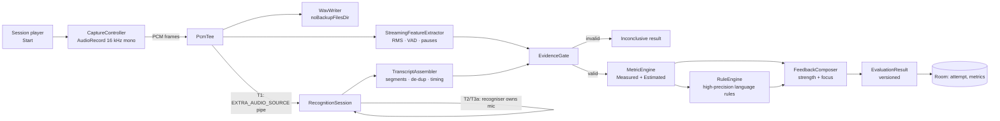

# Local Intelligence Architecture — SpeakCraft

| Field | Value |
|---|---|
| Document ID | ARC-05 |
| Version | 0.1 — Draft for review |
| Date | 2026-11-20 |
| Status | Draft — **Proposed**, awaiting approval (gate G3); tier design requires device spike SPK-01 |
| Owner (role) | AI/ML Engineer |
| Approval | Pending — Product Owner; Android Tech Lead review |
| Related | ADR-003, ADR-009, ADR-015, SRS §6.4–6.5, §6.12, §16, NFR-QUAL, FS-04, FS-05, FS-07, FS-12, RD-03 §5 |

---

## 1. Goals and constraints

| Goal | Constraint |
|---|---|
| Real transcripts for every attempt where the device allows | No cloud AI, no LLM (NG-01); platform recognisers only (ADR-009) |
| Honest, evidence-based metrics | Deterministic rules; versioned; tested with fixtures (NFR-QUAL) |
| One pipeline for every template and stage | Replace 2 scoring engines, 4 recogniser wrappers, 5 availability sources (RD-03 §11) |
| Work offline and on 2 GB devices | Streaming audio processing; no large models (NFR-PERF-009) |

**Distinguish four concepts explicitly** (they are conflated today, FND-AI-05/06):

| Concept | Meaning | Source of truth |
|---|---|---|
| **User preference** | What the user chose (recognition language, online consent, retention) | DataStore `SpeechPreferences` |
| **Model/pack availability** | Whether the on-device language pack for the locale is installed | `SpeechRecognizer.checkRecognitionSupport` (API 33+); otherwise unknown |
| **Device capability** | What the OS/hardware can do (API level, on-device recogniser presence, mic) | `SpeechCapabilityService` probes at startup |
| **Runtime availability** | Whether it works right now (recogniser busy, permission revoked, no network for T3a) | Per-attempt `RecognitionSession` result |

The UI shows a status only when all four are consistent and verified (PP-1).

## 2. Pipeline overview

Components replace the current classes as follows:

| New component | Replaces (current) |
|---|---|
| `CaptureController` (+ `PcmTee`, `WavWriter`) | `AudioRecorderManager` (MediaRecorder/AAC), `AudioResampler` decode path |
| `RecognitionSession` | `LiveTranscriptionManager`, `AndroidLiveRecognizerBackend`, `SpeechRecognitionManager`, `LocalSpeechRecognitionEngine`, `TtsAndSpeechHelper.startLiveSpeechCapture` |
| `SpeechCapabilityService` | `IntelligenceCapabilityManager`, `OfflineAIAvailabilityManager`, `DeviceCapabilityManager`, `OnDeviceModelManager`, `LocalExecutionPolicy` |
| `StreamingFeatureExtractor` | `AudioFeatureExtractionEngine` (bugs fixed, streaming) |
| `EvidenceGate` | `EvaluationEvidenceValidator` (kept and extended) |
| `MetricEngine` | parts of `EvidenceBasedScoringEngine`, `MultimodalFeatureFusionEngine`, `UniversalEvaluationEngine` |
| `RuleEngine` | `LocalLanguageAnalysisEngine` (rules re-qualified), `FillerWordDetectionEngine` |
| `FeedbackComposer` | `LocalFeedbackEngine`, `DynamicLocalCoachEngine`, `DeterministicFeedbackTemplates`, `ImprovementRecommendationEngine`, `RecommendationEngine` |
| `ReferenceMatcher` | `PronunciationAnalysisEngine` alignment (relabelled "recognised as intended") |
| `WordStageEvaluator` | `LocalVocabularyEvaluator` stages 2–4 |
| — (removed) | `FirebaseAiLogicService`, `GeminiCoachService`, `HybridAiCoachCoordinator` cloud paths, MediaPipe engines, `VideoFrameProcessingEngine`, YouTube extraction |

## 3. Capability tiers (from ADR-009)

| Tier | Detection | Capture | Transcript | Replay | User-facing label |
|---|---|---|---|---|---|
| **T1** | API ≥ 33 ∧ `isOnDeviceRecognitionAvailable` ∧ locale supported (`checkRecognitionSupport` → installed) ∧ audio-source piping verified at first use | App `AudioRecord` → WAV + pipe | Continuous, on-device (`EXTRA_SEGMENTED_SESSION`) | Yes | "On-device transcription" |
| **T2** | API ≥ 31 ∧ on-device recogniser available (or T1 piping failed) | Recogniser owns mic | On-device, segment restart + stitching | No | "On-device transcription (no replay)" |
| **T3a** | No on-device recogniser ∧ `isRecognitionAvailable` ∧ online consent = true | Recogniser owns mic | Online speech service (consented) | No | "Online transcription (you agreed)" |
| **T3b** | Otherwise | App `AudioRecord` | None | Yes | "Audio-only feedback" |

Tier is re-evaluated on start-up, consent change, locale change and pack installation; a T1 piping failure at runtime demotes to T2 for the device and is remembered.

## 4. Speech capture and recognition design

### 4.1 Capture
- `AudioRecord` with `MediaRecorder.AudioSource.VOICE_RECOGNITION` (falls back to `MIC`), 16 kHz, mono, PCM16, 20 ms frames.
- `PcmTee` fans frames to `WavWriter`, `StreamingFeatureExtractor` and (T1) the recogniser pipe (`ParcelFileDescriptor.createPipe()` → `EXTRA_AUDIO_SOURCE` with `EXTRA_AUDIO_SOURCE_ENCODING`/`CHANNEL_COUNT`/`SAMPLING_RATE`).
- No boxed collections; fixed ring buffers; constant memory independent of attempt length (fixes FND-AI-13).
- Audio focus requested (`AUDIOFOCUS_GAIN_TRANSIENT_EXCLUSIVE`); loss → interrupt (SRS-FR-SESS-010). Lifecycle `ON_STOP` → interrupt.

### 4.2 Recognition session
- One `RecognitionSession` per attempt; created on the main thread; released in `finally`.
- T1: `EXTRA_SEGMENTED_SESSION`, partial results on; segments appended by `TranscriptAssembler` with timestamps.
- T2/T3a: on `onEndOfSegmentedSession`/`onResults` with recording still active → restart listening within 150 ms; stitch with de-duplication of overlapping words; final results after Stop accepted only for the active segment ID (fixes duplication, FND-AI-04).
- Error classification (SRS-FR-SPCH-010): `NO_MATCH`/`SPEECH_TIMEOUT` → no transcript for that segment (not a capability failure); `NETWORK*` in T3a → attempt continues audio-less; `RECOGNIZER_BUSY` → one retry then T3b for the attempt; `INSUFFICIENT_PERMISSIONS` → interrupt.
- Confidence: from `CONFIDENCE_SCORES` when present; else `null` (SRS-BR-005).
- `EXTRA_ENABLE_FORMATTING` (punctuation) requested where supported; the rule engine must not depend on punctuation (§8.3).

### 4.3 Language packs (API 33+)
`checkRecognitionSupport(intent, executor, callback)` → `RecognitionSupport.installedOnDeviceLanguages` / `pendingOnDeviceLanguages` / `supportedOnDeviceLanguages`; Install → `triggerModelDownload(intent)`; status polled on resume. No app-managed model files (removes the fake Whisper catalogue).

### 4.4 Device spike SPK-01 (blocking for R1 build)
On ≥ 4 devices covering T1/T2/T3: verify audio-source piping, segmented sessions, restart gaps, finalisation latency, accuracy on a 40-utterance recorded test set of B1–B2 accented speech (word error rate per device), concurrency with `AudioRecord`, behaviour without network. Output: tier matrix + go/no-go for T1 piping; feeds NFR-PERF-004/006 and ASM-05.

## 5. Evidence gate

Kept from the current implementation (FND-AI-17) and extended per SRS-BR-001:

| Check | Threshold † | Applies |
|---|---|---|
| Duration | ≥ 1.5 s | All |
| Voiced speech | ≥ 0.5 s and ≥ 25 % of duration | Where audio available (T1, T3b; T2/T3a via RMS callbacks) |
| Level | Mean active-frame RMS above silence floor; adaptive noise floor from first 300 ms | Where audio available |
| Transcript presence | ≥ 1 word (READ/REPEAT/word stages); ≥ 8 words (ANSWER/STRUCT/STORY) | Transcript-required templates (not in T3b) |
| Session scope | Transcript segments carry the attempt ID | T1–T3a |
| Clipping | > 1 % of samples at full scale → quality warning (not invalid) | Where audio available |

Outcome: `Valid` · `Inconclusive(reason)` with reasons `TOO_SHORT`, `TOO_QUIET`, `NO_SPEECH`, `NO_TRANSCRIPT`, `TOO_FEW_WORDS`.

## 6. Metric catalogue (authoritative)

| Key | Metric | Label | Formula / method | Inputs | Templates | Noise band † |
|---|---|---|---|---|---|---|
| M-DUR | Duration | Measured | Recording length (s) | Audio/timer | All | — |
| M-SPK | Speaking time | Measured | Sum of voiced frames (VAD, adaptive threshold) | Audio or RMS callbacks | All | ±0.5 s |
| M-RATIO | Speech ratio | Measured | M-SPK / M-DUR | Audio | ANSWER, STRUCT, STORY | ±5 pts |
| M-WPM | Pace | Measured | Recognised words / (M-SPK in min) | Transcript + audio | ANSWER, STRUCT, STORY, READ | ±10 wpm |
| M-PAUSE | Long pauses | Measured | Count of silences ≥ 1.0 s inside speech (excludes leading/trailing) | Audio | ANSWER, STRUCT, STORY | ±1 |
| M-WORDS | Words | Measured | Recognised word count | Transcript | All transcript templates | — |
| M-LEN | Length vs target | Measured | M-WORDS or M-SPK vs template target range | Transcript/audio | ANSWER, STRUCT, STORY | — |
| M-TARGET | Target word used | Measured | Lemma/inflection match of target word | Transcript | Word stages 2–4 | — |
| M-MATCH | Recognised as intended | Measured | Word-level alignment of transcript vs reference text (Levenshtein alignment; contractions/numbers normalised) | Transcript + reference | READ, REPEAT, stage 3 | ±5 pts |
| M-FILL | Filler words / min | Estimated | Count of high-confidence fillers ("um", "uh", "er", "you know", "I mean", sentence-initial "so/like" heuristics) per minute of speaking | Transcript | ANSWER, STRUCT, STORY | ±1/min |
| M-LEX | Vocabulary variety | Estimated | MATTR (moving-average type-token ratio, window 25 tokens), content words only | Transcript (≥ 25 words) | ANSWER, STRUCT, STORY | ±0.05 |
| M-GRAM | Possible grammar issues | Estimated | Count of high-precision rule hits per 100 words (§8) | Transcript | ANSWER, STRUCT, STORY, stage 4 | — |
| M-STRUCT | Structure elements | Estimated | Detected framework elements via cue-phrase lexicons (STAR: situation/task/action/result; PREP: point/reason/example/point) | Transcript | STRUCT | — |
| M-HEDGE | Hedging | Estimated | Hedges per 100 words ("I think maybe", "sort of", "kind of" as hedges, "just" softeners) | Transcript | ANSWER, STRUCT | — |
| M-LEVEL | Loudness consistency | Measured (quality signal) | Coefficient of variation of active-frame RMS; used only for "too quiet / uneven" quality notes, never as a skill score | Audio | All with audio | — |

**Removed metrics** (cannot be supported honestly): free-speech "pronunciation", "vocal melody" from Hz pitch spread, video presence, "articulation"/"stress" from typed text, rate consistency (until correctly implemented with transcript timing), background-noise score.

Bands (plain language) are defined per metric, e.g. M-WPM: < 100 "slow", 100–160 "comfortable", > 160 "fast" (†, tuned after SPK-01).

## 7. Headline metrics per template (shown on the result)

| Template | Headline 1 | Headline 2 | Headline 3 | Pass/fail |
|---|---|---|---|---|
| TPL-READ | M-MATCH | M-WPM | M-PAUSE | M-MATCH ≥ 75 % † |
| TPL-REPEAT | M-MATCH | M-SPK vs reference duration | M-WORDS | M-MATCH ≥ 75 % † |
| TPL-ANSWER | M-WPM | M-FILL | M-LEN | none (D-06) |
| TPL-STRUCT | M-STRUCT | M-WPM | M-FILL | none |
| TPL-STORY | M-LEN | M-PAUSE | M-LEX | none |
| T3b (any) | M-SPK | M-PAUSE | M-RATIO | none; transcript-based checks "need a transcript" |

Other computed metrics are shown in the detail sheet (SCR-SESS-02).

## 8. Rules and feedback

### 8.1 Rule engine qualification (SPK-02)
- Corpus: ≥ 30 positive and ≥ 30 negative examples per rule, written as unpunctuated, lower-case recogniser-style text, including the false-positive cases found in the audit (FND-AI-09).
- A rule ships only if precision ≥ 0.90 (NFR-QUAL-003); recall is reported, not gated.
- Expected initial survivors (INFERRED): third-person agreement in unambiguous contexts ("he don't", "she have" with exclusions), "more better", "didn't went", common article errors with explicit vowel-sound lists, double negatives, wrong past participle after "have". Run-on, sentence-length and "a lot of → many" rules are **dropped**.
- Rules carry ID, version, explanation, suggestion template, examples.

### 8.2 Feedback composer
Deterministic, priority-ordered rule table; outputs exactly one **strength** and one **focus** (SRS-FR-EVAL-005):

| Priority | Focus condition (example) | Focus text pattern |
|---|---|---|
| 1 | Inconclusive | Reason-specific retry advice |
| 2 | READ/REPEAT: words not recognised as intended | "Try these words again: '{w1}', '{w2}' — listen to the slow reference first." |
| 3 | M-STRUCT missing element (STRUCT) | "Add the {Result}: what changed because of what you did?" |
| 4 | M-FILL above band | "You used '{top filler}' {n} times. Pause silently instead." |
| 5 | M-WPM fast | "Slow down slightly — aim for {target} words per minute." |
| 6 | M-PAUSE high | "Plan your next sentence before you start speaking it." |
| 7 | M-LEN below target | "Say a little more: add one example." |
| 8 | Grammar observation (high precision) | "Possible issue: '{span}' → '{suggestion}'." |

Strength = best metric relative to its band, or improvement vs previous attempt ("Fewer fillers than last time: 6 → 2"). Never praise a metric that is `null` or Estimated with low evidence.

### 8.3 Punctuation independence
No rule or metric relies on sentence boundaries from punctuation; sentence-level heuristics (if any) use pause timing from `TranscriptAssembler`.

## 9. Word-stage evaluation

| Stage | Check | Score | Pass |
|---|---|---|---|
| 2 Say it | Transcript tokens vs target (exact, inflection list from content, edit similarity ≥ 0.8 on single-token output) | 100 exact · 90 inflection · 75–89 near-match · < 75 other | ≥ 75 |
| 3 Use it | M-MATCH on each given sentence | M-MATCH | Both ≥ 75 |
| 4 Make your own | Target present (required) · ≥ 5 words (required) · M-GRAM hits ≤ 1 (required) · composite = 50 (target + length) + 25 × (1 − grammarHits) + 25 × (content-word count ≥ 3) | 0–100 | ≥ 70 and all required |

Inflection acceptance uses explicit inflection lists in the content pack (not stem-prefix heuristics that accept "convenient" for "convey", FND-AI-09).

**Caveat shown to users:** "Speech recognition may recognise a word even when it isn't pronounced clearly, so 'Say it' checks that you were understood, not your accent."

## 10. Versioning, testing and explainability

- `evaluationVersion` = semantic version of the rule set + metric definitions; stored with every attempt; changes listed in a changelog.
- Fixture suite: WAV fixtures (silence, noise, short, normal, fast, many pauses) + transcript fixtures; golden outputs per version; runs in CI (JVM).
- "How we measured this" text is generated from the metric catalogue entries (single source).

## 11. Performance budget

| Step | Budget (60 s attempt, RD-MID) † |
|---|---|
| Streaming features | Real-time during capture (< 10 % CPU) |
| Recogniser finalisation | Platform (target ≤ 1.5 s, measured) |
| Metric + rule + feedback | ≤ 200 ms |
| DB write | ≤ 50 ms |

## 12. Future options (not in scope)

| Option | Gate |
|---|---|
| Correctly implemented on-device Whisper-class ASR (SPK-03) | Must beat T2/T3 WER and latency on SPK-01 set; app-size budget; ADR update |
| On-device language model for richer feedback on capable devices | New ADR, privacy review, Product Owner authorisation (NG-01) |
| Phoneme-level assessment | Requires a validated acoustic model; out of scope (NG-03) |
