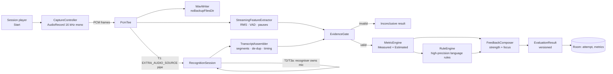

# Local Intelligence Architecture — SpeakCraft

| Field | Value |
|---|---|
| Document ID | ARC-05 |
| Version | 0.2 — Draft for review (2026-11-21: §8.4 mistakes found and coach tips after every attempt, issue catalogue, deterministic tip selection, self-check, candidate acoustic metrics — Product Owner direction PRD-FR-047) |
| Date | 2026-11-21 |
| Status | Draft — **Proposed**, awaiting approval (gate G3); tier design requires device spike SPK-01 |
| Owner (role) | AI/ML Engineer |
| Approval | Pending — Product Owner; Android Tech Lead review |
| Related | ADR-003, ADR-009, ADR-015, SRS §6.4–6.5, §6.12, §16, NFR-QUAL, FS-04, FS-05, FS-07, FS-12, RD-03 §5 |

---

## 1. Goals and constraints

| Goal | Constraint |
|---|---|
| Real transcripts for every attempt where the device allows | No cloud AI, no LLM (NG-01); platform recognisers only (ADR-009) |
| Honest, evidence-based metrics | Deterministic rules; versioned; tested with fixtures (NFR-QUAL) |
| One pipeline for every template and stage | Replace 2 scoring engines, 4 recogniser wrappers, 5 availability sources (RD-03 §11) |
| Work offline and on 2 GB devices | Streaming audio processing; no large models (NFR-PERF-009) |

**Distinguish four concepts explicitly** (they are conflated today, FND-AI-05/06):

| Concept | Meaning | Source of truth |
|---|---|---|
| **User preference** | What the user chose (recognition language, online consent, retention) | DataStore `SpeechPreferences` |
| **Model/pack availability** | Whether the on-device language pack for the locale is installed | `SpeechRecognizer.checkRecognitionSupport` (API 33+); otherwise unknown |
| **Device capability** | What the OS/hardware can do (API level, on-device recogniser presence, mic) | `SpeechCapabilityService` probes at startup |
| **Runtime availability** | Whether it works right now (recogniser busy, permission revoked, no network for T3a) | Per-attempt `RecognitionSession` result |

The UI shows a status only when all four are consistent and verified (PP-1).

## 2. Pipeline overview

Components replace the current classes as follows:

| New component | Replaces (current) |
|---|---|
| `CaptureController` (+ `PcmTee`, `WavWriter`) | `AudioRecorderManager` (MediaRecorder/AAC), `AudioResampler` decode path |
| `RecognitionSession` | `LiveTranscriptionManager`, `AndroidLiveRecognizerBackend`, `SpeechRecognitionManager`, `LocalSpeechRecognitionEngine`, `TtsAndSpeechHelper.startLiveSpeechCapture` |
| `SpeechCapabilityService` | `IntelligenceCapabilityManager`, `OfflineAIAvailabilityManager`, `DeviceCapabilityManager`, `OnDeviceModelManager`, `LocalExecutionPolicy` |
| `StreamingFeatureExtractor` | `AudioFeatureExtractionEngine` (bugs fixed, streaming) |
| `EvidenceGate` | `EvaluationEvidenceValidator` (kept and extended) |
| `MetricEngine` | parts of `EvidenceBasedScoringEngine`, `MultimodalFeatureFusionEngine`, `UniversalEvaluationEngine` |
| `RuleEngine` | `LocalLanguageAnalysisEngine` (rules re-qualified), `FillerWordDetectionEngine` |
| `FeedbackComposer` | `LocalFeedbackEngine`, `DynamicLocalCoachEngine`, `DeterministicFeedbackTemplates`, `ImprovementRecommendationEngine`, `RecommendationEngine` |
| `ReferenceMatcher` | `PronunciationAnalysisEngine` alignment (relabelled "recognised as intended") |
| `WordStageEvaluator` | `LocalVocabularyEvaluator` stages 2–4 |
| — (removed) | `FirebaseAiLogicService`, `GeminiCoachService`, `HybridAiCoachCoordinator` cloud paths, MediaPipe engines, `VideoFrameProcessingEngine`, YouTube extraction |

## 3. Capability tiers (from ADR-009)

| Tier | Detection | Capture | Transcript | Replay | User-facing label |
|---|---|---|---|---|---|
| **T1** | API ≥ 33 ∧ `isOnDeviceRecognitionAvailable` ∧ locale supported (`checkRecognitionSupport` → installed) ∧ audio-source piping verified at first use | App `AudioRecord` → WAV + pipe | Continuous, on-device (`EXTRA_SEGMENTED_SESSION`) | Yes | "On-device transcription" |
| **T2** | API ≥ 31 ∧ on-device recogniser available (or T1 piping failed) | Recogniser owns mic | On-device, segment restart + stitching | No | "On-device transcription (no replay)" |
| **T3a** | No on-device recogniser ∧ `isRecognitionAvailable` ∧ online consent = true | Recogniser owns mic | Online speech service (consented) | No | "Online transcription (you agreed)" |
| **T3b** | Otherwise | App `AudioRecord` | None | Yes | "Audio-only feedback" |

Tier is re-evaluated on start-up, consent change, locale change and pack installation; a T1 piping failure at runtime demotes to T2 for the device and is remembered.

## 4. Speech capture and recognition design

### 4.1 Capture
- `AudioRecord` with `MediaRecorder.AudioSource.VOICE_RECOGNITION` (falls back to `MIC`), 16 kHz, mono, PCM16, 20 ms frames.
- `PcmTee` fans frames to `WavWriter`, `StreamingFeatureExtractor` and (T1) the recogniser pipe (`ParcelFileDescriptor.createPipe()` → `EXTRA_AUDIO_SOURCE` with `EXTRA_AUDIO_SOURCE_ENCODING`/`CHANNEL_COUNT`/`SAMPLING_RATE`).
- No boxed collections; fixed ring buffers; constant memory independent of attempt length (fixes FND-AI-13).
- Audio focus requested (`AUDIOFOCUS_GAIN_TRANSIENT_EXCLUSIVE`); loss → interrupt (SRS-FR-SESS-010). Lifecycle `ON_STOP` → interrupt.

### 4.2 Recognition session
- One `RecognitionSession` per attempt; created on the main thread; released in `finally`.
- T1: `EXTRA_SEGMENTED_SESSION`, partial results on; segments appended by `TranscriptAssembler` with timestamps.
- T2/T3a: on `onEndOfSegmentedSession`/`onResults` with recording still active → restart listening within 150 ms; stitch with de-duplication of overlapping words; final results after Stop accepted only for the active segment ID (fixes duplication, FND-AI-04).
- Error classification (SRS-FR-SPCH-010): `NO_MATCH`/`SPEECH_TIMEOUT` → no transcript for that segment (not a capability failure); `NETWORK*` in T3a → attempt continues audio-less; `RECOGNIZER_BUSY` → one retry then T3b for the attempt; `INSUFFICIENT_PERMISSIONS` → interrupt.
- Confidence: from `CONFIDENCE_SCORES` when present; else `null` (SRS-BR-005).
- `EXTRA_ENABLE_FORMATTING` (punctuation) requested where supported; the rule engine must not depend on punctuation (§8.3).

### 4.3 Language packs (API 33+)
`checkRecognitionSupport(intent, executor, callback)` → `RecognitionSupport.installedOnDeviceLanguages` / `pendingOnDeviceLanguages` / `supportedOnDeviceLanguages`; Install → `triggerModelDownload(intent)`; status polled on resume. No app-managed model files (removes the fake Whisper catalogue).

### 4.4 Device spike SPK-01 (blocking for R1 build)
On ≥ 4 devices covering T1/T2/T3: verify audio-source piping, segmented sessions, restart gaps, finalisation latency, accuracy on a 40-utterance recorded test set of B1–B2 accented speech (word error rate per device), concurrency with `AudioRecord`, behaviour without network. Output: tier matrix + go/no-go for T1 piping; feeds NFR-PERF-004/006 and ASM-05.

## 5. Evidence gate

Kept from the current implementation (FND-AI-17) and extended per SRS-BR-001:

| Check | Threshold † | Applies |
|---|---|---|
| Duration | ≥ 1.5 s | All |
| Voiced speech | ≥ 0.5 s and ≥ 25 % of duration | Where audio available (T1, T3b; T2/T3a via RMS callbacks) |
| Level | Mean active-frame RMS above silence floor; adaptive noise floor from first 300 ms | Where audio available |
| Transcript presence | ≥ 1 word (READ/REPEAT/word stages); ≥ 8 words (ANSWER/STRUCT/STORY) | Transcript-required templates (not in T3b) |
| Session scope | Transcript segments carry the attempt ID | T1–T3a |
| Clipping | > 1 % of samples at full scale → quality warning (not invalid) | Where audio available |

Outcome: `Valid` · `Inconclusive(reason)` with reasons `TOO_SHORT`, `TOO_QUIET`, `NO_SPEECH`, `NO_TRANSCRIPT`, `TOO_FEW_WORDS`.

## 6. Metric catalogue (authoritative)

| Key | Metric | Label | Formula / method | Inputs | Templates | Noise band † |
|---|---|---|---|---|---|---|
| M-DUR | Duration | Measured | Recording length (s) | Audio/timer | All | — |
| M-SPK | Speaking time | Measured | Sum of voiced frames (VAD, adaptive threshold) | Audio or RMS callbacks | All | ±0.5 s |
| M-RATIO | Speech ratio | Measured | M-SPK / M-DUR | Audio | ANSWER, STRUCT, STORY | ±5 pts |
| M-WPM | Pace | Measured | Recognised words / (M-SPK in min) | Transcript + audio | ANSWER, STRUCT, STORY, READ | ±10 wpm |
| M-PAUSE | Long pauses | Measured | Count of silences ≥ 1.0 s inside speech (excludes leading/trailing) | Audio | ANSWER, STRUCT, STORY | ±1 |
| M-WORDS | Words | Measured | Recognised word count | Transcript | All transcript templates | — |
| M-LEN | Length vs target | Measured | M-WORDS or M-SPK vs template target range | Transcript/audio | ANSWER, STRUCT, STORY | — |
| M-TARGET | Target word used | Measured | Lemma/inflection match of target word | Transcript | Word stages 2–4 | — |
| M-MATCH | Recognised as intended | Measured | Word-level alignment of transcript vs reference text (Levenshtein alignment; contractions/numbers normalised) | Transcript + reference | READ, REPEAT, stage 3 | ±5 pts |
| M-FILL | Filler words / min | Estimated | Count of high-confidence fillers ("um", "uh", "er", "you know", "I mean", sentence-initial "so/like" heuristics) per minute of speaking | Transcript | ANSWER, STRUCT, STORY | ±1/min |
| M-LEX | Vocabulary variety | Estimated | MATTR (moving-average type-token ratio, window 25 tokens), content words only | Transcript (≥ 25 words) | ANSWER, STRUCT, STORY | ±0.05 |
| M-GRAM | Possible grammar issues | Estimated | Count of high-precision rule hits per 100 words (§8) | Transcript | ANSWER, STRUCT, STORY, stage 4 | — |
| M-STRUCT | Structure elements | Estimated | Detected framework elements via cue-phrase lexicons (STAR: situation/task/action/result; PREP: point/reason/example/point) | Transcript | STRUCT | — |
| M-HEDGE | Hedging | Estimated | Hedges per 100 words ("I think maybe", "sort of", "kind of" as hedges, "just" softeners) | Transcript | ANSWER, STRUCT | — |
| M-LEVEL | Loudness consistency | Measured (quality signal) | Coefficient of variation of active-frame RMS; used only for "too quiet / uneven" quality notes, never as a skill score | Audio | All with audio | — |

**Removed metrics** (cannot be supported honestly): free-speech "pronunciation", "vocal melody" from Hz pitch spread, video presence, "articulation"/"stress" from typed text, rate consistency (until correctly implemented with transcript timing), background-noise score.

Bands (plain language) are defined per metric, e.g. M-WPM: < 100 "slow", 100–160 "comfortable", > 160 "fast" (†, tuned after SPK-01).

**Band and noise-band table (added 2026-11-21 for §8.4 issue raising; every value is † Proposed — requires approval, tuned on the SPK-01/SPK-02 corpora).** An issue is raised only when the value is beyond the "issue" threshold by more than the noise band.

| Metric | Target band | Issue threshold | Noise band | Notes |
|---|---|---|---|---|
| M-WPM | 100–160 wpm | < 100 (slow) or > 160 (fast) | ±10 wpm | READ uses the reference text's natural rate ±20 % instead † |
| M-PAUSE | ≤ 2 long pauses per minute of speaking | > 2 per minute | ±1 pause | Normalised per minute of M-SPK; leading/trailing silence excluded |
| M-FILL | ≤ 3 per minute | > 3 per minute | ±1/min | Estimated; caveat that recognisers often drop "um/uh" |
| M-LEX | MATTR ≥ 0.55 | < 0.55 | ±0.05 | Only with ≥ 25 words |
| M-HEDGE | ≤ 3 per 100 words | > 3 per 100 words | ±1/100 words | Estimated |
| M-LEN | Activity target range from the content pack (words or seconds) | Below the lower bound | ±5 words or ±3 s | Above the upper bound is not a mistake in R1 |
| M-MATCH | ≥ 75 % (pass) | Any reference word not recognised as intended | — (word-level) | The percentage carries ±5 pts; individual words are discrete |
| M-STRUCT | All elements of the activity's framework | Any element missing | — (discrete) | Estimated; cue phrases shown as evidence |
| M-GRAM | 0 qualified rule hits | ≥ 1 hit | — (discrete) | Only qualified rules (§8.1); max 2 shown (SRS-FR-EVAL-006) |
| M-LEVEL | CV within quality range | Quiet/uneven per quality rule | — | Quality note only, never a skill score |

**Storage units (ENT-04 `value`; added 2026-11-21 for ARC-03, CL-70):** M-DUR and M-SPK in milliseconds · M-RATIO 0–1 · M-WPM words per minute (decimal) · M-PAUSE count (per-minute rate derived for bands) · M-WORDS count · M-LEN words or seconds, as the activity's target defines · M-TARGET boolean (0/1) · M-MATCH 0–100 (%) · M-FILL per minute (decimal) · M-LEX 0–1 · M-GRAM hits per 100 words · M-STRUCT detected-element set (stored as a list, count in `value`) · M-HEDGE per 100 words · M-LEVEL coefficient of variation 0–1. `null` = not computable (SRS-BR-002).

## 7. Headline metrics per template (shown on the result)

| Template | Headline 1 | Headline 2 | Headline 3 | Pass/fail |
|---|---|---|---|---|
| TPL-READ | M-MATCH | M-WPM | M-PAUSE | M-MATCH ≥ 75 % † |
| TPL-REPEAT | M-MATCH | M-SPK vs reference duration | M-WORDS | M-MATCH ≥ 75 % † |
| TPL-ANSWER | M-WPM | M-FILL | M-LEN | none (D-06) |
| TPL-STRUCT | M-STRUCT | M-WPM | M-FILL | none |
| TPL-STORY | M-LEN | M-PAUSE | M-LEX | none |
| T3b (any) | M-SPK | M-PAUSE | M-RATIO | none; transcript-based checks "need a transcript" |

Other computed metrics are shown in the detail sheet (SCR-SESS-02).

## 8. Rules and feedback

### 8.1 Rule engine qualification (SPK-02)
- Corpus: ≥ 30 positive and ≥ 30 negative examples per rule, written as unpunctuated, lower-case recogniser-style text, including the false-positive cases found in the audit (FND-AI-09).
- A rule ships only if precision ≥ 0.90 (NFR-QUAL-003); recall is reported, not gated.
- Expected initial survivors (INFERRED): third-person agreement in unambiguous contexts ("he don't", "she have" with exclusions), "more better", "didn't went", common article errors with explicit vowel-sound lists, double negatives, wrong past participle after "have". Run-on, sentence-length and "a lot of → many" rules are **dropped**.
- Rules carry ID, version, explanation, suggestion template, examples.

### 8.2 Feedback composer
Deterministic, priority-ordered rule table; outputs exactly one **strength** and one **focus** (SRS-FR-EVAL-005):

| Priority | Focus condition (example) | Focus text pattern |
|---|---|---|
| 1 | Inconclusive | Reason-specific retry advice |
| 2 | READ/REPEAT: words not recognised as intended | "Try these words again: '{w1}', '{w2}' — listen to the slow reference first." |
| 3 | M-STRUCT missing element (STRUCT) | "Add the {Result}: what changed because of what you did?" |
| 4 | M-FILL above band | "You used '{top filler}' {n} times. Pause silently instead." |
| 5 | M-WPM fast | "Slow down slightly — aim for {target} words per minute." |
| 6 | M-PAUSE high | "Plan your next sentence before you start speaking it." |
| 7 | M-LEN below target | "Say a little more: add one example." |
| 8 | Grammar observation (high precision) | "Possible issue: '{span}' → '{suggestion}'." |

Strength = best metric relative to its band, or improvement vs previous attempt ("Fewer fillers than last time: 6 → 2"). Never praise a metric that is `null` or Estimated with low evidence.

**Strength codes** (stored and synced as the first entry of `feedbackCodes`, ARC-03 §8; added 2026-11-21, CL-70): STR_ALL_RECOGNISED (READ/REPEAT, every word recognised as intended) · STR_TARGET_WORD_USED · STR_STRUCT_COMPLETE · STR_PACE_IN_BAND · STR_FEW_PAUSES · STR_FEW_FILLERS · STR_LENGTH_ON_TARGET · STR_GOOD_VARIETY · STR_IMPROVED (with metric key and before → after values, beyond the noise band) · STR_COMPLETED (fallback when no metric qualifies: "You finished a full attempt — that's the practice that counts"; never a skill claim).

### 8.3 Punctuation independence
No rule or metric relies on sentence boundaries from punctuation; sentence-level heuristics (if any) use pause timing from `TranscriptAssembler`.

### 8.4 Mistakes found and coach tips after every attempt (added 2026-11-21; PRD-FR-047, SRS-FR-EVAL-015/016, SRS-FR-WORD-014)

Everything here is deterministic function logic over the on-device outputs above. No cloud or generative model is used (D-04). An optional on-device generative rewording of tips would need its own ADR and is out of R1.

**Issue catalogue (versioned with `evaluationVersion`).** An issue is raised only when its source metric is non-null and lies outside the target band by more than the metric's noise band (§6). This stops borderline values from being reported as mistakes.

| Issue code | Raised when | Evidence shown | Label | Applies to |
|---|---|---|---|---|
| ISSUE_WORD_NOT_RECOGNISED | M-MATCH alignment marks reference words as not recognised as intended | The words, in context | Measured | READ, REPEAT, stage 3, review sentences |
| ISSUE_WRONG_FORM | Stage 2 / spoken recall: the output contains a word that is a near-match to the target (edit similarity ≥ 0.6 †) but is not the target or an accepted inflection (score < 75) | "We heard '{heard}'" | Measured | Stage 2, spoken recall |
| ISSUE_TARGET_WORD_MISSING | M-TARGET false **and** ISSUE_WRONG_FORM not raised (no near-match token at all) — the two are mutually exclusive | Target word | Measured | Stages 2–4, review |
| ISSUE_TOO_SHORT | M-LEN below the target range; for stage 4, fewer than 5 words **or** fewer than 3 content words (the composite component in §9) | Words/seconds vs target; for stage 4 "Add a few more meaningful words" | Measured | ANSWER, STRUCT, STORY, stage 4 |
| ISSUE_STRUCT_ELEMENT_MISSING | M-STRUCT lacks an element of the activity's framework | Missing element; detected cue phrases | Estimated | STRUCT |
| ISSUE_FILLERS_HIGH | M-FILL above band | Top fillers with counts | Estimated | ANSWER, STRUCT, STORY |
| ISSUE_PAUSES_LONG | M-PAUSE above band | Count; longest pause and its position in the transcript | Measured | ANSWER, STRUCT, STORY, READ |
| ISSUE_PACE_FAST / ISSUE_PACE_SLOW | M-WPM outside band | Value vs target range | Measured | ANSWER, STRUCT, STORY, READ |
| ISSUE_HEDGING_HIGH | M-HEDGE above band | Hedge phrases quoted | Estimated | ANSWER, STRUCT |
| ISSUE_LOW_VARIETY | M-LEX below band (≥ 25 words only) | Most repeated content words | Estimated | ANSWER, STRUCT, STORY |
| ISSUE_GRAMMAR_POSSIBLE | A qualified rule (§8.1) fires | Quoted span → suggestion; rule ID | Estimated | ANSWER, STRUCT, STORY, stage 4 |
| ISSUE_TOO_QUIET | M-LEVEL quality note | "Recording was quiet/uneven" | Measured (quality) | All with audio |

Ordering follows the §8.2 priorities. Three issues are shown first and the rest sit behind "Show all". Inconclusive attempts show the evidence-gate reason instead of issues.

**Issue display priority** (1 = shown first; ties broken by the larger distance beyond threshold, then issue code alphabetically): 1 ISSUE_TOO_QUIET (it may explain other issues) · 2 ISSUE_WORD_NOT_RECOGNISED, ISSUE_WRONG_FORM, ISSUE_TARGET_WORD_MISSING · 3 ISSUE_STRUCT_ELEMENT_MISSING · 4 ISSUE_FILLERS_HIGH · 5 ISSUE_PACE_FAST / ISSUE_PACE_SLOW · 6 ISSUE_PAUSES_LONG · 7 ISSUE_TOO_SHORT · 8 ISSUE_GRAMMAR_POSSIBLE · 9 ISSUE_HEDGING_HIGH · 10 ISSUE_LOW_VARIETY. Thresholds and noise bands: §6 band table.

**Coach-tip selection (tips are content, versioned with `contentVersion`).**
1. The candidates are content-pack tips whose triggers match the attempt: issue code, metric + band, template, or technique ID (ARC-03 §6).
2. They are ranked by trigger specificity (issue code > metric band > technique > template), then by the tip's priority, then by a stable hash of `tipId + attemptId`. The hash varies wording across attempts while staying reproducible.
3. The **focus tip** is the top tip for the highest-priority issue, and it doubles as the SRS-FR-EVAL-005 focus. Up to two more tips cover the next issues or, failing that, the activity's technique.
4. If no issue is found, the result states "Our checks didn't find issues in this attempt" with a one-line note on what the checks cover, shows the strength, and gives one general tip for the activity's technique.
5. Each tip links to its technique (SCR-PRAC-04) and, where provenance exists, to the specific source video (PRD-FR-057).

**Self-check for what audio cannot show.** Some technique aspects cannot be measured from audio and transcript, such as eye contact, gestures and facial expression (NG-07). For those, the result offers a short self-check checklist that the user ticks. It is stored as *self-reported* and never shown as Measured or Estimated.

**Candidate acoustic metrics for vocal-delivery techniques (not in the R1 catalogue until validated).** These are T1 only, because they need app-owned PCM. They must pass SPK-01 on the RD-LOW/MID/HIGH reference devices before approval.

| Candidate | Method | Label if approved | Notes |
|---|---|---|---|
| Pitch range | Semitone spread (10th–90th percentile) of voiced-frame F0 (autocorrelation/YIN) | Measured | Plain bands "narrow / moderate / wide". Never named "melody", "expressiveness" or "pronunciation". This replaces the removed Hz-spread heuristic only if validation succeeds |
| Volume variation | dB spread (10th–90th percentile) of active-frame RMS | Measured | Sensitive to microphone distance. Shown with that caveat |

## 9. Word-stage evaluation

| Stage | Check | Score | Pass |
|---|---|---|---|
| 2 Say it | Transcript tokens vs target (exact, inflection list from content, edit similarity ≥ 0.8 on single-token output) | 100 exact · 90 inflection · 75–89 near-match · < 75 other | ≥ 75 |
| 3 Use it | M-MATCH on each given sentence | M-MATCH | Both ≥ 75 |
| 4 Make your own | Target present (required) · ≥ 5 words (required) · M-GRAM hits ≤ 1 (required) · composite = 50 (target + length) + 25 × (1 − grammarHits) + 25 × (content-word count ≥ 3) | 0–100 | ≥ 70 and all required |

Inflection acceptance uses explicit inflection lists in the content pack (not stem-prefix heuristics that accept "convenient" for "convey", FND-AI-09).

**Internal template IDs for word-task attempts** (not shown to users; adopted from ARC-03 §11, CL-70): `TPL-WORD-SAY` (stage 2), `TPL-WORD-USE` (stage 3), `TPL-WORD-OWN` (stage 4 and review sentence use), `TPL-WORD-RECALL` (review spoken recall). Word-task attempts are attempts for streak purposes (SRS-BR-010) and use the evidence gate (§5).

**Caveat shown to users:** "Speech recognition may recognise a word even when it isn't pronounced clearly, so 'Say it' checks that you were understood, not your accent."

## 10. Versioning, testing and explainability

- `evaluationVersion` = semantic version of the rule set + metric definitions; stored with every attempt; changes listed in a changelog.
- Fixture suite: WAV fixtures (silence, noise, short, normal, fast, many pauses) + transcript fixtures; golden outputs per version; runs in CI (JVM).
- "How we measured this" text is generated from the metric catalogue entries (single source).

### 10.1 Implementation status (Stage B, as of 2026-11-23)

The engine is implemented in pure Kotlin under `app/src/main/java/com/example/speech/` (packages `analysis`, `evidence`, `metrics`, `rules`, `feedback`, `word`, `pipeline`, `session`, `video`), with Android adapters in `speech/android` and `speech/video/android`, at `evaluationVersion` **1.3.0**. Report: `docs/reports/EP-07_LOCAL_INTELLIGENCE_ENGINE_REPORT.md`.

Updates since 1.1.0: six grammar rules qualified on corpus SPK02-v1 (precision 0.939–1.000) and active; metrics limited to the templates they apply to (§6); one issue per code; golden fixtures pinned per version (`GoldenFixturesTest`); EP-06 session layer (`CaptureController`, `RecordingArbiter`, `RecognitionSession`, `SpeechAttemptRunner`) with Android adapters (`AudioRecordSource`, `WavFileSink`, `RecognizerPipe`, `PlatformRecognizerEngine`, `LanguagePackManager`, `OnlineTranscriptionConsentStore`); video analyser (ARC-07, D-42); WAV→AAC transcoding and replay muxing.

| Design element | Implementation | Note |
|---|---|---|
| §4.1 streaming features (CMP-30) | `StreamingFeatureExtractor` (PCM, 20 ms frames, adaptive noise floor, hangover 200 ms †, click removal 60 ms †, long pauses ≥ 1.0 s inside speech, clipping ratio); `RmsSeriesFeatureExtractor` for T2/T3a `onRmsChanged` levels (relative scale; clipping not observable) | Thresholds † tuned on SPK-01 recordings |
| §5 evidence gate | `EvidenceGate`; the level check runs only when level evidence exists (no default level) | — |
| §6 metrics | `MetricEngine`; transcript-based metrics are omitted without a transcript (T3b); M-GRAM is omitted until a rule is qualified | SRS-BR-002 |
| §8.1 rules | `RuleEngine.CANDIDATE_RULES` + `RuleQualificationHarness` (≥ 30/30 examples, precision ≥ 0.90) + `RuleQualificationRegistry` (empty) → **no grammar observation is shown until SPK-02 records results** | SRS-FR-EVAL-006 |
| §8.2/§8.4 feedback, issues, tips | `FeedbackComposer`, `RuleEngine.detectIssues`, `TipSelector`; technique `issueOverrides` support SUPPRESS (REBAND not yet) | Tip catalogue is built-in until the content pack (ARC-03 §6) exists |
| §9 word stages | `WordStageEvaluator` | — |
| Not yet built | Microphone capture and recognition sessions (EP-06; after SPK-01), content-pack tip loading, persistence of results (EP-03), UI (EP-08) | — |

## 11. Performance budget

| Step | Budget (60 s attempt, RD-MID) † |
|---|---|
| Streaming features | Real-time during capture (< 10 % CPU) |
| Recogniser finalisation | Platform (target ≤ 1.5 s, measured) |
| Metric + rule + feedback | ≤ 200 ms |
| DB write | ≤ 50 ms |

## 12. Future options (not in scope)

| Option | Gate |
|---|---|
| Correctly implemented on-device Whisper-class ASR (SPK-03) | Must beat T2/T3 WER and latency on SPK-01 set; app-size budget; ADR update |
| On-device language model for richer feedback on capable devices | New ADR, privacy review, Product Owner authorisation (NG-01) |
| Phoneme-level assessment | Requires a validated acoustic model; out of scope (NG-03) |
