# Technical Design — SpeakCraft (Target)

| Field | Value |
|---|---|
| Document ID | ARC-02 |
| Version | 0.1 — Draft for review |
| Date | 2026-11-21 |
| Status | Draft — Proposed, awaiting approval (gate G3) |
| Owner (role) | Android Technical Lead |
| Approval | Pending — Product Owner |
| Related | ARC-01 Solution Architecture, ARC-03 Database Design, ARC-04 API & Integration Specification, ARC-05 Local Intelligence Architecture, ADR-001…ADR-015, SEC-01, SRS, NFR, DES-02, RD-02, RD-03, ENG-01, PLN-02 (EP-02…EP-12), PLAN_AND_CANON "Resume canon (2026-11-21)" |

> **Authority (GOV-02 §3.2, §4).** ARC-02 is the authoritative home of **component IDs `CMP-nn`**, the package/class map, the domain-model and engine signatures, sequence and state diagrams, threading rules, the UI error mapping and the compile-time feature-flag list. It does **not** restate: layering and data-flow principles (ARC-01), the persistent schema and the "what syncs" list (ARC-03 §3–§10), repository/service interfaces (ARC-04 §5), evaluation behaviour, metrics, thresholds and rules (ARC-05), or security controls (SEC-01 `SEC-REQ-nn`). Where those documents disagree with each other, ARC-02 records the conflict in §12 and states which reading it designs against.
>
> **Evidence rule (GOV-02 DC-3/DC-4).** Labels: **EXISTING** (in the code today, with `path:line`), **PROPOSED** (target design, not built), **VERIFIED** (seen in source/config), **INFERRED** (reasoned from evidence or documented platform behaviour), **RECOMMENDATION**. Nothing was built, run or tested for this document. Every signature below is **illustrative and PROPOSED**; names may change in Stage B, IDs may not. Numeric defaults marked † are *Proposed — requires approval* (DC-5). Path alias: `pkg/` = `app/src/main/java/com/example/`.
>
> **Product Owner direction (2026-11-21).** (1) The curriculum is built from the frameworks, techniques, exercises, activities and tips taught on the @askvinh YouTube channel (PRD-FR-056, SRS-FR-PRAC-008). (2) **D-08 — DECISION (2026-11-21): "original wording, link out"**: own words and examples, no verbatim transcript text, a link to the **specific** source video, no creator name, likeness or branding (PRD-FR-057, SRS-FR-PRAC-009, SRS-BR-028). (3) After **every** submitted attempt the result lists the mistakes detected, with evidence, and coach tips chosen deterministically from the content pack's technique tips (PRD-FR-047, SRS-FR-EVAL-015/016, SRS-FR-WORD-014). This document applies the direction in §2 (CMP-16, -35, -36, -44, -66, new CMP-75 `TipSelector`, CMP-76 technique screens), §3.1 (Technique, Tip, provenance, `DetectedIssue`, `CoachTip`), §3.2 (`FeedbackComposer`, `TipSelector`, `WordStageEvaluator`), §3.3 (result `UiState` order), §5, §9, §10 (`CurriculumCatalog.kt` re-verify and migrate) and §12. Scraping, caption download and API ingestion stay retired (ADR-011; ARC-04 §2). All feedback logic is pure, deterministic and versioned with `evaluationVersion` + `contentVersion`; no cloud or generative model is used (D-04). An optional on-device generative rewording of tips would need a new ADR and is out of scope for R1.

---

## 1. Scope

### 1.1 What this document covers

| Covered | Section |
|---|---|
| Package and class map with component IDs (ADR-012 packages `app/core/domain/speech/data/feature`) | §2 |
| Key Kotlin signatures: domain models, engines, per-screen `UiState` | §3 |
| Dependency graph and `AppContainer` wiring | §4 |
| Sequence diagrams for the core flows | §5 |
| State diagrams for the stateful components | §6 |
| Concurrency and threading rules | §7 |
| Error types and their mapping to UI | §8 |
| Configuration and compile-time feature flags (WBS T-02.3.2) | §9 |
| Reuse plan for every existing source file (from RD-03) | §10 |
| Coding standards | §11 |
| Open technical questions and issues found in source documents | §12 |

### 1.2 Out of scope

Persistent schema, DAO queries and migrations (ARC-03); Firestore document fields (ARC-03 §8); repository/service interface signatures (ARC-04 §5 — this document only references them); metric formulas, thresholds and rule lists (ARC-05); visual design (DES-05/06); CI and release (ENG-01); test levels and device matrix (TST-01, written in parallel — referenced by section only).

### 1.3 Design baseline

| Item | Baseline | Source |
|---|---|---|
| Module | Single `:app` module, package-by-feature | ADR-012 |
| Namespace | `app.speakcraft` (replaces `com.example`, `app/build.gradle.kts:24`); applicationId is decision D-15 | ADR-012, ENG-01 §2.3 |
| Language/UI | Kotlin 2.2.10, Jetpack Compose + Material 3, Navigation Compose (type-safe routes) | ADR-001, ARC-01 §5 |
| DI | Manual `AppContainer` owned by `SpeakCraftApplication` | ADR-001, ARC-01 §7 |
| Local data | Room `learning.db` + Room `sensitive.db` + DataStore `settings` + DataStore `device_state` + files in `noBackupFilesDir` | ADR-002, canon R-1, SEC-01 §3.2 |
| Background | WorkManager (`SyncWorker`, `ReminderWorker`, `CleanupWorker`) | ADR-005 |
| Cloud | Firebase Auth (Google via Credential Manager), Cloud Firestore (existing named database) — optional, signed-in only | ADR-014, SEC-01 §4 |
| Speech | Platform `SpeechRecognizer` tiers T1/T2/T3a/T3b, `AudioRecord` 16 kHz mono PCM16 | ADR-009, ARC-05 §3–4 |
| minSdk | 24 today (`app/build.gradle.kts:29`), subject to D-14; see §12 TQ-14 (java.time) | NFR-COMP-001 |

---

## 2. Package / class map (ADR-012) — component IDs

### 2.1 Package tree (PROPOSED)

```
app.speakcraft
├── app/            SpeakCraftApplication · MainActivity · di/ (AppContainer, ViewModelFactories) · navigation/ · startup/
├── core/
│   ├── common/     time (Clock, DateKeyProvider) · dispatch (DispatcherProvider) · logging (AppLogger, DiagnosticLog)
│   │               · config (FeatureFlags, AppConfig) · result (Outcome, AppError) · id (IdGenerator)
│   │               · lifecycle (AppVisibility) · privacy (PrivacyFacts, PolicyConstants)
│   ├── designsystem/  SpeakCraftTheme, tokens, components (DES-05)
│   ├── ui/         state templates, UserMessage, permission education, ExternalLinkLauncher
│   └── testing/    fakes and fixtures (test source sets only)
├── domain/         model · plan · progress · review · evaluation (pipeline contract + EvaluationConfig)
├── speech/         capability · capture · recognition · analysis · rules · feedback · tts
├── data/           local (Room: learning.db, sensitive.db) · prefs (DataStore) · content (pack loader)
│                   · remote (Firebase provider, Firestore DTOs/mappers) · sync · account · repository (impls)
│                   · background (workers, schedulers) · export
└── feature/        onboarding · today · session · practice · words · progress · profile · settings
                    (incl. settings/account) · reminders · inbox (R2)
```

**Refinements to ARC-01 §3 (RECOMMENDATION, recorded as issue DI-21):** `data/background` (worker scheduling shared by several features, so it cannot live in a feature), `data/export` (reads every repository), `core/common/lifecycle` and `core/common/privacy`, and `core/ui` link launcher (D-08 outbound video links). Repository **interfaces** are declared in `data/repository` as ARC-01 §3 and ARC-04 §5 state; implementations are `internal` in the same package or sub-packages.

### 2.2 Dependency rules (from ARC-01 §3; enforced by the CI import check, WBS T-02.2.3)

| From | May import | Must not import |
|---|---|---|
| `feature/*` | `domain`, `speech` service interfaces, `data/repository` interfaces, `core` | other `feature/*` packages; `data/local`, `data/remote`, Firebase or Room types; `android.speech.*` |
| `speech/*` | `domain`, `data/repository` interfaces, `core`, Android platform | `feature/*`, Firebase |
| `domain/*` | `core/common` (pure parts only), Kotlin stdlib | `android.*`, `androidx.*`, Firebase, `Context` (§11) |
| `data/*` | `domain`, `core`, Room, DataStore, Firebase, WorkManager | `feature/*`, `speech/*` implementations (interfaces only, e.g. `RecordingStore` used by both) |
| `core/*` | Kotlin stdlib, AndroidX (designsystem/ui only) | any other app package |
| `app/*` | everything (wiring only, no business logic) | — |

### 2.3 Component table

Threading values: **Main** (main thread), **Default** (`Dispatchers.Default` via `DispatcherProvider`), **IO** (`Dispatchers.IO` or Room/DataStore executors), **Audio** (dedicated single-thread audio dispatcher, §7.1), **Worker** (WorkManager `CoroutineWorker`), **Any** (pure, runs on the caller's thread).

#### 2.3.1 `app/` — application shell

| CMP | Class / interface | Package | Responsibility | Collaborators | Threading |
|---|---|---|---|---|---|
| CMP-01 | `SpeakCraftApplication` (`Application`, `Configuration.Provider`) | `app` | Builds the process-scoped `AppContainer` in `onCreate`; installs the crash recorder (ADR-007); supplies the WorkManager `Configuration` with the app `WorkerFactory` (on-demand init); launches `StartupCoordinator.onProcessStart()` on `appScope`. Fixes FND-ARCH-02 | CMP-02, CMP-06, CMP-09, CMP-62 | Main (no I/O in `onCreate`) |
| CMP-02 | `AppContainer` | `app.di` | Manual DI graph: `by lazy` singletons for stores, repositories, engines, speech services, `FirebaseProvider`; owns `appScope` (`SupervisorJob + Default`). Never constructed in composition | all | Any (lazy init synchronised) |
| CMP-03 | `MainActivity` | `app` | Single activity; edge-to-edge; holds the first frame (`OnPreDrawListener`) until the start destination is resolved (no splash library); passes the container to the nav host as a parameter; reports visibility to `AppVisibility`; reads **no** intent extras (SEC-REQ-29; replaces `pkg/MainActivity.kt:15` App Check intent handling) | CMP-04, CMP-06, CMP-13 | Main |
| CMP-04 | `SpeakCraftNavHost`, `AppRoute` (sealed `@Serializable` routes), `MainTabs` | `app.navigation` | Type-safe graph (ARC-01 §5): `OnboardingGraph`, `MainGraph` (Today/Practice/Words/Progress with `saveState`/`restoreState`), full-screen routes `Session(source)`, `SignIn(origin)`, `DeleteAccount`, `DeletionResume`, `Permission(kind)`, `Inbox` (R2, flag); adaptive bar/rail (DES-02 §2.1); routes gated by `FeatureFlags` (§9) | CMP-05, CMP-10, CMP-74 | Main |
| CMP-05 | `ViewModelFactories` | `app.di` | One `ViewModelProvider.Factory` per ViewModel (`viewModelFactory { initializer { … } }`, `createSavedStateHandle()`); the only place ViewModels are constructed (ADR-001 Risks) | CMP-02, CMP-63…73 | Main |
| CMP-06 | `StartupCoordinator` | `app.startup` | `resolveStartDestination()`: deletion resume (SCR-SYS-01) > onboarding resume step (SRS-FR-ONB-010) > Today. `onProcessStart()`: restore-from-backup detection (SEC-REQ-40), orphan sweeps (recordings, transcripts), retention sweep, capability probe, reminder re-check, sync request when signed in, legacy-migration retry (SRS-FR-DATA-008) | CMP-23, CMP-43, CMP-45, CMP-50, CMP-54, CMP-56, CMP-58, CMP-59, CMP-60 | Default/IO on `appScope`; destination read ≤ one DataStore + one Room read |

#### 2.3.2 `core/` — cross-cutting

| CMP | Class / interface | Package | Responsibility | Collaborators | Threading |
|---|---|---|---|---|---|
| CMP-07 | `Clock`, `DateKeyProvider` (+ `SystemClock`, `SystemDateKeyProvider`) | `core.common.time` | Single source of "now" (epoch ms) and of the local `DateKey` at event time (SRS §1.2 dateKey, SRS-BR-011); time-zone id for the event; quiet-hour arithmetic helpers. API-24-safe implementation (§12 TQ-14) | all engines, repositories, workers | Any |
| CMP-08 | `DispatcherProvider` | `core.common.dispatch` | `main`, `default`, `io`, `audio` dispatchers; test implementation swaps in `StandardTestDispatcher` | all async code | Any |
| CMP-09 | `AppLogger`, `DiagnosticLog`, `CrashRecorder` | `core.common.logging` | Structured, PII-redacted logging codes (SEC-01 §10.1, SEC-REQ-34); rolling local diagnostic log in `noBackupFilesDir/diagnostics/` (SEC-01 §10.2); default-handler wrapper that records a redacted crash entry then delegates (ARC-01 §10) | everything | Any (file writes on IO via a single writer) |
| CMP-10 | `FeatureFlags` (+ `BuildConfigFeatureFlags`) | `core.common.config` | Typed access to compile-time `BuildConfig` flags (§9); overridable in tests | CMP-04, CMP-14, wiring | Any |
| CMP-11 | `Outcome<T, E>`, `AppError` hierarchy root | `core.common.result` | Typed success/error results used by repositories and services instead of exceptions (ARC-01 §10); error taxonomy defined in ARC-04 §6, UI mapping in §8 | all | Any |
| CMP-12 | `IdGenerator` (+ `UuidGenerator`) | `core.common.id` | Client-generated UUID v4 for attempts, events, profiles, outbox rows (SRS-FR-DATA-002); deterministic fake in tests | repositories, engines' callers | Any |
| CMP-13 | `AppVisibility` | `core.common.lifecycle` | `StateFlow<Boolean>` "app in foreground", fed by `MainActivity` `onStart`/`onStop` **excluding configuration changes** (`isChangingConfigurations`), so rotation does not interrupt recording (SRS-FR-SESS-013) but backgrounding does (SRS-FR-SESS-010); §12 TQ-05 | CMP-03, CMP-26 | Main |
| CMP-14 | `PrivacyFacts`, `PolicyConstants` | `core.common.privacy` | One reviewed source of "what is stored / synced / never leaves the device", retention options and defaults, consent disclosure version; drives in-app privacy text (SRS-FR-SET-006, SRS-PRIV-002, SEC-REQ-36) and the sync mappers' allow-lists | CMP-10, CMP-52, CMP-70 | Any |
| CMP-15 | `SpeakCraftTheme`, tokens, components | `core.designsystem` | DES-05 tokens and components; existing colour roles migrated from `pkg/ui/theme/*` (§10) | feature screens | Main |
| CMP-16 | State templates (`LoadingState`, `EmptyState`, `ErrorState`, `OfflineBanner`), `UserMessage`, `PermissionEducation`, `ExternalLinkLauncher` | `core.ui` | Shared composables for Loading/Empty/Error/Offline variants (fixes FND-UI-05); `UserMessage(@StringRes id, args)`; SCR-PERM-01 content; **`ExternalLinkLauncher`** opens the specific source-video URL of a content-pack item ("Watch the original lesson") with an `ACTION_VIEW` intent only — no API key, no scraping, no embedded player (PROPOSED; D-08 DECISION; SRS-FR-PRAC-009; ARC-04 §3.9) | feature screens | Main |
| CMP-17 | Fakes and fixtures (`FakeClock`, `FakeDateKeyProvider`, `TestDispatcherProvider`, `FakeIdGenerator`, `Fake*Repository`, WAV/transcript fixtures) | `core.testing` (test source sets) | Testing hooks (§11.6); never on the release classpath | tests | Any |

#### 2.3.3 `domain/` — pure Kotlin

| CMP | Class / interface | Package | Responsibility | Collaborators | Threading |
|---|---|---|---|---|---|
| CMP-18 | Domain models (`Profile`, `Activity`, `Technique`, `WordEntry`, `Attempt`, `Metric`, `EvaluationResult`, `SessionPlan`, `Step`, `WordProgress`, `Review`, `Tier`, `InconclusiveReason`, …) | `domain.model` | Immutable value types shared by every layer (§3.1). No Android types, no persistence annotations (Room entities live in `data/local`, ARC-03) | all | Any |
| CMP-19 | `PlanEngine` (+ `DefaultPlanEngine`) | `domain.plan` | Deterministic daily-session generation, incomplete-step regeneration, swaps, recovery mode, step completion (SRS-FR-TODAY-002…009, SRS-BR-009, -013, -014, -027) | CMP-18 | Default (≤ 150 ms RD-LOW, NFR-PERF-007) |
| CMP-20 | `ProgressCalculator` (+ default impl) | `domain.progress` | Streaks, week calendar, practice time, trends with noise band, word-status counts, milestones — derived from facts only (SRS-BR-010…012, -018, -024; SRS-FR-PROG-005) | CMP-18 | Default |
| CMP-21 | `ReviewScheduler` (+ `Sm2ReviewScheduler`) | `domain.review` | SM-2 variant (SRS-BR-016), status transitions Learned/Reviewing/Mastered (SRS-BR-017), due selection (SRS-BR-027) | CMP-18, CMP-07 (caller passes `DateKey`) | Any |
| CMP-22 | `EvaluationPipeline` (contract), `EvaluationRequest`, `EvaluationConfig` | `domain.evaluation` | Pipeline contract: evidence → `EvaluationResult` (ARC-05 §2); `EvaluationConfig` holds versioned thresholds (SRS-BR-007) and `evaluationVersion` (SRS-FR-EVAL-011). Implementation is CMP-37 in `speech` because it depends on speech analysis classes | CMP-18, CMP-37 | Default |

#### 2.3.4 `speech/` — capture, recognition, analysis

| CMP | Class / interface | Package | Responsibility | Collaborators | Threading |
|---|---|---|---|---|---|
| CMP-23 | `SpeechCapabilityService` (interface, ARC-04 §5.10) + `DefaultSpeechCapabilityService` | `speech.capability` | Tier detection T1/T2/T3a/T3b, pack status, locale support, consent-aware state; re-evaluation on start, locale/consent change, pack install; remembers T1 piping failure (ARC-05 §1, §3; SRS-FR-SPCH-001…004). Replaces 5 availability sources (RD-03 §11) | CMP-24, CMP-25, CMP-43 | Main for platform calls; Default for aggregation |
| CMP-24 | `ConsentStore` (ARC-04 §5.20) | `speech.capability` | T3a consent record (granted, disclosure version, timestamp, recogniser package) in `device_state`; `isValid(currentDisclosureVersion, recogniserPackage)` (SEC-01 §7.3 #10, SEC-REQ-20/21) | CMP-43, CMP-14 | IO |
| CMP-25 | `RecognitionSessionFactory` | `speech.recognition` | **The only code that creates a `SpeechRecognizer`.** T1/T2 → `createOnDeviceSpeechRecognizer`; T3a → `createSpeechRecognizer` only if `ConsentStore.isValid(...)`; otherwise refuses (TC-SEC-015). Replaces `LiveTranscriptionManager.kt:100-102` fallback (FND-SEC-07) | CMP-24, CMP-28 | Main |
| CMP-26 | `CaptureController` (ARC-04 §5.11) + `AudioRecordCaptureController`, `PcmTee`, `WavWriter`, `PipeWriter` | `speech.capture` | App-owned microphone for T1/T3b: `AudioRecord` 16 kHz mono PCM16, 20 ms frames; fan-out to WAV file, feature extractor and (T1) recogniser pipe; audio focus; interrupts on focus loss, background (`AppVisibility`), permission revoke, storage full, limit reached (ARC-05 §4.1; SRS-FR-SESS-003/010) | CMP-13, CMP-27, CMP-30, CMP-50 | Audio (read loop); Main for focus callbacks |
| CMP-27 | `RecordingArbiter` | `speech.capture` | App-wide single active recording lease (`tryAcquire(attemptId)` / `release`), also covering recogniser-owned capture in T2/T3a (SRS-FR-SESS-014; ARC-01 §2 "must not run more than one") | CMP-26, CMP-29 | Any (atomic) |
| CMP-28 | `RecognitionSession` (ARC-04 §5.12) + `PlatformRecognitionSession`, `TranscriptAssembler` | `speech.recognition` | One session per attempt: T1 segmented session over `EXTRA_AUDIO_SOURCE`; T2/T3a segment restart ≤ 150 ms with stitching and de-duplication; error classification; confidence only if supplied (ARC-05 §4.2; SRS-FR-SPCH-009/010; SRS-BR-005) | CMP-25 | Main (platform API), Default (assembly) |
| CMP-29 | `SpeechAttemptRunner` | `speech.capture` | Facade used by `SessionViewModel`: composes capture, recognition and feature extraction for the attempt's tier; exposes progress `Flow`; returns `CaptureResult` (`SpeechEvidence` + optional WAV) or `Interrupted` (ARC-01 §4.1 "speech (Capture+Recognition)") | CMP-23, CMP-26, CMP-27, CMP-28, CMP-30 | Main/Audio/Default as delegated |
| CMP-30 | `StreamingFeatureExtractor` | `speech.analysis` | Constant-memory RMS, adaptive noise floor (first 300 ms), VAD, pause spans, clipping ratio, RMS CV; also an `fromRmsCallbacks` mode for T2/T3a (ARC-05 §4.1, §5; fixes FND-AI-07, FND-AI-13) | CMP-26, CMP-28 | Audio (PCM) / Main (RMS callbacks) |
| CMP-31 | `EvidenceGate` | `speech.analysis` | Fail-closed validity checks → `Valid(warnings)` or `Inconclusive(reason)` (ARC-05 §5; SRS-BR-001). Port of `EvaluationEvidenceValidator` | CMP-18, CMP-22 | Any |
| CMP-32 | `MetricEngine` | `speech.analysis` | Metric catalogue M-* with Measured/Estimated labels; `null` + reason when inputs are missing (ARC-05 §6; SRS-BR-002/003) | CMP-33, CMP-34 | Any |
| CMP-33 | `ReferenceMatcher` | `speech.analysis` | Word alignment of transcript vs reference ("Recognised as intended", ARC-05 M-MATCH; SRS-BR-004). Port of `PronunciationAnalysisEngine` alignment | CMP-34 (Tokenizer) | Any |
| CMP-34 | `RuleEngine`, `Tokenizer`, lexicons | `speech.rules` | Qualified high-precision grammar rules (SPK-02, NFR-QUAL-003), filler/hedge/structure-cue lexicons; one tokenizer for the whole app (fixes FND-AI-15) | — | Any |
| CMP-35 | `FeedbackComposer` | `speech.feedback` | Builds the feedback of every valid attempt: exactly one strength and one focus (ARC-05 §8.2; SRS-FR-EVAL-005), the ordered list of **`DetectedIssue`s** with evidence, label and priority (SRS-FR-EVAL-015), and the **`CoachTip`s** (focus tip + up to 2) via CMP-75 (SRS-FR-EVAL-016); inconclusive advice. UI chrome is emitted as codes + parameters (A11Y-36); tip text comes from the content pack | CMP-32, CMP-33, CMP-34, CMP-36, CMP-75 | Any |
| CMP-36 | `WordStageEvaluator` | `speech.analysis` | Stage 2/3/4 and review-recall checks and scores (ARC-05 §9; SRS-FR-WORD-003…006) using content-pack inflection lists; also returns the stage's `DetectedIssue`s, e.g. word not recognised, wrong form heard, target word missing, sentence too short (SRS-FR-WORD-014) | CMP-33, CMP-34 | Any |
| CMP-37 | `DefaultEvaluationPipeline` (implements CMP-22) | `speech.analysis` | Orchestrates gate → reference match → rules → metrics → feedback → pass/fail; stamps `evaluationVersion`; enforces the 2× budget timeout (SRS-FR-EVAL-013) | CMP-31…36 | Default |
| CMP-38 | `TtsPlayer` (ARC-04 §5.21) | `speech.tts` | Reference audio at 1.0× / 0.75× in the recognition locale (SRS-FR-SESS-012); availability state (SRS-ERR-010); replaces `Locale.US` hard-coding (`TtsAndSpeechHelper.kt:59`) | CMP-49 | Main |
| CMP-39 | `RecordingPlayer` | `speech.capture` | Local playback of retained recordings (`MediaPlayer`, app-private file; SEC-01 §7.1) | CMP-50 | Main |
| CMP-40 | `AudioTranscoder` | `speech.capture` | Mandatory (ADR-015 rev. 2026-11-21) WAV → AAC/M4A via `MediaCodec` + `MediaMuxer` after evaluation (ADR-015 §2); flag `FEATURE_AAC_TRANSCODE` (§9; §12 DI-29) | CMP-50 | IO/Default |
| CMP-75 | `TipSelector` (+ `DefaultTipSelector`) | `speech.feedback` | Pure, deterministic selection of coach tips from the content pack's technique tips per ARC-05 §8.4: triggers (issue code, metric + band, technique, template) matched against the attempt; ranked by trigger specificity, then tip priority, then a stable hash of `tipId + attemptId`; returns the focus tip (top tip for the highest-priority issue) plus up to 2 more, or one general technique tip when no issue is found (SRS-FR-EVAL-016). Versioned by `contentVersion` + `evaluationVersion` | CMP-44 (tips via `ContentIndex`), CMP-35 | Any |

#### 2.3.5 `data/` — persistence, cloud, background

| CMP | Class / interface | Package | Responsibility | Collaborators | Threading |
|---|---|---|---|---|---|
| CMP-41 | `LearningDatabase` (`learning.db`), DAOs, migrations | `data.local` | Room source of truth for ENT-01…ENT-14, ENT-18 (and R2 ENT-15…17) as defined in ARC-03 §3–§5, §7, §9; every DAO query scoped by `profile_id` (SEC-REQ-18) | ARC-03 | IO (Room executors) |
| CMP-42 | `SensitiveDatabase` (`sensitive.db`) | `data.local` | Transcript text keyed by `attemptId`, excluded from backup (canon R-1; SEC-01 §3.2 #2) | CMP-46 | IO |
| CMP-43 | `SettingsStore` (`settings` DataStore), `DeviceStateStore` (`device_state` DataStore) | `data.prefs` | Device/UI preferences (backed up) and device-only state: `deviceId`, consent record, tier cache, watermarks if not in ENT-14, deletion phase if ARC-03 places it here (SEC-01 §3.2 #13; §12 DI-11) | CMP-24, CMP-49 | IO |
| CMP-44 | `ContentPackLoader`, `AssetContentRepository` (implements `ContentRepository`, ARC-04 §5.5) | `data.content` | Loads and indexes the bundled versioned content pack (ARC-03 §6) once per process: tracks, activities, **techniques and their tips with triggers** (SRS-FR-PRAC-008/009, SRS-FR-EVAL-016), words; read-only; release builds contain only items passing the SRS-BR-028 provenance validation (build time, SRS-ERR-008) | CMP-08 | IO (load) → memory |
| CMP-45 | `RoomProfileRepository` (implements `ProfileRepository`, ARC-04 §5.1) | `data.repository` | Local profile creation, onboarding state, profile edits, adoption re-key transaction (SRS-FR-ACC-001/003) | CMP-41, CMP-56 (outbox) | IO |
| CMP-46 | `RoomAttemptRepository` + `AttemptWriter` (implements `AttemptRepository`, ARC-04 §5.2) | `data.repository` | One transaction per attempt: attempt + metrics + recording row + plan-step / word / review effects + events + outbox; transcript to `sensitive.db` with compensation (§7.5) | CMP-41, CMP-42, CMP-50, CMP-56 | IO |
| CMP-47 | `RoomPlanRepository` (ARC-04 §5.3) | `data.repository` | Persist-once plan per dateKey, incomplete-step replacement, swaps, review-step completion, pruning (SRS-BR-013) | CMP-41, CMP-56 | IO |
| CMP-48 | `RoomWordRepository` (ARC-04 §5.4) | `data.repository` | Word lists, detail, counts, due words, stage-1 "Learn" completion | CMP-41, CMP-44 | IO |
| CMP-49 | `DefaultPreferencesRepository` (ARC-04 §5.6) | `data.repository` | Fronts ENT-02 LearningPreferences (Room, synced) and device preferences (`settings`) (canon R-1) | CMP-41, CMP-43, CMP-56 | IO |
| CMP-50 | `RecordingStore` (ARC-04 §5.19) | `data.local` | Per-profile roots `noBackupFilesDir/recordings/<profileId>/`, temp/final paths, expiry computation, orphan sweep, deletion (ADR-015; SEC-REQ-16/19) | CMP-41, CMP-07 | IO |
| CMP-51 | `FirebaseProvider` | `data.remote` | Lazy initialisation of `FirebaseApp`, Auth, App Check provider and `FirebaseFirestore.getInstance(<named db>)` **only** when signing in or already signed in (SEC-01 §4.1); `terminate()` + `clearPersistence()` on sign-out/deletion; debug App Check provider in the `debug` source set (ADR-008) | CMP-10 | Main (init) / IO |
| CMP-52 | `FirestoreRemoteDataSource`, DTOs, mappers | `data.remote` | The only class issuing Firestore calls; maps domain ↔ ARC-03 §8 documents through allow-listed mappers (SEC-REQ-10); query shapes and retry classification per ARC-04 §4 | CMP-51, CMP-14 | Worker/IO |
| CMP-53 | `FirebaseAccountRepository` (ARC-04 §5.7), `GoogleCredentialClient` | `data.account` | Google sign-in via Credential Manager, silent restore, adoption decision, sign-out (D-21), re-auth; process-scoped `authState` (SEC-01 §4.2–4.6). Refactor of `AuthHelper.kt` | CMP-45, CMP-51, CMP-54, CMP-55, CMP-56 | Main (Credential Manager UI) / IO |
| CMP-54 | `AccountDeletionExecutor`, `DeletionStateMachine` | `data.account` | Resumable deletion cascade per SEC-01 §9.3 phases, persisted after each phase (SRS-FR-ACC-007/008, SEC-REQ-24) | CMP-51, CMP-52, CMP-55, CMP-57 | IO / Worker |
| CMP-55 | `LocalDataEraser` (ARC-04 §5.22) | `data.account` | Executes the SEC-01 §6.4 wipe matrix: sign-out Remove, Clear history, Reset vocabulary, Delete account, Delete local data | CMP-41, CMP-42, CMP-43, CMP-50, CMP-51, CMP-59 | IO |
| CMP-56 | `DefaultSyncRepository`, `SyncEngine` (ARC-04 §5.8–5.9), `MergePolicy`, `OutboxWriter` | `data.sync` | Outbox writes inside domain transactions; upload (create-only facts, conditional mutable writes), pull by watermark, merge (ADR-014), status, dead-letter, markers (SEC-01 §9.2) | CMP-41, CMP-52, CMP-53, CMP-57 | IO / Worker |
| CMP-57 | `SyncWorker` | `data.sync` | Unique, network-constrained `CoroutineWorker` draining the outbox then pulling (ADR-005) | CMP-56 | Worker |
| CMP-58 | `LegacyMigrator` | `data.sync` | One-time import of legacy profile + vocabulary for signed-in legacy users (D-19; SRS-FR-DATA-007/008); never writes legacy documents; flag `FEATURE_LEGACY_MIGRATION` | CMP-52, CMP-45, CMP-48 | Worker/IO |
| CMP-59 | `ReminderScheduler` (ARC-04 §5.17), `ReminderWorker`, `ReminderNotifier` | `data.background` | Daily reminder near chosen local time, quiet hours, skip if a valid attempt exists today, due-review mention, channel "Practice reminders" (SRS-FR-REM-001…006; SRS-BR-019) | CMP-07, CMP-46, CMP-48, CMP-49 | Worker / Main (none) |
| CMP-60 | `CleanupWorker`, `RetentionPolicy` | `data.background` | Daily retention enforcement and orphan sweep (SRS-BR-022; SEC-REQ-19); plan pruning (SRS §9 90 days †) | CMP-50, CMP-47 | Worker |
| CMP-61 | `ExportService` (ARC-04 §5.18) | `data.export` | JSON export (ARC-03 §10) and optional recordings ZIP (D-22, flag), delivered per ARC-04 §3.8 decision | CMP-45…49, CMP-42, CMP-50 | IO |
| CMP-62 | `SpeakCraftWorkerFactory` | `data.background` | Constructs workers with container dependencies (manual DI) | CMP-02, CMP-57, CMP-59, CMP-60 | Worker |

#### 2.3.6 `feature/` — screens and ViewModels

All ViewModels expose `StateFlow<…UiState>` (§3.3), accept intents as functions, emit one-off events through a `Channel` consumed once (ARC-01 §6), and receive only interfaces.

| CMP | Class / interface | Package | Responsibility | Collaborators | Threading |
|---|---|---|---|---|---|
| CMP-63 | `OnboardingViewModel` | `feature.onboarding` | SCR-ONB-01…08 step machine with pre-selected defaults; persists each choice (SRS-FR-ONB-001…011); microphone permission outcome; speech check; first attempt hand-off to the session player in onboarding mode | ProfileRepository, PreferencesRepository, SpeechCapabilityService, ContentRepository, ReminderScheduler | Main + repository dispatchers |
| CMP-64 | `TodayViewModel` | `feature.today` | SCR-TODAY-01/02: greeting rules (SRS-FR-TODAY-010), plan get-or-create via PlanEngine, swaps, streak summary, completion state | ProfileRepository, PlanRepository, AttemptRepository, WordRepository, ContentRepository, PreferencesRepository, PlanEngine, ProgressCalculator, SpeechCapabilityService, DateKeyProvider | Main; plan generation on Default |
| CMP-65 | `SessionViewModel` | `feature.session` | SCR-SESS-01/02 player state machine (§6.1); owns the attempt lifecycle; retry/compare; playback; accuracy rating; leave-confirmation; `SavedStateHandle` for prepared prompt (SRS-FR-SESS-013) | SpeechAttemptRunner, RecordingArbiter, EvaluationPipeline, AttemptRepository, ContentRepository, WordRepository, PlanRepository, TtsPlayer, RecordingPlayer, SyncRepository | Main; evaluation on Default |
| CMP-66 | `PracticeHomeViewModel`, `TrackViewModel`, `ActivityDetailViewModel` | `feature.practice` | SCR-PRAC-01…03: tracks with counts, filters, saved (ENT-12), activity detail incl. its technique(s) and the "Watch the original lesson" link (SRS-FR-PRAC-008/009) | ContentRepository, AttemptRepository, PreferencesRepository | Main |
| CMP-67 | `WordsHomeViewModel`, `WordDetailViewModel`, `WordStageFlowViewModel`, `ReviewSessionViewModel` | `feature.words` | SCR-WORD-01…04: lists/filters/search, word detail, stage flow (stage 1 inline; stages 2–4 via session player), review sets of ≤ 10 † | WordRepository, ContentRepository, ReviewScheduler, AttemptRepository, PlanRepository | Main |
| CMP-68 | `ProgressViewModel`, `MetricDetailViewModel`, `HistoryViewModel`, `AttemptDetailViewModel` | `feature.progress` | SCR-PROG-01…04: streak, calendar, practice time, trends (≥ 3 valid attempts), history, attempt detail + replay + rating | AttemptRepository, WordRepository, ProgressCalculator, RecordingPlayer, DateKeyProvider | Main; calculations on Default |
| CMP-69 | `ProfileViewModel` | `feature.profile` | SCR-PROF-01 view/edit display name, level, track, daily minutes (SRS-FR-SET-001); never resets progress (SRS-BR-025) | ProfileRepository, AttemptRepository, ProgressCalculator | Main |
| CMP-70 | `LearningSettingsViewModel`, `SpeechPrivacyViewModel`, `AppearanceViewModel`, `DataPrivacyViewModel`, `AboutViewModel` | `feature.settings` | SCR-SET-01…06, -08, -09: tier/pack/consent/locale/retention, theme and motion, export and clear history, privacy information from `PrivacyFacts`, diagnostics sharing | PreferencesRepository, SpeechCapabilityService, ExportService, LocalDataEraser, PrivacyFacts, DiagnosticLog | Main |
| CMP-71 | `AccountViewModel`, `SignInViewModel`, `DeleteAccountViewModel`, `DeletionResumeViewModel` | `feature.settings.account` | SCR-SET-07, SCR-ACC-01/02, SCR-SYS-01: sign-in, adoption choice, sync status, sign-out dialog defaults (D-21), deletion and resume | AccountRepository, SyncRepository, ProfileRepository | Main |
| CMP-72 | `ReminderSettingsViewModel` | `feature.reminders` | SCR-SET-03 + notification permission education (SCR-PERM-01 notification variant), denied state with system-settings link (SRS-FR-REM-005) | PreferencesRepository, ReminderScheduler | Main |
| CMP-73 | `InboxViewModel` (R2) | `feature.inbox` | SCR-INBOX-01 behind `FEATURE_INBOX` (SRS-FR-REM-007) | ENT-16 repository (ARC-03; R2) | Main |
| CMP-74 | Screen composables (`XRoute` + stateless `XScreen` per SCR-ID) | `feature.*` | Render `UiState`, forward intents, own no business logic and no repository references (NFR-MAINT-001); semantics per DES-07 | CMP-15, CMP-16 | Main |
| CMP-76 | `TechniquesViewModel`, `TechniqueDetailViewModel` | `feature.practice` | Techniques collection and technique detail: name, one-line idea, why it works, steps, tips, linked activities with one "Practise it" action, "Watch the original lesson" link where provenance exists (SRS-FR-PRAC-008/009). Screens: Techniques collection on SCR-PRAC-01, Technique detail SCR-PRAC-04 (DES-02 v0.2) | ContentRepository, AttemptRepository, CMP-16 link launcher | Main |

**Count:** 76 components (CMP-01…CMP-76; CMP-75/76 added for the 2026-11-21 Product Owner direction). New component IDs are appended; IDs are never reused (GOV-02 §7).

---

## 3. Key Kotlin signatures (illustrative, PROPOSED)

Rules for this section: pure Kotlin, no Android imports in `domain` (§11.4); timestamps are `EpochMillis` and dates are `DateKey` so the domain stays API-24-safe whatever D-14 decides (§12 TQ-14); user-visible text is produced in the UI layer from codes (A11Y-36). Persistence entities (ARC-03) and Firestore DTOs (ARC-03 §8) are separate types mapped in `data/*`.

### 3.1 Domain models (`app.speakcraft.domain.model`, CMP-18)

```kotlin
package app.speakcraft.domain.model

// ---------- identifiers ----------
@JvmInline value class ProfileId(val value: String)    // UUID v4; Firebase uid after adoption (re-key form: ARC-03 §3, §12 TQ-07)
@JvmInline value class AttemptId(val value: String)    // UUID v4 = idempotency key (SRS-BR-020)
@JvmInline value class EventId(val value: String)      // UUID v4
@JvmInline value class ActivityId(val value: String)   // content slug, e.g. "onb-intro" (SRS-FR-ONB-009)
@JvmInline value class TechniqueId(val value: String)  // content slug (D-08, RECOMMENDATION)
@JvmInline value class WordId(val value: String)       // content slug
@JvmInline value class DateKey(val value: String)      // "YYYY-MM-DD", device-local date at event time (SRS §1.2)
@JvmInline value class EpochMillis(val value: Long)

// ---------- taxonomy ----------
enum class Level(val code: String) { BEGINNER("L1"), ELEMENTARY("L2"), INTERMEDIATE("L3"), UPPER_INTERMEDIATE("L4"), ADVANCED("L5") } // D-17
enum class Track(val code: String) { EVERYDAY("TRK-EVERYDAY"), WORK("TRK-WORK"), INTERVIEW("TRK-INTERVIEW"), PRESENT("TRK-PRESENT"), CLEAR("TRK-CLEAR") }
enum class Template(val code: String, val freeSpeaking: Boolean) {
    READ("TPL-READ", false), REPEAT("TPL-REPEAT", false),
    ANSWER("TPL-ANSWER", true), STRUCT("TPL-STRUCT", true), STORY("TPL-STORY", true),
    ROLE("TPL-ROLE", true),                                        // R2, FEATURE_ROLE_PLAY
}
enum class StructureFramework { STAR, PREP }
enum class StructureElement { SITUATION, TASK, ACTION, RESULT, POINT, REASON, EXAMPLE, POINT_AGAIN }

// ---------- profile and preferences ----------
enum class AuthState { LOCAL, SIGNED_IN, SIGNED_OUT }              // FS-01 §10
enum class OnboardingStep { VALUE, GOAL, LEVEL, DAILY_TIME, REMINDER, PRIVACY_MIC, SPEECH_CHECK, FIRST_ATTEMPT } // SCR-ONB-01…08

data class Profile(
    val id: ProfileId,
    val authState: AuthState,
    val linkedUid: String?,               // only the uid is copied from Auth (SEC-01 §3.2 #11)
    val displayName: String?,             // optional, ≤ 40 chars (SEC-01 §5.3)
    val level: Level,
    val track: Track,
    val dailyMinutes: Int,                // 5 | 10 | 15 (SRS-FR-ONB-004)
    val memberSince: DateKey,
    val onboarding: OnboardingState,
    val updatedAt: EpochMillis,
)
data class OnboardingState(val resumeStep: OnboardingStep?, val completedAt: EpochMillis?, val baselineAttemptId: AttemptId?)
data class OnboardingChoices(val track: Track, val level: Level, val dailyMinutes: Int, val reminder: TimeOfDay?)   // pre-selected defaults (SRS-FR-ONB-001)

data class LearningPreferences(           // ENT-02, Room, synced inside users/{uid} (canon R-1)
    val dailyWordGoal: Int,               // default 2 †, range 0–5 (SRS-BR-027; DI-06)
    val reviewRemindersEnabled: Boolean,
    val recordingRetention: RecordingRetention,
    val deleteTranscriptsWithRecordings: Boolean,   // D-24 option
    val reminderTime: TimeOfDay?,         // placement: DI-05
)
enum class RecordingRetention { AFTER_FEEDBACK, DAYS_7, DAYS_30, KEEP }  // default DAYS_30 (D-10, ADR-015)
data class TimeOfDay(val hour: Int, val minute: Int)

data class DevicePreferences(             // `settings` DataStore, device/UI only (canon R-1)
    val theme: ThemeMode,
    val reduceMotion: Boolean?,           // null = follow system (SRS-FR-SET-007)
    val remindersEnabled: Boolean,        // per device: notification permission is per device (DI-05)
    val notificationPromptShown: Boolean,
    val recognitionLocale: RecognitionLocale?,   // null = derive from device locale (SRS-FR-SPCH-008)
    val seenTips: Set<String>,            // contextual first-use tips (DES-06 §2.4)
)
enum class ThemeMode { SYSTEM, LIGHT, DARK }
enum class RecognitionLocale(val tag: String) { EN_US("en-US"), EN_GB("en-GB"), EN_IN("en-IN"), EN_AU("en-AU") }

// ---------- content (read-only, from the bundled content pack, ARC-03 §6) ----------
data class Activity(
    val id: ActivityId, val contentVersion: Int,
    val template: Template, val track: Track, val level: Level,
    val title: String, val goal: String, val prompt: String,
    val referenceText: String?,           // READ / REPEAT only
    val prepSeconds: Int, val maxSeconds: Int,   // SRS-FR-SESS-002/003 †
    val targetRange: TargetRange?,        // M-LEN (ARC-05 §6)
    val framework: StructureFramework?,   // STRUCT only
    val techniqueIds: List<TechniqueId>,  // activities reference their technique(s) (SRS-FR-PRAC-008)
    val estimatedMinutes: Int,
    val provenance: Provenance,
)
data class TargetRange(val minWords: Int?, val maxWords: Int?, val minSpeakingSec: Int?, val maxSpeakingSec: Int?)

/** SRS-FR-PRAC-008/009; D-08 DECISION "original wording, link out". Curated by hand into the pack; never scraped (ARC-04 §2). */
data class Technique(
    val id: TechniqueId, val contentVersion: Int,
    val name: String, val oneLineIdea: String, val whyItWorks: String,   // own words (SRS-BR-028)
    val steps: List<String>,
    val tipIds: List<TipId>,
    val activityIds: List<ActivityId>,            // "Practise it" targets
    val tracks: Set<Track>, val level: Level?,
    val provenance: Provenance,
)
@JvmInline value class TipId(val value: String)
/** A coach tip belongs to a technique and is selected by its triggers (SRS-FR-EVAL-016). */
data class TechniqueTip(
    val id: TipId, val techniqueId: TechniqueId, val contentVersion: Int,
    val text: String,                             // own words (SRS-BR-028); content text, not a UI string resource
    val triggers: List<TipTrigger>,               // empty list = general tip for the technique
    val priority: Int,                            // lower = preferred
    val provenance: Provenance,
)
sealed interface TipTrigger {
    data class Issue(val code: IssueCode) : TipTrigger
    data class MetricBand(val key: MetricKey, val band: Band) : TipTrigger
    data class ForTemplate(val template: Template) : TipTrigger
    data class ForTechnique(val techniqueId: TechniqueId) : TipTrigger
}
/** Provenance per SRS-FR-PRAC-009 (fields owned by ARC-03 §6). */
data class Provenance(
    val licenceStatus: LicenceStatus,
    val sourceVideo: SourceVideoRef?,             // specific video, never a channel root (SRS-BR-028; FND-DOM-09)
    val nameAsTaught: String?,                    // technique name as taught at the source (provenance only; not shown as branding)
    val verifiedBy: String?, val verifiedOn: DateKey?,
)
data class SourceVideoRef(val videoId: String, val url: String, val startSeconds: Int?)   // host allow-list: ARC-04 §3.9
enum class LicenceStatus { ORIGINAL, ORIGINAL_REEXPRESSION, OPEN_LICENCE, PENDING_REVIEW } // PENDING_REVIEW never ships in release (SRS-BR-028)

data class WordEntry(
    val id: WordId, val lemma: String, val ipa: String?, val partOfSpeech: String, val meaning: String,
    val examples: List<String>, val collocations: List<String>,
    val acceptedInflections: Set<String>, // explicit list (ARC-05 §9), no stem-prefix heuristics
    val useItSentences: List<String>,     // stage 3 uses two (SRS-FR-WORD-004)
    val level: Level, val tracks: Set<Track>, val provenance: Provenance,
)

/** Read-only, in-memory index built once by ContentRepository (ARC-04 §5.5). */
interface ContentIndex {
    val version: Int
    fun activities(track: Track? = null, template: Template? = null, level: Level? = null): List<Activity>
    fun activity(id: ActivityId): Activity?
    fun word(id: WordId): WordEntry?
    fun newWordCandidates(level: Level, track: Track): List<WordEntry>
    fun techniques(track: Track? = null): List<Technique>          // SRS-FR-PRAC-008
    fun technique(id: TechniqueId): Technique?
    fun tipsFor(techniqueIds: Collection<TechniqueId>): List<TechniqueTip>   // input to TipSelector (CMP-75)
}

// ---------- speech evidence ----------
enum class TranscriptSource { ON_DEVICE, ONLINE_CONSENTED }
enum class Tier(val transcriptSource: TranscriptSource?, val appOwnsMic: Boolean, val replayAvailable: Boolean) { // ADR-009
    T1(TranscriptSource.ON_DEVICE, appOwnsMic = true, replayAvailable = true),
    T2(TranscriptSource.ON_DEVICE, appOwnsMic = false, replayAvailable = false),
    T3A(TranscriptSource.ONLINE_CONSENTED, appOwnsMic = false, replayAvailable = false),
    T3B(null, appOwnsMic = true, replayAvailable = true),
}
data class SpeechEvidence(
    val attemptId: AttemptId, val tier: Tier,       // tier actually used for this attempt (may differ from device tier after fallback)
    val acoustic: AcousticSummary,
    val transcript: Transcript?,                    // null in T3b or when nothing usable was recognised
    val issues: Set<RecognitionIssue>,
)
enum class AcousticSource { PCM, RMS_CALLBACKS }    // PCM in T1/T3b; onRmsChanged in T2/T3a (ARC-05 §5)
data class AcousticSummary(
    val source: AcousticSource, val durationMs: Long,
    val voicedMs: Long?, val meanActiveRms: Float?, val noiseFloorRms: Float?,
    val clippedRatio: Float?, val pauses: List<PauseSpan>?, val activeRmsCv: Float?,
)
data class PauseSpan(val startMs: Long, val endMs: Long)
data class Transcript(
    val sessionId: AttemptId,                       // must equal the attempt id (session scope, ARC-05 §5)
    val text: String, val words: List<RecognisedWord>, val segmentCount: Int,
    val source: TranscriptSource,
    val meanConfidence: Float?,                     // null unless the recogniser supplied scores (SRS-BR-005)
)
data class RecognisedWord(val text: String, val startMs: Long?, val endMs: Long?, val confidence: Float?)
enum class RecognitionIssue { FELL_BACK_TO_AUDIO_ONLY, PIPE_DEGRADED, SEGMENT_GAP, FINALISATION_TIMEOUT }

// ---------- attempts, metrics, evaluation ----------
enum class WordStage(val number: Int) { LEARN(1), SAY_IT(2), USE_IT(3), MAKE_YOUR_OWN(4) }
enum class ReviewMode { SPOKEN_RECALL, SENTENCE_USE }
sealed interface AttemptKind {
    data class ActivityAttempt(val activityId: ActivityId, val template: Template) : AttemptKind
    data class WordStageAttempt(val wordId: WordId, val stage: WordStage, val sentenceIndex: Int? = null) : AttemptKind // stage 3: one attempt per sentence
    data class ReviewRecallAttempt(val wordId: WordId, val mode: ReviewMode) : AttemptKind
}
sealed interface AttemptOrigin {
    data class TodayStep(val planDate: DateKey, val stepIndex: Int) : AttemptOrigin
    data object Practice : AttemptOrigin
    data object Words : AttemptOrigin
    data object Onboarding : AttemptOrigin
    data class Retry(val previous: AttemptId) : AttemptOrigin
}
enum class AttemptOutcome { EVALUATED, PASS, FAIL, INCONCLUSIVE }
enum class InconclusiveReason { TOO_SHORT, TOO_QUIET, NO_SPEECH, NO_TRANSCRIPT, TOO_FEW_WORDS }   // ARC-05 §5

data class Attempt(                                 // ENT-03 + ENT-04 view; immutable once evaluated
    val id: AttemptId, val profileId: ProfileId,
    val kind: AttemptKind, val origin: AttemptOrigin,
    val contentVersion: Int, val evaluationVersion: String, val tier: Tier,
    val startedAt: EpochMillis, val dateKey: DateKey, val durationMs: Long,
    val outcome: AttemptOutcome, val inconclusiveReason: InconclusiveReason?,
    val metrics: List<Metric>, val feedback: Feedback?, val passFail: PassFail?,
    val recordingAvailable: Boolean,                // from ENT-11 + retention
)
data class AttemptSummary(val id: AttemptId, val kind: AttemptKind, val dateKey: DateKey, val outcome: AttemptOutcome, val durationMs: Long, val headline: List<Metric>)

enum class MetricLabel { MEASURED, ESTIMATED, QUALITY_SIGNAL }   // SRS-BR-003; M-LEVEL is a quality signal only
enum class MetricFamily { READ_REPEAT, FREE_SPEAKING }           // SRS-FR-PROG-002
enum class MetricKey(val code: String, val label: MetricLabel) { // ARC-05 §6 is authoritative for definitions
    DURATION("M-DUR", MetricLabel.MEASURED), SPEAKING_TIME("M-SPK", MetricLabel.MEASURED),
    SPEECH_RATIO("M-RATIO", MetricLabel.MEASURED), PACE_WPM("M-WPM", MetricLabel.MEASURED),
    LONG_PAUSES("M-PAUSE", MetricLabel.MEASURED), WORDS("M-WORDS", MetricLabel.MEASURED),
    LENGTH_VS_TARGET("M-LEN", MetricLabel.MEASURED), TARGET_WORD_USED("M-TARGET", MetricLabel.MEASURED),
    RECOGNISED_AS_INTENDED("M-MATCH", MetricLabel.MEASURED),
    FILLERS_PER_MIN("M-FILL", MetricLabel.ESTIMATED), LEXICAL_VARIETY("M-LEX", MetricLabel.ESTIMATED),
    GRAMMAR_FLAGS("M-GRAM", MetricLabel.ESTIMATED), STRUCTURE_ELEMENTS("M-STRUCT", MetricLabel.ESTIMATED),
    HEDGING("M-HEDGE", MetricLabel.ESTIMATED), LOUDNESS_CONSISTENCY("M-LEVEL", MetricLabel.QUALITY_SIGNAL),
}
sealed interface MetricValue {
    data class Number(val value: Double, val unit: MetricUnit) : MetricValue
    data class Count(val value: Int) : MetricValue
    data class Flag(val value: Boolean) : MetricValue
    data class Elements(val detected: Set<StructureElement>, val expected: Set<StructureElement>) : MetricValue
}
enum class MetricUnit { SECONDS, RATIO, WORDS_PER_MINUTE, PER_MINUTE, PER_100_WORDS, PERCENT, TYPE_TOKEN }
enum class UnavailableReason { NO_TRANSCRIPT, NO_AUDIO, TOO_FEW_WORDS_FOR_METRIC, NOT_APPLICABLE, NO_REFERENCE }
enum class Band { LOW, IN_RANGE, HIGH }
data class TextSpan(val start: Int, val end: Int, val text: String)   // local only; never synced (SEC-01 §3.3)
data class Metric(
    val key: MetricKey,
    val value: MetricValue?,                       // null ⇔ unavailable; never a default (SRS-BR-002, NFR-QUAL-001)
    val unavailable: UnavailableReason?,
    val band: Band?,
    val evidence: List<TextSpan> = emptyList(),    // e.g. cue phrases (SRS-FR-EVAL-014)
) { init { require((value == null) == (unavailable != null)) } }

enum class QualityWarning { CLIPPING, UNEVEN_LEVEL }
data class PassFail(val score: Int, val threshold: Int, val passed: Boolean, val notRecognised: List<String> = emptyList())

/**
 * "Mistakes found" (SRS-FR-EVAL-015, SRS-FR-WORD-014). Catalogue, raise rule and ordering are authoritative in
 * ARC-05 §8.4: an issue is raised only when its source metric is non-null and outside the target band by more
 * than the metric's noise band; order follows ARC-05 §8.2 priorities. Versioned with evaluationVersion.
 */
enum class IssueCode {
    ISSUE_WORD_NOT_RECOGNISED, ISSUE_WRONG_FORM, ISSUE_TARGET_WORD_MISSING, ISSUE_TOO_SHORT,
    ISSUE_STRUCT_ELEMENT_MISSING, ISSUE_FILLERS_HIGH, ISSUE_PAUSES_LONG, ISSUE_PACE_FAST, ISSUE_PACE_SLOW,
    ISSUE_HEDGING_HIGH, ISSUE_LOW_VARIETY, ISSUE_GRAMMAR_POSSIBLE, ISSUE_TOO_QUIET,
}
sealed interface IssueEvidence {
    data class Quote(val spans: List<TextSpan>) : IssueEvidence              // e.g. the words not recognised, a flagged phrase
    data class Heard(val expected: String, val heard: String) : IssueEvidence // e.g. wrong form recognised as "{heard}"
    data class Count(val value: Int, val per: MetricUnit?) : IssueEvidence    // e.g. 6 fillers, 4.1 per minute
    data class Value(val value: Double, val unit: MetricUnit, val target: String?) : IssueEvidence
    data class Missing(val elements: Set<StructureElement>) : IssueEvidence
}
data class DetectedIssue(
    val code: IssueCode,
    val evidence: IssueEvidence,
    val label: MetricLabel,                       // fixed per code (ARC-05 §8.4); shown with each entry (SRS-FR-EVAL-015)
    val priority: Int,                            // ARC-05 §8.2 priority; the list is sorted ascending
    val metric: MetricKey?,                       // source metric when the issue comes from a band check
    val checkId: String, val checkVersion: String,   // check or rule that fired (ARC-03 §3.4 attempt_issue)
)
data class CoachTip(
    val tipId: TipId, val techniqueId: TechniqueId,
    val text: String,                             // from the content pack (own words, SRS-BR-028)
    val matched: TipTrigger?,                     // null = general technique tip (fallback, ARC-05 §8.4 step 4)
    val forIssue: IssueCode?,                     // the issue this tip addresses, if any
    val isFocusTip: Boolean,                      // the focus tip doubles as the SRS-FR-EVAL-005 focus
    val sourceVideo: SourceVideoRef?,             // "Watch the original lesson" (SRS-FR-PRAC-009)
)
/** Self-check for technique aspects audio cannot show (ARC-05 §8.4); answers stored as self-reported, never Measured/Estimated. */
data class SelfCheckItem(val id: String, val techniqueId: TechniqueId, val text: String)
enum class FeedbackCode {                           // vocabulary of ARC-05 §8.2; cloud codes mapped in ARC-03 §8
    FOCUS_RETRY_TOO_SHORT, FOCUS_RETRY_TOO_QUIET, FOCUS_RETRY_NO_SPEECH, FOCUS_RETRY_NO_TRANSCRIPT, FOCUS_RETRY_TOO_FEW_WORDS,
    FOCUS_WORDS_NOT_RECOGNISED, FOCUS_STRUCTURE_MISSING, FOCUS_FILLERS, FOCUS_PACE_FAST, FOCUS_PACE_SLOW,
    FOCUS_LONG_PAUSES, FOCUS_SAY_MORE, FOCUS_GRAMMAR_OBSERVATION,
    STRENGTH_BEST_IN_BAND, STRENGTH_IMPROVED_VS_PREVIOUS, STRENGTH_COMPLETED,   // STRENGTH_COMPLETED = fallback, DI-22
}
data class FeedbackItem(val code: FeedbackCode, val params: Map<String, String> = emptyMap(), val quote: TextSpan? = null)
data class LanguageObservation(val ruleId: String, val ruleVersion: Int, val span: TextSpan, val suggestion: String)
data class Feedback(
    val strength: FeedbackItem,
    val focus: FeedbackItem,
    val issues: List<DetectedIssue>,              // all detected, priority order; UI shows 3 then "Show all" (SRS-FR-EVAL-015); empty ⇒ "Our checks didn't find issues…"
    val tips: List<CoachTip>,                     // focus tip first + up to 2 (SRS-FR-EVAL-016; ARC-05 §8.4); exactly 1 general tip when no issue
    val observations: List<LanguageObservation>,  // ≤ 2 high-precision observations (SRS-FR-EVAL-006); also raised as ISSUE_GRAMMAR_POSSIBLE
    val selfCheck: List<SelfCheckItem>,           // from the activity's techniques; may be empty
)

sealed interface EvaluationResult {
    val attemptId: AttemptId
    val evaluationVersion: String
    data class Valid(
        override val attemptId: AttemptId, override val evaluationVersion: String,
        val contentVersion: Int,                   // tips and inflection lists come from this pack version
        val metrics: List<Metric>,                 // every catalogue key for the kind, nulls included
        val headline: List<MetricKey>,             // exactly 3 (ARC-05 §7)
        val feedback: Feedback,
        val passFail: PassFail?,                   // READ/REPEAT and word stages only (SRS-FR-EVAL-008); never for free speaking (SRS-BR-006)
        val qualityWarnings: Set<QualityWarning>,
    ) : EvaluationResult
    data class Inconclusive(
        override val attemptId: AttemptId, override val evaluationVersion: String,
        val reason: InconclusiveReason, val advice: FeedbackItem, val durationMs: Long,
        val retryTip: CoachTip?,                   // one tip for the next try (SRS-FR-WORD-014), technique general tip if any
    ) : EvaluationResult                           // no metrics and no mistakes list; the reason is shown instead (SRS-FR-EVAL-001, -015)
}

// ---------- plans ----------
enum class PlanMode { NORMAL, RECOVERY }                                       // SRS-BR-014
enum class StepKind { WARMUP, SPEAK, WORD_LEARN, WORD_REVIEW }    // ARC-03 §3.7; the optional retry/focus task is a SPEAK step (DI-09)
enum class StepStatus { PENDING, DONE, SKIPPED }
sealed interface StepRef {
    data class Speak(val activityId: ActivityId) : StepRef
    data class WordLearn(val wordId: WordId, val stage: WordStage) : StepRef
    data class WordReview(val wordIds: List<WordId>) : StepRef                 // ≤ 10 † (SRS-BR-027)
}
data class Step(val index: Int, val kind: StepKind, val ref: StepRef, val status: StepStatus, val attemptId: AttemptId?, val estimatedMinutes: Int)
data class SessionPlan(                                                         // ENT-05 + ENT-06 view
    val profileId: ProfileId, val dateKey: DateKey, val minutes: Int, val mode: PlanMode,
    val generatorVersion: String, val contentVersion: Int, val inputsFingerprint: String,
    val steps: List<Step>, val swapsUsed: Int, val completedAt: EpochMillis?,
)

// ---------- words and reviews ----------
enum class WordStatus { NEW, LEARNING, LEARNED, REVIEWING, MASTERED }          // SRS-FR-WORD-001 (cloud enum: DI-07)
data class ReviewSchedule(val intervalDays: Int, val easeFactor: Double, val repetitions: Int, val lapses: Int, val nextDue: DateKey)
data class WordProgress(                                                        // ENT-07 view
    val profileId: ProfileId, val wordId: WordId, val status: WordStatus,
    val highestStagePassed: Int,                    // 0…4; never reverts (SRS-BR-015)
    val failedAttemptsAtCurrentStage: Int,          // ≥ 3 ⇒ easier variant offered (SRS-FR-WORD-007)
    val schedule: ReviewSchedule?,                  // set when Learned (SRS-FR-WORD-008)
    val updatedAt: EpochMillis,
)
enum class ReviewGrade(val sm2Quality: Int) { PASS_FIRST_TRY(4), PASS_AFTER_RETRY(3), FAIL(1) }   // SRS-BR-016
data class Review(                                                              // ENT-08 view
    val eventId: EventId, val wordId: WordId, val dateKey: DateKey,
    val mode: ReviewMode, val grade: ReviewGrade, val attemptId: AttemptId?, val reviewedAt: EpochMillis,
)
```

### 3.2 Engines

ARC-04 §5.13–5.16 mirror the four engine interfaces that are also module interfaces (`EvaluationPipeline`, `ReviewScheduler`, `PlanEngine`, `ProgressCalculator`) **verbatim**. If the two ever diverge, this section governs engines and ARC-04 §5 governs repositories and services.

```kotlin
// ===== CMP-19 =====
package app.speakcraft.domain.plan

interface PlanEngine {
    val generatorVersion: String
    /** Pure and deterministic: equal input ⇒ equal plan (SRS-FR-TODAY-003). Seed = stable hash of (profileId, dateKey, contentVersion). */
    fun generate(input: PlanInput): SessionPlan
    /** Replaces PENDING steps only; DONE/SKIPPED steps keep index and content (SRS-BR-013, SRS-FR-TODAY-007). */
    fun regenerateIncomplete(current: SessionPlan, input: PlanInput): SessionPlan
    /** Next-best candidate of the same template family; at most 3 swaps per day † (SRS-FR-TODAY-009). */
    fun swap(current: SessionPlan, stepIndex: Int, input: PlanInput): SwapResult
    /** Marks a step DONE when its completion rule is met (SRS-BR-009). Inconclusive attempts never complete a step (SRS-BR-008). */
    fun applyCompletion(current: SessionPlan, completion: StepCompletion): SessionPlan
}
data class PlanInput(
    val profileId: ProfileId, val dateKey: DateKey,
    val track: Track, val level: Level, val dailyMinutes: Int,
    val tier: Tier,                                 // T3B ⇒ prefer delivery-oriented activities (SRS-FR-SPCH-007)
    val weakestFamily: MetricFamily?, val weakestMetric: MetricKey?,
    val dueReviews: List<WordId>, val newWordGoal: Int, val wordsInProgress: List<WordProgress>,
    val recentAttempts: List<AttemptSummary>,       // last 14 local days (SRS-FR-TODAY-002); 7-day repeat rule (SRS-FR-TODAY-005)
    val lastValidAttemptDate: DateKey?,             // recovery if ≥ 2 local days ago (SRS-FR-TODAY-008)
    val content: ContentIndex,
)
sealed interface SwapResult {
    data class Swapped(val plan: SessionPlan) : SwapResult
    data object LimitReached : SwapResult
    data object NoAlternative : SwapResult
}
data class StepCompletion(val stepIndex: Int, val attemptId: AttemptId?, val reviewSetFinished: Boolean)

// ===== CMP-20 =====
package app.speakcraft.domain.progress

interface ProgressCalculator {
    /** streakDays = dateKeys with ≥ 1 valid speaking attempt from any source (SRS-BR-010, -011, -012). */
    fun streak(streakDays: Set<DateKey>, today: DateKey): StreakSummary
    fun week(streakDays: Set<DateKey>, today: DateKey, firstDayOfWeekIso: Int): List<CalendarDay>
    /** Sum of recording durations of valid attempts (SRS-BR-018). */
    fun practiceTimeMs(validAttempts: List<AttemptSummary>, range: DateRange): Long
    fun sessionsCompleted(plans: List<SessionPlan>, range: DateRange): Int
    /** < 3 points ⇒ Insufficient; |change| < noise band ⇒ withinNoise = true, shown "no clear change" (SRS-BR-024). */
    fun trend(family: MetricFamily, key: MetricKey, points: List<MetricPoint>, noiseBand: Double): Trend
    fun wordCounts(words: List<WordProgress>, today: DateKey): WordStatusCounts
    /** 3, 7, 14, 30, 60, 100 days, reported once (SRS-FR-PROG-006). */
    fun newMilestone(before: StreakSummary, after: StreakSummary): Milestone?
}
data class StreakSummary(val current: Int, val longest: Int, val practisedToday: Boolean)
data class CalendarDay(val dateKey: DateKey, val practised: Boolean, val isToday: Boolean)
data class DateRange(val start: DateKey, val endInclusive: DateKey)
data class MetricPoint(val attemptId: AttemptId, val dateKey: DateKey, val value: Double)
sealed interface Trend {
    data object Insufficient : Trend
    data class Change(val first: Double, val latest: Double, val delta: Double, val withinNoise: Boolean) : Trend
}
data class WordStatusCounts(val new: Int, val learning: Int, val learned: Int, val reviewing: Int, val mastered: Int, val dueToday: Int)
enum class Milestone(val days: Int) { D3(3), D7(7), D14(14), D30(30), D60(60), D100(100) }

// ===== CMP-21 =====
package app.speakcraft.domain.review

interface ReviewScheduler {
    /** First review 1 day after Learned (SRS-BR-016, SRS-FR-WORD-008). */
    fun firstSchedule(learnedOn: DateKey): ReviewSchedule
    /** Intervals 1, 3, 7, then round(interval × EF); EF starts 2.5, min 1.3, SM-2 update; grade < 3 ⇒ interval 1, lapses + 1. */
    fun next(current: ReviewSchedule, grade: ReviewGrade, today: DateKey): ReviewSchedule
    /** Mastered when interval ≥ 21 d †; a failed review returns Mastered to Reviewing (SRS-BR-017). */
    fun statusAfterReview(current: WordStatus, next: ReviewSchedule, grade: ReviewGrade): WordStatus
    /** Due on or before today, most overdue first, at most [max] (≤ 10 † per set, SRS-BR-027). */
    fun due(words: List<WordProgress>, today: DateKey, max: Int): List<WordId>
}

// ===== CMP-22 =====
package app.speakcraft.domain.evaluation

interface EvaluationPipeline {
    val evaluationVersion: String
    /** Evidence problems return Inconclusive; never throws for them and never fabricates values (NFR-QUAL-001). */
    suspend fun evaluate(request: EvaluationRequest): EvaluationResult
}
data class EvaluationRequest(
    val attemptId: AttemptId, val kind: AttemptKind, val evidence: SpeechEvidence,
    val reference: ReferenceSpec?,
    val techniqueIds: List<TechniqueId>,            // the activity's (or word task's) techniques, for tip selection (SRS-FR-EVAL-016)
    val content: ContentIndex,                      // pinned pack version; supplies tips and inflection lists
    val previousValid: AttemptSummary?,             // comparison and "improved vs previous" strength (SRS-FR-SESS-008)
)
data class ReferenceSpec(
    val referenceText: String?,                     // READ/REPEAT text, or the stage-3 sentence
    val targetWord: WordEntry?,                     // stages 2–4 and review recall
    val targetRange: TargetRange?, val framework: StructureFramework?,
)
data class EvidenceRequirement(val minDurationMs: Long, val minVoicedMs: Long, val minVoicedRatio: Double, val minWords: Int?, val transcriptRequired: Boolean)
/** READ/REPEAT/word stages: ≥ 1 word; ANSWER/STRUCT/STORY: ≥ 8 words; T3B: transcript not required (ARC-05 §5). */
fun evidenceRequirementFor(kind: AttemptKind, tier: Tier, config: EvaluationConfig): EvidenceRequirement
data class EvaluationConfig(                        // versioned with evaluationVersion (SRS-BR-007)
    val evaluationVersion: String,                  // semver of rules + metric definitions (ARC-05 §10)
    val readRepeatPassPct: Int,                     // 75 †
    val stage2Pass: Int, val stage3Pass: Int, val stage4Pass: Int,   // 75 / 75 / 70 †
    val minDurationMs: Long, val minVoicedMs: Long, val minVoicedRatio: Double,   // 1 500 / 500 / 0.25 †
    val minWordsShort: Int, val minWordsFree: Int,  // 1 / 8 †
    val timeoutMs: Long,                            // 2 × NFR-PERF-005 budget (SRS-FR-EVAL-013)
)

// ===== CMP-31, CMP-32, CMP-33, CMP-36 =====
package app.speakcraft.speech.analysis

interface EvidenceGate {
    fun check(evidence: SpeechEvidence, requirement: EvidenceRequirement): GateOutcome
}
sealed interface GateOutcome {
    data class Valid(val warnings: Set<QualityWarning>) : GateOutcome
    data class Inconclusive(val reason: InconclusiveReason) : GateOutcome
}

interface ReferenceMatcher {
    /** Contractions/numbers normalised; Levenshtein word alignment; result labelled "Recognised as intended" (SRS-BR-004). */
    fun match(reference: String, transcript: Transcript): ReferenceMatch
}
data class ReferenceMatch(val percent: Int, val notRecognised: List<String>, val ops: List<AlignmentOp>)
data class AlignmentOp(val type: AlignmentType, val reference: String?, val recognised: String?)
enum class AlignmentType { MATCH, SUBSTITUTION, DELETION, INSERTION }

interface MetricEngine {
    val catalogueVersion: String
    /** One Metric per catalogue key applicable to the kind and tier; missing inputs ⇒ value null + reason. */
    fun compute(input: MetricInput): List<Metric>
    fun headline(kind: AttemptKind, tier: Tier): List<MetricKey>   // ARC-05 §7
}
data class MetricInput(
    val kind: AttemptKind, val evidence: SpeechEvidence, val reference: ReferenceSpec?,
    val referenceMatch: ReferenceMatch?, val rules: RuleReport?,
)

interface WordStageEvaluator {
    fun sayIt(word: WordEntry, transcript: Transcript): WordStageResult                          // stage 2
    fun useIt(word: WordEntry, sentenceMatches: List<ReferenceMatch>): WordStageResult           // stage 3: both ≥ threshold
    fun makeYourOwn(word: WordEntry, transcript: Transcript, rules: RuleReport): WordStageResult  // stage 4
    fun recall(word: WordEntry, transcript: Transcript, mode: ReviewMode): RecallResult           // review sets
}
data class WordStageResult(
    val stage: WordStage, val score: Int, val threshold: Int, val passed: Boolean,
    val unmet: Set<StageRequirement>,
    val issues: List<DetectedIssue>,                // e.g. ISSUE_WORD_NOT_RECOGNISED, ISSUE_WRONG_FORM ("We heard '{heard}'"), ISSUE_TARGET_WORD_MISSING, ISSUE_TOO_SHORT (SRS-FR-WORD-014; ARC-05 §8.4)
)
enum class StageRequirement { TARGET_PRESENT, MIN_WORDS, GRAMMAR_HITS, COMPOSITE_SCORE, BOTH_SENTENCES }
data class RecallResult(val recalled: Boolean, val score: Int, val issues: List<DetectedIssue>)

// ===== CMP-34 =====
package app.speakcraft.speech.rules

interface RuleEngine {
    val ruleSetVersion: String
    /** Punctuation-independent (ARC-05 §8.3); ships only rules with precision ≥ 0.90 on SPK-02 (NFR-QUAL-003). */
    fun analyse(transcript: Transcript, framework: StructureFramework?): RuleReport
}
data class RuleReport(
    val tokens: Int, val contentWords: Int,
    val observations: List<LanguageObservation>,                 // all hits; the composer shows ≤ 2
    val fillers: List<LexiconHit>, val hedges: List<LexiconHit>,
    val structure: Map<StructureElement, List<TextSpan>>,        // cue phrases (SRS-FR-EVAL-014)
)
data class LexiconHit(val term: String, val span: TextSpan)

// ===== CMP-35 =====
package app.speakcraft.speech.feedback

interface FeedbackComposer {
    /**
     * Strength + focus (ARC-05 §8.2), ordered DetectedIssues (SRS-FR-EVAL-015) and CoachTips (SRS-FR-EVAL-016).
     * Pure and deterministic: equal input ⇒ equal Feedback (NFR-QUAL-006). The focus is derived from the
     * highest-priority issue when one exists, so the focus tip and the first mistake agree.
     */
    fun compose(input: FeedbackInput): Feedback
    fun inconclusiveAdvice(reason: InconclusiveReason, kind: AttemptKind): FeedbackItem
}
data class FeedbackInput(
    val kind: AttemptKind, val template: Template?, val metrics: List<Metric>,
    val referenceMatch: ReferenceMatch?, val rules: RuleReport?,
    val stageIssues: List<DetectedIssue>,           // from WordStageEvaluator; empty for activities
    val techniqueIds: List<TechniqueId>, val content: ContentIndex,
    val previousValid: AttemptSummary?,
)

// ===== CMP-75 — selection rule authoritative in ARC-05 §8.4 =====
interface TipSelector {
    /**
     * 1. Candidates = content.tipsFor(...) whose trigger matches: issue code, metric + band, technique id, or template.
     * 2. Rank by trigger specificity (issue code > metric band > technique > template), then tip.priority, then a
     *    stable hash of (tipId + attemptId) — varies wording across attempts, reproducible for the same attempt.
     * 3. Focus tip = top tip for the highest-priority issue; up to [maxExtra] more cover the next issues or, failing
     *    that, the activity's technique. 4. No issue ⇒ exactly one general tip for the activity's technique.
     * Pure: no clock, no randomness, no network, no model.
     */
    fun select(
        attemptId: AttemptId, issues: List<DetectedIssue>, metrics: List<Metric>, template: Template?,
        techniqueIds: List<TechniqueId>, content: ContentIndex, maxExtra: Int = 2,
    ): List<CoachTip>
}
```

Because the selection is reproducible from stored inputs (`attemptId`, issue codes, metric bands, `template_id`, techniques, `content_version`, `evaluation_version`), tips are **re-derived** on attempt detail rather than stored (ARC-03 §3.4 "Coach tips"; OQ-16 there if exact replay across selector versions is ever required).

**Pipeline order (CMP-37, PROPOSED):** `evidenceRequirementFor` → `EvidenceGate.check` (Inconclusive ⇒ `FeedbackComposer.inconclusiveAdvice` + one general technique tip via `TipSelector`, stop) → `ReferenceMatcher.match` (if reference text) → `RuleEngine.analyse` (if transcript) → `MetricEngine.compute` → `WordStageEvaluator` (word stages, review recall: pass/fail + `DetectedIssue`s) or READ/REPEAT threshold for `PassFail` → `FeedbackComposer.compose` (issues from metric bands, reference match, structure, rules and stage results → strength, focus → `TipSelector.select`) → `EvaluationResult.Valid` stamped with `evaluationVersion` and `contentVersion`. The whole call runs inside `withTimeout(config.timeoutMs)` on `Default`; a timeout surfaces as `EvaluationError.Timeout` to the ViewModel (§8), not as Inconclusive. Tip text is content-pack text written in our own words (SRS-BR-028); nothing is generated. An on-device generative rewording would require a new ADR and a privacy review and is out of R1.

### 3.3 ViewModels and `UiState` per main screen

Conventions: one `StateFlow<XUiState>` per ViewModel, built with `stateIn(viewModelScope, WhileSubscribed(5_000), Loading)`; intents are public functions; one-off events (`NavigateTo`, `ShowSnackbar`, `RequestPermission`, `LaunchShareSheet`) go through `Channel<XEvent>(BUFFERED)` exposed as `Flow`; user text is `UserMessage` (CMP-16).

```kotlin
// ---------- feature.onboarding (CMP-63) ----------
sealed interface OnboardingUiState {
    data object Loading : OnboardingUiState
    data class Step(
        val step: OnboardingStep, val choices: OnboardingChoices,    // pre-selected defaults (SRS-FR-ONB-001)
        val mic: MicState, val speechCheck: SpeechCheckUi?, val busy: Boolean, val error: UserMessage?,
    ) : OnboardingUiState
}   // OnboardingChoices is a domain model (§3.1) because ProfileRepository persists it

// ---------- feature.today (CMP-64) ----------
sealed interface TodayUiState {
    data object Loading : TodayUiState
    data class Ready(
        val greeting: Greeting, val session: SessionCardUi, val streak: StreakSummary,
        val todayProgress: TodayProgressUi, val speaking: SpeakingAvailability, val tip: TipUi?,
    ) : TodayUiState
    data class Completed(val greeting: Greeting, val practised: List<StepSummaryUi>, val suggestion: ActivityCardUi?, val streak: StreakSummary) : TodayUiState // SRS-FR-TODAY-011
    data class Error(val message: UserMessage, val canRetry: Boolean) : TodayUiState
}
sealed interface Greeting {                                           // SRS-FR-TODAY-010
    data class FirstVisit(val name: String?) : Greeting
    data class Returning(val partOfDay: PartOfDay, val name: String?, val fact: GreetingFact?) : Greeting
}
enum class SpeakingAvailability { AVAILABLE, MIC_PERMISSION_DENIED, AUDIO_ONLY }

// ---------- feature.session (CMP-65) — states per SRS-FR-SESS-001, §6.1 ----------
sealed interface SessionUiState {
    data object Loading : SessionUiState
    data class Prompt(val header: SessionHeaderUi, val prompt: PromptUi, val reference: ReferenceAudioUi, val canSkipPrep: Boolean) : SessionUiState
    data class Preparing(val header: SessionHeaderUi, val prompt: PromptUi, val remainingSec: Int) : SessionUiState
    data class Ready(val header: SessionHeaderUi, val prompt: PromptUi, val reference: ReferenceAudioUi, val mic: MicState) : SessionUiState
    data class Recording(val header: SessionHeaderUi, val elapsedMs: Long, val remainingMs: Long, val level: Float, val nearLimit: Boolean, val partialTranscript: String?) : SessionUiState
    data class Processing(val header: SessionHeaderUi) : SessionUiState
    /** Sections render in this order: transcript, metrics, strength, mistakes, tips (Product Owner direction 2026-11-21). */
    data class Result(
        val header: SessionHeaderUi, val attemptId: AttemptId,
        val transcript: TranscriptUi?, val tierLabel: TierLabel,      // 1. "On-device" / "Online (consented)" / "No transcript — audio-only" (SRS-FR-SESS-006)
        val headline: List<MetricUi>, val passFail: PassFailUi?,      // 2. three headline metrics; pass/fail for READ/REPEAT and word stages
        val strength: FeedbackItemUi,                                 // 3.
        val mistakes: MistakesUi,                                     // 4. SRS-FR-EVAL-015 / SRS-FR-WORD-014
        val tips: List<CoachTipUi>,                                   // 5. focus tip first + up to 2 (SRS-FR-EVAL-016)
        val selfCheck: SelfCheckUi?,                                  // after tips; answers saved as self-reported (ARC-05 §8.4)
        val comparison: ComparisonUi?, val playback: PlaybackUi?, val rating: RatingUi, val next: NextActionUi,
    ) : SessionUiState
    data class Inconclusive(val header: SessionHeaderUi, val reason: InconclusiveReason, val advice: UserMessage, val retryTip: CoachTipUi?, val canSkip: Boolean) : SessionUiState
    data class Interrupted(val header: SessionHeaderUi, val cause: InterruptionCause) : SessionUiState
    data class Error(val header: SessionHeaderUi?, val message: UserMessage, val action: ErrorAction) : SessionUiState
}
enum class MicState { GRANTED, NEEDS_REQUEST, DENIED, PERMANENTLY_DENIED }
enum class InterruptionCause { AUDIO_FOCUS_LOST, APP_BACKGROUNDED, PERMISSION_REVOKED, STORAGE_FULL, MIC_UNAVAILABLE }
enum class ErrorAction { RETRY_EVALUATION, RETRY_SAVE, EXIT }
data class MetricUi(val key: MetricKey, val value: String?, val label: MetricLabel, val band: UserMessage?, val target: UserMessage?, val unavailable: UserMessage?)
sealed interface MistakesUi {
    data class Found(val firstThree: List<MistakeUi>, val more: List<MistakeUi>) : MistakesUi   // "Show all" when more is non-empty
    data class NoneFound(val coverageNote: UserMessage) : MistakesUi                            // "Our checks didn't find issues in this attempt" + what the checks cover
}
data class MistakeUi(val code: IssueCode, val title: UserMessage, val evidence: UserMessage, val label: MetricLabel)
data class CoachTipUi(val tipId: TipId, val text: String, val techniqueName: String, val techniqueId: TechniqueId, val sourceVideoUrl: String?, val isFocusTip: Boolean)
// SavedStateHandle keys: "source" (route arg), "stepIndex", "phase" (Prompt|Preparing|Ready), "prepRemainingSec", "lastAttemptId".

// ---------- feature.practice (CMP-66) ----------
sealed interface PracticeHomeUiState {
    data object Loading : PracticeHomeUiState
    data class Ready(val tracks: List<TrackCardUi>, val savedCount: Int) : PracticeHomeUiState
    data class Error(val message: UserMessage) : PracticeHomeUiState
}
sealed interface TrackUiState {
    data object Loading : TrackUiState
    data class Ready(val track: Track, val filters: ActivityFiltersUi, val activities: List<ActivityCardUi>) : TrackUiState
    data class Empty(val filters: ActivityFiltersUi) : TrackUiState              // action: clear filters (DES-02 §2.3 #4)
}
sealed interface ActivityDetailUiState {
    data object Loading : ActivityDetailUiState
    data class Ready(
        val activity: ActivityDetailUi, val techniques: List<TechniqueChipUi>, // SRS-FR-PRAC-008
        val sourceVideo: VideoLinkUi?,                                         // "Watch the original lesson" where provenance exists (SRS-FR-PRAC-009)
        val saved: Boolean, val practised: Boolean, val speaking: SpeakingAvailability,
    ) : ActivityDetailUiState
    data object NotFound : ActivityDetailUiState
}
sealed interface TechniqueDetailUiState {                                       // CMP-76
    data object Loading : TechniqueDetailUiState
    data class Ready(
        val name: String, val oneLineIdea: String, val whyItWorks: String, val steps: List<String>,
        val tips: List<String>, val activities: List<ActivityCardUi>, val primaryActivity: ActivityId?,   // single "Practise it" action
        val sourceVideo: VideoLinkUi?,
    ) : TechniqueDetailUiState
    data object NotFound : TechniqueDetailUiState
}

// ---------- feature.words (CMP-67) ----------
sealed interface WordsHomeUiState {
    data object Loading : WordsHomeUiState
    data class Ready(val todaysWords: List<WordCardUi>, val dueCount: Int, val counts: WordStatusCounts, val rows: List<WordRowUi>, val filter: WordFilterUi, val query: String) : WordsHomeUiState
    data class Empty(val filter: WordFilterUi, val query: String) : WordsHomeUiState
    data class Error(val message: UserMessage) : WordsHomeUiState
}
sealed interface ReviewSessionUiState {
    data object Loading : ReviewSessionUiState
    data object NothingDue : ReviewSessionUiState
    data class Item(val index: Int, val total: Int, val prompt: ReviewPromptUi, val mode: ReviewMode) : ReviewSessionUiState
    data class Finished(val reviewed: Int, val newlyMastered: Int) : ReviewSessionUiState
}

// ---------- feature.progress (CMP-68) ----------
sealed interface ProgressUiState {
    data object Loading : ProgressUiState
    data class Ready(
        val streak: StreakSummary, val week: List<CalendarDay>, val minutesThisWeek: Int, val sessionsThisWeek: Int,
        val wordsLearned: Int, val trends: List<TrendCardUi>, val words: WordStatusCounts,   // trend cards carry a text summary (A11Y-12)
    ) : ProgressUiState
    data object Empty : ProgressUiState                                          // no valid attempts yet; action: go to Today
    data class Error(val message: UserMessage) : ProgressUiState
}
sealed interface AttemptDetailUiState {
    data object Loading : AttemptDetailUiState
    data class Ready(                                                           // same section order as the session result
        val summary: AttemptHeaderUi, val transcript: TranscriptUi?, val metrics: List<MetricUi>,
        val strength: FeedbackItemUi?, val mistakes: MistakesUi?, val tips: List<CoachTipUi>,   // null/empty for Inconclusive attempts
        val playback: PlaybackUi?, val rating: RatingUi,
    ) : AttemptDetailUiState
    data object NotFound : AttemptDetailUiState
}

// ---------- feature.settings (CMP-70) and settings.account (CMP-71) ----------
sealed interface SpeechPrivacyUiState {
    data object Loading : SpeechPrivacyUiState
    data class Ready(
        val tier: TierLabel, val verified: Boolean, val locale: RecognitionLocale, val localeOptions: List<RecognitionLocale>,
        val pack: PackUi?, val consent: ConsentUi?, val retention: RecordingRetention, val deleteTranscriptsWithRecordings: Boolean,
    ) : SpeechPrivacyUiState
}
sealed interface AccountUiState {                                               // SCR-SET-07 (FS-01 §9)
    data object Loading : AccountUiState
    data class Local(val signInAvailable: Boolean) : AccountUiState
    data class SignedIn(val maskedEmail: String, val sync: SyncStatus, val pendingUploads: Int, val signOutDefault: SignOutChoice) : AccountUiState // D-21
    data class SignedOutKept(val signInAvailable: Boolean) : AccountUiState
}
sealed interface DeleteAccountUiState {                                         // SCR-ACC-02, SCR-SYS-01
    data object Explain : DeleteAccountUiState
    data class Confirm(val typed: String, val enabled: Boolean) : DeleteAccountUiState
    data object Reauthenticating : DeleteAccountUiState
    data class InProgress(val phase: DeletionPhase, val done: List<DeletionPhase>) : DeleteAccountUiState
    data object WaitingForConnection : DeleteAccountUiState
    data object Done : DeleteAccountUiState
    data class Error(val message: UserMessage, val canRetry: Boolean, val canCancel: Boolean) : DeleteAccountUiState
}
```

`SyncStatus`, `SignOutChoice`, `DeletionPhase`, `PackState` and `ConsentState` are defined with the services that own them (ARC-04 §5.7, §5.8, §5.10). The `…Ui` helper types (`PackUi`, `ConsentUi`, `TrackCardUi`, …) are presentation models owned by each feature and are not listed here.

### 3.4 Repository and service interfaces

Defined authoritatively in **ARC-04 §5** (not repeated here): `ProfileRepository` §5.1, `AttemptRepository` §5.2, `PlanRepository` §5.3, `WordRepository` §5.4, `ContentRepository` §5.5, `PreferencesRepository` §5.6, `AccountRepository` §5.7, `SyncRepository` §5.8, `SyncEngine` §5.9, `SpeechCapabilityService` §5.10, `CaptureController` §5.11, `RecognitionSession` §5.12, engine mirrors §5.13–5.16, `ReminderScheduler` §5.17, `ExportService` §5.18, `RecordingStore` §5.19, `ConsentStore` §5.20, `TtsPlayer` §5.21, `LocalDataEraser` §5.22.

---

## 4. Dependency graph and `AppContainer` wiring

### 4.1 Component dependency graph (PROPOSED)

Solid arrows mean "depends on / calls"; dotted arrows are interface implementations. Feature code never reaches `data/local`, `data/remote` or platform speech APIs directly (§2.2).

```mermaid
flowchart TB
    subgraph APP["app"]
        A1["CMP-01 SpeakCraftApplication"] --> A2["CMP-02 AppContainer"]
        A3["CMP-03 MainActivity"] --> A4["CMP-04 SpeakCraftNavHost"]
        A4 --> A5["CMP-05 ViewModelFactories"]
        A3 --> A6["CMP-06 StartupCoordinator"]
    end
    subgraph FEAT["feature"]
        F2["CMP-74 Screens"] --> F1["CMP-63…73, CMP-76 ViewModels"]
    end
    subgraph SPEECH["speech"]
        S1["CMP-29 SpeechAttemptRunner"] --> S2["CMP-26 CaptureController"]
        S1 --> S3["CMP-28 RecognitionSession"]
        S1 --> S8["CMP-30 StreamingFeatureExtractor"]
        S3 --> S9["CMP-25 RecognitionSessionFactory"]
        S9 --> S10["CMP-24 ConsentStore"]
        S4["CMP-23 SpeechCapabilityService"] --> S10
        S5["CMP-37 DefaultEvaluationPipeline"] --> S6["CMP-31 Gate, 32 Metrics, 33 Matcher, 34 Rules, 36 WordStage"]
        S5 --> S11["CMP-35 FeedbackComposer"] --> S12["CMP-75 TipSelector"]
        S7["CMP-38 TtsPlayer, CMP-39 RecordingPlayer"]
        S2 --> S13["CMP-27 RecordingArbiter"]
    end
    subgraph DOMAIN["domain - pure Kotlin"]
        D1["CMP-19 PlanEngine"]
        D2["CMP-20 ProgressCalculator"]
        D3["CMP-21 ReviewScheduler"]
        D4["CMP-22 EvaluationPipeline contract"]
        D5["CMP-18 Domain models"]
    end
    subgraph DATA["data"]
        R1["Repository and service interfaces - ARC-04 §5"]
        R2["CMP-45…49 Room repositories"] --> L1[("CMP-41 learning.db")]
        R2 --> L2[("CMP-42 sensitive.db")]
        R2 --> L3[("CMP-43 settings and device_state")]
        C1["CMP-44 Content pack"]
        SY["CMP-56 Sync, CMP-57 SyncWorker"] --> RM["CMP-52 Firestore data source"] --> FP["CMP-51 FirebaseProvider"]
        AC["CMP-53 Account, CMP-54 Deletion, CMP-55 Eraser"] --> FP
        BG["CMP-59 Reminders, CMP-60 Cleanup, CMP-62 WorkerFactory"]
        EX["CMP-61 Export"]
        RF["CMP-50 RecordingStore"]
    end
    subgraph CORE["core"]
        K["CMP-07…17 Clock, Dispatchers, Logger, Flags, Outcome, Ids, Visibility, PrivacyFacts, Design system, UI"]
    end
    F1 --> D1
    F1 --> D2
    F1 --> D4
    F1 --> R1
    F1 --> S1
    F1 --> S4
    F1 --> S7
    S5 -.->|implements| D4
    R2 -.->|implements| R1
    C1 -.->|implements| R1
    AC -.->|implements| R1
    SY -.->|implements| R1
    R2 --> SY
    R2 --> D3
    R2 --> RF
    S2 --> RF
    S12 --> C1
    BG --> R1
    EX --> R1
    A6 --> R1
    A6 --> S4
    A5 --> F1
    A2 --> K
    D5 --> K
```

### 4.2 Scopes

| Scope | Objects | Lifetime / release |
|---|---|---|
| **Process (Application)** | `AppContainer`, `appScope`, `Clock`, `DateKeyProvider`, `DispatcherProvider`, `IdGenerator`, `AppLogger`, `FeatureFlags`, `PrivacyFacts`, both Room databases, both DataStores, `ContentRepository` (index cached after first load), all repositories, `SyncRepository`/`SyncEngine`, `AccountRepository` (`authState` StateFlow, SEC-01 §4.3), `FirebaseProvider` (lazy), `SpeechCapabilityService`, `ConsentStore`, `RecordingArbiter`, `RecordingStore`, `ReminderScheduler`, stateless engines | Until process death. Nothing user-specific is cached outside Room/DataStore, so sign-out and deletion need only store wipes plus `FirebaseProvider.reset()` |
| **ViewModel** | `SpeechAttemptRunner` (one per `SessionViewModel`), a `TtsPlayer` instance, a `RecordingPlayer` instance | Created by the factory; released in `onCleared()` (TTS `shutdown()`, player `release()`, runner cancel) |
| **Attempt** | `CaptureHandle`, `RecognitionSession`, `PipeWriter`, temp WAV, arbiter lease | Created at Record; released in `finally` on Stop, interruption, cancel or `onCleared` |
| **Worker run** | `SyncSession` (uid + profileId + epoch token), batches | One `doWork()`; the token is re-checked inside each Room transaction so a sign-out during a run cannot write into a wiped partition |

### 4.3 Wiring sketch (illustrative, PROPOSED)

```kotlin
// app/SpeakCraftApplication.kt — CMP-01
class SpeakCraftApplication : Application(), Configuration.Provider {
    lateinit var container: AppContainer
        private set

    override fun onCreate() {
        super.onCreate()
        container = AppContainer(this)                  // cheap: every member is lazy, no I/O here
        container.crashRecorder.install()                // ADR-007: wraps the default handler, then delegates
        container.appScope.launch { container.startupCoordinator.onProcessStart() }
    }

    // On-demand WorkManager initialisation (the default initializer is removed in the manifest)
    override val workManagerConfiguration: Configuration
        get() = Configuration.Builder()
            .setWorkerFactory(container.workerFactory)
            .setMinimumLoggingLevel(if (BuildConfig.DEBUG) Log.DEBUG else Log.ERROR)
            .build()
}

// app/di/AppContainer.kt — CMP-02
class AppContainer(private val app: Application) {
    val appScope = CoroutineScope(SupervisorJob() + Dispatchers.Default)

    // core
    val dispatchers: DispatcherProvider = DefaultDispatcherProvider
    val clock: Clock = SystemClock
    val dateKeys: DateKeyProvider by lazy { SystemDateKeyProvider(clock) }
    val ids: IdGenerator = UuidGenerator
    val flags: FeatureFlags = BuildConfigFeatureFlags
    val logger: AppLogger by lazy { RedactingAppLogger(DiagnosticLog(app.noBackupFilesDir, dispatchers), debug = BuildConfig.DEBUG) }
    val crashRecorder by lazy { CrashRecorder(logger) }
    val appVisibility = AppVisibilityImpl()
    val privacyFacts by lazy { PrivacyFacts(flags) }

    // data — stores
    private val learningDb by lazy { LearningDatabase.open(app) }            // "learning.db"
    private val sensitiveDb by lazy { SensitiveDatabase.open(app) }          // "sensitive.db" (transcripts, ENT-14, ENT-18)
    private val settings by lazy { SettingsStore(app) }                      // DataStore "settings"
    private val deviceState by lazy { DeviceStateStore(app) }                // DataStore "device_state"
    val recordingStore: RecordingStore by lazy { FileRecordingStore(app.noBackupFilesDir, learningDb, clock, dispatchers) }
    val firebase by lazy { FirebaseProvider(app, flags, logger) }            // nothing initialised until first use

    // domain engines (stateless)
    val planEngine: PlanEngine by lazy { DefaultPlanEngine() }
    val progressCalculator: ProgressCalculator by lazy { DefaultProgressCalculator() }
    val reviewScheduler: ReviewScheduler by lazy { Sm2ReviewScheduler() }

    // data — repositories (interfaces: ARC-04 §5)
    val contentRepository: ContentRepository by lazy { AssetContentRepository(app.assets, dispatchers, logger) }
    private val outbox by lazy { OutboxWriter(learningDb, ids, clock) }
    val profileRepository: ProfileRepository by lazy { RoomProfileRepository(learningDb, sensitiveDb, outbox, ids, clock, dateKeys) }
    val preferencesRepository: PreferencesRepository by lazy { DefaultPreferencesRepository(learningDb, settings, outbox) }
    val planRepository: PlanRepository by lazy { RoomPlanRepository(learningDb, outbox, clock) }
    val wordRepository: WordRepository by lazy { RoomWordRepository(learningDb, contentRepository, reviewScheduler) }
    val attemptRepository: AttemptRepository by lazy {
        RoomAttemptRepository(learningDb, sensitiveDb, recordingStore, outbox, reviewScheduler, planEngine, clock, dateKeys)
    }
    private val remote by lazy { FirestoreRemoteDataSource(firebase, privacyFacts, logger) }
    val syncRepository: SyncRepository by lazy { DefaultSyncRepository(app, learningDb, sensitiveDb, remote, deviceState, logger) }
    val localDataEraser: LocalDataEraser by lazy { DefaultLocalDataEraser(learningDb, sensitiveDb, settings, deviceState, recordingStore, firebase, app) }
    val accountRepository: AccountRepository by lazy {
        FirebaseAccountRepository(app, firebase, GoogleCredentialClient(), profileRepository, syncRepository,
            localDataEraser, sensitiveDb, deviceState, appScope, logger)
    }
    val reminderScheduler: ReminderScheduler by lazy { WorkReminderScheduler(app, dateKeys, clock) }
    val exportService: ExportService by lazy { DefaultExportService(app, learningDb, sensitiveDb, recordingStore, flags, clock) }

    // speech
    val consentStore: ConsentStore by lazy { DataStoreConsentStore(deviceState) }
    val recordingArbiter = RecordingArbiter()
    val speechCapability: SpeechCapabilityService by lazy {
        DefaultSpeechCapabilityService(app, consentStore, settings, deviceState, dispatchers, logger)
    }
    private val recognitionFactory by lazy { RecognitionSessionFactory(app, consentStore, dispatchers) }
    val evaluationPipeline: EvaluationPipeline by lazy { DefaultEvaluationPipeline.create(EvaluationConfig.current(), dispatchers) }
    fun newAttemptRunner() = SpeechAttemptRunner(
        capture = AudioRecordCaptureController(app, appVisibility, recordingStore, dispatchers),
        recognition = recognitionFactory, features = StreamingFeatureExtractor.Factory,
        capability = speechCapability, arbiter = recordingArbiter, logger = logger,
    )
    fun newTtsPlayer(): TtsPlayer = PlatformTtsPlayer(app, preferencesRepository)

    // app
    val startupCoordinator by lazy {
        StartupCoordinator(sensitiveDb, deviceState, profileRepository, accountRepository, speechCapability, recordingStore,
            syncRepository, reminderScheduler, LegacyMigrator(remote, profileRepository, wordRepository, flags), dispatchers, logger)
    }
    val workerFactory: WorkerFactory by lazy { SpeakCraftWorkerFactory(this) }
}
```

### 4.4 ViewModel factories and navigation hand-off

```kotlin
// app/di/ViewModelFactories.kt — CMP-05 (one factory per ViewModel; no service locator in composables)
fun AppContainer.todayViewModelFactory() = viewModelFactory {
    initializer {
        TodayViewModel(profileRepository, planRepository, attemptRepository, wordRepository, contentRepository,
            preferencesRepository, speechCapability, planEngine, progressCalculator, dateKeys, dispatchers)
    }
}
fun AppContainer.sessionViewModelFactory() = viewModelFactory {
    initializer {
        SessionViewModel(
            savedState = createSavedStateHandle(),             // route args + restorable inputs (SRS-FR-SESS-013)
            runner = newAttemptRunner(), tts = newTtsPlayer(), player = RecordingPlayer(recordingStore),
            pipeline = evaluationPipeline, attempts = attemptRepository, content = contentRepository,
            words = wordRepository, plans = planRepository, sync = syncRepository, capability = speechCapability,
            ids = ids, clock = clock, dateKeys = dateKeys, dispatchers = dispatchers,
        )
    }
}

// app/navigation/SpeakCraftNavHost.kt — CMP-04 (container passed as a parameter, not a CompositionLocal; ARC-01 §7)
@Composable
fun SpeakCraftNavHost(container: AppContainer, start: AppRoute, navController: NavHostController = rememberNavController()) {
    NavHost(navController, startDestination = start) {
        composable<AppRoute.Today> {
            val vm: TodayViewModel = viewModel(factory = container.todayViewModelFactory())
            TodayRoute(vm, onOpenSession = { source -> navController.navigate(AppRoute.Session(source)) })
        }
        composable<AppRoute.Session> {
            val vm: SessionViewModel = viewModel(factory = container.sessionViewModelFactory())
            SessionRoute(vm, onExit = navController::popBackStack)
        }
        // … one entry per route; routes of disabled features are not registered (§9)
    }
}
```

`MainActivity` obtains the container once (`(application as SpeakCraftApplication).container`) and passes it down. Screens receive only their ViewModel and callbacks; previews and Robolectric tests build ViewModels with fakes from `core/testing`.

---

## 5. Sequence diagrams

All diagrams are **PROPOSED**. Participant labels carry CMP IDs on first use. "Room transaction" means one `withTransaction {}` on `learning.db` (§7.5).

### 5.1 App start and routing

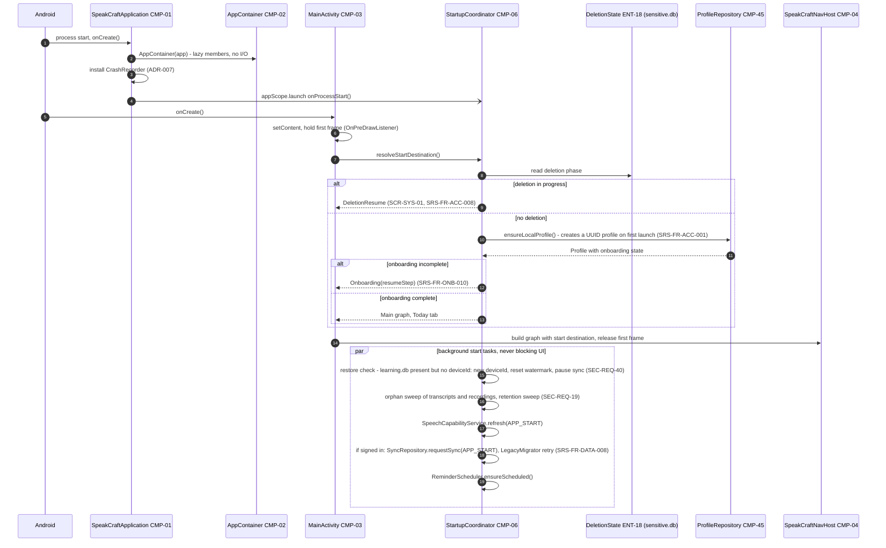

A reminder notification opens `MainActivity` with an explicit intent and no extras; Today is the default start destination, so no deep-link parsing is needed (ARC-01 §5; SEC-REQ-29).

### 5.2 Onboarding to first attempt

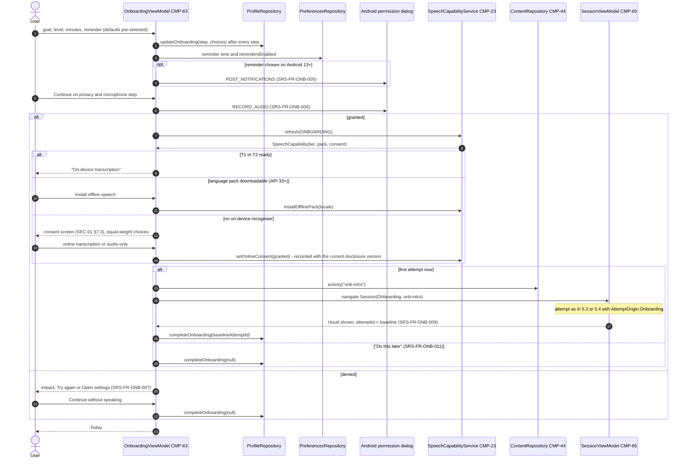

### 5.3 Speaking attempt — tier T1 (app owns the microphone and pipes audio to the recogniser)

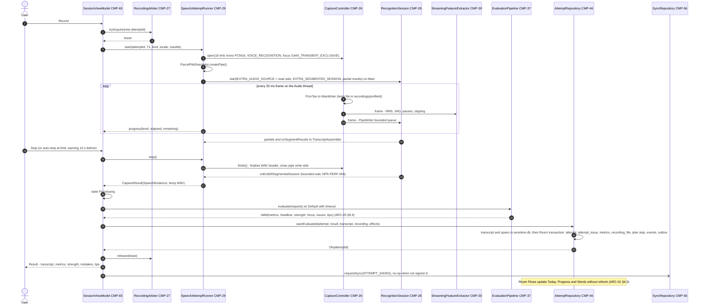

If the pipe stalls (queue full) or the recogniser rejects the audio source, the runner closes the pipe, finishes this attempt audio-only, flags `PIPE_DEGRADED`, and calls `SpeechCapabilityService.reportT1PipingFailure()`, which demotes the device to T2 and remembers it (ARC-05 §3).

### 5.4 Speaking attempt — tier T2 (recogniser owns the microphone)

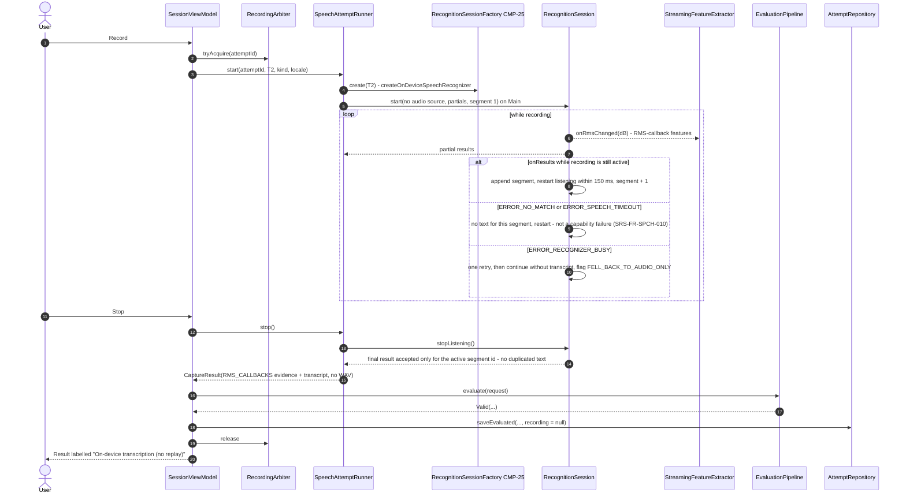

T3a follows the same sequence with `create(T3A)`, which succeeds only when `ConsentStore.isValid(...)` holds (SEC-REQ-20). A network error in T3a continues the attempt without a transcript (ARC-05 §4.2).

### 5.5 Inconclusive attempt

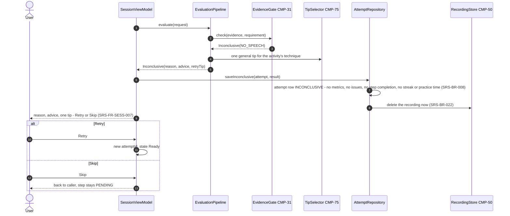

### 5.6 Interruption during recording

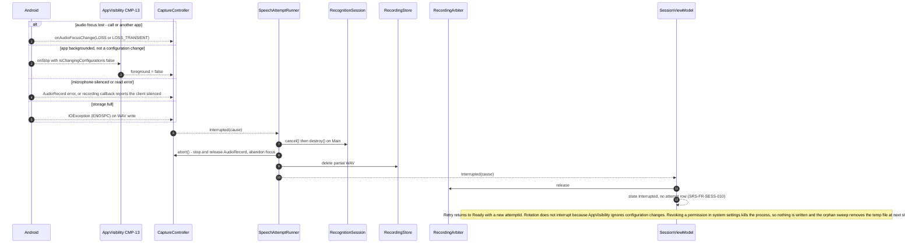

### 5.7 Word stage 4 "Make your own"

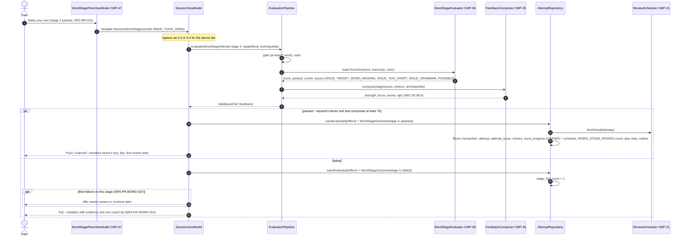

Stage 3 records one attempt per sentence (`sentenceIndex` 0 and 1); the stage passes when the latest valid attempts for both sentences meet the threshold (`WordStageEvaluator.useIt`), decided inside the same `AttemptWriter` transaction as the second attempt.

### 5.8 Review set

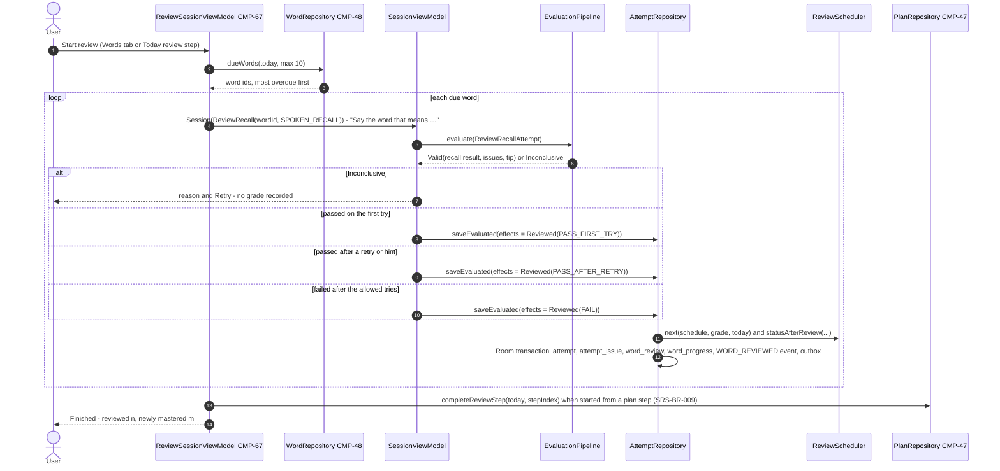

Intermediate failed tries are saved as attempts without a review effect; the grade is recorded once per word per set, on the last try.

### 5.9 Sync — upload

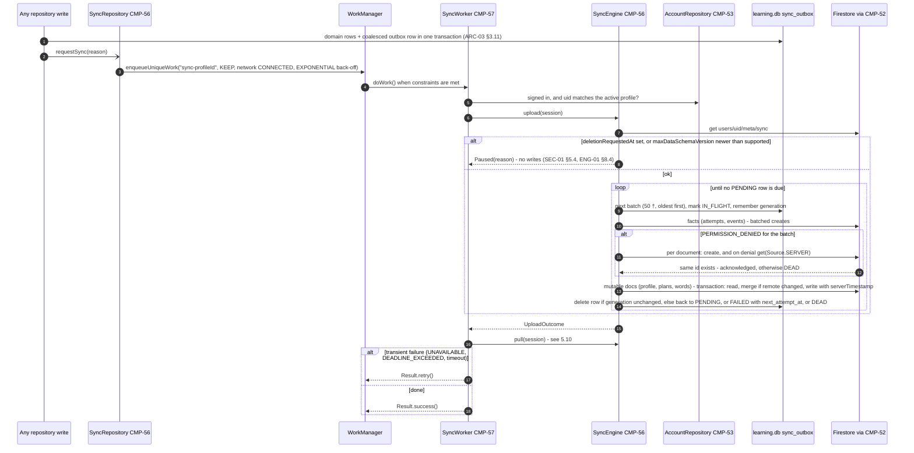

### 5.10 Sync — pull and merge

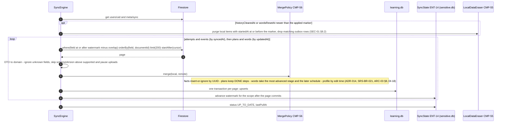

Because `sync_state` lives in `sensitive.db` (ARC-03 §3.0) and cannot share a transaction with `learning.db`, the watermark is advanced only after the page commits; a crash in between re-reads the page, which is harmless because every merge is idempotent (NFR-REL-005).

### 5.11 First sign-in and data adoption

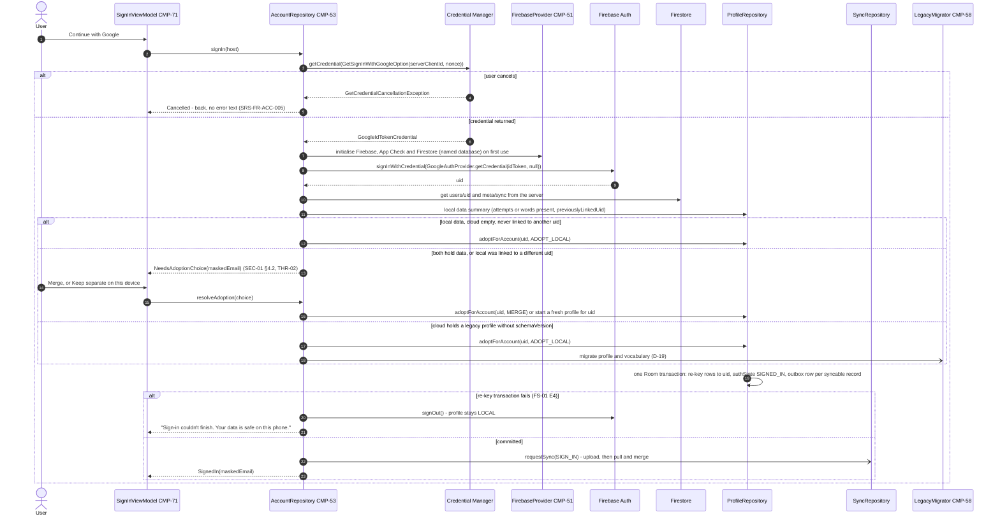

Re-keying `attempt_transcript.profile_id` in `sensitive.db` and renaming the recordings folder happen after the Room commit and are retried at start-up until consistent (ARC-03 §7.2; §12 TQ-07).

### 5.12 Account deletion with resume

Phases follow SEC-01 §9.3 and ARC-03 §3.19 (ENT-18 in `sensitive.db`); FS-01 §5.4 coarse steps map onto them (DI-11).

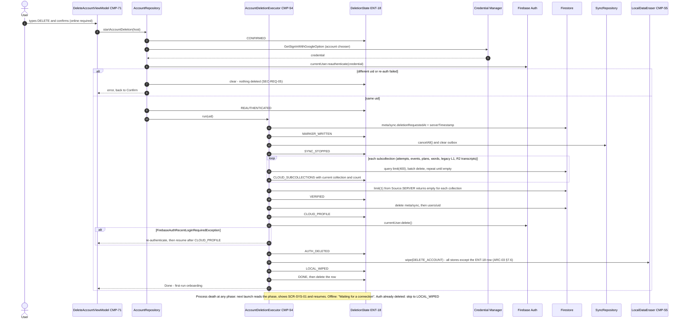

### 5.13 Reminder worker

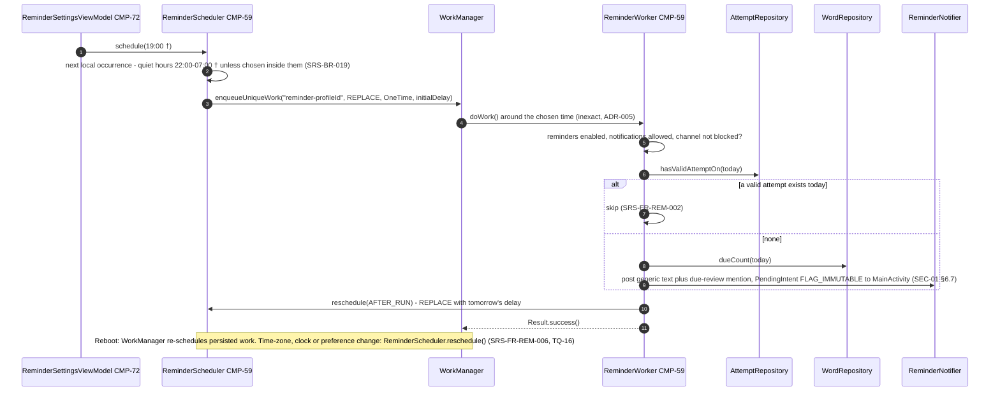

---

## 6. State diagrams

### 6.1 Session player (CMP-65; SRS-FR-SESS-001)

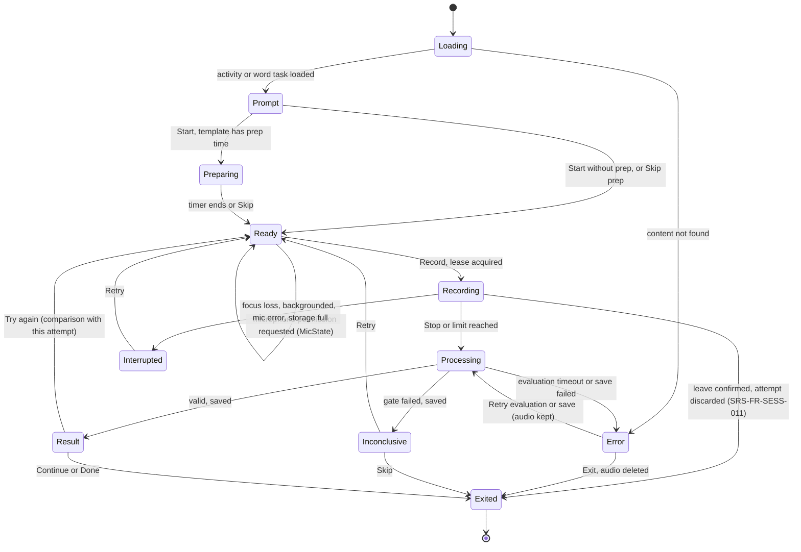

Prepared prompt, step index and phase before Recording are saved in `SavedStateHandle`; Recording survives rotation because the ViewModel and `AppVisibility` ignore configuration changes (SRS-FR-SESS-013); after process death the player restores to `Ready` (an in-flight recording cannot survive process death and is discarded).

### 6.2 Word lifecycle (SRS-FR-WORD-001…008, SRS-BR-015…017)

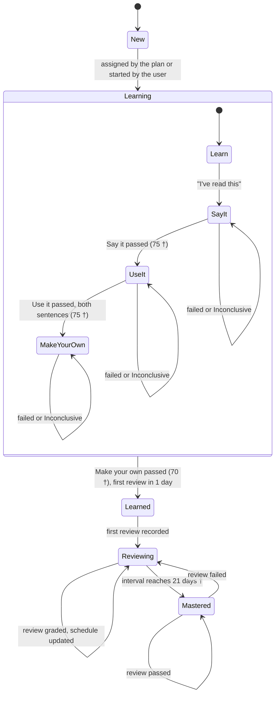

Inconclusive results never change the state or the fail counter (SRS-FR-WORD-006). After three failures on one stage an easier variant is offered (SRS-FR-WORD-007). "Reset vocabulary" returns every word to `New` and writes the `wordsResetAt` marker (SEC-01 §9.2).

### 6.3 Outbox entry (ENT-10; ARC-03 §3.11 states)

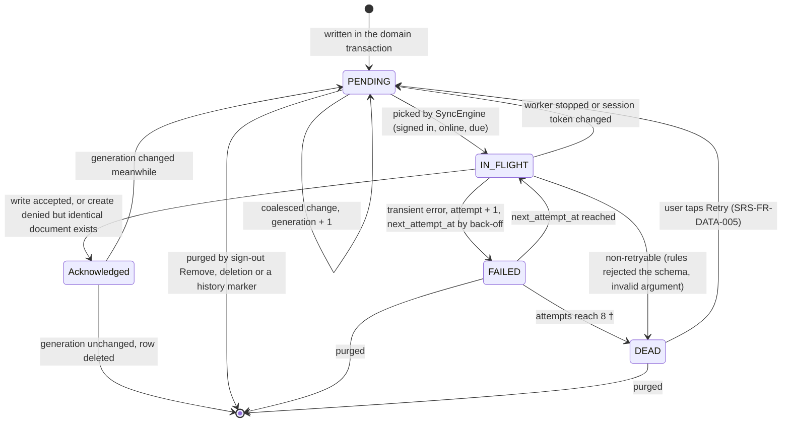

### 6.4 Speech tier (CMP-23; ARC-05 §3; SRS-FR-SPCH-001/003/006)

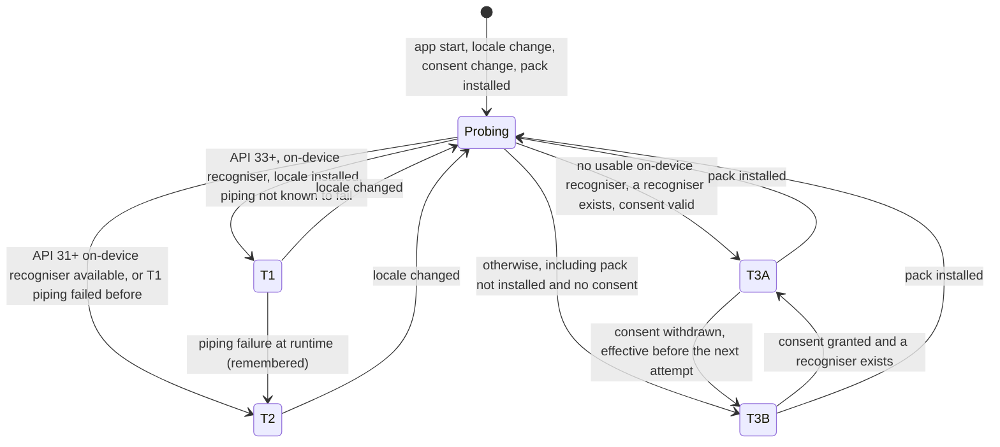

The device tier changes only through these transitions. A per-attempt fallback (busy recogniser, T3a network loss) changes the **attempt's** tier in `SpeechEvidence` and the result label, never the device tier (ARC-05 §4.2). On API 33+ with a downloadable but uninstalled pack, Settings and onboarding offer "Install offline speech" (SRS-FR-SPCH-004).

### 6.5 Account deletion (ENT-18; SEC-01 §9.3)

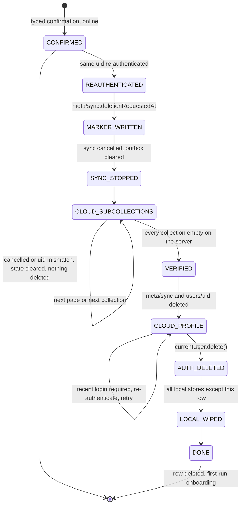

Every phase is persisted before its side effects are considered done; each step is idempotent, so a resume repeats at most the current phase. Process death → resume at next launch via SCR-SYS-01; offline → "Waiting for a connection"; if Auth is already gone at resume → jump to `LOCAL_WIPED` (SEC-01 §9.3; SEC-REQ-24).

---

## 7. Concurrency and threading

### 7.1 Dispatchers and threads

| Name | Backing | Used for | Rules |
|---|---|---|---|
| `main` | `Dispatchers.Main.immediate` | Compose, ViewModel state updates, **all `SpeechRecognizer` calls and callbacks**, `TextToSpeech` calls, Credential Manager UI, audio-focus listener | Never disk or network I/O (NFR-PERF-012); never `runBlocking` |
| `default` | `Dispatchers.Default` | Evaluation pipeline, plan generation, progress calculations, transcript assembly, content indexing after load | CPU work only; pipeline under `withTimeout` |
| `io` | `Dispatchers.IO` | DataStore, file I/O (recordings, export, diagnostics), Firestore awaits inside workers | Room suspend DAOs use Room's own executors; do not wrap them in `withContext(io)` |
| `audio` | Single dedicated thread (`Executors.newSingleThreadExecutor`) as a coroutine dispatcher; the thread sets `Process.THREAD_PRIORITY_URGENT_AUDIO` | `AudioRecord.read` loop, `PcmTee`, `WavWriter` (buffered), `StreamingFeatureExtractor` | Constant memory: preallocated `ShortArray` frames and ring buffers; no allocation per frame; no boxed collections (FND-AI-13) |
| `pipe` | Single dedicated thread | `PipeWriter` writes PCM to the T1 recogniser pipe from a bounded queue (e.g. 50 frames = 1 s †) | Never blocks the audio thread: queue overflow ⇒ close pipe, `PIPE_DEGRADED`, continue capture (§5.3) |
| WorkManager | `CoroutineWorker` default dispatcher | `SyncWorker`, `ReminderWorker`, `CleanupWorker` | Cooperative cancellation (`isStopped` / coroutine cancellation) |

All dispatchers come from `DispatcherProvider` (CMP-08) so tests substitute a `StandardTestDispatcher`.

### 7.2 Single active recording (SRS-FR-SESS-014)

```kotlin
class RecordingArbiter {                                     // CMP-27, app-scoped
    private val active = MutableStateFlow<AttemptId?>(null)
    val activeAttempt: StateFlow<AttemptId?> = active
    /** Non-suspending, never blocks; returns null if another attempt holds the microphone. */
    fun tryAcquire(attemptId: AttemptId): RecordingLease? =
        if (active.compareAndSet(null, attemptId)) RecordingLease(attemptId, this) else null
    internal fun release(lease: RecordingLease) { active.compareAndSet(lease.attemptId, null) }
}
class RecordingLease internal constructor(val attemptId: AttemptId, private val arbiter: RecordingArbiter) : AutoCloseable {
    override fun close() = arbiter.release(this)            // always in finally / onCleared
}
```

| Rule | Detail |
|---|---|
| One lease app-wide | Covers app-owned capture (T1/T3b) and recogniser-owned capture (T2/T3a) |
| UI | Record is disabled while `activeAttempt != null`; a second tap is ignored |
| Release | `finally` of the attempt job; `SessionViewModel.onCleared()`; leaving the player (SRS-FR-SESS-014) |
| Other audio | `TtsPlayer.stop()` and `RecordingPlayer.stop()` run before acquiring the lease; reference audio cannot start while a lease is held |
| No `Mutex.lock()` | A suspending lock could queue a second recording behind the first; the arbiter fails fast instead |

### 7.3 Main-thread rules

1. No disk, database or network work on `main`; StrictMode `detectAll().penaltyDeath()` for disk/network in **debug** builds; CI test asserts zero violations on core flows (NFR-PERF-012).
2. `SpeechRecognizer` is created, started, stopped, cancelled and destroyed on `main` only, and destroyed in `finally` (platform requirement; ARC-05 §4.2).
3. The first frame is held only for the start-destination read (one DataStore read + one indexed Room read); everything else in `onProcessStart` runs after the first frame.
4. The content pack is loaded on `io` and indexed on `default` once; screens observe a `Flow` that emits when ready (Loading state meanwhile).
5. ViewModels never hold `Activity`; the Credential Manager host is passed per call and not stored (ARC-04 §5.7).

### 7.4 WorkManager uniqueness and constraints

| Work | Type | Unique name | Policy | Constraints | Back-off | Tags | Trigger |
|---|---|---|---|---|---|---|---|
| `SyncWorker` | One-time | `sync-<profileId>` | `KEEP` | `NetworkType.CONNECTED` | Exponential, 30 s initial † (WorkManager caps at 5 h) | `sync`, `profile:<id>` | After each syncable write, app start, sign-in, user Retry |
| `SyncWorker` safety net | Periodic 24 h † | `sync-periodic-<profileId>` | `KEEP` | `CONNECTED` | — | as above | Enqueued at sign-in; covers writes made between a run's last outbox check and its completion (TQ-08) |
| `ReminderWorker` | One-time with `initialDelay` | `reminder-<profileId>` | `REPLACE` | none | — | `reminder`, `profile:<id>` | Preference change, each run (schedules the next), app start, time-zone change |
| `CleanupWorker` | Periodic 24 h | `cleanup-retention` | `KEEP` | none (retention must run within 24 h of expiry, SEC-REQ-19) | — | `cleanup` | App start ensures it exists; an app-start sweep also runs |

The sync worker drains the outbox in a loop until no due row remains, so writes during a run are picked up; the session token (§4.2) is checked inside each transaction. Sign-out and deletion call `cancelUniqueWork` for sync and reminders and `cancelAllWorkByTag("profile:<id>")` (SEC-01 §6.4). Account deletion and export are **not** workers: deletion runs on `appScope` and resumes from ENT-18 at the next start; export runs in the ViewModel with progress because the user is waiting.

### 7.5 Room transactions and cross-store consistency

| Operation | Transaction scope (`learning.db`) | Other stores | Failure handling |
|---|---|---|---|
| Save evaluated attempt | `attempt`, `attempt_issue`, `attempt_metric`, `recording_file`, plan step / `SESSION_COMPLETED` event, word progress + `WORD_STAGE_PASSED` / `WORD_REVIEWED` events, `sync_outbox` | Before the transaction: transcript + feedback spans to `sensitive.db`; temp WAV renamed to its final name | Transaction failure ⇒ delete the transcript row and the final file (compensation); a crash between steps is repaired by the start-up orphan sweep (no attempt row ⇒ transcript and file deleted) |
| Save inconclusive attempt | `attempt` (INCONCLUSIVE) + outbox if ARC-03 §8 syncs it | Recording deleted after commit | Same |
| Adoption re-key | All profile-keyed rows + `profile` + outbox rows in one transaction (SRS-FR-ACC-003) | After commit: `sensitive.db` rows re-keyed, recordings folder renamed | Post-commit steps are idempotent and retried at start-up until consistent (TQ-07) |
| Pull page | Upserts for one page | Watermark (ENT-14, `sensitive.db`) advanced after commit | Idempotent re-read on crash |
| Clear history / reset vocabulary | Local rows in one transaction, plus purge outbox row | Then files and transcripts | File deletion retried by the sweep |
| Plan get-or-create | Insert plan + steps only if no plan exists for the dateKey (`INSERT OR IGNORE` + re-read) | — | Two concurrent creators converge on one plan (SRS-BR-013) |

Rules: no network or file I/O inside a Room transaction; facts insert with `OnConflictStrategy.IGNORE` on the UUID key (SRS-BR-020); immutability is guarded by triggers (ARC-03 §5.3); Flows re-emit after commit, so screens update without manual refresh.

### 7.6 Cancellation

| Situation | Behaviour |
|---|---|
| User leaves the player during Recording | Confirmation; on confirm the attempt job is cancelled: recogniser `cancel()` + `destroy()`, `AudioRecord.stop()`/`release()` and focus abandon inside `withContext(NonCancellable)` in `finally`, temp WAV deleted, lease released |
| User leaves during Processing | Evaluation continues on `appScope` only until the save completes (so a valid attempt is not lost, NFR-REL-004); the result is visible later in History |
| `SessionViewModel.onCleared()` | Cancels the runner, releases TTS and player, releases the lease |
| Sign-out or deletion while a sync runs | `cancelUniqueWork`; the session token check aborts the next transaction; in-flight Firestore writes are allowed to finish or fail (idempotent) |
| Worker stopped by the system | `CoroutineWorker` cancellation; outbox rows `IN_FLIGHT` return to `PENDING` on the next run (stale `IN_FLIGHT` older than 15 min † is reset) |
| Evaluation timeout | `withTimeout` cancels the pipeline coroutine; audio is kept until Retry or Exit (SRS-FR-EVAL-013) |

### 7.7 Flow conventions

`StateFlow` for screen state via `stateIn(viewModelScope, WhileSubscribed(5_000), initial)`; `distinctUntilChanged()` on repository Flows; no `GlobalScope`; long-lived background work only on `appScope` (owned by the container) or WorkManager; `collectAsStateWithLifecycle()` in composables.

---

## 8. Error types and mapping to UI

The typed error model (`AppError` and sub-types) is defined in **ARC-04 §6**. This table maps each error to the screen behaviour. Copy is written by UX (DES-06); the "Message intent" column states meaning only. All messages come from string resources, say how to fix the problem, are announced to TalkBack (A11Y-32) and never contain exception text, codes or class names (SRS §15; SEC-REQ-06). Log codes follow SEC-01 §10.1.

| Error (ARC-04 §6) | Raised by | UI state / variant | Message intent | User action | Log code | Requirement |
|---|---|---|---|---|---|---|
| `CaptureError.PermissionDenied` | CMP-26 / permission result | `Ready(mic = DENIED / PERMANENTLY_DENIED)`; Today `speaking = MIC_PERMISSION_DENIED` | SpeakCraft needs the microphone to hear you; other features still work | Try again, or Open settings when permanently denied | `CAPTURE_PERMISSION` | SRS-ERR-001, SRS-FR-ONB-007 |
| `CaptureError.MicUnavailable` | CMP-26 (`AudioRecord` not initialised, in use) | `Interrupted(MIC_UNAVAILABLE)` | Another app is using the microphone | Retry | `CAPTURE_MIC_UNAVAILABLE` | NFR-REL-003 |
| `CaptureError.AudioFocusLost` | CMP-26 | `Interrupted(AUDIO_FOCUS_LOST)` | Recording stopped because another sound started | Retry | `CAPTURE_FOCUS_LOST` | SRS-FR-SESS-010 |
| `CaptureError.Backgrounded` | CMP-26 via CMP-13 | `Interrupted(APP_BACKGROUNDED)` | Recording stopped when you left the app | Retry | `CAPTURE_BACKGROUND` | SRS-FR-SESS-010 |
| `CaptureError.StorageFull` | CMP-26, CMP-50 | `Interrupted(STORAGE_FULL)` | Not enough space to record | Open storage settings; Retry | `CAPTURE_STORAGE_FULL` | SRS-ERR-004 |
| `RecognitionError.NoMatch` / `SpeechTimeout` | CMP-28 | Not an error; may lead to `Inconclusive(NO_TRANSCRIPT / TOO_FEW_WORDS)` | We didn't catch enough words | Retry | `REC_NO_MATCH` | SRS-FR-SPCH-010 |
| `RecognitionError.Busy` / `Unavailable` / `LanguageUnavailable` / `Network` (T3a) | CMP-28 | Attempt continues audio-only; Result tier label "No transcript — audio-only" with a one-line reason | A transcript wasn't available this time | — (Settings link if persistent) | `REC_FALLBACK:<kind>` | SRS-ERR-002, SRS-AVL-003 |
| `RecognitionError.Permission` | CMP-28 | `Interrupted(PERMISSION_REVOKED)` | Microphone access was turned off | Open settings | `REC_PERMISSION` | SRS-FR-SESS-010 |
| `EvaluationResult.Inconclusive` (not an error type) | CMP-37 | `Inconclusive(reason)` + one tip | Reason-specific: too short / too quiet / no speech / transcript unavailable / too few words | Retry, Skip | `EVAL_INCONCLUSIVE:<reason>` | SRS-ERR-003, SRS-FR-SESS-007 |
| `EvaluationError.Timeout` | CMP-37 | `Error(RETRY_EVALUATION)` | Feedback is taking longer than usual | Retry evaluation (audio kept), Exit | `EVAL_TIMEOUT` | SRS-FR-EVAL-013 |
| `EvaluationError.Internal` | CMP-37 | `Error(RETRY_EVALUATION)` | Something went wrong preparing feedback | Retry, Exit | `EVAL_INTERNAL:<class>` | NFR-QUAL-001 (never a fabricated result) |
| `DataError.WriteFailed` / `StorageFull` | CMP-45…49 | One automatic retry, then `Error(RETRY_SAVE)` (session) or non-blocking snackbar (other writes) | We couldn't save this; nothing was lost yet | Retry | `DB_WRITE_FAILED` | SRS-ERR-005 (never show success for a failed write) |
| `DataError.NotFound` | repositories | `NotFound` variant (attempt detail, activity detail) | This item is no longer available | Back | `DB_NOT_FOUND` | — |
| `ContentError.MissingItem` | CMP-44 | History row shows title from stored `contentId` with "no longer available" | This activity is no longer in the library | — | `CONTENT_MISSING` | SRS-BR-026 |
| `SyncError.Offline` | CMP-56 | Account status "Waiting for connection" | Your practice is saved on this phone and will back up when you're online | — | `SYNC_OFFLINE` | SRS-FR-DATA-005 |
| `SyncError.Transient` / `AppCheckFailed` | CMP-56 | Status "Syncing" then "Error — Retry" after dead-letter; banner "Backup is temporarily unavailable" | Backup will retry automatically | Retry | `SYNC_UPLOAD_FAILED{collection,code,attempt}` / `APPCHECK_FAILED` | SRS-ERR-006 |
| `SyncError.SchemaRejected` (dead-letter) | CMP-56 | "Error — Retry" with count of items not backed up | Some items couldn't be backed up | Retry | `SYNC_DEAD:<collection>` | SRS-ERR-006 |
| `SyncError.NewerSchema` | CMP-56 | Status `PAUSED_SCHEMA` | Update SpeakCraft to keep backing up | Open store / release page | `SYNC_PAUSED_SCHEMA` | ENG-01 §8.4 |
| `SyncError.DeletionPending` | CMP-56 | Status `PAUSED_DELETION`; prompt "Finish deleting account" | This account is being deleted on another device | Finish deletion | `SYNC_PAUSED_DELETION` | SEC-01 §9.3 |
| `SyncError.RestorePaused` | CMP-06 | Status `PAUSED_RESTORE` | Sign in to resume backup on this phone | Sign in | `SYNC_PAUSED_RESTORE` | SEC-REQ-40 |
| `AuthError.*` | CMP-53 | Per SEC-01 §4.6 table (cancel silent, offline, no credential, config, invalid user, re-auth required, rate limited, unknown) | SEC-01 §4.6 | SEC-01 §4.6 | `AUTH_*` | SRS-ERR-007, SEC-REQ-06 |
| `AuthError.DifferentAccount` | CMP-53 (re-auth) | `DeleteAccountUiState.Error` | That's a different account | Try again | `AUTH_UID_MISMATCH` | SEC-REQ-05 |
| `DeletionError.Offline` | CMP-54 | `WaitingForConnection` | Connect to the internet to finish deleting your account | Retry | `DEL_OFFLINE` | SRS-ERR-009 |
| `TtsError.Unavailable` | CMP-38 | Reference-audio controls hidden + note | Reference audio isn't available on this device | — | `TTS_UNAVAILABLE` | SRS-ERR-010 |
| `PackInstallError` | CMP-23 | Speech & privacy pack state `Failed` | The offline speech pack couldn't be installed | Retry | `PACK_INSTALL_FAILED` | SRS-FR-SPCH-004 |
| `ExportError.Cancelled` / `WriteFailed` | CMP-61 | Nothing / snackbar | Export didn't finish | Retry | `EXPORT_FAILED` | SRS-FR-SET-004 |
| Notification permission denied | CMP-72 | SCR-SET-03 denied state with system-settings link, no repeated prompts | Reminders are off in system settings | Open settings | `REM_PERMISSION_DENIED` | SRS-FR-REM-005 |
| Unexpected exception in a ViewModel | any | Screen `Error` variant (generic) | Something went wrong. Your practice on this phone is safe | Retry | `UNEXPECTED:<class>` | ARC-01 §10 |
| Uncaught exception | process | Crash after `CrashRecorder` writes a redacted entry | — | — | `CRASH:<class>` | ADR-007 |

---

## 9. Configuration and compile-time feature flags (WBS T-02.3.2)

### 9.1 Principles (ENG-01 §2.4, §8.4)

| # | Rule |
|---|---|
| F-1 | Flags are compile-time `BuildConfig` booleans declared once per build type (`debug`, `staging` if ED-02 approved, `release`). There is **no Remote Config** (it would be a new dependency and an ADR); turning a shipped feature off needs a new release |
| F-2 | Code reads flags only through `FeatureFlags` (CMP-10), so tests can run either state and nothing else imports `BuildConfig.FEATURE_*` |
| F-3 | Flags gate **navigation entries, routes, DI wiring and UI**, never data shape. Room schema, Firestore documents and the content-pack schema are identical with the flag on or off (ENG-01 §2.4) |
| F-4 | Retired-feature flags are `false` in every distributed build from the first R0 build, and the code they hide is then deleted (WBS F-04.1 "behind flags first, then deletion"). A flag is never a substitute for removing a dependency: SEC-REQ-28 / TC-SEC-010 require `firebase-ai` and friends to be **absent from the classpath** |
| F-5 | Unfinished features are `true` in `debug`, `false` in `release` until their acceptance criteria and approvals are met; every flag has an owner and a removal criterion (§9.2) |
| F-6 | `PrivacyFacts` (CMP-14) derives privacy text from the flags that change data flows (e.g. `FEATURE_TRANSCRIPT_SYNC`, `FEATURE_ONLINE_TRANSCRIPTION`), so in-app statements always match behaviour (SEC-REQ-36, SRS-PRIV-002) |
| F-7 | R8 removes code behind constant-false flags when `FeatureFlags` is backed directly by `BuildConfig` constants (INFERRED; verified by APK size and DEX inspection in ENG-01 release checks) |

### 9.2 Flag register (PROPOSED)

| Flag | Purpose | debug | release (R0 → R1) | Removal criterion | Reference |
|---|---|---|---|---|---|
| `LEGACY_YOUTUBE_INTELLIGENCE` | Hides the creator-named tab, YouTube screen and admin sync while code still exists | false | false | Deleted with T-04.1.1 | ADR-011, FND-UI-03 |
| `LEGACY_CLOUD_AI_UI` | Hides cloud-AI settings and coach UI until the SDK and service are removed | false | false | Deleted with T-04.1.2 (SDK removal is mandatory) | ADR-003, SEC-REQ-28 |
| `LEGACY_SELF_UPDATER` | Hides update screens, dialogs and the silent refresh (`AppNavigation.kt:448-451`) | false | false | Deleted with T-04.1.3 | ADR-004 |
| `LEGACY_ADMIN_CONSOLE` | Hides the admin console | false | false | T-04.1.4 | NG-10, FND-SEC-04 |
| `LEGACY_MENTOR_CONVERSATION` | Hides AI Mentor and conversation simulator | false | false | T-04.1.4 | FND-AI-16 |
| `LEGACY_VIDEO_ANALYSIS` | Hides CameraX/MediaPipe flows | false | false | T-04.1.4 | ADR-010 |
| `LEGACY_TUTORIALS` | Hides the four tutorial systems | false | false | T-04.1.4 (contextual tips replace them) | FND-UI-11, DES-06 §2.4 |
| `LEGACY_DASHBOARD_WIDGETS` | Hides fabricated dashboard displays in any build distributed during R0 | false | false | Deleted with the old shell | T-04.2.6, FND-UI-07 |
| `NEW_SHELL` | Switches from the legacy shell to the new navigation shell (CMP-04) | true (from EP-02) | false → true at first R1 beta | Legacy shell deleted | T-02.3.1 |
| `FEATURE_ACCOUNT_SYNC` | Sign-in entry points and sync UI (runtime also hides sign-in when the web client id is absent, SEC-01 §4.6) | true | true in R1 once L1 rules are deployed (SEC-01 §5.6 ordering) | After R1 GA | FS-01, FS-11 |
| `FEATURE_LEGACY_MIGRATION` | D-19 import of profile + vocabulary for signed-in legacy users (CMP-58) | true | true in R1 | End of migration window (L2, R1 + 90 days †) | D-19, SRS-FR-DATA-007 |
| `FEATURE_WORDS_TAB` | Words destination in R1 | true | true if D-20 approved | After R1 GA | D-20 |
| `FEATURE_TECHNIQUES` | Techniques collection, SCR-PRAC-04, technique links on activities and tips | true | true in R1 (P0) — kept only so a release can build while technique content is still `PENDING_REVIEW` | After R1 GA | PRD-FR-056/057, SRS-FR-PRAC-008/009, SRS-BR-028 |
| `FEATURE_SELF_CHECK` | Self-reported technique checklist on the result | true | false until self-check items pass content QA | After content ships | ARC-05 §8.4 |
| `FEATURE_T1_AUDIO_SOURCE_PIPE` | T1 piping; when false, T1-capable devices run as T2 (no replay) | true | per SPK-01 go/no-go | After SPK-01 and one release without incidents | ADR-009, RSK-09 |
| `FEATURE_ONLINE_TRANSCRIPTION` | T3a consent flow and default recogniser; when false T3 devices are T3b only | true | per D-14 / D-25 | After decision | SEC-REQ-20/21 |
| `FEATURE_AAC_TRANSCODE` | Post-evaluation WAV → AAC (CMP-40) | true | true (needed for NFR-COMP-004, DI-29) | After TQ-12 verified | ADR-015 |
| `FEATURE_EXPORT_AUDIO_ZIP` | Optional "Include my recordings (ZIP)" in export | true | per D-22 (and DI-15) | After decision | D-22, SRS-FR-SET-004 |
| `FEATURE_ACOUSTIC_CANDIDATES` | Pitch range and volume variation metrics (T1 only) | true | false until validated on SPK-01 | After approval | ARC-05 §8.4 |
| `FEATURE_WORDS_NOTEBOOK` | R2 notebook (SCR-WORD-05) | true | false | R2 GA | SRS-FR-WORD-012 |
| `FEATURE_WORDS_QUIZ` | R2 quiz (SCR-WORD-06) | true | false | R2 GA | SRS-FR-WORD-013 |
| `FEATURE_ROLE_PLAY` | R2 TPL-ROLE | true | false | R2 GA | SRS-FR-PRAC-007 |
| `FEATURE_INBOX` | R2 inbox and bell badge | true | false | R2 GA | SRS-FR-REM-007 |
| `FEATURE_CHECK_INS` | R2 check-ins (SCR-PROG-05) | true | false | R2 GA | SRS-FR-PROG-008 |
| `FEATURE_TRANSCRIPT_SYNC` | R2 opt-in transcript sync | false | false | R2, after the SEC-01 §9.7 review | D-16, SEC-01 §7.5 |
| `DIAG_VERBOSE_LOGS` | Verbose AppLogger output | true | false (always) | Permanent (debug only) | SEC-REQ-34 |
| `STRICT_MODE` | StrictMode death penalty for disk/network on main | true | false (always) | Permanent (debug only) | NFR-PERF-012 |

### 9.3 Other build configuration

| Item | Mechanism | Value / source |
|---|---|---|
| Firestore database id | Per-variant resource overlay (`src/<variant>/res/values/firebase_config.xml`) | Release: existing named database (`firebase_applet_config.xml:3`); debug: dev project (ENG-01 §2.2, ED-01) |
| Web client id | Resolved at runtime with `getIdentifier("default_web_client_id")`; missing ⇒ sign-in hidden | ENG-01 §3.2 option C |
| `BUILD_CHANNEL` | Existing `BuildConfig` field, kept for About and diagnostics | ENG-01 §1 |
| `GITHUB_RELEASE_REPO` | Existing field (`app/build.gradle.kts:41-45`) | **Removed** with the updater (ADR-004) |
| reCAPTCHA site key | Existing resource (`firebase_applet_config.xml:4`) | **Removed**; App Check provider per ADR-008 |
| `applicationId` / namespace | Gradle | D-15 / `app.speakcraft` (ADR-012) |

### 9.4 Runtime constants (not flags; every value † is Proposed — requires approval)

| Holder | Constant | Default † | Source |
|---|---|---|---|
| `EvaluationConfig` (versioned with `evaluationVersion`) | READ/REPEAT pass; stage 2/3/4 pass | 75 %; 75 / 75 / 70 | SRS-BR-007 |
| | Gate: duration, voiced, voiced ratio, words short/free | 1.5 s, 0.5 s, 25 %, 1 / 8 | SRS-BR-001 |
| | Evaluation timeout | 2 × NFR-PERF-005 budget | SRS-FR-EVAL-013 |
| `AppConfig` | Prep and max recording per template | 15/30/30/0 s; 30/90/120/120 s | SRS-FR-SESS-002/003 (activity may override within limits) |
| | Recogniser finalisation wait; T2 restart target | 3 s; 150 ms | NFR-PERF-006; ARC-05 §4.2 |
| | Pipe queue | 50 frames (1 s) | §7.1 |
| | Minimum free storage before recording | maxSeconds × 32 kB + 5 MB | SRS-ERR-004 |
| | Swaps per day; review set max; new-word goal | 3; 10; 2 (0–5) | SRS-FR-TODAY-009; SRS-BR-027 |
| | Plan retention | 90 days | SRS §9 |
| `PolicyConstants` | Recording retention default and options | D30; AFTER_FEEDBACK/D7/D30/KEEP | D-10, ADR-015 |
| | Quiet hours | 22:00–07:00 | SRS-BR-019 |
| | Consent disclosure version | 1 | SEC-01 §7.3 #10 |
| `SyncConfig` | Upload batch; pull page; watermark overlap; dead-letter after; back-off initial; stale IN_FLIGHT reset | 20; 200; 60 s; 5 attempts; 30 s; 15 min | ARC-04 §4.5 |
| | Deletion page size | 400 | SEC-01 §9.3 |
| `DiagnosticsConfig` | Rolling log | 2 × 256 KB, 7 days | SEC-01 §10.2 |

### 9.5 Declaration sketch (PROPOSED)

```kotlin
// app/build.gradle.kts (excerpt)
android {
    buildFeatures { buildConfig = true }
    defaultConfig {
        listOf("LEGACY_YOUTUBE_INTELLIGENCE", "LEGACY_CLOUD_AI_UI", "LEGACY_SELF_UPDATER", "LEGACY_ADMIN_CONSOLE",
               "LEGACY_MENTOR_CONVERSATION", "LEGACY_VIDEO_ANALYSIS", "LEGACY_TUTORIALS", "LEGACY_DASHBOARD_WIDGETS",
               "FEATURE_TRANSCRIPT_SYNC").forEach { buildConfigField("boolean", it, "false") }
    }
    buildTypes {
        debug   { buildConfigField("boolean", "FEATURE_INBOX", "true");  buildConfigField("boolean", "STRICT_MODE", "true") }
        release { buildConfigField("boolean", "FEATURE_INBOX", "false"); buildConfigField("boolean", "STRICT_MODE", "false") }
    }
}

// core/common/config/FeatureFlags.kt — CMP-10
interface FeatureFlags {
    val newShell: Boolean; val accountSync: Boolean; val techniques: Boolean; val selfCheck: Boolean
    val t1AudioSourcePipe: Boolean; val onlineTranscription: Boolean; val aacTranscode: Boolean
    val exportAudioZip: Boolean; val inbox: Boolean; val transcriptSync: Boolean /* … */
}
object BuildConfigFeatureFlags : FeatureFlags {
    override val inbox get() = BuildConfig.FEATURE_INBOX
    /* … one line per flag … */
}
```

CI prints the flag table of each release artefact into the release record, and a unit test asserts every `LEGACY_*` flag is `false` in `release` (ENG-01 release checklist).

---

## 10. Reuse plan (keep / refactor / delete per existing file, from RD-03)

Decisions: **Keep** (moved with minor changes), **Refactor** (logic or pattern ported into the named CMP, file then deleted), **Re-verify & migrate** (content moved into the bundled content pack after editorial review, then the Kotlin file is deleted), **Delete** (no successor code). Evidence is RD-03 unless a `path:line` is given. `pkg/` = `app/src/main/java/com/example/`.

### 10.1 Application, domain data and engines

| Existing file (lines) | Decision | Target | Reason / evidence |
|---|---|---|---|
| `pkg/MainActivity.kt` (22) | Refactor | CMP-03 | Remove `configureAppCheck(this, intent)` (`:15`); App Check moves to CMP-51 (ADR-008, SEC-REQ-14) |
| `pkg/data/AppContainer.kt` (128) | Refactor (rewrite) | CMP-02 in `app/di`, owned by CMP-01 | Built in composition today (`AppNavigation.kt:216`, FND-ARCH-02); cloud-AI, YouTube and updater members (`:43-45`, `:81-83`, `:93-103`) dropped |
| `pkg/data/activity/ActivityCatalogue.kt` (259) | Refactor | Build-time content validator (T-09.1) | `ActivityValidator` (`:19`) rules become schema checks; catalogue object becomes pack JSON |
| `…/activity/ActivityCatalogueModules1To3.kt` (1 159), `…4To6.kt` (1 109), `…7To10.kt` (1 496) | **Re-verify & migrate** | Content pack activities (ARC-03 §6) | 150 hand-written activities: reviewed, de-duplicated, mapped to 5 tracks × 5 templates, provenance per activity; activities using channel frameworks are linked to techniques (D-08 DECISION; ARC-03 §1.4–1.5; T-09.2) |
| `…/activity/ActivityEngine.kt` (201), `ActivityModels.kt` (392), `ActivityProgressAnalyticsEngine.kt` (122), `DailyPracticeEngine.kt` (299), `LearningPathsEngine.kt` (335), `UniversalEvaluationEngine.kt` (398) | Delete | CMP-18/19/20/37 | Parallel learning system and length-formula scoring (FND-DOM-01, -04, -05, -07, -10) |
| `pkg/data/learning/DailyPracticePlanEngine.kt` (300) | Delete | CMP-19 | Duplicate plan engine (RD-03 §11) |
| `…/learning/LearningModels.kt` (400) | Refactor (pattern) | ENT-09 design, CMP-18 | Idempotency key + `localDateKey` (`:81-93`) reused; admin and notification models dropped |
| `…/learning/LearningProgressManager.kt` (920) | Delete | — | Mostly dead (FND-DOM-02); local JSON is not migrated (D-19) and is deleted after migration (SEC-01 §3.2 #21) |
| `…/learning/LocalVocabularyQuizEngine.kt` (244) | Keep for R2 | R2 quiz behind `FEATURE_WORDS_QUIZ` | Seeded generator matches SRS-FR-WORD-013; verify determinism before use |
| `…/learning/SpacedRepetitionScheduler.kt` (72) | Refactor | CMP-21 | Today: grades 4/2, intervals 1/3/6, clamp 7–60 (`:31-40`), "MASTERED" at reps ≥ 4 and ≥ 14 d (`:44`), epoch-day input. Target: grades 4/3/1, intervals 1/3/7, no clamp, Mastered at ≥ 21 d, `DateKey` (SRS-BR-016/017; FND-DOM-11) |
| `…/learning/StreakAndCompletionEngine.kt` (153) | Refactor (algorithm) | CMP-20 | Consecutive-day logic reused; `java.time` usage (`:3-7`) replaced (TQ-14); one streak definition (FND-DOM-07) |
| `pkg/data/model/CurriculumCatalog.kt` (1 124) | **Re-verify & migrate** | Content pack techniques, tips, activities, word seeds (ARC-03 §1.4, §6) | D-08 DECISION (2026-11-21), SRS-BR-028: `askVinhKnowledgeBase` (`:187-519`) → technique items; `lessons` (`:521`) folded into techniques/activities; `vocabularyBank` (`:544`) → word-bank seed; `speakingChallenges` (`:887`), `pronunciationDrills` (`:916`), `shadowingSegments` (`:927`), `grammarLessons` (`:960`), `publicSpeakingModules` (`:970`), `structuredPrograms` incl. the 30-day plan (`:1000`) → activities and tips linked to techniques; `conversationScenarios` (`:900`) → R2 role-play candidates; `realWorldTaskSeeds` (`:979`) and `dailySteps` (`:989`) not migrated (IA drops them; the plan engine replaces the routine). Each item is matched by hand to a **specific** source video with timestamp, rewritten in our own words, with no creator name or branding, and stays `PENDING_REVIEW` until verified. Channel-root URLs (e.g. `:205`) and `"VERIFIED"` labels are **not** carried over (FND-DOM-09) |
| `…/model/FeatureTutorialRegistry.kt` (440) | Delete | Contextual tips (DES-06 §2.4) | FND-UI-11 (includes the YouTube tutorial, `:332`) |
| `…/model/FirestoreModels.kt` (420) | Delete | CMP-58 (read-only legacy DTOs), CMP-18 | Legacy `UserProfile` (`:17`) and `VocabularyEntry` (`:87`) shapes copied into the migrator until L2; `UiState` (`:9`) replaced by per-screen `UiState` (§3.3) |
| `…/model/StreakAndAnalyticsHelper.kt` (69) | Delete | CMP-20 | Duplicate streak logic |

### 10.2 Speech, evaluation and language

| Existing file (lines) | Decision | Target | Reason / evidence |
|---|---|---|---|
| `pkg/data/ai/local/audio/AudioFeatureExtractionEngine.kt` (232) | Refactor | CMP-30 | DSP building blocks kept (RD-03 §13); streaming rewrite; fixes unreachable noise thresholds, constant rate consistency, single-sample clipping, Hz pitch spread (FND-AI-07) |
| `…/audio/AudioResampler.kt` (308) | Delete | — | Boxed `ArrayList<Short>` decode path (FND-AI-13); capture is 16 kHz natively; a small resampler may live in test fixtures only |
| `…/audio/FillerWordDetectionEngine.kt` (98) | Refactor | CMP-34 lexicon | Narrowed to high-confidence fillers (FND-AI-09; ARC-05 M-FILL) |
| `…/audio/LiveTranscriptionManager.kt` (455) | Refactor (rewrite) | CMP-28, CMP-25 | Keep the `LiveRecognizerBackend` seam (`:59`) and fake-driven test approach; remove the silent network fallback (`:102`, FND-SEC-07); add segment restart, de-dup (FND-AI-04) |
| `…/audio/LocalSpeechRecognitionEngine.kt` (461) | Delete | — | Fabricated Whisper path, TFLite (`:13`, `:143`; FND-AI-03) |
| `…/audio/PronunciationAnalysisEngine.kt` (308) | Refactor | CMP-33 | Alignment + contraction normalisation (`:54-70`) reused; relabelled "Recognised as intended" (SRS-BR-004) |
| `…/audio/SpeechRecognitionManager.kt` (169) | Delete | CMP-23/28 | Stubbed file transcription (FND-AI-02) |
| `…/language/LocalLanguageAnalysisEngine.kt` (707) | Refactor | CMP-34 | Only rules that pass SPK-02 (precision ≥ 0.90) are ported; `tokenizeWords` becomes the single `Tokenizer` (FND-AI-09, -15) |
| `…/language/LocalVocabularyEvaluator.kt` (581) | Refactor | CMP-36 | Stage 2/4 logic and thresholds 75/75/70 (`:25-30`) kept; stem-prefix inflection heuristic removed; `minConfidentAsrThreshold` used only when the recogniser supplies confidence (SRS-BR-005) |
| `…/language/DeterministicFeedbackTemplates.kt` (282), `DynamicLocalCoachEngine.kt` (571), `LocalFeedbackEngine.kt` (495), `LocalFeedbackGenerationEngine.kt` (36) | Delete | CMP-35, CMP-75 | Duplicate/dead feedback generators and the ungrammatical "a lot of" rewrite (FND-AI-09, -15); some phrasing may inform tip copy, rewritten as content |
| `…/fusion/MultimodalFeatureFusionEngine.kt` (140) | Delete | — | Pass-through fusion (RD-03 §5.1) |
| `…/video/BodyLanguageAnalysisEngine.kt` (192), `FaceLandmarkAnalysisEngine.kt` (222), `GestureAnalysisEngine.kt` (223), `VideoFrameProcessingEngine.kt` (244) | Delete | — | ADR-010; models absent (FND-AI-12) |
| `pkg/data/evaluation/EvaluationEvidenceValidator.kt` (321) | Refactor | CMP-31 | Keep fail-closed design and session scoping (`:61-76`, FND-AI-17); per-template word minimum replaces `MIN_TRANSCRIPT_MEANINGFUL_WORDS = 2` (`:46`); internal decode dependency (`:47`) removed; stray comment (`:240`) removed |
| `…/evaluation/EvaluationModels.kt` (107) | Refactor | CMP-18 | `EvidenceIssueCode` → `InconclusiveReason`; nullable dimensions → nullable `Metric` |
| `…/evaluation/EvidenceBasedScoringEngine.kt` (671) | Refactor (pattern) | CMP-32 | Nullable/partial labelling (`:49-175`) informs the metric engine; baseline scores and mislabelled formulas deleted (FND-AI-08) |
| `pkg/data/ai/IntelligenceCapabilityManager.kt` (312), `local/DeviceCapabilityManager.kt` (207), `local/OfflineAIAvailabilityManager.kt` (97), `local/OnDeviceModelManager.kt` (261) | Delete | CMP-23 | Five availability sources, false states, placeholder model catalogue (FND-AI-03, -05); the probe calls (`IntelligenceCapabilityManager.kt:91,99`) are re-implemented in CMP-23 |
| `pkg/data/ai/GeminiCoachService.kt` (87), `HybridAiCoachCoordinator.kt` (356), `cloud/FirebaseAiLogicService.kt` (868), `local/LocalExecutionPolicy.kt` (65) | Delete | CMP-37; TC-SEC-010 | ADR-003; FND-AI-10 |
| `pkg/data/ai/local/LocalIntelligenceOrchestrator.kt` (984), `pkg/data/ai/RecommendationEngine.kt` (139) | Delete | CMP-37, CMP-19 | Mentor/conversation templates with simulated streaming (FND-AI-16); fabricated techniques with synthetic timestamps (`:847-907`, FND-AI-11) |
| `pkg/data/media/AudioRecorderManager.kt` (268) | Delete | CMP-26, CMP-39 | `MediaRecorder` AAC (`:66-74`) and shared `filesDir/recordings` (`:57`) replaced (ADR-009, ADR-015) |
| `pkg/data/media/CameraVideoRecorder.kt` (244) | Delete | — | ADR-010 |
| `pkg/data/media/TtsAndSpeechHelper.kt` (266) | Refactor | CMP-38 | TTS part (`:57-61`) kept with the preferred locale instead of `Locale.US` (`:59`); speech capture (`:126`, `:222`) deleted (FND-SEC-07) |

### 10.3 Firebase, preferences, notifications, updater

| Existing file (lines) | Decision | Target | Reason / evidence |
|---|---|---|---|
| `pkg/data/firebase/AuthHelper.kt` (143) | Refactor | CMP-53 | Credential Manager flows (`:41-82`, `:84-124`) and clear-then-sign-out (`:126-143`) kept; add error mapping (raw `localizedMessage` at `:121` removed, SEC-REQ-06), re-auth, nonce, process-scoped auth state |
| `…/firebase/AppCheckConfig.kt` (64) | Refactor | CMP-51 | Intent debug-token injection (`:13`, `:24-36`) removed; debug provider to the `debug` source set; release provider per ADR-008 |
| `…/firebase/SpeakCraftRepository.kt` (1 351) | Delete | CMP-58, CMP-54 | God object (FND-ARCH-03). Legacy profile and vocabulary reads ported to CMP-58; the legacy subcollection list (`:1295-1299`) reused by CMP-54 during the L1 window. `seedAskVinhKnowledgeBaseIfEmpty` (`:532-539`) and every per-user and shared `extractedTechniques` write (`:539`, `:964`, `:1106`, `:1137`) are **removed**: techniques come from the bundled pack (D-08) |
| `…/firebase/ActivityFirestoreRepository.kt` (288) | Delete | — | Legacy activity collections are not migrated (D-19) |
| `…/firebase/FirestoreErrorHandler.kt` (53) | Delete | CMP-09 codes | Logs uid/email (FND-SEC-08) |
| `pkg/data/preferences/AppPreferencesRepository.kt` (315) | Refactor | CMP-43, CMP-49 | Theme kept; YouTube key, update channel, GitHub repo keys removed; `KeystoreCipherHelper` (`:52-104`) kept only as the documented fallback pattern (SEC-01 §6.6) |
| `…/preferences/AISettingsRepository.kt` (118) | Delete | `DevicePreferences.recognitionLocale` | Cloud keys and ineffective toggles (FND-AI-06) |
| `…/preferences/TutorialState.kt` (83) | Delete | `DevicePreferences.seenTips` | Tutorial systems removed; per-user isolation idea reused |
| `pkg/data/notifications/NotificationManagerRepository.kt` (494), `NotificationModels.kt` (164) | Delete | CMP-59; R2 ENT-16 | In-app only, duplicate stores (FND-DOM-14) |
| `pkg/data/update/ApkIntegrityVerifier.kt` (211), `GitHubReleaseClient.kt` (207), `ReleaseUpdateRepository.kt` (364), `SemVer.kt` (67), `UpdateBackupManager.kt` (146) | Delete | — | ADR-004; FND-OPS-04 |
| `pkg/data/youtube/YouTubeIntelligenceClient.kt` (519) | Delete | — | Scraping, caption download and Data API retired whatever D-08 says (ADR-011; ARC-04 §2) |

### 10.4 UI

| Existing file (lines) | Decision | Target | Reason / evidence |
|---|---|---|---|
| `pkg/ui/AppNavigation.kt` (1 548) | Delete | CMP-04, CMP-74 | 26 string routes, 1 032-line shell (FND-UI-01, FND-ARCH-03); the `BoxWithConstraints` width-tier idea (`:677`) informs CMP-04 |
| `pkg/ui/theme/Color.kt` (120), `Spacing.kt` (48), `Theme.kt` (249), `Type.kt` (106) | Refactor | CMP-15 | Tokenised colour roles kept (RD-03 §4 Preserve); typography and spacing per DES-05 (FND-UI-09) |
| `pkg/ui/components/LaunchAnimationOverlay.kt` (774) | Refactor | Brand launch moment ≤ 1 s | DES-06 §2.3; NFR-PERF-002; reduced motion (A11Y-21) |
| `pkg/ui/components/CoachComponents.kt` (1 943), `DashboardStudioWidgets.kt` (1 543), `ExerciseTemplateRenderers.kt` (819), `FeatureTutorialComponents.kt` (456), `TutorialOverlay.kt` (657), `NotificationDrawer.kt` (785), `NotificationsCenterSheet.kt` (483), `UpdateAvailableDialog.kt` (332) | Delete | DES-05 components, CMP-74 | God files, fabricated displays, tutorial overload (FND-UI-02, -07, -11, -13); the pager implementation quality is noted for reuse as a pattern |
| `pkg/ui/screens/AdminDashboardScreen.kt` (402), `AppUpdateScreen.kt` (660), `YouTubeIntelligenceScreen.kt` (375), `ConversationAndMentorScreens.kt` (878) | Delete | — | Removed features (NG-10, ADR-004, ADR-011, FND-AI-16); techniques reach users through SCR-PRAC-01/04 |
| `pkg/ui/screens/ActivityDiscoveryScreen.kt` (682), `AnalyticsAndSettingsScreens.kt` (1 089), `AuthAndOnboardingScreens.kt` (662), `DailyAndProgramsScreens.kt` (381), `DashboardScreen.kt` (1 038), `LabsAndTrainingScreens.kt` (1 024), `LessonAndModulesScreens.kt` (710), `SpeakingAndChallengesScreens.kt` (1 114), `UniversalActivityScreen.kt` (538), `UserProfileScreen.kt` (616), `VocabularyScreen.kt` (555) | Delete (rewrite) | `feature/*` screens per DES-03/06 | Missing states, fragile state, hard-coded strings (FND-UI-04…10) |
| `pkg/ui/viewmodel/ActivityEngineViewModel.kt` (589), `InteractiveCoachViewModel.kt` (552), `MainCoachViewModel.kt` (487), `SpeakingAndLabsViewModel.kt` (621), `UpdateAndAdminViewModel.kt` (432) | Delete | CMP-63…73, CMP-76 | Concrete-repository coupling and mixed concerns (FND-ARCH-01, -03) |

### 10.5 Tests, scripts and resources

| Existing item | Decision | Target | Reason |
|---|---|---|---|
| `CoachEvaluationEvidenceTest.kt` | Keep (port) | CMP-31 tests | 15 meaningful gate tests (FND-AI-17) |
| `LiveTranscriptionManagerTest.kt` | Refactor | CMP-28 tests with a fake backend | State-machine approach worth keeping (RD-03 §10) |
| `LocalAudioPipelineTest.kt`, `LocalLanguageAndOrchestratorTest.kt`, `StreakAnalyticsAndBackupTest.kt`, `LightweightFeedbackEngineTest.kt` | Review | Fixtures and boundary cases reused for CMP-30/34/20 | Keep cases that test ported logic; delete the rest |
| `ZeroCloudAiNetworkBoundaryTest.kt`, `LocalAIFoundationTest.kt` | Delete | TC-SEC-010 | False assurance (FND-TEST-03) |
| `SemVerAndUpdateTest.kt`, `YouTubeParsingTest.kt`, `HybridAiCoachCoordinatorTest.kt`, `HybridAiComposeUiTest.kt`, `CentralizedAiSettingsTest.kt`, `ActivityEngineUnitTest.kt`, `ActivityEngineComposeTest.kt`, `CurriculumAndRecommendationTest.kt`, `NotificationManagementSystemTest.kt`, `SpeechRecognitionManagerTest.kt`, `UpgradedLocalIntelligenceTest.kt`, `ExampleUnitTest.kt` | Delete with their code | — | Code under test is deleted |
| `SpeakCraftComposeCujTest.kt`, `SpeakCraftTabletLayoutTest.kt`, `SpeakCraftLaunchAnimationTest.kt`, `ExampleRobolectricTest.kt` | Keep harness, rewrite tests | TST-01 | Robolectric + Compose harness (RD-03 §13) |
| `firestore.rules`, `firestore.test.js` | Replace | SEC-01 §5.3, §5.5 | Keep the allow-list style (RD-03 §8 Preserve) |
| `scripts/publish_firestore_release.mjs` (+ test) | Delete | — | ADR-004; revoke the service account (SEC-01 §8.1) |
| `res/xml/file_paths.xml` | Replace | ARC-04 §3.8 | Over-broad paths (FND-SEC-12) |
| `res/xml/backup_rules.xml`, `data_extraction_rules.xml` | Replace | SEC-01 §6.3 | Template rules (FND-SEC-06) |
| `AndroidManifest.xml` | Refactor | ARC-04 §3 | Add `android:name` Application, `<queries>`, `POST_NOTIFICATIONS`, network security config; remove `CAMERA` and review `ACCESS_NETWORK_STATE` |

**Totals (106 main Kotlin files):** Keep 1 · Refactor 24 · Re-verify & migrate 4 · Delete 77.

---

## 11. Coding standards

### 11.1 Size and structure

| Rule | Detail | Check |
|---|---|---|
| File size | ≤ 600 lines; larger needs a written justification in the PR (NFR-MAINT-002; ADR-012) | CI script lists offenders |
| Function size | ≤ 60 lines as a guideline; composables split into stateless pieces | Review |
| One public top-level type per file | Except small sealed hierarchies and their data classes | Review |
| Visibility | Implementations `internal`; interfaces public within the app; no `public` mutable state | Review |

### 11.2 Naming

| Kind | Pattern | Example |
|---|---|---|
| Interface / implementation | `XRepository` / `RoomXRepository`, `FirebaseXRepository`, `DefaultX` | `AttemptRepository` / `RoomAttemptRepository` |
| Test double | `FakeX` (hand-written; no mocking library in the stack) | `FakeAttemptRepository` |
| ViewModel / state / events | `XViewModel`, `XUiState`, `XEvent` | `TodayViewModel` |
| Screens | `XRoute` (collects state) + `XScreen` (stateless) | `SessionRoute`, `SessionScreen` |
| Routes | `AppRoute.X` `@Serializable` | `AppRoute.Session` |
| Constants with † values | In `AppConfig`, `PolicyConstants`, `EvaluationConfig`, `SyncConfig` only | — |
| Log codes | `AREA_EVENT` upper snake | `SYNC_UPLOAD_FAILED` |
| Packages | lower case, singular feature names as in §2.1 | `feature.words` |

### 11.3 Time and dates

1. Never call `System.currentTimeMillis()`, `Date()`, `Instant.now()`, `LocalDate.now()`, `TimeZone.getDefault()` or `ZoneId.systemDefault()` outside `core/common/time`; inject `Clock` and `DateKeyProvider` (CI grep).
2. `dateKey` is computed **at event time** and stored with the fact; it is never recomputed from a timestamp later (SRS-BR-011).
3. Store instants as epoch ms UTC and local dates as `YYYY-MM-DD` strings (ARC-03 §3.0).
4. Reminder scheduling uses `DateKeyProvider` for "next local occurrence" and recomputes after time-zone change (SRS-FR-REM-006).
5. Domain code is API-24-safe regardless of D-14 (`EpochMillis`, `DateKey`; §12 TQ-14).

### 11.4 Layering, Context and platform types

1. `domain/*` imports only `kotlin.*`, `kotlinx.coroutines` (for `suspend`/`Flow` types) and `core/common` pure types — **no `android.*`, `androidx.*`, Firebase or `Context`** (CI import check, NFR-MAINT-001).
2. ViewModels never hold `Context` or `Activity`; anything needing `Context` is a service injected by the factory.
3. Composables never reference repositories, `AppContainer` or Firestore (ADR-012).
4. Only CMP-52 imports Firestore; only CMP-51/53 import Firebase Auth; only CMP-25/28 import `android.speech.SpeechRecognizer`; only CMP-26 imports `AudioRecord` (CI import allow-list).
5. Feature packages do not import each other; navigation between features uses `AppRoute` objects only.

### 11.5 Honesty rules in code (PP-1; NFR-QUAL-001)

1. A metric without inputs is `null` with an `UnavailableReason`; no default, baseline, clamp-to-plausible or placeholder values (`?: 0`, `?: 62` patterns are review blockers).
2. Confidence is used only if the recogniser supplied it (SRS-BR-005).
3. Every metric shown carries its `MetricLabel`; "Recognised as intended" is never called pronunciation (SRS-BR-004).
4. Feedback, issues and tips are deterministic functions of stored inputs; no randomness except the specified stable hash (ARC-05 §8.4); no generative or cloud model (D-04).
5. Counters are derived from facts; nothing increments on navigation or taps (SRS-FR-PROG-005).

### 11.6 Testing hooks

| Hook | Use |
|---|---|
| Interfaces for every repository/service (ARC-04 §5) + `Fake*` in `core/testing` | ViewModel and engine tests without Android or Firebase |
| `Clock`, `DateKeyProvider`, `IdGenerator`, `DispatcherProvider` | Deterministic time, ids and threading (`runTest`, `StandardTestDispatcher`) |
| `FeatureFlags` constructor injection | Both flag states tested for shipped flags |
| `RecognitionSessionFactory` / backend seam | Fake recogniser drives T1/T2/T3 sequences, errors and consent gating (TC-SEC-015) |
| Audio and transcript fixtures | Gate, metric and golden-output tests per `evaluationVersion` (ARC-05 §10; NFR-QUAL-002/004/006) |
| Content-pack fixture | Small pack for plan, tip-selection and word-stage tests |
| Room in-memory databases + migration harness | DAO, transaction, idempotency, profile-isolation tests (TC-SEC-019; ARC-03 §9) |
| `work-testing` (`TestListenableWorkerBuilder`, `WorkManagerTestInitHelper`) | Worker logic and scheduling (ADR-005) |
| Firestore emulator (`demo-` project) | Remote data source and rules tests (SEC-01 §5.5) |
| Robolectric + Compose UI tests | Screens per `UiState` variant, semantics (DES-07), font scale |

Test levels, environments and device matrix are owned by TST-01 (§5, §10).

### 11.7 Compose and UI

`XScreen(state, onIntent)` is stateless and previewable; state hoisted to the ViewModel; `rememberSaveable` for transient UI input; `collectAsStateWithLifecycle`; all strings, plurals and content descriptions in resources (A11Y-36, NFR-MAINT-008); locale-aware number and date formatting (A11Y-37); 48 dp targets (A11Y-19); errors announced (A11Y-32). Content-pack text (technique steps, tips) is content, displayed as provided.

### 11.8 Logging, errors, serialization, dependencies

- Logging only through `AppLogger` with enumerated codes; no PII (SEC-01 §10.1; TC-SEC-041).
- Repositories and services return `Outcome`; exceptions are caught at the boundary and mapped to `AppError` (ARC-04 §6); `CancellationException` is always rethrown.
- One JSON stack: kotlinx-serialization; `org.json` is removed (ADR-001).
- Only ADR-approved dependencies, versions in `gradle/libs.versions.toml` (NFR-MAINT-007).

---

## 12. Open technical questions and issues found in source documents

### 12.1 Open technical questions (TQ)

| ID | Question | Why it matters | Resolution path |
|---|---|---|---|
| TQ-01 | Does `EXTRA_AUDIO_SOURCE` piping work with the common on-device recognisers on API 33+? | Decides T1 vs T2 (replay, full acoustic metrics) | SPK-01; `FEATURE_T1_AUDIO_SOURCE_PIPE` |
| TQ-02 | Exact behaviour of `EXTRA_SEGMENTED_SESSION` with an audio source: when does the session end, how long is finalisation after the pipe closes? | Stop latency (NFR-PERF-006); transcript completeness | SPK-01; ARC-04 §3.2 |
| TQ-03 | T2 restart gap and words lost at segment boundaries; de-dup parameters | Transcript quality for 2-minute answers (FND-AI-04) | SPK-01 |
| TQ-04 | Are word timestamps available (API 34 `RECOGNITION_PARTS` / word timing extras), and on which recognisers? | Better pause-in-sentence evidence and WPM | SPK-01; optional use only |
| TQ-05 | Visibility detection: Activity `onStop` + `isChangingConfigurations` (chosen) vs `ProcessLifecycleOwner`, whose artifact `lifecycle-process` is probably present only transitively (INFERRED) | Rotation must not interrupt; background must | Implement CMP-13 without new artifacts; revisit under ADR-006 if needed |
| TQ-06 | How to detect a silenced microphone (Android 12 privacy toggle, another app capturing): `AudioRecordingCallback`/`isClientSilenced` (API 29+) vs zero-signal heuristic on API 24–28 | Avoids "too quiet" Inconclusive when the OS silenced the mic | SPK-01 |
| TQ-07 | Adoption re-key: rewriting primary keys across ~3 000 attempts in one transaction on RD-LOW; recordings-folder rename; `sensitive.db` post-commit step | SRS-FR-ACC-003 atomicity; NFR-PERF | ARC-03 §7.2; benchmark in EP-03 |
| TQ-08 | Sync uniqueness: `KEEP` + drain loop + 24 h safety net vs `APPEND_OR_REPLACE` | No lost trigger between a run's last check and its end | Measure in EP-11; keep §7.4 default |
| TQ-09 | Firestore SDK cache: memory-only vs default persistent cache | Second on-disk copy of personal data (SEC-01 §3.2 #16); write-await semantics | Decision recorded in ARC-03 §8 (ARC-01 §9); recommendation: memory cache |
| TQ-10 | Does Firebase auto-initialisation (`FirebaseInitProvider`) or any SDK create network traffic in no-account mode? | SEC-REQ-02 network silence | TC-SEC-002 traffic capture; if needed remove the init provider and initialise in CMP-51 |
| TQ-11 | Window-size classes: keep the existing `BoxWithConstraints` approach (`AppNavigation.kt:677`) or add `material3-window-size-class` / `material3-adaptive` (new artifacts) | DES-02 §2.1 adaptive navigation | ADR-006 scope decision |
| TQ-12 | `MediaCodec` AAC encoding reliability on API 24–28 devices | NFR-COMP-004 depends on transcoding (DI-29) | SPK-01 device set; fallback keeps WAV and shortens default retention view |
| TQ-13 | Nonce support end to end (Credential Manager option + Firebase Auth) | SEC-01 §4.2 recommendation | Verify in Stage B |
| TQ-14 | **New finding (INFERRED):** current code uses `java.time` (`StreakAndCompletionEngine.kt:3-7`, `ActivityEngine.kt:4-5`, `ActivityProgressAnalyticsEngine.kt:3-4`, `ActivityEngineViewModel.kt:47-48`) with minSdk 24 (`app/build.gradle.kts:29`) and **no core-library desugaring** in `app/build.gradle.kts`; `java.time` exists only from API 26, so these paths would fail on API 24–25 devices | Affects `DateKeyProvider` and any date code | Options: raise minSdk to 26 (D-14), enable desugaring (new build dependency → ADR), or implement `DateKeyProvider` with `Calendar`/`TimeZone`. The domain uses `EpochMillis`/`DateKey` so it is unaffected. Add to RD-03 as a finding |
| TQ-15 | Two Room databases cannot share a transaction: is compensation + orphan sweep (§7.5) sufficient for transcripts and watermarks? | Consistency after crashes | Accept unless TST-01 kill tests (NFR-REL-004) show gaps |
| TQ-16 | Time-zone/clock change: non-exported manifest receiver for `ACTION_TIMEZONE_CHANGED`/`ACTION_TIME_CHANGED` vs recompute at app start and each worker run | SRS-FR-REM-006; SEC-REQ-29 allow-list (DI-17) | Recommendation: recompute in worker and at start; add the receiver only if testing shows drift |
| TQ-17 | TTS on API 30+ needs `<queries>` for `android.intent.action.TTS_SERVICE` (INFERRED from package-visibility rules) | Reference audio may silently fail | Verify in SPK-01; add to manifest and allow-list (DI-16) |
| TQ-18 | Plan engine selecting activities by technique ("may", SRS-FR-PRAC-008): which input and rule? | `PlanInput` has no technique preference yet | FS-03 to define; add `preferredTechniques` to `PlanInput` then |
| TQ-19 | Where are self-check answers (ARC-05 §8.4, self-reported) stored, and do they sync or export? | Persistence and privacy inventory | ARC-03 (no entity yet) + SEC-01 §3.2 |

### 12.2 Issues found in source documents (DI)

| ID | Issue | Documents | ARC-02 reading / recommendation |
|---|---|---|---|
| DI-01 | ADR-012's package tree has no `domain/` and puts "evaluation (rules, feedback)" under `speech/`; ARC-01 §3 has `domain/` (plan, progress, review, evaluation contracts, model) | ADR-012 vs ARC-01 §3 | ARC-02 follows ARC-01 §3 (the brief also lists `domain`); amend ADR-012 |
| DI-02 | Screen IDs in the canon IA summary (SCR-ONB-01…06, SCR-WORD-03 = review, SCR-SET-01…07) differ from DES-02 (SCR-ONB-01…08, SCR-WORD-04 = review, SCR-SET-01…09, SCR-PRAC-04) | PLAN_AND_CANON vs DES-02 v0.2 | DES-02 is authoritative (GOV-02 §4); ARC-02 uses DES-02 |
| DI-03 | SRS §9 lists transcripts in Room ENT-03; canon R-1, SEC-01 §3.2 #2 and ARC-03 §3.4 put them in `sensitive.db` (`attempt_transcript`) | SRS §9 | Follow canon; update SRS §9 |
| DI-04 | SRS-FR-EVAL-009 says the accuracy rating is "stored with the attempt"; canon and ARC-03 use separate ENT-13 so attempts stay immutable | SRS vs canon | Follow canon; reword SRS |
| DI-05 | Placement of synced preferences: SEC-01 §3.2 #12 puts them in the `settings` DataStore; canon R-1 and ARC-03 §3.3 use Room ENT-02; FS-02 §10 puts `reminderEnabled`/`reminderTime` in DataStore; ARC-03 §3.2 puts `reminder_time` in the profile (synced) and the on/off switch in `settings` (I-14) | SEC-01, FS-02, ARC-03 | Follow ARC-03; update SEC-01 §3.2 #12 and FS-02 §10 |
| DI-06 | `dailyWordGoal` range 0–5 (SRS-BR-027, ARC-03) vs 0–20 in SEC-01 §5.3 rules | SEC-01 | Rules to use 0–5 |
| DI-07 | Word status: SRS-BR-017 / ARC-03 (NEW/LEARNING/LEARNED/REVIEWING/MASTERED, stage 0–4) vs SEC-01 §5.3 rules (NEW/LEARNING/REVIEW/SUSPENDED, stage 0–5; event stage 1–5) | SEC-01 vs SRS | Rules follow ARC-03 §8 (ARC-03 I-05) |
| DI-08 | Word-task attempts have no `templateId` in the SEC-01 rules enum (TPL-* activities only); ARC-03 §11.3 adds word-task template ids | SEC-01 vs ARC-03 | Rules follow ARC-03 |
| DI-09 | SRS-FR-TODAY-004's optional retry/focus task has no step kind (ARC-03 §3.7 models it as `SPEAK`); rules and ARC-03 cap plans at 4 steps (`step_index` 0–3) while 15-minute sessions "scale per FS-03 table" (FS-03 not yet written) | SRS, SEC-01, ARC-03, FS-03 | ARC-02 uses 4 step kinds; FS-03 must keep ≤ 4 steps or the cap must change in ARC-03 and the rules |
| DI-10 | Field naming: `evaluationVersion`/`dateKey` (SRS-FR-EVAL-011, ARC-05 §10, ARC-03) vs `ruleSetVersion`/`localDate` (SEC-01 §5.3 rules, §9.1 export sample) | SEC-01 | Use `evaluationVersion` and `dateKey` (ARC-03 I-03) |
| DI-11 | Deletion steps: FS-01 §5.4/§10 (`CLOUD_DOCS`/`AUTH_USER`/`LOCAL_DATA`/`DONE`) vs SEC-01 §9.3 phases; SEC-01 stores the state in `device_state`, ARC-03 §3.19 in `sensitive.db` ENT-18 | FS-01, SEC-01, ARC-03 | ARC-02 uses SEC-01 phases in ENT-18 (`sensitive.db`); FS-01 should reference SEC-01 phases; SEC-01 §3.2 #13 should point to ENT-18 |
| DI-12 | Sign-in when both device and cloud hold data: SEC-01 §4.2 asks "Merge / Keep separate" (THR-02); FS-01 A2 merges automatically with a confirmation line | FS-01 vs SEC-01 | Follow SEC-01 (§5.11); update FS-01 A2 |
| DI-13 | Sign-out "Keep": SEC-01 §6.4 re-keys data to a local profile; FS-01 §5.3 step 4 keeps it keyed by the uid (ARC-03 adds `previously_linked_uid`) | SEC-01 vs FS-01 | ARC-03 §7 decides; ARC-02 relies only on `ProfileRepository.markSignedOut(keep)` |
| DI-14 | Sign-out "Remove" destination: SEC-01 §4.4 returns to no-account Today; FS-01 §5.3 step 5 creates a new profile and starts onboarding | SEC-01 vs FS-01 | Product decision; ARC-02 supports both via `StartupCoordinator` |
| DI-15 | Export delivery: SRS §8, SRS-FR-SET-004 and ARC-01 §12 specify FileProvider `exports/` + share sheet; SEC-01 §6.1, §9.1 and SEC-REQ-22/29 specify SAF `ACTION_CREATE_DOCUMENT` and no FileProvider (except diagnostics). Audio: D-22 consolidated recommendation allows an optional ZIP in R1; SEC-01 SD-04 (a) and §7.1 say no audio export in R1 | SRS, ARC-01, SEC-01, D-22 | Needs a decision; ARC-04 §3.8 specifies both contracts and recommends SAF (security-authoritative) with the share sheet as an optional second step |
| DI-16 | `<queries>` allow-list (SRS-FR-PLAT-002, SEC-REQ-31, TC-SEC-011) lists only `RecognitionService`; TTS on API 30+ also needs `TTS_SERVICE` (TQ-17) | SRS, SEC-01 | Add after verification |
| DI-17 | SEC-REQ-29/TC-SEC-011 "exported components exactly [MainActivity]" must allow library-merged non-exported components (WorkManager, any time-zone receiver) | SEC-01 | Clarify TC-SEC-011 wording |
| DI-18 | ADR-014 "last-writer-wins per document" does not say whether "last" means last edited or last uploaded; uploads with `serverTimestamp` make it last-uploaded, letting a stale offline edit win | ADR-014 | ARC-03 uses client `edited_at` (I-04); ARC-04 §4.4 specifies a conditional transaction write; clarify ADR-014 |
| DI-19 | ADR-014 §5 and SRS-FR-DATA-004 pull by `updatedAt > lastPull`, but immutable facts carry only server `syncedAt` (SEC-01 §5.3) | ADR-014, SRS | Pull facts by `syncedAt`, mutable documents by `updatedAt` (ARC-04 §4.3) |
| DI-20 | ARC-01 §6 stops capture on "lifecycle ON_STOP", but Activity `ON_STOP` also fires on rotation, contradicting SRS-FR-SESS-013 | ARC-01 §6 vs SRS | Interrupt on app backgrounding only (CMP-13); reword ARC-01 §6 |
| DI-21 | ARC-01 §3 has no home for worker scheduling, export, visibility tracking or privacy facts | ARC-01 §3 | ARC-02 adds `data/background`, `data/export`, `core/common/lifecycle`, `core/common/privacy` |
| DI-22 | SRS-FR-EVAL-005 requires exactly one strength, but ARC-05 §8.2/§8.4 define no fallback when no metric qualifies, and ARC-03 makes `feedback_strength_code` nullable | SRS vs ARC-05, ARC-03 | ARC-02 proposes an honest completion-based fallback (`STRENGTH_COMPLETED`); ARC-05 owner to decide and SRS or ARC-03 to align |
| DI-23 | FS-01 §10 lists `email?` on the Profile; ARC-03 I-13 and SEC-01 §3.2 #11 keep email out of local and cloud records | FS-01 | Masked email is read from Firebase Auth at runtime only |
| DI-24 | SEC-01 §4.3/§5.4 name an `AuthRepository`; ARC-01, FS-01 and ARC-04 use `AccountRepository` | SEC-01 | Same component (CMP-53); SEC-01 wording to align |
| DI-25 | SEC-01 §5.3 rules accept `feedbackCodes` from an `FB_*` enum; ARC-03 §8.3.2 puts the strength code and top 3 `ISSUE_*` codes there | SEC-01 vs ARC-03, ARC-05 §8.4 | Rules follow ARC-03 / ARC-05 |
| DI-26 | ADR-011's decision text (revised 2026-11-21), RD-16 NG-08 and WBS T-04.1.1 now limit removal to ingestion and branding, but the ADR **title** still reads "Remove YouTube Intelligence and the creator-derived content pipeline", which contradicts the kept, re-expressed curriculum (PRD-FR-056/057) | ADR-011 title | Retitle ADR-011 to "Remove YouTube ingestion and creator branding" at the next revision |
| DI-27 | SRS-FR-EVAL-016 lists trigger types in the order "issue code, metric band, template or technique"; ARC-05 §8.4 ranks issue code > metric band > technique > template | SRS vs ARC-05 | Ranking per ARC-05 §8.4 (authoritative for evaluation behaviour) |
| DI-28 | Self-check answers (ARC-05 §8.4) have no SRS requirement ID and no ARC-03 entity | ARC-05 vs SRS, ARC-03 | Add SRS ID and storage (TQ-19); flag `FEATURE_SELF_CHECK` off until then |
| DI-29 | NFR-COMP-004 (≤ 60 MB app data after 30 days) assumes AAC transcoding, but ADR-015 makes transcoding optional. 16 kHz mono PCM16 WAV is 32 kB/s, so about 5 minutes of recording a day is ≈ 9.6 MB/day ≈ 290 MB over 30 days (INFERRED arithmetic) | NFR vs ADR-015 | Make transcoding mandatory where the encoder works (`FEATURE_AAC_TRANSCODE` on), or revise the NFR |
| DI-30 | WBS T-03.1.1 lists entities "ENT-01…14, 18"; ARC-03 now also creates the ENT-15 table in schema v1 (legacy notebook import target) | PLN-02 vs ARC-03 | Update T-03.1.1 |

### 12.3 Change log

| Version | Date | Change | Author (role) |
|---|---|---|---|
| 0.1 | 2026-11-21 | Initial draft: package/class map (CMP-01…76), signatures, wiring, 13 sequence diagrams, 5 state diagrams, threading, error mapping, feature flags, reuse plan, standards, open questions; applies the 2026-11-21 Product Owner direction (technique curriculum, D-08 DECISION, mistakes and coach tips per ARC-05 §8.4) | Android Technical Lead |

