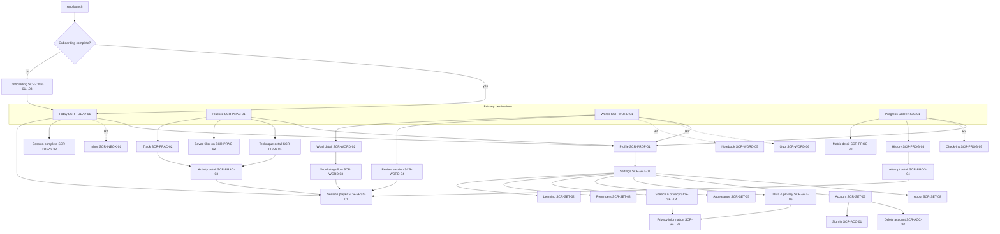

# Information Architecture — SpeakCraft (Proposed)

| Field | Value |
|---|---|
| Document ID | DES-02 |
| Version | 0.2 — Draft for review (2026-11-21: Techniques collection on SCR-PRAC-01 and new SCR-PRAC-04 Technique detail, per Product Owner direction PRD-FR-056/057 and D-08) |
| Date | 2026-11-21 |
| Status | Draft — **Recommendation**, awaiting Product Owner approval (gate G2) |
| Owner (role) | UX Strategist |
| Approval | Pending — Product Owner |
| Related | DES-01 UX Audit, DES-03 Screen Inventory, DES-04 User Flows, DES-06 UI/UX Specifications, PRD, SRS, RD-16 |

> This document is the authoritative source for the navigation structure and **screen IDs** (`SCR-<AREA>-nn`). DES-03 elaborates every screen listed here.

---

## 1. Problems this IA solves (from DES-01 / RD-03)

| Current problem | Evidence | IA response |
|---|---|---|
| 26 routes, 5 tabs incl. a creator-branded tool tab, 22-tile directory on Home | FND-UI-01, UI-03 | 4 purpose-led destinations; no directory; no creator branding |
| Different navigation on rail vs sidebar; Settings unreachable from primary chrome | FND-UI-01 | Same 4 destinations on every width; Profile/Settings always one tap from Today |
| 10 recording surfaces with 12 labels | FND-UI-04 | **One** session player used everywhere |
| Three daily plans, three path concepts | FND-DOM-01, DOM-10 | One Today session; tracks replace modules/paths/programs |
| Help, tours and guides everywhere | FND-UI-11 | Self-explanatory screens + contextual first-use tips only |

## 2. Navigation model

### 2.1 Primary navigation (persistent)

| Slot | Destination | Purpose (user question answered) | Screen |
|---|---|---|---|
| 1 | **Today** | "What should I practise now?" | SCR-TODAY-01 |
| 2 | **Practice** | "I want to rehearse a specific situation." | SCR-PRAC-01 |
| 3 | **Words** | "Which words am I learning and what's due?" | SCR-WORD-01 |
| 4 | **Progress** | "Am I improving?" | SCR-PROG-01 |

- Compact width (< 600 dp): bottom `NavigationBar` with 4 items (icon + label).
- Medium (600–839 dp): `NavigationRail` with the same 4 items.
- Expanded (≥ 840 dp): `NavigationRail` (or permanent drawer) with the same 4 items; list-detail layouts in Practice, Words and Progress.
- Start destination: Today. Tab re-selection scrolls to top / pops to tab root. Each tab keeps its own back stack (`saveState`/`restoreState`).

### 2.2 Secondary navigation

| Entry | Location | Target |
|---|---|---|
| Avatar | Top app bar of every primary destination | Profile (SCR-PROF-01) → Settings |
| Bell (R2) | Top app bar of Today, with unread badge | Inbox (SCR-INBOX-01) |
| Session player | Launched from Today steps, Practice activities, Words stages/reviews, Progress "Try again" | SCR-SESS-01 (full screen, no bottom bar) |
| Sign-in | Onboarding (optional step), Settings → Account, Progress sync prompt (non-blocking) | SCR-ACC-01 |

### 2.3 Navigation principles

1. **Maximum depth 3** from a primary destination (e.g. Practice → Track → Activity → Session player).
2. **Full-screen tasks hide the bottom bar** (session player, onboarding, sign-in, permission education) and always offer a clear exit.
3. **Back is predictable**: system Back pops one level; from a tab root it goes to Today; from Today it exits.
4. **No dead ends**: every empty, error or offline state offers an action.
5. **One name per concept** (DES-05 §12 terminology).

## 3. Complete navigation tree

## 4. Screen list (authoritative IDs)

| Area | ID | Screen | Release |
|---|---|---|---|
| Onboarding | SCR-ONB-01 | Welcome / value | R1 |
| | SCR-ONB-02 | Goal (track) | R1 |
| | SCR-ONB-03 | Level | R1 |
| | SCR-ONB-04 | Daily time | R1 |
| | SCR-ONB-05 | Reminder | R1 |
| | SCR-ONB-06 | Privacy & microphone | R1 |
| | SCR-ONB-07 | Speech check (tier-specific choice) | R1 |
| | SCR-ONB-08 | First attempt intro → session player → first feedback | R1 |
| Today | SCR-TODAY-01 | Today | R1 |
| | SCR-TODAY-02 | Session complete | R1 |
| Session | SCR-SESS-01 | Session player (states: prompt, prepare, ready, recording, processing, result, inconclusive, interrupted, error) | R1 |
| | SCR-SESS-02 | Feedback detail sheet ("How we measured this") | R1 |
| Practice | SCR-PRAC-01 | Practice home (tracks; Techniques collection — PRD-FR-056) | R1 |
| | SCR-PRAC-02 | Track (activity list, filters, saved) | R1 |
| | SCR-PRAC-03 | Activity detail | R1 |
| | SCR-PRAC-04 | Technique detail (idea, why it works, steps, tips, linked exercises with "Practise it", "Watch the original lesson" link — SRS-FR-PRAC-008/009; added 2026-11-21) | R1 |
| Words | SCR-WORD-01 | Words home (today's words, due, list, filters) | R1 |
| | SCR-WORD-02 | Word detail | R1 |
| | SCR-WORD-03 | Word stage flow (Learn → Say it → Use it → Make your own) | R1 |
| | SCR-WORD-04 | Review session | R1 |
| | SCR-WORD-05 | Notebook | R2 |
| | SCR-WORD-06 | Quiz | R2 |
| Progress | SCR-PROG-01 | Progress overview | R1 |
| | SCR-PROG-02 | Metric detail (trend) | R1 |
| | SCR-PROG-03 | History | R1 |
| | SCR-PROG-04 | Attempt detail (transcript, metrics, replay) | R1 |
| | SCR-PROG-05 | Check-ins | R2 |
| Profile & settings | SCR-PROF-01 | Profile | R1 |
| | SCR-SET-01 | Settings home | R1 |
| | SCR-SET-02 | Learning preferences | R1 |
| | SCR-SET-03 | Reminders | R1 |
| | SCR-SET-04 | Speech & privacy | R1 |
| | SCR-SET-05 | Appearance | R1 |
| | SCR-SET-06 | Data & privacy (export, clear, retention) | R1 |
| | SCR-SET-07 | Account (sign-in state, sync status, sign out) | R1 |
| | SCR-SET-08 | About | R1 |
| | SCR-SET-09 | Privacy information | R1 |
| Account | SCR-ACC-01 | Sign in | R1 |
| | SCR-ACC-02 | Delete account (explain → confirm → re-auth → progress → done) | R1 |
| System | SCR-PERM-01 | Permission education (microphone / notifications) | R1 |
| | SCR-INBOX-01 | Inbox | R2 |
| | SCR-SYS-01 | Account-deletion resume / blocking states | R1 |

Total R1: 38 screens (≤ 30 distinct layouts once state variants are counted together; KPI-11).

## 5. Mapping current routes to the new IA

| Current route(s) | New home | Note |
|---|---|---|
| `dashboard` | SCR-TODAY-01 | Rebuilt: one session card instead of ~21 widgets |
| `daily_practice`, Activity Engine "Daily Plan", dashboard plan | SCR-TODAY-01 | Merged into one plan |
| `speaking_lab`, `challenges`, `articulation_lab`, `pronunciation`, `voice_training`, `listening_lab`, `grammar_speaking`, `public_speaking`, `lesson_detail/{id}`, `activity/{id}` | SCR-SESS-01 (+ content in SCR-PRAC-*) | One player; labs become tracks/templates |
| `activity_library(/{moduleId})`, `module_lessons/{slug}`, `learning_paths`, `real_world_tasks` | SCR-PRAC-01…03 | Tracks replace modules/paths/programs; real-world tasks dropped |
| `vocabulary` | SCR-WORD-01…04 | 5-stage lifecycle |
| `analytics` | SCR-PROG-01…04 | Evidence-based only |
| `profile`, `settings` | SCR-PROF-01, SCR-SET-* | Reorganised; developer diagnostics moved to About → Share diagnostics |
| `youtube_library` | SCR-PRAC-01 Techniques collection, SCR-PRAC-04 | The ingestion tool and the creator-named tab are removed (ADR-011). The techniques themselves are kept, re-verified and re-expressed in our own words, with links to the specific source videos (D-08 decided 2026-11-21; PRD-FR-056/057) |
| `ai_mentor`, `conversation` | — | Removed; R2 scripted role-play lives in Practice |
| `app_updates` | — | Removed (ADR-004) |
| `admin_console` | — | Removed (NG-10) |
| Notification drawer | Reminders (system) + R2 Inbox | — |
| Tutorial overlay / guide strips / help dialog | Contextual first-use tips (DES-06 §2.4) | — |

## 6. Content model and labels

| Concept | User-facing label | Never use |
|---|---|---|
| Daily plan | "Today's session" | Daily Practice, Daily Plan, 9-step routine |
| Activity | "Activity" (or the prompt title) | Drill, Lab, Exercise template, Module |
| Track | Track names (e.g. "Job interviews") | Path, Program, Module, Hub |
| Attempt | "Attempt" / "Try again" | Session (reserved for the daily session) |
| Feedback items | "Measured", "Estimated", "Inconclusive", "Focus", "Strength" | AI score, AI check, Coach verdict |
| Word stages | Learn · Say it · Use it · Make your own · Review | AI Quiz |

## 7. Responsive behaviour summary

| Area | Compact | Medium | Expanded |
|---|---|---|---|
| Today | Single column | Single column, wider card | Two columns: session card + progress summary |
| Practice | List → detail (push) | List → detail (push) | List-detail side by side |
| Words | List → detail | List → detail | List-detail |
| Progress | Cards stacked | 2-column cards | 2-column cards + history pane |
| Session player | Full screen | Full screen, centred max width 640 dp | Full screen, centred max width 720 dp |

## 8. Acceptance criteria

1. Every PRD-FR with a UI has a home screen in §4 (verified in GOV-01).
2. Every screen is reachable in ≤ 3 interactions from a primary destination and has a defined Back behaviour.
3. The same four destinations appear on all window classes.
4. No screen ID is used in DES-03/04/06 that is not listed in §4.
