# User Flows — SpeakCraft (Proposed)

| Field | Value |
|---|---|
| Document ID | DES-04 |
| Version | 0.1 — Draft for review |
| Date | 2026-11-21 |
| Status | Draft — awaiting Product Owner approval |
| Owner (role) | UX Strategist |
| Approval | Pending — Product Owner |
| Related | DES-02 Information Architecture, DES-03 Screen Inventory, UC (USE_CASES, in preparation), FS-01…FS-12, PRD §14, SRS §6/§15/§16, RD-09 Journey Map, RD-15 Principles, ARC-05, DES-05, DES-06, DES-07, DES-08 |

> **Authority (GOV-02 §3.2; working-paper canon R-4).** This document owns the flow IDs FLOW-01…FLOW-14. Screens are DES-02 §4 IDs only (detailed in DES-03). Behaviour and rules are owned by the SRS (`SRS-FR`, `SRS-BR`) and the feature specifications; flows reference them and never restate them as new rules. Use-case IDs are linked through GOV-01 once USE_CASES is issued. Everything here is a **RECOMMENDATION** until the Product Owner approves it.

---

## 1. Purpose, scope and conventions

### 1.1 Purpose

The flows show how people move through SpeakCraft to finish real tasks — first use, the daily session, practising, learning words, reviewing progress, and managing privacy, account and data — including every decision point, error and interruption that changes the path. They are the basis for prototype testing (DES-01 §1.2 recommendation), for FS workflows and for end-to-end test scenarios (TST-01).

### 1.2 Notation

| Element | Mermaid shape | Meaning |
|---|---|---|
| `["…"]` | Rectangle | A screen or screen state (with its SCR ID) |
| `("…")` | Rounded | A system action (no user input) |
| `{"…"}` | Diamond | A decision point (system condition or user choice) |
| `(["…"])` | Stadium | Start or end of the flow, or a hand-off to another flow |
| Solid arrow | — | Main path |
| Dotted arrow | — | Optional or less common path |

Each flow has a step table: **#**, **Screen / state**, **User action**, **System response**, **Decision or rule**, **Refs**.

### 1.3 Counting taps and time

| Rule | Definition |
|---|---|
| Tap | One deliberate touch on a control that moves the task forward, including taps on system dialogs. Opening the app (icon or notification) is "app open" and is **not** counted (UX-2 is "from app open"). Reading, scrolling and optional controls (Listen, How we measured this) are not counted. |
| Time estimate | **INFERRED** expert estimates for a B1–B2 user on a mid-range device (NFR RD-MID), using the NFR-PERF targets for system time. They are planning numbers, not measurements (DES-01 L-5). TC-ONB-018 and TC-UX-002 must measure them. |
| Targets | KPI-02: median ≤ 3 min from first open to first **valid** attempt (BRD §8, Proposed). UX-2: ≤ 2 taps from app open to recording in a returning session (RD-15). |

### 1.4 Personas

P1 Aarav (professional, B2), P2 Meera (job seeker, B1+), P3 Daniel (student, B1), P4 Sofia (advanced, C1), P5 Hoang (elementary, A2+) — PRD §7; hypotheses, not research findings.

## 2. Flow index

| ID | Flow | Main personas | Starts at | Ends at | Owning FS | Journey (PRD §14 / RD-09) |
|---|---|---|---|---|---|---|
| FLOW-01 | First-time user: install → first feedback → Today | All; Meera, Hoang | App icon (fresh install) | SCR-TODAY-01 | FS-02 (FS-01, FS-04, FS-05, FS-12) | J1 / stages 3–7 |
| FLOW-02 | Returning user: open → recording in ≤ 2 taps | Aarav, Daniel | App icon or reminder | SCR-SESS-01 recording | FS-03 (FS-04) | J2 / stage 15 |
| FLOW-03 | Daily session end to end | Aarav, Daniel, Hoang | SCR-TODAY-01 | SCR-TODAY-02 → SCR-TODAY-01 | FS-03 (FS-08) | J2 / stage 9 |
| FLOW-04 | Practise a library activity, including from a technique | Meera, Daniel, Sofia | SCR-PRAC-01 | SCR-PRAC-03 / SCR-PRAC-04 | FS-06 | J3 |
| FLOW-05 | Speaking attempt and evaluation | All | Any attempt entry | Result / Inconclusive | FS-04, FS-05, FS-12 | stages 10–12 |
| FLOW-06 | Vocabulary learning (all stages) | Daniel, Meera, Hoang | Today word step or SCR-WORD-01/02 | Word Learned | FS-07 | J4 / stage 14 |
| FLOW-07 | Vocabulary review set | Daniel, Aarav | Today review step or SCR-WORD-01 | SCR-WORD-04 summary | FS-07 | J4 |
| FLOW-08 | Progress review and replay | Sofia, Meera | SCR-PROG-01 | SCR-PROG-04 | FS-08 | J5 / stage 13 |
| FLOW-09 | Settings: speech and privacy | Meera, Hoang | Avatar → SCR-SET-04 | SCR-SET-04 | FS-10, FS-12 | J6 |
| FLOW-10 | Account management | Aarav, Daniel, Meera | SCR-SET-07 (and other entries) | Origin / SCR-ONB-01 | FS-01 (FS-11) | J6 / stage 4 |
| FLOW-11 | Reminders | Daniel, Aarav | SCR-ONB-05 or SCR-SET-03 | Notification → SCR-TODAY-01 | FS-09 | stage 16 |
| FLOW-12 | Data rights: export and clear history | Meera, Sofia | SCR-SET-06 | Share sheet / SCR-SET-06 | FS-10 | J6 |
| FLOW-13 | Microphone permission denied / permanently denied | Hoang, Meera | Any recording entry | Permission granted or non-speaking use | FS-02, FS-04 | stage 10 |
| FLOW-14 | Offline and sync status | Aarav, Hoang | Any screen offline | Synced | FS-11 | — |

---

## 3. Flows

### FLOW-01 — First-time user (install → first feedback → Today)

**Goal.** A new user reaches a valid first attempt with real feedback in about three minutes, without an account or network (PP-4, PP-6; PRD-FR-013; KPI-02).
**Personas.** All; walk-through uses Meera (cares about privacy). Hoang is the slow-reading case.
**Preconditions.** Fresh install; no network needed (PRD acceptance §21 item 2).

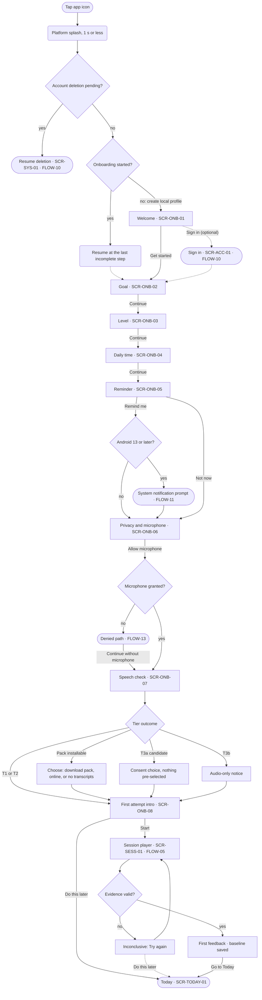

| # | Screen / state | User action | System response | Decision or rule | Refs |
|---|---|---|---|---|---|
| 1 | Splash | Taps the icon | Brand moment ≤ 1 s; creates a local profile (UUID) with no network call | Deletion pending → SCR-SYS-01 first. Onboarding already started → resume at the saved step | SRS-FR-ACC-001, -008; SRS-FR-ONB-010; NFR-PERF-002 |
| 2 | SCR-ONB-01 | **Get started** (tap 1) | — | Optional "Already use SpeakCraft? Sign in" → FLOW-10a; imported choices pre-fill steps 3–6 (FS-02 A8, pending) | SRS-FR-ONB-001; SRS-FR-ACC-002 |
| 3 | SCR-ONB-02 | Keeps or changes the goal; **Continue** (tap 2) | Saves track | Default pre-selected (FS-02 Q1) | SRS-FR-ONB-002 |
| 4 | SCR-ONB-03 | **Continue** (tap 3) | Saves level | Default Intermediate | SRS-FR-ONB-003 |
| 5 | SCR-ONB-04 | **Continue** (tap 4) | Saves daily minutes | Default 10 | SRS-FR-ONB-004 |
| 6 | SCR-ONB-05 | **Not now** (tap 5) — or **Remind me at 19:00** (tap 5) + system Allow (tap 6) | Saves reminder preference; schedules if enabled | Android 13+ only shows the system prompt; denial never blocks (FLOW-11) | SRS-FR-ONB-005; SRS-FR-REM-005 |
| 7 | SCR-ONB-06 | **Allow microphone** (tap 6) + system **Allow** (tap 7) | Privacy statement generated from policy constants | Denied → FLOW-13 with "Continue without microphone" | SRS-FR-ONB-006, -007; SRS-PRIV-002 |
| 8 | SCR-ONB-07 | Reads the outcome; **Continue** (tap 8) | Tier detected in ≤ 2 s †; only verified status shown | T1/T2: no choice. Pack installable: download runs in the background after Continue. T3a: consent required, nothing pre-selected. T3b: audio-only notice. Detection > 2 s → provisional audio-only, re-checked later | SRS-FR-ONB-008; SRS-FR-SPCH-001, -003, -004, -005 |
| 9 | SCR-ONB-08 | **Start** (tap 9) | Opens `onb-intro` (Answer a question, 60 s max, 15 s preparation †) | "Do this later" → Today; baseline not set (FS-02 Q2) | SRS-FR-ONB-009, -011 |
| 10 | SCR-SESS-01 Prepare | **Record** (tap 10) — may tap before the 15 s end | Preparation skipped; capture starts ≤ 300 ms (T1/T3b) or ≤ 800 ms (T2/T3a) | Microphone missing → Permission state (FLOW-13) | SRS-FR-SESS-002; NFR-PERF-004 |
| 11 | SCR-SESS-01 Recording | Speaks ~40–60 s; **Stop** (tap 11) or auto-stop at 60 s | Processing: evidence gate → metrics → feedback | Gate fails → Inconclusive + Try again (counts nothing) | SRS-FR-SESS-003, -006, -007; SRS-BR-001, -008 |
| 12 | SCR-SESS-01 Result (first-result variant) | Reads what we heard, headline metrics, strength, mistakes found and coach tips; **Go to Today** (tap 12) | First valid attempt saved as baseline; counts as a streak day | Result order and content as FLOW-05 step 9 | FS-02 §5 step 9–10; SRS-FR-EVAL-015, -016; SRS-BR-010 |
| 13 | SCR-TODAY-01 | — | `onboardingCompletedAt` set; first plan generated (≤ 150 ms); greeting "Welcome, {name}" or nameless (FS-02 issue 4) | — | SRS-FR-TODAY-002, -010; NFR-PERF-007 |

#### FLOW-01 step count and time estimate against KPI-02

| Moment | Taps (cumulative) | Time (cumulative, INFERRED) |
|---|---|---|
| App open → SCR-ONB-01 interactive | 0 | 0:02 (≤ 2.0 s RD-MID, NFR-PERF-001) |
| SCR-ONB-01 read, Get started | 1 | 0:12 |
| Goal, Level, Daily time (Continue × 3) | 4 | 0:39 |
| Reminder — Not now | 5 | 0:45 |
| Privacy read, Allow microphone, system Allow | 7 | 1:04 |
| Speech check (≤ 2 s) read, Continue | 8 | 1:11 |
| First attempt intro, Start | 9 | 1:17 |
| Read prompt, **Record** (preparation 0–15 s) | **10** | **1:22–1:37** |
| Speak 40–60 s, Stop | 11 | 2:02–2:37 |
| Recogniser finalisation ≤ 1.5 s + evaluation ≤ 2.5 s → **first valid attempt shown** | 11 | **2:06–2:41** |
| Read feedback (incl. mistakes found and coach tips), Go to Today | 12 | 2:36–3:11 |

| Path variant | Taps to recording | Time to first valid attempt | Against KPI-02 (≤ 3:00) |
|---|---|---|---|
| A. Baseline (Not now; T1/T2) | 10 | 2:06–2:41 | Meets, margin 19–54 s |
| B. Reminder chosen on Android 13+ | 11 | +5 s | Meets |
| C. With recommendation R-1 (skip SCR-ONB-07 when no choice is needed) | 9 | −7 s | Meets |
| D. T3a consent read | 10 | +20–30 s | Meets, narrow margin |
| E. Hoang (A2+, slower reading) | 10 | +30–60 s → 2:36–3:41 | **At risk** |
| F. First attempt Inconclusive, one retry | 11–12 | +60–80 s | **Fails** — KPI-02 counts the first *valid* attempt |
| G. Low-end device (RD-LOW) | 10 | +2–5 s (start-up 3.5 s, evaluation ≤ 5 s) | Meets |

**R-1 (RECOMMENDATION for FS-02/FS-12).** When the speech check finds T1 or T2, no choice is needed: run the check while SCR-ONB-06 is shown and put the result line ("Speech recognition works on this phone without internet") on SCR-ONB-08, skipping the SCR-ONB-07 stop. SCR-ONB-07 is still shown for pack, T3a and T3b outcomes. Saves one tap and about 7 s.

**Mitigations for E and F.** Keep onboarding copy at CEFR B1 and short (DES-05 §12.1); show a one-line recording tip on SCR-ONB-08 ("Speak in a quiet place, about 20 cm from the phone"); make the Inconclusive reason specific so the retry succeeds first time (DES-05 §11.16).

---

### FLOW-02 — Returning user (open → recording in ≤ 2 taps)

**Goal.** A returning user is recording within two taps of opening the app (UX-2; DES-01 HRC-20).
**Personas.** Aarav (ten minutes before stand-up), Daniel (after a reminder).
**Preconditions.** Onboarding complete; microphone granted.

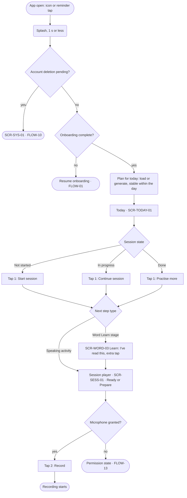

| # | Screen / state | User action | System response | Decision or rule | Refs |
|---|---|---|---|---|---|
| 1 | Splash | Opens the app (not counted) | Brand moment ≤ 1 s; Today interactive ≤ 2.0 s RD-MID / ≤ 3.5 s RD-LOW | Deletion pending → SCR-SYS-01. Legacy migration runs in the background and never blocks | NFR-PERF-001, -002; SRS-FR-DATA-007, -008 |
| 2 | SCR-TODAY-01 | Sees one session card | Plan for today's dateKey loaded, or generated deterministically (≤ 150 ms); recovery session if the last valid attempt was ≥ 2 days ago | Completed steps never change (SRS-BR-013) | SRS-FR-TODAY-002, -003, -008; SRS-BR-014 |
| 3 | SCR-TODAY-01 | **Start session** / **Continue session** / **Practise more** (tap 1) | Opens SCR-SESS-01 at the next incomplete step (Practise more: the suggested activity) | Next step is a word *Learn* stage → one extra tap (exception, issue F-3) | SRS-FR-TODAY-001, -011 |
| 4 | SCR-SESS-01 Ready / Prepare | Reads the prompt; **Record** (tap 2) | Preparation skipped if running; capture ≤ 300 / 800 ms | The first step of a fresh day is the warm-up (Read aloud or Listen & repeat, no preparation, SRS-FR-TODAY-004) | SRS-FR-SESS-002, -004; NFR-PERF-004 |

#### FLOW-02 step count and time estimate against UX-2

| Path | Taps to recording | Time from app open to capture running (INFERRED) | Against UX-2 (≤ 2) |
|---|---|---|---|
| Fresh day, Start session → Record | **2** | 8–11 s RD-MID (start-up ≤ 2 s · scan card 2–3 s · player ≤ 0.3 s · read prompt 3–5 s · capture ≤ 0.8 s); ≤ 13 s RD-LOW | Meets |
| Reminder tap → Today → Start session → Record | 2 | Same | Meets |
| Session in progress, next step is speaking | 2 | Same | Meets |
| Session done → Practise more → Record | 2 | Same | Meets |
| Next step is a word *Learn* stage | 3 | +5–10 s | **Exception** (F-3) |
| Microphone not granted (one-time) | 4 (Allow microphone + system Allow) | +5 s | Exception, one-time (FLOW-13) |
| T3a user offline | 2 (audio-only notice shown) | Same | Meets |

Today's equivalent: 2 taps from the dashboard to a free recorder (Record tab, Record Mic), but only after a 2.1 s overlay and the profile load, and **not** into today's plan (ui_audit §3.1; DES-01 H7).

---

### FLOW-03 — Daily session end to end (steps, completion, streak)

**Goal.** Finish today's 3–4 step session inside one player, with completion and streak earned only from real speaking (PP-4, PP-7; replaces the 8-step self-ticked checklist, UXF-05, UXF-24).
**Personas.** Aarav (10 minutes), Daniel, Hoang (recovery after missed days).
**Preconditions.** Onboarding complete; plan generated for today's dateKey.

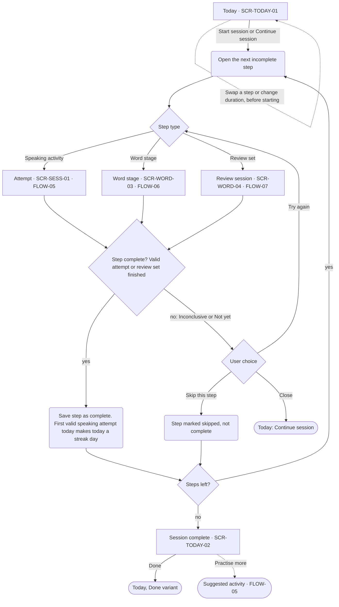

| # | Screen / state | User action | System response | Decision or rule | Refs |
|---|---|---|---|---|---|
| 1 | SCR-TODAY-01 | Optional: Swap a step (≤ 3 per day †) or change duration before starting | Swap replaces the step with the next-best candidate of the same template family; duration change regenerates **only incomplete** steps | Completed steps are never removed or reordered | SRS-FR-TODAY-007, -009; SRS-BR-013 |
| 2 | SCR-TODAY-01 | **Start session** | Opens step 1. For 10 minutes: warm-up (Read aloud / Listen & repeat) → main task (track-matched Answer / Structured answer / Tell a story) → word task (new word stage or review set) → optional retry/focus task. Recovery mode: ≤ 10 minutes, due reviews and a familiar template first, no backlog | — | SRS-FR-TODAY-004, -008; SRS-BR-014 |
| 3 | Step (speaking) | Records and gets feedback (FLOW-05); **Continue** | Valid attempt → step complete; Step progress advances ("Step 2 of 4") | A valid Read-aloud attempt below the pass mark still completes the step ("Not yet" is feedback, not failure) | SRS-BR-009; SRS-FR-EVAL-008 |
| 4 | Step (word) | Completes one stage (FLOW-06) or a review set (FLOW-07); **Continue** | Stage passed or review set finished → step complete | One word stage per step inside Today (RECOMMENDATION; see F-4) | SRS-FR-TODAY-004; SRS-BR-009 |
| 5 | Inconclusive / Not yet | **Try again**, **Skip this step**, or Close | Try again → new attempt. Skip → step marked skipped (not complete). Close → Today shows Continue session | Inconclusive never counts as completion, failure, streak or practice time | SRS-FR-SESS-007; SRS-BR-008; F-7 |
| 6 | Any step | — | First valid speaking attempt of the day (from any source) makes today a streak day — session completion is not needed | Streak per local dateKey at attempt time | SRS-BR-010, -011, -012 |
| 7 | SCR-TODAY-02 | Reads the summary; **Done** | Shows steps done/skipped, measured speaking time, streak with today marked; milestone celebration once on 3, 7, 14, 30, 60, 100 days (static under reduced motion) | Shown only when the last step is complete or skipped (pending F-7) | SRS-FR-TODAY-011; SRS-FR-PROG-006; SRS-BR-018 |
| 8 | SCR-TODAY-01 Done variant | Optional **Practise more** | Suggested optional activity starts in SCR-SESS-01 | Counts toward progress and streak like any attempt | SRS-FR-PRAC-004 |

**Taps for a 10-minute session (INFERRED):** Start (1) · warm-up Record, Stop, Continue (4) · main task Record, Stop, Continue (7) · word Learn "I've read this" or a Say it Record and Continue (8–9) · optional focus task Record, Stop, Continue (11–12) · Done (12–13). About **11–14 taps**, one screen family, no navigation between steps.

---

### FLOW-04 — Practise a library activity, including from a technique

**Goal.** Rehearse a specific situation, or learn a named technique and practise it, outside Today; the attempt counts toward progress and streak (PRD-FR-052, PRD-FR-056).
**Personas.** Meera (one interview question), Daniel (presentations), Sofia (techniques for pace and pauses).
**Preconditions.** None (content is bundled). Techniques follow **D-08 decided 2026-11-21**: our own wording, links to the specific source video, no creator name, likeness or branding (SRS-BR-028).

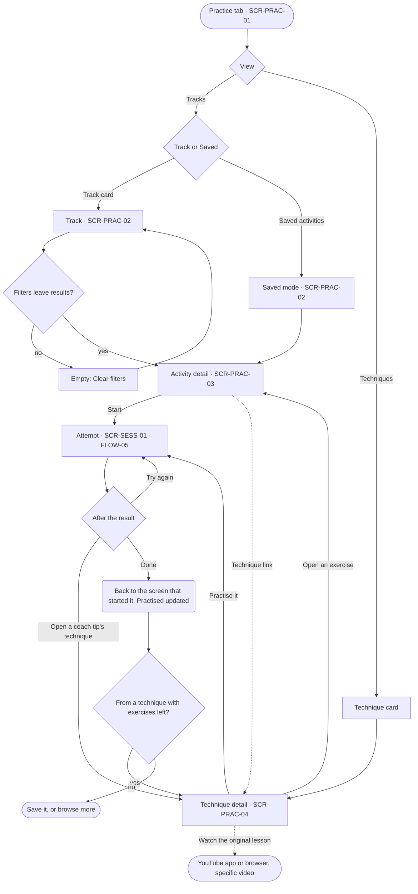

| # | Screen / state | User action | System response | Decision or rule | Refs |
|---|---|---|---|---|---|
| 1 | SCR-PRAC-01 | Chooses **Tracks** or **Techniques** view | Tracks: own track first, then the other four, then Saved activities. Techniques: technique cards (our wording, one-line idea, exercise count, Practised) with track and Saved filters | Techniques are listed here, not in SCR-PRAC-02, so the path stays within depth 3 (DES-03 I-17) | SRS-FR-PRAC-001, -008 |
| 2a | SCR-PRAC-02 | Filters by template / level; opens an activity card | Shows title, template, minutes, level, technique name, Practised | No match → "No activities match these filters" + Clear filters | SRS-FR-PRAC-001, -002, -006 |
| 2b | SCR-PRAC-04 | Reads idea, why it works, steps and tips | Shows linked exercises with Practised status and "{n} of {m} exercises practised" | "Watch the original lesson" appears only with verified provenance; it opens the specific video (with timestamp) outside the app; offline → "Needs a connection" | SRS-FR-PRAC-008, -009; SRS-BR-028 |
| 3a | SCR-PRAC-04 | **Practise it** | Starts the first unpractised linked exercise in SCR-SESS-01 (all practised → the first again) | RECOMMENDATION; exercise rows open SCR-PRAC-03 first (DES-02 v0.2 path) | SRS-FR-PRAC-008 |
| 3b | SCR-PRAC-03 | Reads goal, prompt preview, how it works; **Start** | Opens SCR-SESS-01 | T3b and transcript-needed check → Capability notice, still startable with delivery feedback | SRS-FR-PRAC-003; SRS-FR-SPCH-007 |
| 4 | SCR-SESS-01 | Attempt (FLOW-05) | Recorded identically to Today attempts; counts toward progress and streak | Result shows mistakes found and coach tips; each tip links to its technique (SCR-PRAC-04) | SRS-FR-PRAC-004; SRS-FR-EVAL-015, -016 |
| 5 | SCR-SESS-01 Result | **Try again** (compare) or **Done** | Done → back to SCR-PRAC-03 or SCR-PRAC-04 with Practised updated; from a technique, the primary becomes "Practise it" for the next exercise | — | SRS-FR-SESS-008 |
| 6 | SCR-PRAC-03 / -04 | Optional: Save | Saved activities appear in SCR-PRAC-02 Saved mode; saved techniques under the Saved filter on SCR-PRAC-01 | Saved-activity sync is open (FS-06 issue) | SRS-FR-PRAC-006 |

**Taps (INFERRED).** From a track: Practice tab (0, navigation) → track (1) → activity (2) → Start (3) → Record (4). From a technique: Techniques view (1) → technique (2) → Practise it (3) → Record (4).

---

### FLOW-05 — Speaking attempt and evaluation

**Goal.** Every attempt — from Today, Practice, a technique, a word stage, a review item or "Try again" — follows one state machine with honest outcomes (PP-1; UXF-04, UXF-12, UXF-37).
**Personas.** All.
**Preconditions.** Launched with an activity; tier known (FS-12).

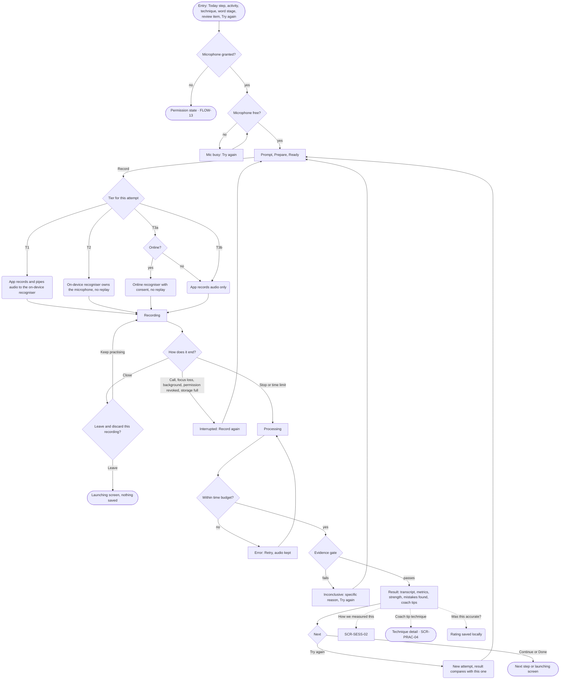

| # | Screen / state | User action | System response | Decision or rule | Refs |
|---|---|---|---|---|---|
| 1 | Entry | — | Checks microphone permission and availability | Not granted → FLOW-13. Busy (call, other app) → "The microphone is being used by another app" + Try again | SRS-ERR-001; DES-05 §11.12 |
| 2 | Prompt / Prepare / Ready | Reads the prompt; optional Listen (1.0× / 0.75×) for Read aloud and Listen & repeat | Preparation 15 s (Answer), 30 s (Structured, Story), 0 otherwise †; Record skips it | Text-to-speech unavailable → Listen hidden, "Reference audio isn't available on this device" | SRS-FR-SESS-002, -012; SRS-ERR-010 |
| 3 | Record | **Record** | Capture by tier: T1 app-owned audio piped to the on-device recogniser (replay available); T2 recogniser owns the microphone (no replay); T3a consented online recogniser (no replay); T3b audio only | T3a offline → attempt runs as audio-only with the notice "You're offline, so this attempt gets audio-only feedback" (SRS-AVL-003; F-6) | SRS-FR-SESS-005; SRS-FR-SPCH-002; ARC-05 §3 |
| 4 | Recording | Speaks; **Stop** | Elapsed and limit shown; "10 seconds left" once; auto-stop at the limit (30 / 90 / 120 s †); "We can't hear anything" after 3 s of near-silence | Recogniser busy → one retry, then the attempt continues audio-only and the result says the transcript wasn't available | SRS-FR-SESS-003, -004; SRS-ERR-002 |
| 5 | Interruption | — | Call, audio-focus loss, backgrounding, permission revoked, storage full → capture stops, partial audio discarded, **no attempt recorded**, Interrupted state + Record again | Storage full adds a storage-settings link | SRS-FR-SESS-010; SRS-ERR-004 |
| 6 | Leave | Close during Prepare, Recording or Processing | Dialog "Leave and discard this recording?" | Leave → nothing saved. Rotation never discards (SRS-FR-SESS-013) | SRS-FR-SESS-011, -014 |
| 7 | Processing | — | "Checking your recording…"; recogniser finalisation ≤ 1.5 s; evaluation ≤ 2.5 s RD-MID | Over 2× budget → Error + Retry, audio kept (timeout rule F-9; DES-03 I-16) | SRS-FR-EVAL-013; NFR-PERF-005, -006 |
| 8 | Evidence gate | — | Valid → metrics, rules, feedback. Invalid → Inconclusive with the specific reason (table below); recording deleted at once; nothing counted | Inconclusive is never a failure, completion, streak day or practice time | SRS-BR-001, -008, -022; SRS-FR-EVAL-001 |
| 9 | Result | Reads, top to bottom: (a) **What we heard** — transcript with tier label ("On-device", "Online (consented)", "No transcript — audio-only") and play control where retained; (b) **headline metrics** — up to 3 tiles, each Measured or Estimated, with band and target; Read aloud / Listen & repeat show "Recognised as intended: N % (pass mark 75 %)" or "Not yet. Try again."; (c) **What went well** — one strength; (d) **Mistakes found** — up to 3 by priority, each with evidence (quoted span, count or value) and its label, "Show all" for more; none → "Our checks didn't find issues in this attempt" + what the checks cover; (e) **Coach tips** — the focus tip first plus up to 2 more, each linking to its technique (SCR-PRAC-04) and, where available, the original lesson; (f) **Try again** (and Continue in Today); (g) **Was this accurate?** | All content from deterministic rules and on-device analysis; no cloud or generative model; evaluation and content versions stored | A metric without inputs shows "Not available — {reason}"; no free-speaking overall score | SRS-FR-EVAL-002…011, -015, -016; SRS-BR-002…007; PRD-FR-047; D-04, D-06 |
| 10 | Result | **Try again** | New attempt on the same activity; the next result compares the 3 headline metrics with the previous valid attempt | Comparison only for the same activity or template (UXF-26) | SRS-FR-SESS-008 |
| 11 | Result | **Continue** (Today) / **Done** (elsewhere) | Valid attempt saved locally first; learning event (idempotent UUID); outbox entry if signed in | Streak day and speaking time from valid attempts only | SRS-FR-DATA-001…003; SRS-BR-010, -018, -020 |
| 12 | Result (optional) | Was this accurate? Yes / No (+ reason: transcript wrong, metric wrong, tip not useful) | Rating stored locally, separate from the immutable attempt | Not synced | SRS-FR-EVAL-009; ENT-13 |

**Inconclusive reasons → user copy (RECOMMENDATION; reasons from ARC-05 §5).**

| Gate reason | Copy on the Inconclusive card | Fix offered |
|---|---|---|
| TOO_SHORT | "We heard only {n} seconds of speech." | Try again; "Speak for a little longer" |
| TOO_QUIET | "It was too quiet to hear clearly." | Try again; "Hold the phone a little closer" |
| NO_SPEECH | "We couldn't hear any speech." | Try again; Tips for a clear recording |
| NO_TRANSCRIPT | "No words were recognised." (T3b: "Speech recognition isn't available on this phone.") | Try again; T3b → Speech & privacy (FLOW-09) |
| TOO_FEW_WORDS | "We recognised only {n} words. Try saying a little more." | Try again |

---

### FLOW-06 — Vocabulary learning (all stages, including fail, Inconclusive and easier variant)

**Goal.** Take a word through Learn → Say it → Use it → Make your own until it is Learned and scheduled for review (PRD-FR-060, -062).
**Personas.** Daniel, Meera (interview words), Hoang (everyday words).
**Preconditions.** A word with a next stage (new-word goal 2 per day †, SRS-BR-027).

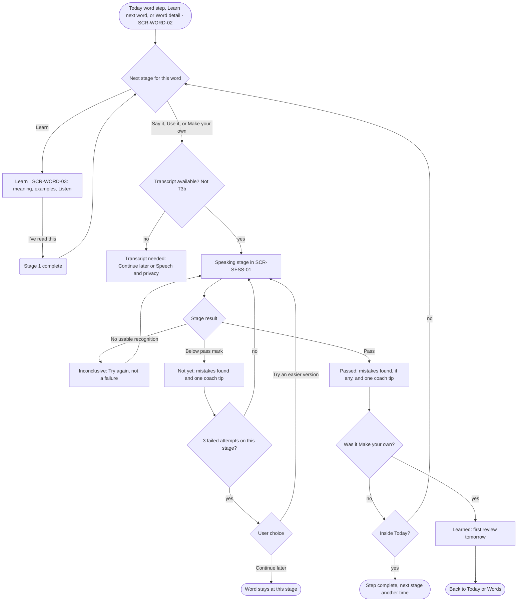

| # | Screen / state | User action | System response | Decision or rule | Refs |
|---|---|---|---|---|---|
| 1 | SCR-WORD-03 Learn | Reads meaning, IPA (if present), part of speech, 2 examples, collocations; Listen; **I've read this** | Stage 1 complete | Stages must be passed in order | SRS-FR-WORD-002; SRS-BR-015 |
| 2 | Say it | Says the word (max 5 s) | Pass if the recogniser output contains the word or an accepted inflection, match ≥ 75 † | Caveat: "Say it checks that you were understood, not your accent" | SRS-FR-WORD-003; ARC-05 §9 |
| 3 | Use it | Reads 2 sentences with the word | Pass if both are recognised as intended ≥ 75 † | — | SRS-FR-WORD-004 |
| 4 | Make your own | Says an original sentence | Pass needs: target word (or inflection), ≥ 5 words, ≤ 1 high-precision grammar observation, and score ≥ 70 † | — | SRS-FR-WORD-005; ARC-05 §9 |
| 5 | Stage result (every submitted attempt) | Reads the result | States **Passed**, **Not yet** or **Inconclusive**; lists the **mistakes found** with evidence (e.g. "Word not recognised", "We heard 'negotiation'", "Target word missing", "Sentence too short: 4 words", "Possible grammar issue: '…'"); gives **one coach tip** for the next try, linked to its technique | Inconclusive shows its reason instead of mistakes and never counts as a failure | SRS-FR-WORD-014; SRS-FR-EVAL-015, -016; SRS-FR-WORD-006; SRS-BR-008 |
| 6 | Not yet | **Try again** | Failed-attempt count for the stage increases | After 3 failures: "Try an easier version" (shorter sentence, slower reference) or "Continue later" | SRS-FR-WORD-007 |
| 7 | Passed | **Next: {stage}** (Words tab) or **Continue** (Today) | Stage saved; inside Today the word step is complete after one stage | Replaying a passed stage never lowers status | SRS-BR-009, -015; F-4 |
| 8 | Learned | **Done** | After Make your own passes: word Learned; first review in 1 day | Spaced repetition per SRS-BR-016 | SRS-FR-WORD-008; SRS-BR-016, -017 |
| 9 | T3b | — | Stages 2–4 show "Transcript needed for this check"; Continue later or Speech & privacy | The word cannot progress past Learn on T3b (F-5) | SRS-FR-SPCH-007 |

Valid speaking attempts in stages 2–4 count as streak days (SRS-BR-010). Leaving mid-flow keeps passed stages; the word resumes at its next stage.

---

### FLOW-07 — Vocabulary review set

**Goal.** Review due words with spoken recall so they move to long-term memory (PRD-FR-063).
**Personas.** Daniel, Aarav.
**Preconditions.** At least one word due today (local dateKey).

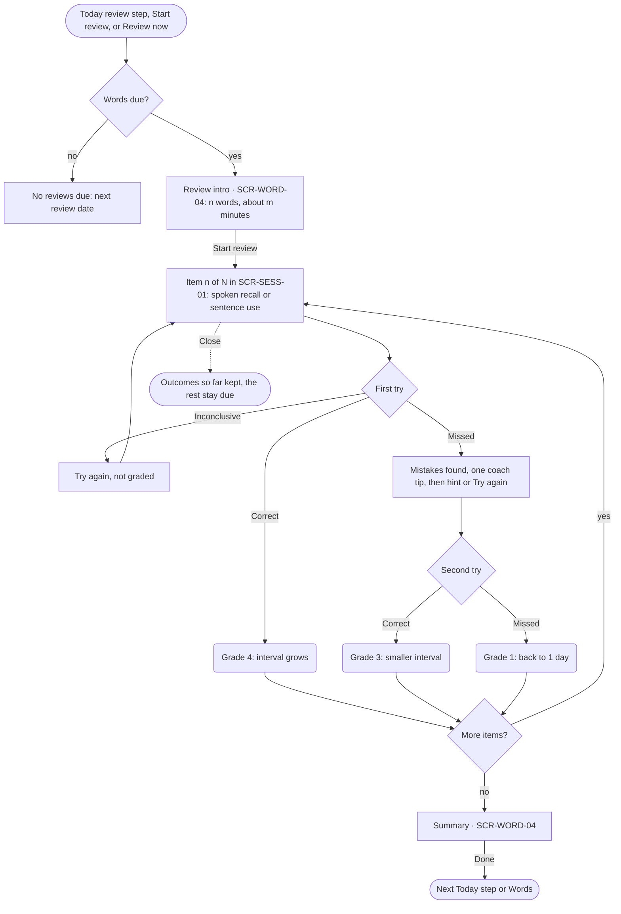

| # | Screen / state | User action | System response | Decision or rule | Refs |
|---|---|---|---|---|---|
| 1 | SCR-WORD-04 intro | **Start review** | Up to 10 due words †, mixing spoken recall ("Say the word that means …") and sentence use | No words due → "No reviews due. Next review: {date}" | SRS-FR-WORD-009; SRS-BR-027 |
| 2 | Item in SCR-SESS-01 | Records an answer | Evaluates recall or sentence use; result states Remembered / Not yet / Inconclusive with the mistakes found and one coach tip | Inconclusive is not graded and the item is offered again | SRS-FR-WORD-014; SRS-BR-008 |
| 3 | Missed first try | Uses the hint or **Try again** | Second attempt | Hint behaviour is not defined in the SRS (F-11) | SRS-BR-016 |
| 4 | Outcome | — | Grade 4 (first try), 3 (after hint or retry), 1 (missed): intervals 1, 3, 7 days, then interval × ease factor; grade < 3 resets to 1 day; a long-term word returns to Reviewing on a miss | Idempotent events per item | SRS-BR-016, -017, -020 |
| 5 | Summary | Reads per-word outcome and next dates; **Done** | Review set finished → the Today step is complete | — | SRS-BR-009 |
| 6 | Close mid-set | Close | Outcomes so far kept; remaining words stay due | — | SRS-BR-020 |

Spoken recall counts as a streak day when valid (SRS-BR-010). T3b: spoken recall needs a transcript, so the set cannot be evaluated (F-5).

---

### FLOW-08 — Progress review and replay

**Goal.** See real improvement from evidence, drill into an attempt, listen back and try again (UX-4; PRD-FR-070, -071).
**Personas.** Sofia (pace and fillers over weeks), Meera (compares interview answers).
**Preconditions.** None; the empty state handles new users.

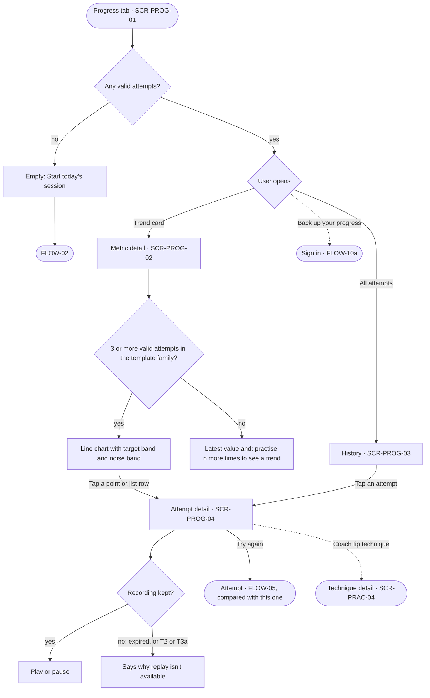

| # | Screen / state | User action | System response | Decision or rule | Refs |
|---|---|---|---|---|---|
| 1 | SCR-PROG-01 | Opens Progress | Streak (current, best, month grid), this week's speaking time (Measured), sessions completed, trend cards, word summary | New user → honest empty state; no zeros or seeded values | SRS-FR-PROG-001, -005, -007; HRC-31, -32 |
| 2 | SCR-PROG-01 | Optional "Back up your progress" (local users) | Opens SCR-ACC-01 (FLOW-10a), returns here | Non-blocking, dismissible | SRS-FR-ACC-002; FS-01 A7 |
| 3 | SCR-PROG-02 | Opens a trend | Line chart of real points only, gaps kept, target and noise bands labelled; text summary | Fewer than 3 valid attempts → no line; changes inside the noise band → "No clear change" | SRS-FR-PROG-002; SRS-BR-024 |
| 4 | SCR-PROG-03 | Opens history; filters | Newest first, template label, headline metrics, Valid / Inconclusive, recording availability | Retired content stays readable | SRS-FR-PROG-003; SRS-BR-026 |
| 5 | SCR-PROG-04 | Opens an attempt | Transcript, all metrics with labels, strength, mistakes found, coach tips, rating, playback if kept | Recording deleted by retention → "This recording was deleted after {n} days"; T2/T3a → "Replay isn't available on this phone" | SRS-FR-PROG-004; SRS-FR-SESS-009; SRS-FR-EVAL-015, -016; SRS-BR-022 |
| 6 | SCR-PROG-04 | **Try again** | New attempt on the same activity (FLOW-05); result compares with this attempt | — | SRS-FR-SESS-008 |

---

### FLOW-09 — Settings: speech and privacy (consent grant / revoke, offline pack install)

**Goal.** See the verified speech status and control language, offline pack, online-transcription consent and recording retention (PP-1, PP-2; UXF-60).
**Personas.** Meera (consent, retention), Hoang (offline pack on an older phone).
**Preconditions.** None.

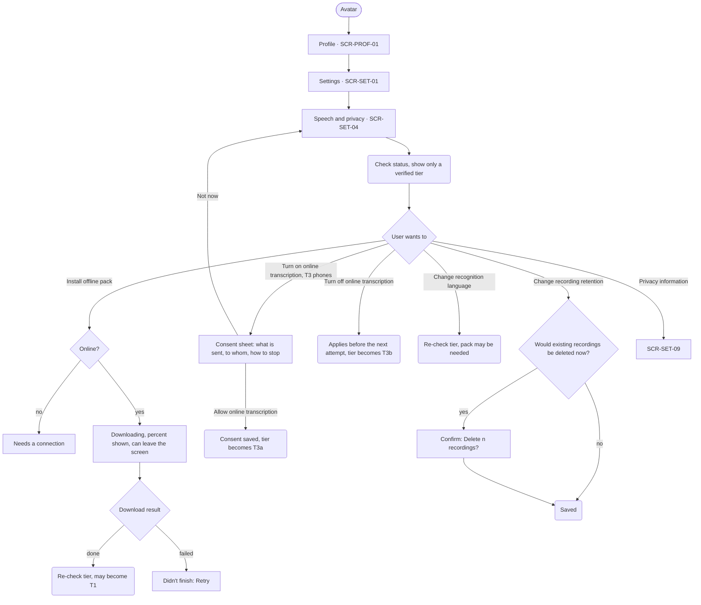

| # | Screen / state | User action | System response | Decision or rule | Refs |
|---|---|---|---|---|---|
| 1 | SCR-SET-04 | Opens Speech & privacy (3 taps from any tab: avatar, Settings, Speech & privacy) | "Checking speech recognition…" (≤ 2 s †), then the verified tier label | Status re-evaluated on app start, locale change, consent change and pack installation | SRS-FR-SET-003; SRS-FR-SPCH-003 |
| 2 | Offline pack | **Install speech pack** | Download with percentage; continues if the user leaves; success → tier re-checked | Offline → "Needs a connection"; failure → "Download didn't finish" + Retry; not supported → "Not available on this phone" | SRS-FR-SPCH-004 |
| 3 | Grant consent | Turns on Online transcription | Consent sheet names what is sent (audio), to whom (the phone's speech service, named where known), that SpeakCraft doesn't store it remotely, and how to withdraw | Allow → consent saved, tier T3a; Not now → unchanged. Offline → option disabled | SRS-FR-SPCH-005; SRS-BR-023; D-25 |
| 4 | Revoke consent | Turns it off | Takes effect before the next attempt; tier T3b; Snackbar "Online transcription is off. Attempts will use audio-only feedback." | Reversible, so no confirmation dialog | SRS-FR-SPCH-006 |
| 5 | Language | Chooses en-US / en-GB / en-IN / en-AU (filtered by support) | Tier re-checked; pack may be offered | Default from device locale if English, else en-US | SRS-FR-SPCH-008 |
| 6 | Retention | Chooses Delete after feedback / 7 days / 30 days / Keep until I delete | Saved; daily cleanup applies it | Shortening that deletes existing recordings → confirm "Delete {n} recordings older than 7 days?" (RECOMMENDATION) | SRS-BR-022; ADR-015; D-10 |
| 7 | Transcripts | Optional "Delete transcripts when recordings expire" | Saved | D-24 (Pending) | D-24 |
| 8 | SCR-SET-09 | Opens Privacy information | Text generated from the same constants that drive behaviour | — | SRS-FR-SET-006; SRS-PRIV-002 |

---

### FLOW-10 — Account management

**Goal.** Optional sign-in that adopts local data, safe sign-out (D-21 default), and complete, resumable account deletion (PRD-FR-002…005).
**Personas.** Aarav and Daniel (sign in, two devices), Meera (delete account).

#### FLOW-10a — Sign in and adopt local data

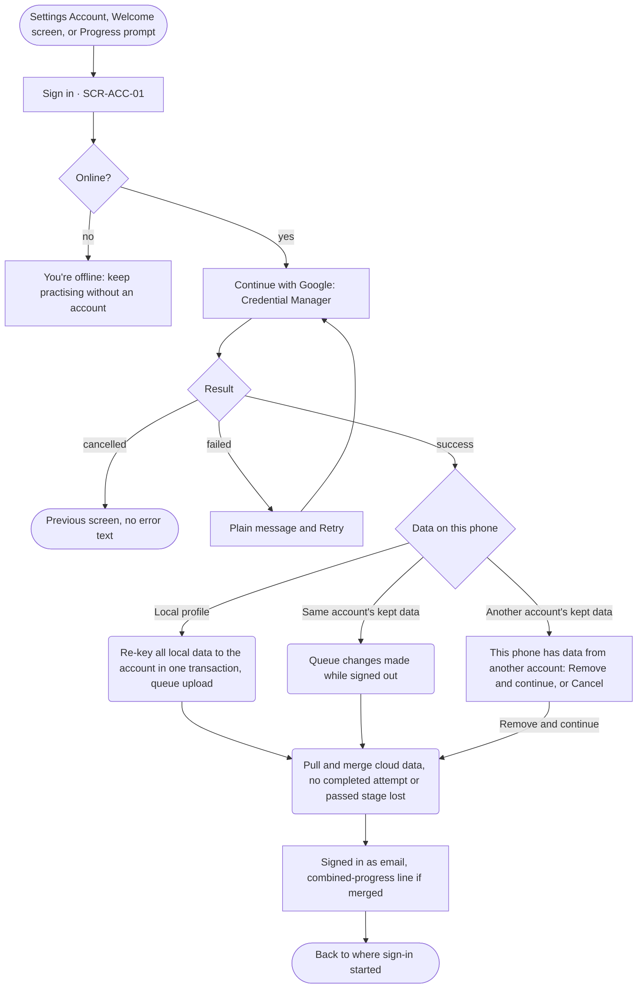

| # | Screen / state | User action | System response | Decision or rule | Refs |
|---|---|---|---|---|---|
| 1 | SCR-ACC-01 | Reads what backs up and what stays on the phone | Text from policy constants | Offline → message, Continue disabled | SRS-FR-ACC-002; SRS-PRIV-002; FS-01 E1 |
| 2 | Credential Manager | Chooses an account | Exchanges the token; signs in | Cancel → back, no error text; failure → plain message + Retry | SRS-FR-ACC-005; SRS-ERR-007 |
| 3 | Adoption | — | From a local profile: re-key in one transaction + outbox for every syncable record; failure → roll back, "Sign-in couldn't finish. Your data is safe on this phone." | Different account's kept data → never merged without "Remove and continue" (FS-01 A4, issue 1) | SRS-FR-ACC-003; FS-01 E4 |
| 4 | Merge | — | Pull since watermark; merge per ADR-014 | Facts append-only; word state keeps the most advanced stage | SRS-FR-ACC-004; SRS-BR-021 |
| 5 | Success | **Done** | "You're signed in as {email}. Your progress backs up when you're online." | Returns to the origin | FS-01 §5.2 |

#### FLOW-10b — Sign out (D-21 default)

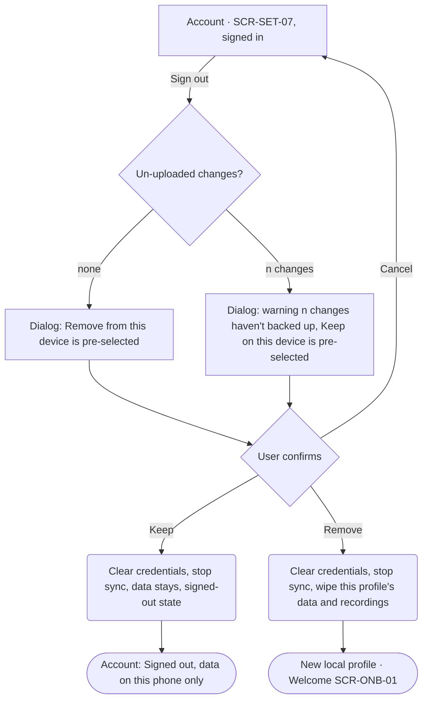

| # | Screen / state | User action | System response | Decision or rule | Refs |
|---|---|---|---|---|---|
| 1 | SCR-SET-07 | **Sign out** | Dialog with "Keep my practice data on this device" / "Remove it from this device" | **D-21 (Pending):** Remove pre-selected when every change is uploaded; with un-uploaded changes, the "{n} changes haven't backed up yet. If you remove your data now, they will be lost." warning and Keep pre-selected | SRS-FR-ACC-006; SEC-REQ-04; FS-01 §5.3 |
| 2 | Confirm | Sign out | Credentials cleared and sync stopped in both cases | Works offline | FS-01 §12 |
| 3a | Keep | — | Data stays on the phone; no sync while signed out | Re-sign-in of the same account uploads the changes (FS-01 A3, issue 2) | FS-01 §5.3 |
| 3b | Remove | — | Wipes the profile's stores (SEC-01 §6.4) incl. recordings; new local profile; onboarding | Restart onboarding vs keep preferences is open (FS-01 Q2; F-12) | SRS-BR-022 |

#### FLOW-10c — Delete account (incl. re-authentication and resume)

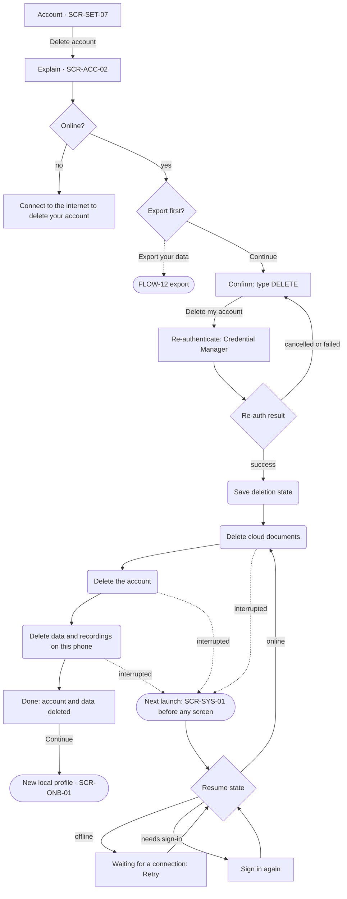

| # | Screen / state | User action | System response | Decision or rule | Refs |
|---|---|---|---|---|---|
| 1 | SCR-ACC-02 Explain | Reads what is deleted where; optional Export first; **Continue** | — | Offline → cannot start | SRS-FR-ACC-007 (1); FS-01 E8 |
| 2 | Confirm | Types DELETE; **Delete my account** (destructive filled button) | Button enabled only for the exact text | Typed vs checkbox confirmation open (FS-01 Q1) | SRS-FR-ACC-007 (2) |
| 3 | Re-auth | Re-authenticates | Nothing is deleted before success | Cancel / failure → back to Confirm | SRS-FR-ACC-007 (3); FS-01 E6 |
| 4 | Progress | Waits (Back disabled; leaving is safe) | Deletion state saved; cloud documents → account → local data and recordings; each step announced | Order fixed: cloud first (rules need the owner) | SRS-FR-ACC-007 (4–6); FS-01 §8 |
| 5 | Done | **Continue** | Fresh first-launch state (FLOW-01) | — | SRS-FR-ACC-007 (7) |
| 6 | Resume (SCR-SYS-01) | — | On next launch, before any other screen, resumes from the saved step | Offline → "Waiting for a connection…" + Retry with no other way in (FS-01 Q3; F-12); needs recent login → Sign in again | SRS-FR-ACC-008; SRS-ERR-009 |

#### FLOW-10d — Delete everything on this device (local or signed-out user)

SCR-SET-07 → **Delete everything on this device** → Dialog listing what is lost (practice history, words, recordings, preferences; cannot be undone) → **Delete** → local data, preferences and recordings deleted, no network needed → new local profile → SCR-ONB-01 (SRS-FR-ACC-009; FS-01 §5.5). Its overlap with "Clear history → Everything" is F-13.

---

### FLOW-11 — Reminders (enable, permission denied, reminder tap, suppression)

**Goal.** One gentle daily reminder at the user's time, never on days they have practised, never guilt-framed (PP-7; UN-07).
**Personas.** Daniel, Aarav.

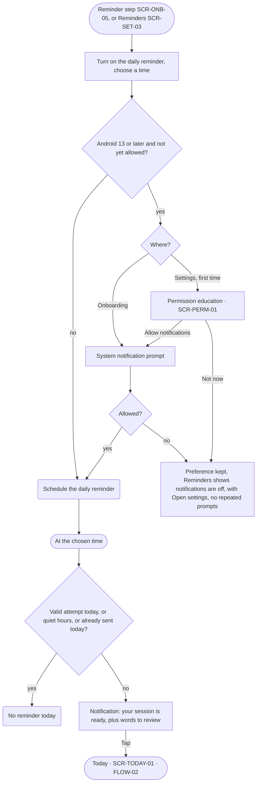

| # | Screen / state | User action | System response | Decision or rule | Refs |
|---|---|---|---|---|---|
| 1 | SCR-ONB-05 / SCR-SET-03 | Turns the reminder on; sets a time (default 19:00 †) | Saves preference | Below Android 13: no permission needed | SRS-FR-ONB-005; SRS-FR-REM-001 |
| 2 | Permission (Android 13+) | Onboarding: system prompt directly. Settings: SCR-PERM-01 once, then the system prompt | — | Never asked at launch; notification education outside onboarding only (F-16) | PRD-FR-083; DES-05 §11.19 |
| 3 | Denied | — | Preference kept; SCR-SET-03 shows "Notifications are off for SpeakCraft" + Open settings | No repeated prompts | SRS-FR-REM-005 |
| 4 | Scheduled | — | WorkManager job near the chosen local time; rescheduled after reboot, time-zone change and preference change | One channel "Practice reminders"; no other notification category in R1 | SRS-FR-REM-001, -004, -006 |
| 5 | Suppression | — | Not posted if a valid attempt exists for today's dateKey; at most 1 per day; not between 22:00 and 07:00 † unless the user chose a time there | — | SRS-FR-REM-002; SRS-BR-019 |
| 6 | Notification | Taps it | Opens Today (2 taps to recording, FLOW-02) | Copy is calm and factual, e.g. "Your 10-minute session is ready. 3 words to review." — no streak-loss warnings | SRS-FR-REM-003; DES-05 §12.1 |
| 7 | Already posted, then practised | — | RECOMMENDATION: cancel the posted reminder when the first valid attempt of the day is saved (F-14) | — | SRS-BR-019 |

---

### FLOW-12 — Data rights: export (with the D-22 option) and clear history

**Goal.** Users can take all their personal data with them and delete parts of their history, with clear consequences (PRD-FR-093, -094; UXF-52).
**Personas.** Meera, Sofia.

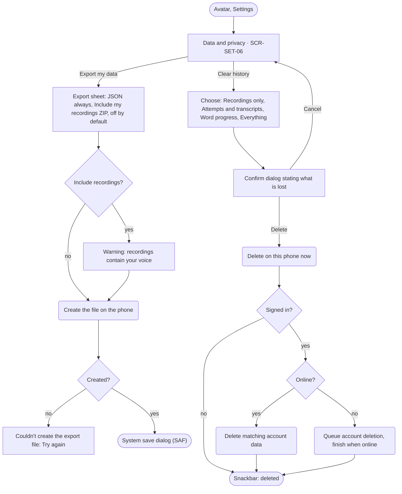

| # | Screen / state | User action | System response | Decision or rule | Refs |
|---|---|---|---|---|---|
| 1 | SCR-SET-06 | **Export my data** | Export sheet: JSON with profile, preferences, attempts (metrics, transcripts if present), word progress, plans, events (ARC-03 §10) | Works offline | SRS-FR-SET-004; SRS-PRIV-003 |
| 2 | Export sheet | Optional "Include my recordings (ZIP)" | Off by default; warning "Recordings contain your voice. Anyone you share this file with can listen to them." | **D-22 (Pending)** consolidated recommendation: optional ZIP in R1. Alternative (SEC-01 SD-04 a): JSON only in R1 → the option is hidden. No recordings → option disabled | SRS-FR-SET-004; D-22 |
| 3 | Generating | **Export** | Button loading; system "save to" dialog (Storage Access Framework) opens and the file is written where the user chooses (SRS-FR-SET-004) | Failure (e.g. storage full) → "Couldn't create the export file. Free some space and try again." + Try again | SRS-ERR-005; ARC-03 §10 |
| 4 | Clear history | Chooses a category | — | Signed-in "Everything" keeps the account; account deletion is FLOW-10c; local "Delete everything on this device" is FLOW-10d (overlap F-13) | SRS-FR-SET-005 |
| 5 | Confirm | **Delete** (destructive text button) | Deletes locally at once; progress shown in the dialog; Snackbar "Deleted" — no Undo, the action is irreversible | Copy states the consequence, e.g. clearing attempts also clears the trends and history built from them | DES-05 §11.5; SRS-BR-022 |
| 6 | Signed in | — | Deletions propagate to the account; offline → queued, "We'll finish deleting from your account when you're online." | Never reports a deletion that did not happen | SRS-FR-SET-005; SRS-ERR-005 |

---

### FLOW-13 — Microphone permission denied / permanently denied

**Goal.** The core task is never silently blocked: users always know why speaking is unavailable and how to fix it, and the rest of the app still works (UXF-36; HRC-17, HRC-27).
**Personas.** Hoang (taps "Don't allow" by habit), Meera (wary of the microphone).

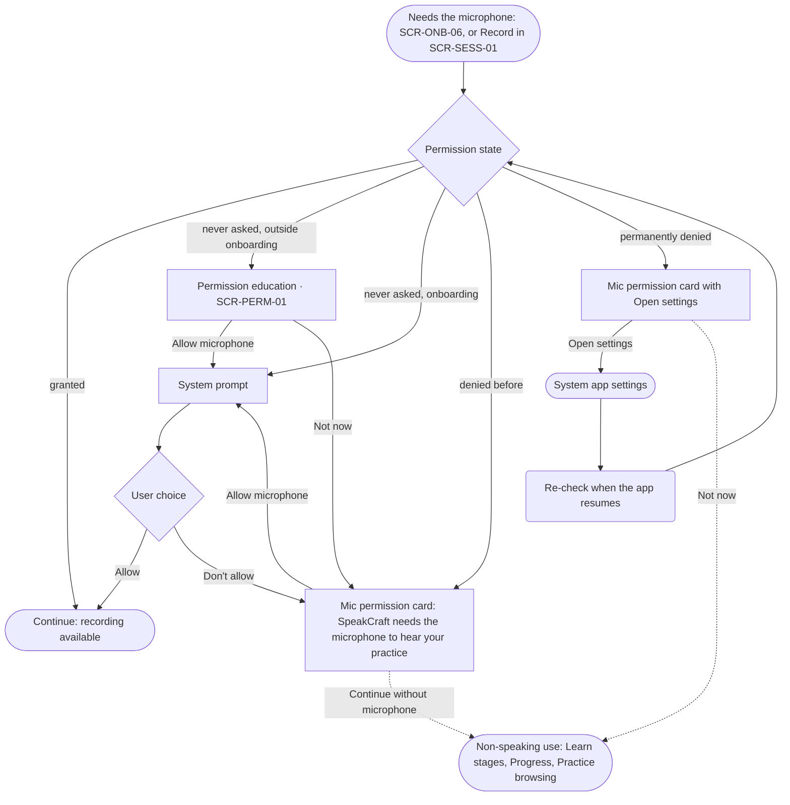

| # | Screen / state | User action | System response | Decision or rule | Refs |
|---|---|---|---|---|---|
| 1 | Onboarding (SCR-ONB-06) | Allow microphone | Privacy statement first, then the system prompt | Denied → impact text + Try again + Continue without microphone | SRS-FR-ONB-006, -007 |
| 2 | First request outside onboarding | Record in SCR-SESS-01 | SCR-PERM-01 explains why and what stays on the phone, then the system prompt | e.g. permission reset by the system for an unused app | DES-05 §11.19; HRC-17 |
| 3 | Denied once | — | Mic permission card replaces the Record button: "SpeakCraft needs the microphone to hear your practice." + Allow microphone | Announced; focus moves to the card; haptic "reject" | DES-05 §11.19, §9 |
| 4 | Permanently denied | **Open settings** | Opens the app's system settings; permission re-checked on `ON_RESUME`; granted → Ready state returns without extra taps | — | SRS-FR-ONB-007; HRC-27 |
| 5 | Continue without microphone | Uses the app | Today: speaking steps disabled with "Microphone needed for speaking steps" + Allow microphone; word *Learn* stages, Practice browsing, Progress and Settings work | No streak day can be earned without a valid speaking attempt (DES-07 OQ-A11Y-1) | SRS-FR-ONB-007; SRS-ERR-001; SRS-BR-010 |
| 6 | Revoked during a recording | — | Interrupted state; partial audio discarded; no attempt | — | SRS-FR-SESS-010 |

---

### FLOW-14 — Offline and sync status

**Goal.** Everything in the core loop works offline; sync is opportunistic, visible only where it matters, and never blocks (PP-6; UXF-50).
**Personas.** Aarav (practises on the train), Hoang (patchy connection).

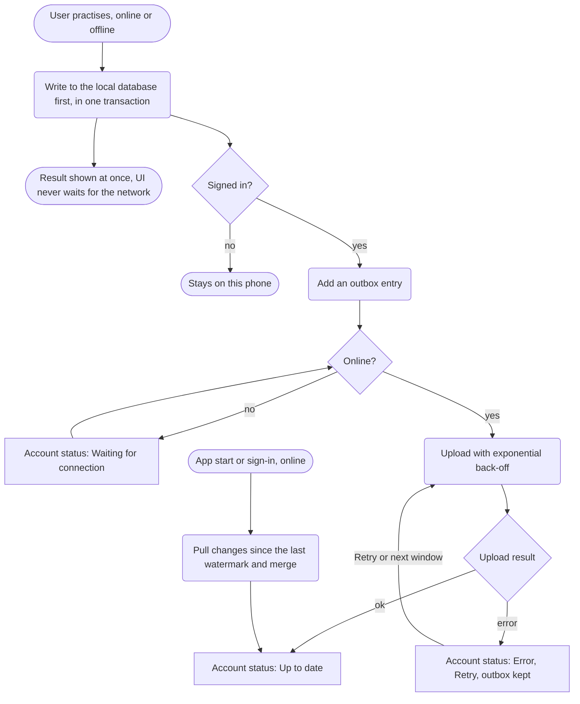

| # | Screen / state | User action | System response | Decision or rule | Refs |
|---|---|---|---|---|---|
| 1 | Any core screen | Practises offline | Identical behaviour; no offline banner on Today, Practice, Words, Progress or the player (T1/T2/T3b) | Offline indicators only where a feature needs the network (DES-03 §5: 12 screens) | SRS-FR-DATA-001; SRS-AVL-001; DES-05 §11.19 |
| 2 | SCR-SESS-01 (T3a) | Records offline | "You're offline, so this attempt gets audio-only feedback" | Speech-service unavailability degrades to T3b with explanation | SRS-AVL-003; F-6 |
| 3 | Sync (signed in) | — | Outbox entry per syncable change; background upload when online with back-off; audio, file paths and (by default) transcripts never uploaded | Idempotent by UUID; duplicates ignored | SRS-FR-DATA-002, -003, -006; SRS-BR-020 |
| 4 | SCR-SET-07 | Checks status | Up to date / Syncing / Waiting for connection / Error — Retry | Sync errors never block; Snackbar only after a manual Retry fails ("Couldn't sync. We'll try again later.") | SRS-FR-DATA-005; SRS-ERR-006 |
| 5 | App start / sign-in | — | Pull since watermark; merge per ADR-014 | Firebase unavailable → only sign-in and sync degrade, with visible status | SRS-FR-DATA-004; SRS-AVL-002; SRS-BR-021 |
| 6 | Network-only features | Sign in, pack download, online consent, account deletion, "Watch the original lesson" | Each shows "Needs a connection" or its offline message and offers the offline alternative | No dead ends (DES-02 §2.3 rule 4) | FS-01 E1, E8; SRS-FR-PRAC-009 |
| 7 | Legacy user, first launch of the new version | — | Profile and vocabulary import runs in the background; failure retried next launch, never blocks | — | SRS-FR-DATA-007, -008; D-19 |

---

## 4. Current flow vs proposed flow

Current steps come from `docs/redevelopment/working_papers/ui_audit.md` §3 (and §7) and DES-01 §4; they are **INFERRED** minimums counted from code, not measured.

### 4.1 First-time use

| Aspect | Current (ui_audit §3.1–3.2) | Proposed (FLOW-01) |
|---|---|---|
| Launch | 2.9 s unskippable overlay; splash-to-app colour jump | Platform splash ≤ 1 s, matching colours |
| Account | Google sign-in required before anything (sign-in + account chooser = 2 taps; needs network) | None required; optional sign-in later |
| Set-up | 3 form steps: name, level (silently rewrites 7 sliders), free-text goal, minutes chips **and** slider, 7 self-rating sliders | 4 one-tap choices with defaults (goal, level, daily time, reminder) |
| Privacy and microphone | System prompt with no explanation; denial does nothing | Plain privacy statement first; denial path with Try again / Open settings / Continue without microphone |
| Speech capability | Status shown without verification | Verified speech check with an honest, tier-specific choice |
| First speaking | After onboarding, a 7-step tour, then finding "Record" | Inside onboarding: "Introduce yourself" |
| Taps to first recording | **9** (Sign in, chooser, Continue ×2, Start My Coaching Plan, Skip Tour, Record tab, Record Mic, Allow) | **10** (9 with R-1) |
| Taps to first feedback | **11** (+ Stop, Analyze) | **11** (+ Stop; feedback is automatic; 10 if the 60 s limit stops it) |
| First feedback content | No transcript by default; "Pronunciation" from loudness; "INSUFFICIENT_EVIDENCE" jargon | Transcript, labelled metrics, one strength, mistakes found, coach tips; specific Inconclusive reason |
| Time to first valid attempt | Not measurable from code; includes network sign-in, profile load and the tour | 2:06–2:41 estimated (KPI-02 ≤ 3:00) |
| Landing | Dashboard with ~21 widgets, "Welcome back" and "1 Day Streak" on day 0 | Today with one session card, honest "Start your streak today" (streak already counts if the first attempt was valid) |

**Reading the comparison honestly.** The tap count barely changes (9 → 10 to first recording). The gains are elsewhere: no account wall and no network dependency, no tour or form-filling, a permission explanation and denial path, automatic feedback, and real content in that feedback. R-1 brings the count to 9.

### 4.2 Daily practice (returning user)

| Aspect | Current (ui_audit §3.1, §7.3; DES-01 UXF-05) | Proposed (FLOW-02, FLOW-03) |
|---|---|---|
| Open | 2.1 s overlay + profile load; possible blocking update dialog | ≤ 1 s brand moment; Today interactive ≤ 2 s |
| Which plan | Three competing plans (dashboard plan, Daily tab, Activity Engine "Daily Plan") | One session card |
| Taps to recording | 2 from the dashboard to a free recorder (Record tab, Record Mic) — **not** into the daily plan | **2** into today's session (Start session, Record) |
| Running the routine | Daily tab → 8-step checklist → each step opens one of 7 separate screens → record → Stop → Analyze → Back → tick | One player runs 3–4 steps in sequence and advances automatically |
| Taps per speaking step | ≈ 6 (Open, Record, Stop, Analyze, Back, tick) | 3 (Record, Stop, Continue) — 2 if the time limit stops it |
| Taps for the whole routine | ≈ 40 for 8 steps, plus a reflection slider and save | ≈ 11–14 for a 10-minute session |
| Completion | Self-reported ticks; "3 minutes per ticked step" practice hours | Only from valid attempts / finished review sets; speaking time measured from recordings |
| Streak | Seeded at 1; two different streak numbers | One streak from the first valid speaking attempt of each day |
| End of session | No summary | SCR-TODAY-02: what was practised, speaking time, streak, milestone |

---

## 5. Issues found in source documents

Raised to the owner of each source document; not fixed here.

| # | Issue | Source(s) | Suggested resolution |
|---|---|---|---|
| F-1 | PRD §14 maps journeys to old flow numbers: J4 → FLOW-05/06, J5 → FLOW-07, J6 → FLOW-08/09. The canonical IDs are J4 → FLOW-06/07, J5 → FLOW-08, J6 → FLOW-09/10/12 (RD-09 §4 already matches DES-04). | PRD §14; working-paper canon R-4 | Update PRD §14. |
| F-2 | The onboarding sequence needs 10 taps to the first recording — one more than today's minimum — mainly because the speech check is its own stop. | SRS-FR-ONB-001; FS-02 §5; DES-02 §4 (SCR-ONB-07) | Adopt R-1: skip SCR-ONB-07 when no choice is needed (FS-02, FS-12, DES-02 to confirm). |
| F-3 | UX-2 fails (3 taps) when the next incomplete step is a word *Learn* stage, because SRS fixes only the session's composition, not the order of remaining steps. | SRS-FR-TODAY-004; RD-15 UX-2 | FS-03: "Continue session" opens the next incomplete **speaking** step first, or UX-2 excludes non-speaking steps. |
| F-4 | Whether a word step in Today runs in SCR-SESS-01 or hands over to SCR-WORD-03 (and how step progress continues) is not defined; nor is "one stage per step" vs continuing to the next stage. | DES-02 §3; SRS-FR-TODAY-004 | Define in FS-03 / FS-07 and DES-06. |
| F-5 | On T3b phones, word stages 2–4 and spoken-recall reviews can never pass, so the Words lifecycle is blocked after *Learn*; no alternative is specified. | SRS-FR-SPCH-007; SRS-FR-WORD-003…005, -009; FS-03 issue | Decide in FS-07: a delivery-only path, or hide speaking stages and say why. |
| F-6 | T3a without network: ARC-05 says the attempt "continues audio-less", SRS-AVL-003 says degrade to T3b, but in T3a the recogniser owns the microphone, so switching mid-attempt is not possible. DES-04 checks connectivity **before** recording. | ARC-05 §4.2; SRS-AVL-003; FS-04 issue | Confirm the pre-recording check in FS-04 / FS-12; define mid-attempt network loss (likely Inconclusive NO_TRANSCRIPT). |
| F-7 | "Skip this step" semantics: whether a session with skipped steps reaches SCR-TODAY-02 and counts toward KPI-04 is undefined. | SRS-FR-SESS-007; SRS-BR-009; DES-07 OQ-A11Y-1; BRD KPI-04 | Decide in FS-03 (DES-03 I-9). |
| F-8 | Milestones trigger "a one-time celebration", but where it appears is not defined when the milestone attempt happens outside Today (Practice, Words). | SRS-FR-PROG-006 | FS-08: show it on the result that earned it; on SCR-TODAY-02 only for Today sessions. |
| F-9 | Processing timeout rules conflict (DES-05: notice + Cancel at 10 s; SRS: Error at 2× budget). | DES-05 §11.11; SRS-FR-EVAL-013 | One rule in FS-04 / FS-05 (DES-03 I-16). |
| F-10 | DES-05's Inconclusive example "We heard less than 3 seconds of speech" does not match the gate (≥ 1.5 s duration, ≥ 0.5 s voiced). | DES-05 §11.16; SRS-BR-001 | Use measured values in copy ("We heard only {n} seconds"). |
| F-11 | Grade 3 is "pass after hint/retry", but no hint behaviour is specified. | SRS-BR-016; SRS-FR-WORD-009 | Define the hint (e.g. first letter, example sentence) in FS-07. |
| F-12 | Two account edge cases are undecided: after sign-out *Remove*, restart onboarding or keep preferences (FS-01 Q2); and an offline deletion resume blocks the whole app with no way in (FS-01 Q3). | SRS-FR-ACC-006, -008 | Product Owner decisions; FLOW-10 shows the current recommendation. |
| F-13 | "Clear history → Everything" (keeps the account) and "Delete everything on this device" (local users) overlap and sit on different screens. | SRS-FR-SET-005; SRS-FR-ACC-009; FS-01 issue 6 | State the difference in SRS and keep both labels distinct. |
| F-14 | A reminder already posted stays in the shade after the user practises; SRS only prevents posting. | SRS-FR-REM-002; SRS-BR-019 | FS-09: cancel the posted reminder on the first valid attempt of the day. |
| F-15 | Export audio option depends on D-22 (consolidated recommendation vs SEC-01 SD-04 a). | SRS-FR-SET-004; D-22 | Product Owner decision. |
| F-16 | Notification permission education: SCR-PERM-01 lists notifications, but onboarding prompts directly after "Remind me". | DES-02 §4; SRS-FR-ONB-005 | Confirm "education from Settings only" in FS-09 (DES-03 I-11). |
| F-17 | Whether migrated legacy users see onboarding is undefined; this changes the FLOW-01/02 gate. | SRS-FR-DATA-007; FS-02 issue 5 | FS-02 / FS-11: skip imported choices, always run privacy, microphone and speech check. |
| F-18 | **Techniques (D-08 decided).** What "Practise it" opens is not stated (DES-04: the next unpractised exercise in the player); "{n} of {m} exercises practised" needs per-technique progress, which no requirement or entity covers; and coach-tip links into SCR-PRAC-04 from full-screen tasks need cross-link rules. | SRS-FR-PRAC-008, SRS-FR-EVAL-016; DES-02 v0.2; ARC-03 | FS-06 and ARC-03 to define; DES-02 / ARC-02 cross-link behaviour (DES-03 I-17, I-24). |
| F-19 | **Result length.** Every result now carries up to 3 metrics, 3 mistakes and 3 tips. Inside a 10-minute Today session (and for each word and review item) this adds reading time that the duration table does not budget, and the required order differs from DES-05 §11.15. | SRS-FR-EVAL-015, -016, SRS-FR-WORD-014; SRS-FR-TODAY-004; DES-05 §11.15 | FS-03 to budget reading time; DES-05 / DES-06 to set collapsed defaults (DES-03 I-23). |

## Change log

| Version | Date | Change | Author (role) |
|---|---|---|---|
| 0.1 | 2026-11-21 | Initial flows FLOW-01…14 with Mermaid diagrams, step tables, tap and time estimates against KPI-02 and UX-2, current-vs-proposed comparison and source issues. Reflects the Product Owner directions of 2026-11-21: D-08 decided "original wording, link out" and SCR-PRAC-04 Technique detail (FLOW-04, FLOW-08, FLOW-14, F-18); "Mistakes found" and "Coach tips" on every result (FLOW-01 step 12, FLOW-05 step 9, FLOW-06 step 5, FLOW-07, F-19). | UX Strategist |

