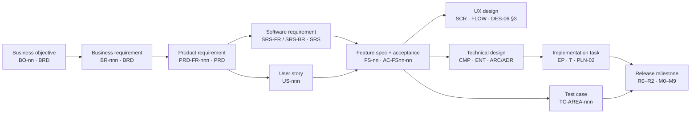

# Requirement Traceability Matrix — SpeakCraft

| Field | Value |
|---|---|
| Document ID | GOV-01 |
| Version | 0.1 — Draft for review |
| Date | 2026-11-21 |
| Status | Draft — awaiting Product Owner approval (gate G4) |
| Owner (role) | Business Analyst / QA Architect |
| Approval | Pending — Product Owner |
| Related | BRD, PRD v0.2, SRS v0.2, NFR, USER_STORIES (US), USE_CASES (UC), FS-00…FS-12, DES-02…DES-07, ARC-01…ARC-05, SEC-01, TST-01, PLN-01, PLN-02, GOV-02 |

> **Authority.** GOV-01 is the authoritative **linkage** between artefacts (GOV-02 §4). It never restates a requirement. Each linked ID is defined in its own authoritative document. When a link changes, the change is made here in the same change set as the source document (GOV-02 §7.3).
>
> **Status of tests.** No test case in this matrix has been executed. Stage A ran no build and no test (GOV-02 DC-4; PLN-05 GR-03). Every TC is **Not run**.

---

## 1. Purpose and traceability chain

This matrix links every product requirement end to end, as the Stage A brief requires:

The matrix has three layers so that it stays readable:

| Layer | Section | Granularity | What it links |
|---|---|---|---|
| Business | §4 | Business objective | BO → BR → PRD-FR |
| Capability | §5 | Capability (CAP-01…12 + platform) | FS → screens, flows, use cases, UI spec sections → components, entities, architecture → WBS epics/tasks → release |
| Requirement | §6 | Product requirement (78 PRD-FR) | PRD-FR → BO, source → SRS-FR → US → AC → TC |
| Quality | §7 | PRD-NFR / NFR / SEC-REQ | PRD-NFR → NFR → TC (via TST-01 §16.7 and SEC-01 §12) |

## 2. How to read and maintain

| Column | Authoritative source | Notes |
|---|---|---|
| BO | BRD §3 | From the PRD-FR's BR source; otherwise the capability's primary objective (§5) |
| PRD-FR, P, R | PRD §15 | Priority P0–P2; release R0/R1/R2 |
| Source | PRD §15 "Source" column | BR, PO-REQ, D-nn or ADR |
| SRS-FR | SRS §6 trace column | Shown without the `SRS-FR-` prefix (e.g. `ACC-006` = SRS-FR-ACC-006) |
| US | USER_STORIES §5 | Primary stories first |
| FS / AC | FS-nn §17 | `AC-FS05-03, -06` = AC-FS05-03 and AC-FS05-06 |
| TC | FS-nn §16–17, TST-01 §16, SEC-01 §13, DES-07 §15 | Shorthand as above |
| SCR / FLOW | DES-02 §4 (IDs), DES-03, DES-04 | Per capability (§5) |
| CMP / ENT | ARC-02 §2, ARC-03 §3 | Per capability (§5) |
| EP / T | PLN-02 | Per capability (§5) |

Maintenance rules: a new or changed requirement updates its row here in the same change; retired IDs are marked *Withdrawn*, never reused (GOV-02 §7); in Stage B each epic review (G5) adds the implementing PR and the CI run that executed the linked TCs.

The requirement layer (§6) was **generated** on 2026-11-21 from the PRD/SRS trace columns, USER_STORIES §5 and every FS §17 table, then checked by script for gaps (§3). Regenerate it the same way after source changes rather than editing rows by hand.

## 3. Coverage summary (as of 2026-11-21)

| Artefact | Count | Coverage check | Result |
|---|---|---|---|
| Business objectives | 6 (BO-01…06) | Each BO has ≥ 1 BR | ✔ |
| Business requirements | 18 (BR-001…018) | Each BR realised by ≥ 1 PRD-FR or PRD-NFR | ✔ — 12 via the PRD source column, 6 by content (§4.2) |
| Product requirements | 78 PRD-FR (73 R0/R1, 5 R2) + 11 PRD-NFR | Each PRD-FR → ≥ 1 SRS-FR | ✔ 78/78 (after SRS v0.2 trace fixes: PRD-FR-014, -051, -061) |
| | | Each PRD-FR → ≥ 1 user story | ✔ 78/78 |
| | | Each PRD-FR → FS acceptance criteria | ✔ 76/78 — PRD-FR-120/121 are platform requirements without an FS; traced to TST-01 CF-13/CF-17 test cases |
| Software requirements | 129 SRS-FR, 28 SRS-BR | Each SRS-FR named by ≥ 1 test case | ⚠ 126/129 — gaps G-01…G-03 (§8) |
| | | Each SRS-BR named by ≥ 1 test case | ✔ 28/28 |
| NFR | 63 | Each NFR → ≥ 1 test case | ✔ 63/63 (TST-01 §16.7) |
| Security requirements | SEC-REQ-01…40 | Each SEC-REQ → ≥ 1 TC-SEC | ✔ (SEC-01 §12) |
| User stories | 75 (US-001…075) | Each story → PRD-FR + SRS-FR + FS | ✔ (USER_STORIES §5) |
| Use cases | 22 (UC-01…22) | SRS-FR covered by a use case | 120/129 — the 9 not covered are R2, simple settings or platform items (USE_CASES coverage table) |
| Feature specs | 12 (FS-01…12) | Acceptance criteria | 239 AC-FS (FS-01 14 · FS-02 13 · FS-03 17 · FS-04 18 · FS-05 26 · FS-06 21 · FS-07 28 · FS-08 21 · FS-09 19 · FS-10 23 · FS-11 20 · FS-12 19) |
| UX | 42 screens (38 R1 + 4 R2), FLOW-01…14, 99 AC-DES | Every SCR in DES-02 has a DES-03 block | ✔ |
| Technical design | 76 CMP, 18 ENT, 15 ADR | Every capability has components and entities (§5) | ✔ |
| Plan | 27 epics (EP-01…27) | Every capability has an epic (§5) | ✔ |
| Test cases | 510 | By prefix: FS 334 (ACC 19, ONB 18, TODAY 27, SESS 28, EVAL 38, PRAC 28, WORD 37, PROG 27, REM 28, SET 30, DATA 28, SPCH 26) · TST-01 88 (PERF 12, REL 12, PRIV 9, COMP 9, REG 26, MIG 12, CONT 8) · SEC-01 49 (TC-SEC-001…050; 039 unused) · DES-07 TC-A11Y-001…039 | **All Not run** |

## 4. Business layer

### 4.1 Business objective → business requirements → product requirements

| BO | Objective (BRD §3) | BR | PRD-FR / PRD-NFR realising them |
|---|---|---|---|
| BO-01 | Trustworthy core speaking-practice experience | BR-001, BR-003, BR-013, BR-018 | PRD-FR-030…036, PRD-FR-040…047, PRD-FR-056; PRD-NFR-001, PRD-NFR-006 |
| BO-02 | Sustainable short daily practice habit | BR-002, BR-010, BR-012, BR-014, BR-018 | PRD-FR-010…014, PRD-FR-020…026, PRD-FR-060…067, PRD-FR-080…084 |
| BO-03 | Measurable improvement from evidence | BR-010, BR-011, BR-018 | PRD-FR-052, PRD-FR-070…075 |
| BO-04 | Verifiable privacy; compliant and store-ready | BR-004, BR-005, BR-006, BR-007, BR-009, BR-014 | PRD-FR-001…005, PRD-FR-011, PRD-FR-090…097, PRD-FR-100…103, PRD-FR-110…114, PRD-FR-121; PRD-NFR-002, PRD-NFR-008 |
| BO-05 | Maintainable, tested foundation on the existing stack | BR-001, BR-006, BR-015, BR-016 | PRD-FR-003, PRD-FR-103, PRD-FR-120; PRD-NFR-009 |
| BO-06 | Remove legal, IP and platform-policy exposure | BR-008, BR-009, BR-017 | PRD-FR-053, PRD-FR-057, PRD-FR-120, PRD-FR-121 |

### 4.2 Business requirement → product requirement

| BR | BO | Realised by (PRD source column) | Realised by (content mapping, GOV-01) |
|---|---|---|---|
| BR-001 | BO-01, BO-05 | PRD-FR-030 | PRD-FR-050, PRD-FR-056 (scenarios and technique curriculum) |
| BR-002 | BO-02 | PRD-FR-010, PRD-FR-020 | PRD-FR-021…026 |
| BR-003 | BO-01 | PRD-FR-031, PRD-FR-032, PRD-FR-040 | PRD-FR-041…047 |
| BR-004 | BO-04 | PRD-FR-100 | PRD-FR-101, PRD-FR-102 |
| BR-005 | BO-04 | PRD-FR-011, PRD-FR-095, PRD-FR-112 | PRD-NFR-002 |
| BR-006 | BO-04, BO-05 | — | PRD-FR-120 (cloud AI removed, SRS-FR-PLAT-001), PRD-FR-047 (no cloud AI for feedback); ADR-003; RD-16 NG-01 |
| BR-007 | BO-04 | PRD-FR-005, PRD-FR-093, PRD-FR-094 | — |
| BR-008 | BO-06 | PRD-FR-053, PRD-FR-057 | SRS-BR-028 |
| BR-009 | BO-04, BO-06 | PRD-FR-121 | — |
| BR-010 | BO-02, BO-03 | — | PRD-FR-060…067 (vocabulary lifecycle and spaced review) |
| BR-011 | BO-03 | PRD-FR-052, PRD-FR-070, PRD-FR-073 | PRD-FR-071, PRD-FR-072, PRD-FR-074 |
| BR-012 | BO-02 | PRD-FR-080 | PRD-FR-081…084 |
| BR-013 | BO-01 | — | PRD-NFR-006 (accessibility); DES-07 |
| BR-014 | BO-02, BO-04 | PRD-FR-001, PRD-FR-002 | — |
| BR-015 | BO-05 | — | PRD-NFR-009 (maintainability, CI gates); ADR-001; ENG-01 |
| BR-016 | BO-05 | PRD-FR-003, PRD-FR-103 | — |
| BR-017 | BO-06 | — | RD-16 NG-10 (no in-app admin); PRD-FR-120 (admin console removed); SEC-01 §5 |
| BR-018 | BO-01…03 | — | BRD §8 KPIs; ADR-013 (D-09); PRD-FR-044 (accuracy rating) |

## 5. Capability layer — design, technical design, plan and release

| CAP / FS | Screens (DES-02/03) · UI spec | Flows · Use cases | Components (ARC-02 §2) | Data (ARC-03 §3) · Architecture | WBS (PLN-02) | Release · milestone |
|---|---|---|---|---|---|---|
| CAP-01 / FS-01 Account & sign-in | SCR-ACC-01, SCR-ACC-02, SCR-SET-07, SCR-SYS-01 · DES-06 §3.7 | FLOW-10a–d · UC-16, UC-17, UC-18, UC-22 | CMP-45, CMP-53, CMP-54, CMP-55, CMP-71 | ENT-01, ENT-10, ENT-14, ENT-18 · ARC-04 §5.7, SEC-01 §4, §9.3, ADR-014 | EP-13 (T-13.3, T-13.4), EP-04 (T-04.2.5) | R1 · M6–M7 |
| CAP-02 / FS-02 Onboarding & personalisation | SCR-ONB-01…08, SCR-PERM-01 · DES-06 §3.1 | FLOW-01, FLOW-13 · UC-01 | CMP-63, CMP-23, CMP-24, CMP-49 | ENT-01, ENT-02 · ARC-05 §3 | EP-13 (T-13.1, T-13.2) | R1 · M6 |
| CAP-03 / FS-03 Today — daily session | SCR-TODAY-01, SCR-TODAY-02 · DES-06 §3.2 | FLOW-02, FLOW-03 · UC-02 | CMP-19, CMP-47, CMP-64 | ENT-05, ENT-06, ENT-09 · ARC-01 §4 | EP-08 (T-08.1, T-08.2, T-08.5), EP-11 (T-11.4) | R1 · M5–M6 |
| CAP-04 / FS-04 Speaking practice session | SCR-SESS-01, SCR-PERM-01 · DES-06 §3.3 | FLOW-05, FLOW-13 · UC-03, UC-04, UC-06 | CMP-26, CMP-27, CMP-28, CMP-29, CMP-30, CMP-39, CMP-40, CMP-65 | ENT-03, ENT-11 · ARC-05 §3–4, ADR-009, ADR-015 | EP-06 (T-06.2–T-06.4, T-06.7), EP-08 (T-08.3) | R1 · M5 |
| CAP-05 / FS-05 Honest feedback & evaluation | SCR-SESS-01 (Result, Inconclusive), SCR-SESS-02 · DES-06 §3.3; DES-05 §11.13–11.16 | FLOW-05 · UC-03, UC-05 | CMP-22, CMP-31…CMP-37, CMP-75 | ENT-03 (+ `attempt_issue`), ENT-04, ENT-13 · ARC-05 §5–§10 (§8.4 mistakes and tips) | EP-07 (T-07.1…T-07.8), EP-08 (T-08.4), EP-05 (T-05.3 SPK-02) | R1 · M5 |
| CAP-06 / FS-06 Practice library & techniques | SCR-PRAC-01…04 · DES-06 §3.4 | FLOW-04 · UC-07, UC-08 | CMP-44, CMP-66, CMP-76 | ENT-12; content pack ARC-03 §6 (techniques, tips, provenance, `licenceStatus`) · SRS-BR-028, ADR-011 | EP-09 (T-09.1…T-09.8), EP-10 (T-10.1, T-10.2), EP-19 (R2), EP-23 (R2) | R1 · M6; R2 · M9 |
| CAP-07 / FS-07 Words | SCR-WORD-01…06 · DES-06 §3.5 | FLOW-06, FLOW-07 · UC-09, UC-10 | CMP-21, CMP-36, CMP-48, CMP-67 | ENT-07, ENT-08, ENT-15 (R2), ENT-17 (R2) · ARC-05 §9 | EP-11 (T-11.1…T-11.4), EP-09 (T-09.4), EP-21 (R2) | R1 · M6; R2 · M9 |
| CAP-08 / FS-08 Progress & streak | SCR-PROG-01…05 · DES-06 §3.6 | FLOW-08 · UC-11 | CMP-20, CMP-39, CMP-68 | ENT-03, ENT-04, ENT-09 · ARC-05 §6 (noise bands) | EP-12 (T-12.1…T-12.3), EP-20 (R2) | R1 · M6; R2 · M9 |
| CAP-09 / FS-09 Reminders & inbox | SCR-SET-03, SCR-PERM-01, SCR-INBOX-01 (R2) · DES-06 §3.7 | FLOW-11 · UC-12 | CMP-59, CMP-62, CMP-72, CMP-73 (R2) | ENT-16 (R2); `settings` DataStore · ADR-005 | EP-15 (T-15.1), EP-22 (R2) | R1 · M6; R2 · M9 |
| CAP-10 / FS-10 Profile, settings, privacy & data rights | SCR-PROF-01, SCR-SET-01…09 · DES-06 §3.7 | FLOW-09, FLOW-12 · UC-13, UC-14, UC-15 | CMP-14, CMP-49, CMP-60, CMP-61, CMP-69, CMP-70 | ENT-01, ENT-02, ENT-11, ENT-13 · ARC-03 §10 (export), SEC-01 §9 | EP-14 (T-14.1…T-14.5) | R1 · M6 |
| CAP-11 / FS-11 Offline-first storage & sync | SCR-SET-07 (sync status) · DES-06 §3.7 | FLOW-14 · UC-19, UC-20, UC-21 | CMP-41, CMP-42, CMP-43, CMP-51, CMP-52, CMP-56, CMP-57, CMP-58, CMP-60 | ENT-09, ENT-10, ENT-14 · ARC-03 §7–§9, ADR-002, ADR-014 | EP-03 (T-03.1.1, T-03.1.2, T-03.2.1), EP-16 (T-16.1…T-16.4) | R0 · M4; R1 · M6 |
| CAP-12 / FS-12 Speech capability | SCR-ONB-07, SCR-SET-04 · DES-06 §3.1, §3.7 | FLOW-05, FLOW-09 · UC-03, UC-13 | CMP-23, CMP-24, CMP-25, CMP-28 | `device_state`, `settings` · ARC-05 §3–§4, ADR-009 | EP-05 (T-05.1, T-05.2 SPK-01), EP-06 (T-06.1, T-06.5, T-06.6, T-06.8) | R0 · M3 (spike); R1 · M5 |
| Platform & transition (no FS) | — · DES-05 (design system), DES-07 | — | CMP-01…CMP-17, CMP-74 | ENG-01, SEC-01, ADR-001, ADR-003, ADR-004, ADR-006…ADR-008, ADR-010…ADR-012 | EP-01, EP-02, EP-04 (T-04.1.x, T-04.2.x), EP-17, EP-18 | R0 · M1–M4; R1 · M7 |

## 6. Requirement layer — PRD-FR → SRS-FR → user story → acceptance → test

BO is derived from the PRD-FR's business-requirement source, or from the capability's objective in §5 when the source is not a BR. SRS-FR IDs omit the `SRS-FR-` prefix. All TCs are **Not run**.

### CAP-01 Account & sign-in

| PRD-FR | P | R | BO | Source | SRS-FR | US | FS / AC | TC |
|---|---|---|---|---|---|---|---|---|
| PRD-FR-001 | P1 | R1 | BO-02, BO-04 | BR-014; D-05 | ACC-001 | US-001 | FS-01: AC-FS01-01, -02 | TC-ACC-001, -002, -018 |
| PRD-FR-002 | P1 | R1 | BO-02, BO-04 | BR-014 | ACC-002, ACC-005 | US-002 | FS-01: AC-FS01-05, -06 | TC-ACC-006, -007 |
| PRD-FR-003 | P1 | R1 | BO-05 | BR-016 | ACC-003, ACC-004 | US-003 | FS-01: AC-FS01-03, -04, -13 | TC-ACC-003, -004, -005, -016 |
| PRD-FR-004 | P1 | R1 | BO-04 | PO-REQ-1119 Ph6 §4 | ACC-006 | US-004 | FS-01: AC-FS01-07, -08, -14 | TC-ACC-008, -009, -010, -019 |
| PRD-FR-005 | P0 | R1 | BO-04 | BR-007 | ACC-007, ACC-008 | US-005, US-006 | FS-01: AC-FS01-09, -10, -11 | TC-ACC-011, -012, -013, -014 |

### CAP-02 Onboarding & personalisation

| PRD-FR | P | R | BO | Source | SRS-FR | US | FS / AC | TC |
|---|---|---|---|---|---|---|---|---|
| PRD-FR-010 | P0 | R1 | BO-02 | BR-002; D-17 | ONB-001, ONB-002, ONB-003, ONB-004 | US-008 | FS-02: AC-FS02-01, -02, -03 | TC-ONB-001, -002, -003 |
| PRD-FR-011 | P0 | R1 | BO-04 | BR-005 | ONB-006, ONB-007 | US-009 | FS-02: AC-FS02-05, -06, -07 | TC-ONB-006, -007, -008 |
| PRD-FR-012 | P0 | R1 | BO-02 | ADR-009 | ONB-008 | US-010 | FS-02: AC-FS02-08 | TC-ONB-009, -010 |
| PRD-FR-013 | P0 | R1 | BO-02 | PG-01 | ONB-009, ONB-011 | US-011 | FS-02: AC-FS02-09, -10, -13 | TC-ONB-011, -012, -014, -015, -018 |
| PRD-FR-014 | P0 | R1 | BO-02 | PO-REQ-1119 Ph2 §2 | SET-001 | US-008 (AC5); also US-057, US-059, US-054 | FS-02: AC-FS02-12 | TC-ONB-016 |

### CAP-03 Today — daily session

| PRD-FR | P | R | BO | Source | SRS-FR | US | FS / AC | TC |
|---|---|---|---|---|---|---|---|---|
| PRD-FR-020 | P0 | R1 | BO-02 | BR-002; PP-3 | TODAY-001, TODAY-004, TODAY-011 | US-012 | FS-03: AC-FS03-01, -08, -10, -11 | TC-TODAY-001, -002, -015, -016, -017, -018, -026 |
| PRD-FR-021 | P0 | R1 | BO-02 | PO-REQ-1119 Ph2 §3, §5 | TODAY-002, TODAY-003, TODAY-005 | US-013 | FS-03: AC-FS03-02, -04, -15, -16 | TC-TODAY-003, -004, -005, -006, -023, -025 |
| PRD-FR-022 | P0 | R1 | BO-02 | PO-REQ-1119 Ph2 §5 | TODAY-006, TODAY-007 | US-014 | FS-03: AC-FS03-03, -12, -14 | TC-TODAY-007, -008, -019, -024 |
| PRD-FR-023 | P1 | R1 | BO-02 | PO-REQ-1119 Ph2 §4 | TODAY-008 | US-015 | FS-03: AC-FS03-05 | TC-TODAY-009, -010 |
| PRD-FR-024 | P1 | R1 | BO-02 | PO-REQ-1119 Ph1 (simplified) | TODAY-001, TODAY-010 | US-016 | FS-03: AC-FS03-07, -09 | TC-TODAY-013, -014, -016 |
| PRD-FR-025 | P2 | R1 | BO-02 | — | TODAY-009 | US-017 | FS-03: AC-FS03-06 | TC-TODAY-011, -012 |
| PRD-FR-026 | P2 | R1 | BO-02 | — | TODAY-007 | US-017 | FS-03: AC-FS03-03 | TC-TODAY-008 |

### CAP-04 Speaking practice session

| PRD-FR | P | R | BO | Source | SRS-FR | US | FS / AC | TC |
|---|---|---|---|---|---|---|---|---|
| PRD-FR-030 | P0 | R1 | BO-01, BO-05 | BR-001 | SESS-001, SESS-002, SESS-003, SESS-004 | US-018 | FS-04: AC-FS04-01…04 | TC-SESS-001…005 |
| PRD-FR-031 | P0 | R1 | BO-01 | BR-003 | SESS-005, SESS-006, SPCH-009 | US-019 | FS-04: AC-FS04-05, -17 | TC-SESS-006, -007, -008, -025, -026 |
| PRD-FR-032 | P0 | R1 | BO-01 | BR-003; PO-REQ-1119 Ph8C | EVAL-001, SESS-007 | US-020 | FS-04: AC-FS04-06; AC-FS05-01, -02 | TC-SESS-020 (+ TC-EVAL-001…004); TC-EVAL-001…004 |
| PRD-FR-033 | P0 | R1 | BO-01 | Learning philosophy RD-13 §9 | SESS-008 | US-021 | FS-04: AC-FS04-07 | TC-SESS-019 |
| PRD-FR-034 | P1 | R1 | BO-01 | RD-13 §9 (listen to yourself) | SESS-009 | US-022 (also US-049) | FS-04: AC-FS04-08 | TC-SESS-008 |
| PRD-FR-035 | P0 | R1 | BO-01 | PRD-NFR-005 | SESS-010, SESS-011, SESS-014 | US-023 | FS-04: AC-FS04-09…12, -14 | TC-SESS-009…015, -018 |
| PRD-FR-036 | P1 | R1 | BO-01 | PO-REQ-1119 Ph8 | SESS-012 | US-022 | FS-04: AC-FS04-15 | TC-SESS-021 |

### CAP-05 Honest feedback & evaluation

| PRD-FR | P | R | BO | Source | SRS-FR | US | FS / AC | TC |
|---|---|---|---|---|---|---|---|---|
| PRD-FR-040 | P0 | R1 | BO-01 | BR-003; PP-1 | EVAL-002, EVAL-003, EVAL-004, EVAL-014 | US-024 | FS-05: AC-FS05-03, -06, -10, -16 | TC-EVAL-005, -006, -007, -016, -024 |
| PRD-FR-041 | P0 | R1 | BO-01 | RD-13 §9 | EVAL-005 | US-025 | FS-05: AC-FS05-07, -08 | TC-EVAL-011, -012, -013 |
| PRD-FR-042 | P1 | R1 | BO-01 | RSK-03 | EVAL-006 | US-027 | FS-05: AC-FS05-09 | TC-EVAL-014, -015 |
| PRD-FR-043 | P0 | R1 | BO-01 | D-06; PO-REQ-1119 Ph8C | EVAL-007, EVAL-008 | US-028 | FS-05: AC-FS05-04, -05 | TC-EVAL-008, -009, -010 |
| PRD-FR-044 | P1 | R1 | BO-01 | KPI-05 | EVAL-009 | US-029 | FS-05: AC-FS05-13 | TC-EVAL-020, -021 |
| PRD-FR-045 | P1 | R1 | BO-01 | PP-1 | EVAL-010 | US-029 | FS-05: AC-FS05-11 | TC-EVAL-017, -018 |
| PRD-FR-046 | P0 | R1 | BO-01 | PO-REQ-1119 Ph8C | EVAL-011 | US-030 | FS-05: AC-FS05-14, -17 | TC-EVAL-022 |
| PRD-FR-047 | P0 | R1 | BO-01 | Product Owner 2026-11-21 | EVAL-015, EVAL-016, WORD-014 | US-026, US-042 (also US-020 AC4) | FS-05: AC-FS05-18…26 | TC-EVAL-028…036, -038 |

### CAP-06 Practice library

| PRD-FR | P | R | BO | Source | SRS-FR | US | FS / AC | TC |
|---|---|---|---|---|---|---|---|---|
| PRD-FR-050 | P0 | R1 | BO-01 | RD-16 CAP-06 | PRAC-001, PRAC-002, PRAC-003 | US-031, US-035 | FS-06: AC-FS06-01…04, -20 | TC-PRAC-001…007, -025, -026 |
| PRD-FR-051 | P0 | R1 | BO-01 | RD-16 | SESS-002, SESS-003 | US-032 | FS-06: AC-FS06-08 | TC-PRAC-013, -016 |
| PRD-FR-052 | P0 | R1 | BO-03 | BR-011 | PRAC-004 | US-033, US-035 | FS-06: AC-FS06-05, -19 | TC-PRAC-008, -009 |
| PRD-FR-053 | P0 | R1 | BO-06 | BR-008; RSK-04 | PRAC-005 | US-034 | FS-06: AC-FS06-07, -08, -11 | TC-PRAC-012, -013, -016, -017, -018 |
| PRD-FR-054 | P2 | R1 | BO-01 | — | PRAC-006 | US-037 (also US-035 AC5) | FS-06: AC-FS06-06 | TC-PRAC-010, -011 |
| PRD-FR-055 | P1 | R2 | BO-01 | RD-16 | PRAC-007 | US-038 | FS-06: AC-FS06-21 | TC-PRAC-028 |
| PRD-FR-056 | P0 | R1 | BO-01 | Product Owner aim 2026-11-21; D-08 | EVAL-016, PRAC-008 | US-035 (also US-031 AC1, US-026 AC4) | FS-06: AC-FS06-13, -14, -16, -17 | TC-PRAC-020, -021, -022, -024 |
| PRD-FR-057 | P0 | R1 | BO-06 | D-08; BR-008 | PRAC-009 | US-036, US-034 (AC4, AC5), US-074 (AC2) | FS-06: AC-FS06-09, -10, -15, -18 | TC-PRAC-014, -015, -023, -027 |

### CAP-07 Words — vocabulary lifecycle

| PRD-FR | P | R | BO | Source | SRS-FR | US | FS / AC | TC |
|---|---|---|---|---|---|---|---|---|
| PRD-FR-060 | P0 | R1 | BO-02, BO-03 | PO-REQ-1119 Ph8 | WORD-001, WORD-002 | US-039, US-040, US-041 | FS-07: AC-FS07-01, -02, -10, -21 | TC-WORD-001, -002, -009, -021, -023, -026 |
| PRD-FR-061 | P0 | R1 | BO-02, BO-03 | PO-REQ-1119 Ph8A | TODAY-002, TODAY-004 | US-043 | FS-07: AC-FS07-14, -15 | TC-WORD-016, -017, -018 |
| PRD-FR-062 | P0 | R1 | BO-02, BO-03 | PO-REQ-1119 Ph8C | WORD-003, WORD-004, WORD-005, WORD-006, WORD-007, WORD-014 | US-040, US-041, US-042 | FS-07: AC-FS07-03…09, -17, -18 | TC-WORD-003…008, -022, -027 |
| PRD-FR-063 | P0 | R1 | BO-02, BO-03 | PO-REQ-1119 Ph9 | WORD-008, WORD-009 | US-041, US-044 | FS-07: AC-FS07-11, -12, -13 | TC-WORD-009…015, -026 |
| PRD-FR-064 | P1 | R1 | BO-02, BO-03 | PO-REQ-1119 Ph8A | WORD-010 | US-045 | FS-07: AC-FS07-16 | TC-WORD-019, -020 |
| PRD-FR-065 | P0 | R1 | BO-02, BO-03 | RSK-04 | WORD-011 | US-046 | FS-07: AC-FS07-19, -28 | TC-WORD-024, -036 |
| PRD-FR-066 | P1 | R2 | BO-02, BO-03 | PO-REQ-1119 Ph9 §3 | WORD-012 | US-047 | FS-07: AC-FS07-22 | TC-WORD-029 |
| PRD-FR-067 | P2 | R2 | BO-02, BO-03 | PO-REQ-1119 Ph9 §1 | WORD-013 | US-047 | FS-07: AC-FS07-23 | TC-WORD-030 |

### CAP-08 Progress & streak

| PRD-FR | P | R | BO | Source | SRS-FR | US | FS / AC | TC |
|---|---|---|---|---|---|---|---|---|
| PRD-FR-070 | P0 | R1 | BO-03 | BR-011 | PROG-001, PROG-002 | US-048 | FS-08: AC-FS08-10, -11 | TC-PROG-008, -009, -010, -013 |
| PRD-FR-071 | P0 | R1 | BO-03 | — | PROG-003, PROG-004 | US-049 | FS-08: AC-FS08-12…16, -19 | TC-PROG-014, -016…-019, -023, -025 |
| PRD-FR-072 | P0 | R1 | BO-03 | PO-REQ-1119 Ph4 | PROG-001, PROG-006 | US-050 | FS-08: AC-FS08-01…07, -17 | TC-PROG-001…005, -011, -012, -020, -021 |
| PRD-FR-073 | P0 | R1 | BO-03 | BR-011 | PROG-005 | US-051 | FS-08: AC-FS08-05, -08, -09 | TC-PROG-006, -007, -024, -026 |
| PRD-FR-074 | P1 | R1 | BO-03 | — | PROG-007 | US-052 | FS-08: AC-FS08-18 | TC-PROG-022 |
| PRD-FR-075 | P1 | R2 | BO-03 | RD-11-I6 | PROG-008 | US-053 | FS-08: AC-FS08-21 | TC-PROG-027 |

### CAP-09 Reminders & inbox

| PRD-FR | P | R | BO | Source | SRS-FR | US | FS / AC | TC |
|---|---|---|---|---|---|---|---|---|
| PRD-FR-080 | P1 | R1 | BO-02 | BR-012 | ONB-005, REM-001, REM-004, REM-006 | US-054 | FS-02: AC-FS02-04; AC-FS09-01, -02, -03, -12…-15, -17 | TC-ONB-004, -005; TC-REM-001, -002, -009, -017…-019, -021…-023 |
| PRD-FR-081 | P1 | R1 | BO-02 | PO-REQ-1119 Ph5 | REM-003 | US-055 | FS-09: AC-FS09-06, -07 | TC-REM-004, -008 |
| PRD-FR-082 | P1 | R1 | BO-02 | PO-REQ-1119 Ph5 | REM-002 | US-055 | FS-09: AC-FS09-04, -05, -08, -18 | TC-REM-003, -005, -006, -007, -024 |
| PRD-FR-083 | P1 | R1 | BO-02 | PO-REQ-1119 Ph5 | ONB-005, REM-005 | US-054 | FS-09: AC-FS09-09, -10, -11 | TC-REM-012…-016, -020, -025 |
| PRD-FR-084 | P2 | R2 | BO-02 | PO-REQ-1119 Ph5 | REM-007 | US-056 | FS-09: AC-FS09-19 | TC-REM-026, -027, -028 |

### CAP-10 Profile, settings, privacy & data rights

| PRD-FR | P | R | BO | Source | SRS-FR | US | FS / AC | TC |
|---|---|---|---|---|---|---|---|---|
| PRD-FR-090 | P1 | R1 | BO-04 | PO-REQ-1119 Ph6 §1 | SET-001 | US-057 | FS-10: AC-FS10-01 | TC-SET-001, -002, -003 |
| PRD-FR-091 | P0 | R1 | BO-04 | PO-REQ-1119 Ph6 §2 | SET-002 | US-058 | FS-10: AC-FS10-02, -23 | TC-SET-004, -029 |
| PRD-FR-092 | P0 | R1 | BO-04 | ADR-009, ADR-015 | SET-003 | US-059 | FS-10: AC-FS10-16, -17, -18, -21 | TC-SET-020, -021, -022, -026, -027 |
| PRD-FR-093 | P0 | R1 | BO-04 | BR-007 | SET-004 | US-060 | FS-10: AC-FS10-07, -08, -09 | TC-SET-009 … -014 |
| PRD-FR-094 | P0 | R1 | BO-04 | BR-007 | ACC-009, SET-005 | US-061, US-007 | FS-01: AC-FS01-12; AC-FS10-10 … -15 | TC-ACC-015; TC-SET-015 … -019 |
| PRD-FR-095 | P0 | R1 | BO-04 | BR-005; PP-2 | SET-006 | US-062 | FS-10: AC-FS10-19 | TC-SET-023 |
| PRD-FR-096 | P1 | R1 | BO-04 | PO-REQ-1119 Ph6 | SET-007 | US-063 | FS-10: AC-FS10-05, -06 | TC-SET-007, -008 |
| PRD-FR-097 | P1 | R1 | BO-04 | ADR-007 | SET-008 | US-064 | FS-10: AC-FS10-20 | TC-SET-024, -025 |

### CAP-11 Offline-first storage & sync

| PRD-FR | P | R | BO | Source | SRS-FR | US | FS / AC | TC |
|---|---|---|---|---|---|---|---|---|
| PRD-FR-100 | P0 | R1 | BO-04 | BR-004 | DATA-001 | US-065 | FS-11: AC-FS11-01, -02 | TC-DATA-001, -002, -003, -028 |
| PRD-FR-101 | P1 | R1 | BO-04, BO-05 | ADR-014 | DATA-003, DATA-005 | US-066 | FS-11: AC-FS11-03, -04, -05, -06, -12, -19, -20 | TC-DATA-004 … -010, -017, -018, -026, -027 |
| PRD-FR-102 | P1 | R1 | BO-04, BO-05 | PO-REQ-1119 Ph10 | ACC-004, DATA-002, DATA-004 | US-067, US-003 | FS-11: AC-FS11-07 … -11, -13 | TC-DATA-011 … -016, -019 |
| PRD-FR-103 | P1 | R1 | BO-05 | BR-016; D-19 | DATA-007, DATA-008 | US-068 | FS-11: AC-FS11-14, -15 | TC-DATA-020, -021, -022 |

### CAP-12 Speech capability management

| PRD-FR | P | R | BO | Source | SRS-FR | US | FS / AC | TC |
|---|---|---|---|---|---|---|---|---|
| PRD-FR-110 | P0 | R1 | BO-01, BO-04 | ADR-009; PP-1 | SPCH-001, SPCH-002, SPCH-003, SPCH-010 | US-069 | FS-12: AC-FS12-01 … -05, -16, -17 | TC-SPCH-001 … -007, -020, -021, -024 |
| PRD-FR-111 | P1 | R1 | BO-01, BO-04 | ADR-009 | SPCH-004 | US-070 | FS-12: AC-FS12-06, -07 | TC-SPCH-008, -009, -010 |
| PRD-FR-112 | P0 | R1 | BO-04 | BR-005 | SPCH-005, SPCH-006 | US-071 | FS-12: AC-FS12-08 … -13, -19 | TC-SPCH-011 … -016, -023, -026 |
| PRD-FR-113 | P0 | R1 | BO-01, BO-04 | PP-1 | SPCH-007 | US-072 | FS-12: AC-FS12-14 | TC-SPCH-017, -025 |
| PRD-FR-114 | P2 | R1 | BO-01, BO-04 | RD-03 FND-AI (existing locales) | SPCH-008 | US-073 | FS-12: AC-FS12-15 | TC-SPCH-018, -019 |

### Platform and transition

| PRD-FR | P | R | BO | Source | SRS-FR | US | FS / AC | TC |
|---|---|---|---|---|---|---|---|---|
| PRD-FR-120 | P0 | R0–R1 | BO-05, BO-06 | BO-05, BO-06 | PLAT-001, PLAT-002 | US-074 | — (no FS; TST-01 CF-17) | TC-REG-022; TC-CONT-001; TC-SEC-010, -011 |
| PRD-FR-121 | P0 | R0 | BO-04, BO-06 | BR-009 | PLAT-003 | US-075 | — (no FS; TST-01 CF-13) | TC-SEC-009, -010, -011 |

## 7. Quality layer — PRD-NFR → NFR → tests

Detailed NFR → TC links are maintained in TST-01 §16.7 (all 63 NFRs covered) and SEC-REQ → TC links in SEC-01 §12. This table gives the entry points.

| PRD-NFR | Expectation | NFR (NFR.md) | Test cases (owner) | Related design |
|---|---|---|---|---|
| PRD-NFR-001 | Honesty | NFR-QUAL-* | TC-EVAL (FS-05), TST-01 §7 golden tests, §9 honesty checklist HON-01…24 | ARC-05 §5–§8.4, DES-05 §11.13–11.16 |
| PRD-NFR-002 | Privacy | NFR-PRIV-* | TC-PRIV-001…009 (TST-01), TC-SEC (SEC-01 §13), TC-SET, TC-DATA | SEC-01 §3, §6, §7, §9; ARC-03 §8 |
| PRD-NFR-003 | Offline | NFR-REL-*, NFR-COMP-* | TC-REL (TST-01), TC-DATA (FS-11) | ARC-01 §8 |
| PRD-NFR-004 | Responsiveness | NFR-PERF-001…012 | TC-PERF-001…012 (TST-01) | ARC-05 §11 |
| PRD-NFR-005 | Reliability | NFR-REL-* | TC-REL-001…012, TC-SESS (interruptions), TC-MIG-001…012 | ARC-02 §7, ADR-014 |
| PRD-NFR-006 | Accessibility | NFR-A11Y-* | TC-A11Y-001…039 (DES-07 §15) | DES-07, DES-05 |
| PRD-NFR-007 | Compatibility | NFR-COMP-001…008 | TC-COMP-001…009 (TST-01), tier matrix TST-01 §5.3 | ADR-009 |
| PRD-NFR-008 | Security | NFR-SEC-* | TC-SEC-001…050 (SEC-01 §13) | SEC-01 SEC-REQ-01…40 |
| PRD-NFR-009 | Maintainability | NFR-MAINT-* | TC-REG-001…026 (TST-01), CI gates (ENG-01) | ADR-012, ARC-02 §11 |
| PRD-NFR-010 | Footprint | NFR-PERF-*, NFR-COMP-* | TC-PERF (APK size, battery) | ADR-006, ADR-010 |
| PRD-NFR-011 | Localisation readiness | NFR-MAINT-* | TC-A11Y (A11Y-36/37), DES-05 G-6 string gate | DES-07 A11Y-36, A11Y-37 |
| — (D-08 content rules) | Content compliance | — (SRS-BR-028) | TC-CONT-001…008 (TST-01 §16) | ARC-03 §6, CNT-01 |

## 8. Gaps and actions

| ID | Gap | Impact | Action (owner) | Status |
|---|---|---|---|---|
| G-01 | SRS-FR-ACC-002 (sign-in entry points: onboarding and Settings → Account) is named by no test case | Entry points could regress unnoticed | Add a Robolectric test in FS-01 §16 (e.g. TC-ACC-020 "Sign-in offered from Settings → Account and from the onboarding secondary action"), after FS-01 issue 4 is resolved (Business Analyst) | Open |
| G-02 | SRS-FR-SESS-005 (capture per tier) is named by no test case — tier capture is tested through TC-SPCH, which traces SRS-FR-SPCH-002 instead | Indirect coverage only | Add SRS-FR-SESS-005 to the traces of the TC-SPCH capture tests and of TC-SESS tier cases (QA Architect) | Open |
| G-03 | SRS-FR-TODAY-001 (Today content) is named by no test case | Today layout covered only by AC-DES (DES-06) | Add a TC-TODAY Robolectric case for the Today content list, linked to AC-DES for SCR-TODAY-01 (QA Architect) | Open |
| G-04 | PRD-FR-120/121 have no feature spec | By design (platform requirements) | Traced to TST-01 CF-13/CF-17 and ENG-01 gates | Accepted |
| G-05 | R2 requirements (PRD-FR-055, -066, -067, -075, -084) have outline-level AC/TC only | Detailed at R2 planning | Re-run the coverage check at the R2 planning gate | Accepted |
| G-06 | Six BRs are not named in PRD source columns (§4.2) | Indirect trace | Content mapping recorded in §4.2 | Accepted |
| G-07 | Stage B link columns (PR, CI run, executed result) do not exist yet | Expected in Stage A | Added per epic at G5 (PLN-05 §6) | Accepted |

## 9. Requirements that depend on open decisions

These rows stay valid, but the linked behaviour changes if the Product Owner decides differently from the recommendation (RD-99 §8).

| Decision | Requirements affected | Documents to update if the recommendation is not approved |
|---|---|---|
| D-05 Account optional | PRD-FR-001…004; SRS-FR-ACC-001…006 | FS-01, FS-02, DES-04 FLOW-01/10, ARC-03 §7 |
| D-06 No composite score | PRD-FR-043; SRS-FR-EVAL-007; SRS-BR-006 | FS-05, DES-05 §11.15, DES-06 §3.3 |
| D-08 Creator content (**DECIDED** 2026-11-21) | PRD-FR-056, PRD-FR-057, PRD-FR-053; SRS-FR-PRAC-008/009; SRS-BR-028 | — (applied) |
| D-10 Recording retention | SRS-BR-022; SRS-FR-DATA-009 | FS-10, ARC-03 §7, ADR-015 |
| D-14 minSdk / tier policy | PRD-FR-110…113; SRS-FR-SPCH-* | FS-12, ARC-05 §3, TST-01 §5 |
| D-16 Transcript sync (R2) | SRS-FR-DATA-006 | ARC-03 §8, SEC-01 §7.5 |
| D-19 Legacy migration scope | PRD-FR-103; SRS-FR-DATA-007/008 | FS-11, ARC-03 §9, TC-MIG |
| D-20 Words in R1 | PRD-FR-060…065 | PLN-01, PLN-02 (EP-11) |
| D-21 Sign-out default | PRD-FR-004; SRS-FR-ACC-006; SEC-REQ-04 | FS-01 §5.3, TC-ACC-010/019 |
| D-22 Audio in export | PRD-FR-093; SRS-FR-SET-004 | FS-10, ARC-03 §10, SEC-01 §9.1, T-14.2 |
| D-23 Backup policy | SRS-PRIV-005; SEC-REQ-16/17 | SEC-01 §6, TC-SEC-012/013 |
| D-24 Local transcript retention | SRS §9 (transcripts) | FS-10, ARC-03 §7 |

## 10. Change log

| Version | Date | Change | Author (role) |
|---|---|---|---|
| 0.1 | 2026-11-21 | First matrix: business, capability, requirement and quality layers; requirement layer generated from PRD v0.2, SRS v0.2, USER_STORIES §5 and FS-01…12 §17; coverage checks and gaps G-01…G-07 | Business Analyst / QA Architect |
