# Project Roadmap

| Field | Value |
|---|---|
| Document ID | PLN-01 |
| Version | 0.2 — Draft for review (2026-11-21: R1 entry criterion updated for the D-08 decision) |
| Date | 2026-11-21 |
| Status | Draft — **estimates preliminary until reviewed by engineering** (G4) |
| Owner (role) | Project Manager |
| Approval | Pending — Product Owner |
| Related | PLN-02 WBS, PLN-03 Sprint Plan, PLN-04 RAID, PLN-05 Governance, PRD §20, RD-16 §3 |

> Durations assume **one developer working with AI assistance at ~8 focus days per two-week sprint** (ASSUMPTION — RSK-06). They are preliminary and will be re-baselined at G4 and after SPK-01. No calendar dates are committed.

---

## 1. Phase overview

```mermaid
gantt
    title SpeakCraft redevelopment (relative sprints, preliminary)
    dateFormat  X
    axisFormat  S%s
    section Stage A
    Discovery & planning (this set)      :done, a1, 0, 1
    Review & approvals G1–G4              :a2, 1, 2
    section R0 Foundation
    EP-01 CI/release, EP-04 safety         :r0a, 2, 4
    EP-02 architecture, EP-03 data         :r0b, 3, 7
    EP-05 spikes SPK-01/02                 :r0c, 3, 5
    section R1 Core loop
    EP-17 design system                    :r1a, 6, 8
    EP-06 speech, EP-07 evaluation         :r1b, 7, 11
    EP-09 content (parallel)               :r1c, 6, 13
    EP-08 session & Today                  :r1d, 10, 13
    EP-10/11/12 practice, words, progress  :r1e, 12, 17
    EP-13/14/15/16 onboarding, settings, reminders, sync :r1f, 14, 19
    EP-18 quality, beta, release           :r1g, 18, 21
    section R2 Depth
    EP-19…24                               :r2, 21, 26
```

Units are sprints (2 weeks). Indicative total: **R0 ≈ 5 sprints, R1 ≈ 14 sprints, R2 ≈ 5 sprints** from Stage B start.

## 2. Phases

### Phase A — Discovery & planning (complete on approval)

| Item | Detail |
|---|---|
| Objectives | Understand the product; define direction; specify; plan |
| Deliverables | All Stage A documents (GOV-02 §5) |
| Exit criteria | G1–G4 approved; decisions D-01…D-20 recorded |
| Approval gate | G1, G2, G3, G4 |

### R0 — Foundation

| Item | Detail |
|---|---|
| Objectives | Make the codebase safe and ready to build on; remove unsafe/unlicensed/misleading features; validate the speech approach |
| Deliverables | EP-01…EP-05: gated CI, release signing, reproducible builds, Application-scoped DI, package structure, nav shell, Room v1 + repositories + events/outbox, removals, privacy fixes, interim account deletion, SPK-01/SPK-02 reports |
| Dependencies | G4; ADR-001…004, 006, 008, 011, 012 approved; ADR-002 for EP-03; DEP-05, DEP-07 |
| Estimated effort | 38–55 d (≈ 5 sprints) |
| Risks | RSK-01, RSK-11, RSK-12, RSK-15 |
| Entry criteria | G4 approved; Firebase/CI access confirmed (ASM-08) |
| Exit criteria | RD-06 §5 R0 exit criterion met; CI green on `main`; SPK-01 go/no-go recorded; ARC-05/NFR updated from spike |
| Approval gate | G5 per epic; R0 review by Product Owner |

### R1 — Core loop (MVP)

| Item | Detail |
|---|---|
| Objectives | Deliver the new product: onboarding → Today → speak → honest feedback → retry; Practice; Words; Progress; reminders; privacy & data rights; sync |
| Deliverables | EP-06…EP-18; release candidate; beta programme; UAT report |
| Dependencies | R0 exit; DEP-01, DEP-02, DEP-06, DEP-08, DEP-09; ADR-005, ADR-007, ADR-009, ADR-013, ADR-014, ADR-015 approved |
| Estimated effort | 101–146 d (≈ 13–18 sprints; plan uses 14) |
| Risks | RSK-01…04, RSK-06, RSK-09, RSK-14 |
| Entry criteria | R0 exit; content verification plan agreed (D-08 decided 2026-11-21; CNT-01 item list and effort) |
| Exit criteria | PRD §21 acceptance criteria; TST-01 R1 exit criteria; G6 and G7 |
| Approval gate | G5 per epic; G6; G7 |

### R2 — Depth

| Item | Detail |
|---|---|
| Objectives | Increase depth and retention: role-play, check-ins, notebook & quiz, inbox, more content |
| Deliverables | EP-19…EP-24 |
| Dependencies | R1 released; beta learnings |
| Estimated effort | 31–46 d (≈ 4–6 sprints) |
| Risks | RSK-04, RSK-16 |
| Entry criteria | R1 KPIs reviewed; R2 scope re-confirmed at G1 (scope change control) |
| Exit criteria | R2 acceptance; G6, G7 |

### R3 — Reach (conditional)

| Item | Detail |
|---|---|
| Objectives | Store launch; video self-review; recognition improvements |
| Dependencies | D-03 (Play), DEP-03, ADR-009/010 revisits |
| Entry criteria | Separate decisions; not planned in detail |

## 3. Milestones

| ID | Milestone | Indicative sprint (from Stage B start) | Evidence |
|---|---|---|---|
| M0 | Stage A approved (G1–G4) | 0 | PLN-05 §7 record |
| M1 | CI gates live; auto-release on push disabled | 1 | CI run links |
| M2 | Unsafe/unlicensed features removed; privacy fixes shipped in an internal build | 2–3 | PRs, tests |
| M3 | SPK-01 go/no-go | 3 | Spike report |
| M4 | R0 complete | 5 | R0 review pack |
| M5 | First end-to-end attempt with new pipeline (internal) | ~10 | Demo + tests |
| M6 | Feature-complete R1 (internal) | ~17 | Epic reviews |
| M7 | R1 beta release | ~19 | Release report |
| M8 | R1 public/production release (channel per D-03) | ~21 | G7 |
| M9 | R2 release | ~26 | G7 |

## 4. Critical path

G4 → EP-05 (SPK-01) → EP-06 speech → EP-07 evaluation → EP-08 session & Today → EP-11/EP-12 → EP-18 quality → R1. Content (EP-09) runs in parallel and becomes critical if not started in R0 (start content review during R0 sprints 3–5).

## 5. Re-planning triggers

- SPK-01 result changes the tier mix materially (re-scope EP-06/EP-07; revisit D-14).
- Velocity < 70 % of plan for two consecutive sprints (RSK-06) → reduce R1 scope via PRD change (candidates: PRD-FR-025, -026, -054, -114 are P2).
- Any rejected ADR at G3 → update ARC docs and WBS before G4.
