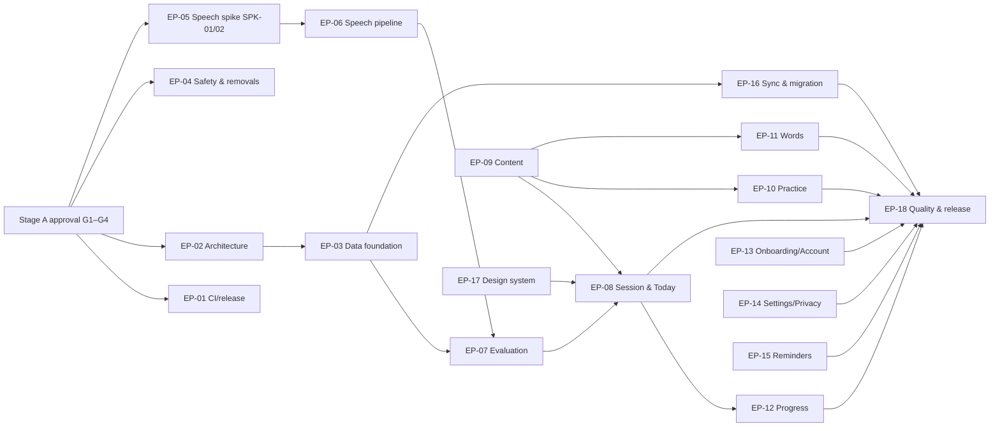

# RAID Log — Risks, Assumptions, Issues, Dependencies

| Field | Value |
|---|---|
| Document ID | PLN-04 |
| Version | 0.2 — Draft for review (2026-11-21: RSK-04/05, ISS-05, DEP-10 updated for the D-08 decision; RSK-17/18 added) |
| Date | 2026-11-21 |
| Status | Draft — living document |
| Owner (role) | Project Manager |
| Approval | Pending — Product Owner |
| Related | RD-14 §8–9, PRD §16–19, PLN-01, PLN-02, PLN-05, RD-99 |

Scales — **Probability**: Low / Medium / High. **Impact**: Low / Medium / High / Critical. **Status**: Open / Mitigating / Closed / Accepted. Owner is a role; in this individual project the Product Owner holds all roles' accountability, with the coding agent preparing artefacts (PLN-05).

## 1. Risks

| ID | Risk | Prob. | Impact | Owner (role) | Mitigation | Trigger / indicator | Status |
|---|---|---|---|---|---|---|---|
| RSK-01 | On-device recognition unavailable or poor on many target devices (minSdk 24; on-device APIs need 31/33) | High | Critical | AI/ML Engineer | SPK-01 before R1 build; tier design T1–T3b; consented online mode; honest audio-only mode; D-14 minSdk review | SPK-01 shows T3 for most mid-range devices or WER > 25 % | Open |
| RSK-02 | Recognisers "correct" mispronunciations, overstating word checks | High | High | AI/ML Engineer | Label "Recognised as intended", caveat copy, never call it pronunciation (SRS-BR-004) | Beta "Was this accurate?" negatives on word stages | Open |
| RSK-03 | Grammar rules produce false positives, damaging trust | Medium | High | AI/ML Engineer | SPK-02 corpus; precision ≥ 0.90 gate; max 2 observations | Rule precision < 0.9 in CI | Open |
| RSK-04 | Content too thin or late (20 words today; creator-derived techniques need verification against specific videos and rewriting before they can ship — CNT-01) | High | High | Product Manager | EP-09: verify and re-express existing items first (T-09.6), then add techniques from further videos; reuse 150 activities after review; ≥ 300 words R1 | Content backlog behind plan by > 2 sprints | Open |
| RSK-05 | IP/legal exposure from creator-derived content | Medium | High | Product Owner | D-08 decided 2026-11-21 ("original wording, link out"): own wording and examples, no verbatim transcripts, no creator name/likeness/branding, specific-video provenance; branding removed in R0; build-time and release content checks (SRS-BR-028, TST-01). Optional legal opinion before a public store launch | A shipped item without verified provenance, a creator-name string, or text that closely follows a video transcript | Mitigating |
| RSK-17 | The Product Owner's aim ("all frameworks, techniques… in all videos") exceeds what R1 can verify and rewrite | High | Medium | Product Manager | R1 ships the verified existing items plus the highest-value techniques; the remainder is catalogued with the CNT-01 template and released in content updates (R2) | Catalogue coverage < plan at R1 content freeze | Open |
| RSK-19…28 | Future optional AI layer (R3+): wrong or ungrounded suggestions, users reading AI text as scores, low device coverage, unstable beta APIs, cost and abuse, provider terms, displacing core work, model drift, locale coverage, store policy | — | — | AI/ML Engineer | Proposed in ARC-06 §14; they enter this log in full only if D-37 approves the AI layer | — | Proposed |
| RSK-18 | Feedback "mistakes" are wrong or over-reported, damaging trust (PRD-FR-047) | Medium | High | AI/ML Engineer | Issues raised only outside band by more than the noise band (ARC-05 §8.4); qualified rules only; golden tests; "Was this accurate?" monitoring | Beta "mistake was wrong" ratings > 10 % † | Open |
| RSK-06 | Single-developer capacity vs scope | High | High | Project Manager | Strict scope; preliminary estimates; incremental releases; re-plan at each gate | Velocity < 70 % of plan for 2 sprints | Open |
| RSK-07 | Success metrics unmeasurable without analytics | Medium | Medium | Product Manager | ADR-013 beta programme; local aggregates user can share | Beta cohort < 10 | Open |
| RSK-08 | Legacy data migration loses user data | Low | High | Database Architect | Minimal scope (D-19); idempotent import; legacy docs untouched; migration tests | Migration test failures | Open |
| RSK-09 | `EXTRA_AUDIO_SOURCE` piping unsupported by common recognisers → no replay on T1 | Medium | Medium | AI/ML Engineer | T2 fallback; replay "not available" copy; SPK-01 | SPK-01 result | Open |
| RSK-10 | Google Play policy/account delays (if ADR-004 approved) | Medium | Medium | Release Engineer | GitHub manual-download beta in the meantime; prepare data-safety and deletion URL early | Account not created by R1 RC | Open |
| RSK-11 | Toolchain incompatibilities when upgrading Compose BOM/lifecycle (ADR-006) | Medium | Medium | Android Tech Lead | Upgrade in isolated PRs in R0 with full test runs | Build/test failures after upgrade | Open |
| RSK-12 | Restructure introduces regressions in reused algorithms | Medium | Medium | QA Architect | Port tests with code; golden fixtures; feature flags | Fixture diffs | Open |
| RSK-13 | Battery/thermal or memory issues on low-end devices during capture | Low | Medium | Android Tech Lead | Streaming processing; NFR-PERF-009/011 tests on RD-LOW | Profiler results | Open |
| RSK-14 | Beta users find "no overall score" unsatisfying (ASM-04) | Medium | Medium | Product Manager | Make transcript/specific focus the hero; interview feedback; revisit D-06 after beta | Ratings/interviews | Open |
| RSK-15 | Firebase project state differs from repo (deployed rules unknown) | Medium | Medium | Security Engineer | Deploy rules from CI after tests; snapshot current rules before change | Console diff | Open |
| RSK-16 | Scope creep from new feature ideas during Stage B | High | High | Product Owner | Change control (RD-16 §6; PLN-05 GR-05) | Unplanned stories in sprint | Open |

## 2. Assumptions

| ID | Assumption | Owner | Validation | Status |
|---|---|---|---|---|
| ASM-01 | B1–B2 professionals and job seekers are the segment with the strongest need and fit | Product Manager | Beta screener + 5–8 interviews | Open |
| ASM-02 | Privacy/offline is a meaningful reason to choose SpeakCraft | Product Manager | Interviews; consent choices | Open |
| ASM-03 | Ten minutes a day is the right default | Product Manager | Duration distribution, completion | Open |
| ASM-04 | Measured insights without a composite score feel useful | Product Manager | Ratings, interviews | Open |
| ASM-05 | Platform recognition is accurate enough for accented B1–B2 speech on mid-range devices | AI/ML Engineer | SPK-01 | Open |
| ASM-06 | Users understand optional sign-in and local-only data | UX Researcher | Onboarding completion; later sign-in rate | Open |
| ASM-07 | At least one RD-LOW, RD-MID and RD-HIGH device (or equivalents) are available for testing | QA Architect | Device inventory at Sprint 0 | Open |
| ASM-08 | The existing Firebase project and named database can be reused | Solution Architect | Console access check at Sprint 0 | Open |
| ASM-09 | Existing users are few (Product Owner + testers), so a minimal migration is acceptable | Product Owner | Owner confirmation | Open |

## 3. Issues (current, known)

| ID | Issue | Impact | Owner | Action | Status |
|---|---|---|---|---|---|
| ISS-01 | Speaking-session saves rejected by Firestore rules at HEAD (FND-DATA-06) | High — sessions not persisted | Android Tech Lead | Fix in R0 (EP-04) or retire path with new data layer | Open |
| ISS-02 | CI may ship debug-signed, debuggable beta builds (FND-SEC-02) | Critical if keystore secret unset | Release Engineer | Disable auto-release on push immediately after approval (EP-01) | Open |
| ISS-03 | Privacy text contradicts behaviour (FND-SEC-05) | High | Security Engineer | Correct text / stop transcript upload (EP-04) | Open |
| ISS-04 | Account deletion unreachable (FND-SEC-03) | High | Android Tech Lead | Wire with re-auth (EP-04) | Open |
| ISS-05 | Creator-branded tab and creator names in content (FND-UI-03, DOM-09) | High (legal) | Product Owner | Remove the tab, ingestion tool and branding in R0 (EP-04); keep and re-express the techniques (EP-09, D-08 decided) | Open |
| ISS-06 | Local builds require undocumented `google-services.json`; no wrapper (FND-OPS-02) | Medium | Release Engineer | EP-01 | Open |
| ISS-07 | 54 documentation conflicts (RD-05) | Medium | Technical Writer | Archive superseded docs after approval | Open |
| ISS-08 | No test has been executed in CI; claimed pass counts unverifiable | Medium | QA Architect | EP-01 CI test gate | Open |

## 4. Dependencies

| ID | Dependency | Type | Needed by | Owner | Status |
|---|---|---|---|---|---|
| DEP-01 | Platform speech recognition behaviour per device (SPK-01) | Technical | EP-06 start | AI/ML Engineer | Open |
| DEP-02 | Original content production (activities, ≥ 300 words) | Product/content | EP-10, EP-11 | Product Manager | Open |
| DEP-03 | Google Play developer account and listing (ADR-004) | Business | R1 RC (if Play beta) / R3 | Product Owner | Open |
| DEP-04 | Approval of ADR-002 (Room) and ADR-005 (WorkManager) | Decision | EP-03, EP-15/16 | Product Owner | Open |
| DEP-05 | Firebase project access and `google-services.json` for CI/dev | Technical | EP-01 | Product Owner | Open |
| DEP-06 | Privacy policy and terms text | Legal/product | EP-14, release | Product Owner | Open |
| DEP-07 | Reference devices (ASM-07) | Testing | SPK-01, EP-18 | QA Architect | Open |
| DEP-08 | Design system tokens and fonts (DES-05) incl. open-licence font files | Design | EP-17 | Design System Architect | Open |
| DEP-09 | Beta cohort recruitment (PROP-02) | Product | R1 beta | Product Manager | Open |
| DEP-10 | Product Owner verification of each creator-derived item against its specific video (CNT-01 workflow; D-08 decided — a formal legal review is optional, advisable before a public store launch) | Content / legal | EP-09 | Product Owner | Open |

## 5. Dependency graph (high level)

