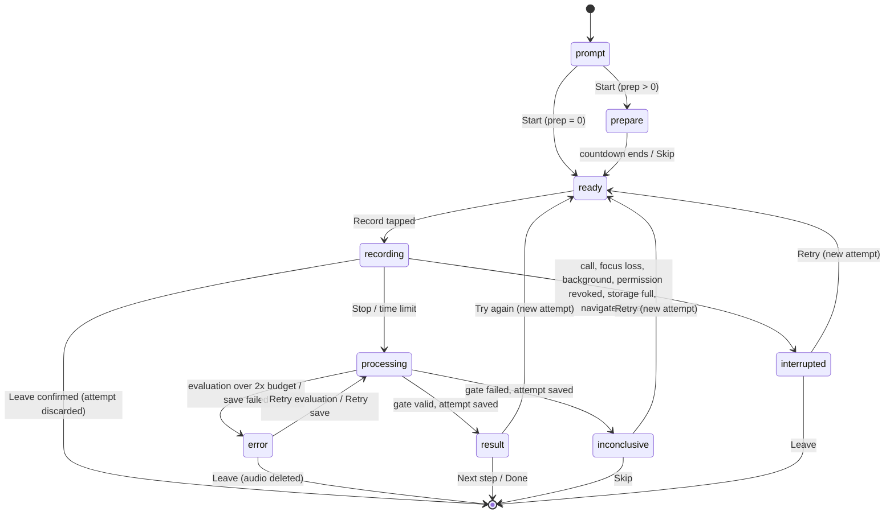

# FS-04 — Speaking Practice Session

| Field | Value |
|---|---|
| Document ID | FS-04 |
| Version | 0.1 — Draft for review |
| Date | 2026-11-21 |
| Status | Draft — awaiting Product Owner approval |
| Owner (role) | Product Manager / Business Analyst |
| Approval | Pending — Product Owner |
| Related | RD-16 CAP-04; PRD §15.4 (PRD-FR-030…036), PRD-FR-047 (result content, FS-05), PRD-FR-051, PRD-FR-056, PRD-NFR-004/005; SRS-FR-EVAL-015/016; SRS §6.4 (SRS-FR-SESS-001…014), SRS-FR-SPCH-002/009/010, SRS-FR-EVAL-001/013, SRS §15 (SRS-ERR-001…005, -010), SRS-BR-008/009/020/022/023/026, SRS-AVL-003; NFR-PERF-004…006, NFR-REL-003/004/008, NFR-PRIV-001/002, NFR-SEC-002, NFR-A11Y-*; ARC-01 §2, §4.1, §6; ARC-05 §2–§5; ADR-009, ADR-015; SEC-01 §3.2, §7; DES-02 (SCR-SESS-01, SCR-PERM-01); FS-02, FS-03, FS-05, FS-06, FS-07, FS-08, FS-12; D-10, D-14 |

---

## 1. Feature ID & purpose

**FS-04 / CAP-04 (pillar P-2).** One **session player** (SCR-SESS-01) used for every speaking attempt in the app — Today steps, Practice activities, Words stages and reviews, Progress "Try again" and the onboarding first attempt. It shows the prompt, optional preparation, a single Record/Stop control with visible state and time limit, captures audio according to the device's speech tier, processes the attempt automatically, shows the transcript (or why there is none) and hands the result to FS-05. It supports **Try again with comparison**, **replay** where the tier and retention allow, **reference audio** for read-aloud and repeat, and ends or pauses safely on **interruptions** without leaving partial data.

## 2. User problem

| Problem (user's words) | Evidence (current system) | Personas / needs |
|---|---|---|
| "I spoke for a minute and it only heard the first sentence — twice." | Recognition stops after one utterance and duplicates text on stop (FND-AI-04) | Aarav (P1), Daniel (P3); UN-03 |
| "There is no transcript at all." | Live transcription is off by default; file transcription returns "" (FND-AI-01, FND-AI-02) | All; UN-03 |
| "Every practice screen works differently." | 10 recording screens, 12 "start recording" labels (FND-UI-04) | All; UX-1 |
| "A call came in and the attempt was ruined." | No audio-focus, lifecycle or call handling; failed recordings never cleaned (FND-AI-14) | Aarav (P1, commute); UN-09 |
| "Rotating the phone wiped my attempt; another screen scored my recording." | No saved state; a recording continues across screens (FND-UI-06) | All |
| "Long answers crash the app on my phone." | Boxed `ArrayList<Short>` decoding (FND-AI-13) | Hoang (P5, low-end device) |
| "I want to hear myself and compare with last time." | No retry comparison; recordings eligible for cloud backup (FND-SEC-06) | Sofia (P4), Meera (P2); UN-08 |

## 3. Scope

| | R1 | R2 |
|---|---|---|
| **In** | All SCR-SESS-01 states (SRS-FR-SESS-001); preparation timer with skip; per-template time limits and 10 s warning; input-level indicator; tier-specific capture (T1/T2/T3a/T3b); automatic processing; transcript with tier label; Inconclusive presentation (copy owned by FS-05); Try again with 3-metric comparison; replay of retained recordings; reference audio at 1.0× and 0.75×; interruption handling; leave confirmation; survival of configuration changes; single active recording; microphone permission education (SCR-PERM-01, microphone variant). Technique exercises (PRD-FR-056; D-08 DECISION, approved by the Product Owner 2026-11-21) run in this same player through the existing templates — e.g. shadowing as TPL-REPEAT, pausing and pace drills as TPL-READ / TPL-ANSWER (mapping RECOMMENDATION, FS-06 §5.7) | Multi-turn TPL-ROLE loop in the same player (content and turn rules in FS-06 §5.8) |
| **Out** | Metric computation, feedback, accuracy rating (FS-05); tier detection, pack install, consent (FS-12); word-stage pass logic (FS-07); live coaching overlays (NG-14); video capture (NG-07, ADR-010 R3); cloud storage or cross-device playback of recordings (NG-12); pronunciation scoring (NG-03); pause/resume of a recording (single Record/Stop control, SRS-FR-SESS-004); playing source videos inside the app — "Watch the original lesson" is an outbound link on SCR-PRAC-04 and in coach tips (SRS-FR-PRAC-009, FS-05 §5.7), never offered while recording; an embedded player would need an ADR (GOV-02 DC-6) | — |

## 4. Preconditions

| Condition | Required state |
|---|---|
| Content | Activity (or word stage / review set) resolved from the content pack (`ContentRepository`); otherwise Empty state |
| Permission | RECORD_AUDIO granted; otherwise SCR-PERM-01 is shown before Ready (SRS-ERR-001) |
| Tier | Current tier from `SpeechCapabilityService` (FS-12); T3a also needs valid consent (SRS-BR-023) and a connection at Record |
| Storage | Free space ≥ 10 MB † before Record (a 120 s WAV at 16 kHz mono PCM16 is ≈ 3.8 MB) — RECOMMENDATION |
| Concurrency | No other recording active in the app (SRS-FR-SESS-014) |

## 5. Main workflow

### 5.1 Attempt flow (SRS-FR-SESS-001…007)

1. The caller navigates to `Session(activityId | wordStage | review, source, stepId?)` (ARC-01 §5). `SessionViewModel` loads the activity (`ContentRepository`), tier (`SpeechCapabilityService`), retention option (`PreferencesRepository`) and the previous valid attempt on the same activity (`AttemptRepository`, for comparison).
2. **Prompt**: title, prompt text, one-line template explanation, maximum length and preparation time. TPL-READ shows the reference text; TPL-REPEAT shows **Listen** (1.0×) and **Listen slowly** (0.75×) and a **Show text** toggle (RECOMMENDATION: text hidden until the first listen, always revealable). **Start** continues.
3. **Prepare** (only if the template's preparation time > 0: TPL-ANSWER 15 s, TPL-STRUCT 30 s, TPL-STORY 30 s, others 0 †, SRS-FR-SESS-002): countdown with **Skip**. At zero the player moves to **Ready**; it never starts recording by itself (RECOMMENDATION; NFR-PRIV-001 explicit user action per attempt).
4. **Ready**: one large **Record** button. On tap, reference audio and playback are stopped, audio focus is requested (`AUDIOFOCUS_GAIN_TRANSIENT_EXCLUSIVE`) and `CaptureController.start(attemptId, tier)` (+ `RecognitionSession` for T1/T2/T3a) starts within ≤ 300 ms (T1/T3b) or ≤ 800 ms (T2/T3a) † (NFR-PERF-004).
5. **Recording**: elapsed time, remaining time, input-level indicator and a single **Stop** (SRS-FR-SESS-004). At (limit − 10 s) a visible warning appears and is announced; at the limit (TPL-READ/REPEAT 30 s, TPL-ANSWER 90 s, TPL-STRUCT/STORY 120 s †, SRS-FR-SESS-003) recording stops automatically. A per-activity `maxSeconds` from the content pack overrides the template default (RECOMMENDATION; FS-02 Issue 7).
6. **Stop** (user or limit) → **Processing**: `CaptureController.stop()` returns a `CaptureResult` (audio features, transcript segments, WAV path for T1/T3b); recogniser finalisation (≤ 1.5 s typical, NFR-PERF-006); `EvaluationPipeline.evaluate()` (FS-05) within the NFR-PERF-005 budget. Copy: "Getting your feedback…".
7. `AttemptRepository.saveAttempt()` writes in one transaction: ENT-03 Attempt, ENT-04 metrics, ENT-11 RecordingFile (if retained), plan-step completion (FS-03), outbox entry; the transcript goes to `sensitive.db` keyed by `attemptId` (SEC-01 §3.2 #2). **The result is shown only after this write succeeds** (NFR-REL-004).
8. **Result** (valid) or **Inconclusive** (gate failed): content and order per FS-05 §5.3 — transcript → headline metrics → strength → Mistakes found → Coach tips → Try again → "Was this accurate?" (SRS-FR-EVAL-015/016). The transcript is shown with the tier label (SRS-FR-SESS-006). Actions: valid → **Try again**, **Play my recording** (where available), **Next step** / **Done**; Inconclusive → **Retry** / **Skip** (SRS-FR-SESS-007).
9. Recording file handling (ADR-015, SRS-BR-022): Inconclusive, interrupted and discarded audio is deleted immediately; a valid T1/T3b recording is kept per the retention option (default 30 days †, D-10) and may be transcoded to AAC; with *Delete after feedback* it is deleted when the user leaves the result.

### 5.2 Player states (SRS-FR-SESS-001; DES-02 §4 SCR-SESS-01)

| State | Entered when | User sees | Leaving with Back |
|---|---|---|---|
| prompt | Player opened | Prompt, limits, reference controls (READ/REPEAT) | Immediate |
| prepare | Start with prep > 0 | Countdown, Skip | Immediate |
| ready | Prep ended/skipped; Try again; Retry | Record button, prompt still visible | Immediate |
| recording | Record tapped | Elapsed, remaining, level, Stop, recording indicator | Confirmation dialog (SRS-FR-SESS-011) |
| processing | Stop or limit | "Getting your feedback…" | Confirmation dialog; confirm discards |
| result | Valid attempt saved | FS-05 result + actions | Immediate |
| inconclusive | Gate failed, attempt saved as Inconclusive | Reason + Retry / Skip (FS-05 copy) | Immediate |
| interrupted | Capture stopped by an interruption | Cause-specific message + Retry | Immediate |
| error | Evaluation timeout or save failure | Message + Retry | Immediate; retained audio deleted |

### 5.3 Behaviour per speech tier (ADR-009, ARC-05 §3–§4; tier detection owned by FS-12)

| Aspect | T1 | T2 | T3a | T3b |
|---|---|---|---|---|
| Microphone owner (SRS-FR-SPCH-002) | App `AudioRecord` 16 kHz mono PCM16 → WAV + pipe to recogniser | Recogniser | Recogniser (default service, consented) | App `AudioRecord` → WAV |
| Transcript (SRS-FR-SPCH-009) | Continuous, segmented, on-device | On-device; restart on end-of-segment, stitched, de-duplicated | Online speech service; restart + stitch | None |
| Level indicator source | PCM RMS | `onRmsChanged` | `onRmsChanged` | PCM RMS |
| Tier label on result (SRS-FR-SESS-006) | "On-device" | "On-device" | "Online (consented)" | "No transcript — audio-only" (see Issue 4) |
| Replay (SRS-FR-SESS-009) | Yes, retention permitting | No — "Replay isn't available on this phone" | No — same message | Yes, retention permitting |
| Network | Not used | Not used | Required; if offline at Record → this attempt runs as audio-only with an explanation (SRS-AVL-003, ARC-01 §8) | Not used |
| Start latency † (NFR-PERF-004) | ≤ 300 ms | ≤ 800 ms | ≤ 800 ms | ≤ 300 ms |
| Recogniser problems (SRS-FR-SPCH-010, ARC-05 §4.2) | No match → empty segment; piping failure → device demoted to T2 (A7) | Busy at start → one retry, then T3b for this attempt (SRS-ERR-002) | Network loss mid-attempt → Issue 2 (A6) | — |
| Transcript-presence gate check (ARC-05 §5) | Applied | Applied | Applied | Not applied (Issue 1) |

### 5.4 Interruptions (SRS-FR-SESS-010, NFR-REL-003)

Common behaviour for every cause during **recording**: stop capture and recognition, delete the partial WAV, create **no** attempt, release audio focus, show **interrupted** with **Retry** (new attempt).

| Cause | Detection (RECOMMENDATION) | Message (RECOMMENDATION copy) |
|---|---|---|
| Phone call | Audio-focus loss (`AUDIOFOCUS_LOSS` / `_TRANSIENT`) or recogniser audio error; no READ_PHONE_STATE permission is used (SRS-FR-PLAT-002) | "Recording stopped because of a call. Nothing was saved." |
| Another app takes audio (alarm, assistant) | Audio-focus loss | "Recording stopped because another app used the audio. Nothing was saved." |
| App backgrounded or screen locked | Lifecycle `ON_STOP` (ARC-01 §6) | "Recording stopped because you left the app. Nothing was saved." |
| Microphone permission revoked | If the process survives (e.g. one-time permission expired): capture or recogniser permission error → interrupted with **Allow microphone**. Android normally ends the process on revocation: nothing is saved and the orphan WAV is deleted at next start (SEC-01 §7.1; Issue 5) | "Microphone access was turned off. Allow it to keep practising." |
| Storage full | Free space below threshold at Record, or a write error during capture (SRS-ERR-004) | "Your phone is out of storage, so recording stopped. Free up space and try again." + **Open storage settings** |
| Navigation away (notification tap, deep link) | Player leaves composition / ViewModel cleared (SRS-FR-SESS-014) | Attempt discarded; RECOMMENDATION: snackbar on the destination "Your recording was stopped." |

In other states: **prepare** — countdown pauses on `ON_STOP` and resumes on return; **processing** — continues in the ViewModel scope; if the process dies before the save, nothing is stored and the orphan WAV is deleted at next start; **result** — playback and reference audio stop on focus loss or backgrounding. Rotation and other configuration changes are **not** interruptions (SRS-FR-SESS-013).

### 5.5 Single active recording (SRS-FR-SESS-014)

`CaptureController` is process-scoped (`AppContainer`) and holds at most one active capture token; `start()` while a capture is active returns `CaptureError.Busy` and the second player shows "Another recording is in progress." One `RecognitionSession` exists per attempt and is released in `finally` (ARC-05 §4.2). Capture is owned by `SessionViewModel` and stopped on `onCleared` and lifecycle `ON_STOP` (ARC-01 §6); TTS and playback are stopped before capture starts so they are never recorded (RECOMMENDATION).

## 6. Alternate workflows

| ID | Trigger | Behaviour |
|---|---|---|
| A1 | **Try again** on a valid result (SRS-FR-SESS-008) | New `attemptId`, same activity, player returns to **ready** with the prompt visible and a **Prepare again** option. The new result shows a side-by-side comparison of the 3 headline metrics with the **most recent previous valid attempt on the same activity** (any source or date): values, units and direction in words ("Pace 172 → 148 words per minute, slower"); a metric null in either attempt shows "—" and is not compared; if the evaluation version differs, a note says "Feedback rules have changed since your last attempt" (RECOMMENDATION) |
| A2 | **Retry** after Inconclusive or Interrupted | New attempt; no comparison with the Inconclusive attempt (SRS-BR-008) |
| A3 | **Skip** after Inconclusive | Today context: next incomplete step (FS-03 A8); other contexts: back to the caller |
| A4 | **Play my recording** (SRS-FR-SESS-009) | Local `MediaPlayer` on the app-private file (SEC-01 §7.1); play/pause and position; offered only for T1/T3b and retention ≠ *Delete after feedback*; also available later on SCR-PROG-04 until the file expires (FS-08) |
| A5 | **Listen / Listen slowly** on TPL-READ/REPEAT (SRS-FR-SESS-012) | `TextToSpeech` at 1.0× / 0.75× in the selected English locale; stops when Record is tapped; if TTS is unavailable see E7 |
| A6 | T3a: connection lost during recording | RECOMMENDATION pending Issue 2: stop at once (the recogniser owns the microphone, so further speech would not be captured); attempt saved as Inconclusive "transcript unavailable"; message "The connection dropped, so we couldn't get a transcript. Try again, or record with audio-only feedback." |
| A7 | T1 audio-source piping fails | Detected at start: restart as T2 before the recording UI appears. Detected mid-attempt: attempt ends as Inconclusive (no transcript); the device is remembered as T2 (ARC-05 §3) |
| A8 | Process death in prompt / prepare / ready | `SavedStateHandle` restores activity and step; the player reopens at **prompt** (SRS-FR-SESS-013) |
| A9 | "Try again" from SCR-PROG-04 on a retired activity | Empty state "This activity is no longer available." + Back (history stays readable, SRS-BR-026) |
| A10 | Word stage or review-set context | Same states; parameters from FS-07 (e.g. Say it max 5 s, Use it two sentences, review prompts in sequence) |
| A11 | R2: TPL-ROLE scenario | Turn loop prompt(partner line + TTS) → ready → recording → processing → turn result, repeated per turn; summary at the end (FS-06 §5.8) |

## 7. Error scenarios

| ID | Condition | Behaviour / copy (RECOMMENDATION) | SRS-ERR |
|---|---|---|---|
| E1 | Microphone permission not granted | SCR-PERM-01: why the microphone is needed, **Allow microphone**; permanently denied → **Open settings**; Not now returns to the caller | SRS-ERR-001 |
| E2 | Recogniser unavailable or busy | Fallback to T3b for this attempt; result says "Transcript wasn't available this time"; capability is not marked failed for "no match" | SRS-ERR-002 |
| E3 | Evidence insufficient | **inconclusive** with reason and Retry (copy in FS-05 §5.2) | SRS-ERR-003 |
| E4 | Storage full | §5.4 storage row | SRS-ERR-004 |
| E5 | Saving the attempt fails | Automatic retry once; then **error** "Couldn't save this attempt. Try again." + Retry save; audio kept until retry or leave; never shown as saved | SRS-ERR-005 |
| E6 | Evaluation exceeds 2× the NFR-PERF-005 budget | **error** "Getting your feedback is taking too long." + Retry evaluation; audio retained until retry or exit (SRS-FR-EVAL-013) | — |
| E7 | TTS unavailable | Reference controls hidden; "Reference audio isn't available on this device." | SRS-ERR-010 |
| E8 | Microphone held by another app (`AudioRecord` init fails or reads silence) | **error** "The microphone is being used by another app. Close it and try again." + Retry | — |
| E9 | Recogniser `INSUFFICIENT_PERMISSIONS` / audio error mid-attempt | **interrupted** (permission or audio cause) | — |
| E10 | Activity ID missing from the content pack | Empty state (A9) | SRS-ERR-008 prevents at build time |

## 8. Business rules

| Rule | Summary of application in this feature |
|---|---|
| SRS-BR-001 | Every attempt passes the evidence gate in **processing** (rules applied by FS-05) |
| SRS-BR-008 | Inconclusive and interrupted attempts never count as completion, failure, streak day or practice time |
| SRS-BR-009 | A valid attempt completes the calling plan step (FS-03) |
| SRS-BR-020 | `attemptId` is a client UUID created at Record; a repeated save of the same UUID has no effect |
| SRS-BR-022 | Discarded, interrupted and Inconclusive recordings are deleted immediately; valid ones follow the retention option (30 days †, D-10) |
| SRS-BR-023 | Online transcription only in T3a with consent; withdrawal applies before the next attempt (SRS-FR-SPCH-006) |
| SRS-BR-026 | Attempts store `activityId` + `contentVersion` |
| RECOMMENDATION | (a) Preparation never auto-starts recording. (b) The 10 s warning applies only to limits ≥ 30 s (Issue 6). (c) Leave confirmation only in **recording** and **processing**. (d) Storage pre-check 10 MB †. (e) TTS and playback stop before capture. (f) Attempt persisted before the result is displayed. (g) Comparison uses the most recent previous valid attempt on the same activity |

## 9. UI states

**SCR-SESS-01 Session player** (feature-specific states are those of §5.2; FS-05 owns the content of result and inconclusive)

| State | What the user sees | Actions |
|---|---|---|
| Default (prompt) | Title, prompt, template line, "Up to {n} seconds", prep time; READ: reference text; REPEAT: Listen / Listen slowly / Show text | Start; Close |
| prepare | Countdown ring with seconds as text; prompt stays visible | Skip; Close |
| ready | Record button (label "Record"), prompt visible | Record; Prepare again (after Try again); Close |
| recording | Recording indicator, elapsed and remaining time, level indicator with text state ("Good level" / "Too quiet"), Stop; warning at limit − 10 s | Stop; Back → leave dialog |
| processing | "Getting your feedback…" progress | Back → leave dialog |
| result | Transcript + tier label; FS-05 content; comparison (A1) when available | Try again; Play my recording (A4); Next step / Done |
| inconclusive | "Inconclusive" badge, reason, tip (FS-05 §5.2) | Retry; Skip |
| interrupted | Cause message (§5.4) | Retry; Allow microphone / Open storage settings when relevant; Close |
| error | E5/E6/E8 message | Retry evaluation / Retry save / Retry; Close |
| Loading | N/A — content and tier are local; `ready` appears within the start-latency budget | — |
| Empty | "This activity is no longer available." (A9, E10) | Back |
| Offline | Identical for T1/T2/T3b; T3a: banner "You're offline — this attempt will get audio-only feedback." before Record | Record |
| Permission | Microphone not granted → SCR-PERM-01 replaces **ready** | Allow microphone; Not now |
| Leave dialog | Real dialog "Stop and leave? This attempt won't be saved." (recording continues while it is open) | Stop and leave; Keep recording |

**SCR-PERM-01 Permission education — microphone variant** (notification variant owned by FS-09)

| State | What the user sees | Actions |
|---|---|---|
| Default | Why the microphone is needed; "Recordings stay on this phone" line from the policy constants (SRS-PRIV-002) | Allow microphone (system dialog); Not now |
| Permission | System RECORD_AUDIO dialog | Allow / Don't allow |
| Permanently denied | Impact text and the path to system settings | Open settings; Not now |
| Granted | Returns to SCR-SESS-01 **ready** | — |
| Loading / Empty / Error / Offline | N/A — static, local screen; identical offline | — |

## 10. Data requirements

| Entity / store | Fields needed by FS-04 (minimum; ARC-03 authoritative) |
|---|---|
| ENT-03 Attempt | `attemptId` (UUID at Record), `profileId`, `activityId?` / `wordId?` + `stage?`, `templateId`, `contentVersion`, `evaluationVersion`, `source` (TODAY / PRACTICE / WORDS / PROGRESS / ONBOARDING), `stepId?`, `dateKey`, `startedAt`, `durationMs`, `tier`, `result` (valid / Inconclusive + reason; PASS / FAIL for threshold templates, SEC-01 §5.3), `previousAttemptId?` (comparison), `deviceId`, `createdAt`. Immutable once evaluated. No transcript, no file path |
| Transcript | `sensitive.db`, keyed by `attemptId` (SEC-01 §3.2 #2); never synced in R1 (D-16) |
| ENT-04 AttemptMetric | Written by the evaluation (FS-05); read for the comparison |
| ENT-11 RecordingFile | `attemptId`, relative file name under `noBackupFilesDir/recordings/<profileId>/`, `format` (WAV / M4A), `sizeBytes`, `durationMs`, `createdAt`, `expiresAt` (ADR-015) |
| ENT-06 SessionStep | `completedByAttemptId` set in the attempt transaction (FS-03) |
| ENT-10 SyncOutbox | Attempt metrics upload for signed-in users (no audio, no transcript, no path; SRS-FR-DATA-006) |
| Not persisted | Interrupted and discarded attempts; live recognition partials (memory only, SEC-01 §3.2 #3) |

## 11. API / repository dependencies

| Dependency | Used for |
|---|---|
| `SessionViewModel` | State machine (§5.2), `SavedStateHandle` restoration, capture ownership |
| `CaptureController` (+ `PcmTee`, `WavWriter`, `StreamingFeatureExtractor`) | Microphone capture, level, WAV writing, focus and lifecycle interrupts (ARC-05 §4.1) |
| `RecognitionSession` | Per-attempt recognition, segment restart and stitching, error classification (ARC-05 §4.2) |
| `SpeechCapabilityService` | Current tier; T1 → T2 demotion on piping failure |
| `EvaluationPipeline` | Gate, metrics and feedback (FS-05) |
| `AttemptRepository` | Transactional save; previous valid attempt for comparison |
| `ContentRepository` | Activity, reference text, limits and overrides |
| `PreferencesRepository` | Retention option, recognition locale (for TTS) |
| `CleanupWorker` | Retention and orphan cleanup (SRS-FR-DATA-009, SEC-01 §7.1) |
| Platform | `AudioRecord`, `SpeechRecognizer`, `TextToSpeech`, `AudioManager` (focus), `MediaPlayer`, lifecycle owners, `StatFs` (free space), runtime-permission APIs |

## 12. Offline behaviour

T1, T2 and T3b attempts work fully offline, including transcript (T1/T2), evaluation, save and replay (PRD-FR-100, NFR-REL-006). T3a needs a connection: when offline at Record the attempt runs as audio-only for that attempt with an explanation (SRS-AVL-003); a connection lost mid-attempt follows A6. Reference audio depends on the device TTS voice being installed; otherwise E7. Signed-in uploads of attempt metrics are queued (FS-11).

## 13. Privacy requirements

- The microphone starts only after the user taps Record, and the recording state is always visible (NFR-PRIV-001); preparation never starts recording.
- No audio or transcript leaves the device except in T3a with consent, and then only to the device's speech service (SRS-PRIV-001, SRS-BR-023, NFR-PRIV-002).
- Recordings live only in `noBackupFilesDir/recordings/<profileId>/`, are never uploaded and are excluded from backup (ADR-015, SRS-PRIV-005); partial, interrupted and Inconclusive audio is deleted immediately (SRS-BR-022).
- Transcripts are stored in `sensitive.db` and never written to logs, notifications or the clipboard (SEC-01 §7.4, NFR-SEC-002).
- Playback is local only; recordings are never shared from the player (NG-06, NG-12).

## 14. Accessibility notes

Record/Stop exposes its state ("Record, button" / "Stop recording, button, recording 0 minutes 42 seconds") (A11Y-26); recording start and stop and the 10 s warning are announced through live regions (A11Y-08, SRS-FR-SESS-004); times are spelled out in semantics (A11Y-34); focus moves to the result header and it is announced (A11Y-09); the level indicator has a text state and is not colour-only (A11Y-23); the speech-rate control is labelled "Listen slowly, 0.75 times speed" (A11Y-25); the leave dialog is a real Dialog with focus containment (A11Y-10); targets ≥ 48 dp (A11Y-19); 200 % font scale without fixed-height containers (A11Y-13); level animation obeys reduced motion (A11Y-21). TalkBack speech can be picked up by the microphone (Q2).

## 15. Acceptance criteria

| ID | Given | When | Then |
|---|---|---|---|
| AC-FS04-01 | A TPL-ANSWER activity | The player opens | The prompt, "Up to 90 seconds" † and a 15 s † preparation are shown, with one path to Record |
| AC-FS04-02 | Preparation is counting down | The user taps Skip, or the countdown ends | The player shows **ready** and recording has not started |
| AC-FS04-03 | **ready** on a T1 or T3b device | The user taps Record | Capture runs within 300 ms †; elapsed time, remaining time, level indicator and one Stop are shown; TalkBack announces that recording started |
| AC-FS04-04 | Recording a TPL-READ activity (limit 30 s †) | 20 s elapse | A warning is shown and announced; at 30 s recording stops and processing starts automatically |
| AC-FS04-05 | A valid attempt on a T1 device | The user taps Stop | Processing runs without further input and the result shows the transcript labelled "On-device" |
| AC-FS04-06 | An attempt that fails the evidence gate | Processing completes | **inconclusive** shows the specific reason with Retry and Skip, and nothing counts toward progress |
| AC-FS04-07 | The activity has a previous valid attempt | The user taps Try again and records a valid attempt | The result shows both attempts' 3 headline metrics side by side with direction in words |
| AC-FS04-08 | Retention 30 days † | A valid attempt completes on T1, T2 and T3b devices | Play my recording is offered on T1 and T3b only; T2 shows "Replay isn't available on this phone"; with *Delete after feedback* no playback is offered |
| AC-FS04-09 | Recording is in progress | Audio focus is lost (incoming call) | Capture stops, the partial WAV is deleted, no attempt row exists and **interrupted** offers Retry |
| AC-FS04-10 | Recording is in progress | The app is sent to the background | Same outcome as AC-FS04-09 with the background message |
| AC-FS04-11 | Recording is in progress | Storage runs out | Recording stops, the partial file is deleted and the message offers Open storage settings |
| AC-FS04-12 | Recording is in progress | The user presses Back | A confirmation appears; confirming discards the attempt with no row; cancelling keeps recording |
| AC-FS04-13 | Recording is in progress | The device is rotated | Recording continues without a gap and elapsed time is continuous |
| AC-FS04-14 | A recording is active | Another player tries to start, or the user opens a notification | Only one capture runs; leaving the player stops and discards the active one |
| AC-FS04-15 | A TPL-REPEAT prompt | The user taps Listen, then Listen slowly | TTS speaks at 1.0× then 0.75× in the selected locale; without TTS the controls are hidden and the message is shown |
| AC-FS04-16 | The result of a valid attempt is displayed | The app is force-stopped and relaunched | The attempt appears in history (it was saved before display) |
| AC-FS04-17 | A T3a device that is offline at **ready** | The user records | The attempt runs with audio-only feedback and the offline explanation is shown |
| AC-FS04-18 | Microphone permission not granted | The player opens | SCR-PERM-01 is shown before **ready**; after granting, the player returns to **ready** |

## 16. Test cases

No test case has been executed in Stage A (GOV-02 DC-4). TC-SESS-009…014 form the interruption suite referenced by NFR-REL-003.

| TC | Title | Type | Preconditions | Steps | Expected result | Traces |
|---|---|---|---|---|---|---|
| TC-SESS-001 | State machine | unit | `SessionViewModel` with fake capture, pipeline, repositories | Drive every transition of §5.2; attempt illegal ones | Legal transitions only; illegal events ignored | SRS-FR-SESS-001 |
| TC-SESS-002 | Preparation per template | unit | Activities of each template | Open prompt; Start | Prep 15/30/30/0 s †; Skip → ready; end → ready, no capture call | SRS-FR-SESS-002, NFR-PRIV-001 |
| TC-SESS-003 | Limits and warning | unit | Fake clock; limits 30/90/120 s †; content override 60 s | Record to limit | Warning at limit − 10 s; auto-stop at limit; override honoured | SRS-FR-SESS-003 |
| TC-SESS-004 | Recording UI semantics | Robolectric UI | recording state | Inspect semantics tree | Elapsed, remaining, level text, single Stop; live-region announcement | SRS-FR-SESS-004 |
| TC-SESS-005 | Start latency | instrumented | One device per tier (TST-01 §5) | Tap Record 10× | P90 within 300 / 800 ms † | NFR-PERF-004 |
| TC-SESS-006 | T1 capture and transcript | instrumented | RD-HIGH, T1 verified | Record a 60 s scripted answer | WAV 16 kHz mono; continuous transcript; label "On-device" | SRS-FR-SPCH-002, -009, SRS-FR-SESS-006 |
| TC-SESS-007 | T2 restart without duplication | instrumented | RD-MID (T2) | Record 60 s with pauses | Full transcript; no duplicated words at stop | SRS-FR-SPCH-009 |
| TC-SESS-008 | Tier labels and replay matrix | unit | Tiers × retention options | Build result state | Labels per §5.3; playback only T1/T3b and retention ≠ after feedback | SRS-FR-SESS-006, -009 |
| TC-SESS-009 | Interrupt: focus loss | instrumented | Recording | Request exclusive focus from a test app | No attempt row; WAV deleted; interrupted | SRS-FR-SESS-010, NFR-REL-003 |
| TC-SESS-010 | Interrupt: phone call | manual | Device with SIM, recording | Receive a call | As TC-SESS-009 with call message | SRS-FR-SESS-010 |
| TC-SESS-011 | Interrupt: background | instrumented | Recording | Press Home | As TC-SESS-009 | SRS-FR-SESS-010 |
| TC-SESS-012 | Interrupt: storage full | unit | Fake `WavWriter` throwing on write; fake `StatFs` below 10 MB † | Record | Stopped; file deleted; storage message and action | SRS-FR-SESS-010, SRS-ERR-004 |
| TC-SESS-013 | Interrupt: permission revoked | manual | Recording | Revoke microphone in system settings; relaunch | No attempt; orphan WAV removed at start | SRS-FR-SESS-010, SEC-01 §7.1 |
| TC-SESS-014 | Interrupt: navigation away | instrumented | Recording | Tap a reminder notification | Capture stopped; no attempt; snackbar | SRS-FR-SESS-014 |
| TC-SESS-015 | Leave confirmation | Robolectric UI | recording and processing states | Press Back; choose each option | Dialog; discard vs continue | SRS-FR-SESS-011 |
| TC-SESS-016 | Rotation during recording | instrumented | Recording | Rotate twice | Capture uninterrupted; WAV continuous; timer continuous | SRS-FR-SESS-013 |
| TC-SESS-017 | Process death before recording | instrumented | prepare state | `am kill`; relaunch | Player at prompt with same activity and step | SRS-FR-SESS-013 |
| TC-SESS-018 | Single active capture | unit | Real `CaptureController` with fake `AudioRecord` | Start twice | Second start returns Busy; first unaffected | SRS-FR-SESS-014 |
| TC-SESS-019 | Try again comparison | unit + Robolectric UI | Previous valid attempt with metrics; one null metric | Try again; save valid attempt | 3 metrics side by side; null shown "—"; direction words | SRS-FR-SESS-008 |
| TC-SESS-020 | Immediate deletion | unit | Inconclusive, interrupted and discarded attempts | Complete each | No file remains; no ENT-11 row | SRS-BR-022 |
| TC-SESS-021 | Reference audio | Robolectric UI | Fake TTS available / unavailable | Tap Listen, Listen slowly | Rates 1.0 / 0.75 with locale; unavailable → hidden + message | SRS-FR-SESS-012, SRS-ERR-010 |
| TC-SESS-022 | Saved before display | instrumented | Valid attempt on result | Force-stop; relaunch; open history | Attempt present with metrics | NFR-REL-004 |
| TC-SESS-023 | Evaluation timeout | unit | Fake pipeline exceeding 2× budget | Stop | error state; Retry re-runs with retained audio | SRS-FR-EVAL-013 |
| TC-SESS-024 | Save failure | unit | Fake repository failing twice | Stop | One automatic retry; error with Retry save; never shown as saved | SRS-ERR-005 |
| TC-SESS-025 | T3a offline at Record | unit | Tier T3a, connectivity off | Record | Audio-only capture for this attempt; banner shown | SRS-AVL-003 |
| TC-SESS-026 | Recogniser busy fallback | unit | Fake recogniser busy twice | Record | One retry then T3b for the attempt; message | SRS-ERR-002, NFR-REL-008 |
| TC-SESS-027 | Permission education | instrumented | Microphone denied, then permanently denied | Open player | SCR-PERM-01 states per §9; grant returns to ready | SRS-ERR-001 |
| TC-SESS-028 | Player accessibility | manual | TalkBack on, font scale 200 %, RD-MID | Complete an attempt with an interruption | All controls reachable and announced; no clipped text | NFR-A11Y-001, -002 |

## 17. Traceability

| PRD-FR | SRS-FR | AC | TC |
|---|---|---|---|
| PRD-FR-030 | SRS-FR-SESS-001…004 | AC-FS04-01…04 | TC-SESS-001…005 |
| PRD-FR-031 | SRS-FR-SESS-005, -006; SRS-FR-SPCH-002, -009; SRS-AVL-003; SRS-ERR-002 | AC-FS04-05, -17 | TC-SESS-006, -007, -008, -025, -026 |
| PRD-FR-032 | SRS-FR-SESS-007 (content in FS-05) | AC-FS04-06 | TC-SESS-020 (+ TC-EVAL-001…004) |
| PRD-FR-033 | SRS-FR-SESS-008 | AC-FS04-07 | TC-SESS-019 |
| PRD-FR-034 | SRS-FR-SESS-009 | AC-FS04-08 | TC-SESS-008 |
| PRD-FR-035 | SRS-FR-SESS-010, -011, -014; SRS-ERR-004 | AC-FS04-09…12, -14 | TC-SESS-009…015, -018 |
| PRD-FR-036 | SRS-FR-SESS-012; SRS-ERR-010 | AC-FS04-15 | TC-SESS-021 |
| PRD-FR-051 (supporting) | SRS-FR-SESS-002, -003 (per-template preparation and limits) | AC-FS04-01, -04 | TC-SESS-002, -003 |
| PRD-FR-011 (supporting) | SRS-ERR-001 | AC-FS04-18 | TC-SESS-027 |
| PRD-NFR-004, -005, -006 | SRS-FR-SESS-013, SRS-FR-EVAL-013; NFR-PERF-004, NFR-REL-003/004, NFR-A11Y-001/002 | AC-FS04-13, -16 | TC-SESS-005, -016, -017, -022, -023, -024, -028 |

## 18. Open questions

| # | Question | Owner |
|---|---|---|
| Q1 | Show the live partial transcript while recording, or only after Stop (Issue 3)? RECOMMENDATION: not in R1 | Product Owner / UX |
| Q2 | With TalkBack on, the "recording started" announcement can be recorded. Delay capture until it finishes, or advise headphones? | UX / Accessibility (DES-07) |
| Q3 | With *Delete after feedback*, may the user replay once on the result before deletion (SRS-FR-SESS-009 says no playback)? | Product Owner |
| Q4 | Should the 10 s warning include a short vibration (haptics are not specified)? | UX |
| Q5 | Should a TPL-ROLE turn (R2) be retried individually, or does an Inconclusive turn restart the scenario? (FS-06 §5.8) | Product Owner |

## 19. Issues found in source documents

| # | Issue | Source | Suggested resolution |
|---|---|---|---|
| 1 | T3b handling of transcript-required templates conflicts: SESS-007 makes "transcript unavailable for a transcript-required template" an Inconclusive reason; SPCH-007 says READ/REPEAT and word stages show delivery metrics in T3b; ARC-05 does not apply the transcript check in T3b. A T3b read-aloud attempt is therefore either Inconclusive or valid | SRS-FR-SESS-007 vs SRS-FR-SPCH-007; ARC-05 §5 | Recommend: in T3b these attempts are valid with delivery metrics and no pass/fail; the "transcript unavailable" reason applies only in T1–T3a |
| 2 | T3a network loss: ARC-05 says the attempt "continues audio-less", but in T3a the recogniser owns the microphone, so nothing is captured after the error; SRS-ERR-002's "fall back to T3b for the attempt" is impossible mid-attempt | ARC-05 §4.2; SRS-ERR-002 | Define the outcome (A6 recommends stopping and Inconclusive) |
| 3 | Live partial transcript is undecided: ARC-01 streams partials to the ViewModel, SESS-004 lists recording UI without them, NG-14 rules out real-time feedback | ARC-01 §4.1; SRS-FR-SESS-004; RD-16 NG-14 | Decide Q1 and state it in SRS-FR-SESS-004 |
| 4 | Tier labels differ: SRS uses "On-device" / "Online (consented)" / "No transcript — audio-only"; ARC-05 uses "On-device transcription", "… (no replay)", "Online transcription (you agreed)", "Audio-only feedback" | SRS-FR-SESS-006 vs ARC-05 §3 | Choose one set (DES-05 §12 one name per concept) |
| 5 | SESS-010 requires the interrupted state when permission is revoked, but Android normally ends the app process when a runtime permission is revoked, so that state cannot be shown; recovery relies on orphan cleanup | SRS-FR-SESS-010; SEC-01 §7.1 | Add "or, if the process ends, no attempt is stored and orphan audio is deleted at next start" |
| 6 | The 10 s warning cannot apply to short limits such as Say it (max 5 s) | SRS-FR-SESS-003 vs SRS-FR-WORD-003 | Apply the warning only to limits ≥ 30 s |
| 7 | SRS §9 places transcripts in Room under ENT-03, while the canon and SEC-01 keep transcript text out of the Attempt table in `sensitive.db` | SRS §9 vs SEC-01 §3.2 #2 | Update SRS §9 to `sensitive.db` |
