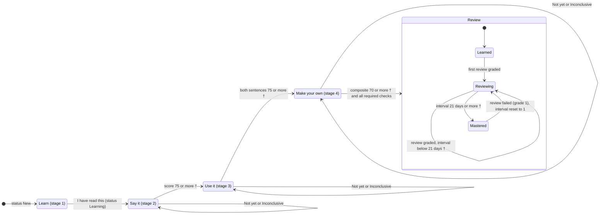

# FS-07 — Words: Vocabulary Lifecycle

| Field | Value |
|---|---|
| Document ID | FS-07 |
| Version | 0.2 — Draft for review (2026-11-21, consistency review CL-62: MASTERED shown as "Long-term review"; CL-32: T3b "Needs a transcript" stage result, RECOMMENDATION pending D-32) |
| Date | 2026-11-21 |
| Status | Draft — awaiting Product Owner approval |
| Owner (role) | Product Manager / Business Analyst |
| Approval | Pending — Product Owner |
| Related | RD-16 CAP-07; PRD §15.7 (PRD-FR-060…067), PRD-FR-047, PRD-FR-057, PRD §14 J4; SRS §6.7 (SRS-FR-WORD-001…014), SRS-FR-EVAL-015/016, SRS-FR-PRAC-009, SRS-FR-SPCH-007, SRS-FR-TODAY-002/004, §15, §16 (SRS-BR-001, -003, -007…-010, -015…-017, -020…-022, -025…-028); NFR-QUAL-*, NFR-MAINT-009, NFR-A11Y-*; ARC-01 §2, §5; ARC-03 §3.4 (`attempt_issue`), §3.8–§3.9, §6 (content pack), ENT-02/03/04/06/07/08/09/15/17; ARC-05 §5–§7, §8.4, §9; ADR-002, ADR-009, ADR-011, ADR-014; DES-02 (SCR-WORD-01…06, SCR-SESS-01); DES-05 §11.21, §12; FS-03, FS-04, FS-05, FS-06, FS-08, FS-10, FS-11, FS-12; decisions D-08 (DECISION 2026-11-21), D-17, D-19, D-20 |

---

## 1. Feature ID & purpose

**FS-07 / CAP-07 (pillar P-3).** Help people move useful words from "I recognise it" to "I can say it and use it in my own sentence" through five stages — **Learn → Say it → Use it → Make your own → Review** — with honest, threshold-based spoken checks — every result states the outcome, lists the mistakes the checks detected with their evidence (or says honestly that none were found) and gives one coach tip (PRD-FR-047) — a small daily new-word goal, spaced-repetition reviews with spoken recall that feed the Today session, and an original, licensed word bank of at least 300 entries. R2 adds a notebook and a deterministic quiz.

## 2. User problem

| Problem (user's words) | Evidence (current system) | Personas / needs |
|---|---|---|
| "I learn words but never use them when I speak." | The 5-stage vocabulary flow exists only as dead code; the UI offers flashcards and a one-sentence "AI Quiz" (FND-DOM-02; data_learning_audit §3.1, §3.5) | Aarav, Meera, Daniel, Hoang — UN-05 |
| "The app says I learned words I only looked at." | "Words learned" increments on the first review, even "Need review" (FND-DOM-08; audit §3.4) | All — UN-06 |
| "Reviews show up at random times." | SM-2 scheduler not wired; ad hoc 1/3/3n-day scheduler; UTC day boundary (FND-DOM-11) | Aarav, Daniel |
| "There's hardly anything to learn." | 20 vocabulary words in the bank (FND-DOM-13; RSK-04) | All |
| "It accepts the wrong word." | Stem-prefix matching accepts "convenient" for "convey" (FND-AI-09; ARC-05 §9) | Hoang, Meera — UN-04 |
| "Tell me what I got wrong, not just a number." | The current vocabulary check returns a single usage verdict without evidence (audit §3.5) | All — UN-03 |
| "Can I trust where this content comes from?" | Creator-derived items marked "VERIFIED" point at the channel root, with no licence artefact (FND-DOM-09; audit §2.3) | All — BR-008 |

## 3. Scope

| | R1 | R2 |
|---|---|---|
| **In** | Word status model; Words home (SCR-WORD-01), Word detail (SCR-WORD-02), stage flow (SCR-WORD-03) using the session player for stages 2–4, review session (SCR-WORD-04); thresholds 75/75/70 †; Mistakes found and one coach tip on every word-stage and review result (SRS-FR-WORD-014; ARC-05 §8.4); Inconclusive and easier-variant handling; SM-2 variant reviews with spoken recall; daily new-word goal; word tasks offered to Today (hand-off to FS-03); filters and search; word bank ≥ 300 entries with provenance; T3b behaviour; Words tab in R1 (D-20) | Notebook SCR-WORD-05 (ENT-15); Quiz SCR-WORD-06 (ENT-17); +300 words (WBS EP-23) |
| **Out** | Pronunciation or accent scoring (NG-03; SRS-BR-004); AI-generated definitions, sentences or quizzes (NG-01); teaching from zero / A1 curriculum (NG-05); user-imported word lists; multi-word expressions in R1 (Q3); creator names, branding or verbatim transcript text in word content, and scraped or API-ingested content (SRS-BR-028; ADR-011); generative rewording of tips (ARC-05 §8.4); sharing words socially (NG-06); daily plan composition (FS-03); "Reset vocabulary" UI (FS-10); legacy mapping rules (FS-11) | Cloud-generated content; leaderboards |

## 4. Preconditions

| Workflow | Preconditions |
|---|---|
| Browse, Learn (stage 1) | Content pack loaded by `ContentRepository`; profile exists (FS-01); no network, microphone or recogniser needed |
| Say it / Use it / Make your own | RECORD_AUDIO granted (FS-04); tier T1, T2 or T3a for a checkable result — T3b gives delivery metrics only (§5.8) |
| Review session | ≥ 1 word with status Learned / Reviewing / Mastered and `nextReviewDate` ≤ today's dateKey |
| Today word task | Today plan generated (FS-03) and containing a `WORD_LEARN` or `WORD_REVIEW` step |
| Reference audio | Device TTS available (else SRS-ERR-010) |

## 5. Main workflow

### 5.1 Word status model (SRS-FR-WORD-001, SRS-BR-015, SRS-BR-017)

| Status | Meaning | Entry condition | Label shown |
|---|---|---|---|
| New | In the bank; no stage passed | Default for every bank word | "New" |
| Learning | Stage 1 passed; stage 4 not yet passed (current stage 2, 3 or 4) | "I've read this" on Learn — RECOMMENDATION (Issue 1) | "Learning · {current stage}" |
| Learned | Stage 4 passed; first review due next day | SRS-BR-017; SRS-FR-WORD-008 | "Learned" |
| Reviewing | ≥ 1 review graded and interval < 21 days † | RECOMMENDATION for Learned → Reviewing (Issue 1); Mastered → Reviewing on a failed review (SRS-BR-017) | "Reviewing" |
| Mastered | Current review interval ≥ 21 days † | SRS-BR-017 | "Long-term review" — the internal status keeps the name `MASTERED`; "Mastered" is never shown (DES-05 §12.3; consistency review, CL-62; Issue 13) |
| *Due* (derived flag, not a status) | Learned / Reviewing / Mastered and `nextReviewDate` ≤ today's dateKey | SRS-BR-016 | "Due today" chip |

Rules: stages are passed in order; a later stage is locked until the previous one is passed; replaying a passed stage creates an attempt but never reverts status (SRS-BR-015). "Words learned" (FS-08) = Learned + Reviewing + Mastered, never words merely opened (PP-7).

### 5.2 Learn a word (FLOW-05)

1. User opens Words (SCR-WORD-01). `WordRepository` emits today's new words (goal, §5.6), due count, in-progress words and the filtered list from Room Flows.
2. User taps a word → SCR-WORD-02 → **Start learning** → SCR-WORD-03 *Learn*.
3. *Learn* shows the stage-1 content (§5.3); **Listen** plays the word via `TextToSpeech` in the recognition locale (SRS §8).
4. **I've read this** → `WordRepository.passStage(wordId, 1)` in one Room transaction: ENT-07 `stage = 1`, `status = LEARNING`; ENT-09 `WORD_STAGE_PASSED` (UUID); ENT-10 outbox row when signed in (SRS-FR-DATA-001/003).
5. *Say it* → SCR-SESS-01 opens in word-stage mode (FS-04 owns player states). `CaptureController` / `RecognitionSession` capture per tier; `EvaluationPipeline` runs `EvidenceGate` → `WordStageEvaluator` (ARC-05 §9) and stores `evaluationVersion` (SRS-FR-EVAL-011).
6. `FeedbackComposer` raises the ARC-05 §8.4 issue codes that apply to the stage (§5.3.1) and selects one coach tip. `AttemptRepository.saveAttempt` writes ENT-03 (incl. `attempt_issue` rows) and ENT-04 and, on a pass, `WordRepository.passStage(wordId, 2)` in the same transaction. The result shows **Pass mark** or **Not yet** (DES-05 §12.2) with **Mistakes found** and **Coach tip**, or the Inconclusive card (FS-05).
7. *Use it* (two sentences) and *Make your own* follow the same pattern (§5.3).
8. Passing *Make your own* sets `status = LEARNED` and `ReviewScheduler.firstReview(today)` sets `nextReviewDate = today + 1 day`, `easeFactor = 2.5` (SRS-FR-WORD-008, SRS-BR-016).
9. Words home and Progress (FS-08) update reactively (ARC-01 §4.2). If launched from Today, **Continue** returns to Today and the step is marked complete per FS-03.

### 5.3 Stage content and checks (SCR-WORD-03 + SCR-SESS-01; ARC-05 §9)

| Stage | Screen content | User action | Check | Pass † (SRS-BR-007) | Result shown |
|---|---|---|---|---|---|
| 1 Learn | Word; IPA if present in content; part of speech; simple meaning; 2 examples; collocations; Listen (RECOMMENDATION: 1.0× and 0.75×) | **I've read this** | None — not an attempt (SRS-FR-WORD-002) | — | Stepper advances to Say it |
| 2 Say it | Word, meaning, Listen; record control, max 5 s (SRS-FR-WORD-003); caveat: "Speech recognition may recognise a word even when it isn't pronounced clearly, so 'Say it' checks that you were understood, not your accent." | Say the word | Recognised tokens vs target: exact = 100 · listed inflection = 90 · near-match (single-token output, edit similarity ≥ 0.8) = 75–89 · otherwise < 75 | ≥ 75 | Pass mark / Not yet with "We heard: '{text}'"; never called pronunciation (SRS-BR-004) |
| 3 Use it | Sentence 1, then sentence 2 (content `useSentences`), target emphasised; Listen 1.0× / 0.75× (as TPL-READ, SRS-FR-SESS-012); max 30 s per sentence (TPL-READ limit, SRS-FR-SESS-003 †) | Read each sentence aloud | M-MATCH "Recognised as intended" per sentence + words not recognised as intended (SRS-FR-EVAL-008) | Both ≥ 75 | Per-sentence Pass mark / Not yet; stage passes when the latest valid attempt of each sentence is ≥ 75 (RECOMMENDATION: a passed sentence is kept until the stage passes) |
| 4 Make your own | "Say your own sentence using '{word}'." Meaning and one collocation as a hint; max 30 s † (RECOMMENDATION) | Speak an original sentence | Required: target word or listed inflection (M-TARGET); ≥ 5 recognised words; ≤ 1 high-precision grammar observation. Composite = 50 (target + length met) + 25 × (1 − observations) + 25 × (content words ≥ 3) | Composite ≥ 70 and all required (SRS-FR-WORD-005) | Pass mark → Learned; Not yet names the first unmet requirement (FeedbackComposer, ARC-05 §8) |

RECOMMENDATION † — near-match scoring (Issue 6): `score = 75 + round((similarity − 0.80) / 0.20 × 14)`, capped at 89; multi-token output is scored by its best token. Content words = tokens not in the versioned function-word list shipped with the rule set.

**Make your own — worked examples** (target "convey"; inflections conveys/conveyed/conveying):

| Recognised text | Target | Words | Observations | Content words ≥ 3 | Composite | Outcome and Mistakes found (ARC-05 §8.4 codes) |
|---|---|---|---|---|---|---|
| "i want to convey my thanks to the team" | yes | 9 | 0 | yes (want, convey, thanks, team) | 50 + 25 + 25 = 100 | Pass mark — "Our checks didn't find issues in this attempt." |
| "i convey it to him" | yes | 5 | 0 | no (convey) | 50 + 25 + 0 = 75 | Pass mark — no issue raised (few content words has no code, Issue 21) |
| "he don't convey it well" | yes | 5 | 1 ("he don't") | no (convey, well) | 50 + 0 + 0 = 50 | Not yet — ISSUE_GRAMMAR_POSSIBLE: "Possible issue: 'he don't' → 'he doesn't'" (Estimated) |
| "convey the message" | yes | 3 | 0 | — | required check fails | Not yet — ISSUE_TOO_SHORT: "3 words — Make your own needs at least 5" (Measured) |
| "i want to share my thanks" | no | 6 | 0 | — | required check fails | Not yet — ISSUE_TARGET_WORD_MISSING: "The word 'convey' wasn't in your sentence" (Measured) |

### 5.3.1 Mistakes found and coach tip on every word result (SRS-FR-WORD-014; SRS-FR-EVAL-015/016; ARC-05 §8.4)

ARC-05 §8.4 is authoritative for the issue catalogue, labels, ordering, tip selection and the honest empty state; FS-05 §5.6–§5.7 for the shared presentation. This table only states **which** §8.4 codes each word check can raise and the evidence the word result shows. Conditions marked RECOMMENDATION fill gaps in §8.4 (Issues 17, 18, 21).

| Stage / item | ARC-05 §8.4 codes that can be raised | Raised when (word context) | Evidence shown (example, target "convey") | Label |
|---|---|---|---|---|
| 2 Say it | ISSUE_WRONG_FORM | Outcome Not yet and the recognised output is a different word or an unlisted form (RECOMMENDATION: a listed inflection or a passing near-match raises nothing, Issue 18) | "We heard 'survey'." | Measured |
| 2 Say it | ISSUE_TOO_QUIET | M-LEVEL quality note on a valid attempt | "The recording was quiet." | Measured (quality) |
| 3 Use it | ISSUE_WORD_NOT_RECOGNISED | M-MATCH alignment marks reference words as not recognised as intended; RECOMMENDATION: always listed when the sentence is Not yet, even inside the M-MATCH noise band (Issue 17) | "Not recognised as intended: 'thanks', 'team' (70 %)" with the words underlined in the sentence | Measured |
| 3 Use it | ISSUE_TARGET_WORD_MISSING, ISSUE_TOO_QUIET | M-TARGET false; M-LEVEL quality note | "The word 'convey' wasn't recognised in this sentence." | Measured |
| 4 Make your own | ISSUE_TARGET_WORD_MISSING, ISSUE_TOO_SHORT, ISSUE_GRAMMAR_POSSIBLE, ISSUE_TOO_QUIET | M-TARGET false; < 5 recognised words; a qualified rule fires (≤ 2 shown, SRS-FR-EVAL-006; > 1 fails the stage); M-LEVEL quality note | §5.3 worked examples | Measured / Measured / Estimated / Measured (quality) |
| Review — spoken recall | ISSUE_WRONG_FORM, ISSUE_TARGET_WORD_MISSING, ISSUE_TOO_QUIET | Different word heard; target absent from a longer utterance; quality note | "We heard 'deliver'." | Measured |
| Review — sentence use | ISSUE_TARGET_WORD_MISSING, ISSUE_WORD_NOT_RECOGNISED, ISSUE_TOO_QUIET | As stage 3 | As stage 3 | Measured |

| Rule | Behaviour |
|---|---|
| Outcome first | The result states **Pass mark**, **Not yet** (the SRS "fail"; DES-05 §12.2 wording, Issue 20) or **Inconclusive** |
| Order and count | §8.2 priority order; first 3 shown, then **Show all ({n})** (SRS-FR-EVAL-015) |
| Nothing found | "Our checks didn't find issues in this attempt." + coverage line from the checks actually run, e.g. "We checked that 'convey' was recognised. We don't check pronunciation or accent." Never "perfect" or "no mistakes" (PRD-FR-047) |
| Inconclusive | The evidence-gate reason and reason-specific retry advice replace both sections (SRS-BR-008; ARC-05 §8.2 priority 1) |
| One coach tip | Exactly one tip on word results (SRS-FR-WORD-014; FS-05 §5.7; Issue 19): the focus tip selected by ARC-05 §8.4 steps 1–3 from content tips triggered by the issue code, then by the word-task template. RECOMMENDATION fallback when no issue is found: the template-triggered tip for the next stage, e.g. "Next you'll read two sentences. Listen to the slow version first." |
| Tip links | Technique link (SCR-PRAC-04) and **Watch the original lesson** only when the tip has a technique and provenance (ARC-05 §8.4 step 5; SRS-FR-PRAC-009) |
| Storage | Codes and numeric evidence in `attempt_issue`; quoted user words ("heard", grammar span) in `sensitive.db` `feedback_spans` (ARC-03 §3.4); tips are re-derived, not stored |

### 5.4 Inconclusive, Not yet and easier variant (SRS-FR-WORD-006, -007; SRS-BR-008)

| Outcome | Condition | Stage | Counts as streak day / practice time / Today step | Failure counter |
|---|---|---|---|---|
| Pass mark | Valid attempt meets the stage pass rule | Advances | Yes (SRS-BR-009, -010, -018) | Reset to 0 |
| Not yet | Valid attempt below threshold or a required check unmet | Unchanged | Yes — it is a valid speaking attempt | +1 |
| Inconclusive | Evidence gate fails (SRS-BR-001: too short, too quiet, no speech, no recognised word) | Unchanged | No (SRS-BR-008); recording deleted immediately (SRS-BR-022) | Unchanged |

A gate failure for low level ("too quiet") makes the attempt Inconclusive; ISSUE_TOO_QUIET is different — a quality note on a *valid* attempt that never changes the outcome on its own (ARC-05 §6 M-LEVEL, §8.4).

After **3 consecutive Not yet** results on a stage, the result adds **Try an easier version** and **Continue later** (SRS-FR-WORD-007). RECOMMENDATION (Issue 9): Say it — slower reference (0.75×) played first and a "listen, then say" prompt; Use it — content `easySentences` (≤ 8 words); Make your own — show two collocations as hints. Thresholds are unchanged in the easier version (PP-1). **Continue later** keeps the word at its current stage. The counter resets on a pass or when the easier version is started.

### 5.5 Review session and spaced repetition (SCR-WORD-04; SRS-FR-WORD-009; SRS-BR-016, -017)

1. **Start review** (Words home, Word detail or a Today `WORD_REVIEW` step) → `WordRepository.reviewSet(today)` returns up to 10 † due words (SRS-BR-027), most overdue first, then lowest ease factor, then `wordId` (RECOMMENDATION; deterministic).
2. Each item is either **spoken recall** — "Say the word that means '{meaning}'." (scored like Say it, ≥ 75 †) — or **sentence use** — a gap sentence from content, "Say the whole sentence: 'We need to ___ our thanks.'" (pass = M-TARGET present and M-MATCH ≥ 75 † against the full sentence). RECOMMENDATION: item type alternates by `reviewCount mod 2`, starting with spoken recall (Issue 10).
3. Grading (SRS-BR-016): pass on first valid try → **grade 4**; Not yet → hint shown (first letter and part of speech; RECOMMENDATION) → pass on second valid try → **grade 3**; second Not yet → **grade 1**, the answer is shown with Listen, and the set moves on. Inconclusive attempts do not use a try. **Skip** leaves the word due and ungraded. Every item result shows its outcome, Mistakes found and one coach tip (§5.3.1).
4. Each graded item writes, in one transaction: ENT-08 WordReview, ENT-09 `WORD_REVIEWED {wordId, grade, attemptId}`, ENT-07 update (`intervalDays`, `easeFactor`, `nextReviewDate`, `reviews`, `lapses`, `status`).
5. The set ends with a summary ("8 words reviewed · next review: Tue 24 Nov"). The set is *finished* for SRS-BR-009 when every item is graded or skipped and ≥ 1 item was graded (RECOMMENDATION; Q4).

**Scheduling (SRS-BR-016).** EF starts at 2.5, minimum 1.3, updated by SM-2: `EF' = EF + 0.1 − (5 − q) × (0.08 + (5 − q) × 0.02)` → grade 4: ±0; grade 3: −0.14; grade 1: −0.54. Intervals 1, 3, 7 days for the first, second and third consecutive successful step, then `round(previous interval × EF')`; grade < 3 resets the interval to 1 and restarts the 1-3-7 sequence. Due dates are `LocalDate.plusDays(interval)` from the **review date** on the local dateKey. RECOMMENDATION † (Issue 11): round half up; interval ≥ 1.

| Event (word "convey") | Date (dateKey) | Grade | EF after | Interval | Next due | Status after |
|---|---|---|---|---|---|---|
| Make your own passed | 2026-11-02 | — | 2.50 | 1 | 2026-11-03 | Learned |
| Review 1 | 2026-11-03 | 4 | 2.50 | 3 | 2026-11-06 | Reviewing |
| Review 2 | 2026-11-06 | 3 | 2.36 | 7 | 2026-11-13 | Reviewing |
| Review 3 | 2026-11-13 | 4 | 2.36 | round(7 × 2.36 = 16.52) = 17 | 2026-11-30 | Reviewing |
| Review 4 | 2026-11-30 | 4 | 2.36 | round(17 × 2.36 = 40.12) = 40 | 2027-01-09 | Mastered (≥ 21 †) |
| Review 5 | 2027-01-09 | 1 | 1.82 | 1 (reset) | 2027-01-10 | Reviewing |
| Review 6 | 2027-01-10 | 4 | 1.82 | 3 (sequence restarts) | 2027-01-13 | Reviewing |

### 5.6 Daily word goal and Today integration (SRS-BR-027; SRS-FR-TODAY-002/004; hand-off to FS-03)

| Item | Behaviour |
|---|---|
| Goal setting | `dailyWordGoal`, default 2 †, range 0–5 (SRS-BR-027); edited in Settings → Learning (SCR-SET-02, FS-10); stored in ENT-02 LearningPreferences |
| What counts | RECOMMENDATION (Issue 12): a word counts toward today's goal when its Learn stage is completed on today's dateKey |
| Today's new words | RECOMMENDATION: `goal` words chosen once per dateKey and stable for the day: level = profile level, then the next lower level, then the next higher; track-tagged words first; order by content `rank`, then `wordId`; excludes started words. Goal 0 = no new words suggested; reviews still offered |
| Goal met | Words home shows "New words today: 2 of 2"; no further new-word prompts that day; the user may still start more words |
| Hand-off to FS-03 | `WordRepository` provides to `PlanEngine`: due count and review set (≤ 10), the in-progress word's next stage, and today's next new word. FS-03 decides which single word task is placed in the session (SRS-FR-TODAY-004) and its priority in recovery mode (SRS-BR-014) |
| Launch and return | A `WORD_REVIEW` step opens SCR-WORD-04; a `WORD_LEARN` step opens SCR-WORD-03 at the word's current stage (route `Session(wordStage | review)`, ARC-01 §5). On finish, control returns to Today |
| Step completion | Per SRS-BR-009: valid word-stage attempt or finished review set. RECOMMENDATION (Issue 7): a `WORD_LEARN` step that starts at Learn continues to Say it and completes on a valid Say it attempt |
| Changing level/track | Never resets word progress (SRS-BR-025); affects only future new-word selection |

### 5.7 Word-bank content requirements (SRS-FR-WORD-011; PRD-FR-065; ARC-03 §6 is authoritative for the schema)

| Field (minimum) | Rule |
|---|---|
| `wordId` | Stable slug ≤ 64 chars, unique, never reused across content versions (SRS-BR-026) |
| `lemma`, `partOfSpeech` | Single word in R1 (Q3) |
| `ipa` | Optional; included only with a licensed or original source in `provenance` |
| `meaning` | Simple meaning, ≤ 20 words, B1-level wording (DES-05 §12.1) |
| `examples[2]` | Exactly 2; each contains the lemma or a listed inflection |
| `collocations[]` | ≥ 1 common collocation |
| `useSentences[2]` | Stage 3 sentences, ≤ 15 words † each, containing the lemma or an inflection |
| `easySentences[]` | ≥ 1 sentence ≤ 8 words † for the easier version |
| `gapSentences[]` | ≥ 1 review sentence with the target replaced by "___" (RECOMMENDATION) |
| `inflections[]` | Explicit accepted forms incl. British/American spelling variants (e.g. organise/organize), because en-GB and en-US recognisers spell differently; no stem-prefix matching (ARC-05 §9, FND-AI-09) |
| `level` | One of the 5 levels (D-17) |
| `trackTags[]` | ≥ 1 of TRK-EVERYDAY, TRK-WORK, TRK-INTERVIEW, TRK-PRESENT, TRK-CLEAR |
| `rank` | Integer selection order within level |
| `provenance` | Source, author role, created date, reviewer and verified-on date (NFR-MAINT-009; BR-008; PP-8). For entries taken from @askvinh channel content: the **specific source video** (ID/URL and timestamp), never the channel root (SRS-BR-028) |
| `licenceStatus` | Per ARC-03 §6. Channel-derived entries: `ORIGINAL_REEXPRESSION` — own wording and examples, no verbatim transcript text, no creator name, likeness or branding (SRS-BR-028; D-08 DECISION 2026-11-21). `PENDING_REVIEW` entries never ship in a release build |
| Pack metadata | `contentVersion`; retired words stay in the pack, flagged `retired`, so history and progress stay readable (SRS-BR-026) |
| Word coach tips (content, FS-06 tip schema) | RECOMMENDATION: ≥ 1 shippable tip triggered by each word-check issue code of §5.3.1 and ≥ 1 template-triggered tip per word stage and review mode, written in our own words (ARC-05 §8.4 steps 1–4; SRS-BR-028) |

Counts and checks (CI, build fails on violation — SRS-ERR-008, SRS-FR-PRAC-005): ≥ 300 shippable, non-retired entries for R1; RECOMMENDATION † ≥ 40 entries for each level from Elementary to Advanced, ≥ 20 for Beginner, ≥ 40 tagged per track; unique `wordId` and `lemma` + `partOfSpeech`; every example, use sentence and easy sentence contains the lemma or a listed inflection after normalisation (lower case, punctuation removed); no creator names, channel handles or borrowed framework names in any text (DES-05 §12.3); channel-derived entries have `licenceStatus = ORIGINAL_REEXPRESSION` and a specific-video provenance with timestamp — a channel-root URL, missing verification or `PENDING_REVIEW` fails the release build (SRS-BR-028). Entries are written by hand; nothing is scraped, downloaded from captions or ingested through an API (ADR-011). RECOMMENDATION: Word detail shows **Watch the original lesson** (outbound intent to the specific video, as SRS-FR-PRAC-009) for channel-derived entries (Issue 22).

### 5.8 Behaviour on tier T3b (no transcript; SRS-FR-SPCH-007)

| Element | T3b behaviour |
|---|---|
| Words home | Info banner: "Word checks need speech recognition. You can still learn words and practise saying them." + **Speech settings** (SCR-SET-04, FS-12) |
| Learn | Fully available |
| Say it / Use it / Make your own | **RECOMMENDATION, pending decision D-32 (RD-99 §8)** (consistency review, CL-32): the stage result shows **"Needs a transcript"** — neither failed ("Not yet") nor Inconclusive — with the options **Install the offline speech pack** and **Allow online transcription** (where T3a is possible; FS-12). Recording allowed; result shows delivery metrics only (M-SPK, M-PAUSE, M-RATIO — ARC-05 §7) and "Transcript needed for this check"; the stage is **not** passed and the failure counter is unchanged. Mistakes found can contain only audio-based issues (ISSUE_TOO_QUIET); otherwise the T3b empty-state line "Without a transcript we could only check speaking time and pauses." (FS-05 §5.6); one template-triggered coach tip |
| Reviews | Due words stay due and ungraded; the review set can be opened for listening practice only (RECOMMENDATION) |
| Streak / practice time | Follows the evidence-gate outcome (transcript presence is not checked in T3b, ARC-05 §5) — contradiction logged as Issue 8; Product Owner decision Q1 |
| Tier change | When the tier becomes T1/T2/T3a (pack installed, consent given), checks resume at the stored stage; nothing is lost |

### 5.9 R2 — Notebook (SCR-WORD-05; SRS-FR-WORD-012; ENT-15) — outline

Save a word from a transcript (FS-05 transcript view, long-press → **Save word**) or from feedback; add notes and tags; edit, delete, favourite, search. A saved bank word links to its WordProgress (**Start learning**); a saved non-bank word is a note only and does not enter the lifecycle (RECOMMENDATION; Q5). Entries saved from transcripts contain free text derived from speech and therefore stay on the device (SEC-01 §3.3) until ARC-03 §8 states otherwise.

### 5.10 R2 — Quiz (SCR-WORD-06; SRS-FR-WORD-013; ENT-17) — outline

Deterministic question sets — meaning, fill-in-the-blank, sentence choice, listening recognition (TTS) — generated from the bank with a seeded generator: `seed = hash(profileId, dateKey, quizIndex)` (RECOMMENDATION; fixes the time-based seed in the current dead engine, audit §3.5). Distractors come from bank words with the same part of speech and level; no generated nonsense forms. Labelled **"Quiz"**, never "AI" (DES-05 §12.3). Quiz answers are taps, not speaking: they do not count toward the streak or practice time and do not change the review schedule (RECOMMENDATION; Q6).

## 6. Alternate workflows

| ID | Trigger | Behaviour |
|---|---|---|
| A1 | Started from a Today word step | Opens at the step's stage or review set; **Continue** returns to Today (FS-03) |
| A2 | User replays a passed stage from Word detail (**Practise again**) | Attempt stored; status and stage never revert (SRS-BR-015) |
| A3 | User leaves mid-stage | Player asks to discard the in-progress recording (SRS-FR-SESS-011); passed stages and passed Use-it sentences are kept |
| A4 | 14 words due | Review set holds 10 †; Words home shows "4 more due" and offers a second set |
| A5 | Signed-in user progresses the same word on two devices | Merge keeps the more advanced stage and the later schedule (SRS-BR-021); WordReview facts are unioned by UUID (SRS-BR-020) |
| A6 | Legacy user upgrades | Imported vocabulary appears with the status FS-11 assigns (SRS-FR-DATA-007, D-19); see Issue 14 |
| A7 | Content update retires an in-progress word | Progress and reviews continue; the word is not offered as new (SRS-BR-026) |
| A8 | Recogniser busy or unavailable for one attempt | Attempt falls back to T3b for that attempt (SRS-ERR-002); stage check shows "Transcript needed for this check" |
| A9 | Microphone permission denied | Learn and browsing work; recording stages show the permission card (FS-04, SRS-ERR-001) |
| A10 | "Reset vocabulary" (FS-10) | All ENT-07/08 rows and word events deleted locally and, when signed in, in the cloud; every word returns to New |

## 7. Error scenarios

| ID | Condition | Behaviour / copy (RECOMMENDATION) | SRS-ERR |
|---|---|---|---|
| E1 | Recording too short, too quiet, no speech or no recognised word | Inconclusive card (FS-05): "We couldn't measure this attempt. No words were recognised. Try again a little closer to the phone." | SRS-ERR-003 |
| E2 | Say it recording runs to the 5 s limit with one short word | Gate may judge voiced speech < 25 % of duration → Inconclusive (Issue 15). RECOMMENDATION: stop automatically 1.0 s † after speech ends (FS-04 / ARC-05 to confirm) | SRS-ERR-003 |
| E3 | Recogniser busy or unavailable | Attempt continues as T3b; "Transcript wasn't available for this attempt." | SRS-ERR-002 |
| E4 | TTS unavailable | Listen controls hidden; "Reference audio isn't available on this device." | SRS-ERR-010 |
| E5 | Saving a stage pass or review fails | "Couldn't save this result. Try again." Retry once; Pass mark is never shown for an unsaved write | SRS-ERR-005 |
| E6 | Storage full while recording | Recording stopped and discarded; link to storage settings | SRS-ERR-004 |
| E7 | Microphone permission denied | Permission card with Allow / Open settings; Learn and lists stay usable | SRS-ERR-001 |
| E8 | Evaluation exceeds 2 × budget | Error state with **Retry evaluation** (SRS-FR-EVAL-013) | — |
| E9 | Call or backgrounding during recording | Interrupted state, no attempt recorded (SRS-FR-SESS-010) | — |
| E10 | Invalid word entry in the content pack | Build fails in CI — never shipped | SRS-ERR-008 |

## 8. Business rules

| Rule | Summary of application in this feature |
|---|---|
| SRS-BR-001 | Evidence gate; word stages need ≥ 1 recognised word (not checked in T3b) |
| SRS-BR-003 / -004 | M-TARGET and M-MATCH are Measured; each issue code carries its fixed Measured/Estimated label (ARC-05 §8.4); agreement is "Recognised as intended", never pronunciation |
| SRS-BR-007 | Pass thresholds: Say it ≥ 75 †, Use it ≥ 75 †, Make your own ≥ 70 † — configurable and versioned |
| SRS-BR-008 | Inconclusive word attempts are not completion, failure, streak days or practice time |
| SRS-BR-009 | A Today word step completes on a valid word-stage attempt or a finished review set |
| SRS-BR-010 | Valid attempts in stages 2–4 and reviews with spoken recall are streak days; Learn and Quiz are not |
| SRS-BR-015 | Stages in order; replaying a passed stage never reverts status |
| SRS-BR-016 | SM-2 variant: grades 4/3/1, intervals 1-3-7 then × EF, EF 2.5 start / 1.3 floor, local dateKey due dates |
| SRS-BR-017 | Learned after stage 4; Mastered at interval ≥ 21 days †; Mastered → Reviewing on a failed review |
| SRS-BR-018 | Valid word attempts add their recording duration to practice time; Learn adds 0 |
| SRS-BR-020 / -021 | Word events idempotent by UUID; word state merges by more advanced stage and later schedule |
| SRS-BR-022 | Word-stage recordings follow the retention setting; Inconclusive recordings deleted immediately |
| SRS-BR-025 / -026 | Level/track changes never reset words; retired words stay readable |
| SRS-BR-027 | New-word goal default 2 † (0–5); review set ≤ 10 words per session step |
| SRS-BR-028 | Word entries taken from @askvinh channel content are original re-expression with specific-video provenance and no creator name or branding; unverified or `PENDING_REVIEW` entries cannot ship (D-08 DECISION 2026-11-21) |
| RECOMMENDATION | Status triggers (§5.1), near-match formula (§5.3), word-context raising conditions and the no-issue tip fallback (§5.3.1), easier versions (§5.4), review item types, hint and ordering (§5.5), goal counting and new-word selection (§5.6), interval rounding — all pending approval |

## 9. UI states

**SCR-WORD-01 Words home**

| State | What the user sees | Actions |
|---|---|---|
| Default | "New words today: {n} of {goal}" with today's words; "Due for review: {n}"; Continue learning (in-progress words with current stage); full list with status chips, search, level and track filters | Start review; open a word; filter; search |
| Loading | Nothing for 300 ms, then skeleton (DES-05 §11.19) | — |
| Empty — no due reviews | "No reviews due. Next review: {weekday date}." | Learn a new word |
| Empty — filter/search | "No words match." | Clear filters |
| Empty — no words at all | N/A — the bundled bank always has ≥ 300 words | — |
| Error | "Couldn't load your words. Something went wrong on this phone." | Try again |
| Offline | Identical to Default (no network needed) | — |
| Permission | N/A — browsing needs no permission | — |
| Goal met / goal 0 | "New words today: 2 of 2" / "New words are off. Change in Settings → Learning." | Learn another word anyway |
| T3b | Info banner (§5.8) | Speech settings |

**SCR-WORD-02 Word detail**

| State | What the user sees | Actions |
|---|---|---|
| Default — New | Word card (DES-05 §11.21), stepper with all stages upcoming | Start learning |
| Default — Learning | Stepper with current stage; locked later stages labelled "Locked — pass {stage} first" | Continue: {stage}; Practise again (passed stages) |
| Default — Learned / Reviewing / Mastered | Status, next review date, review count | Review now (if due); Practise again |
| Loading / Error | Skeleton / "Couldn't load this word." | — / Try again |
| Empty | N/A — always a bank entry | — |
| Offline | Identical to Default | — |
| Permission | Mic denied: recording actions show "Microphone needed" | Allow microphone / Open settings |
| Retired | "This word is no longer in the starter list. Your progress is kept." | As status |
| Channel-derived entry | Default + **Watch the original lesson** link; no creator name (§5.7, RECOMMENDATION) | Opens the specific video outside the app |

**SCR-WORD-03 Word stage flow** (stages 2–4 run inside SCR-SESS-01; player states are FS-04, result and Inconclusive cards FS-05)

| State | What the user sees | Actions |
|---|---|---|
| Default — Learn | Stage-1 content (§5.3), stepper "Stage 1 of 5" | Listen; I've read this |
| Default — recording stage | Stage prompt and content in the player's Prompt state | Record; Listen (Use it, Say it) |
| Result — Pass mark | Score vs pass mark, "We heard: …", stepper advances; Mistakes found (any non-blocking issues, e.g. ISSUE_GRAMMAR_POSSIBLE on a 75) or the honest "didn't find issues" line with coverage; one coach tip | Continue; Show all |
| Result — Not yet | Score; Mistakes found with evidence and labels (§5.3.1), first 3 + Show all; one coach tip for the next try | Try again; Continue later; Show all |
| Inconclusive | Reason-specific card and retry advice instead of Mistakes found; "This attempt doesn't count against you." | Try again |
| Easier version offered | After 3 Not yet (§5.4) | Try an easier version; Continue later |
| T3b result | "Needs a transcript" (neither Not yet nor Inconclusive; RECOMMENDATION, pending decision D-32, RD-99 §8; §5.8) + delivery metrics + "Transcript needed for this check" | Install the offline speech pack; Allow online transcription (where T3a is possible); Continue; Speech settings |
| Loading | Processing state of the player | — |
| Error | E5 / E8 | Retry / Retry evaluation |
| Offline | Identical, except T3a: "Online transcription needs a connection" → attempt handled as T3b | Continue |
| Permission | Microphone permission card (FS-04) | Allow microphone / Open settings |
| Empty | N/A | — |

**SCR-WORD-04 Review session**

| State | What the user sees | Actions |
|---|---|---|
| Default | "Word {i} of {n}"; spoken-recall meaning or gap sentence | Record; Skip |
| Item result | Outcome; Mistakes found (e.g. ISSUE_WRONG_FORM "We heard 'deliver'") or the honest empty line; one coach tip | Next / Try again |
| Hint shown | First letter + part of speech | Record (second try) |
| Answer shown (grade 1) | The word, meaning, Listen, with the item's Mistakes found and tip | Next |
| Inconclusive | Reason card; try not used | Try again |
| Summary | Words reviewed, next review date | Done |
| Empty | "No reviews due today." | Learn a new word |
| Loading / Error | Skeleton / E5 | — / Try again |
| Offline | Identical (T3a as above) | — |
| Permission | Microphone permission card | Allow microphone / Open settings |
| T3b | Listening practice only; "Reviews need speech recognition." | Listen; Done |

**SCR-WORD-05 Notebook (R2)** — Default list with search, tags and favourites; Empty "Words you save from your transcripts appear here."; Loading/Error as above; Offline identical; Permission N/A. **SCR-WORD-06 Quiz (R2)** — Question, options, result summary; Empty N/A (bank bundled); Offline identical; Permission N/A; TTS unavailable hides listening questions.

## 10. Data requirements

| Entity / store | Fields needed by FS-07 (minimum; ARC-03 authoritative) |
|---|---|
| ENT-07 WordProgress (ARC-03 §3.8) | `profile_id`, `word_id`, `status` (NEW / LEARNING / LEARNED / REVIEWING / MASTERED), `stage_passed` (0–4), `stage_fail_count`, `ease`, `interval_days`, `repetitions` (position in the 1-3-7 sequence), `lapses`, `next_review_date` (dateKey), `last_reviewed_date`, `introduced_date`, `learned_date`, `origin` (BANK / LEGACY_IMPORT), edit stamps |
| ENT-08 WordReview (ARC-03 §3.9) | `review_id` (= event id), `word_id`, `mode` (RECALL / SENTENCE), `grade` (1 / 3 / 4), `attempt_id`, `date_key`, interval and ease before/after |
| ENT-09 LearningEvent | `WORD_STAGE_PASSED {wordId, stage, attemptId?}` (its dateKey for stage 1 drives goal counting, §5.6), `WORD_REVIEWED {wordId, grade, attemptId?}` — immutable, UUID |
| ENT-03 Attempt / ENT-04 AttemptMetric (ARC-03 §3.4) | `source` (WORDS / TODAY), `task_kind` (WORD_STAGE / WORD_REVIEW), `content_id` / `target_word_id`, `result` (PASS / FAIL / EVALUATED for T3b / INCONCLUSIVE), `pass_score`, `pass_threshold`, `issue_count`, `focus_issue_ordinal`, `content_version`, `evaluation_version`; `attempt_issue` rows (`issue_code`, `label`, `check_id`, evidence value/count/tokens); metrics M-TARGET, M-MATCH, M-WORDS, delivery metrics. Transcript and quoted evidence (`feedback_spans`) live in `sensitive.db` |
| ENT-02 LearningPreferences | `dailyWordGoal` |
| ENT-05 / ENT-06 SessionPlan / SessionStep | Step `kind` (WORD_LEARN / WORD_REVIEW), `contentId` (wordId or review-set id), `status`; today's new-word list persisted per dateKey (ARC-03 to place) |
| Content pack (ARC-03 §6) | Word entries per §5.7 incl. `licenceStatus` and provenance; word coach tips with triggers (FS-06 tip schema) |
| ENT-15 NotebookEntry (R2) | `entryId`, `wordId?`, `text`, `note`, `tags`, `favourite`, `sourceAttemptId?`, `createdAt`, `updatedAt` |
| ENT-17 QuizAttempt (R2) | `quizId`, `seed`, `dateKey`, question IDs and types, answers, `correctCount`, `contentVersion` |

## 11. API / repository dependencies

| Dependency | Used for |
|---|---|
| `WordRepository` | Word list Flow with filters/search; today's new words; `passStage`; `reviewSet`; `recordReview`; due count; merge input for `SyncEngine` |
| `ContentRepository` | Word entries by `contentVersion`; validation at build time |
| `ReviewScheduler` | Pure SM-2 variant (`firstReview`, `schedule(grade)`), deterministic, no I/O |
| `EvaluationPipeline` (`EvidenceGate`, `WordStageEvaluator`, `MetricEngine`, `RuleEngine`, `FeedbackComposer`) | Stage 2–4 and review checks (ARC-05 §5, §9); issue codes, Mistakes found order and coach-tip selection (ARC-05 §8.4) |
| `AttemptRepository` | Transactional save of attempt, metrics, events and stage change |
| `PlanEngine` (FS-03), `ProgressCalculator` (FS-08) | Consumers: word task selection; words-learned and due counts |
| `PreferencesRepository`, `SpeechCapabilityService` | `dailyWordGoal`; tier (T3b behaviour) |
| `SyncRepository` / `SyncEngine` | Outbox rows for ENT-07 and events (ADR-014) |
| Platform | `TextToSpeech`, `SpeechRecognizer`, `AudioRecord` (through `speech/`) |

## 12. Offline behaviour

Everything in FS-07 works offline on T1, T2 and T3b: the bank is bundled, checks run on the device, and writes go to Room first. On T3a, a word attempt without a connection is handled as T3b for that attempt (ARC-01 §8). Sync of word progress and events is deferred to the outbox and never blocks the UI (SRS-ERR-006).

## 13. Privacy requirements

- Word-stage and review recordings follow the retention setting (SRS-BR-022, ADR-015, D-10); transcripts stay in `sensitive.db` on the device (SRS-FR-DATA-006, D-24).
- Synced data is limited to `users/{uid}/words/{wordId}` state and word events — no audio, transcript or recognised text (SEC-01 §3.3; NFR-PRIV-003; ARC-03 §8). Mistake evidence that quotes the user ("We heard 'survey'", grammar spans) stays in `sensitive.db`; only up to 3 issue codes travel in the attempt's `feedbackCodes` (ARC-03 §3.4).
- "Watch the original lesson" is an outbound intent with no API key, tracking or embedded player (SRS-FR-PRAC-009); no creator name appears (SRS-BR-028).
- Notebook entries saved from transcripts (R2) are free text derived from speech and stay on the device (SEC-01 §3.3).
- No analytics SDK (SRS-PRIV-004); no PII in logs (NFR-SEC-002).

## 14. Accessibility notes

Stage stepper semantics "Stage 2 of 5, Say it, current" with text for done / current / upcoming (DES-05 §11.21; A11Y-06). Record button states announced (A11Y-26); focus moves to the result header (A11Y-09); Pass mark / Not yet / Inconclusive announced in a polite live region (A11Y-08) and carried by text and icon, never colour alone (A11Y-23, NFR-A11Y-006). Listen speed control labelled (A11Y-25). "Mistakes found" and "Coach tip" are headings; each mistake is one merged node read as "{title}, {evidence}, measured" (A11Y-07); not-recognised words are underlined and listed in text, not shown by colour (A11Y-23). Layouts reflow at 200 % font scale (A11Y-13, NFR-A11Y-002); targets ≥ 48 dp (A11Y-19); plurals for counts (A11Y-36). TTS reference audio never auto-plays over TalkBack speech (RECOMMENDATION). Users who cannot complete speaking steps: DES-07 OQ-A11Y-1 (Q7).

## 15. Acceptance criteria

| ID | Given | When | Then |
|---|---|---|---|
| AC-FS07-01 | A bank word with status New | The user taps "I've read this" on Learn | Status becomes Learning with Say it current; one WORD_STAGE_PASSED (stage 1) event is stored; no attempt, streak day or practice time is recorded |
| AC-FS07-02 | A word at Say it | The user opens Word detail | Use it and Make your own are shown as locked and cannot be started |
| AC-FS07-03 | Target "convey" with listed inflections conveys / conveyed / conveying | The recogniser returns "conveyed" | Score 90, Pass mark, Use it unlocked |
| AC-FS07-04 | Target "convey" | The recogniser returns "survey" | Score below 75; Not yet; Mistakes found lists ISSUE_WRONG_FORM "We heard 'survey'." labelled Measured; exactly one coach tip; stage unchanged; failure counter + 1 |
| AC-FS07-05 | Any recording stage | The evidence gate fails | Inconclusive with its reason and Try again; stage, failure counter, streak and practice time unchanged; the recording is deleted |
| AC-FS07-06 | Use it with sentence 1 at 82 and sentence 2 at 70 | The user retries sentence 2 only and scores 78 | Stage 3 passes without re-reading sentence 1 |
| AC-FS07-07 | Make your own for "convey" | The recogniser returns "i convey it to him" | Composite 75, Pass mark, status Learned, next review = tomorrow's dateKey, EF 2.5 |
| AC-FS07-08 | Make your own for "convey" | The recogniser returns "he don't convey it well" | Not yet (composite 50); Mistakes found lists ISSUE_GRAMMAR_POSSIBLE "Possible issue: 'he don't' → 'he doesn't'" labelled Estimated; the coach tip addresses it |
| AC-FS07-09 | Not yet, Inconclusive, Not yet on one stage | A third Not yet is shown | Try an easier version and Continue later are offered; the Inconclusive result was not counted |
| AC-FS07-10 | A word that has passed Use it | The user replays Say it and gets Not yet | Status and stage are unchanged |
| AC-FS07-11 | "convey" learned on 2026-11-02 | Reviews are graded 4, 3, 4, 4, 1, 4 on their due dates | Intervals, EF, due dates and statuses equal the §5.5 table |
| AC-FS07-12 | A review item | The user fails the first try, sees the hint and passes | Grade 3 is recorded and EF decreases by 0.14 |
| AC-FS07-13 | 14 words due | The user starts a review | The set holds 10 words, most overdue first; 4 remain due |
| AC-FS07-14 | Daily goal 2 and Learn completed for two words today | Words home is shown | "New words today: 2 of 2", no further new word suggested, and the user can still start another word |
| AC-FS07-15 | A Today WORD_REVIEW step | The user finishes the review set | Control returns to Today and the step is complete |
| AC-FS07-16 | Words home with mixed statuses | The user filters by Due, searches "conv" or filters by level | Only matching words are listed; with no match "No words match" and Clear filters appear |
| AC-FS07-17 | Tier T3b | The user records Say it | Delivery metrics, "Transcript needed for this check" and the T3b empty-state line (or ISSUE_TOO_QUIET only) are shown; the stage is not passed |
| AC-FS07-18 | A valid Not yet Say it attempt today | Progress is opened | Today is a streak day and the attempt duration is included in practice time (FS-08) |
| AC-FS07-19 | A pack entry whose example lacks the lemma and its inflections, or fewer than 300 entries | CI content validation runs | The build fails and names the entry or the count |
| AC-FS07-20 | Device A at stage 2 and device B at stage 3 for one word | Sync merges | Stage 3 and the later schedule are kept; no WordReview is lost |
| AC-FS07-21 | TTS unavailable | Learn is opened | Listen is hidden, the SRS-ERR-010 message is shown and "I've read this" still works |
| AC-FS07-22 (R2) | A transcript containing a bank word | The user saves it to the notebook with a note and a tag | The entry is searchable, linked to the word and not uploaded |
| AC-FS07-23 (R2) | The same profile, dateKey and quiz index | Two quizzes are generated | Questions and options are identical and the screen title is "Quiz" |
| AC-FS07-24 | Use it sentence "i want to convey my thanks to the team" scored 70 with "thanks" and "team" not recognised as intended | The result is shown | Not yet; ISSUE_WORD_NOT_RECOGNISED lists "thanks" and "team" in context (Measured, underlined, not colour-only); one coach tip |
| AC-FS07-25 | Make your own "i want to convey my thanks to the team" (composite 100, no issue raised) | The result is shown | Pass mark; "Our checks didn't find issues in this attempt." with a coverage line naming what was checked and that pronunciation is not checked; the words "perfect" and "no mistakes" do not appear; one coach tip for the next step |
| AC-FS07-26 | Any word stage or review item | The evidence gate fails | The Inconclusive reason and retry advice are shown instead of Mistakes found; no `attempt_issue` row is stored |
| AC-FS07-27 | A review set with a spoken-recall item answered "deliver" and a sentence-use item missing "convey" | Each item result is shown | ISSUE_WRONG_FORM "We heard 'deliver'." and ISSUE_TARGET_WORD_MISSING respectively, each with one coach tip; grades follow §5.5 |
| AC-FS07-28 | Word entries derived from @askvinh content | CI validates a release build | Entries with `ORIGINAL_REEXPRESSION` and a specific-video provenance with timestamp pass; an entry that is `PENDING_REVIEW`, points to the channel root, lacks verification or contains a creator name or handle fails the build; Word detail shows **Watch the original lesson** with no creator name |

## 16. Test cases

| TC | Title | Type | Preconditions | Steps | Expected result | Traces |
|---|---|---|---|---|---|---|
| TC-WORD-001 | Learn completion transition | unit | Fake repo, New word | `passStage(1)` | LEARNING, stage 1, one event, no attempt | SRS-FR-WORD-001, -002 |
| TC-WORD-002 | Stage order and no revert | unit | Word at stage 1; word at stage 3 | Request stage 3; replay stage 2 with Not yet | Request rejected; stage stays 3 | SRS-BR-015 |
| TC-WORD-003 | Say it scoring | unit | Target "convey" + inflections | Evaluate "convey", "conveyed", "convoy", "survey", "convenient" | 100; 90; 77 † (near-match, Issue 6); < 75; < 75 (no prefix match) | SRS-FR-WORD-003 |
| TC-WORD-004 | Use it two-sentence rule | unit | M-MATCH fixtures 82 / 70, then 78 | Evaluate stage after each | Not passed, then passed; sentence 1 not re-required | SRS-FR-WORD-004 |
| TC-WORD-005 | Make your own composite | unit | Five §5.3 transcripts | Evaluate | Outcomes and composites as §5.3 | SRS-FR-WORD-005 |
| TC-WORD-006 | Grammar observation limit | unit | Transcript with 2 observations | Evaluate | Not yet regardless of composite | SRS-FR-WORD-005 |
| TC-WORD-007 | Inconclusive has no effect | unit | Gate returns NO_TRANSCRIPT | Evaluate and save | No stage change; counter unchanged; not in streak set; recording deletion requested | SRS-FR-WORD-006, SRS-BR-008, -022 |
| TC-WORD-008 | Easier version offer | unit | ViewModel with Not yet, Inconclusive, Not yet, Not yet | Observe state | Offer after third Not yet; thresholds unchanged | SRS-FR-WORD-007 |
| TC-WORD-009 | First review scheduled | unit | Stage 4 pass on 2026-11-02 | `firstReview` | Due 2026-11-03, EF 2.5, LEARNED | SRS-FR-WORD-008 |
| TC-WORD-010 | SM-2 sequence | unit | §5.5 inputs | Apply grades | Every row of §5.5 matches | SRS-BR-016, -017 |
| TC-WORD-011 | EF floor | unit | EF 1.4 | Grade 1 | EF 1.3; interval 1 | SRS-BR-016 |
| TC-WORD-012 | Due on local dateKey | unit | Due 2026-11-30; zone Asia/Tokyo; instant 2026-11-29T15:30Z | Query due | Due (local date 30 Nov) | SRS-BR-016 |
| TC-WORD-013 | Review set selection | unit | 14 due words, varied overdue and EF | `reviewSet` | 10 words in documented order | SRS-FR-WORD-009, SRS-BR-027 |
| TC-WORD-014 | Review grading | unit | Fake evaluator sequences | Pass; fail-hint-pass; fail-fail; Inconclusive-pass | Grades 4, 3, 1, 4 | SRS-FR-WORD-009 |
| TC-WORD-015 | Mastered and back | unit | Interval 17, EF 2.36 | Grade 4, then grade 1 | Mastered; then Reviewing, interval 1 | SRS-BR-017 |
| TC-WORD-016 | Today's new words stable | unit | Fixed bank, level, track, dateKey | Compute; start one word; compute again | Same list for the day | SRS-BR-027 |
| TC-WORD-017 | Goal counted per dateKey | unit | Learn completed 23:50 and 00:10 local | Count goal | One on each dateKey | SRS-BR-027 |
| TC-WORD-018 | Plan hand-off contract | unit | Fake repo: due words / in-progress word / neither | Query candidates | Review set; next stage; new word | PRD-FR-061 |
| TC-WORD-019 | Words home states | Robolectric UI | Fakes per §9 state | Render each, incl. font 2.0 and dark theme | Copy and actions per §9; no clipping | SRS-FR-WORD-010, NFR-A11Y-002 |
| TC-WORD-020 | Filters and search | Robolectric UI | 30 words in mixed statuses | Each filter; search "conv" | Correct subsets | SRS-FR-WORD-010 |
| TC-WORD-021 | Stepper semantics | Robolectric UI | Word at Say it | Read semantics tree | "Stage 2 of 5, Say it, current"; text on every step | NFR-A11Y-001 |
| TC-WORD-022 | T3b stage result | Robolectric UI | Tier T3b, valid delivery attempt | Finish Say it | Delivery metrics + "Transcript needed for this check"; stage unchanged | SRS-FR-SPCH-007 |
| TC-WORD-023 | TTS unavailable | Robolectric UI | Fake TTS unavailable | Open Learn | Listen hidden; message shown; I've read this enabled | SRS-ERR-010 |
| TC-WORD-024 | Content validation | unit | Packs: valid; no provenance; example without lemma; duplicate wordId; 299 entries | Run validator | Only the valid pack passes; errors name the entry | SRS-FR-WORD-011, SRS-ERR-008 |
| TC-WORD-025 | Word merge | unit | Local stage 2, remote stage 3, different schedules | Merge | Stage 3, later schedule, reviews unioned | SRS-BR-020, -021 |
| TC-WORD-026 | Lifecycle on T1 device | manual | RD-HIGH, airplane mode, fresh profile | Learn → Say it → Use it → Make your own; advance date; review | Each stage behaves per §5.3; Learned → Reviewing; Today and Progress update | PRD-FR-060, -063 |
| TC-WORD-027 | Checks on T2 and T3a devices | manual | RD-MID (T2), RD-LOW (T3a with consent) | Tester says the 10 fixture words and sentences | Pass/Not yet per thresholds; no crash; T3a without network handled as T3b | SRS-FR-WORD-003…006 |
| TC-WORD-028 | Stage pass durability | instrumented | Emulator | Pass Say it; kill process on the result screen; relaunch | Stage 2 passed and attempt present | NFR-REL-004 |
| TC-WORD-029 (R2) | Notebook stays local | instrumented | Firebase emulator, signed in | Save word from transcript with note and tag | Entry searchable; no notebook document uploaded | SRS-FR-WORD-012 |
| TC-WORD-030 (R2) | Quiz determinism | unit | Fixed bank and seed inputs | Generate twice; then other quiz index | Identical; different; distractors same part of speech and level; title "Quiz" | SRS-FR-WORD-013 |
| TC-WORD-031 | Issue codes per word check | unit | `WordStageEvaluator` + `FeedbackComposer`; fixtures for each §5.3.1 row incl. a passing listed inflection | Evaluate each | Exactly the ARC-05 §8.4 codes of §5.3.1 with fixed labels, evidence and §8.2 order; no ISSUE_WRONG_FORM on a pass | SRS-FR-WORD-014, SRS-FR-EVAL-015 |
| TC-WORD-032 | Not yet always lists evidence | unit | Use it M-MATCH 72 (inside the ±5 band below 75) | Evaluate | Not yet with ISSUE_WORD_NOT_RECOGNISED listing the words (Issue 17) | SRS-FR-WORD-014 |
| TC-WORD-033 | One coach tip, deterministic | unit | Content tips triggered by issue codes and word-task templates | Evaluate the same attempt twice; then an attempt with no issue | Same single tip both times; template fallback tip when no issue | SRS-FR-WORD-014, SRS-FR-EVAL-016 |
| TC-WORD-034 | Word result sections | Robolectric UI | Fakes: Not yet with 4 issues; pass with none; Inconclusive; T3b | Render each at font 2.0 and in dark theme | First 3 + Show all (4); honest empty line with coverage and no "perfect"; Inconclusive reason instead of sections; T3b line; headings and merged semantics | SRS-FR-WORD-014, PRD-FR-047, NFR-A11Y-001 |
| TC-WORD-035 | Quoted evidence stays private | instrumented | Firebase emulator, signed in | Fail Say it with "survey"; let sync run | "survey" stored only in `sensitive.db`; the uploaded attempt has codes only (≤ 3) | SEC-01 §3.3, NFR-PRIV-003 |
| TC-WORD-036 | Word content D-08 validation | unit | Packs: compliant channel-derived entry; `PENDING_REVIEW`; channel-root URL; no timestamp; creator handle in an example | Run release-build validator | Only the compliant pack passes; errors name the entry | SRS-BR-028, SRS-ERR-008 |
| TC-WORD-037 | Watch the original lesson | instrumented | Channel-derived word with provenance | Open Word detail; tap the link | Outbound `ACTION_VIEW` to the specific video URL with timestamp; no creator name on screen; no network call by the app | SRS-FR-PRAC-009, SRS-BR-028 |

## 17. Traceability

| PRD-FR | SRS-FR / SRS-BR | AC | TC |
|---|---|---|---|
| PRD-FR-060 | SRS-FR-WORD-001, -002, -008; SRS-BR-015; SRS-ERR-010 | AC-FS07-01, -02, -10, -21 | TC-WORD-001, -002, -009, -021, -023, -026 |
| PRD-FR-061 | SRS-FR-TODAY-002, -004 (FS-03); SRS-BR-027 | AC-FS07-14, -15 | TC-WORD-016, -017, -018 |
| PRD-FR-062 | SRS-FR-WORD-003…007, -014; SRS-BR-007, -008; SRS-FR-SPCH-007 | AC-FS07-03…09, -17, -18 | TC-WORD-003…008, -022, -027 |
| PRD-FR-047 (shared with FS-05) | SRS-FR-WORD-014; SRS-FR-EVAL-015, -016 | AC-FS07-04, -08, -17, -24…-27 | TC-WORD-031…035 |
| PRD-FR-057 (shared with FS-06) | SRS-FR-PRAC-009; SRS-BR-028 | AC-FS07-28 | TC-WORD-036, -037 |
| PRD-FR-063 | SRS-FR-WORD-008, -009; SRS-BR-016, -017 | AC-FS07-11, -12, -13 | TC-WORD-009…015, -026 |
| PRD-FR-064 | SRS-FR-WORD-010 | AC-FS07-16 | TC-WORD-019, -020 |
| PRD-FR-065 | SRS-FR-WORD-011; SRS-BR-028 | AC-FS07-19, -28 | TC-WORD-024, -036 |
| PRD-FR-066 (R2) | SRS-FR-WORD-012 | AC-FS07-22 | TC-WORD-029 |
| PRD-FR-067 (R2) | SRS-FR-WORD-013 | AC-FS07-23 | TC-WORD-030 |
| PRD-FR-102 (shared with FS-11) | SRS-BR-020, -021 | AC-FS07-20 | TC-WORD-025 |
| PRD-NFR-005 | NFR-REL-004 | — | TC-WORD-028 |

## 18. Open questions

| # | Question | Owner |
|---|---|---|
| Q1 | On T3b, should word-stage recordings that pass the evidence gate count as streak days and practice time even though the stage cannot be checked (Issue 8)? Recommended: yes, consistent with the gate | Product Owner (D-02) |
| Q2 | Should Make your own ask for a different sentence when the user repeats an example almost word for word (M-MATCH ≥ 90 † against an example)? | Product Owner / AI/ML Engineer |
| Q3 | Include multi-word expressions (phrasal verbs) as targets in R1, or defer to R2? Recommended: R2 | Product Owner |
| Q4 | Is a review set "finished" for SRS-BR-009 if the user skips every item? | Product Owner (with FS-03) |
| Q5 | May notebook words that are not in the bank enter the lifecycle (they have no validated sentences)? | Product Owner |
| Q6 | Should quiz results affect the review schedule? Recommended: no — reviews require spoken recall (PRD-FR-063) | Product Owner |
| Q7 | What progression path exists for users who cannot complete speaking steps (DES-07 OQ-A11Y-1)? | Product Owner / UX |

## 19. Issues found in source documents

| # | Issue | Source | Suggested resolution |
|---|---|---|---|
| 1 | Status triggers are undefined: "Learning (stage 1–4)" does not say whether opening or completing Learn starts Learning, and nothing defines when Learned becomes Reviewing (SRS-BR-017 defines only Learned and Mastered) | SRS-FR-WORD-001, SRS-BR-017 | Adopt §5.1 triggers (Learn completed; first review graded) |
| 2 | Filter set New / Learning / Learned / Due / Mastered omits the Reviewing status and mixes in "Due", which is not a status | SRS-FR-WORD-010 | Add Reviewing; describe Due as a flag |
| 3 | Firestore `words` rules accept status NEW / LEARNING / REVIEW / SUSPENDED — no LEARNED or MASTERED, and SUSPENDED is not an SRS status. ARC-03 §3.8 already uses the SRS set | SEC-01 §5 (`validWord`) vs SRS-FR-WORD-001, ARC-03 §3.8 | Align the rules enum with SRS and ARC-03 |
| 4 | Synced preference `dailyWordGoal` is validated 0–20, but the rule range is 0–5 (ARC-03 §3.3 uses 0–5) | SEC-01 §5 vs SRS-BR-027 | Use 0–5 in the rules |
| 5 | Stage 4 requires "≤ 1 grammar observation" (a count), while ARC-05 §9 says "M-GRAM hits ≤ 1" and M-GRAM is defined per 100 words; the composite term `25 × (1 − grammarHits)` only works with a count | SRS-FR-WORD-005, ARC-05 §6, §9 | State that stage 4 uses the raw observation count |
| 6 | Say it near-match score (75–89 from similarity ≥ 0.8) has no mapping and no rule for multi-token output; near-match can accept a different real word (e.g. "convoy" for "convey", similarity 0.83) | ARC-05 §9 | Define the mapping (§5.3 proposal) and decide whether near-matches that are dictionary words are excluded |
| 7 | A Today step completes only on a valid attempt or a finished review set, so a `WORD_LEARN` step that is only the Learn stage (no attempt) can never complete | SRS-BR-009, SRS-FR-TODAY-004 | Define the WORD_LEARN step as Learn + Say it (§5.6) or let Learn completion count |
| 8 | T3b contradiction: stage checks without recognition output are Inconclusive (not streak days), yet T3b word stages "show delivery metrics only" and the gate skips the transcript check in T3b, making the attempt valid | SRS-FR-WORD-006, SRS-BR-008 vs SRS-FR-SPCH-007, ARC-05 §5 | Decide Q1 and state the T3b outcome explicitly |
| 9 | The easier variant is "shorter sentence, slower reference", which does not apply to Say it (no sentence) or Make your own (own sentence); thresholds for the easier variant are not stated | SRS-FR-WORD-007 | Adopt §5.4 per stage; confirm thresholds unchanged |
| 10 | Review "sentence use" (read a given sentence or make one?) and the grade-3 "hint" are undefined | SRS-FR-WORD-009, SRS-BR-016 | Adopt §5.5 item types and hint |
| 11 | Interval rounding, the sequence after a reset, and whether the next interval counts from the due date or the (late) review date are not specified | SRS-BR-016 | Round half up; restart 1-3-7; count from the review date |
| 12 | What counts toward the daily new-word goal (Learn completed, or Learned?) is undefined; a goal of 2 per day conflicts with one word task per session (also FS-03) | SRS-BR-027, SRS-FR-TODAY-004 | Count Learn completions; let Words home cover the remainder |
| 13 | DES-05 bans "Mastered" as a user-facing term, while the SRS defines and filters by Mastered (here earned through spaced reviews, not views) | DES-05 §12.3 vs SRS-BR-017, SRS-FR-WORD-010 | Keep "Mastered" with its rule explained, or rename in both documents. Consistency review (CL-62): visible label "Long-term review"; internal status `MASTERED` unchanged (§5.1) |
| 14 | Legacy vocabulary (20 words, binary known/unknown, no stages) is migrated, but legacy word IDs may not exist in the new bank and no stage mapping is defined; ARC-03 §6 (content schema) and §9 (migrations) were not yet available when this FS was written (ARC-03 §3.8 has `origin = LEGACY_IMPORT`) | SRS-FR-DATA-007, D-19, ARC-03 §9.4 | FS-11 / ARC-03 §9 to define mapping and treatment of unknown IDs |
| 15 | The evidence gate (voiced ≥ 0.5 s and ≥ 25 % † of duration) is tuned for sentences; a single word in a recording of up to 5 s can fall below both limits and be Inconclusive | SRS-BR-001, SRS-FR-WORD-003 | Per-template gate values for Say it, or automatic stop after speech ends (E2) |
| 16 | Sync scope of ENT-15 NotebookEntry and ENT-17 QuizAttempt is undefined; notebook text saved from transcripts is free text derived from speech, which SEC-01 says never goes to the cloud | SRS-FR-WORD-012/013, SEC-01 §3.3, ARC-03 §8 | ARC-03 §8 to list both as local-only unless approved |
| 17 | ARC-05 §8.4 raises an issue only when the metric is outside its target band by more than its noise band. For threshold checks this can produce a Not yet with no mistake listed (e.g. Use it M-MATCH 72 vs pass 75 with a ±5 band), contradicting SRS-FR-WORD-014 | ARC-05 §8.4 vs SRS-FR-WORD-014, SRS-BR-007 | Apply noise-band suppression only to band metrics; threshold checks always list the failing evidence |
| 18 | ISSUE_WRONG_FORM ("different word/inflection") overlaps ISSUE_TARGET_WORD_MISSING in Say it, and §8.4 does not say whether a passing listed inflection (score 90) or near-match raises it | ARC-05 §8.4, §9 | Raise WRONG_FORM only on a Not yet with a different word heard; nothing on a pass (§5.3.1) |
| 19 | SRS-FR-WORD-014 asks for one coach tip, while SRS-FR-EVAL-016 and ARC-05 §8.4 step 3 give the focus plus up to two more. The §8.4 fallback ("general tip for the activity's technique") does not exist for word stages, which have no technique | SRS-FR-WORD-014 vs SRS-FR-EVAL-016, ARC-05 §8.4 | State that word results show one tip; add a template-triggered fallback for word stages (§5.3.1) |
| 20 | SRS-FR-WORD-014 says each result states "pass, fail or Inconclusive"; DES-05 requires "Pass mark / Not yet" and bans "Fail"; T3b word results are none of the three (see Issue 8) | SRS-FR-WORD-014, DES-05 §12.2–§12.3 | Use "Not yet" for display; define the T3b outcome |
| 21 | In Make your own, fewer than 3 content words lowers the composite and, with one grammar observation, decides a Not yet, but ARC-05 §8.4 has no issue code for it, so the user is not told | ARC-05 §8.4, §9 | Add an issue code (e.g. for "add a describing word") or drop the term from the composite |
| 22 | PRD-FR-057 / SRS-FR-PRAC-009 define the "Watch the original lesson" link for technique, activity and tip records; SRS-BR-028 covers word entries derived from channel content, but no requirement says whether Word detail shows the link | PRD-FR-057, SRS-FR-PRAC-009, SRS-BR-028 | Extend SRS-FR-PRAC-009 to word entries (§5.7 recommendation) |
