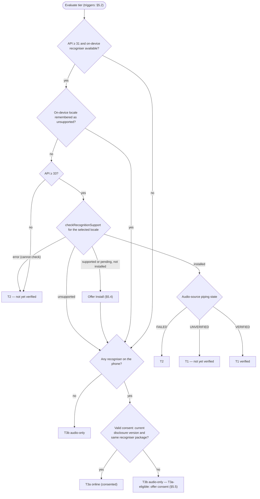

# FS-12 — Speech Capability Management

| Field | Value |
|---|---|
| Document ID | FS-12 |
| Version | 0.1 — Draft for review |
| Date | 2026-11-21 |
| Status | Draft — awaiting Product Owner approval |
| Owner (role) | Product Manager / Business Analyst |
| Approval | Pending — Product Owner |
| Related | RD-16 CAP-12; PRD §15.12 (PRD-FR-110…114), PRD-FR-012, PRD-NFR-002, PRD-NFR-007; SRS §6.12 (SRS-FR-SPCH-001…010), SRS-FR-ONB-008, SRS-FR-SESS-005/006/009/012, SRS-FR-SET-003, SRS-AVL-003, SRS-ERR-001/002, SRS-BR-001, -005, -023, SRS-PRIV-001; NFR-COMP-001/002/006/007, NFR-PERF-004/006, NFR-REL-008, NFR-PRIV-002; ADR-009, ADR-015; ARC-01 §2, §8; ARC-05 §1, §3, §4 (§4.4 SPK-01), §7; SEC-01 §3.2 #13, §7.2, §7.3, §9.6 (SEC-REQ-20, -21); DES-02 (SCR-ONB-07, SCR-SET-04, SCR-SESS-01); FS-02, FS-04, FS-05, FS-10; decisions D-14, D-25; RSK-01, RSK-09, ASM-05, DEP-01 |

> **Boundaries (FS-00 §1.1).** FS-12 owns tier detection, offline-pack install, online-transcription consent, recognition-locale choice, audio-only explanation and recogniser-error classification (`SpeechCapabilityService` and the classification used by `RecognitionSession`). Capture and the session player are **FS-04**; T3b metric display is **FS-05**; the onboarding sequence around SCR-ONB-07 is **FS-02**; the Settings layout around SCR-SET-04 is **FS-10**. The tier design is **subject to device spike SPK-01** (§5.9). Copy is draft wording (RECOMMENDATION); † marks proposed values. No test in this document has been executed (GOV-02 DC-4).

---

## 1. Feature ID & purpose

**FS-12 / CAP-12 (pillars P-2 / F-1).** Find out, honestly and automatically, how this phone can turn speech into text — on-device with replay (T1), on-device without replay (T2), online with the user's explicit consent (T3a) or not at all (T3b, audio-only) — keep that answer current, let people install the offline language pack where Android allows it, let them give or withdraw consent for online transcription, choose their English variant, and make sure recogniser failures are never shown as a broken capability or as the user's mistake.

## 2. User problem

| Problem (user's words) | Evidence (current system) | Personas / needs |
|---|---|---|
| "I spoke but got no transcript." | Live transcription off by default; file transcription stubbed (FND-AI-01, FND-AI-02, UXF-31) | All; UN-03 |
| "It said offline recognition was ready — it wasn't." | Capability status false positives; "init failed" on no-match (FND-AI-05) | All; UN-04 |
| "The speech settings don't do anything." | Ineffective toggles; fake Whisper/Moonshine models (FND-AI-06, FND-AI-03) | Sofia, Aarav |
| "Is my voice being sent somewhere?" | Silent fallback to the network recogniser with no disclosure (FND-SEC-07) | Meera; UN-08 |
| "My phone is older — does this still work?" | minSdk 24 while on-device APIs need 31/33 (RSK-01) | Hoang; UN-09 |
| "It recorded half my answer twice." | Single utterance, duplication on stop, mic contention (FND-AI-04, FND-AI-15) | All |

## 3. Scope

| | R1 | R2 / R3 |
|---|---|---|
| **In** | Tier detection and re-evaluation (T1/T2/T3a/T3b); honest status copy; offline-pack status and install (API 33+); T3a consent capture, revocation and re-consent; audio-only (T3b) explanation and behaviour rules; recognition locale (en-US, en-GB, en-IN, en-AU); recogniser-error classification; SCR-ONB-07 capability logic; SCR-SET-04 speech block | R3: recognition improvements, e.g. on-device Whisper-class model, only if SPK-03 beats T2/T3 (ADR-009 option B) |
| **Out** | Capture, segment stitching and interruption handling (FS-04, ARC-05 §4.1–§4.2); metric computation (FS-05, ARC-05 §6); app-managed model files (removed, FND-AI-03); a manual "engine" selector (current AUTO / ANDROID_OFFLINE / LOCAL_WHISPER is retired); cloud ASR called by SpeakCraft (NG-01, ADR-009 option D); pronunciation or accent scoring (NG-03); live coaching while speaking (NG-14); UI localisation (R3) | — |

## 4. Preconditions

| Workflow | Preconditions |
|---|---|
| Tier detection | Manifest `<queries>` for `android.speech.RecognitionService` (SRS-FR-PLAT-002). No runtime permission and no network needed |
| T1 verification | RECORD_AUDIO granted; a first attempt on the T1 path (FS-04) |
| Offline-pack install | API ≥ 33; on-device recogniser present; selected locale in the supported list; network |
| T3a consent | A recogniser exists but cannot transcribe the locale on-device (§19 #1); consent shown before the first T3a recording, never mid-recording (SEC-01 §7.3 #9) |
| T3a use | Valid consent; network at the time of the attempt |

## 5. Main workflow

### 5.1 Tier detection algorithm (SRS-FR-SPCH-001; ARC-05 §3; ADR-009)
`SpeechCapabilityService` evaluates the inputs below off the main thread (NFR-PERF-012) within 2 s † (FS-02 E7) and publishes one `SpeechCapability` state (tier, verified flag, locale, pack state, T3a eligibility, consent state, recogniser label).

| Step | Input / platform call (API level) | Rule |
|---|---|---|
| 1 | `Build.VERSION.SDK_INT`; `SpeechRecognizer.isOnDeviceRecognitionAvailable` (31) | Both required for T1/T2 |
| 2 | Remembered "on-device locale unsupported" flag (`device_state`) | Set when an on-device attempt returns a language-not-supported/unavailable error (§5.8); cleared on locale or pack change |
| 3 | `checkRecognitionSupport` (33) → installed / pending / supported lists | Installed → T1 path; supported or pending → Install offered, effective tier from the online branch until installed (RECOMMENDATION, §19 #1); unsupported → online branch; error → treated as API 31–32 |
| 4 | Piping state UNVERIFIED / VERIFIED / FAILED (`device_state`) | VERIFIED after the first T1 attempt in which the recogniser returned text while app audio was piped through `EXTRA_AUDIO_SOURCE`; FAILED when the recogniser errors at start or returns nothing while ≥ 2 s † of voiced speech was captured (RECOMMENDATION; SPK-01 calibrates). FAILED demotes the device to T2 and is remembered (ARC-05 §3) |
| 5 | `SpeechRecognizer.isRecognitionAvailable`; recogniser package from `PackageManager` query for `RecognitionService` | No recogniser → T3b |
| 6 | Consent record (`device_state`): granted, disclosure version, timestamp, recogniser package (SEC-01 §7.3 #10) | Valid only for the current disclosure version and the same package (`ConsentStore.isValid`, SEC-REQ-20) |
| Timeout | Detection exceeds 2 s † | Provisional T3b with "We couldn't check speech recognition yet" (§5.3); retried at next start |

### 5.2 Re-evaluation triggers (SRS-FR-SPCH-003; ARC-05 §3; SEC-01 §7.3 #10)
Re-evaluate on: app start; recognition-locale change; device-locale change; consent granted or withdrawn; pack installation finished (or found installed on resume of SCR-SET-04 / SCR-ONB-07); T1 piping failure; recogniser package change detected at start (also invalidates consent). Never during a recording — the tier is fixed for an attempt (RECOMMENDATION). Status text reflects verified state only.

### 5.3 Honest status texts per tier (exact draft copy)
Settings uses the ARC-05 §3 labels as headlines; the session result uses the SRS-FR-SESS-006 labels (label difference: §19 #3). Onboarding copy for SCR-ONB-07 is owned by FS-02 §5.1 and must express the same facts.

| State | SCR-SET-04 headline | SCR-SET-04 detail | Result label (SCR-SESS-01) |
|---|---|---|---|
| Checking | "Checking speech recognition…" | — | — |
| T1 verified | "On-device transcription" | "Your speech is turned into text on this phone. Nothing is sent online. You can replay your recordings." | "On-device" |
| T1 not yet verified | "On-device transcription — not checked yet" | "This phone should turn your speech into text without internet. We'll confirm it the first time you record." | "On-device" (once verified) |
| T2 | "On-device transcription (no replay)" | "Your speech is turned into text on this phone. Nothing is sent online. On this phone SpeakCraft can't keep a recording at the same time, so replay isn't available." Unverified adds: "We'll confirm it the first time you record." | "On-device" |
| T3a | "Online transcription (you agreed)" | "While you record, your voice is sent to {service} to turn it into text. SpeakCraft doesn't upload it or keep it anywhere else. This needs an internet connection." | "Online (consented)" |
| T3b — T3a-eligible | "Audio-only feedback" | "This phone can't turn speech into text without internet. You'll get feedback on speaking time and pauses, and checks that need a transcript are marked. You can turn on online transcription below." | "No transcript — audio-only" |
| T3b — no recogniser | "Audio-only feedback" | "This phone has no speech recognition that SpeakCraft can use. You'll get feedback on speaking time and pauses, and checks that need a transcript are marked." | "No transcript — audio-only" |
| Detection timed out | "We couldn't check speech recognition yet" | "For now you'll get audio-only feedback. We'll check again next time you open SpeakCraft." | "No transcript — audio-only" |
| Pack not installed (extra row) | "Offline speech pack for {English (UK)}: not installed" | "Install it to turn speech into text without internet. Your phone's speech service downloads it and needs a connection." | — |
| Pack downloading / scheduled | "Downloading the {English (UK)} speech pack… {n} %" or "Your phone will download the speech pack when it's ready, for example on Wi-Fi." | "You can keep using SpeakCraft." | — |
| Pack failed | "The speech pack didn't download." | "Check your connection and try again." | — |
| Per-attempt fallback | — | — | "No transcript this time — {no connection / speech recognition was busy / speech recognition wasn't available}" |

Rules: never "AI", "verified", "accurate", "pronunciation" (SRS-BR-004, DES-05 §12); never claim offline operation for T3a; replay is mentioned only where it exists (SRS-FR-SESS-009).

### 5.4 Offline language-pack install (API 33+; SRS-FR-SPCH-004; ARC-05 §4.3)
1. `checkRecognitionSupport` with `EXTRA_LANGUAGE` = selected locale on the on-device recogniser → pack state INSTALLED / PENDING / DOWNLOADABLE / UNSUPPORTED (UNKNOWN on error; Install hidden).
2. SCR-SET-04 (and SCR-ONB-07) show **Install** only for DOWNLOADABLE. Offline: Install disabled, "Needs a connection".
3. Tap **Install** → `triggerModelDownload`. INFERRED (platform behaviour, to confirm in SPK-01): on API 33 there is no completion callback, so the state is polled with `checkRecognitionSupport` on resume and every 10 s † while the screen is visible; newer API levels offer a download listener with progress, scheduled, success and error events, which drive the progress row.
4. Scheduled by the speech service (e.g. waiting for Wi-Fi) → scheduled copy (§5.3).
5. INSTALLED → re-evaluate (§5.2) → "T1 — not yet verified"; snackbar "Speech pack installed. Transcription without internet is now available."
6. Failure → failed copy + **Retry**; Use online transcription (if eligible) and Continue without transcripts stay available (FS-02 E6).
7. The download is performed by the OS speech provider over the network; this is stated next to the button (SEC-01 §7.3 #6). SpeakCraft stores no model files.

### 5.5 Online transcription (T3a): consent, revocation, re-consent (SRS-FR-SPCH-005, -006; SRS-BR-023; SEC-01 §7.3)
**Entry points:** SCR-ONB-07 (FS-02); the Online transcription switch on SCR-SET-04 (Off → On); a one-time card on the SCR-SESS-01 Prompt state before the first recording of a T3a-eligible user who has never decided (RECOMMENDATION). Never during recording. After a decline, at most one re-prompt per 30 days † (SEC-01 §7.3 #8). The disclosure is a full-screen dialog over the calling screen (no own screen ID — §19 #7).

| SEC-01 §7.3 element | Draft copy / rule |
|---|---|
| 1 What is sent | "What is sent: your voice while you record an answer. Not your profile, your history or your other recordings." |
| 2 To whom | "Who receives it: {Speech Services by Google}, your phone's speech service. Its own privacy policy applies; SpeakCraft doesn't control it." Name from the recogniser component label; if it cannot be determined: "your phone's speech service" (SRS-FR-SPCH-005 "named where determinable") |
| 3 When | "When: only while you are recording in a practice session and only while this setting is on. Never in the background." |
| 4 Why | "Why: this phone can't turn {English (India)} speech into text without internet." |
| 5 What SpeakCraft keeps | "Your transcript and recording stay on this phone, under your recording setting. SpeakCraft doesn't upload them." |
| 6 Alternatives | "Other options: Audio-only mode gives feedback on speaking time and pauses without a transcript." If DOWNLOADABLE: "Install the offline speech pack (your phone's speech service downloads it)." |
| 7 Withdrawal | "You can turn this off at any time in Settings › Speech & privacy › Online transcription. It stops before your next recording." |
| 8 Choice design | Two equal-weight buttons **Use online transcription** / **Use audio-only mode**; nothing pre-selected; no countdown; no nagging |
| 9 Timing | Before the first T3a recording; never mid-recording |
| 10 Record | Granted or declined, disclosure version, timestamp, recogniser package → `device_state` (local only; not synced, not backed up) |
| 11 Accessibility | Readable at 200 % font; TalkBack order equals visual order (DES-07) |

**Revocation:** switching Online transcription off on SCR-SET-04 needs no confirmation (withdrawing must be as easy as agreeing — RECOMMENDATION, PP-2); the record is updated to declined with a timestamp; the tier becomes T3b before the next attempt (SRS-FR-SPCH-006); snackbar "Online transcription is off. New recordings use audio-only feedback."
**Re-consent:** required when the disclosure version changes materially or the default recogniser package changes; until then the tier is T3b and the user is prompted before the next recording (SEC-01 §7.3 #10, SEC-REQ-20).
**Invariants:** consent is a device preference — unchanged by sign-in, sign-out or account changes (SRS-BR-023, FS-01 §8); not restored from backup (D-23), so a restored phone asks again; the only code path that creates a non-on-device recogniser checks `ConsentStore.isValid` (SEC-REQ-20); `EXTRA_PREFER_OFFLINE` is never treated as a privacy control (SEC-01 §7.2).

### 5.6 Audio-only mode (T3b) (SRS-FR-SPCH-007; PRD-FR-113; ARC-05 §7)
| Aspect | Behaviour |
|---|---|
| Capture | App `AudioRecord` only (SRS-FR-SPCH-002); no recogniser is created; nothing leaves the phone |
| Replay | Offered under the retention setting (SRS-FR-SESS-009) |
| Result | Headline metrics speaking time, long pauses, speech ratio (ARC-05 §7 T3b row), Measured labels; result label "No transcript — audio-only" |
| Transcript-dependent templates and stages | TPL-READ, TPL-REPEAT and word stages show delivery metrics only and the marker "Transcript needed for this check" (SRS-FR-SPCH-007); completion and streak semantics are owned by FS-03/FS-04/FS-05 (issues logged there) |
| Plan | `PlanEngine` prefers delivery-oriented activities (SRS-FR-SPCH-007, FS-03) |
| Explanation | First T3b result shows once: "No transcript on this phone. This feedback comes from the sound of your voice: speaking time and pauses. Checks that need the words you said are marked." + **Learn more** (SCR-SESS-02) |
| Way out | T3a-eligible: "Turn on online transcription"; DOWNLOADABLE: "Install offline speech pack" |
| Per-attempt T3b | T3a without network, recogniser busy after one retry, or recogniser unavailable → that attempt only gets no transcript and the per-attempt label (§5.3); the device tier is unchanged (ARC-01 §8, SRS-ERR-002). RECOMMENDATION: a T3a user who is offline sees "No connection — this attempt won't have a transcript" on the Prompt state before recording |

### 5.7 Recognition locale (SRS-FR-SPCH-008; PRD-FR-114)
| Item | Rule |
|---|---|
| Options | English (US) en-US · English (UK) en-GB · English (India) en-IN · English (Australia) en-AU |
| Filtering | API 33+: each option shows "Works offline" (installed), "Download needed" (supported), "Online only" (T3a-eligible) or is hidden when no recogniser path supports it. API < 33: all four shown with "Support depends on your phone's speech service" (support cannot be queried — §19 #6) |
| Default (first run) | Device locale if it is one of the four; RECOMMENDATION for other English variants: en-CA → en-US, en-NZ → en-AU, en-IE / en-ZA / other en-* → en-GB; non-English device locale → en-US (SRS-FR-SPCH-008) |
| Effect | Recogniser `EXTRA_LANGUAGE`; reference-audio TTS locale (SRS §8, SRS-FR-SESS-012); tier re-evaluation; consent text element 4 names the language (consent stays valid) |
| Timing | Changed only between attempts (Settings is not reachable during recording) |
| Store | `settings` DataStore (device; backed up per D-23; on a restored phone the value is re-validated) |

### 5.8 Recogniser-error classification (SRS-FR-SPCH-010; ARC-05 §4.2; SRS-ERR-002; NFR-REL-008)
| Platform error (SpeechRecognizer, API) | SRS class | Effect on the attempt | Effect on capability |
|---|---|---|---|
| `ERROR_NO_MATCH`, `ERROR_SPEECH_TIMEOUT` | no match | Segment has no text; if the attempt ends with too few words → Inconclusive (SRS-BR-001; FS-05) | **None** — never a capability failure |
| `ERROR_NETWORK`, `ERROR_NETWORK_TIMEOUT`, `ERROR_SERVER`, `ERROR_SERVER_DISCONNECTED` (31) | network | T3a: attempt continues without transcript (ARC-05 §4.2; outcome detail FS-04 issue); label "no connection" | None; T1/T2 receiving these is logged and treated as unavailable for the attempt |
| `ERROR_RECOGNIZER_BUSY`, `ERROR_TOO_MANY_REQUESTS` (31) | busy | One retry after 300 ms †, then no transcript for this attempt (ARC-05 §4.2) | None |
| `ERROR_AUDIO` | audio | Capture fault → Interrupted state with Retry (FS-04, SRS-FR-SESS-010) | None; three consecutive † → re-evaluate at next start |
| `ERROR_INSUFFICIENT_PERMISSIONS` | permission | Interrupted; microphone flow (SRS-ERR-001, FS-04) | None |
| `ERROR_LANGUAGE_NOT_SUPPORTED`, `ERROR_LANGUAGE_UNAVAILABLE` (31), recogniser creation/bind failure, `ERROR_CLIENT` before any result | unavailable | No transcript for this attempt (SRS-ERR-002, SRS-AVL-003) | On-device language errors set the "locale unsupported" flag (§5.1 step 2); re-evaluate |
| `ERROR_CLIENT` after Stop/cancel | — | Ignored (expected on teardown; RECOMMENDATION) | None |
| T1: no results while voiced audio is piped | unavailable | Attempt keeps its recording, no transcript | Piping FAILED → T2, remembered (§5.1 step 4) |

All errors are caught; the attempt falls back to Inconclusive or no-transcript within 2 s (NFR-REL-008); users never see codes (SRS §15); diagnostics log the class and code only (SEC-01 §10.1).

### 5.9 Dependency on device spike SPK-01 (ARC-05 §4.4; ADR-009; RSK-01, RSK-09, ASM-05)
SPK-01 runs on ≥ 4 devices covering T1/T2/T3 before the R1 build (WBS T-05.1, T-05.2). Until it reports, tier copy, the piping-verification rule and thresholds are **Proposed**.

| SPK-01 question | If it passes | If it fails — what changes |
|---|---|---|
| `EXTRA_AUDIO_SOURCE` piping works with common recognisers | T1 as designed | T1 collapses into T2 on affected recognisers (ADR-009 fallback, RSK-09): no replay for transcript tiers; replay only in T3b; "(no replay)" copy; retention setting relevant mainly to T3b; PRD-FR-034 scope reduced (Product Owner informed) |
| Segmented sessions capture the full attempt | Continuous T1 transcript | T1 uses the restart-and-stitch path of T2/T3a |
| Restart gap ≤ 150 ms with no lost words | T2/T3a transcripts complete | Higher Inconclusive rate; NFR-QUAL-005 at risk; maximum recording lengths (SRS-FR-SESS-003 †) may be shortened |
| Finalisation ≤ 1.5 s (NFR-PERF-006) | Processing feels immediate | Processing copy and NFR-PERF-005 budget re-baselined |
| Word error rate acceptable on the 40-utterance accented set (ASM-05) | Thresholds kept | Pass thresholds (SRS-BR-007 †) and word-stage checks revisited; more checks labelled Estimated; RSK-01 escalated to the Product Owner (D-14) |
| On-device recognisers send nothing over the network | T1/T2 privacy claims hold | That recogniser is treated like T3a (consent required) and the status copy changes (SEC-01 §7.2, NFR-PRIV-002) |
| `checkRecognitionSupport` / `triggerModelDownload` behave consistently per OEM | Install flow as §5.4 | Install hidden on failing devices; pack state UNKNOWN |
| Share of target devices in T3 | Tier mix as assumed | D-14 (minSdk, tier policy) re-opened; T3a/T3b become the main experience for many users |

## 6. Alternate workflows

| ID | Trigger | Behaviour |
|---|---|---|
| A1 | Pack installed or removed outside the app (system settings) | Detected on app start or resume of SCR-SET-04; tier and status update; past attempts unchanged |
| A2 | User changes the phone's default speech service | Package change detected at start → consent invalid → T3b until re-consent; tier re-detected (SEC-01 §7.3 #10) |
| A3 | First T1 attempt fails to pipe audio | That attempt keeps its recording and is evaluated without a transcript (no transcript label); piping FAILED → T2 from the next attempt; Settings shows T2 copy |
| A4 | T3a user is offline | Prompt-state notice (§5.6); the attempt gets no transcript; Settings keeps the T3a headline and adds "Needs an internet connection" |
| A5 | User declines consent | T3b; "Turn on online transcription" stays available in Settings; at most one re-prompt per 30 days † |
| A6 | Phone restored from backup to a new device | Consent and tier cache are not restored (`device_state` excluded, D-23); detection runs; consent asked again; the restored recognition locale is re-validated |
| A7 | Microphone permission denied | Detection still runs (FS-02 A4); recording is blocked by FS-04; SCR-SET-04 shows the microphone note (FS-10 §9) |
| A8 | Detection exceeds 2 s † | Provisional T3b with timed-out copy; re-check at next start (FS-02 E7) |
| A9 | Recognition locale changed to one without an installed pack | Re-evaluation; Install offered for that locale; T3a offered if eligible |

## 7. Error scenarios

| ID | Condition | Behaviour / copy (RECOMMENDATION) | SRS-ERR |
|---|---|---|---|
| E1 | `checkRecognitionSupport` fails | Pack state UNKNOWN; Install hidden; tier via the API 31–32 path | SRS-ERR-002 |
| E2 | `triggerModelDownload` fails | Failed copy + Retry; other options remain | — |
| E3 | Install tapped while offline | Button disabled; "Needs a connection" | — |
| E4 | Recogniser name cannot be resolved | Generic "your phone's speech service" in the disclosure and status | — |
| E5 | Recogniser creation throws (security, remote or bind error) | Classified "unavailable"; attempt without transcript; re-evaluate | SRS-ERR-002 |
| E6 | Consent record cannot be written | Fail closed: consent treated as not given, tier T3b; "Couldn't save your choice. Try again." | SRS-ERR-005 |
| E7 | TTS unavailable for the selected locale | Reference-audio controls hidden (FS-04) | SRS-ERR-010 |
| E8 | Network or busy errors during an attempt | §5.8 per-attempt handling | SRS-ERR-002 |
| E9 | Microphone permission revoked during an attempt | Interrupted (FS-04) | SRS-ERR-001 |

## 8. Business rules

| Rule | Application in this feature |
|---|---|
| SRS-BR-023 | Online transcription only when the tier is T3a and consent is true; revocation immediate; consent is a device preference |
| SRS-PRIV-001 | No audio or transcript leaves the phone except in T3a with consent, and then only to the speech service |
| SRS-BR-001 | Transcript-required templates need recognised words; "no match" leads to Inconclusive via the evidence gate, not to a capability failure |
| SRS-BR-004 | Status copy never presents recognition as pronunciation or accent accuracy |
| SRS-BR-005 | Recogniser confidence is used only when supplied |
| SRS-BR-022 | Recordings exist only in T1 and T3b and follow the retention setting |
| RECOMMENDATION | Detection timeout 2 s †; piping-verification rule; "locale unsupported" flag; one-time Prompt-state consent card; re-prompt interval 30 days † (SEC-01 Proposed); no confirmation to withdraw; locale fallback mapping; pack polling every 10 s † |

## 9. UI states

**SCR-SET-04 Speech & privacy — speech block** (layout and other rows: FS-10 §9)

| State | What the user sees | Actions |
|---|---|---|
| Default | Headline + detail per §5.3; Recognition language; pack row (if supported); Online transcription switch (T3a-eligible only) | Change language; Install; switch |
| Loading | "Checking speech recognition…" | — |
| Empty | N/A — a state always exists (worst case timed-out copy) | — |
| Error | Timed-out or UNKNOWN pack state copy | Check again (re-runs detection) |
| Offline | Install disabled "Needs a connection"; T3a adds "Needs an internet connection" | Other controls |
| Permission | Microphone note (FS-10 §9) — status still shown | Open settings |
| Pack downloading / scheduled / failed | §5.3 rows; progress is a polite live region | Retry (failed) |
| Consent changed | Snackbar after granting or withdrawing | — |

**SCR-ONB-07 Speech check — states owned by FS-12** (sequence, copy and actions: FS-02 §5.1, §9)

| State | Rule |
|---|---|
| Checking | Spinner up to 2 s †; then outcome or timed-out copy (A8) |
| T1 / T2 / pack-installable / T3a-eligible / T3b outcome | Chosen by §5.1; no unverified claim (T1 is "not yet verified" until the first attempt) |
| Pack downloading | §5.4 states; user may continue (FS-02 A9) |
| Consent dialog | §5.5 disclosure |
| Offline | Download and consent need a connection to be used; on-device and audio-only outcomes unaffected |
| Permission | N/A — detection needs no permission |

**T3a consent disclosure** (full-screen dialog over SCR-ONB-07, SCR-SET-04 or SCR-SESS-01 Prompt; no DES-02 screen ID — §19 #7)

| State | What the user sees | Actions |
|---|---|---|
| Default | Elements 1–7 of §5.5 | Use online transcription; Use audio-only mode |
| Loading | Recogniser label resolving (≤ 1 frame typical); generic name used if slow | — |
| Error | E6 message | Try again |
| Offline | Same content plus "You can agree now; transcription works when you're online." | Both buttons |
| Empty / Permission | N/A | — |

**SCR-SESS-01 Session player — capability rows only** (all other states: FS-04)

| State | What the user sees |
|---|---|
| Prompt, T3a offline | "No connection — this attempt won't have a transcript" |
| Prompt, first T3a-eligible attempt, undecided | One-time consent card (§5.5) |
| Result | Tier label (§5.3) next to the transcript, or the per-attempt fallback label |
| Result, first T3b attempt | One-time audio-only explanation (§5.6) |

## 10. Data requirements

| Data | Store | Fields (minimum; ARC-03 authoritative) | Synced / backed up |
|---|---|---|---|
| Consent record | `device_state` | `granted`, `disclosureVersion`, `decidedAt`, `recogniserPackage`, `lastPromptAt` | No / No (SEC-01 §3.2 #13, §3.3) |
| Tier cache | `device_state` | `tier`, `verified`, `pipingState`, `localeUnsupportedFlag`, `detectedAt`, `apiLevel`, `recogniserPackage` | No / No |
| Recognition locale | `settings` DataStore | `recognitionLocale` | No / Yes (D-23) |
| ENT-03 Attempt | `learning.db` | Tier label used for the attempt (SRS-FR-SESS-006) | Per ARC-03 §8 |
| ENT-11 RecordingFile | `learning.db` + files | Present only for T1 and T3b attempts | Never uploaded (ADR-015) |
| Disclosure text version | Bundled constant | `CONSENT_DISCLOSURE_VERSION` | — |

## 11. API / repository dependencies

| Dependency | Used for |
|---|---|
| `SpeechCapabilityService` | Detection, re-evaluation, status Flow, pack state, install, consent-aware tier (ARC-01 §2) |
| `RecognitionSession` | Reports error classes and piping outcome (ARC-05 §4.2) |
| `ConsentStore` (in `device_state`) | `isValid(disclosureVersion, recogniserPackage)` guard (SEC-01 §7.2, SEC-REQ-20) |
| `PreferencesRepository` | Recognition locale |
| `PlanEngine` | Reads the tier to prefer delivery-oriented activities in T3b (FS-03) |
| Platform (API level) | `SpeechRecognizer.isRecognitionAvailable`; `isOnDeviceRecognitionAvailable`, `createOnDeviceSpeechRecognizer` (31); `createSpeechRecognizer` (T3a only, after consent); `checkRecognitionSupport`, `triggerModelDownload`, `EXTRA_AUDIO_SOURCE`, `EXTRA_SEGMENTED_SESSION` (33); download listener on newer levels (INFERRED, verify in SPK-01); `PackageManager` query for `RecognitionService` (`<queries>`); `TextToSpeech` locale checks; `ConnectivityManager` (offline notices) |

## 12. Offline behaviour

T1, T2 and T3b work fully offline. Detection, locale choice and consent decisions work offline. T3a needs a connection per attempt and otherwise falls back to no transcript for that attempt (ARC-01 §8). Pack download needs a connection (ARC-01 §8 "Offline-pack install").

## 13. Privacy requirements

- T1/T2/T3b send 0 bytes of audio or transcript off the phone (NFR-PRIV-002, SRS-PRIV-001); verified by traffic capture (TC-SEC-002).
- A non-on-device recogniser is created only with valid consent (SEC-REQ-20); the disclosure contains every SEC-01 §7.3 element (SEC-REQ-21).
- The consent record stays on the phone, is never synced or backed up, and is not logged (SEC-01 §3.3, §10.1).
- Pack downloads are disclosed as performed by the OS speech provider (SEC-01 §7.3 #6).
- The Play data-safety declaration for T3a follows D-25 (SEC-01 §9.6).
- Recognition partials are memory-only and never logged (SEC-01 §3.2 #3).

## 14. Accessibility notes

Status headline and detail are text, never colour or icon alone (A11Y-23); the consent buttons are equal in size and weight, reachable in visual order, 48 dp (A11Y-19), and the dialog contains focus (A11Y-10); the Online transcription switch is merged with its label and announces its state (A11Y-06, A11Y-07); download progress is a polite live region with a percentage where known (A11Y-08); language options are a radio group with state descriptions; all copy reflows at 200 % (NFR-A11Y-002, A11Y-13).

## 15. Acceptance criteria

| ID | Given | When | Then |
|---|---|---|---|
| AC-FS12-01 | Fake platform inputs for every branch of the §5.1 flowchart | Detection runs | The resulting tier, verified flag and eligibility match the flowchart for each case |
| AC-FS12-02 | An API 33+ device with the pack installed and piping UNVERIFIED | The user opens Speech & privacy, then completes a first attempt with recognised text | First "On-device transcription — not checked yet" is shown, then "On-device transcription" |
| AC-FS12-03 | A T1 candidate whose recogniser returns nothing while voiced audio is piped | The first attempt ends | The attempt keeps its recording without a transcript, the device becomes T2, and T2 persists after restart |
| AC-FS12-04 | Each trigger in §5.2 | It occurs | The tier is re-evaluated; during an active recording it is not |
| AC-FS12-05 | Each state in §5.3 | SCR-SET-04 and a result are shown | Headline, detail and result label match §5.3 exactly and contain no banned terms |
| AC-FS12-06 | API 33+, locale supported but not installed, online | The user taps Install | Progress or scheduled state appears; on success the tier is re-evaluated; on failure Retry is offered and other options remain |
| AC-FS12-07 | The same device offline | SCR-SET-04 is shown | Install is disabled with "Needs a connection" |
| AC-FS12-08 | A T3a-eligible device | The consent disclosure opens | All 11 SEC-01 §7.3 elements are present and the two buttons are equal-weight with neither pre-selected |
| AC-FS12-09 | No valid consent | Any attempt starts | No non-on-device recogniser is created |
| AC-FS12-10 | Consent granted (T3a) | The user turns Online transcription off | No confirmation is asked, the record becomes declined, and the next attempt runs in T3b |
| AC-FS12-11 | Consent granted | The disclosure version or the default recogniser package changes | The tier is T3b until the user consents again before a recording |
| AC-FS12-12 | Consent granted | The user signs out and signs in, or the phone is restored from backup | Sign-in/out leaves consent unchanged; after restore consent is asked again |
| AC-FS12-13 | The user declined consent | 29 and then 31 days pass † | No re-prompt at 29 days; at most one re-prompt after 30 days |
| AC-FS12-14 | A device with no recogniser | The user records any activity | Capture uses `AudioRecord`, replay is available, speaking time / pauses / speech ratio are shown, and read-aloud shows "Transcript needed for this check" |
| AC-FS12-15 | Device locale en-NZ on API 33 with en-GB and en-US packs installed | First run and the language list are shown | The default is en-AU per §5.7 mapping, options show their offline / download / online status, and choosing en-GB changes recogniser and TTS locale |
| AC-FS12-16 | Each platform error in §5.8 | It occurs during an attempt | The attempt and capability effects match §5.8; "no match" never changes the capability state |
| AC-FS12-17 | Injected recogniser failures | An attempt runs | The app does not crash and shows Inconclusive or no-transcript within 2 s |
| AC-FS12-18 | A T1, T2 or T3b device with traffic capture | A full session is completed | No audio or transcript leaves the phone |
| AC-FS12-19 | The recogniser label cannot be resolved | The disclosure and status are shown | "your phone's speech service" is used |

## 16. Test cases

| TC | Title | Type | Preconditions | Steps | Expected result | Traces |
|---|---|---|---|---|---|---|
| TC-SPCH-001 | Tier decision table | unit | Fake platform probes for every flowchart branch | Run detection per case | Tier/verified/eligibility per §5.1 | SRS-FR-SPCH-001 |
| TC-SPCH-002 | Detection timeout | unit | Probe delayed 3 s; fake clock | Run detection | Provisional T3b + timed-out state; retry flagged for next start | SRS-FR-SPCH-003, SRS-AVL-003 |
| TC-SPCH-003 | Piping verification and demotion | unit | Fake recogniser: text / silence / no result with voiced audio | Complete first T1 attempt | VERIFIED / stays UNVERIFIED / FAILED → T2 | SRS-FR-SPCH-001 (ARC-05 §3) |
| TC-SPCH-004 | Demotion persists | instrumented | Piping FAILED stored | Force-stop; relaunch | Tier T2; T2 copy | SRS-FR-SPCH-003 |
| TC-SPCH-005 | Re-evaluation triggers | unit | Spy on detection | Fire each §5.2 trigger, including during a fake recording | Re-run per trigger; none during recording | SRS-FR-SPCH-003 |
| TC-SPCH-006 | Status copy | Robolectric UI | Fake capability per §5.3 state; font scale 2.0 | Render SCR-SET-04 | Text equals §5.3 strings; no banned terms; no clipping | PRD-FR-110, SRS-FR-SPCH-003 |
| TC-SPCH-007 | Result tier labels | Robolectric UI | Fake results per tier and fallback reason | Render result | Labels per §5.3 | SRS-FR-SESS-006 |
| TC-SPCH-008 | Pack state mapping | unit | Fake `RecognitionSupport` lists and error | Map | INSTALLED / PENDING / DOWNLOADABLE / UNSUPPORTED / UNKNOWN | SRS-FR-SPCH-004 |
| TC-SPCH-009 | Pack install UI | Robolectric UI | Fake service: progress, scheduled, success, failure, offline | Tap Install | §5.3 rows; Retry on failure; disabled offline | SRS-FR-SPCH-004 |
| TC-SPCH-010 | Pack install on devices | manual | RD-HIGH on API 33 and on a newer API level; network | Install pack from SCR-SET-04 | Status reaches installed; tier becomes "T1 — not yet verified"; evidence captured | SRS-FR-SPCH-004 (SPK-01) |
| TC-SPCH-011 | Consent disclosure content | Robolectric UI | T3a-eligible fake | Open disclosure | 11 elements present; equal unselected buttons (see TC-SEC-016) | SRS-FR-SPCH-005, SEC-REQ-21 |
| TC-SPCH-012 | Consent gates the recogniser factory | unit | Fake factory; consent absent / stale / valid | Start attempts | `createSpeechRecognizer` only with valid consent (see TC-SEC-015) | SEC-REQ-20, SRS-PRIV-001 |
| TC-SPCH-013 | Withdrawal | unit | Consent valid | Toggle off; request next-attempt capability | T3b; declined record with timestamp; no confirmation event | SRS-FR-SPCH-006, SRS-BR-023 |
| TC-SPCH-014 | Re-consent conditions | unit | Valid consent | Bump disclosure version; change package | Consent invalid; T3b; prompt flagged | SEC-REQ-20 |
| TC-SPCH-015 | Consent independence | unit | Valid consent; backup rules | Sign out/in via fake; simulate restore without `device_state` | Unchanged after sign-in/out; absent after restore | SRS-BR-023, SEC-REQ-17 |
| TC-SPCH-016 | Re-prompt interval | unit | Declined; fake clock | Advance 29 and 31 days | No prompt at 29; one at 31 | SRS-FR-SPCH-005 (SEC-01 §7.3 #8) |
| TC-SPCH-017 | Audio-only behaviour | instrumented | Emulator without a recognition service | Complete TPL-ANSWER and TPL-READ | `AudioRecord` used; replay offered; T3b headlines; "Transcript needed" marker | SRS-FR-SPCH-007, PRD-FR-113 |
| TC-SPCH-018 | Locale filtering and default | unit | Device locales en-US, en-NZ, en-IE, fr-FR; fake support lists | Compute options and default | §5.7 statuses and mapping | SRS-FR-SPCH-008 |
| TC-SPCH-019 | Locale applies to recogniser and TTS | instrumented | Two locales available | Change en-US → en-GB; play reference audio; start attempt | Recogniser intent and TTS use en-GB | SRS-FR-SPCH-008, SRS-FR-SESS-012 |
| TC-SPCH-020 | Error classification | unit | One case per §5.8 error constant | Feed error to classifier | Class, attempt effect and capability effect per §5.8 | SRS-FR-SPCH-010, SRS-ERR-002 |
| TC-SPCH-021 | Fault injection | instrumented | Fake recogniser throwing and erroring at random points | Run 50 attempts | No crash; fallback ≤ 2 s each | NFR-REL-008 |
| TC-SPCH-022 | Network silence | manual | T1, T2 and T3b reference devices; traffic capture | Full scripted session | No audio/transcript egress (see TC-SEC-002) | NFR-PRIV-002, SRS-PRIV-001 |
| TC-SPCH-023 | Recogniser label | unit | Fake `PackageManager`: label present / absent | Build disclosure | Name or generic fallback | SRS-FR-SPCH-005 |
| TC-SPCH-024 | Tier matrix on reference devices | manual | RD-LOW / RD-MID / RD-HIGH (TST-01 §5) | Run detection and one attempt each | Tier per device recorded and matches NFR-COMP-002 expectations | NFR-COMP-002, NFR-COMP-006 |
| TC-SPCH-025 | T3a offline fallback | instrumented | Consented T3a emulator; network off | Open Prompt; record | Offline notice; attempt without transcript; tier unchanged | SRS-ERR-002 (ARC-01 §8) |
| TC-SPCH-026 | Consent dialog accessibility | manual | TalkBack on; font scale 2.0 | Read and act on the disclosure | Reading order = visual order; no clipping; equal targets | NFR-A11Y-001, NFR-A11Y-002 |

## 17. Traceability

| PRD-FR / NFR | SRS-FR / rule | AC | TC |
|---|---|---|---|
| PRD-FR-110 | SRS-FR-SPCH-001, -002, -003, -010 | AC-FS12-01 … -05, -16, -17 | TC-SPCH-001 … -007, -020, -021, -024 |
| PRD-FR-111 | SRS-FR-SPCH-004 | AC-FS12-06, -07 | TC-SPCH-008, -009, -010 |
| PRD-FR-112 | SRS-FR-SPCH-005, -006; SRS-BR-023 | AC-FS12-08 … -13, -19 | TC-SPCH-011 … -016, -023, -026 |
| PRD-FR-113 | SRS-FR-SPCH-007; SRS-AVL-003; SRS-ERR-002 | AC-FS12-14 | TC-SPCH-017, -025 |
| PRD-FR-114 | SRS-FR-SPCH-008 | AC-FS12-15 | TC-SPCH-018, -019 |
| PRD-FR-012 (CAP-02, capability part) | SRS-FR-ONB-008 | AC-FS12-01, -06, -08 | TC-SPCH-001, -009, -011 |
| PRD-NFR-002 | SRS-PRIV-001; NFR-PRIV-002; SEC-REQ-20 | AC-FS12-09, -18 | TC-SPCH-012, -022 |
| PRD-NFR-007 | NFR-COMP-002, -006, -007 | AC-FS12-01, -15 | TC-SPCH-024, -018 |

## 18. Open questions

| # | Question | Owner |
|---|---|---|
| Q1 | D-14: minimum Android version and tier policy — how many users will see T3a/T3b? | Product Owner |
| Q2 | May T3a be offered when an on-device recogniser exists but cannot transcribe the selected locale (pack missing or unsupported)? (§19 #1) | Product Owner / Security Engineer |
| Q3 | Show the honest "not checked yet" state before T1/T2 verification (recommended) or hide it? | Product Owner |
| Q4 | Confirm the 30-day † re-prompt interval and the one-time Prompt-state consent card | Product Owner |
| Q5 | Approve the fallback mapping for English variants outside the four locales (§5.7) | Product Owner |
| Q6 | D-25: data-safety declaration for T3a | Product Owner |

## 19. Issues found in source documents

| # | Issue | Source | Suggested resolution |
|---|---|---|---|
| 1 | SRS-FR-SPCH-001 and ARC-05 §3 allow T3a only when there is **no** on-device recogniser, but SEC-01 §7.3 #4 ("no offline recogniser for the selected English variant") and FS-02 §5.1 ("Use online transcription instead" on the pack-installable outcome) offer T3a when the on-device recogniser lacks the locale | SRS-FR-SPCH-001, ARC-05 §3 vs SEC-01 §7.3, FS-02 §5.1 | Decide Q2 and align the T3a definition |
| 2 | T1 requires "audio-source input verified" (SRS-FR-SPCH-001), which ARC-05 §3 verifies only at first use, and on API 31–32 locale support cannot be checked before use; no tier or label is defined for the unverified period, while SRS-FR-SPCH-003 allows verified states only | SRS-FR-SPCH-001, -003; ARC-05 §3 | Add a "not yet verified" state to the SRS (as §5.3) |
| 3 | User-facing tier labels differ: ARC-05 §3 ("On-device transcription", "… (no replay)", "Online transcription (you agreed)", "Audio-only feedback") vs SRS-FR-SESS-006 ("On-device", "Online (consented)", "No transcript — audio-only") | ARC-05 §3, SRS-FR-SESS-006 | Confirm the split used here (Settings headline vs result label) |
| 4 | SRS-FR-SPCH-010 names six error classes, but ARC-05 §4.2 maps only no-match/timeout, network, busy and permission; `ERROR_AUDIO`, `ERROR_CLIENT`, `ERROR_SERVER`, `ERROR_TOO_MANY_REQUESTS` and the language errors are unmapped. SRS-ERR-002 falls back to T3b immediately, ARC-05 retries once on busy | SRS-FR-SPCH-010, SRS-ERR-002, ARC-05 §4.2 | Adopt the §5.8 table in ARC-05 §4.2 |
| 5 | SRS-FR-SPCH-003 re-evaluation triggers omit a change of the default recogniser package (which SEC-01 §7.3 #10 says invalidates consent) and the runtime T1 piping demotion (ARC-05 §3); "locale change" does not say whether it means the device or the recognition locale | SRS-FR-SPCH-003 | Extend the trigger list as §5.2 |
| 6 | SRS-FR-SPCH-008 defaults to "device locale if English" without mapping English variants outside the four options, and asks for options "filtered by recogniser support", which cannot be queried below API 33 | SRS-FR-SPCH-008 | Approve §5.7 mapping and the API < 33 note |
| 7 | SEC-01 §7.3 #9 places the consent screen in "onboarding SCR-ONB or SCR-PERM-01", but DES-02 §4 defines SCR-PERM-01 as microphone/notification permission education and has no screen ID for the disclosure opened from Settings or the session | SEC-01 §7.3 #9, DES-02 §4 | Add a screen or state ID for the disclosure in DES-02/DES-03 |
| 8 | ARC-05 §1 keeps speech user preferences in a DataStore named `SpeechPreferences`; canon R-1 and SEC-01 §3.2 #13 split them between `settings` (recognition locale, backed up) and `device_state` (consent and tier cache, not backed up) | ARC-05 §1 | Align ARC-05 §1 with the canon store names |
| 9 | SRS-FR-SPCH-004 requires install "progress/failure states", but on API 33 `triggerModelDownload` has no completion or progress callback (INFERRED; a listener exists only on newer API levels) and ARC-05 §4.3 only polls on resume | SRS-FR-SPCH-004, ARC-05 §4.3 | Allow an indeterminate state on API 33; confirm in SPK-01 |
| 10 | SRS-FR-SET-003 shows the online-transcription toggle on "T3 devices", which includes T3b phones with no recogniser where the toggle cannot work | SRS-FR-SET-003 | Change to "devices eligible for T3a" |
| 11 | How T3b users complete transcript-required steps (read-aloud, word stages) and whether those attempts count toward completion and streak is undefined (raised in FS-03 and FS-04) | SRS-FR-SPCH-007, SRS-BR-001, SRS-BR-009 | Resolve in SRS §6.12 with FS-03/FS-04 |
| 12 | PRD-FR-114 (locale choice) is P2, while PRD-FR-092 (P0) and SRS-FR-SET-003 include "recognition language" in the required Speech & privacy content | PRD §15.10 vs §15.12 | Align the priority |
