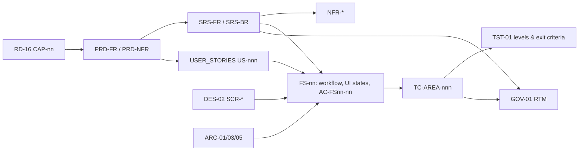

# Feature Specification Index — SpeakCraft

| Field | Value |
|---|---|
| Document ID | FS-00 |
| Version | 0.2 — Draft for review |
| Date | 2026-11-21 |
| Status | Draft — awaiting Product Owner approval |
| Owner (role) | Product Manager / Business Analyst |
| Approval | Pending — Product Owner |
| Related | PRD, SRS, NFR, RD-16 (CAP-nn), DES-02 (SCR-*), ARC-01, ARC-03 (ENT-nn), ARC-05, USER_STORIES (US), USE_CASES (UC), TST-01, GOV-01, GOV-02 |

> **Authority (GOV-02 §4).** Feature specifications are authoritative for **workflow, UI states and per-feature test cases**. They elaborate — and never redefine — the PRD (`PRD-FR`), SRS (`SRS-FR`, `SRS-BR`) and NFR (`NFR-*`). Where an FS proposes detail the SRS does not contain, it is labelled **RECOMMENDATION**. Where an FS finds a gap or contradiction in a source document, it is listed in that FS's final section "Issues found in source documents" and is **not** fixed in the FS.

---

## 1. Index

One feature specification per capability (RD-16 §2). Screen IDs are from DES-02 §4 (authoritative).

| FS | Title | CAP | Release | Primary screens (DES-02) | Test-case prefix | File | Status |
|---|---|---|---|---|---|---|---|
| FS-01 | Account & sign-in | CAP-01 | R1 | SCR-ACC-01, SCR-ACC-02, SCR-SET-07, SCR-SYS-01 | TC-ACC | `FS-01_ACCOUNT_AND_SIGN_IN.md` | Draft |
| FS-02 | Onboarding & personalisation | CAP-02 | R1 | SCR-ONB-01…08, SCR-PERM-01 | TC-ONB | `FS-02_ONBOARDING_AND_PERSONALISATION.md` | Draft |
| FS-03 | Today — daily session | CAP-03 | R1 | SCR-TODAY-01, SCR-TODAY-02 | TC-TODAY | `FS-03_TODAY_DAILY_SESSION.md` | Draft |
| FS-04 | Speaking practice session | CAP-04 | R1 | SCR-SESS-01, SCR-PERM-01 | TC-SESS | `FS-04_SPEAKING_PRACTICE_SESSION.md` | Draft |
| FS-05 | Honest feedback & evaluation | CAP-05 | R1 | SCR-SESS-01 (Result / Inconclusive states), SCR-SESS-02 | TC-EVAL | `FS-05_HONEST_FEEDBACK_AND_EVALUATION.md` | Draft |
| FS-06 | Practice library & techniques | CAP-06 | R1 (5 tracks, 5 templates); R2 (role-play) | SCR-PRAC-01…03, SCR-PRAC-04 | TC-PRAC | `FS-06_PRACTICE_LIBRARY.md` | Draft |
| FS-07 | Words — vocabulary lifecycle | CAP-07 | R1; R2 (notebook, quiz) | SCR-WORD-01…06 (expected) | TC-WORD | `FS-07_WORDS_VOCABULARY_LIFECYCLE.md` | Draft |
| FS-08 | Progress & streak | CAP-08 | R1; R2 (check-ins) | SCR-PROG-01…05 (expected) | TC-PROG | `FS-08_PROGRESS_AND_STREAK.md` | Draft |
| FS-09 | Reminders & inbox | CAP-09 | R1; R2 (inbox) | SCR-SET-03, SCR-INBOX-01, SCR-PERM-01 (expected) | TC-REM | `FS-09_REMINDERS_AND_INBOX.md` | Draft |
| FS-10 | Profile, settings, privacy & data rights | CAP-10 | R1 | SCR-PROF-01, SCR-SET-01…09 (expected) | TC-SET | `FS-10_PROFILE_SETTINGS_PRIVACY_DATA_RIGHTS.md` | Draft |
| FS-11 | Offline-first storage & sync | CAP-11 | R0 / R1 | SCR-SET-07 sync status (expected) | TC-DATA | `FS-11_OFFLINE_FIRST_STORAGE_AND_SYNC.md` | Draft |
| FS-12 | Speech capability management | CAP-12 | R1 | SCR-ONB-07, SCR-SET-04 (expected) | TC-SPCH | `FS-12_SPEECH_CAPABILITY_MANAGEMENT.md` | Draft |

### 1.1 Feature boundaries (who owns what)

| Topic | Owning FS | Referenced by |
|---|---|---|
| Local profile, sign-in, sign-out, account deletion | FS-01 | FS-02, FS-10, FS-11 |
| Onboarding sequence, defaults, first attempt | FS-02 | FS-03, FS-12 |
| Daily plan composition and plan-engine selection | FS-03 | FS-06, FS-07, FS-08 |
| Session-player states, recording, interruptions, retry/compare, replay | FS-04 | FS-02, FS-03, FS-06, FS-07, FS-08 |
| Evidence gate outcomes, metrics display, feedback, accuracy rating, "How we measured this" | FS-05 | FS-04, FS-07, FS-08 |
| Tracks, templates, content-pack schema and minimum counts, role-play (R2) | FS-06 | FS-03, FS-07 |
| Word stages, review sets, word bank | FS-07 | FS-03 |
| Streak, practice time, trends, history | FS-08 | FS-03, FS-05 |
| Tier detection, offline pack, online consent | FS-12 | FS-02, FS-04, FS-05 |

## 2. Template used by every FS

| § | Section | Content rules |
|---|---|---|
| — | Header table | Document ID, Version, Date, Status, Owner (role), Approval, Related (GOV-02 §3.4) |
| 1 | Feature ID & purpose | FS ID, CAP, pillar, one-paragraph purpose |
| 2 | User problem | Problem in user terms, current-system evidence (FND-*), personas P1–P5 (PRD §7) and user needs UN-nn |
| 3 | Scope | In / out, split by release R1 / R2; non-goals referenced as NG-nn |
| 4 | Preconditions | System and user state required before the workflow starts |
| 5 | Main workflow | Numbered steps; system actions name the component (ARC-01 §2) |
| 6 | Alternate workflows | A1…An |
| 7 | Error scenarios | E1…En mapped to `SRS-ERR-nnn` where one exists; user-safe copy |
| 8 | Business rules | `SRS-BR-nnn` references with a short summary (never reworded as a new rule); RECOMMENDATION detail clearly separated |
| 9 | UI states | One table per screen `SCR-*`: default, loading, empty, error, offline, permission, plus feature-specific states; "N/A" is stated with a reason |
| 10 | Data requirements | Entities by name and ARC-03 ID (ENT-nn); fields listed are the minimum the feature needs — ARC-03 is authoritative for the schema |
| 11 | API / repository dependencies | Repository interfaces and engines from ARC-01 §2; platform APIs |
| 12 | Offline behaviour | What works, what is deferred, what is shown |
| 13 | Privacy requirements | `SRS-PRIV-*`, `NFR-PRIV-*`, ADR-015 references |
| 14 | Accessibility notes | `NFR-A11Y-*`, DES-07 |
| 15 | Acceptance criteria | Given / When / Then, IDs `AC-FSnn-nn` |
| 16 | Test cases | `TC-<AREA>-nnn` table: title, type, preconditions, steps, expected result, traces |
| 17 | Traceability | PRD-FR → SRS-FR → AC → TC |
| 18 | Open questions | Questions needing a Product Owner or architecture answer; link to D-nn where relevant |
| 19 | Issues found in source documents | Gaps/inconsistencies in PRD, SRS, ARC-05, DES-02 etc., for the document owner to resolve |

### 2.1 Entity names used (ARC-03 §3 is authoritative)

ENT-01 Profile · ENT-02 LearningPreferences · ENT-03 Attempt · ENT-04 AttemptMetric · ENT-05 SessionPlan · ENT-06 SessionStep · ENT-07 WordProgress · ENT-08 WordReview · ENT-09 LearningEvent · ENT-10 SyncOutbox · ENT-11 RecordingFile · ENT-12 SavedActivity · ENT-13 FeedbackRating · ENT-14 SyncState · ENT-15 NotebookEntry (R2) · ENT-16 InboxMessage (R2) · ENT-17 QuizAttempt (R2) · ENT-18 DeletionState. The content pack (bundled JSON assets, ARC-03 §6) is referenced by name, not by an ENT ID. Learning preferences are a Room entity (ENT-02, synced with the profile, SRS §9); device and UI preferences live in the `settings` DataStore. `PreferencesRepository` fronts both. Transcript text is stored in the separate `sensitive.db` (SEC-01 §3.2), not in ENT-03.

## 3. Conventions

| Convention | Rule |
|---|---|
| Acceptance criteria IDs | `AC-FSnn-nn` (e.g. AC-FS03-07); unique within the FS; never renumbered once approved (GOV-02 §7) |
| Proposed values | Values marked † in the SRS remain **Proposed — requires approval** (GOV-02 DC-5); FSs repeat the † |
| RECOMMENDATION | Detail beyond the SRS (copy, layouts, algorithm parameters). Becomes binding only when the Product Owner approves the FS |
| User-facing copy | Copy in FSs is draft wording (RECOMMENDATION). Final strings live in resources (NFR-MAINT-008) and follow DES-05 §12 terminology |
| Screen IDs | DES-02 §4 only. Note: onboarding is SCR-ONB-01…08, settings are SCR-SET-01…09, SCR-WORD-02 is *Word detail*, SCR-WORD-03 the *stage flow*, SCR-WORD-04 the *review session* |
| Personas | P1 Aarav, P2 Meera, P3 Daniel, P4 Sofia, P5 Hoang (PRD §7; hypotheses, ASM-01) |

## 4. Test-case ID convention

| Prefix | FS | Area |
|---|---|---|
| TC-ACC-nnn | FS-01 | Account & sign-in |
| TC-ONB-nnn | FS-02 | Onboarding |
| TC-TODAY-nnn | FS-03 | Today & plan engine |
| TC-SESS-nnn | FS-04 | Session player (NFR-REL-003 refers to TC-SESS-0xx) |
| TC-EVAL-nnn | FS-05 | Evidence gate, metrics, feedback |
| TC-PRAC-nnn | FS-06 | Practice library & content pack |
| TC-WORD-nnn | FS-07 | Words |
| TC-PROG-nnn | FS-08 | Progress & streak |
| TC-REM-nnn | FS-09 | Reminders & inbox |
| TC-SET-nnn | FS-10 | Profile, settings, data rights |
| TC-DATA-nnn | FS-11 | Storage & sync |
| TC-SPCH-nnn | FS-12 | Speech capability |

Rules:

1. Numbers are three digits, start at 001 and are unique within the prefix. Retired cases are marked *Withdrawn*, never reused.
2. Cross-cutting prefixes owned by other documents — TC-A11Y (DES-07), TC-UX (RD-15), TC-SEC (SEC-01 / NFR-SEC-006), and TC-PERF, TC-REL, TC-PRIV, TC-COMP, TC-REG, TC-MIG, TC-CONT (TST-01 §16; TC-CONT = D-08 content compliance) — are not used in FSs; FSs reference them.
3. **Test types** used in FS tables:

| Type | Meaning | Runs in |
|---|---|---|
| unit | Pure JVM test of an engine, rule, mapper or ViewModel with fakes | CI on every commit |
| Robolectric UI | Compose UI / semantics test on the JVM (incl. font-scale 2.0 and dark theme variants) | CI on every commit |
| instrumented | `androidTest` on emulator or reference device (RD-LOW/MID/HIGH, NFR §1) | Release-candidate testing on emulator and reference devices with recorded evidence (TST-01 §10); automated in CI once an emulator job or the optional nightly workflow is added (ENG-01) |
| manual | Scripted manual test on a reference device, with captured evidence | Release candidate (TST-01) |

4. No FS test case is recorded as passed in Stage A (GOV-02 DC-4). TST-01 owns environments, data sets and exit criteria; GOV-01 links each TC to its requirements.

## 5. How FSs relate to the other documents

| Document | Relationship |
|---|---|
| PRD | Each FS covers exactly one CAP and all its `PRD-FR`s; §17 traces every PRD-FR in the CAP |
| SRS | Each FS elaborates the matching SRS §6 area; business rules are referenced (`SRS-BR`), not restated. If an FS and the SRS disagree, the SRS wins and the FS logs an issue |
| NFR | FSs cite NFR IDs for performance, reliability, privacy and accessibility; they do not set targets |
| US / UC | User stories and use cases describe the same behaviour from the user's / actor's view; an FS acceptance criterion may satisfy one or more stories (linked in GOV-01) |
| DES-03/04/06 | Screen inventory, flows and UI specs elaborate layout; FS UI-state tables define *which* states exist and what they must offer |
| ARC-03 / ARC-05 | Authoritative for data schema and evaluation behaviour; FS data sections list the minimum fields needed |
| TST-01 | FS test cases are the feature-level test inventory; TST-01 adds cross-cutting suites (privacy egress, accessibility, performance) |
| GOV-01 | Holds the full PRD-FR → SRS-FR → AC → TC matrix; FS §17 is the per-feature slice |

## 6. Issues found in source documents (FS-01…FS-12 summary)

Each FS lists its issues in §19 with detail. Summary for the document owners:

| FS | Issue (short) | Source |
|---|---|---|
| FS-01 | Different Google account signing in on a device holding another account's kept data is undefined (adoption could merge accounts) | SRS-FR-ACC-003, -006 |
| FS-01 | Changes made while signed out are never queued for upload on re-sign-in | SRS-FR-DATA-003 |
| FS-01 | Account deletion scope `users/{uid}` omits legacy collections kept read-only during migration | SRS-FR-ACC-007, D-19 |
| FS-01 / FS-02 | Sign-in is "an optional onboarding step" but the onboarding sequence has no such step | SRS-FR-ACC-002 vs SRS-FR-ONB-001 |
| FS-02 | No default goal/track; no display-name capture although the greeting uses {name}; "optional speaking check" for level in RD-16 absent from SRS; legacy users' onboarding undefined | SRS-FR-ONB-001/002, SRS-FR-TODAY-010, RD-16 CAP-02, SRS-FR-DATA-007 |
| FS-03 | "Measured weakest metric" ambiguous; new-word goal (2/day) vs one word task; T3b users cannot complete word tasks; Clear-speech track has few free-speaking activities; Skip semantics | SRS-FR-TODAY-002/004, SRS-BR-009/027, SRS-FR-SPCH-007 |
| FS-04 | T3b handling of transcript-required templates; T3a network loss outcome; live partial transcript undecided | SRS-FR-SESS-007, ARC-05 §4.2/§5, NG-14 |
| FS-05 | ARC-05 §6 vs §7 template applicability (M-PAUSE for READ, M-RATIO for T3b); bands defined only for M-WPM; accuracy rating vs immutable attempts | ARC-05, SRS-FR-EVAL-004/009, SRS-FR-DATA-002 |
| FS-06 | Saved-activity sync undefined; per-activity level vs 15-per-track minimum; role-play turn validity vs 8-word gate | ADR-014, PRD-FR-053, SRS-BR-001, SRS-FR-PRAC-007 |
| FS-07 | T3b word-stage outcome contradictory (Inconclusive vs delivery-only valid); a Learn-only `WORD_LEARN` step can never complete; threshold "Not yet" can show no mistake because of noise-band suppression | SRS-FR-WORD-006, SRS-FR-SPCH-007, SRS-BR-009, ARC-05 §8.4 |
| FS-08 | Streak rule misses a west-bound time-zone move (latest day after today); practice time defined three ways; trend "change" computation undefined | SRS-BR-011, SRS-BR-018, SRS-BR-024, ARC-05 §6 |
| FS-09 | WorkManager-merged permissions not in SRS-FR-PLAT-002; reschedule triggers and "near the chosen time" bound incomplete; reminder preference storage and sync unclear | SRS-FR-PLAT-002, SRS-FR-REM-001/006, SEC-01 §3.2 |
| FS-10 | Export delivery share sheet vs Storage Access Framework; export lists omit ratings, UI preferences and saved activities; clear history not resumable across `sensitive.db` | SRS-FR-SET-004/005, SEC-01 §9.1/§9.2 |
| FS-11 | Per-document LWW on plans can undo completed steps; per-attempt delete not propagated to other devices; legacy documents "untouched" vs deleted after migration | ADR-014, SRS-BR-013/021, SEC-01 §5.6, SRS-FR-DATA-007 |
| FS-12 | T3a definition conflicts (no recogniser vs locale missing); no "not yet verified" tier state; recogniser error classes unmapped | SRS-FR-SPCH-001/003/010, ARC-05 §3/§4.2, SEC-01 §7.3 |

## 7. Review and approval

FS-01…FS-12 are reviewed together at gate G2 (PLN-05) with DES-03/04/06. Approval of an FS approves its RECOMMENDATION items unless the reviewer strikes them. Issues in §19 of each FS are raised to the owner of the affected source document and logged in PLN-04 (ISS-nn) or RD-05 (CONF-nnn).
