# Final Redevelopment Review — SpeakCraft (Stage A approval package)

| Field | Value |
|---|---|
| Document ID | RD-99 |
| Version | 0.2 — Approved (2026-11-21: Gates G1–G4 and decisions D-01…D-36 approved with recommended defaults) |
| Date | 2026-11-21 |
| Status | **Approved — Gates G1–G4 approved; awaiting explicit "Start Stage B" instruction (GR-01)** |
| Owner (role) | Chief Product Officer / Project Manager |
| Approval | **Approved — Product Owner (2026-11-21)** |
| Related | All Stage A documents (GOV-02 §5 index); GOV-01 RTM; PLN-05 governance; `working_papers/CONSISTENCY_LOG.md` |

> **What this document is.** It is the single summary the Product Owner reviews before deciding whether Stage B (implementation) may start. It does not introduce requirements. Every statement points to the authoritative document. **No application code, configuration, rules or workflows were changed in Stage A, and no build or test was executed** (GOV-02 DC-4). No implementation starts before gate G4 and an explicit "start Stage B" instruction (PLN-05 GR-01).

---

## 0. Executive summary

**Where the product is.** SpeakCraft is a single-module Kotlin/Jetpack Compose app (106 files, ~48,900 lines) built in three days of AI-agent commits. It does many things shallowly and its core promise does not work by default. No transcript is produced unless the user finds and enables live transcription, and then only the first utterance is captured. Several scores measure something other than their label: free-speech "pronunciation" is loudness and pitch spread; activity scores are answer length. Of 90 audited features, 12 are implemented as documented, 41 are partial, 16 are broken and 10 are duplicated. None of the 19 "verified" claims in the old documentation can be verified (RD-04). Privacy text contradicts the code, speaking-session saves are rejected by the database rules, account deletion is unreachable, and CI can publish debug-signed builds without running a single test (RD-03, RD-06).

**What we recommend.** Rebuild on the **existing stack** into one coherent product: **a private, honest speaking coach** for intermediate (B1–B2) professionals and job seekers (RD-13, D-01). Its curriculum is built from the communication frameworks, techniques, exercises and tips taught on the @askvinh YouTube channel. Under the Product Owner's decision **D-08 ("original wording, link out")** these are re-expressed in our own words, each item links to its specific source video, and the app never uses the creator's name or branding (PRD-FR-056/057).

The core loop: a ten-minute daily session → speak → see the transcript → three labelled metrics (*Measured* / *Estimated*) → **the mistakes our checks found, with evidence, and coach tips** → try again. Feedback is produced by deterministic logic and on-device analysis; cloud AI is not required (PRD-FR-047, ARC-05 §8.4). When evidence is insufficient the app says **Inconclusive** instead of guessing. The app has four tabs (Today · Practice · Words · Progress), works offline, and makes the account optional.

**How we get there.**
- **R0 Foundation:** safety, CI gates, removals, data foundation and the speech spike. About 38–55 days.
- **R1 Core loop MVP:** about 107–156 engineering days, plus about 38 person-days of content verification by the Product Owner in parallel.
- **R2 Depth:** about 31–46 days.
All estimates are preliminary (PLN-01/02). Each epic is delivered incrementally, behind gates.

**What we need from you.** Review the package, record decisions **D-01…D-36** in §8 (D-08 is already decided), and approve gates G1–G4 (§10). The biggest open risks are on-device speech recognition quality on real devices (spike SPK-01, RSK-01), single-developer capacity (RSK-06), and the content-verification effort (RSK-04/17).

## 1. Current product assessment

| Area | Finding (evidence) | Severity |
|---|---|---|
| Core loop | No transcript by default; recogniser captures only the first utterance (RD-03 FND-AI-01…04) | Critical |
| Honesty | Mislabelled scores (free-speech "pronunciation" = loudness + pitch spread; grammar baseline 78; activity score = length formula); ~78/100 shown for empty recordings historically (RD-03 §5–6) | Critical |
| Scope | 26 routes, three parallel learning systems (modules, activity engine, paths/programs), three daily plans, four streaks, ~10 overlapping labs, a template chatbot labelled "AI Mentor" (RD-03 §4, RD-10) | High |
| Content provenance | Curriculum built around one YouTube creator: 102 references in `CurriculumCatalog.kt`, a creator-named primary tab, a YouTube scraper. None of the 307 content items links to a specific video; the "VERIFIED" timestamps point at the channel root (CNT-01) | High (legal) |
| Privacy & security | Privacy text contradicted by code; `allowBackup=true`; PII in logs; transcripts uploaded; account deletion unreachable; speaking-session saves rejected by Firestore rules; CI may ship debug-signed builds (RD-03 §8, SEC-01 §2) | Critical |
| Build & quality | 161 JVM/Robolectric + 1 instrumented test, never run in CI; Gradle wrapper not committed; `junit` declared with the wrong version (`gradle/libs.versions.toml:50`, CL-20); `java.time` used with minSdk 24 and no desugaring — likely crash on Android 7.x (CL-72) | High |
| Documentation | 59 pre-existing documents with 54 recorded conflicts (RD-01, RD-05) | Medium |
| Strengths to keep | Fail-closed evidence gate and nullable scores; reference alignment; Robolectric/Compose test base; TTS and recognition integration points; Firebase Auth via Credential Manager; the content itself as raw material (RD-03 §13, ARC-02 §10) | — |

## 2. Root causes of dissatisfaction

1. **No product definition.** Features accumulated per request without a target user, a core loop or non-goals, so effort spread across ~15 products in one app (RD-07).
2. **Claims ahead of evidence.** Features were declared "verified" in documents but not tested. Scores were produced where the app had no evidence, so users had no reason to trust the numbers (RD-04, RD-05; PP-1).
3. **Oscillating AI strategy.** Cloud Gemini → "zero cloud AI" → "hybrid AI coach" in three days left dormant code paths and contradictory privacy text (RD-05 history).
4. **No engineering foundation.** No CI tests, no single source of truth for data, manual DI created inside a composable, and duplicated engines, so every change risked regressions (RD-03 §11).
5. **Borrowed identity without a basis.** The product's name, tab and content leaned on a third-party creator with no permission or verifiable sources (RD-03 FND-DOM-09). D-08 now resolves this: we keep the techniques and drop the branding.

## 3. Proposed new product direction

| Element | Direction | Authority |
|---|---|---|
| Segment | Primary: B1–B2 working professionals and job seekers. Secondary: students and graduates | RD-13 §4, D-01 |
| Promise | "A private, honest speaking coach in your pocket: ten minutes of real speaking a day, feedback grounded in evidence you can see" | RD-13 §3 |
| Curriculum | Techniques, frameworks, exercises and tips from the @askvinh channel, re-expressed in original wording, with "Watch the original lesson" links; generic structures such as STAR and PREP | PRD-FR-056/057, SRS-BR-028, D-08 (decided) |
| Core loop | Today session → record → transcript → 3 labelled metrics → strength → **mistakes found + coach tips** → Try again / Continue | PRD-FR-020…047, ARC-05 §7–§8.4 |
| Honesty rules | Measured vs Estimated labels; Inconclusive instead of guessing; no composite score for free speaking; "Possible …" for estimates; self-check (self-reported) for what audio cannot show | SRS-BR-001…008, D-06, DES-05 §11.15 |
| Pillars | Speak every day · Feedback you can trust · Words you can use · Progress you can see · Private by design · Works anywhere | RD-14 §4 |
| Capabilities | 12 (CAP-01…12), one feature spec each | RD-16 §2, FS-00 |
| Non-goals | Cloud AI or chatbots; phoneme scoring; exam prediction; social; scraping; in-app admin; self-updater; monetisation for now; real-time coaching | RD-16 §4 |
| Releases | R0 Foundation · R1 Core loop MVP · R2 Depth (role-play, check-ins, notebook & quiz, inbox, content) · R3 conditional (store launch, video self-review, recognition research) | PLN-01 |

## 4. Biggest design changes

| # | Change | From → to | Authority |
|---|---|---|---|
| 1 | Information architecture | 26 routes, 5 tabs incl. a creator-named scraping tool, 22-tile Home → **4 tabs, 38 R1 screens**, maximum depth 3 | DES-02, DES-03, RDD-01/02 |
| 2 | One session player | Many labs with their own recorders and scorers → one player with explicit states (prompt, prepare, record, processing, result, Inconclusive, interrupted, error) | FS-04, DES-06 §3.3 |
| 3 | Result screen | Composite scores and generic tips → transcript, 3 labelled metrics, one strength, **Mistakes found** (evidence, "Possible …" for estimates), **Coach tips** linked to techniques, Try again/Continue, "Was this accurate?" | FS-05, DES-05 §11.15–11.15c, RDD-07 |
| 4 | Techniques collection | Creator tab and modules → Practice tracks + Techniques collection + Technique detail (SCR-PRAC-04) | FS-06, DES-02 v0.2 |
| 5 | Today | ~21 dashboard widgets → one session card with a single primary action; recording within 2 taps | FS-03, DES-04 FLOW-02 |
| 6 | Onboarding | Account wall → no account needed, defaults pre-selected, first attempt inside onboarding (~2–2.7 min to first valid attempt; KPI-02 ≤ 3 min) | FS-02, DES-04 FLOW-01 |
| 7 | Words | 20-word list → 5-stage lifecycle (Learn → Say it → Use it → Make your own → Review) with spaced review | FS-07 |
| 8 | Progress | Fabricated trends and four streaks → evidence-only trends with noise bands and one streak | FS-08 |
| 9 | Guidance | Four tutorial systems → at most one contextual first-use tip per screen | DES-06 §2.4 |
| 10 | Visual system | Navy/ivory theme with contrast problems → "Calm Indigo" palette with computed contrast, no dynamic colour (D-18) | DES-05 |
| 11 | Accessibility | Few headings or roles, ~386 hard-coded strings → WCAG 2.2 AA-equivalent rules A11Y-01…38 with 39 test cases | DES-07 |

## 5. Architecture assessment

| Topic | Current (RD-02/RD-03) | Target (proposed) | Authority | Approval |
|---|---|---|---|---|
| Stack | Kotlin 2.2, Compose + Material 3, Navigation Compose, Firebase Auth/Firestore/App Check, DataStore + JSON files; Room declared but unused | **Retained** (ADR-001). Additions only through ADRs: Room (+ room-testing), WorkManager | ADR-001, ADR-002, ADR-005 | G3 (D-11, D-12) |
| Structure | One `:app` module, `com.example` namespace, flat packages, AppContainer created inside a composable | Package-by-feature inside `:app` (`app/core/domain/speech/data/feature`); Application-scoped AppContainer; 76 components (CMP-01…76) | ADR-012, ARC-01, ARC-02 §2 | G3 (D-15 for applicationId) |
| Data | JSON files + DataStore + Firestore listeners; aggregates written by clients; device paths in cloud | Room as local source of truth: `learning.db` (backed up, include-only) and `sensitive.db` (transcripts, sync and deletion state; not backed up); 18 entities; immutable facts + idempotent events; outbox; bounded watermark pulls | ARC-03 §3–§9, ADR-014, SEC-01 §6 | G3 |
| Sync | 16+ unbounded listeners; rules rejecting session saves | Six document types under `users/{uid}`; exact field allow-list; merge rules with worked examples | ARC-03 §8, SEC-01 §5 | G3 |
| Intelligence | Mislabelled heuristics, fake Whisper/Moonshine engines, dormant cloud AI | On-device pipeline: capture tiers T1/T2/T3a/T3b → evidence gate → metric catalogue → qualified rules → feedback composer → **issue detection + deterministic tip selection** (§8.4); no cloud AI | ARC-05, ADR-003, ADR-009 | G3 (D-02, D-04, D-14) |
| Integrations | GitHub updater, YouTube scraping, Firebase AI Logic, MediaPipe/TFLite/CameraX | Removed (ADR-003/004/010/011). Kept: Firebase Auth, Firestore, App Check, SpeechRecognizer, TTS. Added: outbound video link (`ACTION_VIEW`), export through SAF | ARC-04 §2–§3 | G3 |
| Security | Debug-signed releases possible, PII in logs, open backup, unreachable deletion | 40 security requirements (SEC-REQ-01…40), 22 threats, 50 security tests; resumable deletion; include-only backup | SEC-01 | G3 (D-21…D-26) |
| DevOps | Release on every push, no tests | PR and release pipelines with test, lint, rules and manifest gates; release signing; dev + prod Firebase | ENG-01 | G4 (D-27…D-31) |

The architecture must also absorb these technical risks (detail in §6):
- Recognition varies across devices; spike SPK-01 decides T1/T2 behaviour before the R1 build.
- `java.time` crashes on Android 7.x (D-14).
- Recording storage needs the AAC transcode, which is now mandatory (ADR-015).
- Rotation must not stop a recording (ARC-01 v0.2).
- TTS needs a `<queries>` entry on API 30+ (SRS-FR-PLAT-002).

## 6. Implementation risks (top 10 — full list in PLN-04)

| ID | Risk | Prob. | Impact | Mitigation |
|---|---|---|---|---|
| RSK-01 | On-device recognition unavailable or poor on many target devices | High | Critical | SPK-01 before the R1 build; tier design; consented online mode; honest audio-only mode; D-14 |
| RSK-06 | Single-developer capacity vs scope | High | High | Strict scope; preliminary estimates; one epic at a time; re-plan at each gate |
| RSK-04 / RSK-17 | Content effort: 307 existing items need verification against specific videos (≈ 38 person-days), and "all techniques in all videos" exceeds R1 | High | High | Verify and re-express the existing items first; choose an R1 technique set (D-36); the rest in R2 content updates |
| RSK-18 | Reported "mistakes" are wrong or over-reported | Medium | High | Raise issues only beyond noise bands; qualified rules only; golden tests; "Was this accurate?" monitoring |
| RSK-03 | Grammar rules produce false positives | Medium | High | SPK-02 corpus; precision ≥ 0.90 † gate |
| RSK-05 | IP exposure from creator-derived content | Medium | High | D-08 rules (own words, no branding, specific-video links); build-time content checks (TC-CONT); optional legal opinion before a public launch (D-35) |
| RSK-08 | Legacy data migration loses data | Low | High | Minimal scope (D-19); idempotent import; legacy documents untouched during the window |
| RSK-14 | Users miss an overall score | Medium | Medium | Transcript, mistakes and tips are the hero; revisit D-06 after beta |
| CL-72 | `java.time` crash on Android 7.x in the current code | High if 7.x users exist | High | D-14: raise minSdk to 26 or add desugaring |
| RSK-10 | Google Play account and policy delays | Medium | Medium | Release-signed GitHub downloads meanwhile; prepare the data-safety form and deletion page early |

## 7. Documentation completeness and consistency review

### 7.1 Required deliverables (Stage A brief §16)

| Folder | Deliverables | Status |
|---|---|---|
| `redevelopment/` | RD-00…RD-16, RD-99 (this document) | ✔ all present |
| `product/` | PRD (v0.2), BRD (v0.2), USER_STORIES (75), FEATURE_SPECIFICATIONS FS-00…FS-12; **plus** CNT-01 Technique Catalogue Audit (Product Owner request) | ✔ |
| `requirements/` | SRS (v0.2), NFR (63 NFRs), USE_CASES (22) | ✔ |
| `design/` | UX_AUDIT, INFORMATION_ARCHITECTURE (v0.2), SCREEN_INVENTORY, USER_FLOWS, DESIGN_SYSTEM (v0.2), UI_UX_SPECIFICATIONS, ACCESSIBILITY_GUIDELINES, REDESIGN_DECISIONS | ✔ |
| `architecture/` | SOLUTION_ARCHITECTURE (v0.2), TECHNICAL_DESIGN, DATABASE_DESIGN, API_AND_INTEGRATION_SPEC, LOCAL_INTELLIGENCE_ARCHITECTURE (v0.2), ADR-001…015; **plus** AI_FUTURE_ARCHITECTURE (ARC-06) and ADR-016 for an optional R3+ AI layer (Product Owner request) | ✔ |
| `security/`, `testing/`, `engineering/` | SECURITY_DESIGN, TEST_STRATEGY, DEVOPS_AND_RELEASE_PLAN | ✔ |
| `planning/` | PROJECT_ROADMAP, WORK_BREAKDOWN_STRUCTURE, SPRINT_PLAN, RAID_LOG, PROJECT_GOVERNANCE | ✔ |
| `governance/` | REQUIREMENT_TRACEABILITY_MATRIX, DOCUMENT_CONTROL | ✔ |

Definition of Done (brief §18):
- Documentation inventoried ✔ · code audited ✔ · actual stack documented ✔ · features classified ✔ · contradictions identified ✔
- Product problems analysed ✔ · direction proposed ✔
- PRD, SRS and BRD ✔ · stories ✔ · UX/UI redesign specified ✔
- Architecture ✔ · database ✔ · security ✔ · testing strategy ✔
- Roadmap ✔ · WBS ✔ · risks and dependencies ✔
- Traceability ✔ (GOV-01) · consistency checked ✔ (§7.2) · approval package ✔ (this document)

### 7.2 Consistency review results

| Check (brief §15) | Result |
|---|---|
| Product vision matches the PRD | ✔ RD-13 v0.2 and PRD v0.2 share the segment, promise, technique curriculum and the mistakes-and-tips loop |
| PRD matches SRS | ✔ 78/78 PRD-FR refined by SRS-FR (three missing trace links fixed in SRS v0.2) |
| User stories match feature specs | ✔ 75 stories trace to FS; every PRD-FR has a story (GOV-01 §3) |
| Screen inventory matches IA | ✔ DES-03 covers all 42 DES-02 screens incl. SCR-PRAC-04; technique navigation aligned in the consistency pass |
| UI specs match user journeys | ✔ DES-06 §3 follows DES-04 FLOW-01…14; result order unified (DES-05 §11.15 v0.2) |
| Technical design supports requirements | ✔ every capability maps to components and entities (GOV-01 §5) |
| Database design supports workflows | ✔ ARC-03 covers all 18 entities, techniques and tips, issues, self-check, export and migration |
| Security design supports data requirements | ✔ after alignment: SEC-01 storage locations and allow-lists defer to ARC-03 |
| Test strategy covers critical requirements | ✔ 510 test cases (all *Not run*); 126/129 SRS-FR named by a test (gaps G-01…G-03 have actions) |
| Roadmap respects dependencies | ✔ SPK-01 precedes the speech pipeline; the data foundation precedes features; content verification is on the R1 critical path |
| Release plan includes quality gates | ✔ ENG-01 gates + TST-01 §10 exit criteria + PLN-05 G5–G7 |

Issues found by the writers and the coordinator are tracked in `working_papers/CONSISTENCY_LOG.md` (CL-01…CL-92):
- **68 fixed** in the documents (versions bumped to 0.2 or 0.3, with change-log entries).
- **7 accepted** with a reason.
- **6 need the Product Owner** and appear in §8 as D-14, D-19, D-22, D-32 and D-33.
- **11 are Stage B refinements**, each with a stated resolution. Examples: propagating deletion of a single attempt across devices; details of the "not yet verified" speech-tier state; skipping the speech-check screen when there is no choice to make; re-baselining sprint capacity and estimates at G4.

### 7.3 Missing information (needs the Product Owner)

| Item | Why it matters | Needed by |
|---|---|---|
| Time to verify source videos (≈ 38 person-days of content work, mostly yours) | R1 content freeze (RSK-04/17) | R1 planning |
| Reference devices (low / mid / high, ideally API 31 and 33+) | SPK-01 and NFR verification (ASM-07) | Sprint 0 |
| Firebase console access, dev project, `google-services.json` | CI and dev builds (DEP-05) | Sprint 0 |
| Google Play developer account (if D-03 approved) | Beta track, data safety, deletion URL (DEP-03) | R1 release candidate |
| Privacy policy and terms text | Store and in-app privacy (DEP-06) | R1 |
| Beta cohort (10+ users) | KPIs and UAT (DEP-09) | R1 beta |
| User research | Personas are hypotheses (ASM-01) | Beta |
| Optional legal opinion on creator-derived techniques | Residual IP risk before a public launch (D-35) | Before an R3 store launch |

## 8. Unresolved decisions (authoritative list)

Record each decision as **Approved / Rejected / Deferred** with the date in PLN-05 §7. "Gate" is where the decision must be made at the latest. Rejecting a recommendation triggers updates to the listed documents before G4 (PLN-05 §5).

| ID | Decision | Options | Recommendation | Gate | Affects | Status |
|---|---|---|---|---|---|---|
| D-01 | Primary segment | S1 B1–B2 professionals & job seekers · S2 students · S3 general learners | **S1 primary, S2 secondary** | G1 | RD-13/14, PRD §6–7 | **Approved 2026-11-21** |
| D-02 | Evaluation philosophy | Measured-first with labels and Inconclusive · composite scores | **Measured-first, labelled, Inconclusive over guessing** | G1 | ARC-05, FS-05 | **Approved 2026-11-21** |
| D-03 | Distribution and in-app updater | Play testing tracks · GitHub APKs with installer · GitHub APKs without installer | **Play tracks when the account exists; until then release-signed GitHub downloads without any in-app installer** (ADR-004) | G1 | ENG-01, NG-11 | **Approved 2026-11-21** |
| D-04 | Cloud AI | Keep (Firebase AI Logic) · remove | **Remove** (ADR-003). Feedback by deterministic and on-device logic (PRD-FR-047) | G1 | ADR-003, NG-01 | **Approved 2026-11-21** |
| D-05 | Account model | Account required · optional | **Optional** (local profile; Google sign-in to back up) | G1 | FS-01, FS-02 | **Approved 2026-11-21** |
| D-06 | Composite "overall score" for free speaking | Show · do not show | **Do not show in R1**; revisit after beta (RSK-14) | G1 | FS-05, DES-05 | **Approved 2026-11-21** |
| D-07 | Monetisation | In R1 · out of scope until after R1 | **Out of scope until after R1** (NG-13) | G1 | BRD §10 | **Approved 2026-11-21** |
| D-08 | Creator-derived content | (A) seek licence · (B) original wording, link out · (C) generic curriculum | **(B)** | G1 | PRD-FR-056/057, SRS-BR-028 | **DECIDED 2026-11-21 — Approved (B)** |
| D-09 | Success measurement | (A) no analytics SDK; structured beta + user-shared local summary · (B) opt-in minimal analytics | **(A) for R1 beta**; revisit (B) before a public launch (ADR-013) | G1 | BRD §8, ADR-013 | **Approved 2026-11-21** |
| D-10 | Recording retention default | Delete after feedback · 7 days · 30 days · keep | **30 days**, user-changeable (ADR-015) | G3 | SRS-BR-022, FS-10 | **Approved 2026-11-21** |
| D-11 | Room as local source of truth | Approve · reject | **Approve** incl. `room-testing` (ADR-002) | G3 | ARC-03, EP-03 | **Approved 2026-11-21** |
| D-12 | WorkManager for reminders, sync and cleanup | Approve · reject | **Approve** (ADR-005) | G3 | FS-09, FS-11 | **Approved 2026-11-21** |
| D-13 | Crash reporting | Local diagnostic log + Play vitals · Crashlytics | **Local PII-free log (user shares) + Play vitals**; Crashlytics only with a separate approval (ADR-007) | G3 | ENG-01, SEC-01 §10 | **Approved 2026-11-21** |
| D-14 | Minimum Android version and tier policy | Keep minSdk 24 + add core-library desugaring (new dependency) · raise minSdk to 26 · raise further | **Raise minSdk to 26.** It removes the `java.time` crash risk (CL-72) without a new dependency; API 24–25 devices would only get the T3 tiers anyway. Check the share of current users on Android 7.x first, if any data exists. Keep tiers T1/T2/T3a/T3b with consented online transcription (ADR-009) | G3 | ADR-009, NFR-COMP, TST-01 §5 | **Approved 2026-11-21** |
| D-15 | applicationId / namespace | Change both · namespace only · neither | **Namespace to `app.speakcraft` only**; keep applicationId `com.aistudio.speakcraft.qxmvkp` (existing installs and Firebase registration) unless a new Play listing makes a change free | G3 | ADR-012, ENG-01 | **Approved 2026-11-21** |
| D-16 | Transcript cloud sync | Never · R2 opt-in | **R2 opt-in, default off** | G3 | ARC-03 §8, SEC-01 §7.5 | **Approved 2026-11-21** |
| D-17 | Level taxonomy | CEFR codes · 5 plain levels | **5 plain levels** with "can do" lines | G1 | SRS-FR-ONB-003 | **Approved 2026-11-21** |
| D-18 | Brand palette | Current navy/ivory · Calm Indigo (DES-05) | **Calm Indigo** | G2 | DES-05 | **Approved 2026-11-21** |
| D-19 | Legacy data migration scope and retirement | Profile + vocabulary only · full migration · none | **Profile + vocabulary only.** Legacy documents stay untouched for a migration window (R1 + 90 days †), then an operator script deletes them; account deletion covers legacy locations during the window (CL-16, CL-68) | G1 | SRS-FR-DATA-007, ARC-03 §9, SEC-01 §5.6 | **Approved 2026-11-21** |
| D-20 | Words tab in R1 | R1 · R2 | **R1** | G1 | PLN-01/02 | **Approved 2026-11-21** |
| D-21 | Sign-out default | Remove pre-selected · Keep pre-selected · depends on sync state | **Remove when everything is synced; Keep (with warning) when not** | G1 | SRS-FR-ACC-006, SEC-REQ-04, FS-01 | **Approved 2026-11-21** |
| D-22 | Audio in the data export | JSON only in R1 · optional ZIP in R1 | **Optional, off-by-default recordings ZIP in R1** with a voice warning (PRD-FR-093 "all personal data"); security alternative: JSON only in R1 | G1 | SRS-FR-SET-004, FS-10, ARC-03 §10 | **Approved 2026-11-21** |
| D-23 | Backup policy | Include-only (`learning.db` + `settings`) · disable backup | **Include-only** | G3 | SEC-01 §6 | **Approved 2026-11-21** |
| D-24 | Local transcript retention | Keep with the attempt · follow recording retention | **Keep with the attempt**, plus an option "Delete transcripts when recordings expire" | G3 | SRS-FR-SET-005, FS-10 | **Approved 2026-11-21** |
| D-25 | Data-safety declaration for online transcription (T3a) | Declare audio shared (optional) · not collected | **Declare "shared, optional"** (conservative), subject to policy review | G3 | SEC-01 §9.6 | **Approved 2026-11-21** |
| D-26 | App Check enforcement | Enforce now · when Play-only and ≥ 98 % verified for 14 days † | **Enforce when Play-only and the threshold holds** | G3 | ADR-008 | **Approved 2026-11-21** |
| D-27 | Firebase projects | Single · dev + prod · dev + staging + prod | **dev + prod** (prod = existing project) | G4 | ENG-01 | **Approved 2026-11-21** |
| D-28 | Signing key | Project-owned key uploaded to Play App Signing · Play-generated | **Project-owned key** | G4 | ENG-01 | **Approved 2026-11-21** |
| D-29 | Security-rules deployment | Manual with recorded evidence · CI with federation | **Manual in R0–R1**, re-evaluate for R2 | G4 | ENG-01, SEC-01 | **Approved 2026-11-21** |
| D-30 | Privacy and deletion page hosting | GitHub Pages · other | **GitHub Pages** (if the repository is public) | G4 | ENG-01, SEC-01 §9.4 | **Approved 2026-11-21** |
| D-31 | Firestore point-in-time recovery | Enable · disable | **Your choice on cost.** If enabled, disclose the 7-day window | G4 | ENG-01, SEC-01 §9.3 | **Approved 2026-11-21 (deferred on cost)** |
| D-32 | Word practice without transcription (T3b) | Block stages 2–4 · "Needs a transcript" with ways to enable recognition · count as Inconclusive | **"Needs a transcript"** (neither failed nor Inconclusive) with options to install the offline pack or allow online transcription; Today swaps word speaking tasks for Learn + a delivery-metric speaking task; the streak counts valid delivery-only attempts (CL-32) | G1 | FS-03, FS-07, SRS-FR-WORD-006 | **Approved 2026-11-21** |
| D-33 | TalkBack speech captured by the microphone (OQ-A11Y-2) | Delay capture until announcements end (conflicts NFR-PERF-004) · announce "Recording" before capture, then no announcements until Stop · both | **Announce before capture starts; no announcements while recording; announce the result after Stop** | G2 | DES-07, FS-04, NFR-PERF-004 | **Approved 2026-11-21** |
| D-34 | Users who cannot complete a speaking step (OQ-A11Y-1) | Keep SRS-BR-010 (streak needs a valid attempt) · accessibility exception | **Keep SRS-BR-010; Skip never penalises; revisit after beta feedback** | G2 | DES-07, SRS-BR-010/012 | **Approved 2026-11-21** |
| D-35 | Legal opinion on creator-derived techniques | Before R1 beta · before a public store launch · none | **Before a public store launch (R3)**; the D-08 rules apply from R0 | G4 | RSK-05, ENG-01 | **Approved 2026-11-21** |
| D-36 | R1 technique set | All 37 found techniques · a curated subset · only fully measurable ones | **A curated subset of about 15 †**: the 3 fully checkable (PREP, silence instead of fillers, STAR) plus the most valuable partly checkable ones (CNT-01 §4), each with verified provenance; the rest follow in R2 content updates | G1 | FS-06, CNT-01, T-09.6/T-09.8 | **Approved 2026-11-21** |

### 8.1 Future AI decisions (added 2026-11-21 at the Product Owner's request; decided at the R3 scope review — not needed for G4)

The design for optional future AI is ARC-06, with ADR-016 (both **Proposed — R3+, conditional**). R1 and R2 ship without AI, and the app works fully without it (NG-01…03 stay non-goals for R1–R2).

| ID | Decision | Options | Recommendation | Gate | Status |
|---|---|---|---|---|---|
| D-37 | Pursue an optional AI layer in R3? | No AI ever · optional on-device-first layer · defer until R2 beta data | **Yes in principle, evidence first:** approve the spikes (SPK-03 re-scoped, SPK-04) at the R3 scope review; the build decision follows the spike results | G1 for R3 | Pending |
| D-38 | On-device only vs hybrid with cloud | On-device only · hybrid (Firebase AI Logic) · cloud only | **On-device first** (ADR-016 B); hybrid only after value is shown, SPK-05 passes, a privacy review and D-39; cloud-only rejected | G3 for R3 | Pending |
| D-39 | Cloud access path | Firebase AI Logic + enforced App Check · approved backend proxy | **Firebase AI Logic + App Check** if cloud is approved (needs Play distribution); a proxy only if server-side redaction becomes a requirement | G3 for R3 | Pending |
| D-40 | Which AI use cases first | Better on-device transcripts, tip rewording and proofreading (on-device) · answer-content feedback (cloud) · none | **On-device first**: better transcripts (SPK-03), then tip rewording and proofreading; answer-content feedback later | G1 for R3 | Pending |
| D-41 | AI in no-account mode | No AI without an account · on-device AI after opt-in · on-device and cloud after consent | **On-device AI after opt-in; no cloud** (keeps no-account mode free of network calls) | G1 for R3 | Pending |

### 8.2 Video analyser decision (added 2026-11-23)

| ID | Decision | Options | Outcome | Status |
|---|---|---|---|---|
| D-42 | Audio and video analyser in the app | Self-review only (ADR-010) · live analysis, no video saved · analysis + local replay | **Analysis + local replay**, on-device only, Estimated metrics, no scores, video under recording retention (ADR-017, ARC-07; NG-07 amended) | **DECIDED 2026-11-23 — Product Owner** |

## 9. Recommended execution sequence

```mermaid
gantt
    dateFormat  X
    axisFormat  %s
    title Preliminary sequence (2-week sprints from G4, as in PLN-01 milestones; estimates preliminary)
    section Approvals
    G1–G4 review and decisions        :a0, 0, 1
    section R0 Foundation
    EP-01 CI gates and release hardening :r1, 1, 2
    EP-04 Removals and privacy fixes      :r2, 1, 3
    EP-02 Restructure and app shell       :r3, 2, 3
    EP-03 Data foundation (Room, outbox)  :r4, 3, 2
    EP-05 SPK-01 / SPK-02 spikes          :r5, 2, 3
    section R1 Core loop
    EP-06 Speech pipeline                 :s1, 6, 3
    EP-07 Evaluation, mistakes, tips      :s2, 7, 3
    EP-08 Session player and Today        :s3, 9, 3
    EP-09 Content verification (Product Owner) :s4, 3, 12
    EP-10…16 Practice, Words, Progress, Onboarding, Settings, Reminders, Sync :s5, 10, 7
    EP-17 Design system and accessibility :s6, 6, 3
    EP-18 Quality, beta, release          :s7, 16, 3
    section R2 Depth
    EP-19…24                              :t1, 21, 6
```

1. **Approve** gates G1–G4 and record decisions (PLN-05 §7).
2. **R0 Foundation** (≈ 38–55 days; M1–M4). In order:
   - Disable auto-release on push and add CI test gates (EP-01).
   - Remove unsafe and branded features; fix privacy defects (EP-04).
   - Restructure into packages with an Application-scoped container (EP-02).
   - Room data foundation, outbox and migration harness (EP-03).
   - Device spike SPK-01 and the grammar-rule corpus SPK-02 (EP-05), with a go/no-go at M3.
   - Fix the version-catalogue `junit` entry and the D-14 outcome.
3. **R1 Core loop** (≈ 107–156 engineering days; M5–M8):
   - Speech pipeline (EP-06) → evaluation with mistakes and tips (EP-07) → session player and Today (EP-08).
   - Then Practice and Techniques, Words, Progress, Onboarding and Account, Settings and Data rights, Reminders, Sync (EP-10…16).
   - The design-system foundation (EP-17) runs alongside.
   - Content verification (EP-09, ≈ 38 person-days) starts right after G4 and finishes before content freeze.
   - Quality, beta and release (EP-18).
4. **R2 Depth** (≈ 31–46 days; M9): role-play, check-ins, notebook and quiz, inbox, content expansion.
5. **R3 conditional:** store launch, video self-review and recognition research, each after its own decision.

One epic at a time, on a feature branch, with tests written alongside the code and a G5 review per epic (PLN-05 GR-02). Detail: PLN-01 roadmap, PLN-02 WBS, PLN-03 sprint plan.

## 10. Approval checklist

| # | Gate / item | What to review | Approve when | Recorded in |
|---|---|---|---|---|
| 1 | **G1 Product** | RD-07…RD-16, BRD, PRD, SRS, NFR, USER_STORIES, USE_CASES, FS-00…12, CNT-01 | Direction, segment, scope, non-goals accepted; D-01…D-07, D-09, D-17, D-19…D-22, D-32, D-36 recorded | PLN-05 §7 |
| 2 | **G2 UX** | DES-01…DES-08 | IA, flows, design system, key screens accepted; D-18, D-33, D-34 recorded | PLN-05 §7 |
| 3 | **G3 Architecture & security** | ARC-01…05, ADR-001…015, SEC-01, NFR targets | Each ADR approved or rejected; D-10…D-16, D-23…D-26 recorded | PLN-05 §7 |
| 4 | **G4 Implementation** | PLN-01…05, ENG-01, TST-01, GOV-01, this document | Plan and governance accepted; D-27…D-31, D-35 recorded; **explicit instruction "start Stage B"** | PLN-05 §7 |
| 5 | Archive superseded documents | RD-01 dispositions | Approve moving superseded pre-existing documents to `docs/archive/` in a separate commit (T-04.3) | PLN-05 §7 |
| 6 | Commit the Stage A documentation | `git status` (new `docs/` folders, untracked) | Instruct a commit when ready (PLN-05 GR-10) | Git history |
| 7 | Future AI layer (ARC-06, ADR-016) | ARC-06, §8.1 | **Not needed for G1–G4.** Read for direction; D-37…D-41 are decided at the R3 scope review | PLN-05 §7 (later) |

## 11. Change log

| Version | Date | Change | Author (role) |
|---|---|---|---|
| 0.1 | 2026-11-21 | Approval package: assessment, root causes, direction, design changes, architecture, risks, completeness and consistency review, decisions D-01…D-36 (D-08 decided), execution sequence, approval checklist | CPO / Project Manager |
| 0.2 | 2026-11-21 | Recorded Product Owner approval of Gates G1–G4 and decisions D-01…D-36 with all recommended defaults (mirrored in PLN-05 §7) | CPO / Project Manager |
