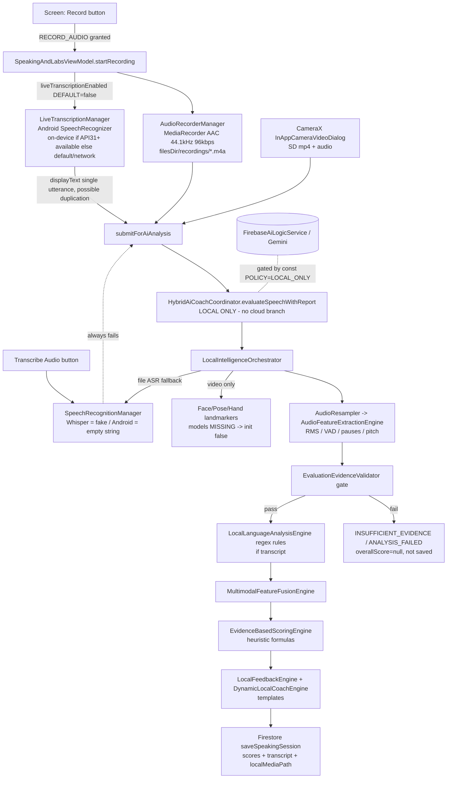

# SpeakCraft — AI, Speech & Media Pipeline Audit (read-only discovery)

Scope: `app/src/main/java/com/example/data/ai/**`, `data/media/*`, `data/youtube/YouTubeIntelligenceClient.kt`, `assets/models/README.md`, `app/docs/*.md`, related tests, plus the UI/ViewModel call sites and the `data/evaluation` scoring code the pipeline depends on.
Method: static reading only (no JDK/SDK, nothing was built or run). All paths are relative to `app/src/main/java/com/example/` unless they start with `app/`.
Legend: **[V]** = VERIFIED (seen in code at the cited line). **[I]** = INFERRED (reasoned from code plus platform/library behaviour; needs device confirmation).

---

## 0. Executive summary (the 12 things that matter most)

1. **The default pipeline is "audio-only DSP".** Live transcription is **off by default** (`data/preferences/AISettingsRepository.kt:26`, `AppPreferencesRepository.kt:44,163`) [V]. File transcription after recording never returns text: the Whisper path is fake (item 3), and the Android fallback **always returns an empty transcript** (`data/ai/local/audio/SpeechRecognitionManager.kt:113-126`) [V]. So out of the box, grammar and vocabulary are `null`, and "pronunciation" is a loudness/pitch/continuity proxy (`data/evaluation/EvidenceBasedScoringEngine.kt:428-453`) [V].
2. **No ML model ships.** `app/src/main/assets/models/` holds only `README.md` and `.gitkeep`. No code anywhere downloads a model (grep for `downloadUrl`/`DownloadManager` finds only the app-update code) [V].
3. **The Whisper TFLite path is stubbed and would be broken even with a model.** The "vocabulary" is a hand-invented map of about 200 IDs, including made-up tokens such as `369 to "Ġspeak", 370 to "Ġcraft"` (`LocalSpeechRecognitionEngine.kt:426-459`). The decode loop is a single greedy pass with no autoregressive decoder. The log-mel uses a naive O(N²) DFT, natural log and no Whisper normalisation (`:342-393`). The catalogue URL points to a whisper.cpp **GGML `.bin`** saved as `.tflite` (`OnDeviceModelManager.kt:84`) [V]. Moonshine is never executed (`LocalSpeechRecognitionEngine.kt:76` checks only `WHISPER_TINY_EN`) [V].
4. **False "ready" states.** `OnDeviceModelManager.isInstalled()` returns `true` for every `bundledInAssets` model without checking the file exists (`OnDeviceModelManager.kt:160-166`) [V]. Settings therefore shows "Video Intelligence: Available — MediaPipe face, posture, and hand gesture analysis ready" and "Bundled MediaPipe tasks ready" (`IntelligenceCapabilityManager.kt:274-280, 290-294`). At runtime every landmarker `initialize()` returns `false` because the `.task` assets are missing (`video/FaceLandmarkAnalysisEngine.kt:46-55`) [V].
5. **Cloud AI (Gemini via Firebase AI Logic) is fully coded but unreachable.** Every path is gated by the compile-time constant `LocalExecutionPolicy.POLICY = "LOCAL_ONLY"` (`local/LocalExecutionPolicy.kt:13-15`, `HybridAiCoachCoordinator.kt:74-75`) [V]. If re-enabled, it would upload raw audio/video (≤19 MiB inline), transcripts, profile name/goal/scores and history, and stream the live microphone (Gemini Live). There is **no consent flow** (grep for "consent": 0 hits) [V]. The cloud speech path also **bypasses the evidence gate** (`HybridAiCoachCoordinator.kt:198-212`) and re-introduces default scores (`76`, floor `20`; `FirebaseAiLogicService.kt:283-287`) [V].
6. **The "zero cloud" network guard is theatre.** `aiEndpointBlockingInterceptor` is **never attached** to any OkHttpClient (only referenced in its own file; `YouTubeIntelligenceClient.kt:61-65` builds a client without it) [V]. `ZeroCloudAiNetworkBoundaryTest` only calls the interceptor with a fake chain. Firebase AI uses its own HTTP stack and the `firebasevertexai.googleapis.com` host, which is not in the block list [I].
7. **The privacy statement is contradicted by the code.** Settings says "All speaking audio, video, and live transcripts stay on this device" (`ui/screens/AnalyticsAndSettingsScreens.kt:917`). But:
   - transcripts up to 15,000 chars are written to Firestore (`data/firebase/SpeakCraftRepository.kt:806`) [V];
   - when no on-device recogniser exists, live transcription uses `SpeechRecognizer.createSpeechRecognizer()`, i.e. the default (typically Google, network) recognition service (`LiveTranscriptionManager.kt:99-103`, `TtsAndSpeechHelper.kt:126`) [V code / I behaviour];
   - `allowBackup="true"` with empty rules means `filesDir/recordings` is eligible for Google Drive Auto Backup (`AndroidManifest.xml:18-20`, `res/xml/data_extraction_rules.xml`) [V config / I behaviour].
8. **Live transcription has correctness bugs.**
   - Each Android `SpeechRecognizer` session ends after one utterance, and nothing restarts it (no `EXTRA_SEGMENTED_SESSION`, no restart in `onFinal`; `LiveTranscriptionManager.kt:161-166, 363-381`). A 60-second answer is typically transcribed only up to the first pause [V code / I behaviour].
   - `stopTranscription()` promotes the partial text to final (`:418-431`). Android then still delivers `onResults` for the same utterance, which is appended again, so text is duplicated (`:363-380`). `submitForAiAnalysis` reads this duplicated `displayText` (`ui/viewmodel/SpeakingAndLabsViewModel.kt:459-463`) [V code / I timing].
   - The manifest has no `<queries>` entry for `android.speech.RecognitionService` (`AndroidManifest.xml:1-49`). With `targetSdk 36`, `SpeechRecognizer.isRecognitionAvailable()` can return false and binding can fail on API 30+ [I, high confidence; needs a device check].
   - `MediaRecorder` and `SpeechRecognizer` capture the mic at the same time (`SpeakingAndLabsViewModel.kt:228, 256-258`). Android's concurrent-capture policy may silence one of them [I].
9. **Several DSP metrics are dead or constant.**
   - "Background noise" can never exceed about 0.015, so every `> 0.06f`/`> 0.08f` noise check is unreachable (`AudioFeatureExtractionEngine.kt:97-108` vs `LocalFeedbackEngine.kt:238`, `MultimodalFeatureFusionEngine.kt:59`, `EvidenceBasedScoringEngine.kt:436`) [V].
   - `speakingRateConsistencyScore` is always `1.0` in the main pipeline because features are extracted with an empty transcript (`LocalIntelligenceOrchestrator.kt:114`, `AudioFeatureExtractionEngine.kt:192-195`). That adds a constant +12 to fluency and produces a fabricated "Steady vocal pacing consistency (100%)" strength in audio-only mode (`LocalFeedbackEngine.kt:121-128`) [V].
   - A single sample above 32000 flags "clipping" (`AudioFeatureExtractionEngine.kt:71,75`) [V].
10. **Scores are heuristic proxies with fixed baselines.** The root-cause doc says baselines were removed, but grammar is still `78 + bonus − penalties` (`EvidenceBasedScoringEngine.kt:543`). Fluency starts at 38 (`:355`), audio-only pronunciation at 20 (`:438`), delivery at 18 (`:487`) and video at 30 (`:637`) [V]. ASR confidence is fabricated: a constant 0.85 (`SpeakingAndLabsViewModel.kt:129`) or 0.94 after file transcription (`:193`); the live recogniser's `CONFIDENCE_SCORES` are never read (`LiveTranscriptionManager.kt:138-145`) [V].
11. **Grammar and structure rules over-fire on spoken, unpunctuated ASR text.** Sentence splitting relies on `.!?` (`LocalLanguageAnalysisEngine.kt:683-684`), so a whole transcript counts as one sentence. Any answer over 45, 30 or 26 words gets three separate run-on complaints (`LocalLanguageAnalysisEngine.kt:571-586`, `LocalFeedbackEngine.kt:346-349`, `DynamicLocalCoachEngine.kt:432-435`) plus a grammar −8 run-on penalty (`EvidenceBasedScoringEngine.kt:542`) [V code; I that ASR omits punctuation]. Many rules have obvious false positives (§6).
12. **Lots of duplicated or dead code.** There are 4 speech-recognition wrappers, 4 feedback generators (2 dead), 5 "availability" sources and a dead cloud stack. The `mediapipe tasks-audio` dependency is unused. Details in §12.

---

## 1. End-to-end pipeline as implemented

### 1.1 Main Speaking Lab / Challenges / Labs path (`SpeakingAndLabsViewModel`)

| Step | Class / function (evidence) | Reality |
|---|---|---|
| Permission | Screens request `RECORD_AUDIO` before calling `startRecording` (e.g. `ui/screens/LabsAndTrainingScreens.kt:175-176`). Video needs CAMERA+MIC via `RequestMultiplePermissions` (`ui/screens/SpeakingAndChallengesScreens.kt:156-167`) [V] | Real |
| Record audio | `SpeakingAndLabsViewModel.startRecording` (`:208-280`) → `AudioRecorderManager.startRecording` (`data/media/AudioRecorderManager.kt:59-113`): MediaRecorder, MIC, MPEG_4/AAC, 96 kbps, 44.1 kHz, `filesDir/recordings/speakcraft_rec_<ts>.m4a` (`:57,62,72-77`) [V] | **Real** |
| Record video (optional) | `InAppCameraVideoDialog` (`data/media/CameraVideoRecorder.kt:66-244`): CameraX `Quality.SD` + audio → `filesDir/recordings/speakcraft_vid_<ts>.mp4` (`:103, 201-206`). Upload is via `PickVisualMedia.VideoOnly` (`SpeakingAndChallengesScreens.kt:394`), copied to `recordings/speakcraft_clip_<ts>` (`SpeakingAndLabsViewModel.kt:377-378`) [V] | **Real** |
| Live transcript (optional, **default OFF**) | `LiveTranscriptionManager.startTranscription` (`data/ai/local/audio/LiveTranscriptionManager.kt:278-403`), started right after the recorder (`SpeakingAndLabsViewModel.kt:256-258`) → `AndroidLiveRecognizerBackend` (`:71-194`) [V] | **Real but partial**: single utterance, duplication bug, network recogniser when no on-device one (§2) |
| Post-hoc transcription (button "Transcribe Audio", `SpeakingAndChallengesScreens.kt:460-475`) | `HybridAiCoachCoordinator.transcribeAudio` (`data/ai/HybridAiCoachCoordinator.kt:107-148`) → `SpeechRecognitionManager.transcribe` (`local/audio/SpeechRecognitionManager.kt:88-138`) [V] | **Stubbed**: Whisper is never installable, and the Android branch returns `""` with a notice (`:113-126`) |
| Evidence gate | `LocalIntelligenceOrchestrator.evaluateSpeechWithReport` (`local/LocalIntelligenceOrchestrator.kt:66-310`) → `EvaluationEvidenceValidator.validate` (`data/evaluation/EvaluationEvidenceValidator.kt:49+`): duration ≥1.5 s, RMS ≥0.008, voiced ≥0.5 s, transcript session id must match (`:42-45, 59-75`) [V] | **Real** |
| Decode | `AudioResampler.decodeToPcm16Mono16k` (`local/audio/AudioResampler.kt:30-43`): WAV fast path, then MediaExtractor/MediaCodec, mono downmix, linear-interpolation resample to 16 kHz, cap 600 s [V] | **Real** (memory risk, §11) |
| Acoustic DSP | `AudioFeatureExtractionEngine.extract` (`local/audio/AudioFeatureExtractionEngine.kt:57-223`): RMS, dBFS, 20 ms-frame energy VAD (0.015), pauses ≥300/750 ms, difference-function pitch 80–400 Hz [V] | **Heuristic** (some sub-metrics dead or constant, §7) |
| Video landmarks (only if video) | `VideoFrameProcessingEngine.extractFrames` (1 fps, ≤60 frames, ≤640 px) → Face/Body/Gesture engines (`LocalIntelligenceOrchestrator.kt:137-169`) [V] | **Code real, models absent** → each `initialize()` returns false → video dimension `null` (partial) |
| Language analysis | `LocalLanguageAnalysisEngine.analyze` (`local/language/LocalLanguageAnalysisEngine.kt:512-615`), only when a transcript exists (`LocalIntelligenceOrchestrator.kt:244-255`) [V] | **Heuristic** (≈40 regex rules) |
| Pronunciation | `PronunciationAnalysisEngine.analyze` only if `extraInstructions` contains `"Expected:"` (`LocalIntelligenceOrchestrator.kt:257-260, 938-943`) [V] | **Heuristic proxy** (word alignment of ASR output) |
| Fusion | `MultimodalFeatureFusionEngine.fuse` (`local/fusion/MultimodalFeatureFusionEngine.kt:35-139`) [V] | Aggregator only |
| Score | `EvidenceBasedScoringEngine.score` (`data/evaluation/EvidenceBasedScoringEngine.kt:45+`): 5 dimensions (+video), overall = mean of evaluated dimensions (`:170`) [V] | **Heuristic formulas** with baselines (§7) |
| Feedback text | `LocalFeedbackEngine.buildFeedback` (`local/language/LocalFeedbackEngine.kt:410-483`) = 6 sub-engines + `DynamicLocalCoachEngine.analyze` [V] | **Template/heuristic** (deterministic) |
| Persist | Only if `COMPLETED`: `repository.saveSpeakingSession` → Firestore `users/{uid}/speakingSessions` incl. `transcript` (≤15k chars), `localMediaPath`, all scores (`SpeakingAndLabsViewModel.kt:533-548`; `data/firebase/SpeakCraftRepository.kt:783-823`) [V] | **Real** (transcript leaves device) |
| Retention | Media is only deleted when a saved session is deleted (`SpeakingAndLabsViewModel.kt:586-592`; `SpeakCraftRepository.kt:908-909`). Failed, discarded or "record again" attempts are never cleaned up [V] | Partial |

### 1.2 Diagram



ASCII summary:
```
mic --MediaRecorder--> .m4a ---------------------------+
mic --SpeechRecognizer (opt-in, 1 utterance)--> text --+--> Orchestrator --> decode->DSP --> GATE --> regex NLP --> heuristic scores --> templates --> Firestore
                                    file-ASR: always "" ┘                     video->MediaPipe (models absent => null)
                                                    Cloud Gemini: compiled in, unreachable (const LOCAL_ONLY)
```

### 1.3 Other pipelines that reuse these components
- **Activity engine** (`ui/viewmodel/ActivityEngineViewModel.kt`, `data/activity/UniversalEvaluationEngine.kt:170-236`): runs the same validator, then text-only `LocalLanguageAnalysisEngine` + `DynamicLocalCoachEngine.analyzeUserDraft` (`UniversalEvaluationEngine.kt:247-256`). **Video is simulated**: `videoFramesAnalyzed = 1` and `videoAnalysisCompleted = true` are set whenever the video file exists, and no MediaPipe runs (`UniversalEvaluationEngine.kt:200-201`) [V].
- **Mentor chat**: `LocalIntelligenceOrchestrator.askMentorStream` (`:566-775`) builds a template string and "streams" it in 56-char chunks with `delay(4L)` (`:770-774`) [V]. That is simulated streaming. With no profile it invents values: weakest skill `"Fluency" to 62L` and strongest `"Listening" to 72L` (`:960, 973`) [V].
- **Conversation partner**: template responses plus keyword echo (`:395-513`) [V].
- **Vocabulary**: `LocalVocabularyEvaluator` stage 4 (via orchestrator `:360-389`) and stage 2 (via `data/learning/LocalVocabularyQuizEngine.kt:68`) [V].
- **YouTube lessons**: `YouTubeIntelligenceClient` scraping, then local sentence extraction (`LocalIntelligenceOrchestrator.kt:818-917`) [V].

---

## 2. Speech recognition

### 2.1 Android SpeechRecognizer usages (two independent wrappers)

| Wrapper | Recognizer creation | Language | Offline flag | Confidence |
|---|---|---|---|---|
| `AndroidLiveRecognizerBackend` (`LiveTranscriptionManager.kt:71-194`) | `createOnDeviceSpeechRecognizer` only if `preferOffline && API≥31 && isOnDeviceRecognitionAvailable`; otherwise `createSpeechRecognizer` (default service) (`:99-103`) [V] | `settings.selectedRecognitionLanguage` (default `en-US`; options en-US/GB/AU/IN per docs) (`:163`) [V] | `EXTRA_PREFER_OFFLINE = preferOffline`, where `preferOffline = engine != AUTO \|\| offlineOk` (`:165, 340`) [V]. With AUTO and no on-device recogniser, it is **false**, so the network recogniser is allowed | Not read: only `RESULTS_RECOGNITION.firstOrNull()` (`:138-145`) [V] |
| `TtsAndSpeechHelper.startLiveSpeechCapture` (`data/media/TtsAndSpeechHelper.kt:109-234`), used by conversation/mentor voice turns (`ui/screens/ConversationAndMentorScreens.kt:126,345,396,618,834`) | Always `createSpeechRecognizer` (`:126`) [V], although the KDoc says "Full on-device speech capture" (`:105-108`) | **Hard-coded `Locale.US`** (`:218`) [V]; ignores the user setting | `EXTRA_PREFER_OFFLINE=true` (a hint only) (`:221-223`) [V/I] | Reads `CONFIDENCE_SCORES`, but falls back to invented `0.78f` (`:175-179`) and salvages partials at `0.55f` (`:150-163`) [V] |

Notes:
- `EXTRA_PREFER_OFFLINE` is advisory. Without an installed offline pack, the default Google service can stream audio to servers [I].
- `LocalSpeechRecognitionEngine.handleOfflineFallback` builds an Intent with `EXTRA_PREFER_OFFLINE` that is **never used**, only logged (`LocalSpeechRecognitionEngine.kt:99-106`) [V].
- **Single-utterance sessions.** Neither wrapper sets `EXTRA_SEGMENTED_SESSION` (API 33+) or silence-length extras, and `onFinal` never restarts listening (`LiveTranscriptionManager.kt:363-381`). The UI only retries on error (`onRetry = { speakingVm.retryLiveTranscription() }`, e.g. `SpeakingAndChallengesScreens.kt:274`) [V]. Android ends a session at end-of-speech, so continuous monologue capture is not implemented [I, documented behaviour]. Test `08` (`app/src/test/java/com/example/LiveTranscriptionManagerTest.kt:165-178`) feeds two `onFinal`s to one listener, which a real recogniser would not do.
- **Duplication on stop.** `stopTranscription()` merges `partialText` into `finalizedText` (`LiveTranscriptionManager.kt:418-431`). The session id is unchanged, so the `onResults` delivered after `stopListening()` passes the guard (`:364`) and is appended (`:366`) [V code / I that Android delivers final results after `stopListening`, as documented]. `submitForAiAnalysis` reads `displayText` later, at submit time (`SpeakingAndLabsViewModel.kt:459-463`) [V]. This inflates word count, WPM and filler counts. Test `11` (`LiveTranscriptionManagerTest.kt:208-221`) does not deliver a late final.
- **Benign errors are reported as "Initialization Failed".** Any `onError` (including `ERROR_NO_MATCH` or a speech timeout) calls `capabilityManager.recordRecognizerInitFailure(message)` (`LiveTranscriptionManager.kt:385`), and Settings shows `INITIALIZATION_FAILED` (`IntelligenceCapabilityManager.kt:177-183`) until the next `onReady` [V].
- **Package visibility.** No `<queries><intent><action android:name="android.speech.RecognitionService"/></intent></queries>` in the manifest (`app/src/main/AndroidManifest.xml:1-49`), with `targetSdk = 36` (`app/build.gradle.kts:30`) [V]. On API 30+ this commonly makes `isRecognitionAvailable()` return false or binding fail. `AndroidLiveRecognizerBackend.startListening` then fails fast (`:92-94`) [I — must be checked on a device].
- **Concurrent mic.** The recorder starts first (`SpeakingAndLabsViewModel.kt:228`), then the recogniser (`:256-258`). Under Android 10+ concurrent-capture rules, one client may receive silence [I]. If the m4a gets silence, the evidence gate rejects it as `SILENT_AUDIO`. If the recogniser does, `ERROR_AUDIO` or `NO_MATCH` follows.

### 2.2 Whisper / Moonshine TFLite path

| Aspect | Finding |
|---|---|
| Model acquisition | Catalogue only (`OnDeviceModelManager.kt:75-146`). **No download code exists** [V]. Whisper URL = `huggingface.co/ggerganov/whisper.cpp/.../ggml-tiny.en.bin` (`:84`), a GGML file, not a TFLite flatbuffer [V]. If saved as `whisper-tiny-en.tflite`, `Interpreter(modelFile)` would throw, be caught, and return "Transcription failed" (`LocalSpeechRecognitionEngine.kt:143, 262-271`) [I]. The Moonshine URL `usefulsensors/moonshine/.../moonshine-tiny-int8.tflite` (`:98`) is likely not a real artifact [I] |
| Integrity | All `sha256Hash = ""` (`OnDeviceModelManager.kt:83,97,111,125,139`). `verifyIntegrity` returns **true** for a blank hash (`:191`) and for bundled models (`:190`) [V]. `SpeechRecognitionManager.validateModelIntegrity` is called only from a test (`app/src/test/.../SpeechRecognitionManagerTest.kt:59-66`) [V] |
| Storage | `filesDir/ai_models/<fileName>` (`OnDeviceModelManager.kt:152-154`); with a null context it falls back to `java.io.tmpdir` [V] |
| Log-mel | Present but non-conformant. Naive DFT inside nested loops, with `cos`/`sin` computed per sample per bin: about 201×400 trig pairs per frame × 3000 frames per 30 s window (`LocalSpeechRecognitionEngine.kt:358-374`) [V]. Uses `ln` (`:388`), whereas Whisper uses log10 with clamp to max−8 and `(x+4)/4` scaling. HTK-style mel (`:395-419`), not Slaney [V/I]. Even a correct model would get the wrong input distribution |
| Tokenizer/decoder | **Fabricated.** `WHISPER_ENGLISH_VOCAB` maps about 200 IDs to invented words (`:426-459`), e.g. 257 → "Ġthe" (real GPT-2 257 is a BPE merge), 369/370 → "speak"/"craft". Unknown IDs in 32..126 are emitted as raw ASCII chars (`:325-328`). No byte-level BPE decoding, no merges file, no SOT/language/task prompt, no autoregressive loop. One `interpreter.run` per 30 s window with argmax per output step (`:170-197`) [V] |
| Confidence | Default `0.85f` (`:151`), or the mean sigmoid of max logits (`:188-191`) [V] |
| Moonshine | Never runs: `SpeechRecognitionManager` counts Moonshine as "primary" (`SpeechRecognitionManager.kt:48-50`), but `LocalSpeechRecognitionEngine.transcribe` checks only Whisper (`:76-79`) and falls back [V] |
| Runtime with models absent (actual state) | `checkAvailability` gives `audio-only-fallback`, or `android-speech-offline-engine` on API 31+ with an on-device recogniser (`SpeechRecognitionManager.kt:62-66`). `transcribe()` returns `""` either way (`:113-137`). The coordinator turns this into failure text that tells users to "install the optional lightweight speech model (~39 MB) in Settings" (`:124`), which is impossible because Settings has no download control (`AnalyticsAndSettingsScreens.kt:861` shows only a status string) [V] |

**Verdict:** file-based on-device ASR = **STUBBED/BROKEN**. Live Android ASR = **PARTIALLY_IMPLEMENTED**.

---

## 3. MediaPipe video (face / pose / hand)

- **Models present?** No. `assets/models/` contains only `README.md` and `.gitkeep`. The README claims "Bundled MediaPipe models" (`app/src/main/assets/models/README.md:3-6`). Each engine looks for `models/<name>.task` in assets, then `filesDir/ai_models/<name>.task` (`FaceLandmarkAnalysisEngine.kt:14, 41-55`; `BodyLanguageAnalysisEngine.kt:15, 41-49`; `GestureAnalysisEngine.kt:14, 43-57`) [V]. Nothing writes to `ai_models` [V].
- **Without models.** `initialize()` returns false. The orchestrator skips analysis and sets `videoAnalysisCompleted = (face != null || posture != null)` = false (`LocalIntelligenceOrchestrator.kt:143-158`). The validator marks video invalid (`EvaluationEvidenceValidator.kt:201-209`). If audio is valid, `video_presence` becomes `null` and the report is flagged partial (`EvidenceBasedScoringEngine.kt:619-629`) [V]. Meanwhile Settings shows Video Intelligence **AVAILABLE** (false positive, §5) [V]. Frame extraction still runs and decodes up to 60 bitmaps before discovering no model (`LocalIntelligenceOrchestrator.kt:139-141`) [V].
- **What it would compute with models (IMAGE mode, 1 fps keyframes `OPTION_CLOSEST_SYNC`, `VideoFrameProcessingEngine.kt:130-134`):**
  - Face (`FaceLandmarkAnalysisEngine.kt:79-184`): detection rate; "yaw" = `(dxRight−dxLeft)/(dxRight+dxLeft)*45` from landmarks 1/234/454 (`:125-131`); "pitch" from 10/152 (`:134-135`); "facing camera" if |yaw| < 15. Its own limitation text says it is not validated eye contact (`:180`) [V]. Meaningful only as "face in frame / roughly frontal".
  - Pose (`BodyLanguageAnalysisEngine.kt:64-169`): shoulder Y difference > 0.05 = "uneven" (`:100-102`); nose-X std-dev bands for "movement" (`:125-134`); centring from mean nose X (`:140-147`). **`headTiltAlert` is actually shoulder unevenness** (`:167`), yet feedback says "Frequent head tilt observed" (`LocalFeedbackEngine.kt:298-303`) [V]. Meaningful only as framing/stability hints.
  - Hands (`GestureAnalysisEngine.kt:79-185`): `gestureFrequency` = fraction of frames with any hand visible (`:130`), which is not gesture frequency. Wrist-X std-dev is the "consistency" (`:134-147`) [V]. Weak signal. Visible hands ≠ gesturing.
  - `video_presence` score = `30 + face%*35 + body%*30 + 6 (any hand) − 10 (uneven shoulders)`, clamped 15–98 (`EvidenceBasedScoringEngine.kt:631-638`) [V]. This is a framing score, not body language.
- **Activity-engine video is simulated** (`UniversalEvaluationEngine.kt:200-201`) [V].

---

## 4. Cloud AI — FirebaseAiLogicService & GeminiCoachService (privacy-critical)

### 4.1 Reachability
- `LocalExecutionPolicy.POLICY` is a `const val` = `"LOCAL_ONLY"`, and `isLocalOnly()` is effectively constant `true` (`local/LocalExecutionPolicy.kt:13-15`) [V].
- Every cloud call in `HybridAiCoachCoordinator` is behind `isCloudAiEnabled()`, which returns `false` first when local-only (`HybridAiCoachCoordinator.kt:74-78`). `cloudAiEnabledFlow` is `flowOf(false)` (`:56-63`) [V].
- User toggle: `AISettings.cloudAiEnabled` **default `false`** (`data/preferences/AISettingsRepository.kt:23`; `AppPreferencesRepository.kt:40,159`). `effectiveCloudAiEnabled = cloudAiSupportedInBuild && cloudAiEnabled`, with `cloudAiSupportedInBuild = !isLocalOnly()` = false (`AISettingsRepository.kt:24, 33-34`). `setCloudAiEnabled(true)` is rejected (`AISettingsRepository.kt:71-75`; coordinator `:86-101`). The Settings `Switch` is disabled and labelled "Unavailable • Zero-Cloud-AI Policy" (`ui/screens/AnalyticsAndSettingsScreens.kt:663-688`) [V].
- **Conclusion:** in this build no cloud AI call can happen at runtime [V]. The code is **DEAD but shipped**: `firebase-ai` is a dependency (`app/build.gradle.kts:135`), `FirebaseAiLogicService` is instantiated lazily in `AppContainer` (`data/AppContainer.kt:43-45`), and App Check (reCAPTCHA + debug) is configured (`data/firebase/AppCheckConfig.kt`).
- `GeminiCoachService` is `@Deprecated`, and every method throws `UnsupportedOperationException` (`data/ai/GeminiCoachService.kt:20-87`). It is only referenced from deprecated secondary ViewModel constructors (e.g. `SpeakingAndLabsViewModel.kt:52-61`) and a test [V]. It also hosts the `ExtractedYouTubeBundle` and `VocabEvaluationResult` data classes still used elsewhere (`:6-18`).

### 4.2 Model names (`FirebaseAiLogicService.kt:80-84, 105, 488, 556`)
`balanced` → `gemini-3.8-flash`, `deep` → `gemini-4-argon`, `fast` → `gemini-3.5-flash-lite`. Transcription and Live are hard-wired to `gemini-3.8-flash`; vocabulary to `gemini-3.5-flash-lite` [V]. **UNKNOWN** whether these are valid published model IDs ("argon" looks like a codename). If invalid, every cloud call would fail. The tier is read from `prefsRepo`, not `aiSettingsRepo` (`HybridAiCoachCoordinator.kt:80-84`), a minor inconsistency [V].

### 4.3 What would leave the device if cloud were enabled (exact payloads) [V]

| Function (FirebaseAiLogicService.kt) | Data sent | Limits |
|---|---|---|
| `transcribeAudio` (`:90-144`) | **Raw audio bytes inline** + MIME + topic hint | ≤19 MiB (`MAX_INLINE_MEDIA_BYTES`, `:45`); hint ≤200 chars (`:121`); 60 s timeout (`:44`) |
| `analyzeSpeechRecording` (`:150-300`) | **Raw audio or video bytes inline** (`:222-224`), module, prompt title, duration, previous session title/fluency/grammar/WPM (`:217-219`), extra instructions, **full live transcript** (`:234-236`, no length cap) | ≤19 MiB |
| `askMentorStream` (`:306-378`) | **Profile displayName, communicationLevel, primaryGoal, six skill scores** (`:322-333`), last 4 sessions' titles/scores/WPM/fillers (`:334-342`), latest drill, last 12 chat turns (`:359-362`), the question | none on question |
| `generateConversationTurn` (`:384-430`) | scenario, level, last 16 turns, message | 260 output tokens |
| `generateConversationCheckIn` (`:432-470`) | scenario + **entire conversation transcript** | none |
| `startLiveVoiceSession` (`:476-534`) | **Continuous bidirectional microphone audio** (Gemini Live `startAudioConversation`, voice "Aoede", input and output transcription) | session-based |
| `evaluateVocabularyUsage` (`:540-597`) | word, meaning, user sentence | — |
| `extractYouTubeLessons` (`:603-708`) | title, URL, description (≤2500), captions (≤6500) | — |
| `evaluateUniversalActivity` (`:714-838`) | **media bytes inline** (`:755-762`), activity rubric, checklist, local metrics, user text (≤4000) | ≤19 MiB |

Further issues if cloud were re-enabled:
- No explicit consent and no per-feature disclosure (grep "consent" in main: 0 hits) [V].
- The coordinator's cloud `analyzeSpeechRecording` branch runs **before and instead of** the evidence gate (`HybridAiCoachCoordinator.kt:198-212`) [V]. That branch is unused by the UI today; only the coordinator's `evaluateSpeechWithReport` is called (`SpeakingAndLabsViewModel.kt:514`), and it has no cloud branch (`HybridAiCoachCoordinator.kt:150-184`) [V].
- Fabricated defaults when the model omits fields: scores `optInt(..., 76).coerceIn(20,100)` (`:283-287`), WPM fallback `130` (`:255`), activity overall `74` (`:783`), dimension = overall when missing (`:798-805`) [V]. This is the same failure mode as the "78/100 bug" documented in `app/docs/COACH_EVALUATION_ROOT_CAUSE.md`.
- `startLiveVoiceSession` swallows tool calls with a stub `{"status":"ok"}` (`:508-510`) [V].
- `startCloudLiveVoiceCall` is never called from UI (grep) [V]. The voice-call UI uses local dictation (`ConversationAndMentorScreens.kt:344-354`).

### 4.4 Relation to `ZeroCloudAiNetworkBoundaryTest` and the "zero cloud AI" claims
- The test (`app/src/test/java/com/example/ZeroCloudAiNetworkBoundaryTest.kt:21-108`) checks three things: the constant value, the interceptor against a hand-made `Interceptor.Chain`, and that `GeminiCoachService` throws [V]. It proves nothing about real traffic:
  - `aiEndpointBlockingInterceptor` (`LocalExecutionPolicy.kt:35-48`) is **never added** to any `OkHttpClient` in main code (grep: only its own file) [V]. `YouTubeIntelligenceClient`'s client lacks it (`YouTubeIntelligenceClient.kt:61-65`) [V].
  - `BLOCKED_AI_DOMAINS` (`:18-25`) lists `generativelanguage.googleapis.com` and `firebaseml.googleapis.com`. Firebase AI Logic (`firebase-ai`) talks to `firebasevertexai.googleapis.com` through its own HTTP client, so it would neither match nor pass through OkHttp interceptors [I].
  - The actual guarantee is the compile-time constant plus the `isCloudAiEnabled()` short-circuits [V].
- `assets/models/README.md:12-14` says zero LLMs and "0 MB downloaded models". That is true of the local feedback path [V], but the APK ships a full Gemini client [V].
- `app/docs/CENTRALIZED_AI_SETTINGS.md:23` and the Settings text (`AnalyticsAndSettingsScreens.kt:917`) say audio, video and transcripts stay on device. This is contradicted by: Firestore transcript storage (`SpeakCraftRepository.kt:806`) [V]; the default/network SpeechRecognizer (§2.1) [V/I]; Auto Backup eligibility of `filesDir/recordings` (`AndroidManifest.xml:18-20`, empty `backup_rules.xml`/`data_extraction_rules.xml`) [V/I]; and `localMediaPath` (device path) synced to Firestore (`SpeakCraftRepository.kt:803`) [V].

---

## 5. Decision logic: HybridAiCoachCoordinator, IntelligenceCapabilityManager, OfflineAIAvailabilityManager, DeviceCapabilityManager, LocalExecutionPolicy, OnDeviceModelManager

### 5.1 How each concern is modelled

| Concern | Where | Assessment |
|---|---|---|
| User preference | `AISettings` (`AISettingsRepository.kt:21-34`); consumed in `HybridAiCoachCoordinator.evaluateSpeechWithReport` (`:179-182`) and `transcribeAudio` (`:117-121`) [V] | Modelled, but several toggles **don't do what they say**:<br/>• `localAiEnabled=false` does not disable grammar, vocab, mentor or conversation. It only feeds `enableAudioAnalysis` (grep: only coordinator `:181` and the capability matrix use it) [V].<br/>• `localAudioAnalysisEnabled=false` makes the orchestrator skip decoding, but the validator then decodes and extracts DSP itself (`EvaluationEvidenceValidator.kt:109-134`, because `audioRequired = true` in `LocalIntelligenceOrchestrator.kt:194`) and scoring proceeds. The toggle is ineffective [V]. |
| Model availability | `OnDeviceModelManager.isInstalled` (`:160-167`) [V] | **Conflated with "declared as bundled".** Returns `true` for MediaPipe without touching assets. Whisper "installed" = file exists (no format, size or hash check) |
| Device capability | `DeviceCapabilityManager.assess` (`:83-109`) [V] | `canRunMediaPipe` = RAM ≥256 MB (always true); `canRunWhisper` = RAM ≥512 MB. `DeviceProfile`, `hasNpu` (SoC-name substring match, `:190-206`), battery, thermal and `canRunConcurrently` are **computed but never consumed** (grep) [V]. The orchestrator's `capabilityManager` constructor param is unused (`LocalIntelligenceOrchestrator.kt:57`) [V] |
| Runtime availability | `IntelligenceCapabilityManager.runtimeInitError` (`:65-69`) set by `LiveTranscriptionManager` (`:316, 347, 385, 397`) [V] | A single global string. Any recogniser error is classed as init failure (§2.1) |
| Policy | `LocalExecutionPolicy.isLocalOnly()` [V] | Hard-coded |
| Aggregation | `OfflineAIAvailabilityManager.getStatus` (`:47-96`) → only `canAnalyzeVideo` is read by `IntelligenceCapabilityManager` (`:115-116`). `missingModels`, `limitationNotices` and `activeProfile` are unused outside (grep) [V] | Over-engineered and partially dead |

### 5.2 Contradictory states a user can see [V unless noted]
1. **"Video Intelligence (Camera/Pose): Available — MediaPipe face, posture, and hand gesture analysis ready"** and **"Bundled MediaPipe tasks ready"**, while no `.task` file exists (`IntelligenceCapabilityManager.kt:115-116, 274-280, 290-294` ← `OfflineAIAvailabilityManager.kt:68-71` ← `OnDeviceModelManager.kt:162-163`). If `offlineAvailabilityManager` is null, `faceModelReady = (context != null)`, which also gives a false positive (`:116`).
2. **"On-Device Speech Recognition: Enabled — Offline ASR verified via Android On-Device SpeechRecognizer"** (API 31+ with an on-device recogniser; `:227-233`), yet "Transcribe Audio" always fails because the Android file path returns `""` (`SpeechRecognitionManager.kt:113-126`).
3. **"Live Transcription: Ready (… • Offline verified)"** when only a Whisper file exists (`offlineSpeechAvailable = localAsrModelInstalled || androidOnDevice`, `:113, 203-205`). But live transcription never uses Whisper. It uses the Android default (possibly network) recogniser.
4. Engine preference `LOCAL_WHISPER` makes live transcription show **"Local Whisper (Model Check)"** (`LiveTranscriptionManager.kt:452`), while actually running Android `SpeechRecognizer` with `preferOffline=true` (`:340`).
5. Engine label **"Local Whisper Tiny INT8"** whenever any file named `whisper-tiny-en.tflite` exists (`IntelligenceCapabilityManager.kt:149-156`), even a GGML file that cannot load.
6. **"Live Transcription: Initialization Failed"** after a harmless no-match or timeout (§2.1).
7. **"Local Intelligence: Disabled"** while all local language engines keep running (§5.1).
8. Settings text "Model Availability: Not installed (Optional ~39 MB pack)" with no way to install (`AnalyticsAndSettingsScreens.kt:861`; `IntelligenceCapabilityManager.kt:283-288`).
9. `INTELLIGENCE_CAPABILITY_MATRIX.md:6` promises "Never mark an unavailable feature as enabled". Items 1–3 violate this.

Performance note: the matrix is computed on the main thread, both as the initial value of `collectAsStateWithLifecycle` (`ui/AppNavigation.kt:435-437`) and in the ViewModel constructor (`SpeakingAndLabsViewModel.kt:84`). This involves `registerReceiver`, `StatFs`, PackageManager queries and file stats [V/I minor jank].

---

## 6. Local language intelligence

### 6.1 `LocalLanguageAnalysisEngine` (`local/language/LocalLanguageAnalysisEngine.kt`)
- **About 40 regex rules** (`MODULAR_RULES`, `:76-499`). Families: SVA (8), TNS (3), ART (2), PRP (6), PRN (3), NUM (3), WCH (4), STR (3), SPK (11). Plus FRG_001 fragment (`:549-569`), RUN_001 run-on >45 words (`:65, 571-586`) and REP_001 adjacent duplicate (`:588-601`) [V].
- **Confidence gating is effectively constant.** Rules below `0.75` are skipped, or below `0.92` if transcript confidence <0.6 (`:524-527`). Every rule's confidence is ≥0.85, and the caller always passes a fabricated 0.85 or 0.94 (§0 item 10). So all rules always run [V].
- **Rule examples and likely false positives:**
  - `SVA_001` `\b(he|she|it|that|this)\s+(don't)\b` (`:81`): flags relative-clause *that* — "tools **that don't** work" becomes "that doesn't" [V/I].
  - `SVA_006` `(he|she|it)\s+(have|are|were|go|do)` (`:121`): flags the subjunctive "if **it were** up to me" and "I suggest that **he go**" [V/I].
  - `ART_001` `\ba\s+([aeiou][a-z]+)` with prefix exceptions `uni,use,usu,eur,one,once,ute,ubi,eup,eul` (`:67-69, 205-212`): flags "a **utility**", "a **urologist**" (prefixes `uti`/`uro` are not excepted) [V].
  - `ART_002` `\ban\s+([bcdf…][a-z]+)`, case-insensitive (`:217`): flags "an **MBA**", "an **FBI** agent", "an **SQL** query" (letter names start with vowel sounds). Silent-h list only (`:71-74`) [V/I].
  - `PRP_003` `explain\s+(me|him|her|them|us)` (`:247`): flags the correct "explain **them** to the team" [V/I].
  - `PRN_003` `myself\s+and\s+[a-z]+` (`:297`): "I taught myself and then…" becomes the nonsense correction "then and I" (`:299`) [V].
  - `NUM_001` `(two|…|many)\s+(year|month|day|…|minute|…)` (`:307`): flags compound adjectives "a **two year** contract", "a **five minute** talk" [V/I].
  - `SPK_006` `(can|…|will)\s+to\s+([a-z]+)` (`:446`): flags the noun "the **will to** win" [V/I].
  - `REP_001` `\b(\w{2,})\s+\1\b` (`:589`): flags grammatical "I know **that that** works" and "had had" [V/I].
  - `SVA_005` requires a plural ending in `s` (`:113`), so it misses "there is many **people**" [V].
- **Sentence splitting** `[.!?]+` (`:683-684`): Android ASR text usually lacks punctuation [I]. The whole answer becomes one sentence, so `RUN_001` fires above 45 words, and `averageSentenceLength` equals the total word count. The complexity note then says "Sentences are quite long" (`:691`) and the grammar dimension takes a run-on penalty (`EvidenceBasedScoringEngine.kt:542`) [V].
- **Vocabulary diversity** = unique non-stop words with length >2 ÷ **all** tokens (`:645-650`). This raw type-token ratio falls as answers get longer, so longer answers are penalised. "Repeated words" = >3 occurrences, excluding a 47-word stop list (`:501-507, 645`) [V].
- `applyCorrections` does a global, case-insensitive `String.replace` of each original span (`:621-635`), so it can rewrite unrelated occurrences [V].
- Deterministic: no randomness in `data/ai` or `data/evaluation` (grep) [V].

### 6.2 `FillerWordDetectionEngine` (`local/audio/FillerWordDetectionEngine.kt`)
- Fixed list: `um, uh, like, basically, actually, you know, sort of, kind of, right, okay so, i mean` (`:33-37`). Word-boundary regex, case-insensitive (`:57-64, 92-97`). Fillers per minute assume 125 WPM (`:71-74`) [V].
- False positives: "I **like** pizza", "turn **right**", "the **right** answer", "what **kind of** car", "**actually**" used for contrast [V/I]. False negatives: Google ASR usually drops "um"/"uh" from transcripts [I], so the most important disfluencies are under-counted while legitimate words are over-counted. "so", "well", "er" and "hmm" are not in the list (`er` appears only in `DynamicLocalCoachEngine.fillerCleanupRegex`, `:99-102`) [V].
- `RecommendationEngine` uses a substring test `allMistakesText.contains("um")`, which matches "n**um**ber", "maxim**um**", "vol**um**e" and routes the user to the "Zero-Filler Sprint" (`data/ai/RecommendationEngine.kt:34`) [V].

### 6.3 `DynamicLocalCoachEngine` (`local/language/DynamicLocalCoachEngine.kt`)
- Keyword topic extraction (frequency of words ≥4 chars, 60-word stop list) (`:60-68, 180-189`). Intent classification by single trigger words, e.g. any "team" or "project" means INTERVIEW (`:193-205`) [V].
- Hedge rewrites delete "kind of", "sort of", "basically", "actually", "literally" (`:70-83`). "What **kind of** car" becomes "What car" [V/I].
- Vague upgrades: "**a lot of**" becomes "**many**" (`:92`), which is ungrammatical with uncountables ("many water") [V/I].
- Run-on split at the conjunction nearest the middle (>24 words), inserting "[pause]" (`:329-344`). If nothing else applies it inserts "[1s pause]" mid-sentence in the first sentence, always (`:359-375`) [V].
- `hasOpeningAnchor` = first "sentence" ≥16 chars and not starting with um/uh (`:223-226`). With unpunctuated ASR this is almost always true, giving the "You launched cleanly…" praise [V/I]. Longest sentence >26 words gives a focus area (`:432-435`) [V].
- Narrative and micro-drill are template switches (`:460-559`) [V]. Deterministic.

### 6.4 `LocalFeedbackEngine` (+6 sub-engines) (`local/language/LocalFeedbackEngine.kt`)
- Grammar (`:22-57`), Fluency (WPM 120–170 is ideal, pauses 2–8, fillers; `:63-139`), Vocabulary (`:145-190`), Pronunciation (alignment, clipping, noise; `:196-251`), Confidence/delivery (dBFS −30..−6 is "strong projection", pitch SD ≥25 Hz is "dynamic melody"; face/posture; `:257-314`), Structure (max sentence ≥30 words = run-on; signpost list; `:320-369`) [V].
- Audio-only fabricated strength: "Steady vocal pacing consistency (100%)" (`:121-128`), because the score is constant 1.0 (§7) [V].
- The noise check `> 0.06f` (`:238`) is unreachable (§7) [V].
- Head-tilt text is driven by shoulder unevenness (`:298-303`) [V].

### 6.5 `LocalVocabularyEvaluator` (`local/language/LocalVocabularyEvaluator.kt`)
- Stage 2 (word speaking; `:81-196`): max over tokens of Levenshtein similarity, with exact match → 100, inflection → 96, Soundex-equal & sim ≥0.65 → ≥82. Pass ≥75 (`:123-143`). This measures "ASR returned that word", and a language-model-driven ASR snaps mispronunciations to dictionary words [I]. It overstates pronunciation ability.
- Stage 3 (`evaluatePracticeSentence`, `:202-316`): **no callers** (grep) [V]. DEAD.
- Stage 4 (own sentence; `:322-480`): composite of `0.40*context + 0.35*grammar + 0.25*completeness`, with arbitrary step tables (`:390-413`). Pass requires the target word, non-trivial, ≥4 words, ≥70 and ≤1 grammar issue (`:415-416`) [V].
- `isInflectionOf` accepts any candidate starting with a ≥5-char stem plus 1–5 letters (`:524`). "convey" (stem "conve") therefore accepts "**convenient**" [V].

### 6.6 `DeterministicFeedbackTemplates` / `LocalFeedbackGenerationEngine`
- `DeterministicFeedbackTemplates.buildFeedback` (`:62-80`) is **used only by a test** (`app/src/test/.../LocalLanguageAndOrchestratorTest.kt:63`). The file stays live only because it defines `LocalFeedbackEvidence` and `StructuredFeedback` (`:15-48`) [V]. Its "next task by evaluator" table duplicates `ImprovementRecommendationEngine` (`DeterministicFeedbackTemplates.kt:251-259` vs `LocalFeedbackEngine.kt:383-391`) [V].
- `LocalFeedbackGenerationEngine` is a 36-line wrapper with **zero references** in main or test (`local/language/LocalFeedbackGenerationEngine.kt:17-36`) [V].

---

## 7. Pronunciation & audio features — what is measured and what scores can claim

### 7.1 `AudioFeatureExtractionEngine` (`local/audio/AudioFeatureExtractionEngine.kt`) [V]

| Feature | Implementation | Validity |
|---|---|---|
| RMS / loudness | Whole-file RMS → dBFS (`:66-78`) | Includes silence. Depends on mic gain/AGC [I]. Not projection |
| Clipping | **Any one sample** with \|s\| > 32000 (`:71,75`) | Over-sensitive (a tap or plosive triggers it). Costs −10/−14 pronunciation and −12 delivery |
| VAD | 20 ms frames, fixed RMS threshold 0.015 (`:48-49, 95-101`) | Not noise-adaptive. Noise above 0.015 counts as "speech" and **raises** fluency |
| Background noise | Mean RMS of frames *below* 0.015 (`:99-108`) | **Bounded below 0.015**, so every `> 0.06/0.08` check is dead (`LocalFeedbackEngine.kt:238`, `MultimodalFeatureFusionEngine.kt:59`, `EvidenceBasedScoringEngine.kt:436`). Delivery noise penalty `noise*80` ≤ 1 point (`EvidenceBasedScoringEngine.kt:485`) |
| Pauses | Silent runs ≥300 ms (short) / ≥750 ms (long), including leading and trailing silence (`:115-140`) | Crude, but real |
| Pitch | Difference function at lags 40–200 (80–400 Hz), 40 ms windows on every other active frame, global min below 20% of `diff[minLag]` (`:143-183`) | No YIN normalisation or voicing check, so octave errors are likely [I]. Std-dev is in **Hz, not semitones**, which biases scores toward higher-pitched voices [I] |
| WPM | Words ÷ **total** duration (orchestrator recomputes, `LocalIntelligenceOrchestrator.kt:228-238`) | Underestimates (counts silence). With single-utterance live ASR, words cover only the first utterance, so WPM is grossly low [I] |
| Rate consistency | `1.0` unless the transcript was supplied at extraction and duration ≥20 s (`:192-195`) | Main pipeline extracts with `""` (`LocalIntelligenceOrchestrator.kt:114`) and the validator reuses those features (`EvaluationEvidenceValidator.kt:55`). **Always 1.0** gives a constant +12 fluency (`EvidenceBasedScoringEngine.kt:355`) |
| Articulation rate | Words ÷ voiced time (`:190`) | Always 0 in the main pipeline (same reason) |

### 7.2 `AudioResampler` (`local/audio/AudioResampler.kt`) [V]
- WAV fast path (`:123-169`), MediaCodec decode with `INFO_OUTPUT_FORMAT_CHANGED` tracking and an idle guard (`:190-276`), channel averaging (`:278-285`), linear interpolation resample **without an anti-alias low-pass filter** (`:287-307`, aliasing [I]). Cap: 600 s / 9.6 M samples (`:14-15, 54-57`); longer recordings are silently truncated.
- Memory issues: in §11.

### 7.3 `PronunciationAnalysisEngine` (`local/audio/PronunciationAnalysisEngine.kt`) [V]
- **Not phoneme-based.** Normalises contractions and digits 0–10 (`:68-92, 213-224`). Levenshtein-style word alignment with backtrace (`:233-301`). Credits: match 1.0, accent variant 0.9, substitution 0.3, deletion or insertion 0 (`:155-181`). It labels itself `isPhonemeLevel=false` and "Transcript-Based Word Alignment (Non-Phonetic)" (`:40-41`).
- `ACCENT_EQUIVALENTS` (`:95-113`) pairs real words with non-words ("tink", "dat", "wery", "vater"). An ASR with a language model will almost never output those, so the entries are effectively dead [I]. The "they're" equivalence can never fire because normalisation expands "they're" to "they are" first (`:68-85, 213-216`) [V].
- With no reference text it returns `matchScore = 1.0`, `wordAccuracy = 1.0` (`:125-141`). The orchestrator only calls it when "Expected:" text exists (`LocalIntelligenceOrchestrator.kt:258-260`), so that default is not scored [V].

### 7.4 What the scores are (`data/evaluation/EvidenceBasedScoringEngine.kt`) [V]
- **Fluency** = `38 + 34*speechRatio + 20*continuity + 12*rateConsistency(=1.0) − 4*fillers(≤24) ± WPM band (+6/0/−8) − long-pause penalty`, clamped 10–98 (`:354-372`).
- **Pronunciation (with reference text)** = `matchScore*100 + 4 (clean loudness) − 10 (clipping)` (`:411-415`). This is ASR word agreement.
- **Pronunciation (freeform, the common case)** = `20 + loudness band (16/28/36) + 0.45*pitchSD(≤50 Hz) + 30*continuity − noise(dead) − clipping` (`:428-438`). It measures **loudness, pitch variation and amount of voicing — not pronunciation**. It is labelled "Pronunciation & Clarity" with confidence 0.52/0.68.
- **Delivery** = `18 + loudness band + pitch band − noise − clipping` (`:474-487`).
- **Grammar** = `78 + length bonus (0/5/10/16) − 9 per issue − 8 if avg sentence >30 words` (`:533-543`). Mostly length- and punctuation-driven. **Vocabulary** = diversity + target bonus + length adjustment − repetition (`:594-598`).
- **Honest assessment:** the scores can claim "relative loudness, proportion of voiced time, rough pitch spread, pause counts and (with a transcript) rule-matched error counts on this device and mic". They **cannot** claim pronunciation accuracy, phoneme or prosody quality, intelligibility to listeners, grammatical accuracy (low recall, notable false positives), or comparability across devices, mics, rooms, genders or recording lengths. `overallScore` (`:170`) averages incommensurable proxies.

---

## 8. Multimodal fusion (`local/fusion/MultimodalFeatureFusionEngine.kt`) [V]
- It copies fields into `LocalFeedbackEvidence`, runs filler detection on the transcript (`:66-70`), picks a word count (raw whitespace split when language analysis exists, `:72-78`, which differs from the validator's `meaningfulWordCount`) and a WPM (`:80-84`), appends limitation notices (`:46-108`) and sets `processingMode` (`:111-116`).
- There is **no cross-modal reasoning**: no weighting, no alignment of audio/video timelines, no conflict resolution. The orchestrator overrides its WPM and duration right afterwards (`LocalIntelligenceOrchestrator.kt:282-286`) [V].
- Value: low. It is a data-transfer mapper whose name overstates its role. The noise notice (`:59`) is dead (§7).

---

## 9. YouTube client (`data/youtube/YouTubeIntelligenceClient.kt`) [V unless noted]
- **Fetching:**
  - Single video: GET `https://www.youtube.com/watch?v=<id>` with a **spoofed Chrome Mobile User-Agent** (`:199-201, 505-510`). Title, description, publish date and length are regex-scraped from the HTML (`:456-481`).
  - Captions: regex `"captionTracks":(\[.*?\])`, prefer `en*`, unescape `&`, GET the timedtext XML (`:391-412, 248-250`).
  - Playlist and channel: public **RSS** feeds `feeds/videos.xml?playlist_id=` / `channel_id=` (`:95, 123`). `@handle` is resolved by scraping the channel HTML for `"channelId"`/`"externalId"` (`:290-307`).
  - Optional **YouTube Data API v3** `search` with a **user-supplied key in the query string** (`:309-327`), from `prefs.youtubeApiKey` set in Settings (`ui/screens/AnalyticsAndSettingsScreens.kt:437`).
  - Up to 15 videos, 4 concurrent fetches (`:152-171`).
- **ToS/legal risk:**
  - Scraping watch pages and undocumented timedtext endpoints with a spoofed UA conflicts with YouTube's Terms, which prohibit automated access other than the official APIs [I, based on the published ToS].
  - Captions are copyrighted. Admin sync stores the full caption segments in Firestore (`ui/viewmodel/UpdateAndAdminViewModel.kt:365-382`, `segments = video.segments`).
  - Local extraction publishes **verbatim caption sentences** as `creatorAdvice` with `moderationStatus = "PUBLISHED"` (`LocalIntelligenceOrchestrator.kt:869, 882`). User audits save them directly (`ui/viewmodel/InteractiveCoachViewModel.kt:506-533`).
  - The API key sits in a URL (log/proxy exposure). `search.list` costs 100 quota units per call [I].
- **Fragility:**
  - HTML regexes break on markup changes or the EU consent interstitial (`consent.youtube.com`), leading to `NO_CAPTIONS` or a wrong title [I].
  - Non-greedy `\[.*?\]` stops at the first `]` if a track object contains a nested array [V regex / I format].
  - Timedtext now often requires a PO token for unauthenticated clients, which returns an empty body: "Caption track present but returned empty timedtext" (`:284-285`) [I].
  - Errors are swallowed to `null` (`:515-517`).
- **UI use:** `YouTubeIntelligenceScreen` runs an audit (`ui/screens/YouTubeIntelligenceScreen.kt:154`) via `InteractiveCoachViewModel.auditYouTubeUrl` (`:465-546`). For each video it calls `extractYouTubeLessons`, which is local sentence splitting: keyword category and difficulty (`LocalIntelligenceOrchestrator.kt:828-845`), first 5 sentences of 30–240 chars become "drills" with templated text and **synthetic timestamps `idx*45s`** (`:847-884`, `:880`). It saves `YouTubeSource` plus techniques to Firestore. `AdminDashboardScreen` does the same with auto-publish (`ui/screens/AdminDashboardScreen.kt:144`).

---

## 10. Media recording, files, TTS, permissions, interruptions

- **Audio:** `MediaRecorder` with `AudioSource.MIC`, MPEG_4/AAC, 96 kbps, 44.1 kHz, default (mono) channels. Pause/resume. Amplitude meter polls `maxAmplitude` every 80 ms on `Dispatchers.Default` (`AudioRecorderManager.kt:65-106`) [V]. There is no `setMaxDuration`/`setMaxFileSize`, so recording is unbounded. Analysis truncates at 600 s; uploads over 19 MiB are rejected (`SpeakingAndLabsViewModel.kt:40, 346-364, 414`) [V]. After stop, the duration comes from `MediaMetadataRetriever` (`AudioRecorderManager.kt:158-163, 241-253`) [V].
- **Video:** CameraX `Recorder` with `Quality.SD`, front camera default, `withAudioEnabled()` (`CameraVideoRecorder.kt:76, 102-112, 205-206`). Duration is wall-clock (`:207, 216-217`) [V]. Pressing **Close during recording** calls `stop()` and then `onDismiss()` (`:172-176`). The Finalize callback still calls `onVideoSaved`, so the clip is attached anyway (`:211-219`) [V code / I ordering].
- **Files:** `filesDir/recordings/` holds `speakcraft_rec_*.m4a`, `speakcraft_vid_*.mp4` and `speakcraft_clip_*` (copies of picked videos) [V]. `FileProvider` exposes `recordings/` and the whole `cache` (`res/xml/file_paths.xml`) [V]. Temp copies go to `cacheDir` and are deleted in `finally` (`LocalIntelligenceOrchestrator.kt:96-100, 307-309`; `HybridAiCoachCoordinator.kt:122-137`) [V].
- **Retention and deletion:** deleted only when a saved session is deleted (§1.1). No TTL and no cleanup of unsaved or failed attempts. The pre-update backup records only file names (`data/update/UpdateBackupManager.kt:39-53`). `allowBackup=true` with default rules [V]. Media is **not encrypted** at rest beyond app sandboxing [V].
- **TTS:** `TextToSpeech(applicationContext)` with `Locale.US` hard-coded (`TtsAndSpeechHelper.kt:56-63`). `speak()` silently no-ops until ready (`:68-72`). One instance is created in `AppNavigation` composition and released on dispose (`ui/AppNavigation.kt:301, 309-311`) [V]. Used for word, phrase and script playback and conversation replies (e.g. `ui/screens/LabsAndTrainingScreens.kt:143-151`, `ConversationAndMentorScreens.kt:130`) [V].
- **Permissions:** RECORD_AUDIO and CAMERA are declared (`AndroidManifest.xml:7-8`) and requested per screen before use (§1.1) [V]. `@SuppressLint("MissingPermission")` on the camera dialog (`CameraVideoRecorder.kt:65`) relies on the caller. `AudioRecorderManager` does not check the permission itself; a start failure becomes `RECORDING_FAILED` (`SpeakingAndLabsViewModel.kt:228-253`) [V].
- **Interruptions:** no lifecycle, audio-focus or telephony handling anywhere (grep for `ON_STOP`/`AudioFocus`/`TelephonyManager`/`ProcessLifecycleOwner`: none) [V]. Consequences [I]:
  - backgrounding during recording continues the file, but Android silences mic access for background apps without a microphone foreground service, so the recording gets silent gaps that skew pause and WPM metrics while the timer keeps counting;
  - calls are not detected;
  - `SpeechRecognizer` typically errors when backgrounded.
- **Shared recorder:** one `AudioRecorderManager` singleton is shared by `SpeakingAndLabsViewModel` and `ActivityEngineViewModel` (`ui/AppNavigation.kt:340, 397`). `SpeakingAndLabsViewModel.onCleared()` calls `audioManager.release()` on it (`:615-620`) [V]. A VM re-key (user change) can release a recorder in use elsewhere [I].

---

## 11. Performance, memory & threading risks

| Risk | Evidence | Severity |
|---|---|---|
| **Boxed `ArrayList<Short>` for decoded PCM** | `AudioResampler.kt:199, 247-249` [V]. A 2-min, 48 kHz stereo CameraX clip is about 11.5 M boxed `Short` objects (16 B each plus a reference), around 250–300 MB. A 10-min 44.1 kHz recording is about 26 M [I] | **High (OOM)** |
| Whole-file `readBytes()` before the WAV header check, for every format | `AudioResampler.kt:125` [V]. Up to 19 MiB+ extra per decode | Medium |
| Full media `ByteArray` loaded and passed, then ignored (file path preferred) | `SpeakingAndLabsViewModel.kt:466` (`readRecordedBytes`), `:418`; orchestrator prefers `localMediaPath` (`LocalIntelligenceOrchestrator.kt:88-90`) [V] | Medium |
| Up to 60 ARGB bitmaps (640 px) held at once; 3 landmarkers created, loaded and run sequentially per evaluation | `VideoFrameProcessingEngine.kt:100-164`, used at `LocalIntelligenceOrchestrator.kt:139-160`. The streaming `processFrames` (`:170-232`) is unused [V]. About 60 × 1.2 MB ≈ 74 MB [I] | Medium-High |
| Naive DFT log-mel (moot today) | `LocalSpeechRecognitionEngine.kt:358-374` [V]. About 2.4×10⁸ sin+cos per 30 s window, likely minutes on mobile [I] | High if ever enabled |
| Pitch loop cost | `AudioFeatureExtractionEngine.kt:146-178`: about 51k multiply-adds per analysed frame, a few hundred million for 10 min [I] | Low-Medium (runs on IO) |
| Main-thread capability computation | `ui/AppNavigation.kt:435-437`, `SpeakingAndLabsViewModel.kt:75-85` → `DeviceCapabilityManager.assess` (`registerReceiver`, `StatFs`) + `SpeechRecognizer.isRecognitionAvailable` + file stats [V] | Low-Medium (StrictMode) |
| Recogniser lifecycle | Android backend posts to the main looper (`LiveTranscriptionManager.kt:172-176, 180-193`) [V], OK. `TtsAndSpeechHelper` creates and destroys on the caller thread, which is UI clicks (`:122-126, 236-244`) [V], OK. Two independent recogniser wrappers can contend (`ERROR_RECOGNIZER_BUSY`) [I] | Low-Medium |
| MediaRecorder metering race | `recorder?.maxAmplitude` on Default vs `stop`/`release` on another thread (`AudioRecorderManager.kt:93-97, 152-157`) [V]; exceptions are caught | Low |
| Landmarker release | `release()` only runs after `initialize()` succeeds. Analysis is wrapped in `runCatching`, so the release paths are reached (`LocalIntelligenceOrchestrator.kt:143-157`) [V]. No leak observed | Low |
| Leaks | `TtsAndSpeechHelper` uses `applicationContext` [V]. `AudioRecorderManager.release` covers player and recorder [V]. No obvious Activity leaks found | Low |

---

## 12. Duplicated / dead code (verified with grep over `app/src/main` and `app/src/test`)

**Overlaps**
- **Speech recognition (4 wrappers):** `SpeechRecognitionManager` (file ASR facade, always `""` today), `LocalSpeechRecognitionEngine` (fake Whisper), `LiveTranscriptionManager` + `AndroidLiveRecognizerBackend` (real streaming), `TtsAndSpeechHelper.startLiveSpeechCapture` (second streaming wrapper with different language, offline and confidence semantics). Each has its own error mapping (`LiveTranscriptionManager.kt:116-134` vs `TtsAndSpeechHelper.kt:256-265`) [V].
- **Availability sources (5):** `IntelligenceCapabilityManager`, `OfflineAIAvailabilityManager`, `DeviceCapabilityManager`, `SpeechRecognitionManager.checkAvailability` (`:47-81`), `LiveTranscriptionManager.refreshFromSettings` (`:212-246`) [V].
- **Feedback generators:** `LocalFeedbackEngine` (live) + `DynamicLocalCoachEngine` (live) vs `DeterministicFeedbackTemplates.buildFeedback` (test-only) vs `LocalFeedbackGenerationEngine` (unreferenced). `ImprovementRecommendationEngine` vs `RecommendationEngine` (app-level). `UniversalEvaluationEngine` is a second scoring pipeline [V].
- **Cloud:** `GeminiCoachService` (throwing stub) vs `FirebaseAiLogicService` (gated) [V].
- **Text processing:** at least 5 tokenisers (`LocalLanguageAnalysisEngine.kt:686-687`, `PronunciationAnalysisEngine.kt:226-227`, `FillerWordDetectionEngine.kt:68-69`, `MultimodalFeatureFusionEngine.kt:73`, `AudioFeatureExtractionEngine.kt:185`) and 3 sentence splitters with 3 run-on thresholds: 45 (`LocalLanguageAnalysisEngine.kt:65`), 30 (`LocalFeedbackEngine.kt:346`), 26/24 (`DynamicLocalCoachEngine.kt:331, 433`) [V].
- **Model manager alias:** `LightweightModelManager` (`OnDeviceModelManager.kt:261`) is unused [V].

**Dead in production (no main-code caller)** [V]
- `GeminiCoachService` (deprecated constructors only).
- `FirebaseAiLogicService` methods (policy-gated).
- `HybridAiCoachCoordinator.analyzeSpeechRecording` (`:186-231`).
- `InteractiveCoachViewModel.startCloudLiveVoiceCall` (`:256-299`).
- `LocalIntelligenceOrchestrator.analyzeSpeechRecording` (`:312-343`, test-only) and `evaluateVocabularyUsage` (`:349-358`).
- `LocalExecutionPolicy.aiEndpointBlockingInterceptor` and `isBlockedAiEndpoint` (test-only).
- `DeterministicFeedbackTemplates.buildFeedback` (test-only) and `LocalFeedbackGenerationEngine` (none).
- `LocalVocabularyEvaluator.evaluatePracticeSentence`.
- `AudioResampler.decodeInChunks`, `AudioFeatureExtractionEngine.extractFromFile`.
- `VideoFrameProcessingEngine.processFrames` and `extractMetadata` (the method).
- `OnDeviceModelManager.recoverCorruptModel`, `unloadModel` (no-op, `:241-243`), `availableStorageBytes`.
- `SpeechRecognitionManager.validateModelIntegrity` (test-only).
- `DeviceCapabilityManager.canRunAudioAndVideoConcurrently`, `recommendedFrameSamplingIntervalMs`, `getProfile`.
- Fields `DeviceProfile`, `hasNpu`, `thermalStatus`, `batteryPct`, `AIAvailabilityStatus.missingModels/limitationNotices/activeProfile`.
- Moonshine catalogue entry.
- Dependency `mediapipe tasks-audio` (`app/build.gradle.kts:148-150`; no `mediapipe.tasks.audio` import in main).

---

## 13. Test coverage (meaningful vs merely constructed)

| Test | What it really verifies | Gaps |
|---|---|---|
| `ZeroCloudAiNetworkBoundaryTest` (`app/src/test/java/com/example/ZeroCloudAiNetworkBoundaryTest.kt:21-108`) | Constant value; interceptor on a fake chain; deprecated stub throws | Interceptor is never wired. Firebase AI endpoint is not covered. No real network assertion |
| `HybridAiCoachCoordinatorTest` (`…/HybridAiCoachCoordinatorTest.kt:26-133`) | Settings persistence and cloud rejection (meaningful); tier string mapping; local routing returns non-blank text; live voice rejected | No assertion on content quality. Never exercises `evaluateSpeechWithReport` |
| `LiveTranscriptionManagerTest` (`…/LiveTranscriptionManagerTest.kt:69-282`) | State machine with a **fake backend** (meaningful for the logic) | `AndroidLiveRecognizerBackend` untested. Test 08 encodes unrealistic multi-final behaviour. No late-final-after-stop case (duplication bug). Test 14's "error retry" claim only builds a data object (`:272-281`) |
| `LocalAIFoundationTest` (`…/LocalAIFoundationTest.kt:20-130`) | Catalogue constants, profile tiers, missing Whisper reported | Asserts `bundledInAssets=true` (`:80-88`) but never checks the asset exists, so it encodes the false-positive bug |
| `LocalAudioPipelineTest` (`…/LocalAudioPipelineTest.kt:15-97`) | Filler boundaries; alignment on synthetic strings; RMS/clipping on a sine wave | No pitch accuracy, VAD, noise or pause validation. Sine ≠ speech |
| `SpeechRecognitionManagerTest` (`…/SpeechRecognitionManagerTest.kt:17-66`) | Null-context fallbacks; empty-transcript behaviour | Whisper path, tokenizer and mel all untested |
| `LocalLanguageAndOrchestratorTest` (`…/LocalLanguageAndOrchestratorTest.kt:20-152`) | Issues non-empty; templates non-empty; fusion word count; local turns non-blank | Weak "isNotEmpty" assertions. Tests the dead `DeterministicFeedbackTemplates` |
| `UpgradedLocalIntelligenceTest` (`…/UpgradedLocalIntelligenceTest.kt:20-154`) | Specific SPK rules fire (meaningful positive cases); YouTube drill count | **No negative/false-positive tests** for any grammar rule |
| `LightweightFeedbackEngineTest` (`…/LightweightFeedbackEngineTest.kt:29-321`) | Sub-engine strings for crafted evidence | Crafted inputs bypass the constant/dead-metric bugs |
| `CoachEvaluationEvidenceTest` (`…/CoachEvaluationEvidenceTest.kt:91-480`) | Evidence gate states, null scores, stale transcripts, partial averaging (most valuable suite) | Uses synthetic **WAV** (`:52`), so the WAV fast path is used. The real **M4A/AAC MediaCodec path is never tested** (it cannot run on the JVM). Scores are checked for presence, not validity |
| `YouTubeParsingTest` (`…/YouTubeParsingTest.kt:18-74`) | URL regexes, RSS and timedtext parsing on fixtures | No HTML scraping or network tests |

Untested entirely:
- `AudioRecorderManager`, `CameraVideoRecorder`, `TtsAndSpeechHelper`;
- the three MediaPipe engines and `VideoFrameProcessingEngine`;
- `AudioResampler` MediaCodec path, `LocalSpeechRecognitionEngine` inference, `OnDeviceModelManager.verifyIntegrity` with a hash;
- the `IntelligenceCapabilityManager` video false positive (`CentralizedAiSettingsTest.kt:111` only checks `PERMISSION_REQUIRED`);
- `FirebaseAiLogicService` calls.

The pass report (`app/docs/COACH_AND_TRANSCRIPTION_TEST_REPORT.md:4-6`, "161 passed") is **UNKNOWN** because nothing could be built here.

---

## 14. Capability status classification

| Capability | Status | Key evidence |
|---|---|---|
| Audio recording (MediaRecorder AAC) | IMPLEMENTED (no interruption handling) | `AudioRecorderManager.kt:59-113` |
| In-app video recording (CameraX SD) | IMPLEMENTED (Close-attaches bug) | `CameraVideoRecorder.kt:94-226` |
| Video upload | IMPLEMENTED (video-only, ≤19 MiB) | `SpeakingAndLabsViewModel.kt:311-395` |
| Audio decode/resample | IMPLEMENTED (OOM risk) | `AudioResampler.kt:45-98, 190-276` |
| Evidence validation gate | IMPLEMENTED | `EvaluationEvidenceValidator.kt:49-290` |
| Loudness / VAD / pauses | HEURISTIC_PROXY | `AudioFeatureExtractionEngine.kt:66-140` |
| Pitch / "vocal melody" | HEURISTIC_PROXY (octave-error-prone, Hz-based) | `:143-183` |
| Background-noise detection | BROKEN (unreachable thresholds) | `:97-108` vs `LocalFeedbackEngine.kt:238` |
| Speaking-rate consistency | BROKEN (constant 1.0) | `LocalIntelligenceOrchestrator.kt:114`; `AudioFeatureExtractionEngine.kt:192-195` |
| Clipping detection | HEURISTIC_PROXY (single-sample trigger) | `:71,75` |
| Live transcription (Android SpeechRecognizer) | PARTIALLY_IMPLEMENTED (default off; single utterance; duplication; may need `<queries>`; network fallback) | `LiveTranscriptionManager.kt:71-455` |
| Post-hoc file transcription (Android) | STUBBED (always `""`) | `SpeechRecognitionManager.kt:113-126` |
| Whisper TFLite ASR | STUBBED/BROKEN (fake vocab, wrong mel, GGML URL, no model) | `LocalSpeechRecognitionEngine.kt:121-459`; `OnDeviceModelManager.kt:84` |
| Moonshine ASR | DEAD | `LocalSpeechRecognitionEngine.kt:76` |
| Model download | STUBBED (absent) | grep: no downloader |
| Model integrity check | STUBBED (blank hashes → true) | `OnDeviceModelManager.kt:188-210` |
| MediaPipe face/pose/hand | PARTIALLY_IMPLEMENTED in code; BROKEN at runtime as shipped (no models) | `video/*Engine.kt` initialize; `assets/models/` |
| Video presence score | HEURISTIC_PROXY (when it runs) | `EvidenceBasedScoringEngine.kt:631-638` |
| Activity-engine video assessment | STUBBED/SIMULATED | `UniversalEvaluationEngine.kt:200-201` |
| Capability matrix / Settings diagnostics | PARTIALLY_IMPLEMENTED (false positives) | `IntelligenceCapabilityManager.kt:102-311` |
| Device capability tiering | DEAD (computed, unused) | `DeviceCapabilityManager.kt:83-109` |
| Filler detection | HEURISTIC_PROXY | `FillerWordDetectionEngine.kt:33-83` |
| Grammar analysis | HEURISTIC_PROXY (~40 regex rules; FP-prone) | `LocalLanguageAnalysisEngine.kt:76-615` |
| Vocabulary diversity / repetition | HEURISTIC_PROXY | `:637-681` |
| Pronunciation (with reference text) | HEURISTIC_PROXY (ASR word alignment) | `PronunciationAnalysisEngine.kt:119-207` |
| Pronunciation (freeform) | HEURISTIC_PROXY, mislabelled (loudness/pitch/voicing) | `EvidenceBasedScoringEngine.kt:428-453` |
| Fluency / Delivery / Grammar / Vocab scores | HEURISTIC_PROXY (fixed baselines) | `EvidenceBasedScoringEngine.kt:354-598` |
| ASR confidence propagation | BROKEN (constants 0.85/0.94) | `SpeakingAndLabsViewModel.kt:129,193`; `LiveTranscriptionManager.kt:138-145` |
| Multimodal fusion | IMPLEMENTED (pass-through mapper) | `MultimodalFeatureFusionEngine.kt:35-139` |
| Coaching feedback (LocalFeedbackEngine + Dynamic coach) | IMPLEMENTED (deterministic templates) | `LocalFeedbackEngine.kt:410-483`; `DynamicLocalCoachEngine.kt:104-127` |
| DeterministicFeedbackTemplates.buildFeedback | DEAD (test-only) | `DeterministicFeedbackTemplates.kt:62-80` |
| LocalFeedbackGenerationEngine | DEAD | `LocalFeedbackGenerationEngine.kt:17-36` |
| Local mentor chat | HEURISTIC_PROXY (templates; simulated streaming) | `LocalIntelligenceOrchestrator.kt:566-775` |
| Local conversation partner / debrief | HEURISTIC_PROXY | `:395-560` |
| Vocab Stage 2 (speak word) | HEURISTIC_PROXY | `LocalVocabularyEvaluator.kt:81-196` |
| Vocab Stage 3 (practice sentence) | DEAD | `:202-316` |
| Vocab Stage 4 (own sentence) | HEURISTIC_PROXY | `:322-480` |
| Recommendation engine | HEURISTIC_PROXY (substring bug) | `RecommendationEngine.kt:20-138` |
| YouTube fetch (scrape/RSS/API) | IMPLEMENTED but fragile, ToS risk | `YouTubeIntelligenceClient.kt:67-519` |
| YouTube lesson extraction (local) | HEURISTIC_PROXY (sentence split; fake timestamps) | `LocalIntelligenceOrchestrator.kt:818-917` |
| Cloud AI coach (FirebaseAiLogicService) | DEAD (compiled in, policy-gated) | `FirebaseAiLogicService.kt:76-868`; `LocalExecutionPolicy.kt:13-15` |
| Gemini Live voice | DEAD | `FirebaseAiLogicService.kt:476-534`; `InteractiveCoachViewModel.kt:256` (no caller) |
| GeminiCoachService | DEAD (throws) | `GeminiCoachService.kt:20-87` |
| Cloud-AI network interceptor | DEAD (never attached) | `LocalExecutionPolicy.kt:35-48` |
| TTS | IMPLEMENTED (Locale.US fixed) | `TtsAndSpeechHelper.kt:56-76` |
| Dictation via TtsAndSpeechHelper | PARTIALLY_IMPLEMENTED (not on-device as claimed; en-US fixed) | `TtsAndSpeechHelper.kt:109-234` |
| Session persistence (Firestore) | IMPLEMENTED (uploads transcript) | `SpeakCraftRepository.kt:783-823` |
| Recording retention/cleanup | PARTIALLY_IMPLEMENTED | `SpeakingAndLabsViewModel.kt:586-592` |
| Model name validity for Gemini tiers | UNKNOWN | `FirebaseAiLogicService.kt:80-84` |
| Test-report claim (161/161) | UNKNOWN | `app/docs/COACH_AND_TRANSCRIPTION_TEST_REPORT.md:4-6` |
