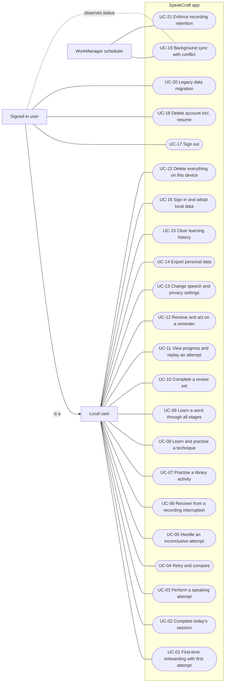
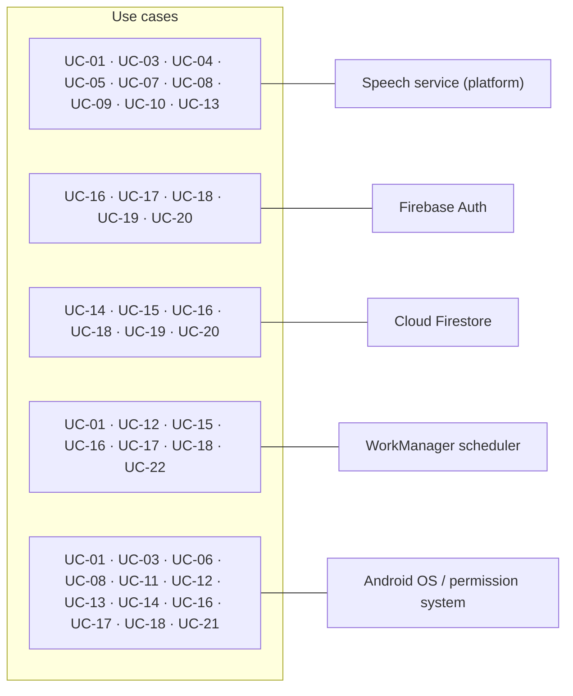

# Use Cases — SpeakCraft

| Field | Value |
|---|---|
| Document ID | UC |
| Version | 0.1 — Draft for review |
| Date | 2026-11-21 |
| Status | Draft — awaiting Product Owner approval |
| Owner (role) | Business Analyst |
| Approval | Pending — Product Owner |
| Related | SRS, FS-00…FS-12, DES-04, US |

> **Authority (GOV-02 §3.2, §4).** This document is the authoritative home of use-case IDs `UC-nn`. Use cases describe system behaviour from the actors' point of view. They **reference** software requirements (`SRS-FR`), business rules (`SRS-BR`) and errors (`SRS-ERR`) by ID and do not redefine them. If the SRS and a use case disagree, the SRS wins and the gap is logged in §7. Steps marked **RECOMMENDATION** come from SEC-01, FS-nn or DES-04 proposals that the SRS does not yet require. Values marked † are **Proposed — requires approval** (GOV-02 DC-5). Sources are SRS v0.2 and PRD v0.2 (2026-11-21).

---

## 1. Purpose and scope

1. Describe the 22 most important actor goals for releases R0–R1 as structured use cases with main, alternate and exception flows, so that FS workflows (FS-00 §2 §5–§7), DES-04 flows and test cases can be checked against one actor-level model.
2. Trace each use case to SRS functional requirements, business rules and error handling, and to the feature specifications and user stories that elaborate it.
3. R2 behaviour (role-play, notebook, quiz, check-ins, inbox) appears only as alternate flows. R3 is out of scope.

**Product Owner direction of 2026-11-21, reflected here.** **D-08 is a DECISION**: "original wording, link out" (PRD-FR-057, SRS-BR-028). The technique curriculum is PRD-FR-056 / SRS-FR-PRAC-008. Mistakes and coach tips follow every submitted attempt (PRD-FR-047, SRS-FR-EVAL-015/016, SRS-FR-WORD-014). These appear in UC-03, UC-08, UC-09 and UC-10.

## 2. Actors

| Actor | Kind | Description | Primary in | Secondary in |
|---|---|---|---|---|
| **Local user** | Human | A person using SpeakCraft without an account (SRS §4 "Local user"). Data stays on the device | UC-01…UC-15, UC-22 | — |
| **Signed-in user** | Human | A Local user who has signed in with Google. Inherits every Local-user use case and adds backup, sync and account functions (SRS §4 "Signed-in user"). A Beta tester (SRS §4) is a Local or Signed-in user and has no separate use case | UC-17, UC-18, UC-20 | UC-19 |
| **Speech service (platform)** | System | The device's speech-recognition service: on-device for T1/T2, online only with consent for T3a (ADR-009). In this document it also stands for the device text-to-speech engine used for reference audio | — | UC-01, UC-03, UC-04, UC-05, UC-07, UC-08, UC-09, UC-10, UC-13 |
| **Firebase Auth** | External service | Google sign-in identity, re-authentication and user deletion (via Credential Manager) | — | UC-16, UC-17, UC-18, UC-19, UC-20 |
| **Cloud Firestore** | External service | Per-user documents under `users/{uid}` in the existing named database (ADR-014) | — | UC-14, UC-15, UC-16, UC-18, UC-19, UC-20 |
| **WorkManager scheduler** | System | Runs scheduled and constraint-based work: reminders, sync, recording cleanup (ADR-005) | UC-19, UC-21 | UC-01, UC-12, UC-15, UC-16, UC-17, UC-18, UC-22 |
| **Android OS / permission system** | System | Runtime permissions (RECORD_AUDIO, POST_NOTIFICATIONS), audio focus and lifecycle events, notifications, Credential Manager UI, the share sheet, storage, and outbound intents to other apps (YouTube app or browser for "Watch the original lesson") | — | UC-01, UC-03, UC-06, UC-08, UC-11, UC-12, UC-13, UC-14, UC-16, UC-17, UC-18, UC-21 |

## 3. Use-case diagrams

### 3.1 Primary actors and use cases

### 3.2 Supporting systems

### 3.3 Relationships between use cases

| Relationship | From | To | Condition |
|---|---|---|---|
| «include» | UC-01, UC-02, UC-07, UC-08, UC-09, UC-10 | UC-03 | Every speaking step, activity, technique exercise, word stage 2–4 and spoken review item is an attempt |
| «include» | UC-02 | UC-09, UC-10 | Today's word step is a new-word stage or a review set |
| «extend» | UC-04 → UC-03 | — | User taps Try again on a result |
| «extend» | UC-05 → UC-03 | — | The evidence gate returns Inconclusive |
| «extend» | UC-06 → UC-03 | — | Capture is interrupted |
| «extend» | UC-04 → UC-11 | — | Try again from attempt detail |
| «extend» | UC-02 → UC-12 | — | Tapping a reminder opens Today |
| «include» | UC-16 | UC-19 | First pull and upload after sign-in |
| «extend» | UC-20 → UC-16 / app start | — | Signed-in legacy user without a migration-complete flag |
| «extend» | UC-14 → UC-18 | — | User exports before deleting the account |
| «followed by» | UC-17 (Remove), UC-18, UC-22 | UC-01 | The device returns to first-run state |

## 4. Conventions

| Item | Rule |
|---|---|
| ID | `UC-nn`, never reused. Alternate flows `An`, exception flows `En`, both local to the use case |
| Step references | "A2 (step 4)" means the alternate flow branches at main-scenario step 4 |
| Requirements | Steps cite the SRS-FR they realise. Every use case lists its SRS-BR and SRS-ERR references |
| Screens | DES-02 §4 IDs (`SCR-*`). Flows: DES-04 `FLOW-nn` |
| Pending decisions | Steps follow the canon's consolidated recommendation and name the decision: D-21 sign-out, D-22 export audio, D-24 transcripts, D-10 retention, D-19 legacy scope. **D-08 is a DECISION** |
| Personas | Personas appear only in examples, by name (PRD §7) |

### 4.1 Use-case index

| UC | Name | Primary actor | FS | DES-04 flow | Stories |
|---|---|---|---|---|---|
| UC-01 | First-time onboarding with first attempt | Local user | FS-02 | FLOW-01 | US-001, US-008…US-011 |
| UC-02 | Complete today's session | Local user | FS-03 | FLOW-02, FLOW-03 | US-012…US-017, US-043 |
| UC-03 | Perform a speaking attempt (all tiers) | Local user | FS-04, FS-05, FS-12 | FLOW-05 | US-018, US-019, US-022, US-024…US-030, US-069, US-072 |
| UC-04 | Retry and compare | Local user | FS-04 | FLOW-05 | US-021 |
| UC-05 | Handle an inconclusive attempt | Local user | FS-05, FS-04 | FLOW-05 | US-020 |
| UC-06 | Recover from a recording interruption | Local user | FS-04 | FLOW-05, FLOW-13 | US-023 |
| UC-07 | Practise a library activity | Local user | FS-06 | FLOW-04 | US-031…US-033, US-037, US-038 |
| UC-08 | Learn and practise a technique | Local user | FS-06 | FLOW-04 | US-034, US-035, US-036 |
| UC-09 | Learn a word through all stages | Local user | FS-07 | FLOW-06 | US-039…US-042 |
| UC-10 | Complete a review set | Local user | FS-07 | FLOW-07 | US-042, US-044 |
| UC-11 | View progress and replay an attempt | Local user | FS-08 | FLOW-08 | US-048…US-052, US-022 |
| UC-12 | Receive and act on a reminder | Local user | FS-09 | FLOW-11 | US-054, US-055 |
| UC-13 | Change speech and privacy settings | Local user | FS-10, FS-12 | FLOW-09 | US-059, US-062, US-069…US-071, US-073 |
| UC-14 | Export personal data | Local user | FS-10 | FLOW-12 | US-060 |
| UC-15 | Clear learning history | Local user | FS-10 | FLOW-12 | US-061 |
| UC-16 | Sign in and adopt local data | Local user | FS-01 | FLOW-10a | US-002, US-003 |
| UC-17 | Sign out | Signed-in user | FS-01 | FLOW-10b | US-004 |
| UC-18 | Delete account (incl. resume after interruption) | Signed-in user | FS-01 | FLOW-10c | US-005, US-006 |
| UC-19 | Background sync with conflict | WorkManager scheduler | FS-11 | FLOW-14 | US-066, US-067 |
| UC-20 | Legacy data migration | Signed-in user | FS-11 | — | US-068 |
| UC-21 | Enforce recording retention | WorkManager scheduler | FS-11, FS-10 | — | US-059, US-022 |
| UC-22 | Delete everything on this device | Local user | FS-01 | FLOW-10d | US-007 |

---

## 5. Use cases

### UC-01 — First-time onboarding with first attempt

| Field | Value |
|---|---|
| Primary actor | Local user |
| Secondary actors | Android OS / permission system; Speech service (platform); WorkManager scheduler |
| Goal | Personalise the app and reach a valid first speaking attempt with real feedback in about three minutes (KPI-02) |
| Preconditions | App installed; no profile exists (first launch, or after a full local deletion); the content pack contains `onb-intro` |
| Trigger | The user opens the app for the first time |
| Frequency | Once per install, or after UC-17 Remove, UC-18 or UC-22 |
| Business rules | SRS-BR-001, SRS-BR-008, SRS-BR-010, SRS-BR-019, SRS-BR-023, SRS-BR-025 |
| Related requirements | SRS-FR-ACC-001; SRS-FR-ONB-001…011; SRS-FR-SPCH-001, SRS-FR-SPCH-005; SRS-FR-REM-001, SRS-FR-REM-005; SRS-FR-EVAL-015, SRS-FR-EVAL-016 (through UC-03) |
| Related FS · stories · flow | FS-02 (FS-01, FS-04, FS-05, FS-09, FS-12) · US-001, US-008…US-011 · FLOW-01 |

**Main success scenario**

1. The system creates a local profile with a UUID without any network call and shows the value screen (SCR-ONB-01) (SRS-FR-ACC-001).
2. The user taps Get started. The system shows the goal step with a pre-selected option. The user continues, and the system maps the goal to a track and saves the step index (SRS-FR-ONB-001, -002, -010).
3. The user confirms level (default Intermediate) and daily minutes (default 10) (SRS-FR-ONB-003, -004).
4. The user chooses "Remind me at [time]" (default 19:00 †). On Android 13+ the Android OS shows the POST_NOTIFICATIONS request and the user allows it. The system stores the preference and asks WorkManager to schedule the reminder (SRS-FR-ONB-005, SRS-FR-REM-001).
5. The system shows the privacy statement (recordings and transcripts stay on this phone), generated from the policy constants. The user taps Allow microphone, and the Android OS shows the RECORD_AUDIO dialog. The user grants it (SRS-FR-ONB-006).
6. The system determines the tier by probing the Speech service and shows the tier-specific outcome (SCR-ONB-07). In the main scenario the tier is T1 or T2 and the user taps Continue (SRS-FR-ONB-008, SRS-FR-SPCH-001).
7. The system shows the first-attempt intro (SCR-ONB-08). The user taps Start, and the session player runs `onb-intro` (TPL-ANSWER, 60 s maximum) through **UC-03** (SRS-FR-ONB-009).
8. The system stores the attempt like any other. The result shows the transcript, metrics, mistakes found and coach tips, and the attempt's metrics become the baseline (SRS-FR-ONB-009, SRS-FR-EVAL-015/016).
9. The user taps Go to Today. The system records onboarding as complete, and Today builds the first plan (UC-02).

**Alternate flows**

| ID | At step | Condition | Behaviour |
|---|---|---|---|
| A1 | 4 | User chooses Not now | No permission request; reminders stay off |
| A2 | 4 | Notification permission denied | Preference kept; Settings → Reminders shows the blocked state with a system-settings link; no repeated prompt (SRS-FR-REM-005) |
| A3 | 6 | Offline pack installable (API 33+, locale supported) | User downloads the pack (as UC-13 A3), chooses online transcription, or continues without transcripts. If the download is still running at Continue, the tier is re-evaluated after installation (SRS-FR-SPCH-003, -004) |
| A4 | 6 | No on-device recogniser, but a recogniser exists | Consent screen (SRS-FR-SPCH-005): Allow gives T3a; Not now gives T3b |
| A5 | 6 | No recogniser (T3b) | Audio-only explanation; the first attempt gives delivery feedback only (SRS-FR-SPCH-007) |
| A6 | 7 | User taps Do this later | Onboarding completes and Today opens without a baseline (SRS-FR-ONB-011) |
| A7 | any | Process death | On relaunch the user resumes at the last incomplete step with earlier choices kept (SRS-FR-ONB-010) |
| A8 | 8 | First attempt Inconclusive | UC-05. No baseline is stored. Do this later remains available |

**Exception flows**

| ID | At step | Condition | Behaviour | SRS-ERR |
|---|---|---|---|---|
| E1 | 5 | Microphone denied | Impact explained; Try again (or Open settings if permanently denied); Continue without microphone leads to Today with speaking steps disabled (SRS-FR-ONB-007) | SRS-ERR-001 |
| E2 | 7 | Recogniser unavailable or busy | The attempt continues as T3b where audio is app-owned; the user is told no transcript was available | SRS-ERR-002 |
| E3 | 7 | Storage full during recording | UC-06 | SRS-ERR-004 |
| E4 | 2–4 | Saving a choice fails | Non-blocking message; retry once; stay on the step | SRS-ERR-005 |
| E5 | 8 | Evidence insufficient | UC-05 | SRS-ERR-003 |

**Postconditions**

| Outcome | State |
|---|---|
| Success | Onboarding complete; profile holds track, level, daily minutes and reminder preference; a valid attempt is stored as the baseline and counts as a streak day (SRS-BR-010); Today's plan exists |
| Failure | Onboarding progress is saved at the last completed step; no partial attempt is stored |

**Notes:** SRS-FR-ACC-002 mentions a sign-in entry during onboarding, but SRS-FR-ONB-001 has no such step (FS-01 Issue 4). There is no default goal (FS-02 Issue 3). The 2 s † speech-check timeout is FS-02 RECOMMENDATION. DES-04 FLOW-01 proposes skipping SCR-ONB-07 when no choice is needed (RECOMMENDATION).

### UC-02 — Complete today's session

| Field | Value |
|---|---|
| Primary actor | Local user (or Signed-in user) |
| Secondary actors | Speech service (platform) |
| Goal | Finish today's session of 3–4 steps in about the chosen number of minutes |
| Preconditions | Onboarding complete; microphone granted for speaking steps |
| Trigger | The user opens Today (directly or from a reminder, UC-12) and taps Start |
| Frequency | Daily per active user |
| Business rules | SRS-BR-008, SRS-BR-009, SRS-BR-010, SRS-BR-012, SRS-BR-013, SRS-BR-014, SRS-BR-027 |
| Related requirements | SRS-FR-TODAY-001…011; SRS-FR-PROG-005; SRS-FR-DATA-001, SRS-FR-DATA-002; SRS-FR-PRAC-008 (technique-based selection) |
| Related FS · stories · flow | FS-03 (FS-04, FS-07, FS-08) · US-012…US-017, US-043 · FLOW-02, FLOW-03 |

**Main success scenario**

1. The system shows Today: greeting, session card, streak summary and today's progress (SRS-FR-TODAY-001, -010).
2. If no plan exists for today's dateKey, the system builds one deterministically from track, level, daily minutes, weakest measured metric family, due reviews, new-word goal, the last 14 days and the content version, and saves it (SRS-FR-TODAY-002, -003, -005, -006).
3. The user taps Start, and the system opens the first incomplete step.
4. For a speaking step the user performs **UC-03**. A valid attempt marks the step complete (SRS-BR-009).
5. For the word step the user performs **UC-09** (new-word stage) or **UC-10** (review set).
6. After each step the system returns to Today with updated progress, and the user continues.
7. After the last step the system shows the completion state (SCR-TODAY-02) with what was practised and one optional suggestion (SRS-FR-TODAY-011).
8. The system records a session-completed event, and streak and statistics are recalculated from facts (SRS-FR-DATA-002, SRS-FR-PROG-005).

**Alternate flows**

| ID | At step | Condition | Behaviour |
|---|---|---|---|
| A1 | 2 | Last valid attempt ≥ 2 local days ago | Recovery session: min(chosen, 10) minutes, due reviews and a familiar template first, no backlog (SRS-FR-TODAY-008, SRS-BR-014) |
| A2 | 3 | User changes today's duration or a preference | Only incomplete steps are regenerated (SRS-FR-TODAY-007, SRS-BR-013) |
| A3 | 3–6 | User swaps a step | Next-best candidate of the same template family; at most 3 † swaps a day (SRS-FR-TODAY-009) |
| A4 | 4 | Attempt Inconclusive | UC-05; the step stays incomplete (SRS-BR-008) |
| A5 | 4 | User taps Try again | UC-04 |
| A6 | 6 | User leaves Today part-way | The plan is kept; later the same day the same plan shows with completed steps preserved (SRS-BR-013) |
| A7 | 1 | Microphone not granted | Speaking steps are disabled with a grant action (SRS-FR-ONB-007) |
| A8 | 2 | Tier T3b | The plan prefers delivery-oriented activities (SRS-FR-SPCH-007) |
| A9 | 2 | Technique-linked activities available | The plan engine may select activities by technique (SRS-FR-PRAC-008; Issue 12) |

**Exception flows**

| ID | At step | Condition | Behaviour | SRS-ERR |
|---|---|---|---|---|
| E1 | 2, 4, 8 | Saving the plan, step state or event fails | Non-blocking error; retry once; success is never shown | SRS-ERR-005 |
| E2 | 4 | Microphone permission revoked | Permission education (SCR-PERM-01) | SRS-ERR-001 |
| E3 | 4 | Recogniser unavailable | T3b for the attempt | SRS-ERR-002 |

**Postconditions**

| Outcome | State |
|---|---|
| Success | All steps complete; a session-completed event is stored; the day is a streak day if it has ≥ 1 valid speaking attempt (SRS-BR-010, SRS-BR-012) |
| Failure | Completed steps are kept; incomplete steps stay available for the rest of the dateKey |

**Notes:** What "Skip" on an Inconclusive result means for step completion is not defined (FS-00 §6, FS-03). Behaviour when the date changes at midnight during a session is not defined (Issue 13). On T3b phones the word step can never complete (Issue 9).

### UC-03 — Perform a speaking attempt (all tiers)

| Field | Value |
|---|---|
| Primary actor | Local user |
| Secondary actors | Speech service (platform); Android OS / permission system (audio focus, lifecycle, microphone, text-to-speech playback) |
| Goal | Record a response and receive a transcript where the tier allows, honest labelled metrics, the mistakes found and coach tips |
| Preconditions | Microphone granted; activity loaded from the content pack; tier known (SRS-FR-SPCH-001); no other recording active (SRS-FR-SESS-014) |
| Trigger | The user opens a speaking step, library activity, technique exercise, word stage or review item in the session player (SCR-SESS-01) |
| Frequency | Several times per session |
| Business rules | SRS-BR-001, SRS-BR-002, SRS-BR-003, SRS-BR-004, SRS-BR-005, SRS-BR-006, SRS-BR-007, SRS-BR-020, SRS-BR-022, SRS-BR-023 |
| Related requirements | SRS-FR-SESS-001…009, SRS-FR-SESS-012, SRS-FR-SESS-013; SRS-FR-EVAL-001…016; SRS-FR-SPCH-002, SRS-FR-SPCH-007, SRS-FR-SPCH-009, SRS-FR-SPCH-010; SRS-FR-DATA-001, SRS-FR-DATA-003, SRS-FR-DATA-009 |
| Related FS · stories · flow | FS-04, FS-05, FS-12 · US-018, US-019, US-022, US-024…US-030, US-069, US-072 · FLOW-05 |

**Main success scenario** (tier T1)

1. The system shows the prompt. For Read aloud and Listen & repeat it offers reference audio at 1.0× and 0.75× from the Speech service's text-to-speech engine (SRS-FR-SESS-001, -012).
2. The system runs the template's preparation timer (15 s † for Answer a question, 30 s † for Structured answer and Tell a story, none for the others). The user may skip it (SRS-FR-SESS-002).
3. The user taps Record. The system takes audio focus from the Android OS, starts `AudioRecord` at 16 kHz mono, writes a WAV file and pipes the audio to the on-device recogniser (SRS-FR-SPCH-002, SRS-FR-SESS-005).
4. The system shows elapsed time, remaining time, the input level and a single Stop control, and TalkBack announces the start (SRS-FR-SESS-004).
5. The user taps Stop, or the template limit is reached after a 10 s warning (SRS-FR-SESS-003).
6. The system assembles the transcript across segments without duplicates (SRS-FR-SPCH-009) and runs the evidence gate (SRS-FR-EVAL-001, SRS-BR-001). The gate passes.
7. The system computes the template's metrics with Measured or Estimated labels and selects the 3 headline metrics. For Structured answer it adds the framework elements detected. It runs the high-precision language rules and composes one strength and one focus. Recogniser confidence is used only if supplied. It records `evaluationVersion` and `contentVersion` (SRS-FR-EVAL-002…006, -011, -012, -014).
8. The system lists the **mistakes found** by its deterministic checks: up to 3 in ARC-05 §8.2 priority order, each with evidence and its Measured/Estimated label, plus "Show all" (SRS-FR-EVAL-015). It selects the **coach tips**: the focus tip plus up to 2 technique tips whose trigger matches, each linking to its technique and, where provenance exists, to the source video (SRS-FR-EVAL-016).
9. The system stores the attempt and its metrics in one transaction, creates an outbox entry if the user is signed in, and applies the retention setting to the recording (SRS-FR-DATA-001, -003, -009).
10. The system shows the result: transcript labelled "On-device" with playback, headline metrics, strength, mistakes found, coach tips, Try again, and "Was this accurate?" (SRS-FR-SESS-006, -009; SRS-FR-EVAL-009).

**Alternate flows**

| ID | At step | Condition | Behaviour |
|---|---|---|---|
| A1 | 3 | Tier T2 | The recogniser owns the microphone; segments are restarted and stitched; acoustic metrics come from RMS callbacks; no playback (SRS-FR-SPCH-002, SRS-FR-SESS-009) |
| A2 | 3 | Tier T3a | As A1, using the consented online recogniser; tier label "Online (consented)" (SRS-BR-023) |
| A3 | 3 | Tier T3b | `AudioRecord` only. The result says "No transcript — audio-only" and shows speaking time, long pauses and speech ratio. Transcript checks say "Transcript needed for this check", and mistakes are limited to delivery issues (SRS-FR-SPCH-007) |
| A4 | 2 | User skips preparation | Ready state immediately |
| A5 | 7 | Read aloud / Listen & repeat | "Recognised as intended: N %" with pass/fail at 75 % † and the words not recognised as intended (SRS-FR-EVAL-008). Free-speaking templates show no overall score (SRS-FR-EVAL-007) |
| A6 | 7 | Word stage or review item | Stage evaluation and word result per UC-09 / UC-10 (SRS-FR-WORD-014) |
| A7 | 8 | No issue detected | "Our checks didn't find issues in this attempt" plus one line on what the checks cover; no claim of perfection (SRS-FR-EVAL-015) |
| A8 | 8 | No tip trigger matches | A general tip for the activity's technique is shown (SRS-FR-EVAL-016; Issue 10) |
| A9 | 10 | User opens a tip's technique or "Watch the original lesson" | Technique detail (SCR-PRAC-04) opens above the player, or the source video opens outside the app (UC-08 A3) |
| A10 | 10 | User rates accuracy or opens "How we measured this" | The rating is stored locally; the detail sheet SCR-SESS-02 opens (SRS-FR-EVAL-009, -010) |
| A11 | 10 | User taps Try again | UC-04 |
| A12 | 3 | T1 audio-source piping fails on first use | The device is demoted to T2 and the demotion is remembered (ARC-05 §3) |

**Exception flows**

| ID | At step | Condition | Behaviour | SRS-ERR |
|---|---|---|---|---|
| E1 | 6 | Evidence insufficient | UC-05 | SRS-ERR-003 |
| E2 | 3, 6 | Recogniser busy or unavailable | The attempt continues as T3b where audio is app-owned, and the user is told no transcript was available. "No match" leads to Inconclusive, not to a capability failure (SRS-FR-SPCH-010) | SRS-ERR-002 |
| E3 | 3–5 | Call, focus loss, backgrounding, permission revoked, storage full | UC-06 | SRS-ERR-004 (storage), SRS-ERR-001 (permission) |
| E4 | 7–8 | Evaluation exceeds 2× the NFR-PERF-005 budget | Error state with Retry evaluation; audio kept until retry or exit (SRS-FR-EVAL-013) | — |
| E5 | 9 | Database write fails | Non-blocking error; retry once; success is never shown | SRS-ERR-005 |
| E6 | 1 | Text-to-speech unavailable | Reference-audio controls hidden with an explanation | SRS-ERR-010 |

**Postconditions**

| Outcome | State |
|---|---|
| Success | An immutable attempt with metrics, `evaluationVersion` and `contentVersion`; the recording kept per retention (SRS-BR-022); an outbox entry if signed in; a streak day if this is the first valid speaking attempt today (SRS-BR-010) |
| Failure | Interrupted: no attempt and no partial file. Inconclusive: an Inconclusive attempt without metrics and with its recording deleted (UC-05) |

**Notes:** The outcome of a T3a network loss mid-attempt is not defined in the SRS (ARC-05 §4.2 says only that the attempt continues; FS-00 §6; Issue 24). Whether to show a live partial transcript is undecided (NG-14). Estimated entries listed under "Mistakes found" must keep "Possible issue" wording (Issue 11). The result order follows DES-03 SCR-SESS-01 (RECOMMENDATION).

### UC-04 — Retry and compare

| Field | Value |
|---|---|
| Primary actor | Local user |
| Secondary actors | Speech service (platform) |
| Goal | Make another attempt on the same activity and see whether the change worked |
| Preconditions | A result exists for an activity, in the player or in attempt detail (SCR-PROG-04) |
| Trigger | The user taps Try again |
| Frequency | Frequent |
| Business rules | SRS-BR-001, SRS-BR-002, SRS-BR-006, SRS-BR-008, SRS-BR-020 |
| Related requirements | SRS-FR-SESS-008; SRS-FR-EVAL-004, SRS-FR-EVAL-005, SRS-FR-EVAL-011, SRS-FR-EVAL-015, SRS-FR-EVAL-016; SRS-FR-PROG-004 |
| Related FS · stories · flow | FS-04, FS-05 · US-021 · FLOW-05 |

**Main success scenario**

1. The user taps Try again on a result.
2. The system starts a new attempt on the same activity, and the user completes **UC-03** steps 1–9 (SRS-FR-SESS-008).
3. The system finds the most recent earlier valid attempt on that activity.
4. The system shows the result with the three headline metrics side by side with that attempt. The strength may cite the improvement (ARC-05 §8.2), and the mistakes and tips are those of the new attempt.
5. The user continues, or retries again.

**Alternate flows**

| ID | At step | Condition | Behaviour |
|---|---|---|---|
| A1 | 1 | Started from attempt detail in Progress | The player opens on that activity (DES-02 §3) |
| A2 | 3 | No earlier valid attempt | Result without comparison |
| A3 | 4 | A metric is null in either attempt | "Not available" for that metric (SRS-BR-002) |
| A4 | 2 | Today retry/focus step | The step completes on a valid attempt (SRS-BR-009) |

**Exception flows**

| ID | At step | Condition | Behaviour | SRS-ERR |
|---|---|---|---|---|
| E1 | 2 | New attempt Inconclusive | UC-05; no comparison shown | SRS-ERR-003 |
| E2 | 2 | Interruption | UC-06 | SRS-ERR-004 |
| E3 | 2 | Write fails | As UC-03 E5 | SRS-ERR-005 |

**Postconditions**

| Outcome | State |
|---|---|
| Success | Both attempts are stored unchanged; the comparison is shown |
| Failure | The earlier attempt is unaffected |

**Notes:** Comparison across attempts with different `evaluationVersion` values is not defined (Issue 14).

### UC-05 — Handle an inconclusive attempt

| Field | Value |
|---|---|
| Primary actor | Local user |
| Secondary actors | Speech service (platform) |
| Goal | Understand why no evaluation was possible, and retry or skip without penalty |
| Preconditions | An attempt has been recorded and stopped |
| Trigger | The evidence gate returns Inconclusive |
| Frequency | Target ≤ 15 % of attempts on T1/T2 phones (KPI-06, NFR-QUAL-005) |
| Business rules | SRS-BR-001, SRS-BR-002, SRS-BR-008, SRS-BR-009, SRS-BR-022 |
| Related requirements | SRS-FR-SESS-007; SRS-FR-EVAL-001, SRS-FR-EVAL-015; SRS-FR-WORD-006, SRS-FR-WORD-014; SRS-FR-SPCH-010 |
| Related FS · stories · flow | FS-05, FS-04 · US-020 · FLOW-05 |

**Main success scenario**

1. The system applies the evidence gate: duration ≥ 1.5 s; voiced speech ≥ 0.5 s and ≥ 25 % †; level above the silence threshold; ≥ 1 recognised word for Read/Repeat/word stages or ≥ 8 † for free speaking; transcript scoped to this attempt (SRS-BR-001).
2. A check fails. The system stores the attempt as Inconclusive with its reason and shows no metric (SRS-FR-EVAL-001, SRS-BR-002).
3. The system deletes the recording immediately (SRS-BR-022).
4. The system shows the Inconclusive state with the specific reason and advice in place of "Mistakes found", plus Retry and Skip (SRS-FR-SESS-007, SRS-FR-EVAL-015).
5. The user taps Retry and performs **UC-03** on the same activity.
6. The new attempt is valid, and the step (if any) completes (SRS-BR-009).

**Alternate flows**

| ID | At step | Condition | Behaviour |
|---|---|---|---|
| A1 | 5 | User taps Skip | Returns to the previous screen; the step stays incomplete (SRS-BR-008, SRS-BR-009) |
| A2 | 2 | Word stage with no usable output | Inconclusive, not a failure; it does not count toward the 3-failure easier-variant rule (SRS-FR-WORD-006, SRS-FR-WORD-014) |
| A3 | 2 | Recogniser "no match" | Inconclusive (no transcript); capability status unchanged (SRS-FR-SPCH-010) |
| A4 | 1 | Tier T3b | The transcript-presence check does not apply (ARC-05 §5) |
| A5 | 4 | Onboarding first attempt | No baseline is stored; Do this later remains available (FS-02 A7) |

**Exception flows**

| ID | At step | Condition | Behaviour | SRS-ERR |
|---|---|---|---|---|
| E1 | 2 | Saving the Inconclusive record fails | Non-blocking error; retry once | SRS-ERR-005 |
| E2 | 4 | The gate's own reason is evidence insufficiency | The required behaviour is this use case | SRS-ERR-003 |

**Postconditions**

| Outcome | State |
|---|---|
| Success | No completion, failure, streak day or practice time is recorded for the Inconclusive attempt (SRS-BR-008); the user has retried or skipped |
| Failure | Same: no penalty. The step remains incomplete |

**Notes:** SRS-FR-SESS-007 lists four reasons; ARC-05 §5 has five (TOO_FEW_WORDS) (Issue 15). What Skip means for Today completion is not defined (FS-03).

### UC-06 — Recover from a recording interruption

| Field | Value |
|---|---|
| Primary actor | Local user |
| Secondary actors | Android OS / permission system (phone call, audio-focus loss, lifecycle stop, permission revocation, storage) |
| Goal | The recording ends safely with no corrupt data, and the user can retry |
| Preconditions | A recording is in progress (UC-03 steps 3–5) |
| Trigger | A phone call, audio-focus loss, the app going to the background, microphone permission revoked or storage full during recording; or the user tries to leave the player |
| Frequency | Occasional |
| Business rules | SRS-BR-008, SRS-BR-022 |
| Related requirements | SRS-FR-SESS-010, SRS-FR-SESS-011, SRS-FR-SESS-013, SRS-FR-SESS-014 |
| Related FS · stories · flow | FS-04 · US-023 · FLOW-05, FLOW-13 |

**Main success scenario**

1. The Android OS signals an interruption: an incoming call, audio-focus loss, lifecycle stop, permission revocation or a storage write failure.
2. The system stops capture and the recognition session.
3. The system discards the partial audio and transcript and records no attempt (SRS-FR-SESS-010, SRS-BR-022).
4. The system shows the Interrupted state, explaining what happened, with Retry.
5. The user returns and taps Retry, and **UC-03** restarts from Ready.

**Alternate flows**

| ID | At step | Condition | Behaviour |
|---|---|---|---|
| A1 | 1 | User presses Back or navigates away while recording | Confirmation dialog: confirming discards the attempt; Cancel continues recording (SRS-FR-SESS-011, -014) |
| A2 | 1 | Phone rotated | Not an interruption: recording continues and state is kept (SRS-FR-SESS-013) |
| A3 | 5 | Permission was revoked | Retry routes to permission education SCR-PERM-01 (FLOW-13) |
| A4 | 1 | Process death while recording | On relaunch no attempt exists; an orphan sweep removes the partial file (SEC-01 §7.1, RECOMMENDATION) |

**Exception flows**

| ID | At step | Condition | Behaviour | SRS-ERR |
|---|---|---|---|---|
| E1 | 1 | Storage full | Message with a link to storage settings | SRS-ERR-004 |
| E2 | 5 | Microphone denied on retry | Impact explained; Try again / Open settings | SRS-ERR-001 |
| E3 | 3 | Deleting the partial file fails | Retried at next start; diagnostic without personal data | SRS-ERR-005 |

**Postconditions**

| Outcome | State |
|---|---|
| Success | No partial attempt and no partial file; the user can retry |
| Failure | Same guarantee: data is never left corrupt |

**Notes:** Audio-route changes (headset or Bluetooth disconnect) are not listed in SRS-FR-SESS-010 (Issue 16).

### UC-07 — Practise a library activity

| Field | Value |
|---|---|
| Primary actor | Local user |
| Secondary actors | Speech service (platform) |
| Goal | Rehearse a chosen situation outside Today, with the practice counting toward progress and streak |
| Preconditions | Onboarding complete; content pack loaded |
| Trigger | The user opens the Practice tab (SCR-PRAC-01) |
| Frequency | Several times a week |
| Business rules | SRS-BR-008, SRS-BR-010, SRS-BR-018, SRS-BR-026 |
| Related requirements | SRS-FR-PRAC-001…004, SRS-FR-PRAC-006, SRS-FR-PRAC-007 (R2), SRS-FR-PRAC-008 (collection entry) |
| Related FS · stories · flow | FS-06 · US-031…US-033, US-037, US-038 · FLOW-04 |

**Main success scenario**

1. The system lists the five tracks with activity counts and the Techniques collection (SRS-FR-PRAC-001, SRS-FR-PRAC-008).
2. The user selects a track. The system lists its activities, filterable by template, level and Saved; each card shows title, template, estimated minutes, level and Practised status (SRS-FR-PRAC-001, -002).
3. The user opens an activity. The detail (SCR-PRAC-03) shows the goal, a prompt preview, an explanation of the template, and Start (SRS-FR-PRAC-003).
4. The user taps Start and performs **UC-03**.
5. The system records the attempt exactly like a Today attempt. It counts toward progress and streak, and the card shows Practised (SRS-FR-PRAC-004).
6. The user tries again (UC-04) or returns to the track.

**Alternate flows**

| ID | At step | Condition | Behaviour |
|---|---|---|---|
| A1 | 2 | Filter matches nothing | Empty state with a clear-filter action (DES-02 §2.3) |
| A2 | 3 | User saves or unsaves the activity | It appears in or disappears from the Saved filter (SRS-FR-PRAC-006) |
| A3 | 1 | User opens the Techniques collection | UC-08 |
| A4 | 4 | (R2) Role-play activity | Each partner line is shown and spoken by text-to-speech; each user turn runs UC-03 as an Answer-a-question attempt with turn-specific expected elements (SRS-FR-PRAC-007) |

**Exception flows**

| ID | At step | Condition | Behaviour | SRS-ERR |
|---|---|---|---|---|
| E1 | 4 | Microphone denied | Permission education | SRS-ERR-001 |
| E2 | 4 | Evidence insufficient | UC-05 | SRS-ERR-003 |
| E3 | A4 | Text-to-speech unavailable | Partner lines shown as text only | SRS-ERR-010 |

**Postconditions**

| Outcome | State |
|---|---|
| Success | Valid attempt stored; a streak day if it is the first valid attempt today; practice time includes it (SRS-BR-010, SRS-BR-018) |
| Failure | No change to progress |

**Notes:** Whether a valid library attempt completes the same activity's Today step is not stated (Issue 25). An invalid content pack never reaches users because the build fails (SRS-ERR-008).

### UC-08 — Learn and practise a technique

| Field | Value |
|---|---|
| Primary actor | Local user |
| Secondary actors | Speech service (platform); Android OS / permission system (outbound intent to the YouTube app or browser) |
| Goal | Understand a named speaking technique in plain words and practise it with an exercise, getting honest feedback, mistakes found and coach tips |
| Preconditions | Onboarding complete; the content pack contains techniques whose provenance has been verified (SRS-BR-028) |
| Trigger | The user opens the Techniques collection on SCR-PRAC-01, a technique linked from a coach tip, or a technique-based activity |
| Frequency | Several times a week (Product Owner curriculum basis, PRD-FR-056) |
| Business rules | SRS-BR-028 (D-08 DECISION), SRS-BR-002, SRS-BR-003, SRS-BR-006, SRS-BR-010 |
| Related requirements | SRS-FR-PRAC-008, SRS-FR-PRAC-009, SRS-FR-PRAC-004, SRS-FR-PRAC-005, SRS-FR-PRAC-006; SRS-FR-EVAL-014, SRS-FR-EVAL-015, SRS-FR-EVAL-016 |
| Related FS · stories · flow | FS-06 · US-034, US-035, US-036 · FLOW-04 |

**Main success scenario**

1. The system shows the Techniques collection on Practice (SCR-PRAC-01) (SRS-FR-PRAC-008).
2. The user selects a technique. Technique detail (SCR-PRAC-04) shows the name, a one-line idea, why it works, steps, tips, the linked exercises with a single "Practise it" action, and "Watch the original lesson". All text is in SpeakCraft's own words, with no creator name, likeness or branding (SRS-FR-PRAC-008, SRS-BR-028).
3. The user taps "Practise it". The system opens the linked exercise in the session player using one of the five templates, and the user performs **UC-03**.
4. The system evaluates the attempt only with the template's labelled metrics. Framework techniques such as STAR or PREP use Structured-answer element detection, labelled Estimated. No technique-specific score is invented (SRS-BR-002, SRS-BR-003, SRS-BR-006, SRS-FR-EVAL-014).
5. The result shows mistakes found and coach tips, with tips for this technique preferred where their triggers match (SRS-FR-EVAL-015, -016).
6. The attempt counts toward progress and streak like any library attempt (SRS-FR-PRAC-004). The user returns to the technique or tries again (UC-04).

**Alternate flows**

| ID | At step | Condition | Behaviour |
|---|---|---|---|
| A1 | 1 | Entered from a coach tip in a result | SCR-PRAC-04 opens above the player; Back returns to the result (DES-03, RECOMMENDATION) |
| A2 | 2 | User saves the exercise | It appears under Saved (SRS-FR-PRAC-006) |
| A3 | 2 | User taps "Watch the original lesson" | The system sends an outbound intent through the Android OS, and the specific source video opens at its timestamp in the YouTube app or browser. There is no API key, scraping or embedded download (SRS-FR-PRAC-009). The user returns to SpeakCraft with Back |
| A4 | 2 | Item has no provenance (in-house content) | No video link is shown (SRS-FR-PRAC-008 "where provenance exists") |
| A5 | 3 | Technique has several exercises | The user picks one; the primary action starts the first unpractised one (RECOMMENDATION) |
| A6 | 1 | Offline | Technique detail and exercises work; only the video link needs a connection |

**Exception flows**

| ID | At step | Condition | Behaviour | SRS-ERR |
|---|---|---|---|---|
| E1 | A3 | No network, or no app can open the link | Behaviour not defined in the SRS; RECOMMENDATION: a plain-language message saying the video needs a connection or a browser (Issue 17) | — |
| E2 | 3 | Microphone denied | Permission education | SRS-ERR-001 |
| E3 | 4 | Evidence insufficient | UC-05 | SRS-ERR-003 |
| E4 | build | A technique with `licenceStatus = PENDING_REVIEW`, unverified provenance or channel-root provenance | It is excluded at build time and never shipped (SRS-BR-028) | SRS-ERR-008 |

**Postconditions**

| Outcome | State |
|---|---|
| Success | Valid attempt stored against the technique's exercise; progress and streak updated; no creator branding shown |
| Failure | No change to progress |

**Notes:** PRD-FR-056 says techniques "are used by Today's plan", while SRS-FR-PRAC-008 says the plan engine "may" use them (Issue 12). Delivery techniques can only be judged with the existing ARC-05 metrics. ARC-05 §8.4 lists candidate acoustic metrics that are not in R1 until validated, plus a self-reported self-check for aspects audio cannot show (Issue 10). The existing creator-derived items are re-verified against specific videos before they are included (WBS T-09.6, CNT-01).

### UC-09 — Learn a word through all stages

| Field | Value |
|---|---|
| Primary actor | Local user |
| Secondary actors | Speech service (platform), including text-to-speech pronunciation |
| Goal | Move a word from New to Learned through Learn → Say it → Use it → Make your own, knowing after each attempt what went wrong and how to fix it |
| Preconditions | Word bank loaded; the word is New or Learning; microphone granted for stages 2–4 |
| Trigger | The user opens the new-word step in Today, or a word from Words home or Word detail (SCR-WORD-01/02 → SCR-WORD-03), found by status filter or search if needed (SRS-FR-WORD-010) |
| Frequency | Up to the new-word goal each day (default 2 †, SRS-BR-027) |
| Business rules | SRS-BR-001, SRS-BR-007, SRS-BR-008, SRS-BR-010, SRS-BR-015, SRS-BR-016, SRS-BR-017, SRS-BR-020 |
| Related requirements | SRS-FR-WORD-001…008, SRS-FR-WORD-010, SRS-FR-WORD-011 (bank precondition), SRS-FR-WORD-014; SRS-FR-TODAY-004 |
| Related FS · stories · flow | FS-07 · US-039…US-042 · FLOW-06 |

**Main success scenario**

1. **Learn:** the system shows the word, IPA if present, part of speech, a simple meaning, 2 examples and collocations, and plays the pronunciation. The user taps "I've read this". The stage is complete and the status becomes Learning (SRS-FR-WORD-001, -002).
2. **Say it:** the user records the word (5 s maximum) through UC-03. The stage passes if the output contains the word or an accepted inflection with a match score ≥ 75 † (SRS-FR-WORD-003, SRS-BR-007).
3. After the attempt the system shows the word result: pass, fail or Inconclusive, the specific mistakes with evidence (for example "recognised as '{heard}'"), and one coach tip for the next try (SRS-FR-WORD-014).
4. **Use it:** the user reads 2 given sentences. The stage passes if recognised-as-intended is ≥ 75 † for both, and the word result is shown as in step 3 (SRS-FR-WORD-004, -014).
5. **Make your own:** the user speaks an original sentence. It passes if the target word is present, the sentence has ≥ 5 words, there is ≤ 1 high-precision grammar observation and the composite is ≥ 70 †. The word result is shown (SRS-FR-WORD-005, -014).
6. The system marks the word Learned, schedules the first review per SRS-BR-016 (in 1 day), and records stage-passed events with UUIDs (SRS-FR-WORD-008, SRS-BR-020).
7. Valid attempts in stages 2–4 count as streak-day attempts (SRS-BR-010).

**Alternate flows**

| ID | At step | Condition | Behaviour |
|---|---|---|---|
| A1 | 2, 4, 5 | Stage failed | Word result with mistakes and a tip; the user retries. After 3 failures an easier variant (shorter sentence, slower reference) is offered and the user may continue later (SRS-FR-WORD-007, -014) |
| A2 | any | User leaves after a stage | Progress is kept; next time the user resumes at the next stage (SRS-BR-015) |
| A3 | any | User replays a passed stage | The status never goes down (SRS-BR-015) |
| A4 | 2–5 | Tier T3b | Only delivery metrics, marked "Transcript needed for this check" (SRS-FR-SPCH-007); the word cannot pass (Issue 9) |
| A5 | 5 | Pass with one grammar observation | Pass, with the observation still listed as a possible issue (SRS-FR-WORD-014; Issue 11) |

**Exception flows**

| ID | At step | Condition | Behaviour | SRS-ERR |
|---|---|---|---|---|
| E1 | 2, 4, 5 | No usable recognition output | Inconclusive with its reason, not a failure (SRS-FR-WORD-006) | SRS-ERR-003 |
| E2 | 1 | Text-to-speech unavailable | Pronunciation control hidden with an explanation | SRS-ERR-010 |
| E3 | 2, 4, 5 | Recogniser unavailable | T3b for the attempt | SRS-ERR-002 |
| E4 | 2, 4, 5 | Interruption | UC-06 | SRS-ERR-004 |

**Postconditions**

| Outcome | State |
|---|---|
| Success | Word Learned; first review due in 1 day; stage events stored once (idempotent) |
| Failure | The word stays at its last passed stage |

**Notes:** The ARC-05 §9 caveat "Say it checks that you were understood, not your accent" is shown. SRS-FR-WORD-014 gives one tip, while SRS-FR-EVAL-016 allows up to three (Issue 18).

### UC-10 — Complete a review set

| Field | Value |
|---|---|
| Primary actor | Local user |
| Secondary actors | Speech service (platform) |
| Goal | Recall due words aloud, learn from each mistake and keep the spaced schedule up to date |
| Preconditions | At least one word is due on the local dateKey |
| Trigger | The Today word step with due reviews, or Review on Words home (SCR-WORD-04) |
| Frequency | Most days |
| Business rules | SRS-BR-008, SRS-BR-009, SRS-BR-010, SRS-BR-016, SRS-BR-017, SRS-BR-020, SRS-BR-027 |
| Related requirements | SRS-FR-WORD-008, SRS-FR-WORD-009, SRS-FR-WORD-014; SRS-FR-TODAY-004 |
| Related FS · stories · flow | FS-07 · US-042, US-044 · FLOW-07 |

**Main success scenario**

1. The system builds a review set of up to 10 † due words (SRS-FR-WORD-009, SRS-BR-027).
2. For each item the system presents spoken recall ("Say the word that means …") or sentence use.
3. The user records through UC-03, and the system evaluates the item.
4. The system shows the item result: pass, fail or Inconclusive, the mistakes with evidence, and one coach tip (SRS-FR-WORD-014).
5. The system grades the item (4 first-try pass, 3 pass after hint or retry, 1 fail), updates the interval and ease factor, and computes the due date on the local dateKey (SRS-BR-016).
6. The system updates the status: Mastered when the interval reaches ≥ 21 days †; a Mastered word that fails returns to Reviewing (SRS-BR-017). It records review events with UUIDs (SRS-BR-020).
7. After the last item the system shows a summary, and the Today word step is complete (SRS-BR-009).

**Alternate flows**

| ID | At step | Condition | Behaviour |
|---|---|---|---|
| A1 | 3 | User needs a hint or retry | Grade 3 on a later pass (SRS-BR-016) |
| A2 | 1 | More than 10 words due | The rest stay due for a later session (SRS-BR-027) |
| A3 | any | User leaves part-way | Not defined whether completed items keep their grades (Issue 19) |

**Exception flows**

| ID | At step | Condition | Behaviour | SRS-ERR |
|---|---|---|---|---|
| E1 | 3 | Inconclusive item | Inconclusive reason shown; not graded as a fail (SRS-BR-008); the grade it should get is not defined (Issue 19) | SRS-ERR-003 |
| E2 | 3 | Interruption | UC-06 | SRS-ERR-004 |
| E3 | 5–6 | Write fails | Non-blocking error; retry once | SRS-ERR-005 |

**Postconditions**

| Outcome | State |
|---|---|
| Success | Schedules updated; valid spoken-recall attempts count toward the streak (SRS-BR-010); Today word step complete |
| Failure | Ungraded items stay due |

**Notes:** On T3b, recall cannot be checked (Issue 9).

### UC-11 — View progress and replay an attempt

| Field | Value |
|---|---|
| Primary actor | Local user |
| Secondary actors | Android OS (local media playback) |
| Goal | See evidence-based improvement and revisit a past attempt |
| Preconditions | At least one attempt stored (trends need ≥ 3 valid attempts in a template family) |
| Trigger | The user opens the Progress tab (SCR-PROG-01) |
| Frequency | Weekly |
| Business rules | SRS-BR-010, SRS-BR-011, SRS-BR-012, SRS-BR-018, SRS-BR-022, SRS-BR-024, SRS-BR-026 |
| Related requirements | SRS-FR-PROG-001…007, SRS-FR-PROG-008 (R2); SRS-FR-SESS-009 |
| Related FS · stories · flow | FS-08 · US-048…US-052, US-022 · FLOW-08 |

**Main success scenario**

1. The system shows current and longest streak, the 7-day calendar, practice time this week, sessions completed, words learned and trend cards, all calculated from local facts (SRS-FR-PROG-001, -005).
2. The user opens a metric (SCR-PROG-02). The system shows the trend per template family with its noise band, or "no clear change" when the change is within the band (SRS-FR-PROG-002, SRS-BR-024).
3. The user opens History (SCR-PROG-03). Attempts are listed newest first with date, activity, template, headline metrics, status and playback availability (SRS-FR-PROG-003).
4. The user opens an attempt (SCR-PROG-04). The system shows the transcript, all labelled metrics, feedback, the accuracy rating and playback (SRS-FR-PROG-004).
5. The user taps play, and the system plays the kept recording locally (SRS-FR-SESS-009).
6. The system also shows the word-progress summary: counts by status and words due today (SRS-FR-PROG-007).

**Alternate flows**

| ID | At step | Condition | Behaviour |
|---|---|---|---|
| A1 | 2 | Fewer than 3 valid attempts | No trend; explanation of what is needed |
| A2 | 4 | Recording expired or cleared, or a T2/T3a attempt | No playback, with the reason |
| A3 | 4 | Attempt synced from another device | No transcript or recording on this device (SRS-FR-DATA-006) |
| A4 | 4 | User taps Try again | UC-04 |
| A5 | 1 | Streak milestone reached (3, 7, 14, 30, 60, 100) | One-time celebration that respects reduced motion (SRS-FR-PROG-006) |
| A6 | 1 | (R2) Check-in available | Check-in results plotted against earlier ones (SRS-FR-PROG-008) |
| A7 | 4 | Data restored from backup | "Recording and transcript not available on this device" (SEC-01 §6.5, RECOMMENDATION) |

**Exception flows**

| ID | At step | Condition | Behaviour | SRS-ERR |
|---|---|---|---|---|
| E1 | 1–4 | Local query fails | Non-blocking error with Retry | SRS-ERR-005 |
| E2 | 5 | Recording row exists but the file is missing | Playback hidden; the orphan sweep corrects the row (SEC-01 §7.1, RECOMMENDATION) | — |

**Postconditions**

| Outcome | State |
|---|---|
| Success | Read-only view; only the celebration-shown flag may change |
| Failure | No data changed |

**Notes:** Trends across evaluation versions are not defined (Issue 14).

### UC-12 — Receive and act on a reminder

| Field | Value |
|---|---|
| Primary actor | Local user |
| Secondary actors | WorkManager scheduler; Android OS / permission system (notifications) |
| Goal | Be reminded once at the chosen time and go straight to Today |
| Preconditions | Reminders on; notification permission granted (Android 13+) |
| Trigger | The scheduled reminder time arrives |
| Frequency | At most once a day |
| Business rules | SRS-BR-019, SRS-BR-008 |
| Related requirements | SRS-FR-REM-001…006; SRS-FR-ONB-005 |
| Related FS · stories · flow | FS-09 · US-054, US-055 · FLOW-11 |

**Main success scenario**

1. WorkManager runs the reminder work near the chosen local time (SRS-FR-REM-001).
2. The system checks for a valid attempt with today's dateKey and finds none (SRS-FR-REM-002, SRS-BR-019).
3. The system checks quiet hours (22:00–07:00 † unless the user chose a time in that window) and the daily cap (SRS-BR-019).
4. The system writes the reminder text, mentioning due word reviews if there are any (SRS-FR-REM-003).
5. The system posts the notification on the "Practice reminders" channel through the Android OS (SRS-FR-REM-004).
6. The user taps it, and Today opens (SRS-FR-REM-003) → UC-02.

**Alternate flows**

| ID | At step | Condition | Behaviour |
|---|---|---|---|
| A1 | 2 | A valid attempt exists today | No reminder |
| A2 | 2 | Only Inconclusive attempts today | The reminder is still posted (SRS-BR-008) |
| A3 | 3 | Inside quiet hours and the time was not chosen there | Not posted |
| A4 | — | Phone restarts, time zone changes or preference changes | The reminder is rescheduled (SRS-FR-REM-006) |
| A5 | 6 | User dismisses the notification | No further reminder that day |

**Exception flows**

| ID | At step | Condition | Behaviour | SRS-ERR |
|---|---|---|---|---|
| E1 | 5 | POST_NOTIFICATIONS denied | Not posted; Settings → Reminders shows the blocked state with a system-settings link; no repeated prompts (SRS-FR-REM-005) | — (no SRS-ERR defined) |
| E2 | 1 | The OS delays background work (battery optimisation) | The reminder arrives late; the tolerance is not defined (Issue 20) | — |
| E3 | 2 | Local read fails | No reminder; PII-free diagnostic | SRS-ERR-005 |

**Postconditions**

| Outcome | State |
|---|---|
| Success | At most one reminder posted today; the user is on Today |
| Failure | No reminder posted; the schedule continues |

**Notes:** A valid attempt made on another device that has not synced yet does not suppress the reminder (INFERRED). "At most one per day by default" has no defined non-default option (Issue 20).

### UC-13 — Change speech and privacy settings (consent, offline pack, retention, locale)

| Field | Value |
|---|---|
| Primary actor | Local user |
| Secondary actors | Speech service (platform); Android OS / permission system; WorkManager scheduler (cleanup) |
| Goal | Control the recognition mode, language, online-transcription consent and recording retention |
| Preconditions | Onboarding complete |
| Trigger | The user opens Profile → Settings → Speech & privacy (SCR-SET-04) |
| Frequency | Rare |
| Business rules | SRS-BR-022, SRS-BR-023 |
| Related requirements | SRS-FR-SET-002, SRS-FR-SET-003, SRS-FR-SET-006; SRS-FR-SPCH-003, SRS-FR-SPCH-004, SRS-FR-SPCH-005, SRS-FR-SPCH-006, SRS-FR-SPCH-008; SRS-FR-DATA-009 |
| Related FS · stories · flow | FS-10, FS-12 · US-059, US-062, US-069…US-071, US-073 · FLOW-09 |

**Main success scenario** (T3 phone; consent granted)

1. The system shows the tier and its status, the recognition language, offline-pack status, the online-transcription consent toggle (T3 phones), the recording-retention selector and a link to privacy information (SRS-FR-SET-003).
2. The user turns on online transcription. The system shows the consent screen: audio goes to the device's speech service provider (named where it can be determined) for transcription only, SpeakCraft does not store it remotely, and consent can be withdrawn here (SRS-FR-SPCH-005).
3. The user chooses "Use online transcription". The system stores consent and re-evaluates the tier as T3a (SRS-FR-SPCH-003, SRS-BR-023).
4. The user changes recording retention, for example from 30 days † to 7 days. The system saves the choice, and the cleanup job applies it (SRS-FR-DATA-009, SRS-BR-022).
5. The user opens privacy information (SCR-SET-09). It describes the current tier's behaviour in text generated from the policy constants (SRS-FR-SET-006).

**Alternate flows**

| ID | At step | Condition | Behaviour |
|---|---|---|---|
| A1 | 3 | User chooses "Use audio-only mode" | Tier stays T3b |
| A2 | 2 | User withdraws consent | Takes effect before the next attempt; tier T3b (SRS-FR-SPCH-006) |
| A3 | 1 | API 33+ with pack management, pack not installed | User taps Install. The Speech service downloads the pack with progress, and the tier is re-evaluated afterwards (SRS-FR-SPCH-004, -003) |
| A4 | 1 | User changes recognition language (en-US, en-GB, en-IN, en-AU, filtered by recogniser support) | Saved; tier re-evaluated; reference audio uses the new locale (SRS-FR-SPCH-008, -003) |
| A5 | 4 | Retention "Delete after feedback" | Future results offer no playback (SRS-FR-SESS-009) |
| A6 | 4 | Retention shortened | Existing recordings past the new limit are deleted; a longer limit applies only to new recordings (SEC-01 §7.1, RECOMMENDATION; Issue 21) |

**Exception flows**

| ID | At step | Condition | Behaviour | SRS-ERR |
|---|---|---|---|---|
| E1 | A3 | Download fails or no network | Failure state with Retry; other options remain | — (FS-12) |
| E2 | 3 | Speech service unavailable | Falls back to T3b with an explanation (SRS-AVL-003) | SRS-ERR-002 |
| E3 | 3, 4 | Saving the preference fails | Non-blocking error; retry once | SRS-ERR-005 |

**Postconditions**

| Outcome | State |
|---|---|
| Success | Preferences stored (consent in `device_state`, SEC-01 §7.3); tier re-evaluated; retention applied |
| Failure | Previous settings unchanged |

**Notes:** Consent is a device preference and is not changed by sign-in or sign-out (FS-01 §8). The re-prompt limit (one per 30 days †) and the re-consent triggers are only in SEC-01 §7.3 (Issue 22). The D-24 option "Delete transcripts when recordings expire" has no SRS-FR (Issue 21).

### UC-14 — Export personal data

| Field | Value |
|---|---|
| Primary actor | Local user (or Signed-in user) |
| Secondary actors | Android OS / permission system (share sheet, destination app); Cloud Firestore (optional pre-export pull, RECOMMENDATION) |
| Goal | Get a machine-readable copy of all personal data |
| Preconditions | A profile exists |
| Trigger | Settings → Data & privacy → Export (SCR-SET-06) |
| Frequency | Rare |
| Business rules | SRS-BR-022 (recordings exist only within retention); SRS-PRIV-003 applies |
| Related requirements | SRS-FR-SET-004 |
| Related FS · stories · flow | FS-10 · US-060 · FLOW-12 |

**Main success scenario**

1. The system explains what the export contains and that it includes transcripts (SEC-01 §7.4). It shows a separate, off-by-default option "Include my recordings (ZIP)" with a warning that recordings contain the user's voice (D-22 consolidated recommendation; SRS-FR-SET-004 "optionally").
2. The user leaves the ZIP option off and taps Export.
3. From local data the system builds a JSON file (ARC-03 §10 schema) containing profile, preferences, attempts (metrics, and transcripts where present), word progress, plans and events (SRS-FR-SET-004).
4. The system passes the file to the Android share sheet, and the user picks a destination (SRS-FR-SET-004).
5. The system confirms that the export is complete.

**Alternate flows**

| ID | At step | Condition | Behaviour |
|---|---|---|---|
| A1 | 2 | User turns on "Include my recordings (ZIP)" | After confirming the voice warning, the retained recordings are packaged as a ZIP alongside the JSON (D-22, pending) |
| A2 | 3 | Signed in and online | The system pulls first and adds "Includes data synced up to {time}" (SEC-01 §9.1, RECOMMENDATION) |
| A3 | 3 | Offline or no account | Export completes from local data |
| A4 | 4 | User cancels the share sheet | Nothing is shared; the user returns to Data & privacy |

**Exception flows**

| ID | At step | Condition | Behaviour | SRS-ERR |
|---|---|---|---|---|
| E1 | 3 | Not enough storage to write the file | No SRS-ERR exists; RECOMMENDATION: a plain-language message, and no partial file is shared (Issue 6) | — |
| E2 | 3 | Local read fails | Non-blocking error; success is never shown | SRS-ERR-005 |

**Postconditions**

| Outcome | State |
|---|---|
| Success | The file covers 100 % of the personal-data categories in SRS §9 (SRS-PRIV-003, NFR-PRIV-004) |
| Failure | No partial file is shared |

**Notes:** D-22 is pending. Delivery is still being decided: the SRS uses the share sheet, while SEC-01 §9.1 recommends the Storage Access Framework (Issue 6). Whether ENT-12 SavedActivity and ENT-13 FeedbackRating are export categories is not stated in SRS §9 (Issue 7).

### UC-15 — Clear learning history

| Field | Value |
|---|---|
| Primary actor | Local user (or Signed-in user) |
| Secondary actors | Cloud Firestore; WorkManager scheduler (propagation job) |
| Goal | Delete selected categories of learning data |
| Preconditions | A profile exists |
| Trigger | Settings → Data & privacy → Clear history (SCR-SET-06) |
| Frequency | Rare |
| Business rules | SRS-BR-020, SRS-BR-021, SRS-BR-022 |
| Related requirements | SRS-FR-SET-005; SRS-FR-PROG-005; SRS-FR-DATA-003 |
| Related FS · stories · flow | FS-10 (FS-11) · US-061 · FLOW-12 |

**Main success scenario**

1. The system offers: recordings only; attempts and transcripts; word progress; everything (SRS-FR-SET-005).
2. The user picks an option. The system shows a confirmation stating the consequences and that the action cannot be undone.
3. The user confirms. The system deletes the local rows in one transaction, then the files (SEC-01 §9.2, RECOMMENDATION).
4. If the user is signed in, the system queues the matching cloud deletions, and WorkManager carries them out when online (SRS-FR-SET-005, SRS-FR-DATA-003).
5. The system recalculates streak and statistics from the remaining facts (SRS-FR-PROG-005) and confirms completion.

**Alternate flows**

| ID | At step | Condition | Behaviour |
|---|---|---|---|
| A1 | 1 | Recordings only | The recordings folder is emptied; attempts stay; playback is no longer offered |
| A2 | 1 | Word progress | Words return to New and reviews are removed (SEC-01 §6.4 "reset vocabulary") |
| A3 | 1 | Everything, signed in | Local and cloud learning data are deleted and the account stays. A local user may use UC-22 instead (Issue 7) |
| A4 | 4 | Signed in and offline | The cloud deletion runs when a connection returns |
| A5 | 4 | Other signed-in devices | They remove the same items on their next pull through a cleared-history marker (SEC-01 §9.2, RECOMMENDATION) |

**Exception flows**

| ID | At step | Condition | Behaviour | SRS-ERR |
|---|---|---|---|---|
| E1 | 3 | Local deletion fails | Rolled back; non-blocking error; success is never shown | SRS-ERR-005 |
| E2 | 4 | Cloud propagation fails | Outbox kept; exponential back-off; status "Error — Retry" | SRS-ERR-006 |

**Postconditions**

| Outcome | State |
|---|---|
| Success | Exactly the stated categories are deleted locally and, if signed in, in the cloud (NFR-PRIV-005) |
| Failure | Nothing is partly deleted locally; cloud deletion is retried |

**Notes:** The cloud propagation mechanism (tombstones, markers) is specified only in SEC-01 §9.2. Today's plan after clearing is not defined (Issue 7).

### UC-16 — Sign in and adopt local data

| Field | Value |
|---|---|
| Primary actor | Local user |
| Secondary actors | Firebase Auth; Cloud Firestore; Android OS (Credential Manager); WorkManager scheduler |
| Goal | Link progress to a Google account for backup and multi-device sync without losing local data |
| Preconditions | Local profile; network available; a Google account on the phone |
| Trigger | The user taps Sign in with Google (Settings → Account SCR-SET-07, or the Progress backup prompt) |
| Frequency | Once per device |
| Business rules | SRS-BR-020, SRS-BR-021, SRS-BR-023 |
| Related requirements | SRS-FR-ACC-002, SRS-FR-ACC-003, SRS-FR-ACC-004, SRS-FR-ACC-005; SRS-FR-DATA-003, SRS-FR-DATA-004, SRS-FR-DATA-005, SRS-FR-DATA-006; SRS-FR-SET-006 (sign-in explanation) |
| Related FS · stories · flow | FS-01, FS-11 · US-002, US-003, US-066, US-067 · FLOW-10a |

**Main success scenario**

1. The system shows SCR-ACC-01, explaining what backs up and what never leaves the phone, in text generated from the policy constants (SRS-FR-SET-006).
2. The user taps Continue with Google. The Credential Manager sheet opens and the user picks an account (SRS-FR-ACC-002).
3. The system exchanges the ID token with Firebase Auth, and sign-in succeeds.
4. In one transaction the system re-keys all local data from the local profile ID to the UID and queues every syncable record for upload (SRS-FR-ACC-003).
5. The system pulls documents changed since the watermark from Cloud Firestore and merges them per ADR-014 (SRS-FR-ACC-004, SRS-FR-DATA-004).
6. WorkManager uploads the outbox (SRS-FR-DATA-003). No audio, file path or (by default) transcript is uploaded (SRS-FR-DATA-006).
7. The system confirms sign-in and shows the sync status (SRS-FR-DATA-005).

**Alternate flows**

| ID | At step | Condition | Behaviour |
|---|---|---|---|
| A1 | 5 | The account already has cloud data | Merged; no completed attempt or passed word stage is discarded (SRS-FR-ACC-004, SRS-BR-021) → UC-19 |
| A2 | 4 | The same account signs in again after Keep | No re-key needed (FS-01 A3); changes made while signed out are not queued (Issue 8) |
| A3 | 4 | A different account signs in while another account's kept data is on the phone | Not defined by the SRS. FS-01 A4 recommends never adopting automatically (Issue 8) |
| A4 | 5 | Legacy user | UC-20 |
| A5 | 5 | A deletion marker is found for this account | Offer to finish deleting the account (SEC-01 §9.3, RECOMMENDATION) → UC-18 |

**Exception flows**

| ID | At step | Condition | Behaviour | SRS-ERR |
|---|---|---|---|---|
| E1 | 2 | User cancels | Back to the previous screen with no error text (SRS-FR-ACC-005) | — |
| E2 | 2–3 | Offline, no credential, or server failure | Plain-language message and Retry | SRS-ERR-007 |
| E3 | 4 | Re-key transaction fails | Rolled back; signed out of Firebase; data stays local | SRS-ERR-005 |
| E4 | 5–6 | Pull or upload fails | User stays signed in; status "Error — Retry"; UI never blocked | SRS-ERR-006 |

**Postconditions**

| Outcome | State |
|---|---|
| Success | Profile signed in; data keyed by the UID; outbox filled; merged view shown |
| Failure | Profile still local; data intact |

**Notes:** SRS-AVL-002: if Firebase is unavailable, only sign-in and sync are affected.

### UC-17 — Sign out (D-21 default)

| Field | Value |
|---|---|
| Primary actor | Signed-in user |
| Secondary actors | Firebase Auth; Android OS (Credential Manager); WorkManager scheduler; Cloud Firestore (local cache cleared) |
| Goal | End the session and decide what stays on the phone |
| Preconditions | Signed in |
| Trigger | Settings → Account → Sign out (SCR-SET-07) |
| Frequency | Rare |
| Business rules | SRS-BR-022, SRS-BR-023 |
| Related requirements | SRS-FR-ACC-006 |
| Related FS · stories · flow | FS-01 · US-004 · FLOW-10b |

**Main success scenario** (everything synced)

1. The system checks the outbox and finds every change uploaded.
2. The system shows the dialog with "Remove my practice data from this device" pre-selected and "Keep it on this device" (SRS-FR-ACC-006; D-21 recommendation).
3. The user confirms Remove.
4. The system cancels sync work in WorkManager, clears the credential state and signs out of Firebase Auth (SRS-FR-ACC-006).
5. The system deletes the profile's data, preferences, transcripts and recordings and the Firestore local cache (SRS-BR-022; SEC-01 §6.4), then returns to the first-run state (UC-01).

**Alternate flows**

| ID | At step | Condition | Behaviour |
|---|---|---|---|
| A1 | 1–2 | Changes not yet uploaded | The dialog states how many and pre-selects Keep (D-21) |
| A2 | 3 | User confirms Keep | Data stays on the phone; no sync while signed out (Issue 2 on how it is keyed) |
| A3 | 1 | Online | Optional bounded final upload of at most 10 s † before signing out (SEC-01 §4.4, RECOMMENDATION) |
| A4 | any | Offline | Sign-out completes locally in both branches (FS-01 §12) |
| A5 | 3 | User cancels | Stays signed in |

**Exception flows**

| ID | At step | Condition | Behaviour | SRS-ERR |
|---|---|---|---|---|
| E1 | 5 | Local wipe fails | Retried; success is never shown | SRS-ERR-005 |
| E2 | 3 | Remove chosen despite the unsynced warning | The un-uploaded changes are lost, as the warning said | — |

**Postconditions**

| Outcome | State |
|---|---|
| Success | Credentials cleared; sync stopped; data removed or kept as chosen; online-transcription consent unchanged (SRS-BR-023) |
| Failure | Still signed in, or wipe retried |

**Notes:** FS-01 Q2 asks whether learning preferences should survive Remove.

### UC-18 — Delete account (including resume after interruption)

| Field | Value |
|---|---|
| Primary actor | Signed-in user |
| Secondary actors | Firebase Auth; Cloud Firestore; Android OS (Credential Manager); WorkManager scheduler |
| Goal | Delete the account and all associated data in a way that can be verified |
| Preconditions | Signed in; network available |
| Trigger | Settings → Account → Delete account (SCR-ACC-02) |
| Frequency | Rare |
| Business rules | SRS-BR-022 |
| Related requirements | SRS-FR-ACC-007, SRS-FR-ACC-008; SRS-PRIV-003 |
| Related FS · stories · flow | FS-01 · US-005, US-006 · FLOW-10c |

**Main success scenario**

1. The system explains what will be deleted in the cloud and on the phone, that it cannot be undone, and offers Export first (SRS-FR-ACC-007 (1)).
2. The user confirms explicitly, by typing or with an explicit confirmation (SRS-FR-ACC-007 (2)).
3. The system asks for re-authentication, and the user re-authenticates with the same account through Firebase Auth (SRS-FR-ACC-007 (3)).
4. The system saves the deletion state (ENT-18 DeletionState) (SRS-FR-ACC-008).
5. The system deletes all Cloud Firestore documents under `users/{uid}` (SRS-FR-ACC-007 (4)).
6. The system deletes the Firebase Auth user (SRS-FR-ACC-007 (5)).
7. The system deletes all local data and recordings for the profile and cancels its WorkManager work (SRS-FR-ACC-007 (6)).
8. The system shows a completion confirmation, clears the deletion state and returns to first run (SRS-FR-ACC-007 (7)) → UC-01.

**Alternate flows**

| ID | At step | Condition | Behaviour |
|---|---|---|---|
| A1 | launch | The app starts with a deletion state that is not done | The resume screen (SCR-SYS-01) appears before any other screen, and deletion continues from the saved step (SRS-FR-ACC-008) |
| A2 | A1 | The Auth user was already deleted | Continue with step 7 |
| A3 | 6 | Firebase requires a recent login | Re-authenticate and resume; do not restart (SEC-01 §4.5, RECOMMENDATION) |
| A4 | 1 | User exports first | UC-14, then back to step 1 |
| A5 | 5 | SEC-01 phases | Marker write, sync stop, server-side verification, legacy subcollections (SEC-01 §9.3, RECOMMENDATION; Issue 3) |

**Exception flows**

| ID | At step | Condition | Behaviour | SRS-ERR |
|---|---|---|---|---|
| E1 | 1 | Offline at the start | "Connect to the internet to delete your account"; deletion does not start (FS-01 E8) | — |
| E2 | 3 | Re-authentication cancelled or fails | Nothing deleted; back to the confirmation step | SRS-ERR-007 |
| E3 | 3 | A different account re-authenticates | Abort with "That's a different account" (SEC-01 §4.5, RECOMMENDATION) | SRS-ERR-007 |
| E4 | 5–7 | Network loss or process death | The deletion state is kept and resumes per A1 | SRS-ERR-009 |
| E5 | A1 | Offline at resume | Not defined in the SRS (FS-01 Q3; Issue 4) | SRS-ERR-009 |
| E6 | 7 | Local file deletion fails | Stays at the local step and is retried at next launch | SRS-ERR-005 |

**Postconditions**

| Outcome | State |
|---|---|
| Success | No documents under `users/{uid}`; Auth user deleted; no local data or files for the profile (NFR-REL-009) |
| Failure | Nothing deleted if the failure is before step 4; otherwise the deletion state is kept and resumed |

**Notes:** Legacy collections outside `users/{uid}` are not covered by SRS-FR-ACC-007 (FS-01 Issue 3; Issue 3). Play also requires a web deletion route, which depends on D-30 (SEC-01 §9.4).

### UC-19 — Background sync with conflict

| Field | Value |
|---|---|
| Primary actor | WorkManager scheduler |
| Secondary actors | Cloud Firestore; Firebase Auth; Signed-in user (sees the status) |
| Goal | Upload local changes and merge remote ones with no loss of completed progress |
| Preconditions | Signed in; outbox entries or remote changes exist |
| Trigger | An outbox entry is created, connectivity returns, or the app starts online |
| Frequency | Continuous while signed in |
| Business rules | SRS-BR-020, SRS-BR-021 |
| Related requirements | SRS-FR-DATA-001…006 |
| Related FS · stories · flow | FS-11 · US-066, US-067 · FLOW-14 |

**Main success scenario**

1. A signed-in user's change is written locally first and an outbox entry is created (SRS-FR-DATA-001, -003).
2. WorkManager runs the sync job when online, and the status shows "Syncing" (SRS-FR-DATA-005).
3. The system uploads outbox entries in batches. Immutable facts are idempotent by UUID, and uploads contain no audio, paths or transcripts (SRS-FR-DATA-002, -006, SRS-BR-020).
4. At app start (online) the system pulls documents changed since the watermark (SRS-FR-DATA-004).
5. The system merges: facts are combined by UUID; mutable documents use last-writer-wins per document (`updatedAt` + `deviceId`); word state keeps the most advanced stage and the later schedule (SRS-BR-021).
6. The system recalculates streak and statistics locally from the merged facts (ADR-014). The status shows "Up to date".

**Alternate flows**

| ID | At step | Condition | Behaviour |
|---|---|---|---|
| A1 | 2 | Offline | "Waiting for connection"; runs when online |
| A2 | 3 | Fact already in the cloud | Duplicate ignored (SRS-BR-020) |
| A3 | 5 | Profile edited on two phones | The later `updatedAt` wins |
| A4 | 5 | Word passed stage 3 on phone A and reviewed on phone B | Most advanced stage and later schedule kept |
| A5 | 5 | Cleared-history marker from another phone | Older items are removed locally (SEC-01 §9.2, RECOMMENDATION) |
| A6 | 4 | Deletion marker present | Stop uploading; offer to finish deleting the account (SEC-01 §9.3, RECOMMENDATION) |

**Exception flows**

| ID | At step | Condition | Behaviour | SRS-ERR |
|---|---|---|---|---|
| E1 | 3–4 | Upload or download fails | Outbox kept; exponential back-off; "Error — Retry"; UI never blocked | SRS-ERR-006 |
| E2 | 2 | Token invalid (account deleted elsewhere) | Sync stops; "You've been signed out" (SEC-01 §4.3, RECOMMENDATION) | SRS-ERR-007 |
| E3 | 5 | Local write fails during the merge | Merge rolled back and retried | SRS-ERR-005 |

**Postconditions**

| Outcome | State |
|---|---|
| Success | Outbox drained; local database reflects the merged state; watermark advanced |
| Failure | Outbox kept; no data lost |

**Notes:** Clock differences between phones affect last-writer-wins. Sync of saved activities (ENT-12) is not defined (FS-06; Issue 7). Changes made while signed out are not queued (Issue 8).

### UC-20 — Legacy data migration (D-19)

| Field | Value |
|---|---|
| Primary actor | Signed-in user (legacy) |
| Secondary actors | Cloud Firestore; Firebase Auth |
| Goal | Keep profile and vocabulary progress from the previous version |
| Preconditions | The redesigned version is installed over the legacy app; the Firebase session survives (depends on D-15); migration not yet complete |
| Trigger | First launch of the redesigned version |
| Frequency | Once per legacy user |
| Business rules | SRS-BR-020, SRS-BR-021, SRS-BR-025 |
| Related requirements | SRS-FR-DATA-007, SRS-FR-DATA-008 |
| Related FS · stories · flow | FS-11 (FS-01 A6) · US-068 · — |

**Main success scenario**

1. The system finds a signed-in legacy user without the migration-complete flag.
2. The system reads the legacy profile (name, level, goal, daily minutes) and vocabulary progress from the legacy collections in Cloud Firestore (SRS-FR-DATA-007).
3. The system maps them to the new profile and word progress (mapping in ARC-03 §9), writes them locally and creates outbox entries.
4. The system records migration as complete and leaves the legacy documents untouched (SRS-FR-DATA-007; D-19).
5. The user continues to Today.

**Alternate flows**

| ID | At step | Condition | Behaviour |
|---|---|---|---|
| A1 | 2 | No legacy data | Migration recorded as complete |
| A2 | 1 | Legacy user not signed in, or a debug-signed install that cannot update in place | Not migrated (D-19 scope; SEC-01 §5.6) |
| A3 | 2 | Offline at first launch | Retried at the next launch (SRS-FR-DATA-008) |

**Exception flows**

| ID | At step | Condition | Behaviour | SRS-ERR |
|---|---|---|---|---|
| E1 | 2–3 | Read or mapping fails | The app stays usable; retried at the next launch; PII-free diagnostic (SRS-FR-DATA-008) | SRS-ERR-006 |
| E2 | 3 | Local write fails | Rolled back; retried | SRS-ERR-005 |

**Postconditions**

| Outcome | State |
|---|---|
| Success | Profile and vocabulary progress present; migration flag set |
| Failure | App usable; migration pending |

**Notes:** SEC-01 §5.6 L1 has the client delete migrated legacy subcollections, which conflicts with step 4 (Issue 5). Whether migrated users see onboarding is not defined (FS-02 Issue 5).

### UC-21 — Enforce recording retention

| Field | Value |
|---|---|
| Primary actor | WorkManager scheduler |
| Secondary actors | Android OS (file system) |
| Goal | Delete recordings that are past the user's retention period |
| Preconditions | Kept recordings exist |
| Trigger | Daily cleanup job |
| Frequency | Daily |
| Business rules | SRS-BR-022 |
| Related requirements | SRS-FR-DATA-009; SRS-FR-SESS-009 |
| Related FS · stories · flow | FS-11, FS-10 · US-059, US-022 · — |

**Main success scenario**

1. WorkManager runs the daily cleanup job (SRS-FR-DATA-009).
2. The system reads the retention setting (default 30 days †, D-10; SRS-BR-022).
3. The system finds recordings older than that period under `noBackupFilesDir/recordings/<profileId>/`.
4. The system deletes the files and updates the recording rows, so those attempts no longer offer playback (SRS-FR-SESS-009).

**Alternate flows**

| ID | At step | Condition | Behaviour |
|---|---|---|---|
| A1 | 2 | "Keep until I delete" | Nothing is deleted |
| A2 | 2 | "Delete after feedback" | Recordings were already deleted after the result (SRS-BR-022); nothing to do |
| A3 | 1 | Phone off or job delayed | App-start sweep (SEC-01 §7.1, RECOMMENDATION; Issue 23) |
| A4 | 3 | Orphan files with no row | Deleted (SEC-01 §7.1, RECOMMENDATION) |

**Exception flows**

| ID | At step | Condition | Behaviour | SRS-ERR |
|---|---|---|---|---|
| E1 | 4 | Deletion fails | Retried on the next run; PII-free diagnostic | SRS-ERR-005 |

**Postconditions**

| Outcome | State |
|---|---|
| Success | No recording older than the retention period remains |
| Failure | Expired files are retried on the next run |

**Notes:** The 24-hour enforcement window (SEC-REQ-19) is not in SRS-FR-DATA-009 (Issue 23). Deleting transcripts when recordings expire (D-24 option) is not specified (Issue 21).

### UC-22 — Delete everything on this device

| Field | Value |
|---|---|
| Primary actor | Local user (or a signed-out user with kept data) |
| Secondary actors | WorkManager scheduler (work cancelled) |
| Goal | Remove all SpeakCraft data from the phone without a network |
| Preconditions | Not signed in |
| Trigger | Settings → Account → Delete everything on this device (SCR-SET-07) |
| Frequency | Rare |
| Business rules | SRS-BR-022 |
| Related requirements | SRS-FR-ACC-009, SRS-FR-ACC-001 |
| Related FS · stories · flow | FS-01 · US-007 · FLOW-10d |

**Main success scenario**

1. The system shows a confirmation listing the consequences (practice history, words, recordings, preferences; cannot be undone).
2. The user confirms.
3. The system deletes all local data, preferences and recordings and cancels the profile's scheduled work (SRS-FR-ACC-009).
4. The system creates a new local profile and starts onboarding (SRS-FR-ACC-001) → UC-01.

**Alternate flows**

| ID | At step | Condition | Behaviour |
|---|---|---|---|
| A1 | 2 | User cancels | Nothing changes |

**Exception flows**

| ID | At step | Condition | Behaviour | SRS-ERR |
|---|---|---|---|---|
| E1 | 3 | Deletion fails partway | Retried; success is never shown | SRS-ERR-005 |

**Postconditions**

| Outcome | State |
|---|---|
| Success | No local data remains for the old profile |
| Failure | Deletion retried; no success message |

**Notes:** It overlaps with UC-15 "Everything" (FS-01 Issue 6; Issue 7).

---

## 6. Coverage

### 6.1 UC → SRS-FR, SRS-BR and SRS-ERR

| UC | SRS-FR | SRS-BR | SRS-ERR |
|---|---|---|---|
| UC-01 | ACC-001; ONB-001…011; SPCH-001, -005; REM-001, -005; EVAL-015, -016 | 001, 008, 010, 019, 023, 025 | 001, 002, 003, 004, 005 |
| UC-02 | TODAY-001…011; PROG-005; DATA-001, -002; PRAC-008 | 008, 009, 010, 012, 013, 014, 027 | 001, 002, 005 |
| UC-03 | SESS-001…009, -012, -013; EVAL-001…016; SPCH-002, -007, -009, -010; DATA-001, -003, -009 | 001…007, 020, 022, 023 | 001, 002, 003, 004, 005, 010 |
| UC-04 | SESS-008; EVAL-004, -005, -011, -015, -016; PROG-004 | 001, 002, 006, 008, 020 | 003, 004, 005 |
| UC-05 | SESS-007; EVAL-001, -015; WORD-006, -014; SPCH-010 | 001, 002, 008, 009, 022 | 003, 005 |
| UC-06 | SESS-010, -011, -013, -014 | 008, 022 | 001, 004, 005 |
| UC-07 | PRAC-001…004, -006, -007 (R2), -008 | 008, 010, 018, 026 | 001, 003, 010 |
| UC-08 | PRAC-004, -005, -006, -008, -009; EVAL-014, -015, -016 | 002, 003, 006, 010, 028 | 001, 003, 008 |
| UC-09 | WORD-001…008, -010, -011, -014; TODAY-004 | 001, 007, 008, 010, 015, 016, 017, 020 | 002, 003, 004, 010 |
| UC-10 | WORD-008, -009, -014; TODAY-004 | 008, 009, 010, 016, 017, 020, 027 | 003, 004, 005 |
| UC-11 | PROG-001…007, -008 (R2); SESS-009 | 010, 011, 012, 018, 022, 024, 026 | 005 |
| UC-12 | REM-001…006; ONB-005 | 008, 019 | 005 |
| UC-13 | SET-002, -003, -006; SPCH-003, -004, -005, -006, -008; DATA-009 | 022, 023 | 002, 005 |
| UC-14 | SET-004 | 022 | 005 |
| UC-15 | SET-005; PROG-005; DATA-003 | 020, 021, 022 | 005, 006 |
| UC-16 | ACC-002…005; DATA-003…006; SET-006 | 020, 021, 023 | 005, 006, 007 |
| UC-17 | ACC-006 | 022, 023 | 005 |
| UC-18 | ACC-007, -008 | 022 | 005, 007, 009 |
| UC-19 | DATA-001…006 | 020, 021 | 005, 006, 007 |
| UC-20 | DATA-007, -008 | 020, 021, 025 | 005, 006 |
| UC-21 | DATA-009; SESS-009 | 022 | 005 |
| UC-22 | ACC-001, -009 | 022 | 005 |

All prefixes are `SRS-FR-` / `SRS-BR-` / `SRS-ERR-`. All ten SRS-ERR conditions (001…010) and all 28 business rules (SRS-BR-001…028) appear in at least one use case.

### 6.2 SRS-FR → UC (reverse check, SRS v0.2: 129 requirements)

| Area | Requirement → use case(s) |
|---|---|
| ACC (9) | 001 → UC-01, UC-22 · 002…005 → UC-16 · 006 → UC-17 · 007, 008 → UC-18 · 009 → UC-22 |
| ONB (11) | 001…011 → UC-01 (005 also UC-12) |
| TODAY (11) | 001…011 → UC-02 (004 also UC-09, UC-10) |
| SESS (14) | 001…007 → UC-03 · 008 → UC-03, UC-04 · 009 → UC-03, UC-11, UC-21 · 010, 011 → UC-06 · 012 → UC-03 · 013 → UC-03, UC-06 · 014 → UC-06 |
| EVAL (16) | 001…016 → UC-03 (001 and 015 also UC-05; 014…016 also UC-08; 004, 005, 011, 015, 016 also UC-04) |
| PRAC (9) | 001…003 → UC-07 · 004 → UC-07, UC-08 · 005 → UC-08 · 006 → UC-07, UC-08 · 007 (R2) → UC-07 A4 · 008 → UC-08 (also UC-02, UC-07) · 009 → UC-08 |
| WORD (14) | 001…005, 007, 010, 011 → UC-09 · 006 → UC-09, UC-05 · 008 → UC-09, UC-10 · 009 → UC-10 · 014 → UC-09, UC-10, UC-05 · **012 (R2), 013 (R2): no use case** |
| PROG (8) | 001…004, 006, 007 → UC-11 · 005 → UC-11, UC-02, UC-15 · 008 (R2) → UC-11 A6 |
| REM (7) | 001…006 → UC-12 (001, 005 also UC-01) · **007 (R2): no use case** |
| SET (8) | 002, 003 → UC-13 · 004 → UC-14 · 005 → UC-15 · 006 → UC-13, UC-16 · **001, 007, 008: no use case** |
| DATA (9) | 001, 002 → UC-19 (also UC-02, UC-03) · 003…006 → UC-19, UC-16 (003 also UC-03, UC-15) · 007, 008 → UC-20 · 009 → UC-21, UC-03, UC-13 |
| SPCH (10) | 001 → UC-01 · 002, 007, 009 → UC-03 · 003, 004, 006, 008 → UC-13 · 005 → UC-01, UC-13 · 010 → UC-03, UC-05 |
| PLAT (3) | **001…003: no use case** |

**SRS-FRs without a use case (9 of 129) and why.**

| SRS-FR | Reason | Covered instead by |
|---|---|---|
| SRS-FR-WORD-012, SRS-FR-WORD-013 | R2 notebook and quiz: simple CRUD and generation with no multi-actor interaction; R2 is covered briefly | US-047, FS-07 |
| SRS-FR-REM-007 | R2 inbox: simple list management | US-056, FS-09 |
| SRS-FR-SET-001 | Profile view and edit: single-actor form, no alternate system interaction | US-057, FS-10 |
| SRS-FR-SET-007 | Appearance settings: no system interaction beyond saving a preference | US-063, FS-10 |
| SRS-FR-SET-008 | About and share diagnostics: static content plus a share action | US-064, FS-10 |
| SRS-FR-PLAT-001…003 | Build-time and platform constraints; no actor goal | US-074, US-075, ENG-01, SEC-01 |

## 7. Issues found in source documents

Issues already logged in FS-01 §19 and FS-02 §19 (summarised in FS-00 §6) are referenced by number in the use-case notes and not repeated here. Each item goes to the owner of the source document; it is not fixed here (GOV-02 DC-2).

| # | Issue | Source | Suggested resolution | Use cases |
|---|---|---|---|---|
| 1 | SRS §4 abbreviates user classes as UC-L, UC-S and UC-B, which collides with the use-case ID namespace `UC-nn` (GOV-02 §3.2) | SRS §4 | Rename the classes (for example CLS-L/CLS-S/CLS-B) | All |
| 2 | Sign-out *Keep* data model. FS-01 §5.3 keeps data keyed by the UID as SIGNED_OUT; SEC-01 §4.4/§6.4 re-keys it to a local profile marked "previously linked". (The D-21 pre-selection itself is now aligned in SRS, FS-01 and SEC-01 v0.2) | FS-01 §5.3 vs SEC-01 §4.4, §6.4 | Choose one model | UC-17, UC-16 |
| 3 | Account-deletion state machine. SRS-FR-ACC-007 lists seven steps limited to `users/{uid}`. FS-01 persists ENT-18 DeletionState with steps CLOUD_DOCS / AUTH_USER / LOCAL_DATA / DONE. SEC-01 §9.3 persists `device_state.deletion` with phases CONFIRMED…DONE, including MARKER_WRITTEN, SYNC_STOPPED, VERIFIED and legacy subcollections. Where the state is stored, the phase names, and whether legacy collections are in scope all differ | SRS-FR-ACC-007/008; FS-01 §5.4, §10; SEC-01 §9.3 | Adopt one phase model and storage location; extend SRS-FR-ACC-007 to legacy paths during the D-19 window | UC-18 |
| 4 | Deletion resume offline. SRS-FR-ACC-008 requires the resume screen "before any other screen", but behaviour when offline at resume is not defined and could lock the user out (FS-01 Q3) | SRS-FR-ACC-008 | Decide whether the user may continue locally while cloud deletion is pending | UC-18 |
| 5 | Legacy migration. SRS-FR-DATA-007 leaves legacy documents untouched; SEC-01 §5.6 L1 has the client delete the subcollections it migrated. BR-016 includes learning preferences that SRS-FR-DATA-007 does not import. The value mapping to D-17 levels and tracks and the onboarding behaviour for migrated users are not defined. The use case depends on D-15 (whether the Firebase session survives the update) | SRS-FR-DATA-007 vs SEC-01 §5.6; BR-016; FS-02 Issue 5; D-15, D-17, D-19 | Align the SRS and SEC-01; define the mapping in ARC-03 §9; state the onboarding rule | UC-20 |
| 6 | Export. D-22 (recordings ZIP) is still pending. Delivery differs: the share sheet plus a FileProvider limited to `exports/` (SRS-FR-SET-004, SRS §8) versus the Storage Access Framework with no FileProvider (SEC-01 §6.1, §9.1; logged for RD-99). No SRS-ERR covers lack of storage while writing the export | SRS-FR-SET-004, SRS §8, §15; SEC-01 §9.1 | Decide D-22 and one delivery mechanism; add an export error condition | UC-14 |
| 7 | Data categories and clearing scope. SRS §9 has no rows for ENT-12 SavedActivity or ENT-13 FeedbackRating, so export and deletion completeness (SRS-PRIV-003) is ambiguous, and SavedActivity sync is undefined (FS-06). "Clear history → Everything" (SRS-FR-SET-005) and "Delete everything on this device" (SRS-FR-ACC-009) overlap (FS-01 Issue 6). The cloud propagation mechanism (tombstones, markers) is only in SEC-01 §9.2. Whether today's plan is regenerated after clearing is not stated | SRS §9; SRS-FR-SET-005; SRS-FR-ACC-009; SEC-01 §9.2 | Add ENT-12/ENT-13 to SRS §9 with sync/export status; state which action applies to which user state; move the propagation rule into the SRS; define plan behaviour | UC-14, UC-15, UC-19, UC-22 |
| 8 | Sign-in edge cases. Records created while signed out are never queued for upload when the same account signs in again (SRS-FR-DATA-003 covers only signed-in changes). A different account signing in on a phone holding another account's kept data could merge one person's history into another's account (FS-01 Issues 1–2) | SRS-FR-ACC-003, SRS-FR-DATA-003 | Queue unacknowledged records on every sign-in; allow adoption only from LOCAL profiles or the same UID | UC-16, UC-19 |
| 9 | T3b word path. SRS-FR-SPCH-007 shows delivery metrics for word stages, but SRS-FR-WORD-006 makes stage checks without recognition output Inconclusive. On T3b a word can never pass stages 2–4, a review can never be graded, and Today's word step never completes (SRS-BR-009) | SRS-FR-SPCH-007 vs SRS-FR-WORD-006, SRS-BR-009 | Define T3b plan and completion rules for words | UC-02, UC-09, UC-10 |
| 10 | Coach tips (partly resolved). ARC-05 v0.2 §8.4 defines the ISSUE_* catalogue, display priority and tip ranking. Still open: the tip-trigger schema in ARC-03 §6 does not exist yet; the fallback "a general tip for the activity's technique" has no rule for activities that reference no technique (`onb-intro`, warm-ups, word stages); ARC-05 §8.4 adds a user-ticked self-check and candidate acoustic metrics that no SRS-FR covers | SRS-FR-EVAL-016; ARC-05 §8.4; ARC-03 §6 | Define the tip schema; add a no-technique fallback; add SRS-FRs for the self-check or label it RECOMMENDATION | UC-03, UC-08 |
| 11 | "Mistakes found" and honesty. PRD-FR-047 and SRS-FR-EVAL-015 present every detected issue as a mistake, including Estimated ones (fillers, grammar observations), while SRS-FR-EVAL-006 requires "Possible issue" wording and SRS-BR-003 requires the Estimated label | SRS-FR-EVAL-015 vs SRS-FR-EVAL-006, SRS-BR-003 | State that Estimated entries keep "Possible issue" wording; add to the TST-01 §9 honesty checklist | UC-03, UC-09 |
| 12 | PRD-FR-056 says techniques "are used by Today's plan" (mandatory); SRS-FR-PRAC-008 says the plan engine "may" select activities by technique; SRS-FR-TODAY-002's plan inputs do not include technique | PRD-FR-056 vs SRS-FR-PRAC-008, SRS-FR-TODAY-002 | Decide and align | UC-02, UC-08 |
| 13 | Midnight rollover. Plans are per dateKey (SRS-BR-013) and streak days use the attempt-time dateKey (SRS-BR-011), but the behaviour of a session that continues past midnight is not stated (which plan the remaining steps belong to, and the dateKey of the completion event) | SRS-BR-011, SRS-BR-013 | Add a rule | UC-02 |
| 14 | Comparisons (SRS-FR-SESS-008) and trends (SRS-FR-PROG-002) do not say how attempts with different `evaluationVersion` values are handled | SRS-FR-SESS-008, SRS-FR-PROG-002, SRS-FR-EVAL-011 | Add a rule | UC-04, UC-11 |
| 15 | SRS-FR-SESS-007 lists four Inconclusive reasons; ARC-05 §5 defines five (adds TOO_FEW_WORDS) | SRS-FR-SESS-007 vs ARC-05 §5 | Align | UC-05 |
| 16 | SRS-FR-SESS-010 omits audio-route changes (headset or Bluetooth disconnect) and process death | SRS-FR-SESS-010 | Extend or map to existing triggers | UC-06 |
| 17 | "Watch the original lesson" link. No behaviour is defined for offline, for no app being able to open the link, or for a video later removed or made private, and there is no re-verification cadence. Checking for a handler needs package-visibility `<queries>`, which SRS-FR-PLAT-002 does not list. SRS-FR-PRAC-009 requires provenance on *all* technique, activity and tip records, while SRS-FR-PRAC-008 ("where provenance exists") and SRS-BR-028 imply it only for creator-derived items | SRS-FR-PRAC-008, -009; SRS-BR-028; SRS-FR-PLAT-002 | Clarify the provenance scope; add link-failure behaviour and a re-verification cadence; extend SRS-FR-PLAT-002 if needed | UC-08 |
| 18 | SRS-FR-WORD-014 gives "one coach tip" for word results, but says SRS-FR-EVAL-016 applies, which gives the focus tip plus up to 2 more | SRS-FR-WORD-014 vs SRS-FR-EVAL-016 | State the tip count for word results | UC-09, UC-10 |
| 19 | Review sets. SRS-BR-016 defines grades 4/3/1 only, so the grade for an Inconclusive recall is not stated. Whether completed items keep their grades when the user leaves a set part-way is not stated either | SRS-BR-016; SRS-FR-WORD-009 | Add both rules | UC-10 |
| 20 | Reminders. "At most one per day by default" (SRS-BR-019, PRD-FR-081) has no defined non-default option. "Near the chosen local time" (SRS-FR-REM-001) has no tolerance, although WorkManager timing can drift under battery optimisation | SRS-BR-019; SRS-FR-REM-001 | Remove "by default" or define the option; state an acceptable delay (NFR) | UC-12 |
| 21 | Retention. The rule that a shorter retention applies to existing recordings is only in SEC-01 §7.1. The D-24 option "Delete transcripts when recordings expire" has no SRS-FR | SEC-01 §7.1; D-24; SRS-FR-SET-003, SRS-FR-DATA-009 | Add both to the SRS | UC-13, UC-21 |
| 22 | Online-transcription consent. The re-prompt limit (at most once per 30 days † after a decline) and re-consent triggers (disclosure version or recogniser package change) are only in SEC-01 §7.3; the SRS does not say where consent is stored (SEC-01: `device_state`) | SRS-FR-SPCH-005, -006 vs SEC-01 §7.3 | Add these to SRS-FR-SPCH-005/006 | UC-01, UC-13 |
| 23 | Cleanup timing. The app-start sweep, the orphan sweep and the "within 24 hours of expiry" window (SEC-REQ-19) are only in SEC-01 §7.1; SRS-FR-DATA-009 names only a daily job | SRS-FR-DATA-009 vs SEC-01 §7.1 | Add them to SRS-FR-DATA-009 | UC-21, UC-06, UC-11 |
| 24 | The outcome of a T3a network loss mid-attempt is not defined. The recogniser owns the microphone, so neither transcript nor app audio exists after the loss | SRS-FR-SESS-007, SRS-FR-SPCH-010; ARC-05 §4.2 | State the result (for example Inconclusive with reason "connection lost") | UC-03 |
| 25 | Whether a valid library or technique attempt on an activity that is also in today's plan completes that Today step is not stated | SRS-FR-PRAC-004; SRS-BR-009 | State the rule in SRS-BR-009 | UC-07, UC-08, UC-02 |

## 8. Change log

| Version | Date | Change | Author (role) |
|---|---|---|---|
| 0.1 | 2026-11-21 | Initial draft: 7 actors, two use-case diagrams and a relationship table, 22 use cases (UC-01…UC-22), UC → SRS-FR/BR/ERR coverage and a reverse check against the 129 SRS-FRs in SRS v0.2 (120 covered, 9 explained), and 25 source issues. Product Owner direction of 2026-11-21 applied: D-08 DECISION "original wording, link out"; mistakes and coach tips in UC-03, UC-05, UC-09 and UC-10; new UC-08 "Learn and practise a technique" | Business Analyst |
