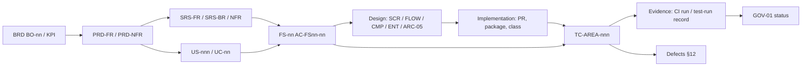
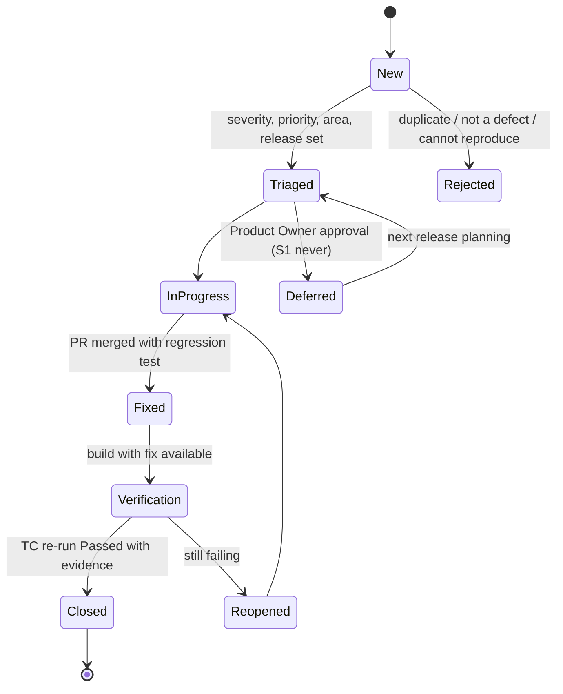

# Test Strategy — SpeakCraft

| Field | Value |
|---|---|
| Document ID | TST-01 |
| Version | 0.1 — Draft for review |
| Date | 2026-11-21 |
| Status | Draft — awaiting Product Owner approval |
| Owner (role) | QA Architect |
| Approval | Pending — Product Owner |
| Related | SRS, NFR, FS-00…12, SEC-01, DES-07, GOV-01, ENG-01 |

> **Stage A notice.** This strategy is documentation only. **No build, test or measurement has been executed** (GOV-02 DC-4: there is no JDK or Android SDK in the analysis environment). Every test case named here has the status **Not run**. All numeric targets are owned by NFR and remain **Proposed — requires approval** (GOV-02 DC-5); values marked † are Proposed. Any test dependency that is not already in `gradle/libs.versions.toml` is flagged **NEW DEPENDENCY — requires approval** (GOV-02 DC-6, PLN-05 GR-04).

> **Authority (GOV-02 §4).** TST-01 is authoritative for test levels, environments, test data, entry/exit criteria, the severity scale, the defect workflow, the non-functional test cases TC-PERF, TC-REL, TC-PRIV, TC-COMP, TC-REG and TC-MIG (§16) and the content-compliance test cases TC-CONT (§16.8, new prefix for D-08 creator-derived content). Feature test cases are defined in FS-01…FS-12 (TC-ACC … TC-SPCH), security test cases in SEC-01 §13 (TC-SEC), accessibility test cases in DES-07 §15 (TC-A11Y) and UX test cases in RD-15 (TC-UX). TST-01 references those IDs and never redefines them. GOV-01 holds the requirement ↔ test links.

---

## 1. Objectives and principles

### 1.1 Objectives

| ID | Objective | Measured by |
|---|---|---|
| TO-01 | Prove the core loop works on real devices of every speech tier: onboarding → Today → speak → transcript → honest feedback → retry → progress | Critical-feature list CF-01…CF-19 (§8.3) passed on the §5 matrix |
| TO-02 | Prove honesty: no fabricated, defaulted or mislabelled output reaches the user, including the mistakes list and coach tips shown after every submission (PRD-FR-047) | §7 evaluation-quality gates; §9 honesty checklist; NFR-QUAL-001…006 |
| TO-03 | Prove the privacy claims: no audio or transcript egress by default, backup exclusions, complete export and deletion, privacy text equal to behaviour | TC-PRIV-*, TC-SEC-*; NFR-PRIV-001…007 |
| TO-04 | Protect user data: no lost valid attempt, idempotent events, safe schema and legacy migrations | TC-REL-*, TC-MIG-* |
| TO-05 | Measure every approved NFR target on the reference devices and report the measured value honestly | TC-PERF-*, TC-COMP-*; NFR → TC table §16.7 |
| TO-06 | Stop regressions early: required gates on every PR, broader suites nightly and on every release candidate | §14; TC-REG-* |
| TO-07 | Give the Product Owner evidence, not assertions, at gates G5, G6 and G7 (PLN-05 §3) | §8.4 evidence rules; §10 exit criteria |
| TO-08 | Prove that creator-derived content complies with D-08: own wording, link to the specific source video, no creator name or branding, nothing unreviewed shipped (SRS-BR-028) | TC-CONT-001…008; §9.2 content-compliance checklist |

### 1.2 Principles

| ID | Principle | Rule in practice |
|---|---|---|
| TP-01 | **Never mark an unexecuted test as passed** | A test is **Passed** only when it was executed and its output captured: a CI run URL with JUnit XML/HTML, or a test-run record (§8.4) with screenshots and logs. Anything else is **Not run**. "Expected to pass", "should pass" and "verified" without evidence are not allowed (GOV-02 DC-4; PLN-05 GR-03; NFR-MAINT-006) |
| TP-02 | **Tests run in CI before claims** | No document, PR description, CHANGELOG entry or release note may state that a behaviour is tested, verified or working unless the CI run (or the RC test-run record) that proves it is linked. TC-REG-010 checks this for docs and the CHANGELOG |
| TP-03 | **Real audio fixtures** | Speech and evaluation behaviour is tested with recorded, annotated audio fixtures and recogniser-output transcript fixtures (§6.1), not only synthetic tones. A sine wave is not speech (gap in today's `LocalAudioPipelineTest`, ai_media_audit.md §13) |
| TP-04 | Assert meaning, not presence | Assertions compare values with annotations, thresholds and golden outputs. Forbidden as the only assertion: a score `in 1..100`, `isNotEmpty()`, "node exists". Never test a component that production does not wire (FND-TEST-03) |
| TP-05 | Null over default | When evidence is missing, tests assert `null`, "Not available" or Inconclusive. A test that accepts a default value for missing evidence is itself a defect (NFR-QUAL-001, SRS-BR-002) |
| TP-06 | Hermetic and deterministic | Unit and Robolectric tests inject `Clock`, `DateKeyProvider` and `DispatcherProvider` (WBS T-02.1.2), use `kotlinx-coroutines-test` virtual time, a fixed locale and time zone, no real network and no `google-services.json` (WBS T-01.1.2). Firestore tests use the emulator with a `demo-` project id only |
| TP-07 | Fakes, not mocks | The stack has no mocking library (platform_security_audit.md §9). Tests use hand-written fakes of the ARC-04 §5 interfaces (WBS T-02.2.2). MockK or Mockito would be a NEW DEPENDENCY and is not proposed |
| TP-08 | Test pyramid | Most tests are JVM unit tests. Compose UI is tested with Robolectric on the JVM. Instrumented tests are kept for behaviour only a device shows (microphone, recogniser, WorkManager scheduling, backup, process death, performance). Manual tests are scripted and evidenced |
| TP-09 | Boundaries for every rule | Every `SRS-BR` has unit tests at, just below and just above each boundary (NFR-MAINT-003; SRS §19 item 2) |
| TP-10 | Proposed targets are reported, not bent | A measurement that misses a Proposed target is reported as Failed against that target, with the measured value. Only the Product Owner can waive or re-baseline (NFR §10). Emulator timings are never reported as meeting a device target |
| TP-11 | Test-data privacy | Voice fixtures only with written consent (§6.1.3). No real user data in any test environment. Test accounts only in the dev Firebase project (ENG-01 §10). Logs captured during testing are checked for PII before they are attached to an issue |
| TP-12 | One home per test ID | Each TC ID is defined in exactly one document (§8.2). A fixed defect gets a regression test before it is closed (§12) |

### 1.3 Test result vocabulary

| Status | Meaning | Who may set it |
|---|---|---|
| **Not run** | Default for every TC. The state of **all** TCs in Stage A | — |
| **Passed** | Executed; expected result observed; evidence linked | Executor, with evidence |
| **Failed** | Executed; expected result not observed; defect raised (§12) | Executor |
| **Blocked** | Could not be executed (environment, dependency, missing device); reason recorded | Executor |
| **Waived** | Accepted for this release although not executed or failed; reason, risk and expiry recorded | **Product Owner only** |
| **Not applicable** | Requirement not in this release, or removed by a decision (for example D-15 can make TC-MIG-008 not applicable) | QA Architect; confirmed at G6 |

---

## 2. Current test assessment

All statements in this section are **VERIFIED** from the repository (read-only) unless labelled otherwise. Evidence: `docs/redevelopment/working_papers/platform_security_audit.md` §4.5 and §9, `ai_media_audit.md` §13, `data_learning_audit.md` §10, `ui_audit.md` §10, RD-03 §10, ENG-01 §1.4. **Nothing was executed.** The documented "161 passed" (`app/docs/COACH_AND_TRANSCRIPTION_TEST_REPORT.md:4-6`) is UNKNOWN.

### 2.1 Inventory summary

| Item | Fact | Label | Finding |
|---|---|---|---|
| JVM and Robolectric tests | **161** `@Test` methods in 24 files under `app/src/test` (5,325 lines) | VERIFIED | FND-TEST-01 |
| Instrumented tests | **1** (`ExampleInstrumentedTest`, asserts the package name) | VERIFIED | FND-TEST-01 |
| Trivial tests | 3 (`ExampleUnitTest`, `ExampleRobolectricTest`, `ExampleInstrumentedTest`) | VERIFIED | FND-TEST-01 |
| CI execution | **Never run in CI.** The only workflow builds and publishes; there is no unit, Robolectric, lint or rules job | VERIFIED (ENG-01 §1.4) | FND-OPS-01, ISS-08 |
| Firestore rules tests | `firestore.test.js`: 4 tests using `@firebase/rules-unit-testing`; no `package.json`, so not runnable; no coverage of `speakingSessions` (the broken path) | VERIFIED | FND-TEST-04 |
| Node tests | `scripts/publish_firestore_release.test.mjs`: 3 tests of the release publisher | VERIFIED | — |
| Mocking | No MockK or Mockito; isolation uses fakes | VERIFIED | — |
| Untested areas | Repositories, auth, App Check, `LearningProgressManager`, plan engines, SM-2 scheduler, notification sync, recorder, TTS, M4A decode path, NavHost/app shell, permission denial, offline, rotation and process death, font scaling, TalkBack | VERIFIED (grep) | FND-TEST-02 |
| False assurance | Zero-cloud interceptor attached to no client; "models bundled" asserted without checking files; activity scores asserted only `in 1..100`; a CUJ test name overclaims what it checks | VERIFIED | FND-TEST-03 |
| Compile dependency | Unit tests reference `R.string.default_web_client_id` through `AuthHelper.kt:53`, so they need `google-services.json` to compile | INFERRED | FND-OPS-02, ISS-06 |
| Catalog defect | `gradle/libs.versions.toml:50` resolves `junit:junit` with `version.ref = "junitVersion"` (1.3.0, line 5 — the AndroidX ext version) instead of `junit` (4.13.2, line 4) | VERIFIED (read in this review) | FND-OPS-06; WBS T-01.4.1 |
| Vacuous-pass risk | `isReturnDefaultValues = true` (`app/build.gradle.kts:88`) makes Android stubs return defaults | VERIFIED (config) / INFERRED (impact) | — |
| Harness worth keeping | Robolectric 4.16.1 with Compose ui-test (`@Config(sdk=[36])`), fakes-based state-machine tests, pure-logic test style | VERIFIED | RD-03 §10 "Preserve" |

### 2.2 Disposition per test file

**Keep** = port with the component and extend. **Rewrite** = keep the intent and the useful cases, re-implement against the new component. **Delete** = remove in the same PR that removes the feature (EP-04 T-04.1.x); never by `@Ignore`.

| File | Tests | Runner | Disposition | Target (new home) | Reason / finding |
|---|---|---|---|---|---|
| `CoachEvaluationEvidenceTest.kt` | 15 | Robolectric | **Keep** | `EvidenceGate` (T-07.1); TC-EVAL, TC-REG-015 | Most valuable suite (fail-closed gate, nulls, stale transcripts). Extend with recorded speech fixtures (§6.1), the new reasons `TOO_FEW_WORDS` and session scope; drop assertions on retired `EvidenceBasedScoringEngine` dimensions. Gap: M4A path never tested (FND-TEST-02) — retired with WAV/PCM capture |
| `LiveTranscriptionManagerTest.kt` | 14 | Robolectric | Rewrite | `RecognitionSession` (T-06.3/06.4); TC-SPCH, TC-REL-008 | Keep the fake-backend state-machine approach. Add late-final-after-stop (duplication, FND-AI-04), segment restart and stitching. Remove the unrealistic multi-final case (test 08) and the retry claim that only builds a data object (test 14) |
| `ActivityEngineUnitTest.kt` | 9 | JVM | Rewrite | Content-pack validator (TC-REG-013), `PlanEngine` (TC-TODAY) | Keep: unique IDs, validator rejects bad input, plan avoids recent activities. Delete: score `in 1..100` assertions (FND-TEST-03) and retired `UniversalEvaluationEngine` |
| `LightweightFeedbackEngineTest.kt` | 11 | JVM | Rewrite | `MetricEngine` / `FeedbackComposer` goldens (TC-REG-014) | Crafted inputs bypass the constant/dead-metric bugs (FND-TEST-03). Pronunciation and confidence sub-engines are removed (ARC-05 §6) |
| `LocalAudioPipelineTest.kt` | 3 | JVM | Rewrite | `StreamingFeatureExtractor`, `ReferenceMatcher`, M-FILL | Keep filler-boundary and alignment cases; replace the sine wave with audio fixtures for VAD and pauses (TP-03) |
| `UpgradedLocalIntelligenceTest.kt` | 7 | JVM | Rewrite | SPK-02 corpus seeds (TC-REG-016) | Positive rule cases only, no false-positive tests; YouTube drill test deleted (ADR-011) |
| `StreakAnalyticsAndBackupTest.kt` | 7 | Robolectric | Rewrite | `ProgressCalculator` boundary tests (TC-PROG) | Keep streak arithmetic as seeds; add time-zone and DST boundaries (SRS-BR-010/011). Delete updater-backup and tutorial-registry cases |
| `SpeakCraftComposeCujTest.kt` | 20 | Robolectric | Rewrite | Per-screen Robolectric suites in FS-01…12 | Most rendered screens are retired (admin, updater, mentor, tutorials, creator lessons). Reuse patterns: destructive-action confirmation (TC-SET), "no pronunciation bar when unassessable" (honesty, §9). Inverted cases: the "Welcome back" greeting (SRS-FR-TODAY-010, never on first visit) and the creator attribution badge, which must now be **absent** (SRS-BR-028; TC-CONT-001) |
| `SpeakCraftLaunchAnimationTest.kt` | 8 | Robolectric | Rewrite | Brand moment ≤ 1 s (DES-06 §2.3); TC-PERF-002, TC-A11Y-010 | Current timeline is 2.1–2.9 s; keep the reduced-motion and timeline-math approach |
| `SpeakCraftTabletLayoutTest.kt` | 7 | Robolectric | Rewrite | Window-class tests (TC-COMP-005) | Keep the bounds-based assertions for the new screens |
| `ActivityEngineComposeTest.kt` | 4 | Robolectric | Delete | — (pattern reused for TC-PRAC) | Universal activity screens retired (FS-06 replaces) |
| `CentralizedAiSettingsTest.kt` | 10 | Robolectric | Delete | TC-SEC-010 replaces the zero-cloud assurance | AI settings and cloud toggles retired (ADR-003); builds `SpeakCraftRepository` with `FirebaseApp` (needs `google-services.json`) |
| `CurriculumAndRecommendationTest.kt` | 4 | JVM | Delete | Specific-video provenance check TC-CONT-002 (D-08) | `CurriculumCatalog` and `RecommendationEngine` retired; accepts channel-root YouTube URLs as provenance (FND-DOM-09), which SRS-BR-028 now forbids |
| `ExampleRobolectricTest.kt` | 1 | Robolectric | Delete | Real smoke test (launch → Today) | Trivial (FND-TEST-01) |
| `ExampleUnitTest.kt` | 1 | JVM | Delete | — | Trivial (`2 + 2 == 4`) |
| `HybridAiCoachCoordinatorTest.kt` | 4 | Robolectric | Delete | — | Cloud AI routing retired (ADR-003) |
| `HybridAiComposeUiTest.kt` | 5 | Robolectric | Delete | — | Screens and cloud chips retired |
| `LocalAIFoundationTest.kt` | 5 | JVM | Delete | — | Asserts `bundledInAssets=true` without checking files; tests an unwired interceptor (FND-TEST-03) |
| `LocalLanguageAndOrchestratorTest.kt` | 4 | JVM | Delete | SPK-02 precision corpus | Weak `isNotEmpty` assertions; tests dead `DeterministicFeedbackTemplates` |
| `NotificationManagementSystemTest.kt` | 4 | Robolectric | Delete | TC-REM (FS-09); dedupe idea reused for the R2 inbox | In-app notification centre retired |
| `SemVerAndUpdateTest.kt` | 8 | Robolectric | Delete | — | Self-updater retired (ADR-004); hard-asserts `BuildConfig` version (FND-OPS-07). Pure-logic style preserved as a pattern |
| `SpeechRecognitionManagerTest.kt` | 4 | JVM | Delete | — | Whisper/model path removed (ADR-009) |
| `YouTubeParsingTest.kt` | 3 | Robolectric | Delete | — | YouTube client removed (ADR-011) |
| `ZeroCloudAiNetworkBoundaryTest.kt` | 3 | JVM | Delete | TC-SEC-010, TC-SEC-002, TC-PRIV-002 | False assurance: interceptor attached to no production client (FND-TEST-03) |
| **Totals (`app/src/test`)** | **161** | | **Keep 1 file / 15 · Rewrite 9 files / 86 · Delete 14 files / 60** | | |
| `androidTest/ExampleInstrumentedTest.kt` | 1 | AndroidJUnit4 | Delete | Instrumented smoke (TC-REG-002 automated part) | Trivial |
| `firestore.test.js` | 4 | Node + emulator | Rewrite | Interim L0 containment tests on current rules (R0), then the SEC-01 §5.5 suite TC-SEC-020…038 (L3 replaces the file) | Not runnable (FND-TEST-04); needs `package.json` + lockfile |
| `scripts/publish_firestore_release.test.mjs` | 3 | Node | Delete | — | Release publisher retired with ADR-004 |

### 2.3 Harness actions (R0, EP-01/EP-02)

| # | Action | WBS |
|---|---|---|
| H-1 | Fix the JUnit catalog reference (`junit` → `version.ref = "junit"`) | T-01.4.1 |
| H-2 | Make unit tests compile without `google-services.json` | T-01.1.2 |
| H-3 | Commit `package.json` and `package-lock.json` for the rules tests (`@firebase/rules-unit-testing`, `firebase-tools`); run with `npm ci` only (SEC-01 §5.5; ENG-01 §11) | T-01.2.2 |
| H-4 | After the legacy deletions, set `isReturnDefaultValues = false` so a missing fake or Robolectric shadow fails loudly (RECOMMENDATION) | T-01.2.1 |
| H-5 | Add the fake `Clock` / `DateKeyProvider` / `DispatcherProvider`, repository fakes and fixture folders (§6.7) | T-02.1.2, T-02.2.2 |
| H-6 | Enable AGP unit-test coverage (JaCoCo, built in) for TC-REG-004 | T-01.2.1 |
| H-7 | Make `testDebugUnitTest` part of the required `build-test` check (ENG-01 §4.2) | T-01.2.1, T-01.2.3 |

---

## 3. Test levels

### 3.1 Tooling and dependency status

| Tool | Used for | Status |
|---|---|---|
| JUnit 4.13.2 (after H-1) | All JVM tests | Existing (catalog line 4) |
| kotlinx-coroutines-test 1.10.2 | `runTest`, virtual time, `Dispatchers.setMain`, Flow collection | Existing |
| Robolectric 4.16.1 | Android framework on the JVM; Compose UI tests; SDK-parameterised tests | Existing |
| androidx.test core / runner; androidx.test.ext:junit 1.3.0 | `AndroidJUnit4`, `ActivityScenario` | Existing |
| Espresso core 3.7.0 | Instrumented interactions and idling | Existing |
| Compose `ui-test-junit4` + `ui-test-manifest` (BOM) | Compose semantics tests (Robolectric and instrumented) | Existing |
| Android Lint; AGP unit-test coverage (JaCoCo); AGP Gradle Managed Devices; `testBuildType` | Static analysis, coverage, emulator definitions in Gradle, release-like instrumented runs | Built into the toolchain (verify with AGP 9.1.1); no app dependency |
| Platform APIs in tests: `StrictMode`, `Activity.reportFullyDrawn`, `android.os.Trace`, `TrafficStats`, `AudioManager.getActiveRecordingConfigurations`, `StorageStatsManager`, `UiAutomation.executeShellCommand` | Timing markers, egress, recording state, storage, permission grant/revoke | Platform; no dependency |
| SDK and device tools: `adb`, `am start -W`, `dumpsys gfxinfo / meminfo / batterystats / diskstats`, Perfetto, `bmgr`, `apkanalyzer`, `apksigner`, `zipalign` | Performance, backup, artefact checks | SDK tools; no app dependency |
| `androidx.room:room-testing` (`MigrationTestHelper`, in-memory DB) | Database level, TC-MIG-001/002 | **Usable only if ADR-002 is approved (D-11).** ADR-002 names runtime/ktx/compiler only; `room-testing` must be added to its approved scope (§17 issue 2) |
| `androidx.work:work-testing` (`TestDriver`, `TestListenableWorkerBuilder`, synchronous executor) | Reminder, sync and cleanup workers | **Usable only if ADR-005 is approved (D-12)**; named in ADR-005 |
| Node 20, `firebase-tools`, `@firebase/rules-unit-testing`, Node built-in test runner | Rules tests TC-SEC-020…038; Firestore and Auth emulators for Android integration tests | Test tooling outside the app. **Needs a committed `package.json` + lockfile** (H-3); confirm under ADR-006 (SEC-01 §5.5). `firebase.json:9-12` configures only the Firestore emulator (port 8085); an Auth emulator entry must be added (configuration change) |

**NEW DEPENDENCY — requires approval.** None of the following is proposed; each has a fallback that this strategy uses.

| Candidate | Would help with | Fallback used by TST-01 |
|---|---|---|
| UiAutomator (`androidx.test.uiautomator`) | System permission dialogs, notification shade | `pm grant` / `pm revoke` through `UiAutomation.executeShellCommand`; dialog behaviour covered by scripted manual steps |
| `androidx.test:rules` (`GrantPermissionRule`), Test Orchestrator | Permission set-up, per-test isolation | Shell commands; `pm clear` between test classes |
| Macrobenchmark / Baseline Profiles (`androidx.benchmark`), JankStats (`androidx.metrics`) | Start-up and frame timing | `am start -W` + `reportFullyDrawn`, `dumpsys gfxinfo`, Perfetto (§16.1) |
| MockK, Mockito, Turbine, Truth | Mocks, Flow assertions, fluent assertions | Fakes; `kotlinx-coroutines-test` with `first()` / `toList()` in `backgroundScope` |
| Roborazzi or Paparazzi | Screenshot goldens | Semantics assertions; Robolectric native-graphics `captureToImage()` for manual review |
| Accessibility Test Framework / `espresso-accessibility` | Automated accessibility checks | DES-07 semantics tests; Accessibility Scanner app at RC (manual) |
| kotest-property | Property-based tests | Seeded random loops in JUnit 4 (TC-REL-005) |
| Kover | Coverage | AGP JaCoCo |
| Third-party emulator GitHub Action; cloud device farm (ENG-01 §10: not proposed) | Instrumented runs in CI | Gradle Managed Devices on the runner, or local device-lab runs with captured reports (§14.3) |
| Network-capture tool on the test bench (proxy or on-device VPN capture) | Egress checks TC-PRIV-002, TC-SEC-002 | Not an app dependency. Tool name and version recorded in evidence; Product Owner approves the tool before first use (RECOMMENDATION). Automated part uses `TrafficStats` |

### 3.2 Levels at a glance

| Level | Scope | Representative cases | Tools (existing stack) | Location | Runs (§14) |
|---|---|---|---|---|---|
| L-UNIT Unit | One engine, rule, mapper or ViewModel with fakes | TC-TODAY (plan engine), TC-EVAL, TC-PROG, TC-WORD scheduler, TC-REL-005, TC-REG-014…019 | JUnit 4, coroutines-test | `app/src/test` | Every PR |
| L-INT Integration | Several real components with fakes only at the edges (audio fixture → features → gate → metrics → feedback; sync engine + Room + fake remote; workers) | TC-EVAL pipeline, TC-DATA, TC-REL-010/011 | JUnit 4, Robolectric, work-testing (ADR-005) | `app/src/test` | Every PR |
| L-REPO Repository | Room-backed repositories: transactions, outbox writes, Flow emissions, profile partitioning, error mapping | TC-DATA, TC-SEC-019, TC-ACC-003/004 | Robolectric + in-memory Room (ADR-002) | `app/src/test` | Every PR |
| L-DB Database | Exported schemas, migrations, query plans, `sensitive.db` separation | TC-MIG-001/002/012, TC-PERF-008 (plan check) | room-testing (ADR-002), Robolectric | `app/src/test` + `app/schemas/` | Every PR (schema check); migrations on schema change |
| L-UI UI (Robolectric Compose) | Every FS §9 UI state per screen, interactions, navigation, theme, font scale, window class, reduced motion | TC-ONB, TC-ACC UI cases, TC-A11Y-002…010, TC-COMP-005 (JVM part) | Robolectric, Compose ui-test | `app/src/test` | Every PR |
| L-E2E End-to-end (instrumented) | Core-loop journeys on emulators and reference devices; process death; WorkManager real scheduling | TC-ACC-001/011/013, TC-ONB-004/007/013, TC-REL-003/004, CF suites | AndroidX test, Espresso, Compose ui-test, Firebase emulators | `app/src/androidTest` | Nightly (§14.2) and RC |
| L-OFF Offline | Every core-loop flow without network (airplane, Wi-Fi without internet, emulator stopped) | TC-REL-006, TC-SEC-001, TC-ACC-001/015 | As L-E2E plus manual | androidTest + manual | Nightly and RC |
| L-SEC Security | Rules emulator suite, static checks, artefact checks, manual RC review | **TC-SEC-001…050** (SEC-01 §13; SEC-01 §5.5 rules plan) — referenced, not redefined | Node rules harness, CI scripts, instrumented | Per SEC-01 "Runs in" | PR (rules, static), release (artefact), RC (manual) |
| L-A11Y Accessibility | Semantics, font scale, contrast, targets, reduced motion, TalkBack | **TC-A11Y-nnn** (DES-07 §15) — referenced, not redefined | Robolectric, Compose ui-test; TalkBack and Accessibility Scanner (manual) | test + manual | PR (automated), RC (manual) |
| L-PERF Performance | NFR-PERF methods on reference devices | TC-PERF-001…012 | Platform tools (§3.1); JVM early-warning timings | androidTest + bench scripts | Baseline at R0 end; RC |
| L-COMP Compatibility | Tier matrix, API levels, window classes, recogniser variants, locales, 16 KB | TC-COMP-001…009 | Gradle Managed Devices, physical devices | androidTest + manual | Nightly (emulators), RC (devices) |
| L-REG Regression | Re-running suites after change; quality gates; evaluation, mistakes and tip goldens; defect regression | TC-REG-001…026 | All of the above | CI + RC | PR, nightly, RC |
| L-CONT Content compliance | D-08 rules for creator-derived techniques, exercises and tips: branding gate, provenance, review status, no verbatim fields, own-words review, link-out | TC-CONT-001…008 (§16.8) | CI scripts and build-time validator; manual review | CI + RC | PR (build-time), release (artefact scan), RC (manual) |
| L-UAT User acceptance | Beta programme, UAT scripts, Product Owner sign-off | UAT-01…UAT-10 (§3.4) | Release-signed beta builds | Beta channel (ENG-01 §8.1) | Per release (R1, R2) |

Evaluation quality (gate, metrics, rule precision, golden fixtures) is a cross-level concern described in §7.

### 3.3 Level notes

| Level | Rules |
|---|---|
| L-UNIT | Targets: `PlanEngine`, `EvidenceGate`, `MetricEngine`, `RuleEngine`, `FeedbackComposer`, `ReferenceMatcher`, `WordStageEvaluator`, `ReviewScheduler`, `ProgressCalculator`, `SyncEngine` merge, error mappers, ViewModels. One behaviour per test; the TC ID is in the test name (`tcEval003_inconclusiveWhenTooShort`) so the traceability script (§8.1) can find it. Every SRS-BR has boundary cases (TP-09). Coverage ≥ 70 % line for `speech/`, `data/` and engines (NFR-MAINT-003) |
| L-INT | Real implementations wired together through the process-scoped container with fakes only at platform edges (recogniser, Firebase, clock). The evaluation pipeline runs from fixture PCM + transcript fixture to `EvaluationResult` and is compared with goldens (§7.1). Workers run with `work-testing` `TestDriver` (constraints met, periodic delay elapsed) |
| L-REPO | In-memory Room on Robolectric. Each write that must create an outbox entry is asserted to be atomic with it (failure injected after the first insert leaves neither). Flows emit once per committed transaction. SRS-ERR-005 mapping: a failed write never reports success |
| L-DB | Schema JSON committed under `app/schemas/` (ADR-002). CI fails when the schema changes without a migration and a migration test (ENG-01 §4.2). `MigrationTestHelper` runs every version pair from v1 to latest on the seeded database (§6.3). `fallbackToDestructiveMigration` is forbidden (static check in TC-MIG-002). `EXPLAIN QUERY PLAN` asserts index use for the NFR-PERF-008 queries. `learning.db` and `sensitive.db` have separate schemas and migrations (PLAN_AND_CANON R-1) |
| L-UI | Each FS §9 state table is a test checklist: default, loading, empty, error, offline, permission and feature states rendered from fake ViewModel state. Variants: dark theme, `fontScale = 2f`, compact / medium / expanded qualifiers, reduced motion. Robolectric is not used for timing, real permission dialogs or recogniser behaviour |
| L-E2E | Audio input: (a) a **debug-only** audio-source seam that reads a fixture WAV instead of the microphone for T1/T3b capture paths (debug source set only; its absence from release is checked by TC-REG-022 — RECOMMENDATION for ARC-02); (b) real microphone with acoustic playback of fixtures for scripted device runs; (c) real platform recogniser on physical devices, fake recogniser on emulators (emulator images are not representative of on-device recognition). Permissions are granted or revoked with shell commands; system dialogs are covered manually. Firebase emulators are reached at `10.0.2.2` (emulator) or the bench machine's LAN address (physical device) with a `demo-` project id |
| L-OFF | Conditions: airplane mode; Wi-Fi with no internet; network toggled every 30 s; Firebase emulator stopped. Expected: every core flow completes, sync shows "Waiting for connection" and never blocks (SRS-FR-DATA-005, SRS-AVL-001/002) |
| L-SEC | SEC-01 §13 owns the cases and pass criteria; TST-01 schedules them (§14) and gates on them (§10). Rules tests follow SEC-01 §5.5 (baseline builder per collection, generated negatives, coverage artefact, required check `rules-test`) |
| L-A11Y | DES-07 §15 owns the cases. Automated: TC-A11Y-001 (JVM token contrast), 002…006 and 009 (semantics), 007 and 023 (font scale), 008 (targets), 010 (reduced motion), 020 (snackbar), 024 (both themes). Manual at RC: TalkBack core-loop script and 200 % font pass on RD-MID (WBS T-18.4); DES-01 §5 heuristic checklist for new screens |
| L-PERF | Protocol: release-like build (release or the non-debuggable `staging` type, ENG-01 §2.2); cold state unless stated; median of 10 runs with P90 recorded (NFR §1); battery ≥ 50 %, 5-minute cool-down between series, screen brightness fixed, airplane mode unless the case needs network, same OS build per series. Raw data attached. Emulator numbers are never reported against device targets (TP-10) |
| L-COMP | §5 matrix; API-gated code is also unit-tested with Robolectric at SDK 24, 31, 33 and 36 (verify that Robolectric 4.16.1 supports each); physical devices confirm tier behaviour (NFR-COMP-002) |
| L-REG | PR regression = all JVM suites (required). Nightly = instrumented suites. RC = full manual regression on the matrix, including tiers T1, T2, T3a/T3b, offline, sign-in/sign-out and deletion (ENG-01 §8.3 item 8). Selection: CF suites always; extra suites by changed area; every fixed S1/S2 defect adds an automated test (TC-REG-021) |
| L-UAT | §3.4 |

### 3.4 User acceptance testing

#### 3.4.1 Beta programme (ADR-013 option A; ENG-01 §8.1)

| Item | Plan (Proposed — requires approval) |
|---|---|
| Cohort | Recruited testers, ≤ 50 on the interim GitHub prerelease channel; **≥ 10 active** testers required for KPI evidence (RSK-07 trigger) |
| Recruitment | DEP-09; screener for the primary segment S1 (B1–B2 professionals and job seekers, ASM-01); mix of tiers (at least 3 T1/T2 and 2 T3 devices) |
| Duration | ≥ 14 days per beta build series before R1 UAT sign-off |
| Builds | Release-signed `vX.Y.Z-beta.N` only; never debug builds (ENG-01 §4.4) |
| Feedback channels | In-app "Was this accurate?" (local), user-initiated "Share my beta summary" (aggregate counts only), "Share diagnostics" with preview (ADR-007), a feedback form, 5–8 interviews |
| Measures collected | KPI-01…KPI-06 and KPI-08 inputs (BRD §8); defects raised through §12 |
| Consent | Beta terms explain what testers may share; nothing is collected automatically (ADR-013) |

#### 3.4.2 UAT scripts

| Script | Journey (PRD §14) | Outline | Acceptance focus | Devices |
|---|---|---|---|---|
| UAT-01 | J1 First-time user | Fresh install offline → onboarding defaults → privacy and mic → speech check → "Introduce yourself" → first feedback | PRD §21 item 2; KPI-02 timing recorded | RD-MID (T2), RD-HIGH (T1) |
| UAT-02 | J2 Daily session | Today → Start → all steps → completion → streak update | Plan fits minutes; completed steps preserved | Any two tiers |
| UAT-03 | J3 Rehearse a situation | Practice → Techniques → technique detail → "Practise it" → speak → read Mistakes found and Coach tips → retry → compare → save; open "Watch the original lesson" | Mistakes have evidence and labels; tips are useful and not presented as AI; comparison shows the previous valid attempt; the link opens the specific video | Any |
| UAT-04 | J4 Learn a word | Learn → Say it → Use it → Make your own → review next day (clock advanced on test device only) | Thresholds and Inconclusive handling understood | T1/T2 and T3b |
| UAT-05 | J5 Check progress | Progress → trend → history → replay | No trend before 3 valid attempts; noise band | Any |
| UAT-06 | J6 Privacy and data | Speech & privacy → retention; export; clear history; delete local data | Export opens; deletion complete | Any |
| UAT-07 | Account (FS-01) | Sign in (dev project) → sync → sign out keep/remove → delete account | Data adopted; deletion confirmed | RD-MID |
| UAT-08 | Low capability (FS-12) | T3a consent flow and withdrawal; T3b audio-only session | Honest labels; no transcript claims | RD-LOW |
| UAT-09 | Accessibility | Core loop with TalkBack and at 200 % font | Operable without sight; no clipped text | RD-MID |
| UAT-10 | Reminders (FS-09) | Enable reminder → skip practice → reminder arrives around the time; practise → no reminder | One per day; suppression | RD-MID, RD-HIGH |

#### 3.4.3 UAT sign-off

The UAT report (PLN-05 §8 release report) contains: build tag and SHA; device list with tiers; UAT script results (Passed / Failed / Blocked with evidence); beta duration, active testers and KPI-01…06, KPI-08 values with their denominators; open defects by severity; honesty checklist result (§9); accessibility and privacy results; waivers requested. **The Product Owner signs it at gate G6.** The QA Architect role prepares it and does not approve its own work (PLN-05 §1).

---

## 4. Test environments

| ID | Environment | Purpose | Build | Data | Provided by |
|---|---|---|---|---|---|
| ENV-01 | Local development | Write and run unit, Robolectric and emulator tests | `debug` | Fakes; Firestore/Auth emulator with `demo-speakcraft`; seeded DBs (§6.3) | ENG-01 §3 (wrapper, onboarding guide) |
| ENV-02 | CI — PR and push to `main` (`ci.yml`) | Required gates: build, unit, Robolectric, lint, schema check, security-static, rules-test | `debug` + unsigned `release` (R8 check) | Fixtures in repo; emulator `demo-speakcraft` (offline) | ENG-01 §4.2 |
| ENV-03 | CI — nightly (proposed `nightly.yml`, §14.2) | Instrumented suites on Gradle Managed Devices (API 24, 31, 33, 36 and a 16 KB image); emulator-backed sync, deletion and migration tests | `debug` (functional) | Seeded DBs; legacy snapshot loaded into the emulator | Needs ENG-01 update (§17 issue 1) |
| ENV-04 | Device lab | Physical reference devices (§5) for tiers, performance, manual suites | `debug` (functional), release-like (performance) | Fixtures; test accounts | QA; devices per ASM-07 |
| ENV-05 | Dev Firebase project (D-27 option B) | Manual integration: real Google sign-in, multi-device sync, deletion, legacy-migration rehearsal | `debug` / `staging` | Test Google accounts only; seed and cleanup scripts (ENG-01 §10) | ENG-01 §2.1, §10 |
| ENV-06 | Release candidate | Full regression, honesty review, privacy, accessibility, performance confirmation | Release-signed RC APK (or `staging` if ED-02) | Fresh installs and upgrade installs | ENG-01 §10 |
| ENV-07 | Beta | UAT and field signals | Release-signed `-beta.N` | Testers' own data on their devices (never collected automatically) | ENG-01 §8.1 |
| ENV-08 | Production | **No testing.** Monitoring only (Play vitals or shared diagnostics) | Release | Real users | ENG-01 §9 |

| Condition | How it is produced |
|---|---|
| Offline | Airplane mode; Wi-Fi without internet; `svc wifi/data disable` via shell on emulators |
| Slow or flaky network | Emulator network speed and latency settings; toggling every 30 s |
| Firebase unavailable | Emulator stopped mid-sync |
| Time and time zone | Fake `Clock` in JVM tests; device date/time and time-zone changes only on test devices, with automatic time disabled |
| Storage full | Debug-only storage-check seam returning "full" (RECOMMENDATION) plus a manual fill on an emulator |
| Low memory | RD-LOW device; emulator with 2 GB RAM |

Test accounts: at least three Google test accounts in the dev project — A (primary), B (second account / different-account guard, FS-01 issue 1), D (disposable, account deletion). **Never** in the prod project.

---

## 5. Test device matrix

### 5.1 Physical reference devices (NFR §1)

| ID | Class (NFR §1) | Selection criteria | Expected tier | Used for | Model / build fingerprint |
|---|---|---|---|---|---|
| DEV-L1 | **RD-LOW** | Android 8–10 (API 26–29), 2–3 GB RAM, entry-level SoC (Android Go-class or 2019-era budget) | T3a (with consent) / T3b | Memory and latency floor (TC-PERF-001/005/007/008/009), 2 GB (TC-COMP-003), T3 behaviour, consent flow | Record at Sprint 0 (ASM-07) |
| DEV-M1 | **RD-MID** | Android 12 (API 31/32), 4 GB RAM, mid-range SoC, Google recognition service present | T2 | Primary segment device: most performance targets, battery (TC-PERF-011), sync recovery (TC-REL-007), TalkBack pass | Record at Sprint 0 |
| DEV-H1 | **RD-HIGH** | Android 14–16 (API 34–36), 6–8 GB RAM, on-device recognition with installable English pack | T1 | Audio-source piping, replay, segmented sessions, recording latency T1 | Record at Sprint 0 |
| DEV-X1 | Second OEM (any class, preferably RD-MID or RD-HIGH) | Different manufacturer from DEV-M1/H1; an OEM recognition service if available | T1 or T2 | Recogniser variants (TC-COMP-006); ENG-01 §10 "at least two OEMs" | Record at Sprint 0 |
| DEV-16K | Optional | A device that offers the 16 KB page-size developer option | T1 | TC-COMP-008 on hardware | Optional |

The SPK-01 devices (≥ 4, ARC-05 §4.4) are reused for this matrix. Every result records: model, Android version and security patch, build fingerprint, RAM, recogniser package and version, installed language packs, tier detected.

### 5.2 Emulators (NFR §1)

| ID | Image | Purpose | Notes |
|---|---|---|---|
| EMU-24 | API 24 (Android 7.0), Google APIs | minSdk floor: install, launch, T3a/T3b paths, permission model without POST_NOTIFICATIONS | Replaced by API 26 if D-14 raises minSdk |
| EMU-31 | API 31 | T2 code paths with a fake recogniser; exact-alarm-free WorkManager scheduling | Emulator recognition is not representative |
| EMU-33 | API 33 | T1 API paths (`EXTRA_AUDIO_SOURCE`, `checkRecognitionSupport`) with a fake recogniser; POST_NOTIFICATIONS flow | — |
| EMU-36 | API 36 (target SDK) | Current platform behaviour (edge-to-edge, predictive back); default nightly image | — |
| EMU-16K | 16 KB page-size image (API 35 or 36) | NFR-COMP-008 | Nightly smoke |
| EMU-TAB / EMU-FOLD | API 36 tablet (expanded) and foldable (medium/expanded) profiles | NFR-COMP-005 window classes and rotation | Nightly UI smoke |
| Robolectric | SDK 36 (current config) plus 24, 31, 33 for API-gated code | Robolectric parity named in NFR §1 | JVM, every PR |

### 5.3 Speech-tier coverage

| Tier (ADR-009) | Primary device | Secondary | Emulator role | How the tier is produced in tests |
|---|---|---|---|---|
| **T1** on-device + `EXTRA_AUDIO_SOURCE` | DEV-H1 | DEV-X1 (if T1) | EMU-33/36 with fake recogniser (logic only) | English pack installed; piping verified at first use |
| **T2** on-device, recogniser owns mic | DEV-M1 | DEV-X1 (if T2) | EMU-31 with fake recogniser | API 31–32 device, or T1 device after a piping failure (ARC-05 §3) |
| **T3a** consented online | DEV-L1 (online) | EMU-24 (network on, fake recogniser) | Consent and gating logic | No on-device recogniser + consent given; network on |
| **T3b** audio-only | DEV-L1 (consent withdrawn) | Any device with consent off and no on-device recogniser | EMU-24 | Consent withdrawn (SRS-FR-SPCH-006) or recogniser unavailable (SRS-ERR-002) |

A **debug-only tier override** (compile-time flag in the debug source set, ARC-02 §9) lets functional tests force a tier on any device (RECOMMENDATION). It must be absent from release builds (checked by TC-REG-022). Tier behaviour claims are verified only on physical devices without the override (NFR-COMP-002).

### 5.4 16 KB page size (NFR-COMP-008)

- EMU-16K runs the instrumented smoke suite nightly and TC-COMP-008 at every RC.
- CI checks native-library alignment of the release APK (`zipalign -c -P 16 -v 4`); after the removal of MediaPipe, TFLite and CameraX the APK may contain no native libraries, and the check then confirms that.
- DEV-16K is used when available; otherwise the result states "emulator only".

### 5.5 Configuration coverage

| Dimension | Values | Where |
|---|---|---|
| Window class | Compact 360 × 640 dp; medium 600 × 960 dp; expanded 1280 × 800 dp; portrait and landscape | Robolectric qualifiers (every PR); EMU-TAB/FOLD and one phone rotation run (nightly, RC) |
| Font scale | 1.0, 1.3, 1.5, 2.0 (TC-A11Y-023) | Robolectric; RD-MID manual at RC |
| Theme | Light, dark (TC-A11Y-024) | Robolectric; RC spot check |
| Recognition locale | en-US, en-GB, en-IN, en-AU (NFR-COMP-007) | DEV-H1, DEV-M1 |
| Device language | English and one non-English device locale (default recognition locale falls back to en-US, SRS-FR-SPCH-008) | DEV-M1 |
| Accessibility services | TalkBack; system animator scale 0 | RD-MID manual; Robolectric reduced motion |

### 5.6 Device availability (ASM-07) and fallbacks

| Situation | Action |
|---|---|
| Sprint 0 | QA records the device inventory against §5.1; gaps raised as DEP-07 risks |
| A class is missing | (1) Borrow or buy a matching device (Product Owner decision, cost); (2) use the closest equivalent and record the deviation in every result; (3) emulators for functional coverage only, labelled "not representative for performance or recognition" |
| A device fails mid-release | Re-run the affected suites on the fallback device; results from different devices are never merged into one measurement |
| Cloud device farms | Not proposed (ENG-01 §10); a request needs Product Owner approval (new service, cost) |

### 5.7 Suite × device map

| Suite | EMU-24 | EMU-31 | EMU-33 | EMU-36 | EMU-16K | DEV-L1 | DEV-M1 | DEV-H1 | DEV-X1 |
|---|---|---|---|---|---|---|---|---|---|
| Instrumented smoke (TC-REG-002 automated part) | N | N | N | N | N | RC | RC | RC | RC |
| Core-loop E2E (CF suites) | N | N | N | N | — | RC | RC | RC | — |
| Offline suite (TC-REL-006) | N | — | — | N | — | RC | RC | RC | — |
| Interruptions (TC-REL-003) | — | — | — | N | — | RC | RC | RC | — |
| Tier detection (TC-COMP-002) | N | N | N | N | — | RC | RC | RC | RC |
| Performance (TC-PERF) | — | — | — | — | — | RC | RC | RC | — |
| Accessibility manual | — | — | — | — | — | — | RC | — | — |
| Privacy egress (TC-PRIV-002, TC-SEC-002) | — | — | — | — | — | RC | RC | RC | — |
| Backup (TC-PRIV-006, TC-SEC-013) | — | — | — | N | — | — | RC | — | — |
| 16 KB (TC-COMP-008) | — | — | — | — | N, RC | — | — | — | — |

N = nightly (or the local device-lab substitute, §14.3); RC = every release candidate.

---

## 6. Test data

### 6.1 Audio fixture set

#### 6.1.1 Format and annotation

| Item | Rule |
|---|---|
| Format | WAV, 16 kHz, mono, PCM16 (the T1/T3b capture format, ARC-05 §4.1) |
| Sidecar | One JSON annotation per fixture: id, category, duration, voiced time, word-level transcript with timings, word count, long-pause count (silences ≥ 1.0 s inside speech), pace (words ÷ voiced minutes), expected gate outcome and reason, template, speaker consent id, licence, recording device and room |
| Annotation | Two annotators label independently; disagreements are resolved and recorded. Tolerances used in tests come from NFR-QUAL-004 (WPM ± 10 %, pauses ± 1) |
| Recogniser output | For each speech fixture, the transcripts produced by each SPK-01 device class are stored as **transcript fixtures** (`FX-T-*`), unpunctuated and as returned (fillers often dropped). JVM tests feed these through a fake `RecognitionSession`, so pipeline tests do not depend on a recogniser at test time |
| Checksums | A manifest lists every fixture with its SHA-256; tests fail if a fixture changes without a manifest update |

#### 6.1.2 Fixture catalogue

| ID | Category | Content | Expected gate outcome (SRS-BR-001, ARC-05 §5) | Used by |
|---|---|---|---|---|
| FX-A-01 | Silence | 5 s digital silence | Inconclusive (`TOO_QUIET` or `NO_SPEECH`, reason precedence per FS-05) | TC-REG-015 |
| FX-A-02 | Silence | 10 s room tone (≈ −50 dBFS) | Inconclusive `NO_SPEECH` | TC-REG-015 |
| FX-A-03 | Noise only | 10 s fan / HVAC | Inconclusive `NO_SPEECH` | TC-REG-015 |
| FX-A-04 | Noise only | 10 s street traffic | Inconclusive `NO_SPEECH` | TC-REG-015 |
| FX-A-05 | Noise only (hard) | 10 s distant café babble | Annotated expected outcome; a mismatch is logged as a known limitation only with Product Owner agreement | TC-REG-015 |
| FX-A-06 | Short | 1.2 s single word | Inconclusive `TOO_SHORT` | TC-REG-015 |
| FX-A-07 | Short boundary | Pair: 1.49 s and 1.50 s, one recognised word, TPL-READ | `TOO_SHORT` / Valid | TC-REG-015; TC-EVAL |
| FX-A-08 | Voiced boundary | 3 s file with 0.4 s voiced | Inconclusive `NO_SPEECH` (voiced < 0.5 s) | TC-REG-015 |
| FX-A-09 | Voiced-ratio boundary | Pair: 24 % and 26 % voiced over 10 s | Inconclusive / Valid (25 % †) | TC-REG-015 |
| FX-A-10 | Quiet speaker | Speech at ≈ −40 dBFS | Annotated (`TOO_QUIET` or Valid per silence floor) | TC-REG-015 |
| FX-A-11 | Normal | 60 s TPL-ANSWER, ≈ 130 wpm, 2 long pauses | Valid | TC-REG-014/017; TC-PERF-005 |
| FX-A-12 | Fast | 60 s, ≈ 180 wpm | Valid; M-WPM band "fast" | TC-REG-017 |
| FX-A-13 | Slow | 60 s, ≈ 90 wpm | Valid; band "slow" | TC-REG-017 |
| FX-A-14 | Long pauses | 60 s with 6 pauses ≥ 1.0 s and 3 pauses of 0.8–0.95 s | Valid; M-PAUSE = 6 ± 1 | TC-REG-017 |
| FX-A-15 | Edge silence | 3 s leading and trailing silence around 30 s speech | Valid; edge silences not counted as pauses | TC-REG-017 |
| FX-A-16 | Long | 120 s TPL-STORY | Valid | TC-PERF-009; TC-REL-012 |
| FX-A-17 | Clipped | > 1 % samples at full scale | Valid with quality warning | TC-EVAL |
| FX-A-18 | Read aloud | Reference text read exactly | Valid; M-MATCH high | TC-REG-014 |
| FX-A-19 | Read aloud | Same text with 3 substituted words | Valid; the 3 words listed as not recognised as intended | TC-REG-014 |
| FX-A-20 | Structured | STAR answer with all four elements | Valid; M-STRUCT 4/4 (Estimated) | TC-REG-014 |
| FX-A-21 | Structured | STAR answer missing Result | Valid; focus "Add the Result" (ARC-05 §8.2 priority 3) | TC-REG-014 |
| FX-A-22 | Fillers | Dense "um", "uh", "you know" | Valid; M-FILL reported as Estimated with the recogniser caveat | TC-REG-014 |
| FX-A-23 | Word stages | Target word exact; inflection; near-match; wrong word; target absent | Stage 2 scores 100 / 90 / 75–89 / < 75 / fail (ARC-05 §9) | TC-WORD; TC-REG-014 |
| FX-A-24…63 | **Consented B1–B2 accented recordings** | ≥ 40 utterances (the SPK-01 set, WBS T-05.2), ≥ 5 speakers, ≥ 3 first-language backgrounds, mixed genders, all five templates | Valid speech (annotated) | TC-REG-017/018; SPK-01 WER |

#### 6.1.3 Consent, privacy and storage

| Rule | Detail |
|---|---|
| Consent | Written consent per speaker: purpose (testing SpeakCraft), where stored, who can access, publication (only if the repository is public), withdrawal. A withdrawn recording is deleted and its goldens regenerated under a version bump |
| No PII | Files are named by fixture ID; recordings do not contain names, addresses or other identifying details; spoken prompts are scripted |
| Location | `app/src/test/resources/fixtures/audio/` if consent allows the repository's visibility; otherwise private storage fetched by CI. Decision needed on repository visibility and size (OQ-TST-2) |
| Size | Target ≤ 50 MB for the whole set (RECOMMENDATION); Git LFS would be a new service and is not proposed |

### 6.2 SPK-02 transcript corpus (rule precision)

| Item | Rule |
|---|---|
| Purpose | Qualify every candidate language rule before it ships (ARC-05 §8.1; NFR-QUAL-003; WBS T-05.3) |
| Size | ≥ 30 positive (rule should fire) and ≥ 30 negative (must not fire) examples **per rule**, including the false-positive cases found in the audit (FND-AI-09) |
| Style | Lower-case, unpunctuated, recogniser-style text; include examples captured from SPK-01 devices; include fillers dropped and run-on text (ARC-05 §8.3 punctuation independence) |
| Labels | Two annotators; each example records rule id, label, source (written or recogniser-captured), annotator agreement |
| Split | Development split (≈ 2/3) for rule authoring and a held-out split (≈ 1/3) (RECOMMENDATION). The gate is computed on the full labelled corpus as NFR-QUAL-003 states; held-out precision is reported alongside, and a held-out value below 0.90 is escalated to the Product Owner |
| Companion corpora | Filler phrases (M-FILL), STAR/PREP cue phrases (M-STRUCT), hedges (M-HEDGE), text normalisation for M-MATCH (contractions, numbers), word-stage inflection lists |

### 6.3 Seeded databases

Generated by deterministic test code (fixed seed; no new dependency) so the data always matches the current schema. Instrumented tests generate the data on the device at test start.

| ID | Content | Used by |
|---|---|---|
| DB-EMPTY | New local profile, no data | First-run tests |
| DB-1DAY | Onboarded profile, baseline attempt, today's plan | Start-up (TC-PERF-001 variant a) |
| DB-30D | 30 days of daily use with default retention: ≈ 90 attempts, recordings for 30 days | TC-COMP-004; retention |
| **DB-2Y** | **2 years of history** (730 days; ≈ 600 practice days): ≈ **3,000 attempts** (≈ 15 % Inconclusive), ≈ 20,000 attempt-metric rows, 730 session plans with ≈ 2,600 steps, ≈ 600 word-progress rows, ≈ 6,000 word reviews, ≈ 9,000 learning events, ≈ 2,500 transcripts in `sensitive.db`, recording rows for the last 30 days only, ≈ 300 feedback ratings | NFR-PERF-008 (TC-PERF-008), TC-PERF-001 variant b, TC-MIG-002, export size |
| DB-EDGE | Time-zone changes, a DST transition, missed days, attempts referencing retired content versions, Inconclusive attempts on streak boundaries, Mastered words that fail review | SRS-BR boundary tests, TC-PRIV-004 export golden, TC-MIG-012 |
| DB-2PROF | Two profiles (local and signed-in) with interleaved rows | TC-SEC-019, sign-out and deletion wipes |
| DB-OUTBOX50 | DB-2Y plus 50 un-uploaded attempts over 7 dateKeys | TC-REL-007 |

### 6.4 Legacy Firestore snapshot (migration tests)

| Item | Rule |
|---|---|
| Source | **Synthetic** documents built from the legacy models and paths (platform_security_audit.md §3.2; data_learning_audit.md §1.4, §8). An anonymised copy of the Product Owner's own legacy account may be added only with the Product Owner's explicit consent (ASM-09). No other real user data |
| Form | Firestore emulator export (`firebase emulators:export`), loaded with `--import` in TC-MIG tests |
| Variants | LEG-01 complete profile and vocabulary; LEG-02 missing optional fields; LEG-03 each legacy level vocabulary (3-, 4- and 5-tier, FND-DOM-12) for mapping to the five levels (D-17); LEG-04 large vocabulary (≥ 500 entries); LEG-05 malformed documents (wrong types); LEG-06 already migrated (marker set); LEG-07 partially migrated (interrupted run) |
| Local legacy state | For in-place upgrade tests (if D-15 keeps the applicationId): a legacy app data directory with `speakcraft_prefs` DataStore and the JSON stores (`learning_state/…`, `notification_store/…`, mentor history), produced by running the last legacy release build on an emulator with scripted use |

### 6.5 Other data sets

| ID | Content | Used by |
|---|---|---|
| CP-VALID / CP-INVALID-* | Content packs: valid; duplicate id; missing required field; unknown template; missing provenance; a track below 15 activities; word bank below 300 entries | TC-REG-013; SRS-ERR-008 |
| CP-V2 | Content pack v2 that retires two activities | TC-MIG-012 (SRS-BR-026) |
| TIP-FIX | Fixed transcript fixtures and metric sets per template, technique exercise, word stage 2–4 and review item, each with a fixed `attemptId`; band-boundary cases (edge + noise band, just beyond, `null`); no-issue cases; a test content pack of technique tips with every trigger type (issue code, metric + band, technique, template) and tied priorities | TC-REG-024, TC-REG-025 (§7.5) |
| CP-INVALID-BRAND / -PROV / -PENDING / -VERBATIM | Content packs with: a creator name in a display field; channel-root, playlist or timestamp-less provenance and missing verified-by/on; a `PENDING_REVIEW` item and an item without verified provenance; a `transcript` field and a caption file | TC-CONT-001…004 |
| BRAND-DENYLIST | Creator handle, name and brand tokens, maintained by the Product Owner; excluded from its own scan | TC-CONT-001 |
| LEGACY-NGRAM | SHA-256 hashes of normalised 8-word sequences from legacy creator-derived text in the current repository (no raw text stored) | TC-CONT-005 |
| EXPORT-GOLDEN | Expected export JSON for DB-EDGE (schema per ARC-03 §10) | TC-PRIV-004; TC-SEC-017 |
| PRIVACY-FACTS | Snapshot of the privacy-facts constants and rendered strings | TC-PRIV-007; TC-SEC-044 |
| LOG-PII | Strings containing emails, uids, JWTs, `users/<uid>` paths and transcript text | TC-SEC-040; TC-MIG-006 |
| ACCOUNTS | Dev-project test accounts A, B and D (§4) | ENV-05 tests |

### 6.6 Fixture governance

| Rule | Detail |
|---|---|
| Location | `app/src/test/resources/fixtures/` (audio, transcripts, corpus, content packs, goldens); `app/src/androidTest/assets/fixtures/` for on-device audio injection; `test-data/firestore/legacy-*` for emulator exports |
| Change control | Fixture and golden changes go through PR review; golden output changes require an `evaluationVersion` bump (§7.1) |
| Ownership | QA Architect (catalogue), AI/ML Engineer (annotation and corpus), Database Architect (seed generators, legacy snapshot) |

---

## 7. Evaluation-quality testing

### 7.1 Golden fixtures per `evaluationVersion`

| Step | Rule |
|---|---|
| Golden content | For every speech fixture and its transcript fixture: the full `EvaluationResult` (gate outcome and reason, every metric value or `null` with reason, Measured/Estimated label, headline selection, band, strength and focus ids, rule hits, "How we measured this" source ids) |
| Location | `fixtures/golden/<evaluationVersion>/<fixtureId>.json`; mistakes and coach-tip goldens (§7.5) under `fixtures/golden/<evaluationVersion>/<contentVersion>/<fixtureId>.json` because issues are versioned with `evaluationVersion` and tips with `contentVersion` (ARC-05 §8.4) |
| Comparison | Exact match (NFR-QUAL-006 determinism). Floating values are serialised with fixed precision defined by ARC-05 |
| Change | Any golden change requires: a new `evaluationVersion` (semantic version, ARC-05 §10), a changelog entry, a new golden folder and reviewer sign-off. A CI script fails a PR that changes goldens of the current version without bumping it |
| History | Goldens of the previous version are kept (not run) so reviewers can diff behaviour between versions |

### 7.2 Quality gates

| Gate | Target (NFR) | Data set | Level | Blocking | TC |
|---|---|---|---|---|---|
| Evidence-gate correctness | 100 % of gate fixtures classified correctly (NFR-QUAL-002) | FX-A-01…10 + valid fixtures | L-UNIT (JVM) | PR | TC-REG-015 |
| Rule precision | Each shipped rule ≥ 0.90 † on ≥ 30 pos / ≥ 30 neg (NFR-QUAL-003) | SPK-02 corpus | L-UNIT (JVM) | PR | TC-REG-016 |
| Metric accuracy | WPM within ± 10 %, long pauses within ± 1 of annotation (NFR-QUAL-004) | FX-A-11…16, FX-A-24…63 | L-INT (JVM) + device record | PR (JVM); RC (device record) | TC-REG-017 |
| Inconclusive rate | ≤ 15 % on T1/T2 for valid-speech fixtures (NFR-QUAL-005) | FX-A-24…63 played to DEV-H1 / DEV-M1 | L-E2E (device) | RC | TC-REG-018 |
| Determinism | Same inputs → identical metrics and feedback (NFR-QUAL-006) | All goldens; run twice; default locale tr-TR and hi-IN; three time zones | L-UNIT | PR | TC-REG-014, TC-REG-023 |
| No fabrication | 0 default/baseline scores, constant confidences or simulated analysis (NFR-QUAL-001) | Static scan + null-on-missing-evidence tests | L-UNIT + CI script | PR | TC-REG-019 |
| Labels carry text | Measured / Estimated / Inconclusive / tier labels are text, not colour only (NFR-A11Y-006, SRS-BR-003) | Robolectric result screens | L-UI | PR | TC-REG-020 |
| Mistakes and coach tips | Detected issues and selected tips equal the goldens for every fixture, per `evaluationVersion` and `contentVersion` (ARC-05 §8.4; SRS-FR-EVAL-015/016, SRS-FR-WORD-014) | TIP-FIX set (§6.5) with fixed attempt IDs | L-UNIT | PR | TC-REG-024 |
| Mistake-detection precision | Rule-based issues (`ISSUE_GRAMMAR_POSSIBLE`) come only from shipped rules that pass the precision gate; metric-based issues inherit the metric-accuracy gate and the noise-band raising rule | SPK-02 corpus; FX-A-11…16 | L-UNIT | PR | TC-REG-016, TC-REG-017, TC-REG-024 |
| Honest empty state, self-check, non-AI tips | Empty state never implies perfection; self-check is self-reported; tips never presented as AI (ARC-05 §8.4) | Robolectric result screens | L-UI | PR | TC-REG-025 |
| Candidate acoustic metrics | Pitch range and volume variation absent from R1 until validated by SPK-01 and approved (ARC-05 §8.4) | Release build; strings | CI | PR / release | TC-REG-026 |
| Field signals | KPI-05 ≥ 75 % positive accuracy ratings; KPI-06 ≤ 15 % Inconclusive (BRD §8) | Beta summaries | L-UAT | R1 exit input (not a test pass/fail) | §3.4 |

### 7.3 Rule-precision gate mechanics

1. The rule registry lists each rule with id, version and status (`shipped` or `candidate`). Only `shipped` rules can run in production (ARC-05 §8.1).
2. For each rule: TP = fires on a positive example; FP = fires on a negative example; precision = TP ÷ (TP + FP); recall = TP ÷ positives (reported, not gated).
3. The CI test fails if any `shipped` rule has fewer than 30 positive or 30 negative examples, or precision < 0.90 †.
4. The report also shows the Wilson 95 % lower bound for each rule's precision (information only: with 30 + 30 examples a 0.90 point estimate is uncertain); the gate stays as defined in NFR-QUAL-003.
5. A rule that fails is demoted to `candidate` (not shipped); the demotion is a code change reviewed like any other.
6. SRS-FR-EVAL-006 limits (at most 2 observations per attempt, "Possible issue" wording) are tested in TC-EVAL (FS-05).
7. **Mistake detection falls under this gate.** `ISSUE_GRAMMAR_POSSIBLE` (ARC-05 §8.4) can only be raised by a `shipped` rule, so its precision is the rule's precision. No separate mistake-precision gate exists; the other issue codes are qualified by metric accuracy (TC-REG-017), alignment tests (M-MATCH) and the noise-band raising rule (§7.5).

### 7.4 Honesty assertions that are automated

| Check | How | TC |
|---|---|---|
| Missing input → `null` + "Not available — {reason}" | Unit tests per metric with inputs removed | TC-REG-019; TC-EVAL |
| No literal default scores | CI script scans `speech/` and evaluation packages for known fabricated constants (62, 65, 78, 38, 74, 0.85, 0.94, 0.78, 0.55 — RD-03 §12) and for numeric literals assigned to score fields outside the threshold configuration | TC-REG-019 |
| Confidence only when supplied | Fake recogniser without `CONFIDENCE_SCORES` → confidence `null` and not displayed (SRS-BR-005) | TC-REG-019 |
| No composite for free speaking | Result screen for TPL-ANSWER/STRUCT/STORY has no overall-score node (SRS-BR-006) | TC-EVAL; TC-REG-020 |
| Naming | String resources contain no "pronunciation score", "accent accuracy" or "AI" labels for deterministic features (SRS-BR-004; PRD-FR-067) | TC-REG-019 |
| Thresholds | Boundary tests at 74/75 and 69/70 (SRS-BR-007) | TC-EVAL; TC-WORD |

### 7.5 Mistakes found and coach tips (ARC-05 §8.4 is authoritative)

Golden tests map **fixed transcripts and metric sets** to the **expected detected issues and selected tips**, per `evaluationVersion` (issue catalogue, raising rule, ordering) and `contentVersion` (tips and triggers). They implement TC-REG-024; the honesty aspects are TC-REG-025 and HON-20…HON-24.

| Aspect (ARC-05 §8.4) | What the golden or test asserts |
|---|---|
| Issue catalogue | Each fixture's expected issue codes from the ARC-05 §8.4 table (`ISSUE_WORD_NOT_RECOGNISED`, `ISSUE_WRONG_FORM`, `ISSUE_TARGET_WORD_MISSING`, `ISSUE_TOO_SHORT`, `ISSUE_STRUCT_ELEMENT_MISSING`, `ISSUE_FILLERS_HIGH`, `ISSUE_PAUSES_LONG`, `ISSUE_PACE_FAST` / `ISSUE_PACE_SLOW`, `ISSUE_HEDGING_HIGH`, `ISSUE_LOW_VARIETY`, `ISSUE_GRAMMAR_POSSIBLE`, `ISSUE_TOO_QUIET`), only for the templates and stages where each applies |
| Raising rule | An issue is raised only when its source metric is non-null **and** outside the target band by more than the metric's noise band. Boundary fixtures per band-based code: value at band edge + noise band → not raised; just beyond → raised; source metric `null` → never raised. `ISSUE_LOW_VARIETY` only with ≥ 25 words |
| Evidence and label | Each issue carries the evidence named in ARC-05 §8.4 (quoted words in context, "We heard '{heard}'", counts, value vs target, longest pause and its position, quoted hedges, span → suggestion with rule ID) and its label (Measured, Estimated, or Measured (quality) for `ISSUE_TOO_QUIET`) |
| Ordering and display | Issues ordered by the ARC-05 §8.2 priorities; the first three shown, the rest behind "Show all" |
| Inconclusive | Inconclusive attempts show the evidence-gate reason and **no** issues and no empty-state text |
| Tip candidates and ranking | Candidates = content-pack tips whose trigger matches (issue code, metric + band, template, technique ID). Ranking: trigger specificity (issue code > metric band > technique > template), then tip priority, then the stable hash of `tipId + attemptId`. Golden fixtures therefore fix the `attemptId`. Extra tests: the same `attemptId` always selects the same tips (on JVM and on device); a different `attemptId` may change the choice only among tips tied on specificity and priority — the hash never overrides specificity or priority |
| Focus tip | The focus tip is the top tip for the highest-priority issue and is identical to the SRS-FR-EVAL-005 focus; up to two further tips cover the next issues, otherwise the activity's technique |
| Empty state | No issue → "Our checks didn't find issues in this attempt" + the one-line note on what the checks cover + the strength + exactly one general tip for the activity's technique |
| Links | Each tip links to its technique (SCR-PRAC-04) and, where provenance exists, to the specific source video (PRD-FR-057; TC-CONT-007) |
| Word stages and reviews | SRS-FR-WORD-014: pass / fail / Inconclusive stated, issues such as `ISSUE_WRONG_FORM` with "{heard}", `ISSUE_TARGET_WORD_MISSING`, `ISSUE_TOO_SHORT` (stage 4 < 5 words), `ISSUE_GRAMMAR_POSSIBLE`, and one coach tip (FX-A-23 with transcript fixtures) |
| Self-check | Self-check items for aspects audio cannot show (NG-07) are stored and displayed as *self-reported*, never as Measured or Estimated, and never change metrics, trends, streak or practice time |
| Determinism and versions | Two runs give identical output; a change to issue goldens needs an `evaluationVersion` bump, a change to tip goldens a `contentVersion` bump (CI check) |

### 7.6 Candidate acoustic metrics (pitch range, volume variation)

ARC-05 §8.4 lists two candidate T1-only metrics that are **not in the R1 catalogue**. Until SPK-01 validates them on RD-LOW, RD-MID and RD-HIGH and the Product Owner approves them:

- TC-REG-026 checks that the release build neither computes nor displays them (compile-time flag off; no strings or result fields for them) and that no string names them "melody", "expressiveness" or "pronunciation".
- A validation proposal for SPK-01 (RECOMMENDATION): pitch-range agreement with a reference F0 annotation of FX-A-24…63 within ± 1 semitone on each reference device; volume-variation repeatability within ± 2 dB across two recordings at the same microphone distance, with the distance caveat measured at 15 cm and 40 cm. Thresholds are Proposed and owned by ARC-05/NFR once approved; when approved they join the §6.1 fixtures and §7.1 goldens under a new `evaluationVersion`.

---

## 8. Traceability approach

### 8.1 Chain and GOV-01 maintenance

| Rule | Detail |
|---|---|
| GOV-01 columns | Requirement ID → source document → US/UC → FS acceptance criterion → design references (SCR, FLOW, CMP, ENT) → implementation (PR, package/class) → TC IDs → level/type → latest status (§1.3 vocabulary) → evidence link → release |
| Same-PR rule | A PR that changes behaviour updates the authoritative document and GOV-01 in the same PR (GOV-02 §7.3; PLN-05 GR-07; DoD item 6) |
| Test naming | Automated tests carry their TC ID in the method name (`tcEval003_…`) or a KDoc tag `@tc TC-EVAL-003` |
| Traceability script (RECOMMENDATION; shell or Kotlin script, no new dependency) | (1) Reads TC IDs defined in FS-01…12, SEC-01 §13, DES-07 §15, RD-15 and TST-01 §16; (2) finds them in `app/src/test`, `app/src/androidTest` and the rules suite; (3) reports *defined but not implemented*, *implemented but not defined* (orphans) and *duplicates*; (4) reads the JUnit XML of the CI run and sets Passed/Failed with the run URL. Manual TCs take their status from test-run records (§8.4). The report is a CI artefact and is attached to every G5 and G6 pack |
| Release check | At release exit (§10.3): every P0 PRD-FR in the release has ≥ 1 Passed acceptance test (PRD §21 item 1); every SRS-FR in the release has ≥ 1 Passed TC (SRS §19 item 1); every SRS-BR has boundary unit tests (SRS §19 item 2); every NFR in §16.7 has ≥ 1 Passed or Product-Owner-Waived TC |
| Who | QA Architect role maintains the TC columns; BA role maintains requirement columns; the Product Owner approves the matrix at G4 and reviews it at G6 |

### 8.2 Test-case prefix ownership

| Prefix | Owner document | Area |
|---|---|---|
| TC-ACC | FS-01 | Account and sign-in |
| TC-ONB | FS-02 | Onboarding |
| TC-TODAY | FS-03 | Today and plan engine |
| TC-SESS | FS-04 | Session player, recording, interruptions (NFR-REL-003 refers to TC-SESS-0xx) |
| TC-EVAL | FS-05 | Evidence gate, metrics, feedback (feature level) |
| TC-PRAC | FS-06 | Practice library and content pack (feature level) |
| TC-WORD | FS-07 | Words |
| TC-PROG | FS-08 | Progress and streak |
| TC-REM | FS-09 | Reminders and inbox |
| TC-SET | FS-10 | Profile, settings, data rights |
| TC-DATA | FS-11 | Storage and sync |
| TC-SPCH | FS-12 | Speech capability |
| TC-SEC | SEC-01 §13 | Security (referenced, never redefined) |
| TC-A11Y | DES-07 §15 | Accessibility (referenced, never redefined) |
| TC-UX | RD-15 | UX principles (e.g. TC-UX-002, ≤ 2 taps to recording) (referenced, never redefined) |
| **TC-PERF** | **TST-01 §16.1** | Performance (NFR-PERF) |
| **TC-REL** | **TST-01 §16.2** | Reliability (NFR-REL) |
| **TC-PRIV** | **TST-01 §16.3** | Privacy (NFR-PRIV, SRS-PRIV) — complements TC-SEC |
| **TC-COMP** | **TST-01 §16.4** | Compatibility (NFR-COMP) |
| **TC-REG** | **TST-01 §16.5** | Regression suites, code-quality gates (NFR-MAINT) and corpus-level evaluation-quality gates (NFR-QUAL), including the mistakes and coach-tip goldens (§7.5) |
| **TC-MIG** | **TST-01 §16.6** | Room schema migrations, legacy import, app upgrade |
| **TC-CONT** | **TST-01 §16.8** (new prefix, justified in §16.8) | Compliance of creator-derived content with D-08 / SRS-BR-028 |

### 8.3 Critical-feature acceptance list

These features must have **all** listed acceptance tests Passed (or Product-Owner-Waived) before the release exits (§10). FS-03…FS-12 are being written in parallel; where their TC numbers are not yet fixed the prefix is given and GOV-01 binds the exact IDs.

| CF | Critical feature | Requirements | Acceptance tests | Release |
|---|---|---|---|---|
| CF-01 | Account-free use and local profile | PRD-FR-001; SRS-FR-ACC-001; SEC-REQ-01/02 | TC-ACC-001, -002, -018; TC-SEC-001, -002 | R1 |
| CF-02 | Onboarding to a valid first attempt, offline, on T1 and T2 | PRD-FR-010…013; SRS-FR-ONB-001…011; PRD §21 item 2 | TC-ONB-001, -007, -011, -013; UAT-01 | R1 |
| CF-03 | Recording and interruption safety | PRD-FR-030, -035; SRS-FR-SESS-001…014 | TC-SESS (FS-04 recording, interruption, single-recorder cases); TC-REL-003, -004 | R1 |
| CF-04 | Evidence gate and Inconclusive | PRD-FR-032; SRS-FR-EVAL-001; SRS-BR-001, -008 | TC-EVAL (FS-05 gate cases); TC-REG-015 | R1 |
| CF-05 | Honest metrics: labels, nulls, no composite for free speaking, "Recognised as intended" | PRD-FR-040…046; SRS-BR-002…007 | TC-EVAL (FS-05); TC-REG-014, -019, -020; §9 checklist | R1 (R0: fabricated displays removed) |
| CF-06 | Deterministic daily plan; completed steps preserved; recovery | PRD-FR-020…023; SRS-FR-TODAY-002…008; SRS-BR-013/014 | TC-TODAY (FS-03); TC-PERF-007 | R1 |
| CF-07 | Streak, practice time and trends from evidence only | PRD-FR-070…073; SRS-BR-010…012, -018, -024 | TC-PROG (FS-08) | R1 |
| CF-08 | Word stages and spaced repetition | PRD-FR-060…063; SRS-BR-007, -015…017 | TC-WORD (FS-07) | R1 |
| CF-09 | Export, clear history, account deletion | PRD-FR-005, -093, -094; SRS-FR-ACC-007/008; SRS-FR-SET-004/005 | TC-ACC-011, -013, -015; TC-SET (FS-10); TC-PRIV-004, -005; TC-REL-009; TC-SEC-006, -017, -018 | R0 (deletion reachable) / R1 (full) |
| CF-10 | Privacy: no egress by default, backup exclusions, privacy text = behaviour | PRD-FR-095; SRS-PRIV-001…005; NFR-PRIV-001…007 | TC-PRIV-001…009; TC-SEC-002, -012, -013, -044 | R0 (backup, transcript upload stopped, text corrected) / R1 |
| CF-11 | Offline-first writes and sync integrity | PRD-FR-100…102; SRS-FR-DATA-001…006; SRS-BR-020/021 | TC-DATA (FS-11); TC-REL-005, -006, -007 | R0 (local-first skeleton) / R1 |
| CF-12 | Speech tiers, offline pack and online consent | PRD-FR-110…114; SRS-FR-SPCH-001…010 | TC-SPCH (FS-12); TC-COMP-002, -006; TC-SEC-015, -016 | R1 |
| CF-13 | Release artefact integrity | PRD-FR-121; SRS-FR-PLAT-003; SEC-REQ-27/28 | TC-SEC-009, -010, -011 | R0 |
| CF-14 | Per-user cloud isolation (rules) | NFR-SEC-001; SEC-REQ-07…13 | TC-SEC-020…038 (R0: interim L0 suite on current rules) | R0 / R1 |
| CF-15 | Accessible core loop | PRD-NFR-006; NFR-A11Y-001…006 | TC-A11Y (DES-07 §15); UAT-09 | R1 |
| CF-16 | Legacy migration (profile + vocabulary) | PRD-FR-103; SRS-FR-DATA-007/008; D-19 | TC-MIG-003…006 | R1 |
| CF-17 | Retired features removed, including the creator-named tab and branding | PRD-FR-120; SRS-FR-PLAT-001/002; SRS-BR-028 | TC-REG-022; TC-CONT-001; TC-SEC-010, -011 | R0 |
| CF-18 | Mistakes found and coach tips after every submission | PRD-FR-047; SRS-FR-EVAL-015/016; SRS-FR-WORD-014; ARC-05 §8.4 | TC-EVAL (FS-05); TC-WORD (FS-07); TC-REG-024, -025; HON-20…HON-23 | R1 |
| CF-19 | Technique curriculum compliant with D-08 (own words, link out, no branding, nothing unreviewed shipped) | PRD-FR-056/057; SRS-FR-PRAC-008/009; SRS-BR-028 | TC-PRAC (FS-06 techniques); TC-CONT-001…008; §9.2 checklist | R1 |

### 8.4 Evidence and the test-run record

| Evidence type | Content | Retention |
|---|---|---|
| Automated (CI) | JUnit XML + HTML, lint SARIF, coverage report, rules coverage report, traceability report, size report | PR runs 7 days (ENG-01 §4.2); release and RC runs **90 days** and copied to the offline release archive (aligns with ENG-01 §4.4 step 10) |
| Test-run record (TRR) — manual and device runs; the "TST-01 template" cited by ENG-01 §8.3 item 8 | TRR id; build tag, commit SHA and APK SHA-256; environment and device record (§5.1); tester role; date; TCs run with status (§1.3); actual results; evidence links (screenshots, screen recordings, Perfetto traces, PII-checked logcat excerpts); defects raised; deviations from the script | Attached to the release issue (ENG-01 §8.3) and archived with the release |
| Measurement record (performance) | Raw values for every run, median, P90, device state (battery, temperature note, OS build), build type | Same as TRR |

A TC without one of these records is **Not run** (TP-01).

---

## 9. Honesty review checklist

Used **before every release** (R0 internal builds, every R1/R2 release candidate, before gate G6) and, for the screens a story touches, as part of the Definition of Done (PLN-05 §6 item 4). It implements PRD §21 item 3: "No screen shows a metric, score, status or label that is not backed by evidence."

### 9.1 Checklist

| ID | Check | Pass criterion | How verified | Evidence |
|---|---|---|---|---|
| HON-01 | **No fabricated values** | Every number shown (metric, count, minutes, streak, percentage) traces to a metric in ARC-05 §6 or a statistic derived from valid attempts and events (SRS-FR-PROG-005) | Screen walk with DB-EDGE and DB-EMPTY; TC-REG-019 static scan | Screenshot per screen and state with the source of each number noted |
| HON-02 | **No default, baseline or fallback values** | Missing evidence shows "Not available — {reason}" or an empty state, never a placeholder number (SRS-BR-002; NFR-QUAL-001) | DB-EMPTY walk; metric-input-removed unit tests | Screenshots; TC-REG-019 run |
| HON-03 | **No fabricated statuses** | Capability, offline-pack, sync and permission statuses reflect verified state only (PP-1; SRS-FR-SPCH-003; SRS-FR-DATA-005): no "Ready" or "Verified" before the probe; no "Up to date" while the outbox has entries | Status screens on DEV-L1/M1/H1; outbox seeded with 3 entries | Screenshots with device state |
| HON-04 | **No fabricated labels** | No "AI", "pronunciation", "accent" or "fluency score" labels on deterministic or recognition-based outputs (SRS-BR-004; PRD-FR-067 "Quiz") | String-resource scan (TC-REG-019) + screen walk | Scan report |
| HON-05 | **Measured / Estimated labels** | Every displayed metric carries its fixed label per SRS-BR-003 / ARC-05 §6, as text (not colour only, NFR-A11Y-006) | TC-REG-020; result and detail screens for each template | Screenshots for all 5 templates and T3b |
| HON-06 | **Inconclusive instead of guesses** | Insufficient evidence produces Inconclusive with its specific reason and Retry/Skip (SRS-FR-SESS-007); Inconclusive never counts as completion, failure, streak day or practice time (SRS-BR-008) | FX-A-01…10 on device; Progress after Inconclusive attempts | Screenshots; TC-REG-015 run |
| HON-07 | No composite score for free speaking | TPL-ANSWER, STRUCT, STORY show no overall score (SRS-BR-006); READ/REPEAT and word stages show score vs configured threshold | Result screens per template | Screenshots |
| HON-08 | Confidence only when supplied | No confidence shown unless the recogniser supplied it (SRS-BR-005) | Device with a recogniser that omits confidence | Screenshot |
| HON-09 | Trends are evidence-based | No trend before 3 valid attempts; noise band shown; small changes reported as "no clear change" (SRS-BR-024) | DB-1DAY and DB-2Y | Screenshots |
| HON-10 | Counters are derived | Streak, minutes and words learned do not change on navigation or taps; only valid attempts and events change them (SRS-FR-PROG-005, SRS-BR-018) | Navigate all tabs 10 times; compare values | Before/after screenshots |
| HON-11 | Explanations include limits | Every metric's "How we measured this" includes its limitation (SRS-FR-EVAL-010) | Detail sheet per metric | Screenshots |
| HON-12 | **Privacy text matches behaviour** | In-app privacy statements, onboarding privacy step, consent screen, privacy policy and data-safety inputs come from the same privacy facts and match measured behaviour (SRS-FR-SET-006; SRS-PRIV-002; NFR-PRIV-007; SEC-REQ-36) | TC-PRIV-007, TC-SEC-044, plus comparison with TC-PRIV-002 egress and TC-PRIV-006 backup results | Signed privacy checklist (ENG-01 §8.3 item 9) |
| HON-13 | Tier labels are true | The result's transcript label ("On-device", "Online (consented)", "No transcript — audio-only") matches the tier actually used (SRS-FR-SESS-006) | One attempt per tier on the matrix | Screenshots with tier record |
| HON-14 | Celebrations are real | Milestones fire only at real streak milestones (SRS-FR-PROG-006) | DB-EDGE around day 3 and 7 | Screenshots |
| HON-15 | Reminder copy is honest | Reminders say "around" the chosen time (ADR-005); no notification category other than practice reminders in R1 (SRS-FR-REM-004) | TC-REM run; notification settings screen | Screenshot |
| HON-16 | No outcome promises | No copy promises exam scores, fluency or guaranteed improvement (RD-16 non-goals) | Copy review of strings and store/GitHub release text | Review note |
| HON-17 | Retired features leave no claims | No strings, help text or release notes mention retired features (RD-16 §5) | String scan; release notes review | Scan report |
| HON-18 | **Test and release claims are evidenced** | CHANGELOG, release notes, PR descriptions and docs contain no "verified/tested/passed" without a CI or TRR link (NFR-MAINT-006; PLN-05 GR-03) | TC-REG-010 | Script report |
| HON-19 | **No unexecuted test recorded as passed** | Every Passed status in GOV-01 and the release report has evidence (§8.4; GOV-02 DC-4) | Traceability report vs evidence links | Report |
| HON-20 | **"No issues found" never implies perfection** | The empty state reads "Our checks didn't find issues in this attempt" with the one-line note on what the checks cover (in T3b: only delivery checks), shows the strength and one general tip — no "perfect", "flawless", "no mistakes", celebration or score change (ARC-05 §8.4 step 4; SRS-FR-EVAL-015). Inconclusive attempts show the gate reason, never the empty state | TC-REG-025; result screens for a no-issue attempt on T1 and T3b and an Inconclusive attempt | Screenshots |
| HON-21 | **Every shown mistake has evidence** | Each listed issue shows the evidence and label defined in ARC-05 §8.4 (quoted words, "We heard '{heard}'", counts, value vs target, quoted span → suggestion); no issue is raised from a `null` metric or from a value within the noise band of the target band; grammar issues only from shipped rules | TC-REG-024 goldens; screen walk over TIP-FIX cases on device | Screenshots; TC-REG-024 run |
| HON-22 | **Tips are never presented as AI** | Coach tips and the mistakes list carry no "AI", "smart coach", "generated" wording or AI iconography; each tip links to its technique and, where provenance exists, to the specific source video (ARC-05 §8.4; D-04) | TC-REG-025 string and semantics scan; screen walk | Scan report; screenshots |
| HON-23 | Self-check is self-reported | Self-check items (aspects audio cannot show, NG-07) are labelled self-reported, never Measured or Estimated, and do not change metrics, trends, streak or practice time (ARC-05 §8.4) | TC-REG-025; Progress before/after ticking a self-check | Screenshots |
| HON-24 | Unvalidated metrics are not shown | Candidate acoustic metrics (pitch range, volume variation) are absent until SPK-01 validation and Product Owner approval; no metric or result label is named "melody", "expressiveness" or "pronunciation" (ARC-05 §8.4; SRS-BR-004) | TC-REG-026 | Scan report |

**Procedure.** The QA Architect role executes the checklist on the release candidate with T1 and T3b devices and the DB-EMPTY, DB-1DAY and DB-EDGE data sets, records Pass/Fail per item with evidence in a TRR, and raises a defect for each failure (§11 minimum severities). **Any Fail blocks the release.** Recommended as non-waivable: HON-01, HON-02, HON-12, HON-19, HON-21. The Product Owner reviews the completed checklist at G6.

### 9.2 Content-compliance release checklist (D-08, SRS-BR-028)

Completed for every release that ships creator-derived content (techniques, exercises, activities, tips) and attached to the release issue. It provides the evidence for the content item proposed for ENG-01 §8.3 (§17 issue 15).

| ID | Item | Evidence | Blocking |
|---|---|---|---|
| CC-01 | Build-time gates passed on the release commit: branding grep (TC-CONT-001), specific-video provenance (TC-CONT-002), no `PENDING_REVIEW` or unverified items (TC-CONT-003), no verbatim transcript fields or caption files (TC-CONT-004) | CI run URL | Yes |
| CC-02 | Signed artefact scans passed: no brand tokens in APK strings, 0 `PENDING_REVIEW` items in the bundled pack (TC-CONT-001, -003 in `release.yml`) | `release.yml` log | Yes |
| CC-03 | Wording-overlap proxy report reviewed; every override justified (TC-CONT-005) | Report + reviewer note | Yes |
| CC-04 | Own-words manual spot check completed and signed (TC-CONT-006): sample seed, items, reviewer, date, per-item result | Content-compliance record | Yes |
| CC-05 | "Watch the original lesson" link-out verified on a device (TC-CONT-007) | TRR | Yes |
| CC-06 | Store listing and release text reviewed: no creator name, likeness or branding (TC-CONT-008) | Screenshots | Yes |
| CC-07 | Every shipped creator-derived item has verified-by and verified-on provenance updated for this content version | Content provenance export from the validator | Yes |

Any failure is an S1 defect (legal/policy exposure, §11.1): the item is set back to `PENDING_REVIEW` and removed from the release, or the release is held.

---

## 10. Entry and exit criteria

### 10.1 Per test level

| Level | Entry criteria | Exit criteria |
|---|---|---|
| L-UNIT | Code compiles in CI; fakes for the component exist; boundaries listed for each SRS-BR touched | 100 % of tests pass in CI; no `@Ignore` without a linked issue; line coverage ≥ 70 % for `speech/`, `data/` and engines (NFR-MAINT-003) |
| L-INT | Units passing; fixture manifest valid | 100 % pass; goldens match the current `evaluationVersion` |
| L-REPO | Room schema exported; repository interfaces (ARC-04 §5) stable | 100 % pass incl. transaction-atomicity and profile-isolation cases |
| L-DB | Schema change in PR | Schema check passes; migration test for every version pair passes on DB-2Y; no destructive fallback |
| L-UI | FS §9 state table for the screen exists; design spec available (DES-06) | Every FS §9 state rendered and asserted; variants (dark, `fontScale` 2.0, window classes) pass; DES-01 §5 checklist has no Blocker or Major |
| L-E2E | Feature merged; nightly or device-lab environment healthy; fixtures installed | 100 % of CF scenarios for the release pass on the devices in §5.7; flaky tests quarantined ≤ 5 % and each has an issue |
| L-OFF | Offline flows implemented | 100 % of core-loop flows pass in airplane mode on T1, T2 and T3b (NFR-REL-006) |
| L-SEC | SEC-01 §13 cases implemented for the release scope | Every TC-SEC in scope Passed; rules coverage artefact reviewed (ENG-01 §8.3 item 5) |
| L-A11Y | Screens implemented with semantics | DES-07 §15 cases in scope Passed; TalkBack and 200 % manual pass on RD-MID with no S1/S2 open |
| L-PERF | Release-like build; reference devices available; seeded DBs | Each approved NFR-PERF target met on its device class, or a Product Owner waiver recorded with the measured value |
| L-COMP | Matrix devices recorded (§5.1) | TC-COMP cases in scope Passed; every tier verified on ≥ 1 physical device (NFR-COMP-002) |
| L-REG | Candidate build tagged | All automated suites green on the release commit; manual RC regression TRR complete |
| L-UAT | RC passed L-REG; beta build distributed; testers briefed | UAT-01…10 executed; beta ≥ 14 days with ≥ 10 active testers (R1); UAT report signed by the Product Owner (G6) |

### 10.2 Suspension and resumption

| Suspend testing of a build when | Resume when |
|---|---|
| The smoke suite (TC-REG-002) fails | A new build passes smoke |
| An S1 defect blocks a core flow | Fix merged and verified |
| CI infrastructure, emulator or device failure makes results unreliable | Environment restored; affected runs repeated from the start |
| The build under test is not the tagged RC (SHA mismatch) | Correct build installed and recorded |

### 10.3 Per release

#### R0 Foundation

| Item | Criteria |
|---|---|
| Entry | G4 approved (PLN-05); Firebase and CI access confirmed (ASM-08); device inventory started (ASM-07) |
| **Exit (RD-06 §5, restated in substance — RD-06 is authoritative)** | **R0 is complete when GAP-01…GAP-06, GAP-10 (spike only: the SPK-01 report), GAP-11 (fabricated displays removed), GAP-20, GAP-21 (deletion reachable), GAP-30…GAP-33 and GAP-50 are closed and verified.** The table below defines "verified" for each gap |
| Also required (PLN-01 R0 exit) | CI green on `main`; SPK-01 go/no-go recorded by the Product Owner; ARC-05 and NFR updated from the spike |

| Gap | Closed when | Verified by (evidence) |
|---|---|---|
| GAP-01 Debug builds distributable | Release-on-push disabled; tag-driven, release-signed, non-debuggable builds only | TC-SEC-009 and TC-SEC-010 on a signed R0 artefact; workflow diff; ENG-01 §8.3 items 7 and 12 |
| GAP-02 Creator-branded content | Creator-named tab, branding and unreviewed creator-derived content removed; R1 replaces it with original re-expression under D-08 (SRS-BR-028) | TC-CONT-001 (branding grep gate); TC-REG-022 (no creator-tab classes or routes); TC-CONT-002/003 on any creator-derived content that ships in R0 |
| GAP-03 YouTube scraping | Client, screens, collections and strings removed | TC-REG-022 (no YouTube client classes or endpoints in the release DEX); TC-SEC-011 (permission allow-list) |
| GAP-04 Privacy text contradicted (R0 part) | Transcript upload stopped; privacy text corrected | TC-PRIV-003 (payloads contain no transcript field) or an interim rules test denying transcript fields; TC-PRIV-007 on the corrected text; HON-12 |
| GAP-05 Recordings in cloud backup | Recordings under `noBackupFilesDir`; backup rules include only the approved set | TC-SEC-012 (static), TC-SEC-013 / TC-PRIV-006 (dynamic `bmgr`), TC-SEC-014 (location) |
| GAP-06 PII in release logs | `AppLogger` with redaction; no raw `Log` | TC-SEC-040, TC-SEC-041; logcat capture during a scripted session (TC-SEC-048 subset) |
| GAP-10 (spike only) | SPK-01 report delivered: ≥ 4 devices, tier matrix, piping go/no-go, WER and latency per device (ARC-05 §4.4) | Report link; Product Owner go/no-go recorded (PLN-01 M3) |
| GAP-11 (R0 part) | Fabricated dashboard displays removed from any build distributed in R0 (WBS T-04.2.6) | Honesty checklist HON-01, -02, -10 on the R0 internal build; TC-REG-019 scan for the RD-03 §12 constants |
| GAP-20 Speaking-session saves denied | Either the `speakingSessions` rules/payload aligned or the path retired in favour of the Room data path | Rewritten `firestore.test.js` case for the path (if kept) or repository tests persisting to Room; TC-MIG-001 schema check |
| GAP-21 (R0 part) | Account deletion reachable with re-authentication (WBS T-04.2.5) | TC-SEC-005; emulator deletion test of the interim flow; manual run in the dev project (TRR) |
| GAP-30 No CI gates | `ci.yml` required checks live; tag-driven release | Branch-protection settings evidence; a deliberately failing PR shown as blocked (one-off TRR); ENG-01 §4.3 |
| GAP-31 Non-reproducible builds | Wrapper committed and validated; unit tests compile without `google-services.json` | TC-SEC-046; clean-checkout CI run (H-1, H-2) |
| GAP-32 DI container per recreation | Process-scoped container in `Application` | Robolectric test: the same container instance survives activity recreation |
| GAP-33 No structure/interfaces (R0 part) | Package-by-feature skeleton and repository interfaces | TC-REG-007 import-boundary check passing on `main` |
| GAP-50 Documentation conflicts | Stage A set approved; superseded documents archived | PLN-05 §7 approval record (G1–G4); archive commit (WBS T-04.3) |

TST-01 supplementary conditions for "verified": the §2.2 dispositions are complete (Delete items removed with their features, Keep/Rewrite items ported or ticketed); no open S1/S2 defect in R0 scope.

#### R1 Core loop (MVP)

| Item | Criteria |
|---|---|
| Entry | R0 exit met; SPK-01 done (PRD §20); content plan agreed (D-08); ADR-005, 007, 009, 013, 014, 015 approved (PLN-01) |
| Exit | 1. PRD §21 items 1–8 hold. 2. SRS §19 items 1–5 hold. 3. CF-01…CF-19 acceptance tests Passed or Waived (§8.3); TC-CONT cases are not waivable while D-08 stands (RECOMMENDATION). 3a. Content-compliance checklist (§9.2) complete with no failed item. 4. All required CI checks green on the release commit: `wrapper-validation`, `build-test`, `security-static`, `rules-test` (ENG-01 §4.3). 5. Every NFR approved for R1 has a Passed (or Waived) TC per §16.7 on the reference devices of §5. 6. Honesty checklist (§9) Passed. 7. No open S1 or S2 defect; open S3 defects listed in the release report and accepted by the Product Owner. 8. Beta ≥ 14 days with ≥ 10 active testers; crash-free users ≥ 99 % (NFR-REL-001, beta); KPI-01…06 values reported with denominators. 9. ENG-01 §8.3 release checklist complete. 10. UAT report signed at G6 |

#### R2 Depth

| Item | Criteria |
|---|---|
| Entry | R1 released; R1 KPIs reviewed; R2 scope re-confirmed at G1 (PLN-01) |
| Exit | 1. Every R2 requirement (PRD-FR-055, -066, -067, -075, -084 and their SRS-FR) has Passed acceptance tests in GOV-01. 2. Full R1 regression (automated + RC manual) Passed. 3. TC-MIG cases for any R2 schema change (ENT-15/16/17) Passed. 4. If D-16 transcript sync is approved for R2: SEC-01 §7.5 constraints tested, privacy review (SEC-01 §9.7) and HON-12 repeated. 5. Honesty checklist Passed. 6. No open S1/S2. 7. KPI-07 measurement plan executed where check-ins exist. 8. UAT report signed (G6) |

### 10.4 Per epic (G5)

An epic exits when the PLN-05 §6 Definition of Done holds; in test terms: the epic's FS test cases are implemented and Passed in CI (with the run URL), new UI passed the DES-07 automated cases and the honesty checklist items for the touched screens, GOV-01 rows are updated, and no S1/S2 defect is open in the epic.

---

## 11. Severity and priority

### 11.1 Severity (impact)

| Severity | Definition | Examples | ENG-01 §8.5 mapping |
|---|---|---|---|
| **S1 — Critical** | Privacy or security breach, loss of user data, a fabricated result presented as real, crash on launch or in the core loop for a tier, legal/policy exposure, or a release-integrity failure | Audio or transcript sent off-device without T3a consent; privacy text says recordings stay on the device but they are in a backup; valid attempts lost after process death; a default score shown when evidence is missing; debug-signed build distributed; another user's data readable through rules; creator name or branding shipped, a `PENDING_REVIEW` item shipped, or copied wording found in creator-derived content (SRS-BR-028) | S1 (fix ≤ 48 h †, halt rollout) |
| **S2 — High** | A core-loop capability broken or wrong for a tier, device class or segment, with no reasonable workaround; any honesty-checklist failure not covered by S1 | T2 devices never produce a transcript; streak not incremented by a valid word-stage attempt; Inconclusive counted as practice time; TalkBack cannot start a recording; export missing a data category | S2 (next patch ≤ 7 days †) |
| **S3 — Medium** | Feature partly wrong with a workaround, or a non-core feature broken | Swap offers the same activity; reminder arrives outside the flex window; history filter wrong; text clipped at 200 % on a secondary screen | S3 (normal release train) |
| **S4 — Low** | Cosmetic or minor, no functional impact | Spacing off-token; typo in help text; icon misaligned | S3 (normal release train) |

Minimum severities: a failed honesty-checklist item is at least S2; HON-01, HON-02, HON-12, HON-19 and HON-21 failures are S1. A failed TC-SEC or TC-PRIV case is at least S2. A failed TC-CONT case or §9.2 item is S1.

### 11.2 Priority (order of fixing)

Defect priority uses **DP1…DP4** so it is never confused with requirement priority P0–P3 (PRD §15) or gap priority (RD-06).

| Priority | Meaning | Default for |
|---|---|---|
| DP1 — Immediate | Stop other work; fix now | S1 |
| DP2 — Before release | Must be fixed before the next release leaves | S2; S3 on a CF feature |
| DP3 — Planned | Scheduled in the next release | S3 |
| DP4 — Backlog | Fix when convenient | S4 |

The triage owner may raise priority above the default; lowering an S1/S2 priority below DP2 needs Product Owner approval.

---

## 12. Defect workflow

### 12.1 States

| State | Entry rule | Owner (role) |
|---|---|---|
| New | Defect report complete (§12.3) | Reporter (agent role, tester, beta tester) |
| Triaged | Severity (§11.1), priority (§11.2), area (TC prefix / CAP), affected release and tier set | QA Architect (triage owner) |
| In progress | Assigned; branch created | Android Tech Lead / relevant engineering role |
| Fixed | PR merged; contains a test that fails before and passes after the fix (TC-REG-021) | Engineer |
| Verification | Build containing the fix installed | QA Architect |
| Closed | Failing TC re-run and Passed with evidence linked | QA Architect |
| Reopened | Verification failed or the defect recurred | QA Architect |
| Deferred | Product Owner approval recorded in the issue; never for S1; S2 deferral blocks release exit unless waived | Product Owner |
| Rejected | Reason recorded (duplicate link, not a defect with requirement reference, cannot reproduce after two attempts on the reported device) | QA Architect |

### 12.2 Service levels (Proposed — requires approval)

| Severity | Triage | Fix target | Release impact |
|---|---|---|---|
| S1 | ≤ 1 working day (immediately during a rollout) | ≤ 48 h for released builds (ENG-01 §8.5); before any further release otherwise | Halt rollout / block release |
| S2 | ≤ 2 working days | ≤ 7 days for released builds; before release exit otherwise | Blocks release exit unless Product Owner waiver |
| S3 | ≤ 5 working days | Next planned release | Listed in release report; Product Owner accepts open S3s at G6 |
| S4 | Next triage session | Backlog | None |

Triage happens at least twice a week during active development and daily during an RC or beta period. For S1 incidents ENG-01 §8.5 applies (incident issue, halt, hotfix branch, same required checks, post-incident note within 5 working days).

### 12.3 Defect report

Tracked as GitHub Issues with labels `defect`, `severity:S1…S4`, `priority:DP1…DP4`, `area:<TC prefix>`, `tier:T1/T2/T3a/T3b`, `release:R0/R1/R2` (RECOMMENDATION; OQ-TST-4). Each report contains: title; build tag and SHA; device record (§5.1) and tier; preconditions and data set; steps; expected result with requirement or TC reference; actual result; evidence (screenshot, recording, PII-checked log); frequency; workaround. Beta reports are transcribed by the QA Architect role with the tester's consent and without personal data.

### 12.4 Rules

1. A defect found by a TC links that TC; a defect found outside any TC gets a new or updated TC before closure (TP-12).
2. Every fixed S1/S2 defect has an automated regression test where technically possible; otherwise a manual TC added to the RC regression script (TC-REG-021).
3. The release report lists open defects by severity, deferred defects with approvals, and defects found in beta that escaped RC testing (escape analysis).

---

## 13. Test ownership by role

SpeakCraft is an individual project (PLN-05 §1). The coding agent operates every role below except the Product Owner and beta testers, **prepares** all test artefacts and **never approves its own work**. The **Product Owner approves**: TST-01 itself (G4), waivers, S1/S2 deferrals, target re-baselines, new test dependencies, the UAT report (G6) and the release (G7).

R = responsible (prepares/executes) · A = accountable (approves) · C = consulted · I = informed

| Activity | Product Owner | QA Architect / Automation | Android Tech Lead | AI/ML Engineer | Security Engineer | UI/UX (accessibility) | DevOps / Release | Database Architect | Product Manager |
|---|---|---|---|---|---|---|---|---|---|
| Maintain TST-01, levels, exit criteria | A | R | C | C | C | C | C | C | I |
| Unit and Robolectric tests with each change | I | C | R | R (speech/eval) | C | C | — | R (data) | — |
| FS test cases (TC-ACC … TC-SPCH) | A (G2) | R (review) | C | C | C | C | — | C | R (author) |
| Audio fixtures, annotations, SPK-02 corpus | A (consent terms) | R (catalogue) | — | R (annotation, corpus) | C (privacy) | — | — | — | — |
| Golden outputs and `evaluationVersion` bumps | I | R (review) | C | R | — | — | — | — | — |
| Rules tests TC-SEC-020…038 | I | C | C | — | R | — | C | C | — |
| Security static and artefact checks | I | C | C | — | R | — | R | — | — |
| Instrumented E2E and device lab | I | R | R | C | — | — | C | — | — |
| Performance measurement (TC-PERF) | A (waivers) | R | R | C | — | — | — | C | — |
| Accessibility tests (TC-A11Y) and manual pass | I | R | C | — | — | R | — | — | — |
| Migration tests (TC-MIG) | I | R | C | — | C | — | — | R | — |
| Honesty checklist (§9) | A (review at G6) | R | C | C | C | C | — | — | C |
| Privacy review (SEC-01 §9.7; HON-12) | A | C | C | C | R | — | — | — | C |
| Content compliance: TC-CONT gates, brand deny-list, own-words spot check, §9.2 checklist | **A** (signs TC-CONT-006 and §9.2; owns the deny-list) | R (automated gates, checklist) | C | C (tip triggers) | C | — | C (artefact scans) | — | R (provenance records) |
| Defect triage (§12) | A (deferrals, S1/S2 downgrades) | R | C | C | C | C | C | C | C |
| CI pipelines and nightly job | A (cost, new workflow) | C | C | — | C | — | R | — | — |
| Beta programme and UAT scripts | A | R (scripts) | — | — | — | — | C (builds) | — | R (cohort) |
| Release test report and UAT report | **A (G6)** | R | C | C | C | C | C | — | C |
| Release approval | **A (G7)** | C | C | — | C | — | R | — | C |

Beta testers execute UAT scripts and report feedback (PLN-05 §2).

---

## 14. CI integration

Aligned with ENG-01 §4. Workflows: `ci.yml` (pull request to and push on `main`), `release.yml` (tags `v*.*.*`), plus a **proposed** `nightly.yml` (§14.2) that ENG-01 does not yet define (§17 issue 1).

### 14.1 Suite-to-pipeline map

| Suite / check | TCs | PR (`ci.yml`) | Push to `main` | Nightly (proposed) | Release (`release.yml`) | RC (manual) |
|---|---|---|---|---|---|---|
| Wrapper validation | TC-SEC-046 | ✔ required (`wrapper-validation`) | ✔ | — | via step 3 | — |
| Build debug + unsigned release (R8) | — | ✔ required (`build-test`) | ✔ | — | ✔ step 6 | — |
| Unit + Robolectric (`testDebugUnitTest`) incl. goldens, gate set, precision gate, mistakes and tip goldens, SRS-BR boundaries | FS TCs (unit/Robolectric), TC-REG-001, -014…017, -019, -020, -023, -024, -025; TC-CONT-007 (intent part) | ✔ required (`build-test`) | ✔ | — | via step 3 | — |
| Lint | TC-REG-006 | ✔ required (`build-test`) | ✔ | — | via step 3 | — |
| Room schema check | TC-MIG-001 | ✔ required (`build-test`) | ✔ | — | via step 3 | — |
| Migration tests (room-testing) | TC-MIG-002, -012 | ✔ when schema changed (`build-test`) | ✔ | ✔ full matrix | via step 3 | — |
| Security static | TC-SEC-010, -011, -012, -041, -043, -045 | ✔ required (`security-static`) | ✔ | — | ✔ step 7 (TC-SEC-009/010 on signed artefacts) | — |
| Rules emulator suite | TC-SEC-020…038 | ✔ required (`rules-test`) | ✔ | — | via step 3 | — |
| TST-01 quality checks (scripts; proposed addition to `build-test` or a `quality-static` job) | TC-REG-004, -005, -007, -008, -009, -010, -011, -012, -013, -022, -026; TC-PERF-010; TC-COMP-008 (alignment); TC-PRIV-009; traceability report | ✔ (coverage and size: report on PR, gate at release) | ✔ | — | ✔ size and alignment on signed artefacts | — |
| Content-compliance build-time gates (content-pack validator, release variant) | TC-CONT-001…005 | ✔ required (`build-test`; the build fails, SRS-ERR-008) | ✔ | — | ✔ TC-CONT-001 and -003 on the signed APK | — |
| Content-compliance manual review | TC-CONT-006, -007 (device), -008; §9.2 | — | — | — | — | ✔ (signed record) |
| Instrumented suites on Gradle Managed Devices (API 24, 31, 33, 36, 16 KB) | TC-ACC/ONB/SESS… instrumented cases, TC-REL-003 (automated part), TC-REL-004, TC-PERF-012, TC-COMP-001, -002 (logic), -005, -008 | — | — | ✔ | — | Re-run on devices |
| Emulator integration (Android emulator + Firestore/Auth emulator) | TC-REL-007, -009, -011; TC-MIG-003…006, -009, -010; TC-SEC-006, -018 | — | — | ✔ | — | — |
| Extended property loops | TC-REL-005 (10× seeds) | — | — | ✔ | — | — |
| Device suites (matrix §5.7) | TC-PERF-*, TC-COMP-*, TC-PRIV-001/002/006, TC-REL-001…004, -006, -008, -012, TC-REG-002, -003, -018, TC-SEC-001, -002, -013, -048 | — | — | — | — | ✔ (TRRs) |
| Honesty checklist, accessibility manual, UAT | §9; DES-07 manual; UAT-01…10 | — | — | — | — | ✔ |

Common rules (ENG-01 §4.2): no secrets in PR workflows; actions pinned by SHA; runner `ubuntu-24.04`; job timeout 30 minutes (Proposed); reports uploaded with `if: always()`.

### 14.2 Proposed nightly workflow (`nightly.yml`) — RECOMMENDATION, needs ENG-01 update and Product Owner approval

| Aspect | Proposal |
|---|---|
| Trigger | `schedule` once per night on `main`, plus `workflow_dispatch` |
| Jobs | `instrumented` (Gradle Managed Devices; one matrix entry per image), `emulator-integration` (Firestore and Auth emulators with `demo-speakcraft`, Android emulator), `property-extended` |
| Secrets | None; permissions `contents: read` |
| Cost / feasibility | GitHub-hosted runner minutes and hardware acceleration availability must be confirmed (ASSUMPTION); Gradle Managed Devices are built into AGP (no new dependency); a third-party emulator action would be a new dependency |
| Artefacts | JUnit XML/HTML, logcat per failed test, retained 14 days |
| Failure handling | Default GitHub notification to maintainers; triage next working day; a red nightly blocks the next RC tag |

### 14.3 Fallback when nightly runs are not approved

Run `./gradlew connectedDebugAndroidTest` (and the emulator-integration suite) on the device lab before each epic review (G5) and on every RC; archive the JUnit XML with a TRR. Results are reported as "device-lab run", never as CI.

### 14.4 Release pipeline additions

`release.yml` already re-asserts that the commit's CI checks passed (ENG-01 §4.4 step 3) and runs TC-SEC-009/010 on signed artefacts (step 7). TST-01 adds, on the signed artefacts: the APK/AAB size report against NFR-PERF-010 (TC-PERF-010) and the 16 KB alignment check (TC-COMP-008). The RC manual suites run on the draft release's APK before the `release` environment approval (ENG-01 §8.3 items 8 and 9).

### 14.5 Test hygiene

| Rule | Detail |
|---|---|
| Retries | No automatic retries for JVM tests. Instrumented tests may retry once; a pass on retry is reported as flaky and ticketed |
| Quarantine | Label plus linked issue; quarantined tests still run and are reported but are excluded from the required check; ≤ 5 % of any suite; > 14 days → fix or delete; CF tests cannot be quarantined at release exit |
| `@Ignore` | Only with an issue link in the reason; listed by the traceability report |
| Runtime budget | JVM suite ≤ 10 minutes target; PR jobs within the 30-minute timeout |
| Reporting | Each PR shows tests run/passed/failed/skipped, coverage, golden diffs and the rule-precision table in the job summary |

---

## 15. Risks to testing and mitigations

| ID | Risk | Likelihood / impact | Mitigation | RAID link |
|---|---|---|---|---|
| TR-01 | Reference devices for each class are not available | Medium / High | Sprint 0 inventory; borrow/buy decision; record deviations; emulators labelled "functional only" (§5.6) | ASM-07, DEP-07 |
| TR-02 | Platform recognisers are non-deterministic and change with updates | High / Medium | JVM pipeline tests use transcript fixtures; device tests use tolerances and record recogniser versions; SPK-01 baseline repeated per release | RSK-01, ASM-05 |
| TR-03 | Emulators lack on-device recognition, so tier behaviour cannot be automated | High / Medium | Fake recogniser for logic; tier claims only from physical devices (NFR-COMP-002) | RSK-01, RSK-09 |
| TR-04 | No nightly CI (cost, emulator flakiness) | Medium / Medium | §14.3 device-lab fallback; quarantine policy | — |
| TR-05 | Voice-fixture consent or storage constraints (repository visibility) | Medium / High | Consent form; private storage option; synthetic speech is **not** a substitute for the accented set | OQ-TST-2 |
| TR-06 | SPK-02 corpus too small or authored by the rule writer (overfitting) | Medium / High | Two annotators; held-out split reported; recogniser-captured examples; Wilson lower bound shown | RSK-03 |
| TR-07 | Same agent writes code and tests (no independent tester) | High / High | TP-04 assertion rules; goldens and corpus reviewed in PRs; Product Owner reviews evidence at G5/G6; escape analysis (§12.4) | RSK-06 |
| TR-08 | `room-testing` / `work-testing` not approved with ADR-002/005 | Low / Medium | Fall back to Robolectric-based schema tests and manual worker tests; flag reduced coverage at G4 | DEP-04 |
| TR-09 | Firestore emulator differs from production rules behaviour | Low / Medium | Rules deployed only from tested commits; manual smoke in the dev project at RC (ENV-05) | RSK-15 |
| TR-10 | Google sign-in cannot be fully automated | High / Low | Auth emulator for flows; scripted manual sign-in in the dev project | — |
| TR-11 | Robolectric fidelity gaps (fonts, insets, accessibility services) | Medium / Medium | Instrumented spot checks on EMU-36; manual 200 % and TalkBack pass at RC | — |
| TR-12 | Flaky tests erode trust in gates | Medium / Medium | §14.5 hygiene rules | — |
| TR-13 | Performance variance (thermal, background apps, OS updates) | High / Medium | §3.3 protocol; median of 10 with P90; raw data kept; same OS build per series | RSK-13 |
| TR-14 | Beta cohort too small for KPI evidence | Medium / Medium | Minimum 10 active testers; report denominators; extend beta if short | RSK-07, DEP-09 |
| TR-15 | Targets still Proposed at test time | High / Low | Test against Proposed values and report; Product Owner approves or re-baselines (NFR §10) | — |
| TR-16 | Legacy snapshot not representative of real legacy data | Medium / Medium | Build from legacy models and rules; optional consented copy of the Product Owner's account | RSK-08, ASM-09 |
| TR-17 | Date, time-zone and DST defects in streaks, plans and reviews | Medium / High | Fake clock; DB-EDGE; time-zone matrix in unit tests | — |
| TR-18 | New tests repeat old false-assurance patterns | Medium / High | TP-04/TP-05 in PR review; traceability report flags tests without TC; delete rather than keep weak tests | FND-TEST-03 |
| TR-19 | Own-words compliance cannot be fully automated: captions are never downloaded (ADR-011), so copying from the videos is invisible to CI | High / High | Seeded manual spot check signed by the Product Owner (TC-CONT-006); overlap proxy against legacy text (TC-CONT-005); content authored by hand with provenance records | RSK-05 |
| TR-20 | Brand deny-list misses variants, logos or likeness in images | Medium / High | Product Owner owns the list; case-insensitive and handle variants; image review inside TC-CONT-006 and TC-CONT-008 | RSK-05 |
| TR-21 | Mistake goldens depend on bands and noise bands that ARC-05 has not yet defined for every metric | High / Medium | Goldens written for defined bands first; open items raised (§17 issues 20, 21); goldens regenerated under a version bump when bands are approved | — |

---

## 16. Non-functional test cases

Conventions for §16:

- Every case below has status **Not run** (GOV-02 DC-4). Targets are quoted from NFR and remain **Proposed** (†); NFR is authoritative if they differ.
- Unless the NFR row states P90, the target applies to the **median of 10 runs**; P90 is always recorded (NFR §1). The L-PERF protocol in §3.3 applies to every TC-PERF.
- "Level" uses §3.2 codes; "Devices" use §5 IDs. "Complements" names SEC-01 or FS cases that test a related aspect; TST-01 cases do not redefine them.

### 16.1 Performance (TC-PERF)

| TC | Title | Level / devices | Preconditions and data | Steps | Expected result (pass criterion) | Traces |
|---|---|---|---|---|---|---|
| TC-PERF-001 | Cold start to interactive Today | L-PERF; DEV-M1, DEV-L1 (DEV-H1 recorded for information); release-like build | Onboarding complete; variant a DB-1DAY, variant b DB-2Y; the app calls `reportFullyDrawn()` when Today's session card and streak summary are populated from Room (RECOMMENDATION for ARC-02) | 1) `adb shell am force-stop <pkg>`; 2) wait 10 s; 3) `adb shell am start -W -n <pkg>/.MainActivity`; 4) read the "Fully drawn" time from logcat and `TotalTime` from `am`; 5) repeat 10 times per variant | P90 time to fully drawn ≤ 2.0 s on RD-MID and ≤ 3.5 s on RD-LOW, for both variants; medians recorded | NFR-PERF-001; PRD-NFR-004 |
| TC-PERF-002 | Brand launch moment | L-UI (Robolectric, PR) + L-PERF (DEV-M1) | DES-06 §2.3 brand moment implemented; reduced motion off/on | 1) Robolectric with paused `mainClock`: launch, advance the clock, assert the brand moment is gone and Today is interactive by 1,000 ms; 2) with system animator scale 0 and, separately, in-app Reduce motion: assert the brand moment is not shown; 3) device: 60 fps screen recording of 10 cold starts, count frames from the first brand frame to Today's first frame; 4) run TC-PERF-001 with the brand moment enabled | Brand moment ≤ 1.0 s; not shown when reduced motion is on; TC-PERF-001 targets still met with the brand moment enabled | NFR-PERF-002; NFR-A11Y-005; complements TC-A11Y-010 |
| TC-PERF-003 | Navigation between primary destinations | L-PERF; DEV-M1, DEV-L1 | DB-2Y; Today open | 1) `adb shell dumpsys gfxinfo <pkg> reset`; 2) switch Today → Practice → Words → Progress → Today for 20 cycles with `adb shell input tap` at 1 s intervals; 3) `adb shell dumpsys gfxinfo <pkg>` → janky-frame percentage; 4) Perfetto trace of 10 transitions: input event to the destination's first frame | Each transition ≤ 300 ms to first frame; janky frames ≤ 5 % | NFR-PERF-003 |
| TC-PERF-004 | Recording start latency | L-PERF; DEV-H1 (T1), DEV-M1 (T2), DEV-L1 (T3a and T3b) | Session player at Ready; `android.os.Trace` sections around Record (RECOMMENDATION) | 1) Start a Perfetto capture; 2) tap Record; 3) measure input event → first `AudioRecord.read` with data (T1/T3b) or → `onReadyForSpeech` (T2/T3a); 4) 10 attempts per tier | ≤ 300 ms (T1, T3b); ≤ 800 ms (T2, T3a) | NFR-PERF-004; SRS-FR-SESS-004 |
| TC-PERF-005 | Evaluation latency for a 60 s attempt | L-PERF; DEV-M1, DEV-L1; release-like build | FX-A-11 (60 s) played acoustically from a bench speaker at a fixed level in a quiet room; trace markers Stop, RecognizerFinal, ResultVisible | 1) Record while the fixture plays; 2) tap Stop at 60 s; 3) evaluation latency = ResultVisible − max(Stop, RecognizerFinal); 4) 10 runs per device; 5) JVM early warning: pipeline time for FX-A-11 on CI recorded (not gated; ARC-05 §11 budget ≤ 200 ms on RD-MID) | P90 ≤ 2.5 s on RD-MID and ≤ 5 s on RD-LOW, excluding recogniser finalisation | NFR-PERF-005; ARC-05 §11; complements TC-EVAL for SRS-FR-EVAL-013 |
| TC-PERF-006 | Recogniser finalisation after Stop | L-PERF; DEV-H1, DEV-M1, DEV-X1, DEV-L1 (T3a) | As TC-PERF-005; SPK-01 data | Measure Stop → final result callback per tier; 10 runs per device | Values recorded per device and recogniser version. **Monitored, not gated** (NFR-PERF-006): a median above 1.5 s is reported to the Product Owner as an observation. "Passed" here means measured and reported | NFR-PERF-006; SPK-01 |
| TC-PERF-007 | Plan generation | L-PERF on DEV-L1 + L-UNIT early warning | DB-2Y; trace section `PlanEngine.generate`; automatic time off on the test device | 1) Set the device date forward one day; 2) cold start; 3) read the section duration from Perfetto; 4) repeat 10 times on successive dates; 5) JVM timing on every PR (recorded, not gated) | ≤ 150 ms on RD-LOW | NFR-PERF-007; SRS-FR-TODAY-002 |
| TC-PERF-008 | Local queries for Today and Progress | L-PERF on DEV-L1 (instrumented, `testBuildType` release-like — RECOMMENDATION) + L-DB plan check (PR) | DB-2Y generated on the device (≈ 3,000 attempts) | 1) Close and reopen the database; 2) run each query — today's plan with steps, streak days, weekly calendar, practice time this week, trend series per template family and metric, history first page, word counts by status, due reviews — 10 times, recording the first run after open separately; 3) on PR, `EXPLAIN QUERY PLAN` for each query in Robolectric | Each query ≤ 50 ms; first-after-open value recorded; every query plan uses an index (no full scan of the attempt or metric tables) | NFR-PERF-008; ARC-03 §5 |
| TC-PERF-009 | Peak memory during a 120 s evaluation | L-PERF; DEV-L1, DEV-M1 | FX-A-16 (120 s) played acoustically; baseline taken at Ready | 1) `adb shell dumpsys meminfo <pkg>` at Ready; 2) record 120 s; 3) sample meminfo every second through recording and evaluation; 4) repeat for 5 consecutive attempts; 5) check logcat for OOM and low-memory kills | Java heap increase ≤ 120 MB over baseline at peak; no OOM on RD-LOW; heap after the 5th attempt and a GC within +10 MB of baseline (leak indicator, RECOMMENDATION) | NFR-PERF-009; FND-AI-13 |
| TC-PERF-010 | Install size | CI: PR (unsigned release) and `release.yml` (signed) | Release build with R8 and resource shrinking | 1) Build the universal APK and the AAB; 2) record both sizes; 3) compare with the last `main` build | Universal APK ≤ 25 MB †; PR summary shows the delta and warns above +500 KB (RECOMMENDATION); release fails above the target once approved | NFR-PERF-010 |
| TC-PERF-011 | Battery for a 10-minute session | L-PERF; DEV-M1 | Charged to ≥ 80 %; brightness 50 %; airplane mode; wireless adb or cable disconnected during the run | 1) `adb shell dumpsys batterystats --reset`; 2) `adb shell dumpsys battery unplug`; 3) run the scripted 10-minute session (warm-up, main task, word task, retry; ≈ 5 attempts); 4) read battery level before/after and the app's estimated power use from `dumpsys batterystats <pkg>`; 5) `adb shell dumpsys battery reset`; 6) 10 runs, which may be spread across days under identical conditions | ≤ 2 % battery per 10-minute session on RD-MID | NFR-PERF-011; RSK-13 |
| TC-PERF-012 | No main-thread disk or network I/O | L-E2E (debug build); EMU-24, EMU-36 nightly | Test application enables StrictMode thread policy (disk read/write, network) with a `penaltyListener` collecting violations (API 28+) or `penaltyDeath` (API < 28) | 1) Run the core-loop E2E: onboarding, Today, a T3b session via the debug audio seam, result, Progress, a word stage, export; 2) collect violations | 0 violations originating in app packages; third-party violations listed and reviewed | NFR-PERF-012; FND-DATA-08 |

### 16.2 Reliability (TC-REL)

| TC | Title | Level / devices | Preconditions and data | Steps | Expected result (pass criterion) | Traces |
|---|---|---|---|---|---|---|
| TC-REL-001 | Crash-free users | L-UAT (beta) + post-release monitoring + RC | Beta ≥ 14 days; shared diagnostics (ADR-007) or Play vitals on Play tracks | 1) Collect crash reports from shared diagnostics, tester reports and (if available) Play vitals; 2) crash-free users = (active users − users with ≥ 1 crash) ÷ active users; 3) every crash seen during RC suites becomes a defect | ≥ 99 % in beta; ≥ 99.5 % in production (ENG-01 §8.3 item 19 monitoring); 0 unexplained crashes in RC suites. With fewer than 100 active testers the beta target means **zero** testers with a crash; raw numerator and denominator are always reported | NFR-REL-001; KPI-08 |
| TC-REL-002 | ANR rate | RC + beta + Play vitals | As TC-REL-001 | 1) After each RC device series, capture `adb bugreport` and check for ANR traces; 2) review StrictMode results (TC-PERF-012) as a leading indicator; 3) Play vitals ANR rate when on Play | ≤ 0.47 % user-perceived ANR rate (Play); 0 ANRs in RC suites | NFR-REL-002 |
| TC-REL-003 | Recording interruption handling | L-E2E (EMU-36 nightly, automated part) + RC on DEV-H1 (T1), DEV-M1 (T2), DEV-L1 (T3b) | Attempt count and `recordings/<profileId>/` listing noted | For each tier, start recording and at 10 s trigger: (a) incoming call (`adb emu gsm call` on emulators; a real call on devices); (b) Home; (c) audio-focus loss (another app starts playback); (d) RECORD_AUDIO revoked in system settings (the OS kills the process — check on relaunch); (e) storage full (debug storage seam on the emulator; manual fill on a test device). After each, inspect UI, database and files, then relaunch | (a)(b)(c)(e) show Interrupted with Retry; (d) relaunch shows no in-progress attempt. In **all 15 scenarios**: no attempt row, no partial WAV, no orphan after the next start-up sweep, recogniser released (100 %) | NFR-REL-003; SRS-FR-SESS-010; SRS-ERR-004; complements TC-SESS-0xx (FS-04) |
| TC-REL-004 | Data durability after the result is shown | L-E2E (EMU-36 nightly) + RC on DEV-M1 | Valid attempt completed with result visible; metric values captured from the result screen | 1) One of: `adb shell am kill` while backgrounded, `adb shell am force-stop`, `adb reboot`; 2) relaunch; 3) compare history entry and metrics with the captured values; 4) 20 runs killing the process at a random moment between Stop and ResultVisible | 0 lost attempts once the result was shown; for earlier kills either no attempt row or a complete one — never an attempt without metrics or metrics without an attempt | NFR-REL-004; SRS-FR-DATA-001 |
| TC-REL-005 | Idempotency of events and sync batches | L-UNIT / L-INT (PR) + emulator integration (nightly, 10× seeds) | Seeded random fact generator (attempts, stage passes, reviews, session completions) | 1) For 1,000 seeds: apply the sequence once; apply it twice; apply a shuffled copy with duplicates; 2) compute a canonical hash of every table; 3) emulator: upload the same outbox batch twice and apply the same pull batch twice | Identical hashes for once / twice / shuffled; identical Firestore document set after duplicate uploads; no duplicate events | NFR-REL-005; SRS-FR-DATA-002; SRS-BR-020 |
| TC-REL-006 | Offline core loop | L-OFF; RC on DEV-H1 (T1), DEV-M1 (T2), DEV-L1 (T3b); automated subset nightly on EMU-24/36 | Airplane mode; repeat with Wi-Fi connected but no internet | Fresh install → onboarding with first attempt → complete Today's session → Practice activity with retry → Words stages 1–4 and a review → Progress history and replay → change retention, export, clear recordings → Delete everything on this device | 100 % of flows complete; no wait > 10 s without explanation; sync status "Waiting for connection" only for signed-in users; no success shown for network work that did not happen | NFR-REL-006; SRS-AVL-001; PRD-FR-100; complements TC-SEC-001 |
| TC-REL-007 | Sync recovery after 7 days offline | Emulator integration (nightly) + RC on DEV-M1 against the bench emulator | Signed-in user (Auth emulator); DB-OUTBOX50 (50 attempts over 7 dateKeys plus word progress and events); Firestore emulator holding the user's earlier state | 1) Start offline; 2) restore connectivity and start a timer; 3) wait for "Up to date"; 4) compare every syncable local record with the emulator documents field by field through the ARC-03 §8 mapping | Sync completes ≤ 2 min on RD-MID; 0 differences; no duplicates; outbox empty | NFR-REL-007; SRS-FR-DATA-003/004 |
| TC-REL-008 | Recogniser failure recovery | L-INT (Robolectric, fake recogniser, PR) + RC subset on DEV-M1 | Fake recogniser that can emit any error mid-attempt | Inject each: `NO_MATCH`, `SPEECH_TIMEOUT`, `NETWORK`, `NETWORK_TIMEOUT`, `SERVER`, `CLIENT`, `AUDIO`, `RECOGNIZER_BUSY` (twice), `INSUFFICIENT_PERMISSIONS`, language unavailable, service disconnect; time error callback → UI state | No crash; behaviour per ARC-05 §4.2 (no-match → segment without transcript, not a capability failure; network in T3a → continue audio-less; busy → one retry then T3b; permission → Interrupted); UI reaches Inconclusive or the T3b fallback ≤ 2 s after the error | NFR-REL-008; SRS-FR-SPCH-010; SRS-ERR-002 |
| TC-REL-009 | Deletion completeness, including resume | Emulator integration (nightly) + RC in the dev project | Signed-in user with documents in every `users/{uid}` subcollection, recordings, an export file, a diagnostics log; legacy documents if the L1 window is open | 1) Run account deletion; 2) variant: kill the process in each phase (CLOUD_DOCS, AUTH_USER, LOCAL_DATA) and relaunch; 3) after DONE, query every subcollection under `users/{uid}`, the Auth emulator, `learning.db` and `sensitive.db` rows for the profile, the recordings and exports folders, the settings DataStore and WorkManager work tagged with the profile | 0 documents under `users/{uid}`; Auth user absent; 0 local rows and files for the profile; resume completes from every phase. Legacy-path result recorded against the FS-01 issue 3 decision | NFR-REL-009; NFR-PRIV-005; SRS-FR-ACC-007/008; complements TC-ACC-011/013, TC-SEC-006/037 |
| TC-REL-010 | Database write failure | L-REPO (Robolectric, PR) | Fault injection in the DAO layer | Inject `SQLiteFullException` / `SQLiteException` on attempt save, word-stage save and plan update | Non-blocking error message; one automatic retry; PII-free diagnostic; UI never shows success; no partial rows | NFR-REL-004; SRS-ERR-005 |
| TC-REL-011 | Sync failure and back-off | L-INT with `work-testing` (PR) + emulator integration (nightly) | Signed-in user with outbox entries | 1) Stop the emulator during upload; 2) observe `SyncWorker` retry and back-off through `TestDriver`; 3) read the status in Settings → Account; 4) restart the emulator | Outbox kept; exponential back-off; status "Error — Retry" then "Up to date"; UI never blocked | NFR-REL-007; SRS-ERR-006; SRS-FR-DATA-005 |
| TC-REL-012 | Soak on a low-end device | RC on DEV-L1 | DB-2Y; T3a or T3b | 50 consecutive attempts across templates, switching tabs after each, without restarting; meminfo every 10 attempts | No crash or ANR; heap growth over the run ≤ 20 MB after GC (RECOMMENDATION); all 50 attempts in history | NFR-REL-001; NFR-PERF-009; NFR-COMP-003 |

### 16.3 Privacy (TC-PRIV)

| TC | Title | Level / devices | Preconditions and data | Steps | Expected result (pass criterion) | Traces |
|---|---|---|---|---|---|---|
| TC-PRIV-001 | Microphone only after explicit action; recording state visible | L-E2E (EMU-33/36 nightly) + RC on DEV-H1, DEV-M1 | RECORD_AUDIO granted | 1) Visit every screen without tapping Record while the test polls `AudioManager.getActiveRecordingConfigurations()`; 2) wait 30 s at Ready; 3) tap Record — check an active configuration and the on-screen state (text + elapsed time); 4) Stop — configuration released within 1 s; 5) navigate away during recording | No app recording configuration except between Record and Stop; recording state shown as text and time (and announced, TC-A11Y); system microphone indicator off outside recording; navigation away stops capture | NFR-PRIV-001; SRS-FR-SESS-004, -014 |
| TC-PRIV-002 | No audio or transcript egress in T1, T2 and T3b | RC on DEV-H1 (T1), DEV-M1 (T2), DEV-L1 (T3b) + `TrafficStats` instrumented check (nightly) | Network **on**; local-only and signed-in variants; capture tool on the bench (§3.1) | 1) Start capture; 2) three attempts per template; 3) open history and replay; 4) stop capture and list destinations and bytes per host; 5) signed-in: inspect Firestore payloads via TC-PRIV-003 mappers; 6) automated: app-UID `TrafficStats` transmit bytes before/after a scripted local-only session | 0 bytes from the app to non-Firebase hosts during attempts in T1/T2/T3b; Firebase payloads have no audio, transcript or file-path fields; local-only user: 0 app-initiated connections | NFR-PRIV-002; SRS-PRIV-001; complements TC-SEC-002, -015 |
| TC-PRIV-003 | Cloud payloads contain only the ARC-03 §8 fields | L-UNIT (PR) | Maximal local records (every optional field set, transcript present in `sensitive.db`, recording path, `deviceId`, email) | For each synced document type (profile and learning preferences, attempt with metrics, plan, word, event, `meta/sync`): build the payload and compare its key set with the ARC-03 §8 allow-list (one test constant derived from ARC-03 §8) | Payload keys exactly equal the allow-list per type; no transcript, audio, path or email | NFR-PRIV-003; SRS-FR-DATA-006; SEC-REQ-10; complements TC-SEC-023, -026 |
| TC-PRIV-004 | Export completeness | L-INT (Robolectric, PR) + RC manual on DEV-M1 | DB-EDGE plus recordings; EXPORT-GOLDEN | 1) Run export (JSON; plus the recordings ZIP if D-22 adopts it); 2) parse the file; 3) for every personal-data category in SRS §9 compare row counts and values with the database; 4) compare with EXPORT-GOLDEN; 5) device: share to Files offline and open it | 100 % of SRS §9 categories present with matching counts; SEC-01 §9.1 exclusions absent; works offline without an account; recordings only in the ZIP option | NFR-PRIV-004; SRS-FR-SET-004; SRS-PRIV-003; complements TC-SEC-017 |
| TC-PRIV-005 | Clear-history options delete exactly the stated categories | L-REPO (Robolectric, PR) + emulator integration for signed-in propagation (nightly) | Copy of DB-EDGE with recordings; signed-in variant with cloud documents | For each option (recordings only; attempts and transcripts; word progress; everything): snapshot tables, files and cloud documents; run the option; snapshot again | Only the stated categories removed, all others unchanged; signed-in: matching cloud documents deleted and the marker set (SEC-REQ-23); statistics recomputed from remaining evidence; confirmation text lists exactly the deleted categories | NFR-PRIV-005; SRS-FR-SET-005; complements TC-SEC-018 |
| TC-PRIV-006 | Backup exclusions with real data | RC on EMU-36 and DEV-M1 | User with recordings, transcripts, an export file and a diagnostics log | 1) `adb shell bmgr backupnow <pkg>` with the local transport and inspect the backup set; 2) run the device-to-device transfer path per Android backup testing guidance; 3) restore to a clean install | Backup contains only `learning.db` and `settings` (D-23); no recordings, `sensitive.db`, exports, diagnostics or `device_state`; restored app opens a consistent database | NFR-PRIV-006; SRS-PRIV-005; complements TC-SEC-012, -013, -050 |
| TC-PRIV-007 | Privacy text matches behaviour | L-UI (Robolectric, PR) | PRIVACY-FACTS snapshot | 1) Render the privacy information screen, the onboarding privacy step, the sign-in explainer and the T3a consent screen; 2) compare rendered text with the snapshot generated from the policy constants; 3) assert that the constants used by behaviour (retention default, synced-field list, tiers that send audio) are the same objects used by the text generator; 4) in a test, change one constant and re-render | Rendered text equals the snapshot; no hand-written privacy claim outside the generator; changing a constant changes both behaviour and text | NFR-PRIV-007; SRS-FR-SET-006; SRS-PRIV-002; complements TC-SEC-044 |
| TC-PRIV-008 | Transcripts stored only in `sensitive.db` | L-REPO (PR) | Attempts saved with transcripts | 1) Inspect the `learning.db` schema and rows; 2) search the `learning.db` file bytes for a known transcript phrase; 3) check that `sensitive.db` is excluded by the backup rules | Transcript text only in `sensitive.db` (PLAN_AND_CANON R-1; SEC-01 §3.2); none in `learning.db`; `sensitive.db` not in backup | NFR-PRIV-002; NFR-PRIV-006 |
| TC-PRIV-009 | No analytics or crash-reporting SDK on the release classpath | CI static (PR) | — | 1) Inspect `releaseRuntimeClasspath` for analytics and crash-reporting artefacts (for example `firebase-analytics`, `firebase-crashlytics`); 2) DEX scan for their packages | None present unless D-13 / ADR-013 approve one (the check then cites the approval) | SRS-PRIV-004; NFR-PRIV-002; ADR-013 |

### 16.4 Compatibility (TC-COMP)

| TC | Title | Level / devices | Preconditions and data | Steps | Expected result (pass criterion) | Traces |
|---|---|---|---|---|---|---|
| TC-COMP-001 | Minimum Android version | L-COMP; EMU-24 nightly (EMU-26 if D-14 raises minSdk); RC on DEV-L1 | Release-like build | 1) Install on API 24; 2) onboarding (T3b, or T3a with a fake recogniser), a T3b attempt, Progress, Settings; 3) try to install on an API 23 image | All flows complete without crash; API 23 install refused (`INSTALL_FAILED_OLDER_SDK`) | NFR-COMP-001 |
| TC-COMP-002 | Tier behaviour matrix | L-UNIT (Robolectric, SDK-parameterised, PR) + RC on every physical device | Fake capability inputs per row (API, on-device availability, locale support, piping result, consent) | 1) Robolectric: each row → expected tier; 2) device: fresh install, speech check, record the detected tier, one attempt, check the transcript label and replay availability | T1 on API ≥ 33 with on-device locale support; T2 on API 31–32 or after a T1 piping failure; T3a/T3b below 31 or without on-device support; **each tier observed on ≥ 1 physical reference device**; labels per ARC-05 §3 | NFR-COMP-002; SRS-FR-SPCH-001 |
| TC-COMP-003 | 2 GB RAM | RC on DEV-L1 (2 GB); emulator with 2,048 MB RAM for functional runs only | DB-2Y; three other apps in the background | Complete the core loop, a 120 s attempt and Progress | Fully functional; no OOM; app not killed in the foreground | NFR-COMP-003 |
| TC-COMP-004 | Storage after 30 days | RC on DEV-M1 (release-like) | DB-30D with three 60 s recordings per day retained under the default retention, transcoded per ADR-015 | 1) Let the daily cleanup run (or trigger it with `adb shell cmd jobscheduler run -f <pkg> <jobId>`); 2) read app data and cache size from system settings and from `StorageStatsManager` in an instrumentation helper | App data + cache ≤ 60 MB † | NFR-COMP-004; ADR-015 |
| TC-COMP-005 | Window classes and configuration changes | L-UI (Robolectric qualifiers, PR) + EMU-TAB/EMU-FOLD nightly + one phone at RC | Session player in each state | 1) Render each primary screen at compact, medium and expanded; 2) rotate during prompt, preparation, recording and result; 3) fold/unfold on the foldable emulator; 4) switch theme during a session | Layouts per DES-06 per class; no state loss — current step, prepared prompt and in-progress recording survive rotation (SRS-FR-SESS-013); portrait required, landscape supported | NFR-COMP-005; SRS-FR-SESS-013 |
| TC-COMP-006 | Recogniser variants | RC on DEV-M1/DEV-H1 (Google service), DEV-X1 (OEM service), and a device or image with no recognition service | `<queries>` for `RecognitionService` present | 1) List recognition-service providers; 2) run the speech check and record the tier; 3) three attempts; 4) on the no-service device check T3b and the explanation | Works with Google's service and ≥ 1 OEM service where available; no service → T3b with the SRS-AVL-003 explanation; no crash | NFR-COMP-006; SRS-AVL-003 |
| TC-COMP-007 | Recognition locales | RC on DEV-H1, DEV-M1 | Device locales en-US, en-GB, en-IN, en-AU and one non-English locale; accented fixtures FX-A-24… subset | 1) Open Speech & privacy → recognition language; 2) select each supported locale; 3) TPL-READ attempt with acoustic playback; 4) check the reference-audio (TTS) locale | Only recogniser-supported locales listed; default = device locale if English, else en-US (SRS-FR-SPCH-008); transcript produced in each supported locale; TTS matches the locale or reference audio is hidden with the SRS-ERR-010 message | NFR-COMP-007; SRS-FR-SESS-012 |
| TC-COMP-008 | 16 KB page size | CI check (PR and signed release) + EMU-16K nightly + DEV-16K optional at RC | Release APK | 1) `zipalign -c -P 16 -v 4` on the APK; list any `.so` files and their load-segment alignment; 2) instrumented smoke on EMU-16K; 3) optional hardware run | Alignment check passes (or the APK has no native libraries); smoke passes; no crash on launch | NFR-COMP-008 |
| TC-COMP-009 | API-level behaviour smoke | Nightly EMU-24/31/33/36 + RC devices | Fresh installs | Check: notification permission flow on 33+ only; no exact-alarm requirement; predictive back; edge-to-edge insets (content not hidden by system bars, A11Y-30); package visibility for `RecognitionService` on 30+; no unexpected permission prompts | Behaviour correct for each API level; no crash; permission prompts only as SRS-FR-PLAT-002 allows | NFR-COMP-001; NFR-COMP-002; SRS-FR-PLAT-002 |

### 16.5 Regression, quality gates and evaluation regression (TC-REG)

| TC | Title | Level / where | Preconditions and data | Steps | Expected result (pass criterion) | Traces |
|---|---|---|---|---|---|---|
| TC-REG-001 | PR regression suite | CI `build-test` | — | `./gradlew testDebugUnitTest lintDebug` (plus the existing ENG-01 jobs) | 0 failures; no `@Ignore` without an issue link; reports uploaded | NFR-MAINT-003 (supporting); SRS §19 item 1 |
| TC-REG-002 | Release smoke | Nightly (automated subset) + RC manual on every §5.1 device (≤ 30 min script) | RC installed fresh | Install, launch, onboarding fast path (skip first attempt), one attempt per available tier, Progress, Settings → privacy information, export, sign-in and sign-out (dev project) | Every step passes; a failure suspends RC testing (§10.2) | NFR-COMP-002; NFR-REL-001 (supporting) |
| TC-REG-003 | Full RC manual regression | RC; §5.7 matrix | TRR per device | Execute FS manual cases and CF scenarios (§8.3) | All CF tests Passed; failures triaged (§12) | SRS §19; ENG-01 §8.3 item 8 |
| TC-REG-004 | Line coverage | CI (AGP JaCoCo) | — | Generate the coverage report; compute line coverage for `speech/`, `data/` and the engine packages | ≥ 70 % per named package; PR shows the delta; gate at release | NFR-MAINT-003; KPI-10 |
| TC-REG-005 | SRS-BR boundary inventory | CI traceability script | Tests tagged with SRS-BR IDs | List tests per SRS-BR-001…028; reviewer confirms boundary values | Every SRS-BR has ≥ 1 test, including below / at / above boundary cases where the rule has a boundary | NFR-MAINT-003; SRS §19 item 2 |
| TC-REG-006 | Lint | CI `build-test` | Lint baseline committed | `lintDebug` | 0 errors; warnings ≤ baseline | NFR-MAINT-004 |
| TC-REG-007 | Import boundaries | CI script | — | Parse imports: no `feature.x` imports `feature.y`; files declaring composables import no repository types | 0 violations | NFR-MAINT-001; ADR-012; GAP-33 |
| TC-REG-008 | File size | CI script | Justification list file | Count lines per Kotlin file | No file > 600 lines unless listed with a reviewed justification | NFR-MAINT-002 |
| TC-REG-009 | Single engine per concern | CI script + review | — | Assert exactly one production implementation of: plan engine, streak computation, evaluation pipeline, `RecognitionSession`, `SpeechCapabilityService`; search for the retired class names in RD-03 §11 | Exactly one each; retired names absent | NFR-MAINT-005; KPI-11 |
| TC-REG-010 | Claims check | CI script on changed `docs/**`, `CHANGELOG.md`; PR template checkbox | — | Find "verified", "passed", "tested", "works" statements in changed lines; each must carry a CI run URL or TRR id | 0 unevidenced claims | NFR-MAINT-006; PLN-05 GR-03; HON-18 |
| TC-REG-011 | Dependency allow-list | CI script | Allow-list file citing ADR approvals | Compare resolved `releaseRuntimeClasspath` and test classpaths with the allow-list; find catalog aliases unused by any build file | No unapproved dependency; no unused catalog entry | NFR-MAINT-007; ADR-006 |
| TC-REG-012 | Strings in resources | CI (Lint `HardcodedText` + script) | — | Flag string literals passed to `Text(`, `contentDescription =` and notification builders in `feature/*`; check plurals use plural resources | 0 findings outside allow-listed debug code | NFR-MAINT-008; A11Y-36 |
| TC-REG-013 | Content-pack validation (schema) | CI build-time validator | Bundled pack; CP-VALID, CP-INVALID-* | Validate schema, unique IDs, required fields, provenance metadata present, R1 minimums (≥ 15 activities per track, ≥ 300 words); D-08 compliance rules are in TC-CONT (§16.8) | Valid pack passes; each invalid fixture fails the build with a clear message (SRS-ERR-008) | NFR-MAINT-009; SRS-FR-PRAC-005; PRD-FR-053, -065 |
| TC-REG-014 | Evaluation goldens | CI `build-test` | Goldens for the current `evaluationVersion` (§7.1) | Run the pipeline for every fixture twice; compare with goldens; run the version-bump check | Exact match; second run identical; golden change without version bump fails | NFR-QUAL-006; NFR-QUAL-001; SRS-FR-EVAL-011 |
| TC-REG-015 | Evidence-gate fixture set | CI `build-test` | FX-A-01…10 + valid fixtures | Classify each fixture | 100 % match the annotated outcome **and** reason | NFR-QUAL-002; SRS-BR-001 |
| TC-REG-016 | Rule-precision gate | CI `build-test` | SPK-02 corpus; rule registry | Per §7.3 | Every shipped rule has ≥ 30 / ≥ 30 examples and precision ≥ 0.90 †; recall and Wilson lower bound reported | NFR-QUAL-003; SRS-FR-EVAL-006, -015 |
| TC-REG-017 | Metric accuracy | CI (JVM gate) + RC device record | FX-A-11…16, FX-A-24…63 with transcript fixtures | Compute M-WPM and M-PAUSE; compare with annotations; on DEV-H1/DEV-M1 record the same with real recognisers | JVM: WPM within ± 10 % and long pauses within ± 1 for every fixture; device values reported | NFR-QUAL-004 |
| TC-REG-018 | Inconclusive rate on T1/T2 | RC on DEV-H1 (T1) and DEV-M1 (T2) | FX-A-24…63 played acoustically in a quiet room at a fixed level | Run each fixture as an attempt; count Inconclusive outcomes | ≤ 15 % per device | NFR-QUAL-005; KPI-06 |
| TC-REG-019 | No fabrication | CI script + unit tests | RD-03 §12 constant list; banned-label list | 1) Scan evaluation and `speech/` code for the known fabricated constants and literal score assignments; 2) remove each metric input in turn; 3) fake recogniser without confidence; 4) scan strings for banned labels ("pronunciation score", "accent accuracy", "AI" on deterministic features) | 0 scan findings; each metric `null` with reason when its input is missing; confidence `null` | NFR-QUAL-001; SRS-BR-002, -004, -005; GAP-11 |
| TC-REG-020 | Labels carry text | L-UI (Robolectric) | Result and detail screens for all five templates and T3b | Assert each metric's text/semantics contains "Measured" or "Estimated"; Inconclusive shows a text reason; tier label is text | All present; no meaning carried by colour alone | NFR-A11Y-006; SRS-BR-003; SRS-FR-SESS-006 |
| TC-REG-021 | Defect regression audit | RC | List of S1/S2 defects closed in the release | Check each links a test that failed before and passes after the fix (or a manual TC added to TC-REG-003) | 100 % linked | §12.4; NFR-MAINT-003 (supporting) |
| TC-REG-022 | Retired features and debug seams absent from release | CI on the release APK + signed artefact in `release.yml` | Retired-feature package list; debug-seam class list | DEX/class scan for YouTube client, MediaPipe, TFLite, CameraX, updater, admin console, mentor, conversation simulator, tutorial overlay, the creator tab; debug seams (audio-source injection, tier override, storage seam); merged manifest without retired components | None present | NFR-MAINT-007; PRD-FR-120; SRS-FR-PLAT-001; GAP-02, -03 |
| TC-REG-023 | Locale and time-zone determinism | CI `build-test` | Goldens; plan-engine fixtures | Re-run plan engine and evaluation goldens with default locales tr-TR, hi-IN, ar-EG and time zones UTC−10, UTC+5:30, UTC+14 (dateKey from the injected zone) | Outputs identical to goldens | NFR-QUAL-006; SRS-FR-TODAY-003 |
| TC-REG-024 | Mistakes and coach-tip goldens (ARC-05 §8.4) | CI `build-test` | TIP-FIX (§6.5): fixed transcripts and metric sets with fixed `attemptId`s for every template, technique exercises, word stages 2–4 and review items; goldens per `evaluationVersion` **and** `contentVersion` (§7.5) | 1) Run issue detection and tip selection for each fixture twice; 2) compare with goldens: issue codes from the ARC-05 §8.4 catalogue, raising rule at band boundaries (edge + noise band → none; just beyond → raised; `null` metric → none), evidence and label per code, §8.2 ordering, first three + "Show all", focus tip = SRS-FR-EVAL-005 focus, up to two further tips, ranking (specificity → priority → `tipId + attemptId` hash), technique and source-video links, no-issue output (empty-state text, strength, one general technique tip); 3) same `attemptId` on JVM and device → same tips; different `attemptId` changes only tied choices; 4) version-bump check for both versions | Exact match; identical second run; hash never overrides specificity or priority; a change to tip goldens without a `contentVersion` bump, or to issue goldens without an `evaluationVersion` bump, fails | SRS-FR-EVAL-015, -016; SRS-FR-WORD-014; PRD-FR-047; NFR-QUAL-001, -006 |
| TC-REG-025 | Honest empty state, self-check and non-AI labelling | L-UI (Robolectric) + CI string scan | Valid attempt with no issue (T1 and T3b); Inconclusive attempt; activity with a self-check | 1) No issue → "Our checks didn't find issues in this attempt" + coverage note + strength + one general tip; 2) T3b → coverage note names only the delivery checks that ran; 3) Inconclusive → gate reason, no issues list and no empty-state text; 4) tick self-check items → shown as self-reported, no Measured/Estimated label, no change to metrics, trends, streak or practice time; 5) scan strings and semantics of the mistakes, tips and self-check sections for "AI", "smart coach", "generated", "perfect", "flawless", "no mistakes" | Empty state never implies perfection; Inconclusive never presented as "no issues"; self-check stays self-reported; tips never presented as AI; every listed mistake has evidence and a label | SRS-FR-EVAL-015, -016; SRS-BR-008; PRD-FR-047; ARC-05 §8.4; NFR-QUAL-001; HON-20…23 |
| TC-REG-026 | Candidate acoustic metrics hidden until validated | CI on the release build + string scan | ARC-05 §8.4 candidates (pitch range, volume variation); approval status | 1) Check the compile-time flag for the candidates is off in `release`; 2) scan the release DEX and resources for their result fields and strings; 3) scan all strings for "melody", "expressiveness", "pronunciation" as metric names | Not computed or displayed in R1 unless SPK-01 validation and Product Owner approval are recorded (then the check cites them); banned names absent | ARC-05 §8.4; NFR-QUAL-001; HON-24 |

### 16.6 Migration (TC-MIG)

| TC | Title | Level / where | Preconditions and data | Steps | Expected result (pass criterion) | Traces |
|---|---|---|---|---|---|---|
| TC-MIG-001 | Room schema check | CI `build-test` | Exported schemas under `app/schemas/` (ADR-002) | Compare the generated schema JSON with the committed one | Unchanged, or changed together with a version increment, a `Migration` and a migration test | NFR-REL-004; ADR-002; ENG-01 §4.2 |
| TC-MIG-002 | Migration paths | L-DB (room-testing) | DB-2Y-equivalent data at each prior version | 1) `MigrationTestHelper` creates each prior version and fills it; 2) migrate to latest; 3) validate schema and compare data; 4) static check for `fallbackToDestructiveMigration`; for both `learning.db` and `sensitive.db` | Every version pair passes; data preserved; no destructive fallback | NFR-REL-004; ARC-03 §9 |
| TC-MIG-003 | Legacy profile import | Emulator integration (nightly) + rehearsal in the dev project (RC) | LEG-01, LEG-02, LEG-03 loaded; legacy user signs in on first launch of the new version | Run the import; read the new profile; diff legacy documents before/after | Name, level (mapped to the five levels, D-17), goal → track and daily minutes imported; migration marker set; legacy documents byte-identical; uploaded fields only those in ARC-03 §8 | SRS-FR-DATA-007; D-19; NFR-PRIV-003 |
| TC-MIG-004 | Legacy vocabulary import | Emulator integration (nightly) | LEG-01, LEG-04 | Run the import; compare word progress with the mapping rules | Each legacy entry mapped per ARC-03 §9 (status, stage, schedule); entries absent from the new word bank handled per ARC-03 §9 and counted in the result; no passed stage regresses (SRS-BR-015) | SRS-FR-DATA-007; SRS-BR-015 |
| TC-MIG-005 | Idempotent and resumable import | Emulator integration (nightly) | LEG-07 | Kill the process at 5 random points during the import, relaunching each time; then run the import again after completion | Final state identical to an uninterrupted run; no duplicates; the second run is a no-op | NFR-REL-005; SRS-FR-DATA-008 |
| TC-MIG-006 | Import failure does not block use | Emulator integration (nightly) | LEG-05 (malformed); device offline at first launch | Launch; use Today; relaunch online | App usable; import retried on the next launch; diagnostic entry contains no PII (LOG-PII rules) | SRS-FR-DATA-008; NFR-SEC-002 |
| TC-MIG-007 | Legacy local stores on in-place upgrade | RC on EMU-36 (if D-15 keeps the applicationId; otherwise Not applicable) | Legacy app data directory (§6.4) | Upgrade; complete migration; list the app's files and backup set | Per the ARC-03 §9 decision; at minimum, after migration no legacy JSON store with personal data remains (imported or deleted) and none is in backup | NFR-PRIV-005; NFR-PRIV-006; §17 issue 8 |
| TC-MIG-008 | In-place app upgrade | RC on EMU-36 and DEV-M1 (Not applicable if D-15 changes the applicationId) | Last legacy release-signed build installed and used | Upgrade to the RC signed with the same key; launch; then try upgrading a debug-signed legacy install | Upgrade succeeds, app launches to the correct screen, migrations run, no crash; the debug-signed install refuses the update (signature mismatch) and the release-notes reinstall instructions are correct (SEC-01 §5.6) | NFR-COMP-001; NFR-REL-004 |
| TC-MIG-009 | Firestore schema-version compatibility | Emulator integration (nightly) | Documents with `schemaVersion` N+1; `meta/sync.maxDataSchemaVersion` above the client's | Sync | Client pauses upload, asks the user to update, never overwrites newer documents; unknown fields ignored on read (ENG-01 §8.4; SEC-01 §5.4) | NFR-REL-007 |
| TC-MIG-010 | Rules transition rehearsal (L0 → L1) | Emulator (rules harness) | Legacy data; L1 rules | Simulate legacy-client and R1-client operations | Legacy reads and deletes allowed; legacy creates/updates denied; R1 writes allowed | NFR-SEC-001; SEC-01 §5.6; complements TC-SEC-035 |
| TC-MIG-011 | Legacy DataStore preferences on upgrade | Robolectric (PR) + RC upgrade run (Not applicable if D-15 changes the applicationId) | Legacy `speakcraft_prefs` keys (data_learning_audit.md §7.1) | Run the preferences migration | Mapped values preserved in the new settings / learning preferences per ARC-03 §9; retired keys (AI settings, tutorial state) deleted | NFR-REL-004; NFR-PRIV-005 |
| TC-MIG-012 | Content version change | L-REPO (PR) | Attempts on activities retired in CP-V2 | Install CP-V2; open history; generate a plan | Retired activities still readable in history (SRS-BR-026); plan engine no longer selects them; no crash | NFR-REL-004; SRS-BR-026 |

### 16.7 NFR → test-case coverage

Every NFR ID has at least one test case from TST-01 §16, SEC-01 §13 or DES-07 §15. "Also" lists feature cases that contribute. "First" is the release in which the NFR is first verified.

| NFR | Subject | TST-01 §16 | SEC-01 §13 | DES-07 §15 | Also | First |
|---|---|---|---|---|---|---|
| NFR-PERF-001 | Cold start | TC-PERF-001 | — | — | — | R1 (baseline R0) |
| NFR-PERF-002 | Brand moment | TC-PERF-002 | — | TC-A11Y-010 | — | R1 |
| NFR-PERF-003 | Navigation | TC-PERF-003 | — | — | — | R1 |
| NFR-PERF-004 | Recording start latency | TC-PERF-004 | — | — | — | R1 |
| NFR-PERF-005 | Evaluation latency | TC-PERF-005 | — | — | TC-EVAL (timeout) | R1 |
| NFR-PERF-006 | Recogniser finalisation (monitored) | TC-PERF-006 | — | — | SPK-01 | R0 (spike) |
| NFR-PERF-007 | Plan generation | TC-PERF-007 | — | — | TC-TODAY | R1 |
| NFR-PERF-008 | Local queries | TC-PERF-008 | — | — | — | R1 |
| NFR-PERF-009 | Peak memory | TC-PERF-009, TC-REL-012 | — | — | — | R1 |
| NFR-PERF-010 | Install size | TC-PERF-010 | — | — | TC-REG-022 | R0 |
| NFR-PERF-011 | Battery | TC-PERF-011 | — | — | — | R1 |
| NFR-PERF-012 | No main-thread I/O | TC-PERF-012 | — | — | — | R1 |
| NFR-REL-001 | Crash-free users | TC-REL-001, TC-REL-012 | — | — | TC-REG-002 | R1 (beta) |
| NFR-REL-002 | ANR rate | TC-REL-002 | — | — | — | R1 |
| NFR-REL-003 | Interruptions | TC-REL-003 | — | — | TC-SESS (FS-04) | R1 |
| NFR-REL-004 | Durability | TC-REL-004, TC-REL-010, TC-MIG-001, -002, -008, -011, -012 | — | — | — | R0 (Room path) / R1 |
| NFR-REL-005 | Idempotency | TC-REL-005, TC-MIG-005 | — | — | TC-ACC-005 | R0 / R1 |
| NFR-REL-006 | Offline | TC-REL-006 | TC-SEC-001 | — | TC-ACC-001, -015 | R1 |
| NFR-REL-007 | Sync recovery | TC-REL-007, TC-REL-011, TC-MIG-009 | — | — | TC-DATA (FS-11) | R1 |
| NFR-REL-008 | Recogniser failure recovery | TC-REL-008 | — | — | TC-SPCH (FS-12) | R1 |
| NFR-REL-009 | Deletion completeness | TC-REL-009 | TC-SEC-005, -006, -037 | — | TC-ACC-011, -013 | R0 (reachable) / R1 |
| NFR-SEC-001 | Rules isolation | TC-MIG-010 | TC-SEC-020…038 | — | — | R0 (L0) / R1 |
| NFR-SEC-002 | No PII in logs | TC-MIG-006 | TC-SEC-040, -041, -048 | — | TC-ACC-017 | R0 |
| NFR-SEC-003 | Release-signed, non-debuggable, R8 | — | TC-SEC-009 | — | — | R0 |
| NFR-SEC-004 | Only `MainActivity` exported | — | TC-SEC-008, -011 | — | — | R0 |
| NFR-SEC-005 | No critical vulnerabilities | — | TC-SEC-045, -046, -047 | — | — | R0 |
| NFR-SEC-006 | No cloud-AI SDK | — | TC-SEC-010 | — | — | R0 |
| NFR-PRIV-001 | Recording consent and visibility | TC-PRIV-001 | — | — | TC-SESS (FS-04) | R1 |
| NFR-PRIV-002 | Local processing, no egress | TC-PRIV-002, -008, -009 | TC-SEC-002, -015, -016 | — | TC-ACC-018 | R1 |
| NFR-PRIV-003 | Cloud fields = ARC-03 §8 | TC-PRIV-003, TC-MIG-003 | TC-SEC-023, -026 | — | — | R0 (transcript upload stopped) / R1 |
| NFR-PRIV-004 | Export completeness | TC-PRIV-004 | TC-SEC-017 | — | TC-SET (FS-10) | R1 |
| NFR-PRIV-005 | Deletion and clear history | TC-PRIV-005, TC-REL-009, TC-MIG-007, -011 | TC-SEC-003, -018 | — | TC-ACC-009 | R1 |
| NFR-PRIV-006 | Backup exclusions | TC-PRIV-006, -008, TC-MIG-007 | TC-SEC-012, -013, -014 | — | — | R0 |
| NFR-PRIV-007 | Privacy text = behaviour | TC-PRIV-007 | TC-SEC-044 | — | TC-ONB-006 | R0 (corrected text) / R1 |
| NFR-A11Y-001 | Screen readers | — | — | TC-A11Y-002…006, -009, -020; DES-07 manual TalkBack case | UAT-09 | R1 |
| NFR-A11Y-002 | 200 % font | — | — | TC-A11Y-007, -023 | TC-ONB-017 | R1 |
| NFR-A11Y-003 | Contrast | — | — | TC-A11Y-001, -024 | — | R1 |
| NFR-A11Y-004 | Touch targets | — | — | TC-A11Y-008 | TC-ONB-017 | R1 |
| NFR-A11Y-005 | Reduced motion | TC-PERF-002 | — | TC-A11Y-010 | — | R1 |
| NFR-A11Y-006 | Colour independence | TC-REG-020 | — | DES-07 semantics cases (A11Y-23) | — | R1 |
| NFR-COMP-001 | Minimum Android version | TC-COMP-001, -009, TC-MIG-008 | — | — | — | R1 |
| NFR-COMP-002 | Tier behaviour | TC-COMP-002, -009, TC-REG-002 | — | — | TC-SPCH (FS-12) | R1 |
| NFR-COMP-003 | 2 GB RAM | TC-COMP-003, TC-REL-012 | — | — | — | R1 |
| NFR-COMP-004 | Storage ≤ 60 MB | TC-COMP-004 | — | — | — | R1 |
| NFR-COMP-005 | Window classes | TC-COMP-005 | — | — | — | R1 |
| NFR-COMP-006 | Recogniser variants | TC-COMP-006 | — | — | — | R1 |
| NFR-COMP-007 | Locales | TC-COMP-007 | — | — | — | R1 |
| NFR-COMP-008 | 16 KB page size | TC-COMP-008 | — | — | — | R1 |
| NFR-MAINT-001 | Module boundaries | TC-REG-007 | — | — | — | R0 |
| NFR-MAINT-002 | File size | TC-REG-008 | — | — | — | R0 |
| NFR-MAINT-003 | Coverage and SRS-BR boundaries | TC-REG-004, -005 | — | — | — | R1 (reported from R0) |
| NFR-MAINT-004 | Lint | TC-REG-006 | — | — | — | R0 |
| NFR-MAINT-005 | Single engine per concern | TC-REG-009 | — | — | — | R1 |
| NFR-MAINT-006 | Docs and evidenced claims | TC-REG-010 | — | — | — | R0 |
| NFR-MAINT-007 | Approved dependencies only | TC-REG-011, -022, TC-PRIV-009 | TC-SEC-010 | — | — | R0 |
| NFR-MAINT-008 | Strings in resources | TC-REG-012 | — | — | — | R1 |
| NFR-MAINT-009 | Content validated, provenance | TC-REG-013, TC-CONT-002 | — | — | TC-PRAC (FS-06) | R1 |
| NFR-QUAL-001 | No fabricated outputs | TC-REG-014, -019, -024, -025, -026 | — | — | TC-EVAL (FS-05) | R0 (displays removed) / R1 |
| NFR-QUAL-002 | Evidence-gate correctness | TC-REG-015 | — | — | TC-EVAL | R1 |
| NFR-QUAL-003 | Rule precision | TC-REG-016 | — | — | SPK-02 | R0 (spike) / R1 |
| NFR-QUAL-004 | Metric accuracy | TC-REG-017 | — | — | — | R1 |
| NFR-QUAL-005 | Inconclusive rate | TC-REG-018 | — | — | KPI-06 (beta) | R1 |
| NFR-QUAL-006 | Determinism | TC-REG-014, -023, -024 | — | — | TC-TODAY | R1 |

Result: **all 63 NFR IDs (NFR-PERF-001…012, NFR-REL-001…009, NFR-SEC-001…006, NFR-PRIV-001…007, NFR-A11Y-001…006, NFR-COMP-001…008, NFR-MAINT-001…009, NFR-QUAL-001…006) are covered.** NFR-A11Y-001…006 depend on DES-07 §15 (in preparation) keeping the TC-A11Y meanings fixed in PLAN_AND_CANON R-3; NFR-A11Y-006 is additionally covered by TC-REG-020.

### 16.8 Content compliance (TC-CONT) — creator-derived content under D-08

**Why a new prefix.** D-08 (decided 2026-11-21, "original wording, link out") makes the compliance of creator-derived content a distinct legal and policy risk area (RSK-05, BO-06, KPI-12; SRS-BR-028, PRD-FR-057). Its checks combine build-time gates, artefact scans, a store-listing review and a manual own-words review signed by the Product Owner. They are neither regression checks (TC-REG) nor feature behaviour (TC-PRAC in FS-06, which owns the Techniques collection UI). TC-CONT-nnn is therefore owned by TST-01 §16.8; FS-00 §4 and GOV-01 should list it (§17 issue 16).

| TC | Title | Level / where | Preconditions and data | Steps | Expected result (pass criterion) | Traces |
|---|---|---|---|---|---|---|
| TC-CONT-001 | Creator name and branding grep gate | CI build-time (`build-test`) + signed artefact in `release.yml` | Brand deny-list file maintained by the Product Owner (creator handle, name and brand tokens; excluded from its own scan); CP-INVALID-BRAND fixture | Case-insensitive scan of: `app/src/main/res/**` strings and file names of drawables; every user-visible field of the content pack (ARC-03 §6); notification text sources; app name; in-repo store-listing and release-note text (CHANGELOG, release-notes template, README listing section); the strings in the release APK | 0 matches; any match fails the build (SRS-ERR-008); the fixture fails as expected | SRS-BR-028; PRD-FR-057; GAP-02; KPI-12 |
| TC-CONT-002 | Provenance points to a specific video | CI build-time validator | CP-INVALID-PROV fixtures: channel-root URL (`/@…`, `/channel/`, `/c/`, `/user/`), playlist-only, search URL, missing timestamp, missing verified-by/verified-on, future verified-on date | Validate every technique, activity and tip record carrying creator-derived content: URL is a single-video URL (`youtube.com/watch?v=<id>`, `youtu.be/<id>` or `youtube.com/shorts/<id>`, as ARC-03 V-12) with a timestamp; technique name as taught, verified-by and verified-on present; `licenceStatus` present | Valid records pass; each invalid fixture fails the build with the record id | SRS-FR-PRAC-009; SRS-BR-028; NFR-MAINT-009 |
| TC-CONT-003 | No PENDING_REVIEW item in release builds | CI build-time (release variant) + asset scan of the signed APK in `release.yml` | CP fixture with one `licenceStatus = PENDING_REVIEW` item and one item without verified provenance | 1) Run the release-variant content validation on the fixture; 2) unzip the signed release APK, parse the bundled pack, count items by `licenceStatus` | Validation fails on the fixture; the release artefact contains 0 `PENDING_REVIEW` items and 0 items without verified provenance | SRS-BR-028; SRS-ERR-008 |
| TC-CONT-004 | No verbatim transcript fields | CI build-time validator | Content schema allow-list; CP-INVALID-VERBATIM fixture with a `transcript` field and a caption file | 1) Reject unknown keys (allow-list); 2) reject keys matching transcript, caption, subtitle or timedtext; 3) reject caption files (`.vtt`, `.srt`, `.ttml`) in assets | No such field or file in the bundled pack; fixture fails the build | SRS-BR-028; PRD-FR-057; ADR-011 |
| TC-CONT-005 | Wording-overlap proxy against legacy creator-derived text (RECOMMENDATION) | CI script | Hashed, normalised 8-word sequences of the legacy creator-derived content found in the current repository (data_learning_audit.md §2.3); only hashes are stored, not the text | Normalise each creator-derived item (lower case, punctuation removed), hash its 8-word sequences, compare with the legacy hash set | No item shares an 8-word sequence with the legacy set unless a reviewed override entry exists. **Proxy only:** copying from the videos themselves cannot be detected automatically because captions are never downloaded (ADR-011); TC-CONT-006 covers that | SRS-BR-028; PRD-FR-057 |
| TC-CONT-006 | Own-words manual spot check | RC (manual); reviewer: Product Owner or a content reviewer the Product Owner names | Content-compliance record template; seeded random sample: all new or changed creator-derived items if fewer than 10, otherwise max(10, 10 %) of them, plus 5 unchanged items | For each sampled item open the "Watch the original lesson" link at its timestamp and check: (1) wording is our own — no copied sentence; only the technique name as taught may match; (2) examples are our own; (3) the link opens the specific video at the stated moment; (4) no creator name, likeness or branding in text or images | Every sampled item passes all four checks; the record lists sample seed, items, reviewer and date. A failed item is set back to `PENDING_REVIEW` (removed from the release) and raised as an S1 defect (legal/policy exposure) | PRD-FR-057; SRS-BR-028 |
| TC-CONT-007 | "Watch the original lesson" link-out mechanics | L-UI (Robolectric, PR) + RC on DEV-M1 | Technique with provenance; technique without provenance | 1) Tap the link and capture the outgoing intent; 2) measure app-UID network bytes during the tap (`TrafficStats`); 3) check the technique without provenance; 4) device with no handler for the URL | `ACTION_VIEW` intent with the provenance URL including the timestamp; the app itself sends no request, embeds no player or WebView and uses no API key; link hidden when no provenance; no-handler case shows a user-safe message; no YouTube API or caption endpoints in the release DEX (TC-REG-022) | SRS-FR-PRAC-008, -009; SRS-BR-028; ADR-011; complements TC-PRAC (FS-06) |
| TC-CONT-008 | Store listing and release text review | RC (manual, release checklist) | Draft GitHub release notes; Play Console listing when Play is used (title, short and full description, screenshots, feature graphic) | Review all listing text and images, and the screenshots' visible content | No creator name, likeness or branding anywhere in the listing or release text; screenshots show no creator branding | SRS-BR-028; PRD-FR-057 |

---

## 17. Issues found in source documents

These are raised to the owning document's author (GOV-02 §7; PLN-04 ISS / RD-05 CONF). TST-01 does not fix them in the source.

| # | Issue | Source | Suggested resolution |
|---|---|---|---|
| 1 | FS-00 §4 says instrumented tests run "CI nightly", but ENG-01 §4.1 defines no nightly workflow (only `ci.yml` and `release.yml`); NFR-PERF-012 also expects a "CI test" for StrictMode, which needs an instrumented run | FS-00 §4; ENG-01 §4.1; NFR-PERF-012 | Add `nightly.yml` to ENG-01 (TST-01 §14.2) or record the device-lab fallback (§14.3) as the agreed approach |
| 2 | ADR-002 requires migration tests in CI but lists only `room-runtime`, `room-ktx` and `room-compiler`; `room-testing` (`MigrationTestHelper`) is not named, so it is not covered by the approval | ADR-002 Consequences | Add `room-testing` (test scope) to ADR-002 before D-11 is decided |
| 3 | NFR-PERF-001 and -003 name "Macrobenchmark-style" and "JankStats-style" methods; `androidx.benchmark` and `androidx.metrics` are not in the stack | NFR §2 | TST-01 uses platform tools; if the Product Owner wants Macrobenchmark it needs a dependency approval |
| 4 | NFR introduction refers to "the first R0 baseline measurements (T-02.6.x in PLN-02)"; PLN-02 has no T-02.6.x (EP-02 ends at T-02.4); the only performance task is T-18.2 in R1 | NFR intro; PLN-02 §3 | Add an R0 baseline-measurement task to PLN-02 (or point NFR to T-18.2) |
| 5 | SRS §12 cites "NFR-PERF-001…010" but NFR defines NFR-PERF-001…012 (battery is 011, StrictMode 012) | SRS §12 | Change to NFR-PERF-001…012 |
| 6 | Severity vocabulary differs: SRS §19 and PLN-05 §3 use Critical/High, ENG-01 §8.5 uses S1–S3 | SRS §19; PLN-05; ENG-01 §8.5 | ENG-01 references TST-01 §11 (S1 = Critical, S2 = High, S3 = Medium, S4 = Low; ENG-01 S3 = TST-01 S3 + S4) |
| 7 | `gradle/libs.versions.toml:50` resolves `junit:junit` with `version.ref = "junitVersion"` (1.3.0) instead of `junit` (4.13.2): JVM tests cannot resolve JUnit 4 as declared (VERIFIED in this review; FND-OPS-06) | Repository; WBS T-01.4.1 | Fix in EP-01 before any test gate (H-1) |
| 8 | D-19 and SRS-FR-DATA-007 cover legacy **cloud** data only. With an in-place upgrade (if D-15 keeps the applicationId), the legacy JSON stores and `speakcraft_prefs` keys holding personal data stay in the app sandbox; no requirement says to import or delete them | SRS-FR-DATA-007; D-19; D-15 | ARC-03 §9 to decide import or deletion; TC-MIG-007/011 test whichever is decided |
| 9 | SEC-01 §13 numbering skips TC-SEC-039 (001…038, 040…050) | SEC-01 §13 | Mark TC-SEC-039 "not used" so GOV-01 does not expect it |
| 10 | NFR-REL-003 cites "TC-SESS-0xx" and NFR-A11Y-001 cites a "manual TalkBack script (DES-07 TC-A11Y)" without IDs; the fixed TC-A11Y list in PLAN_AND_CANON R-3 has no manual TalkBack case | NFR §3, §6 | FS-04 and DES-07 assign IDs; GOV-01 binds them |
| 11 | NFR §1 lists emulator images for "Robolectric parity", but the existing Robolectric tests pin `sdk=[36]` only | NFR §1; ui_audit.md §10 | TST-01 §5.2 adds SDK 24/31/33 parameterisation for API-gated code |
| 12 | PRD §21 item 7 lists CI gates "unit, Robolectric, lint, rules tests" but omits `security-static`, which ENG-01 §4.3 makes a required check | PRD §21; ENG-01 §4.3 | Align PRD §21 with the four ENG-01 required checks (TST-01 §10.3 R1 exit uses all four) |
| 13 | DES-01 §5 cites a "TST-01 Definition of Done"; the DoD is owned by PLN-05 §6 | DES-01 §5 | Cite PLN-05 §6; TST-01 §10.1 uses the DES-01 §5 checklist as an L-UI exit item |
| 14 | ENG-01 §4.2 keeps PR test artefacts 7 days; release evidence needs longer retention | ENG-01 §4.2 | Keep release and RC test evidence 90 days and archive it (TST-01 §8.4) |
| 15 | ENG-01 §8.3 release checklist has no content-compliance item for D-08 (creator branding, provenance, PENDING_REVIEW, own-words review) | ENG-01 §8.3; SRS-BR-028 | Add an item that requires the TST-01 §9.2 checklist |
| 16 | The new TC-CONT prefix (TST-01 §16.8) is not yet listed in FS-00 §4 or GOV-01 | FS-00 §4; GOV-01 | Register TC-CONT as owned by TST-01 |
| 17 | SRS-BR-028 forbids the creator name in "the UI, content, notifications or store listing"; it is unclear whether non-displayed provenance metadata in the content pack (technique name as taught, verified-by) counts as "content" | SRS-BR-028 | Confirm; TST-01 scans user-visible fields and treats provenance fields as metadata (TC-CONT-001) |
| 18 | SRS-FR-EVAL-015's empty state ("Our checks didn't find issues…") does not say what to show in T3b, where transcript-based checks never ran; the sentence could imply more checking than happened | SRS-FR-EVAL-015 | State that the coverage note names only the checks that ran (TC-REG-025, HON-20) |
| 19 | PRD-FR-047 says mistakes are listed after "every submitted attempt"; SRS-FR-EVAL-015 limits the list to valid attempts and shows the Inconclusive reason otherwise | PRD-FR-047; SRS-FR-EVAL-015 | Align PRD wording with the SRS (TST-01 tests the SRS behaviour) |
| 20 | ARC-05 §8.4 raises an issue only when the metric is outside its target band "by more than the metric's noise band (§6)", but §6 gives no noise band for M-LEN, M-HEDGE, M-STRUCT or M-LEVEL, and target bands are defined only for M-WPM (§6 note; FS-05 issue). The boundary goldens for `ISSUE_TOO_SHORT`, `ISSUE_HEDGING_HIGH`, `ISSUE_FILLERS_HIGH`, `ISSUE_PAUSES_LONG`, `ISSUE_LOW_VARIETY` and `ISSUE_TOO_QUIET` cannot be fixed until these values exist | ARC-05 §6, §8.4 | Define a target band and noise band (or "none = 0") for every metric that raises an issue |
| 21 | ARC-05 §8.4 orders issues "by the §8.2 priorities", but §8.2 has no priority for `ISSUE_WRONG_FORM`, `ISSUE_TARGET_WORD_MISSING`, `ISSUE_HEDGING_HIGH`, `ISSUE_LOW_VARIETY` or `ISSUE_TOO_QUIET`; ties are undefined | ARC-05 §8.2, §8.4 | Add every issue code to the priority table with a deterministic tie-break |

---

## 18. Open questions for the Product Owner

| ID | Question | Default if not answered |
|---|---|---|
| OQ-TST-1 | Approve a nightly CI workflow with emulators (runner minutes), or accept device-lab runs with archived reports? | Device-lab fallback (§14.3) |
| OQ-TST-2 | Where may consented voice fixtures be stored, given the repository's visibility? | Private storage fetched by CI; no fixtures in a public repository |
| OQ-TST-3 | Beta size and duration (≥ 10 active testers, ≥ 14 days proposed)? | As proposed |
| OQ-TST-4 | Use GitHub Issues with the §12.3 labels as the defect tracker? | Yes |
| OQ-TST-5 | Approve `room-testing` and `work-testing` with ADR-002/005; approve any optional test dependency in §3.1 (UiAutomator is the most useful)? | Only the two ADR-named test artefacts; manual steps for system dialogs |
| OQ-TST-6 | Approve the non-debuggable `staging` build type (ENG-01 ED-02) for performance runs (`testBuildType`)? | Performance measured on release builds with trace markers only |
| OQ-TST-7 | Who performs the D-08 own-words spot check (TC-CONT-006) and the store-listing review (TC-CONT-008)? | The Product Owner |

---

## 19. Change log

| Version | Date | Change | Author (role) |
|---|---|---|---|
| 0.1 | 2026-11-21 | Initial test strategy for Stage A, including the Product Owner direction of 2026-11-21 (PRD-FR-047, -056, -057; SRS-FR-EVAL-015/016, SRS-FR-PRAC-008/009, SRS-FR-WORD-014, SRS-BR-028) and ARC-05 v0.2 §8.4: mistakes and coach-tip goldens (§7.5, TC-REG-024/025), candidate acoustic metrics kept out of R1 (§7.6, TC-REG-026), honesty items HON-20…HON-24, content-compliance checklist §9.2 and the new TC-CONT prefix (§16.8). No test executed (GOV-02 DC-4) | QA Architect |
